# GB/T 30281-2013 信息安全技术 鉴别与授权 可扩展访问控制标记语言

> 来源：[GB/T 30281-2013 国家标准详情](https://openstd.samr.gov.cn/bzgk/std/newGbInfo?hcno=83F5E7C7E7F7AB4E7875E65234F75730)。
> PDF SHA-256：d48e7fad3e3d1dc112760b47dce2d4a0d72691225695a03808e22e54324c2dd1。
> 转写说明：将官方 PDF 全部页面渲染为图像并用图像识别核对文字、标题、列表、图示和表格；省略封面、目录、出版信息、页眉页脚及页码，合并跨页内容。第12章符合性长表保留官方表格裁切图，正文及其他表格按章节转写。正式引用请核对原页面图像。

## 前言

本标准按照 GB/T 1.1—2009给出的规则起草。

本标准由全国信息安全标准化技术委员会（SAC/TC 260）提出并归口。

本标准起草单位：中国科学院软件研究所。

本标准主要起草人：冯登国、徐震、张敏、翟征德、王雅哲、高志刚、张凡。

## 引言

如何实现大规模分布式应用中的信息资源的受控共享，实现基于策略的安全管理已成为信息安全领域关注的重点之一。目前多数分布式应用仍然独立定义自己的安全策略并实施资源访问控制，不仅无法获得一个完整的安全策略实施视图，而且安全策略的维护代价高，可靠性缺乏足够保障。

本标准定义一种通用的可扩展的访问控制策略标记语言 XACML，支持多种访问控制策略类型，允许用户自定义策略扩展，允许用户以一种实现无关的方式定义系统的资源保护策略并控制资源访问控制决策的逻辑过程，实现安全策略定义形式和访问判定过程标准化。


## 1 范围

本标准规定了可扩展访问控制标记语言（XACML）的数据流模型、语言模型和语法。

本标准适用于大规模分布式应用中资源统一访问控制策略语言的编写与分析。

## 2 规范性引用文件

下列文件对于本文件的应用是必不可少的。凡是注日期的引用文件，仅注日期的版本适用于本文件。凡是不注日期的引用文件，其最新版本（包括所有的修改单）适用于本文件。

- IEEE 754 浮点运算标准（Standard for Floating-point Arithmetic）

- IETF RFC 822 电子邮件的标准格式（Standard for the Format of Arpa Internet Text Messages）

- IETF RFC 2253 轻型目录访问协议（v3）：UTF-8 字符串表示辨别名（Lightweight Directory Access Protocol （v3）：UTF-8 String Representation of Distinguished Names）

- IETF RFC 2396统一资源标识符：基本语法（Uniform Resource Identifiers （URI）： Generic Syntax）

- IETF RFC 2732 文本 IPv6地址在 URL 上的格式（Format for Literal IPv6 Addresses in URL’s）

- IETF RFC 3280 X.509 PKI 证书和 CRL 简况（Internet X.509 Public Key Infrastructure Certificate and Certificate Revocation List （CRL） Profile）

- W3C XQuery1.0 和 XPath 2.0函数与操作符（XQuery 1.0 and XPath 2.0 Functions and Operators）

- W3C XML 模式，第1部分和第2部分（XML Schema, parts 1 and 2）

## 3 术语和定义

下列术语和定义适用于本文件。

### 3.1 属性 attribute

在谓词和目标中用于描述主体、资源、动作和环境的特征。

### 3.2 授权决策 authorization decision

PDP 依据适用策略产生的评估结果，该结果返回至 PEP。

### 3.3 上下文 context

决策请求和授权决策的规范表述。

### 3.4 上下文处理器 context handler

将决策请求从原始格式的决策请求转换成 XACML 规范形式，并将授权决策从 XACML 规范形式转换成原始应答格式的系统实体。

### 3.5 决策 decision

规则、策略或策略集的评估结果。

### 3.6 决策请求 decision request

PEP 发送给 PDP 的授权决策请求。

### 3.7 效果 effect

规则条件满足时的预期评估结果，其取值为“Permit”或“Deny”。

### 3.8 环境 environment

一组独立于特定的主体、资源或者动作且与授权决策相关的属性集合。

### 3.9 命名属性 named attribute

属性的特定实例，具体值取决于属性名、类型、持有者和属性颁发者。

### 3.10 义务 obligation

由策略或策略集所定义，在PEP执行授权决策时应同时执行的特定操作。

### 3.11 策略 policy

执行访问控制决策遵循的规则。由一组规则、一个规则组合算法标识和一组义务（可选）组成，是策略集的组成部分。

### 3.12 策略管理点 policy administration point

创建策略或策略集的系统实体。

### 3.13 策略组合算法 policy-combining algorithm

用于组合多个策略的决策和义务的程序。

### 3.14 策略判定点 policy decision point

依据适用策略进行评估并产生授权决策的系统实体。

### 3.15 策略执行点 policy enforcement point

发出决策请求并依据授权决策结果进行访问控制的系统实体。

### 3.16 策略信息点 policy information point

产生并提供属性值的系统实体。

### 3.17 策略集 policy set

包括一个由策略或者其他策略集构成的集合，一个策略组合算法和一个可选的义务集合。

### 3.18 规则 rule

由一个目标、一个效果和一个条件构成，是策略的组成部分。

### 3.19 主体 subject

参与者，其属性用于描述谓词。

### 3.20 目标 target

由主体、资源和动作三者标识的决策请求集合，是对规则、策略和策略集适用范围的一种限定。

### 3.21 类型合一 type Unification

对两个类型表达式进行合一的方法。

## 4 缩略语

下列缩略语适用于本文件。

PAP：策略管理点（Policy Administrator Point）

PDP：策略决策点（Policy Decision Point）

PEP：策略执行点（Policy Enforcement Point）

PIP：策略信息点（Policy Information Point）

XACML：可扩展访问控制标记语言（Extensible Acess Control Markup Language）

XML：可扩展置标语言（Extensible Markup Language）

XSLT：可扩展样式表转换语言（Extensible Stylesheet Language Transformation）

SAML：安全断言标记语言（Security Assertion Markup Language）

XPath:XML 路径语言（XML Path Language）

URI：通用资源标识符（Uniform Resource Identifier）

W3C：万维网联盟（World Wide Web Consortium）

LDAP：轻量级目录访问协议（Lightweight Directory Access Protocol）

## 5 XACML 概述

### 5.1 概述

如何实现大规模分布式应用中的信息资源的受控共享，实现基于策略的安全管理已成为信息安全领域关注的重点之一。目前多数分布式应用仍然独立定义自己的安全策略并实施资源访问控制，不仅无法获得一个完整的安全策略实施视图，而且安全策略的维护代价高，可靠性缺乏足够保障。因此迫切需一种通用的策略描述语言，允许组织有效地管理信息系统部件中安全策略组件的实施情况。由于XML 的句法和语义能很容易地进行扩展以适应安全应用的需求，并得到了几乎所有主流平台和工具提供商的广泛支持，因此 XML 自然地成为了这种通用安全策略语言的基础。

### 5.2 需求

描述信息系统安全策略的描述语言面临的基本需求是：

a） 提供一种方法将单独的规则和策略组合成一个策略集，以便使其适用于某次决策请求；

b） 提供一种方法来定义策略和规则的组合过程；

c） 提供一种方法来处理具有不同能力的多个主体；

d） 提供一种方法来基于主体和资源的属性进行授权决策；

e） 提供一种方法来处理多值属性；

f） 提供一种方法基于信息资源的内容进行授权决策；

g） 提供一组逻辑和数学操作符来处理主体、资源和环境的属性；

h） 提供一种方法来处理分布的策略组件，同时对策略组件的定位、检索和认证方式进行抽象；

i） 提供一种方法来基于主体、资源和动作的属性快速地确定适用于给定访问操作的策略；

j） 提供一个抽象层来将策略编写者同应用环境的细节隔离；

k）提供一种方法来指定一组随着策略实施而强制执行的动作。

### 5.3 规则和策略组合

适用于特定决策请求的完整策略可能包含多个规则和策略。例如，一个个人隐私应用中，隐私信息的拥有者能定义安全策略一些方面，而负责监护这些信息的机构能定义策略的另外一些方面。为了产生一个授权决策，应能将这两个分离策略合并成一个适用于请求的单独策略。

XACML定义了以下三个顶层策略元素：

- `<Rule>`元素：包含一个布尔表达式，它能独立地进行评估，却不能独立地被PDP 访问。因此，该元素自身不能作为授权决策的基本单位。该元素能在 PAP中独立存在，因此能作为策略管理的基本单位，并被多个策略重复引用。

- `<Policy>`元素：包含一组`<Rule>`元素和一个指定的对`<Rule>`元素评估结果进行组合的方式。它是 PDP 访问策略的基本单位，因此是授权决策的基础。

- `<PolicySet>`元素：包含一组`<Policy>`或其他`<PolicySet>`元素，和一个指定的对它们的评估结果进行组合的方式。它是将多个分离策略合并成一个单独策略的标准方法。

### 5.4 组合算法

XACML定义了一组能由 RuleCombiningAlgId 或 PolicyCombingAlgId属性指定的组合算法。规则组合算法定义了基于一组规则评估结果得到授权决策的过程。策略组合算法定义了基于一组策略评估结果得到授权决策的过程。标准的组合算法如下：

- 拒绝优先：如果一个`<Rule>`或`<Policy>`元素的评估结果为“Deny”，则无论任何其他`<Rule>`或`<Policy>`元素的评估结果如何，组合后的结果是“Deny”；

- 允许优先：一个“Permit”评估结果将导致组合结果为“Permit”；

- 首次适用：组合评估结果等同于第一个适用于当前决策请求的`<Rule>`、 `<Policy>`或`<PolicySet>`元素的评估结果；

- 唯一适用：“唯一适用”算法仅适用于策略的组合。该算法产生的组合结果保证有且仅有一个`<Policy>`或`<PolicySet>`适用于当前决策请求，而这个适用策略的评估结果就是最终的组合决策结果。如果没有任何策略或者策略集适用，则组合结果为“NotApplicable”；如果多于一个的策略或策略集适用，则组合结果为“Indeterminate”；

策略和策略集可能带有能够修改组合算法行为的参数。但是本标准中定义的组合算法都是无参数的。必要时，用户能定义自己的组合算法。

### 5.5 多主体

访问控制策略经常对多个主体的动作制定规则。例如，数额较大的金融交易需要多个具有不同能力的用户主体批准。XACML允许在一次决策请求中有多个主体。属性 “subject-category”用于区分具有不同能力的主体。本标准为该属性定义了一组标准值，用户还能自定义属性值。

### 5.6 基于主体和资源属性的策略

在XACML 中，主体属性可以通过在请求上下文的`<SubjectAttributeDesignator>`元素来表示。该元素包含一个用来标识属性的唯一资源名（URN）。另外一种方式是通过`<AttributeSelector>`元素，该元素包含一个 Xpath 表达式，可以用来从请求上下文中检索主体属性。

XACML 定义了一种标准的方式来引用 LDAP规范中定义的属性。这样做的目的是鼓励开发人员使用标准的属性标识符。

在 XACML 中，资源属性可以通过在请求上下文的`<ResourceAttributeDesignator>`元素来表示。

该元素包含一个用来标识属性的唯一资源名（URN）。另外一种方式是通过`<AttributeSelector>`元素，该元素包含一个 Xpath 表达式，可以用来从请求上下文中检索资源属性。

### 5.7 多值属性

常见的属性传输方式都支持多值属性。因此，当PDP 检索一个命名属性的值时，结果可能有多个。

这样的多个值称为一个包。包与集合的不同之处在于：包能包含多个重复的值，而集合不能。有时，这种情况对应一个错误；当且仅当规则中的任一属性值符合规则的要求，规则就被满足。

XACML提供了一组函数以便策略制定者能清楚地指定 PDP 如何处理多值属性。这组函数称为“高阶函数”（见 A.3）。

### 5.8 基于资源内容的策略

许多应用要求访问时基于信息资源的内容进行授权决策。例如，一个常见的隐私策略的例子是用户应能访问有关自己的纪录。这种情况下，策略应能引用信息资源中的主体。

当信息资源能被表示成 XML 文档时，XACML应能支持这种基于资源内容的授权決策。`<AttributeSelector>`元素中的Xpath 表达式可以用来从请求上下文中的信息资源中提取数据。

如果信息资源不是 XML 文档，XACML 应能引用资源的属性（见5.4）。

### 5.9 操作符

为了实现授权决策，策略需要操作主体、资源、动作和环境的属性。在决策过程中，多种属性参与比较和计算过程。例如在一个金融应用中，用户的可用资金额度等于用户的信用额度与账户余额的和。

这种情况需要对主体和资源的属性进行数学操作。

一个策略可能定义了允许执行某个操作的所有角色。策略评估过程需要检查策略中标识出的角色集合与主体拥有的角色集合的交集非空。这种情况需要集合操作。

XACML给出了一组内置函数和一种添加自定义函数的方法。这些函数能通过`<Apply>`元素进行嵌套已形成复杂的表达式。`<Apply>`元素的 FunctionId 属性标识了能施加在元素内容上的函数。每个标准函数都接受确定类型的参数，其返回值类型也是确定的。因此策略的数据类型一致性能在策略编写或解析的时候进行。对请求上下文中的数据值和策略中期望的值进行比较能确保可预期的判定结果。

除了对数值类型和集合的操作符，本标准也定义了对日期、时间和时间长度类型的操作符。

本标准还定义了针对多种数据类型的关系操作符，这些数据类型包括 RFC822 和 X.500命名形式、字符串、URI等。

布尔操作符允许对规则中的谓词进行组合。例如，一个规则可能定义：只有在工作时间内且地理位置在组织内的终端上发起的访问操作才被允许。

XACML 借用了 MathML[1]，XQuery 1.0以及 XPath 2.0中的函数表示方法。

### 5.10 策略分布

分布式系统中，不同的策略编写者能制定自己的策略声明，并且在多个策略实施点进行实施。除了有助于对独立的策略组件进行收集和组合之外，这种方法还有助于策略的及时更新。XACML并不规定任何策略分布方法。PDP 应对所收集策略的目标元素进行检查以确保处理中的策略是适用的。

`<Policy>`元素可以附着在其适用的信息资源上[2]，或者在一个或多个位置进行维护以便检索。在这些情形下，适用策略可以被信息资源中的标识符或位置符引用。

### 5.11 策略索引

为了方便管理和提高评估效率，整个组织的安全策略能表示成多个独立的策略元素。在这种情况下，必须在策略评估之前鉴别和检索那些适用的策略声明并对其进行验证。下文提及的`<Target>`元素就是为此目的而定义的。

本规则支持两种策略索引方法：

- 策略声明能存储在数据库中。这种情况下，PDP 应只从数据库中检索那些适用于当前决策请求的策略声明。此外，PDP 应按照本标准中定义的方式评估所检索策略和策略集的`<Target>`元素。

- PDP能加载所有可用策略，并根据特定的决策请求上下文对其`<Target>`元素进行评估，以确定适用的策略和策略集。

### 5.12 抽象层

PEP 可以有多种形式：例如，一个 PEP可能是远程访问网关、Web 服务器或电子邮件代理的一部分。一个特定的策略可能需要在多个 PEP 中实施，因此需要给出一种 XACML PDP 使用的规范化决策请求和应答上下文形式。这种规范化形式称为XACML 上下文，上下文中涉及的属性和元素集则构成了抽象层。

遵守 XACML规范的 PEP能直接提交和接收 XACML 上下文格式的决策请求和应答，否则需要一个中间步骤把 PEP 能理解的请求和应答格式转换成 XACML上下文格式。

如果原始决策请求和决策结果格式是符合某个 XML schema 的，XSLT 能用来实现从原始格式到XACML 上下文格式的转换。

如果请求的资源是 XML 文档，则它可以直接包含在XACML 请求上下文中或者为其所引用。通过XPath 表达式，策略评估过程能引用资源中的值。

### 5.13 随同策略实施一起执行的动作

很多应用的安全策略指定了“必须”执行的动作和“可能”执行的动作中的一种，或者两种[3]；

XACML 通过`<Obligations>`元素来描述那些随着策略评估过程而“必须”执行的临时动作[4]。本标准没有对这些动作进行定义，因此要正确地实施这种策略，PEP 和 PDP之间需要事先达成一致。除非 PEP能理解适用策略中的`<Obligations>`元素并履行其定义的所有动作，否则它将拒绝相应的资源访问请求。

## 6 模型

### 6.1 数据流模型

图1所示的数据流图显示了 XACML 域中的主要参与者。

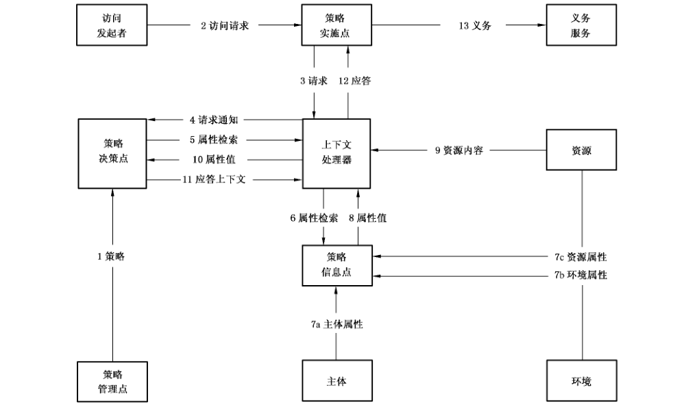

该模型包括以下步骤：

<ol class="standard-subclauses">
<li>1） PAP编写策略和策略集并提供给 PDP。这些策略或者策略集代表了特定目标的完整策略。</li>
<li>2） 访问请求者发送给 PEP一个要访问资源的请求。</li>
<li>3） PEP将请求按照原有格式发送给上下文处理器，请求中可能包含主体、资源、动作和环境的属性信息。</li>
<li>4） 上下文处理器构造 XACML 请求并将其发送给PDP。</li>
<li>5） PDP 向上下文处理器请求其所需的其他主体、资源、动作和环境属性。</li>
<li>6） 上下文处理器向 PIP 请求上述属性信息。</li>
<li>7） PIP 获得请求的属性。</li>
<li>8） PIP 返回请求的属性给上下文处理器。</li>
<li>9） 上下文处理器将所获得的资源加入上下文中（可选）。</li>
<li>10） 上下文处理器将所获得的属性和资源（可选）发送至 PDP,PDP 评估策略。</li>
<li>11） PDP 将包括授权决策在内的应答上下文返回给上下文处理器。</li>
<li>12） 上下文处理器将应答上下文转换成 PEP 能理解的格式，并发送给 PEP。</li>
<li>13） PEP完成规定的义务操作。</li>
<li>14） 如果访问被允许则PEP 允许对资源的访问，否则拒绝该访问（图1中未显示）。</li>
</ol>

### 6.2 XACML上下文

XACML上下文将核心语言和应用环境隔离开。图2所示的灰色区域为 XACML 标准的覆盖范围。XACML上下文由 XML模式定义，描述 PDP 的输入和输出的规范表述形式。XACML 策略中引用的属性可能以 XPath 形式在上下文中表示，或者表示成主体、资源、动作、环境分别对应的属性指示器和其属性标识、属性数据类型、属性发布者（可选）。具体的应用实施应对应用环境中的属性表达方式和 XACML上下文中的属性表达方式进行转换，但转换细节超出本标准的定义内容。一些应用如SAML，能通过XSLT自动完成这种转换。

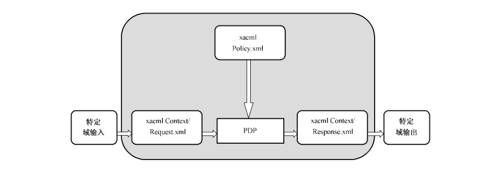

### 6.3 策略语言模型

#### 6.3.1 模型概述

如图3所示，策略语言模型的主要组件是：

- 规则；
- 策略；
- 策略集。

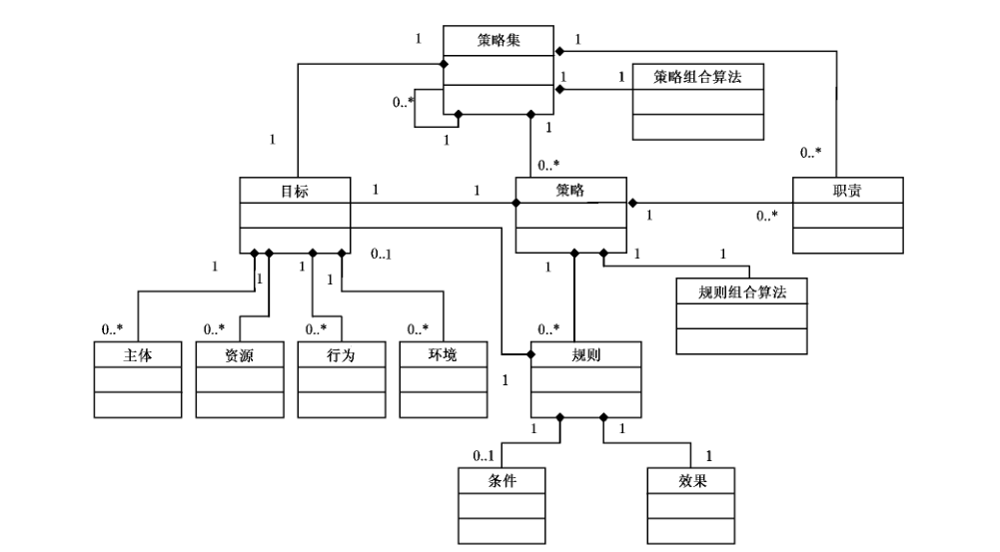

#### 6.3.2 规则

##### 6.3.2.1 概述

规则是策略的最基本单元。规则能仅限定于 XACML 域中的一个参与者。为了在参与者之间交换规则，他们应被包装为一个策略。规则的组件主要包括目标、结果、条件。

##### 6.3.2.2 规则目标

目标定义了资源、主体、动作、环境集合。

`<Condition>`条件元素能进一步增强目标建立的适用性。如果规则要应用到一个特定类型的所有实体，则相关的实体将被目标忽略。PDP 验证请求中的主体，资源，动作和环境属性是否满足目标中定义的匹配。目标的定义是不连续的，目的是适用的规则能被 PDP 更有效的识别。

一个规则可以不包含目标元素。这种情况下，规则的目标和父策略元素的目标相同。

某些主体名称形式、资源名称形式和特定类型的资源是结构相关的。例如 RFC822是针对主体的结构化命名形式，而 UNIX文件系统命名形式和 URIs都是针对资源的结构化命名形式。XML 文档也是一种结构化的资源。

通常，在一个结构化的命名形式里的节点（不能是叶节点）的名字也是一个命名形式的合法实例。

非叶节点的主体名称只能在“match”操作中使用（如

`urn:oasis:names:tc:xacml:1.0:function:rfc822Name-match`），而不能在“equal”操作中使用（如

`urn:oasis:names:tc:xacml:1.0:function:rfc822Name-equal`），见附录 A。

##### 6.3.2.3 结果

规则的结果表明了规则制定者对于规则评估为真的预期的结果。结果值可能为“Permit”或者“Deny”。

##### 6.3.2.4 条件

条件描述了加在目标断言之上加强规则适用性的布尔表达式。

#### 6.3.3 策略

##### 6.3.3.1 概述

一个策略由4个主要的部分组成：目标、规则组合算法标识符、一组规则、义务。

##### 6.3.3.2 策略目标

XACML 中的`<PolicySet>`， `<Policy>`或者`<Rule>`元素包含一个`<Target>`元素，该元素定义了应用策略或者规则的特定主体，资源，动作和环境集合。`<PolicySet>`、`<Policy>`元素的`<Target>`元素可能由`<PolicySet>``<Policy>`的编写者定义，也有可能从包含`<Target>`元素的`<PolicySet>``<Policy>`和`<Rule>`元素的`<Target>`元素计算得出。

XACML 并没有定义系统实体如何计算`<Target>`，以下是两种可能被使用的方法：——方法一：外部`<PolicySet>`、`<Policy>`的`<Target>`元素通过计算内部`<PolicySet>`、`<Policy>`和`<Rule>`元素的并集得到；

——方法二：外部组件的`<Target>`元素能通过计算所有内部组件的`<Target>`元素交集得到。

两种方法的评估结果是非常不同的：第一种情况，外部组件的`<Target>`元素适用所有满足至少一个内部组件`<Target>`元素的决策请求；第二种情况，外部组件的`<Target>`仅仅适用于满足所有内部组件`<Target>`元素的决策请求。只有在目标数据模型相对简单的情况下，计算`<Target>`元素的交集才是实际可行的。

假如策略编写者声明了`<Policy>`元素的`<Target>`元素，则这个`<Policy>`元素中的任何含有相同`<Target>`元素的`<Rule>`元素将忽略掉`<Target>`元素。这些`<Rule>`元素从包含他们的`<Policy>`元素继承`<Target>`。

##### 6.3.3.3 规则组合算法

规则组合算法定义了对规则评估结果进行组合从而产生策略评估结果的方法。PDP应答的决策值是由规则组合算法计算的策略评估值。策略可以含有影响规则组合算法操作的组合参数。

##### 6.3.3.4 义务

义务可以由策略编写者添加。

当 PDP 评估包括义务的策略时，它通过应答返回特定的义务给 PEP。

#### 6.3.4 策略集

##### 6.3.4.1 概述

策略集包含4个主要的部分：目标、策略组合算法标识符、策略集、义务。

##### 6.3.4.2 策略组合算法

策略组合算法定义了评估策略集时组合策略评估结果的方法。PDP 应答的决策值是由策略组合算法计算的策略集评估结果。策略集可以含有影响策略组合算法操作的参数。

##### 6.3.4.3 义务

策略集的编写者能为策略集增加义务。当 PDP 评估包含义务的策略集时，它通过应答返回给 PEP特定的义务。

## 7 策略语法

> 转写注：本章 XML 示例按原版恢复；7.3、7.23、7.45 等示例原有弯引号，以及 7.30 的结构均保留。文字中的 `Enviroment`、`ConminerParametersType`、`ConbinerParameterType` 等原版拼写也予以保留。

### 7.1 〈PolicySet〉元素

`<PolicySet>`元素是 XACML 描述框架的顶层元素。`<PolicySet>`是其他策略集和策略的集合。策略集可能直接使用`<PolicySet>`元素包含一个策略集，或者使用`<PolicySetIdReference>`间接包含策略集。`<PolicySet>`元素能使用`<Policy>`元素直接包含策略，或者使用`<PolicyIdReference>`间接引用策略。

`<PolicySet>`可以被评估，评估过程见 9.11。

如果`<PolicySet>`元素包含 URL形式的其他策略和策略集的引用，那么这些引用应能被解析。

`<PolicySet>`元素包含的策略集和策略应使用由 PolicyCombiningAlgId 属性标识的算法组合起来。

所有的策略组合算法将其中包含的`<PolicySet>`元素看作`<Policy>`元素。如果`<PolicySet>`元素包含的`<Target>`元素匹配请求上下文，那么`<PolicySet>`元素可能被PDP使用来产生授权决策。

`<Obligations>`元素包含义务集合，PEP 在执行授权决策的同时应将它们一起执行。如果 PEP 不理解，或者不能执行集合中的任何一个义务，那么 PEP认为 PDP返回了“Deny”授权决策。

`<PolicySet>`元素及其类型定义如下：

```xml
<xs:element name="PolicySet" type="xacml:PolicySetType"/>
<xs:complexType name="PolicySetType">
<xs:sequence>
 <xs:element ref="xacml:Description" minOccurs="0"/>
 <xs:element ref="xacml:PolicySetDefaults" minOccurs="0"/>
 <xs:element ref="xacml:Target"/>
 <xs:choice minOccurs="0" maxOccurs="unbounded">
  <xs:element ref="xacml:PolicySet"/>
  <xs:element ref="xacml:Policy"/>
  <xs:element ref="xacml:PolicySetIdReference"/>
  <xs:element ref="xacml:PolicyIdReference"/>
  <xs:element ref="xacml:CombinerParameters"/>
  <xs:element ref="xacml:PolicyCombinerParameters"/>
  <xs:element ref="xacml:PolicySetCombinerParameters"/>
 </xs:choice>
 <xs:element ref="xacml:Obligations" minOccurs="0"/>
</xs:sequence>
<xs:attribute name="PolicySetId" type="xs:anyURI" use="required"/>
<xs:attribute name="Version" type="xacml:VersionType" default="1.0"/>
<xs:attribute name="PolicyCombiningAlgId" type="xs:anyURI" use="required"/>
</xs:complexType>
```

`<PolicySet>`元素是 PolicySetType 复合类型，包含以下属性和元素：PolicySetId［必需］策略集标识符。PAP有责任保证PDP 看到的任何两个策略都没有相同的标识符。这能通过预定义的URN或者 URI框架来实现。如果策略集标识符是URL.形式，则它是可解析的。

Version［默认 1.0］策略集的版本PolicyCombiningAlgId［必需］组合`<PolicySet>`、`<CombinerParameters>`、`<PolicyCombinerParameters>`和`<PolicySetCombinerParameters>`元素的策略组合算法的标识符。标准的组合算法标识符见 B.9。标准的策略组合算法见附录C。

`<Description>`［可选］策略集的自由格式描述。

`<PolicySetDefaults>`［可选］适用于策略集的默认值集。`<PolicySetDefaults>`元素的范围是策略集内部。

`<Target>`［必需］策略集适用的决策请求的集合。`<Target>`元素可能由策略集制定者制定，也能从引用的`<Policy>`元素的`<Target>`元素计算得出，计算结果是这些元素的交集或并集。

`<PolicySet>`［任意数量］策略集包含的策略集。

`<Policy>`［任意数量］策略集包含的策略。

`<PolicySetIdReference>`［任意数量］一个策略集的引用。被引用的策略集应包含在这个策略集中，如果是 URL，则应是可解析的。

`<PolicyIdRefrence>`［任意数量］一个策略的引用。被引用的策略应包含在这个策略集中，如果是 URL，则应能解析。

`<Obligations>`［可选］包含`<Obligation>`元素集合。

`<CombinerParameters>`［可选］包含一个`<CombinerParameter>`元素序列。

`<PolicyCombinerParameters>`［可选］包含一个`<CombinerParameter>`元素序列，这些元素和`<PolicySet>`元素包含的特定`<Policy>`和`<PolicyReference>`元素相关。

`<PolicySetCombinerParameters>`［可选］包含一个`<CombinerParameter>`元素序列，这些元素和`<PolicySet>`元素包含的特定`<PolicySet>`和 `<PolicySetReference>`元素相关。

### 7.2 〈Description〉元素

`<Description>`元素包含对`<PolicySet>`、`<Policy>`或`<Rule>`元素的自由形式的描述。其元素及类型定义如下：

```xml
<xs:element name="Description" type="xs:string"/>
```

`<Description>`元素是 xs:string 简单类型。

### 7.3 〈PolicySetDefaults〉元素

`<PolicySetDefaults>`元素定义应用到`<PolicySet>`元素的默认值，其元素及其类型定义如下：

```xml
<xs:element name="PolicySetDefaults" type="xacml:DefaultsType"/>
<xs:complexType name=“DefaultsType”>
<xs:sequence>
 <xs:choice>
  <xs:element ref=“xacml:XPathVersion” minOccurs=“0”/>
 </xs:choice>
</xs:sequence>
</xs:complexType>
```

`<PolicySetDefaults>`元素是 DefaultsType 复合类型，包含以下元素：`<XpathVersion>`［可选］默认的Xpath 版本。

### 7.4 〈XpathVersion〉元素

`<XPathVersion>`元素应指定策略集和策略中`<AttributeSelector>`元素使用的 Xpath 规范的版本，其元素及其类型定义如下：

```xml
<xs:element name="XPathVersion" type="xs:anyURI"/>
```

Xpath1.0规范的 URI是 `http://www.w3.org/TR/1999/Rec-xpath-19991116`。如果策略集和策略包含`<AttributeSelector>`元素或基于 Xpath 的函数，则必须包含`<XpathVersion>`元素。

### 7.5 〈Target〉元素

`<Target>`元素标识了父元素要评估的决策请求的集合。`<Target>`元素应作为`<PolicySet>`和`<Policy>`元素的子元素，也可以作为`<Rule>`元素的子元素。它包含主体，资源，动作和环境定义。

`<Target>`元素应包含一个`<Subjects>`， `<Resources>`， `<Actions>`和`<Environments>`元素的合取序列。

若要`<Target>`的父元素适用于决策请求，`<Target>`元素和`<xacml-context:Request>`元素中的对应部分至少有一组完全匹配。

`<Target>`元素及其类型定义如下：

```xml
<xs:element name="Target" type="xacml:TargetType"/>
<xs:complexType name="TargetType">
<xs:sequence>
 <xs:element ref="xacml:Subjects" minOccurs="0"/>
 <xs:element ref="xacml:Resources" minOccurs="0"/>
 <xs:element ref="xacml:Actions" minOccurs="0"/>
 <xs:element ref="xacml:Environments" minOccurs="0"/>
</xs:sequence>
</xs:complexType>
```

`<Target>`元素的类型是 TargetType 复合类型，包含以下元素：`<Subjects>`［可选］上下文中主体属性的匹配说明。如果缺少此元素，则目标匹配所有主体。

`<Resources>`［可选］上下文中资源属性的匹配说明。如果缺少此元素，则目标匹配所有资源。

`<Actions>`［可选］上下文中动作属性的匹配说明。如果缺少此元素，则目标匹配所有动作。

`<Enviroment>`［可选］上下文中环境属性的匹配说明。如果缺少此元素，则目标匹配所有环境。

### 7.6 〈Subjects〉元素

`<Subjects>`元素包含`<Subject>`元素的析取序列，其元素及其类型定义如下：

```xml
<xs:element name="Subjects" type="xacml:SubjectsType"/>
<xs:complexType name="SubjectsType">
  <xs:sequence>
    <xs:element ref="xacml:Subject" maxOccurs="unbounded"/>
  </xs:sequence>
</xs:complexType>
```

`<Subjects>`元素类型是 SubjectsType 复合类型，包含以下元素：

- `<Subject>`［一个或多个，必需］

### 7.7 〈Subject〉元素

`<Subject>`元素包含一个`<SubjectMatch>`元素的合取序列，其元素及其类型定义如下：

```xml
<xs:element name="Subject" type="xacml:SubjectType"/>
<xs:complexType name="SubjectType">
  <xs:sequence>
    <xs:element ref="xacml:SubjectMatch" maxOccurs="unbounded"/>
  </xs:sequence>
</xs:complexType>
```

`<Subject>`元素类型是 SubjectType 复合类型，包含以下元素：

- `<SubjectMatch>`［一个或多个］

### 7.8 〈SubjectMatch〉元素

`<SubjectMatch>`元素通过匹配内含的属性值和请求上下文中`<xacml-context:Subject>`元素的主体属性来确定一个主体相关的实体集合，其元素及其类型定义如下：

```xml
<xs:element name="SubjectMatch" type="xacml:SubjectMatchType"/>
<xs:complexType name="SubjectMatchType">
  <xs:sequence>
    <xs:element ref="xacml:AttributeValue"/>
    <xs:choice>
      <xs:element ref="xacml:SubjectAttributeDesignator"/>
      <xs:element ref="xacml:AttributeSelector"/>
    </xs:choice>
  </xs:sequence>
  <xs:attribute name="MatchId" type="xs:anyURI" use="required"/>
</xs:complexType>
```

`<SubjectMatch>`元素类型 SubjectMatchType 复合类型，包含下列属性和元素：MatchId［必需］指定匹配函数。这个属性的值应是9.6 中 xs:anyURI 类型的合法值。

`<xacml:AttributeValue>`［必需］内含的属性值。

`<SubjectAttributeDesignator>`［必需，选项］能用来确定请求上下文中`<Subject>`元素包含的一个或多个主体属性值。

- `<AttributeSelector>`［必需，选项］能用来确定请求上下文中的一个或多个属性值。Xpath 表达式应解析成请求上下文中`<Subject>`元素包含的主体属性。

### 7.9 〈Resources〉元素

`<Resources>`元素包含一个`<Resource>`元素的析取序列，其元素及其类型定义如下：

```xml
<xs:element name="Resources" type="xacml:ResourcesType"/>
<xs:complexType name="ResourcesType">
  <xs:sequence>
    <xs:element ref="xacml:Resource" maxOccurs="unbounded"/>
  </xs:sequence>
</xs:complexType>
```

`<Resources>`元素类型是 ResourcesType 复合类型，包含以下元素：

- `<Resource>`［一个或多个，必需］

### 7.10 〈Resource〉元素

`<Resource>`元素包含一个`<ResourceMatch>`元素的合取序列，其元素及其类型定义如下：

```xml
<xs:element name="Resource" type="xacml:ResourceType"/>
<xs:complexType name="ResourceType">
  <xs:sequence>
    <xs:element ref="xacml:ResourceMatch" maxOccurs="unbounded"/>
  </xs:sequence>
</xs:complexType>
```

`<Resource>`元素类型是 ResourceType 复合类型，包含以下元素：

- `<ResourceMatch>`［一个或多个］

### 7.11 〈ResourceMatch〉元素

`<ResourceMatch>`元素通过匹配内含的属性值和请求上下文中`<xacml-context:Resource>`元素的资源属性值来确定一个资源相关的实体集合，其元素及其类型定义如下：

```xml
<xs:element name="ResourceMatch" type="xacml:ResourceMatchType"/>
<xs:complexType name="ResourceMatchType">
  <xs:sequence>
    <xs:element ref="xacml:AttributeValue"/>
    <xs:choice>
      <xs:element ref="xacml:ResourceAttributeDesignator"/>
      <xs:element ref="xacml:AttributeSelector"/>
    </xs:choice>
  </xs:sequence>
  <xs:attribute name="MatchId" type="xs:anyURI" use="required"/>
</xs:complexType>
```

`<ResourceMatch>`元素类型为 ResourceMatchType 复合类型，包含下列属性和元素：MatchId［必需］指定匹配函数。这个属性的值应是9.6 中 xs:anyURI 类型的合法值。

`<xacml:AttributeValue>`［必需］内含的属性值。

`<ResourceAttributeDesignator>`［必需］能用来确定请求上下文中`<Resource>`元素包含的一个或多个资源属性值。

- `<AttributeSelector>`［必需］能用来确定请求上下文中的一个或多个属性值。Xpath 表达式应解析成请求上下文中`<Resource>`元素包含的资源属性。

### 7.12 〈Actions〉元素

`<Actions>`元素包含一个`<Action>`元素的析取序列，其元素及其类型定义如下：

```xml
<xs:element name="Actions" type="xacml:ActionsType"/>
<xs:complexType name="ActionsType">
  <xs:sequence>
    <xs:element ref="xacml:Action" maxOccurs="unbounded"/>
  </xs:sequence>
</xs:complexType>
```

`<Actions>`元素类型是 ActionsType 复合类型，包含以下元素：`<Action>`［一个或多个，必需］

### 7.13 〈Action〉元素

`<Action>`元素包含一个`<ActionMatch>`元素的合取序列，其元素及其类型定义如下：

```xml
<xs:element name="Action" type="xacml:ActionType"/>
<xs:complexType name="ActionType">
  <xs:sequence>
    <xs:element ref="xacml:ActionMatch" maxOccurs="unbounded"/>
  </xs:sequence>
</xs:complexType>
```

`<Action>`元素类型是 ActionType 复合类型，包含以下元素：

- `<ActionMatch>`［一个或多个］

### 7.14 〈ActionMatch）元素

`<ActionMatch>`元素通过匹配内含的属性值和请求上下文中`<xacml-context:Action>`元素包含的动作属性值来确定一个动作相关的实体集合，其元素及其类型定义如下：

```xml
<xs:element name="ActionMatch" type="xacml:ActionMatchType"/>
<xs:complexType name="ActionMatchType">
  <xs:sequence>
    <xs:element ref="xacml:AttributeValue"/>
    <xs:choice>
      <xs:element ref="xacml:ActionAttributeDesignator"/>
      <xs:element ref="xacml:AttributeSelector"/>
    </xs:choice>
  </xs:sequence>
  <xs:attribute name="MatchId" type="xs:anyURI" use="required"/>
</xs:complexType>
```

`<ActionMatch>`元素类型 ActionMatchType 复合类型，包含下列属性和元素：MatchId［必需］指定匹配函数。这个属性的值应是9.6中 xs:anyURI类型的合法值。

`<xacml:AttributeValue>`［必需］内含的属性值。

`<ActionAttributeDesignator>`［必需，选项］能用来确定请求上下文中`<Action>`元素包含的一个或多个动作属性值。

- `<AttributeSelector>`［必需，选项］能用来确定请求上下文中的一个或多个属性值。Xpath 表达式应解析成请求上下文中`<Action>`元素包含的动作属性。

### 7.15 〈Environments〉元素

`<Environments>`元素包含一个`<Environment>`元素的析取序列，其元素及其类型定义如下：

```xml
<xs:element name="Environments" type="xacml:EnvironmentsType"/>
<xs:complexType name="EnvironmentsType">
  <xs:sequence>
    <xs:element ref="xacml:Environment" maxOccurs="unbounded"/>
  </xs:sequence>
</xs:complexType>
```

`<Environments>`元素类型是 EnvironmentsType 复合类型，包含以下元素：

- `<Environment>`［一个或多个，必需］

### 7.16 〈Environment〉元素

`<Environment>`元素应包含一个`<EnvironmentMatch>`元素的合取序列，其元素及其类型定义如下：

```xml
<xs:element name="Environment" type="xacml:EnvironmentType"/>
<xs:complexType name="EnvironmentType">
  <xs:sequence>
    <xs:element ref="xacml:EnvironmentMatch" maxOccurs="unbounded"/>
  </xs:sequence>
</xs:complexType>
```

`<Environment>`元素类型是 EnvironmentType 复合类型，包含以下元素：`<EnvironmentMatch>`［一个或多个］

### 7.17 〈EnvironmentMatch〉元素

`<EnvironmentMatch>`元素通过匹配内含的属性值和请求上下文中`<xacml-context:Environment>`元素包含的环境属性值来确定一个环境相关的实体集合，其元素及其类型定义如下：

```xml
<xs:element name="EnvironmentMatch" type="xacml:EnvironmentMatchType"/>
<xs:complexType name="EnvironmentMatchType">
  <xs:sequence>
    <xs:element ref="xacml:AttributeValue"/>
    <xs:choice>
      <xs:element ref="xacml:EnvironmentAttributeDesignator"/>
      <xs:element ref="xacml:AttributeSelector"/>
    </xs:choice>
  </xs:sequence>
  <xs:attribute name="MatchId" type="xs:anyURI" use="required"/>
</xs:complexType>
```

`<EnvironmentMatch>`元素类型为 EnvironmentMatchType 复合类型，包含下列属性和元素：MatchId［必需］指定匹配函数。这个属性的值应是9.6 中 xs:anyURI 类型的合法值。

`<xacml:AttributeValue>`［必需］内含的属性值。

`<EnvironmentAttributeDesignator>`［必需］能用来确定请求上下文中`<Environment>`元素的一个或多个属性值。

`<AttributeSelector>`［必需］能用来确定请求上下文中的一个或多个属性值。Xpath 表达式应解析成请求上下文中`<Environment>`元素包含的环境属性。

### 7.18 〈PolicySetIdReference〉元素 {#718-policysetldreference元素}

`<PolicySetIdReference>`元素通过id 引用一个`<PolicySet>`元素。如果`<PolicySetIdReference>`是一个 URL.则它能解析得到一个`<PolicySet>`元素。但是解析策略集引用的机制超出本标准的讨论范围。

其元素及其类型定义如下：

```xml
<xs:element name="PolicySetIdReference" type="xacml:IdReferenceType"/>
<xs:complexType name="IdReferenceType">
  <xs:simpleContent>
    <xs:extension base="xs:anyURI">
      <xs:attribute name="xacml:Version" type="xacml:VersionMatchType" use="optional"/>
      <xs:attribute name="xacml:EarliestVersion" type="xacml:VersionMatchType" use="optional"/>
      <xs:attribute name="xacml:LatestVersion" type="xacml:VersionMatchType" use="optional"/>
    </xs:extension>
  </xs:simpleContent>
</xs:complexType>
```

`<PolicySetIdReference>`元素类型 xacml:IdReferenceType 复合类型，通过以下属性扩展 xs：anyURI 类型：Version［可选］指定引用策略集的版本匹配表达式。

EarliestVersion［可选］指定引用策略集适用的最早版本的匹配表达式。

LatestVersion［可选］指定引用策略集适用的最新版本的匹配表达式。

被引用的策略集必须匹配所有的表达式，匹配方法见7.21。如果所有的属性都没有，则使用任何版本的策略集均可。如果能获得匹配的多个版本，则应使用最新的一个。

### 7.19 〈PolicyIdReference）元素 {#719-policyldreference元素}

`<PolicyIdReference>`元素通过id 引用一个`<Policy>`元素。如果`<PolicyIdReference>`是一个 URL，则它能解析得到一个`<Policy>`元素，但是解析策略引用的机制不属于本标准的讨论范围。

`<PolicyIdReference>`元素其元素及其类型定义如下：

```xml
<xs:element name="PolicyIdReference" type="xacml:IdReferenceType"/>
```

`<PolicyIdReference>`元素类型 xacml:IdReferenceType 复合类型。

### 7.20 VersionType 简单类型

此类型元素包含策略或者策略集的版本数字，其类型定义如下：

```xml
<xs:simpleType name="VersionType">
  <xs:restriction base="xs:string">
    <xs:pattern value="(\d+\.)*\d+"/>
  </xs:restriction>
</xs:simpleType>
```

版本号应表示为一个十进制数序列，并以“.”分隔。一个数字代表一个直接的数字匹配。“d”表示一个或多个十进制数位。

### 7.21 VesionMatchType 简单类型

此类型包含一个匹配版本号的受限正则表达式。表达式应匹配被引用策略或策略集的版本，并且该版本接受引用。

其类型定义如下：

```xml
<xs:simpleType name="VersionMatchType">
  <xs:restriction base="xs:string">
    <xs:pattern value="((\d+|\*)\.)*(\d+|\*|\+)"/>
  </xs:restriction>
</xs:simpleType>
```

版本匹配用“.”分隔，像一个版本字符串。一个数字表示了直接的数字匹配。“*”表示任何单个数字都是有效的。“+”表示任何数字和任何数字序列都是有效的。

### 7.22 〈Policy〉元素

`<Policy>`元素是提交给 PDP 评估的最小实体。应使用9.10定义的过程对`<Policy>`元素进行评估。

`<Policy>`元素包含一个`<VariableDefinition>`和`<Rule>`元素之间的选择序列。

`<Policy>`元素包含的规则集应通过 RuleCombiningAlgId 属性指定的算法进行组合。

`<Policy>`元素及其类型定义如下：

```xml
<xs:element name="Policy" type="xacml:PolicyType"/>
<xs:complexType name="PolicyType">
<xs:sequence>
 <xs:element ref="xacml:Description" minOccurs="0"/>
 <xs:element ref="xacml:PolicyDefaults" minOccurs="0"/>
 <xs:element ref="xacml:CombinerParameters" minOccurs="0"/>
 <xs:element ref="xacml:Target"/>
 <xs:choice maxOccurs="unbounded">
  <xs:element ref="xacml:CombinerParameters" minOccurs="0"/>
  <xs:element ref="xacml:RuleCombinerParameters" minOccurs="0"/>
  <xs:element ref="xacml:VariableDefinition"/>
  <xs:element ref="xacml:Rule"/>
 </xs:choice>
 <xs:element ref="xacml:Obligations" minOccurs="0"/>
</xs:sequence>
<xs:attribute name="PolicyId" type="xs:anyURI" use="required"/>
<xs:attribute name="Version" type="xacml:VersionType" default="1.0"/>
<xs:attribute name="RuleCombiningAlgId" type="xs:anyURI" use="required"/>
</xs:complexType>
```

`<Policy>`元素的类型为 PolicyType 复合类型，包含以下属性和元素：PolicyId［必需］策略标识符。PAP有责任保证 PDP 可见的任何两个策略都具有不同的标识符。这能通过附上预定义的URN或者 URI来实现。如果策略标识符是 URL. 形式，则它应是可解析的。

Version［默认 1.0］策略的版本号。

RuleCombiningAlgId［必需］规则组合算法的标识符。`<Policy>`，`<CombinerParameters>` 和`<RuleCombinerParameters>`元素应使用这个算法来组合。

`<Description>`［可选］策略的自由形式描述。

`<PolicyDefaults>`［可选］定义适用于策略的默认值集。`<PolicyDefaults>`元素的范围应限定在策略内。

`<CombinerParameters>`［可选］规则组合算法使用的参数序列。

`<RuleCombinerParameters>`［可选］规则组合算法使用的参数序列。

`<Target>`［必需］`<Target>`元素定义了策略对于决策请求集的适用性。`<Target>`元素能由策略编写者指定，也能通过对`<Rule>`元素中包含的`<Target>`元素计算交集或者并集得出。

`<VariableDefinition>`［任意］通用函数定义。能从规则的任意位置引用。

- `<Rule>`［任意］应按照 RuleCombiningAlgId 属性指定的组合算法组合规则序列。目标元素匹配决策请求的规则应考虑，目标元素不匹配决策请求的规则应忽略。

`<Obligations>`［可选］义务合取序列。PEP 应将其和授权决策联合执行。

### 7.23 〈Policy Defaults〉元素

`<PolicyDefaults>`元素指定应用到`<Policy>`元素的默认值，其元素及其类型定义如下：

```xml
<xs:element name="PolicyDefaults" type="xacml:DefaultsType"/>
<xs:complexType name=“DefaultsType”>
  <xs:sequence>
    <xs:choice>
      <xs:element ref=“xacml:XPathVersion” minOccurs=“0”/>
    </xs:choice>
  </xs:sequence>
</xs:complexType>
```

`<PolicyDefaults>`元素类型是 DefaultsType 复合类型，包含以下元素：

- `<XpathVersion>`［可选］默认 Xpath 版本。

### 7.24 〈CombinerParameters〉元素

`<CombinerParameters>`元素为策略或者规则组合算法传递参数。

如果多个`<CombinerParameters>`元素出现在同一个策略或者策略集里面，他们应和一个包含了所有这些元素中参数串联序列的`<CombinerParameters>`元素等价，`<CombinerParameters>`元素的顺序在串联后的`<CombinerParameters>`元素中保留。

> 注：本标准中定义的组合算法都是没有参数的。

`<CombinerParameters>`元素及其类型定义如下：

```xml
<xs:element name="CombinerParameters" type="xacml:CombinerParametersType"/>
<xs:complexType name="CombinerParametersType">
  <xs:sequence>
    <xs:element ref="xacml:CombinerParameter" minOccurs="0" maxOccurs="unbounded"/>
  </xs:sequence>
</xs:complexType>
```

`<CombinerParameters>`元素的类型 ConminerParametersType 复合类型，包含以下元素：

- `<CombinerParameter>`［任意］单个参数，参见7.25。

`<CombinerParameters>`元素支持是可选的。

### 7.25 〈CombinerParameter〉元素

`<CombinerParameter>`元素传递单个参数给策略或者规则组合算法，其元素及其类型定义如下：

```xml
<xs:element name="CombinerParameter" type="xacml:CombinerParameterType"/>
<xs:complexType name="CombinerParameterType">
  <xs:sequence>
    <xs:element ref="xacml:AttributeValue"/>
  </xs:sequence>
  <xs:attribute name="ParameterName" type="xs:string" use="required"/>
</xs:complexType>
```

`<CombinerParameter>`元素类型为 ConbinerParameterType 复合类型，包含以下属性：ParameterName［必需］参数的标识符。

AttributeValue ［必需］参数的值。

`<CombinerParameter>`元素支持是可选的。

### 7.26 〈RuleCombinerParameters〉元素

`<RuleCombinerParameters>`元素传递一个和特定规则相关的参数给规则组合算法。

每个`<RuleCombinerParameters>`元素应和同一个策略里的一个规则相关。如果多个`<RuleCombinerParameters>`元素引用了相同的规则，他们应和一个包含了所有这些元素中参数串联序列的`<RuleCombinerParameters>`元素等价，元素的顺序在串联后的`<RuleCombinerParameters>`元素中保留。

`<RuleCombinerParameters>`元素及其类型定义如下：

```xml
<xs:element name="RuleCombinerParameters" type="xacml:RuleCombinerParametersType"/>
<xs:complexType name="RuleCombinerParametersType">
<xs:complexContent>
 <xs:extension base="xacml:CombinerParametersType">
 <xs:attribute name="RuleIdRef" type="xs:string" use="required"/>
 </xs:extension>
</xs:complexContent>
</xs:complexType>
```

`<RuleCombinerParameters>`元素包含以下元素：

- RuleIdRef［必需］策略中`<Rule>`元素的标识符。

只有当 CombinerParameters 支持是可选时，`<RuleCombinerParameters>`元素支持才是可选的。

### 7.27 〈PolicyCombinerParameters〉元素

`<PolicyCombinerParameters>`元素传递一个和特定策略相关的参数给策略组合算法。

每个`<PolicyCombinerParameters>`元素应和同一个策略集里的一个策略相关。如果多个`<PolicyCombinerParameters>`元素引用了相同的策略，他们应和一个包含了所有这些元素中参数串联序列的`<PolicyCombinerParameters>`元素等价，元素的顺序在串联后的`<PolicyCombinerParameters>`元素中保留。

`<PolicyCombinerParameters>`元素及其类型定义如下：

```xml
<xs:element name="PolicyCombinerParameters" type="xacml:PolicyCombinerParametersType"/>
<xs:complexType name="PolicyCombinerParametersType">
  <xs:complexContent>
    <xs:extension base="xacml:CombinerParametersType">
      <xs:attribute name="PolicyIdRef" type="xs:anyURI" use="required"/>
    </xs:extension>
  </xs:complexContent>
</xs:complexType>
```

`<PolicyCombinerParameters>`元素类型 PolicyCombinerParametersType 复合类型，包含以下元素：`<PolicyIdRef>`［必需］策略集中的策略标识符或者`<PolicyIdReference>`元素的值。

只有当 CombinerParameters 支持是可选时，`<PolicyCombinerParameters>`元素支持才是可选的。

### 7.28 〈PolicySetCombinerParameters）元素

`<PolicySetCombinerParameters>`元素传递一个和特定策略集相关的参数给策略组合算法。

每个`<PolicySetCombinerParameters>`元素应和同一个策略集里的一个策略集相关。如果多个`<PolicySetCombinerParameters>`元素引用了相同的策略集，他们应和一个包含了所有这些元素中参数串联序列的`<PolicySetCombinerParameters >`元素等价，元素的顺序在串联后的`<PolicySetCombinerParameters>`元素中保留。

`<PolicySetCombinerParameters>`元素及其类型定义如下：

```xml
<xs:element name="PolicySetCombinerParameters" type="xacml:PolicySetCombinerParametersType"/>
<xs:complexType name="PolicySetCombinerParametersType">
  <xs:complexContent>
    <xs:extension base="xacml:CombinerParametersType">
      <xs:attribute name="PolicySetIdRef" type="xs:anyURI" use="required"/>
    </xs:extension>
  </xs:complexContent>
</xs:complexType>
```

`<PolicySetCombinerParameters>`元素类型 PolicySetCombinerParametersType 复合类型，包含以下元素：

- `<PolicySetIdRef>`［必需］策略集中的策略集标识符或者`<PolicySetIdReference>`元素的值。

只有当 CombinerParameters 支持是可选时，`<PolicySetCombinerParameters>`元素支持才是可选的。

### 7.29 〈Rule〉元素

`<Rule>`元素定义策略里的单个规则。应使用9.10定义的评估过程评估`<Rule>`元素。

`<Rule>`元素及其类型定义如下：

```xml
<xs:element name="Rule" type="xacml:RuleType"/>
<xs:complexType name="RuleType">
  <xs:sequence>
    <xs:element ref="xacml:Description" minOccurs="0"/>
    <xs:element ref="xacml:Target" minOccurs="0"/>
    <xs:element ref="xacml:Condition" minOccurs="0"/>
  </xs:sequence>
  <xs:attribute name="RuleId" type="xs:string" use="required"/>
  <xs:attribute name="Effect" type="xacml:EffectType" use="required"/>
</xs:complexType>
```

`<Rule>`元素类型 RuleType 复合类型，包含以下属性和元素：RuleId［必需］表示规则的标识符。

- Effect［必需］规则效果。这个属性的值为“Permit”或“Deny”。

`<Description>`［可选］规则自由形式的描述。

- `<Target>`［可选］确定`<Rule>`元素需要评估的决策请求的集合。如果缺少该元素，则`<Rule>`元素的目标应由`<Policy>`元素中的`<Target>`元素指定，见9.7。

`<Condition>`［可选］规则被赋予 Effect 值前应满足的断言。

### 7.30 EffectType 简单类型

EffectType 简单类型定义了`<Rule>`元素中 Effect 属性及`<Obligation>`元素中 FulfillOn 属性使用的值。

EffectType类型定义如下：

```xml
<xs:simpleType name="EffectType">
  <xs:restriction base="xs:string"/>
  <xs:enumeration value="Permit"/>
  <xs:enumeration value="Deny"/>
</xs:simpleType>
```

### 7.31 〈VariableDefinition〉元素

`<VariableDefinition>`元素应被用来定义一个被`<VariableReference>`引用的值。其 VariableId 属性名称不应在其所在策略中与其他`<VariableDefinition>`元素的 VariableId 属性名称相同。

`<VariableDefinition>`元素能包含未定义的`<VariableReference>`元素，但相应的`<VariableDefinition>`元素应在同一策略内被定义。`<VariableDefinition>`能成组排列，也能置于策略中的引用附近。对于每个`<VariableDefinition>`元素，能定义零或多个引用。

`<VariableDefinition>`元素及其类型定义如下：

```xml
<xs:element name="VariableDefinition" type="xacml:VariableDefinitionType"/>
<xs:complexType name="VariableDefinitionType">
  <xs:sequence>
    <xs:element ref="xacml:Expression"/>
  </xs:sequence>
  <xs:attribute name="VariableId" type="xs:string" use="required"/>
</xs:complexType>
```

`<VariableDefinition>` 属于 VariableDefinitionType 复合类型，包含以下元素和属性：`<Expression>`［必需］任意 ExpressionType 复合类型的元素。

VariableId［必需］变量定义的名称。

### 7.32 〈VariableReference〉元素

`<VariableReference>`元素用来引`<Policy>`元素中的一个变量定义。`<VariableReference>`元素通过匹配 VariableId 属性的字符串来引用相应的`<VariableDefinition>`元素。在同一`<Policy>`元素中，`<VariableReference>`所引用的`<VariableDefinition>`元素有且只有一个。对于一个`<VariableDefinition>`元素，能存在零或多个`<VariableReference>`元素来引用它。

`<VariableReference>`元素及其类型定义如下：

```xml
<xs:element name="VariableReference" type="xacml:VariableReferenceType" substitutionGroup="xacml:Expression"/>
<xs:complexType name="VariableReferenceType">
  <xs:complexContent>
    <xs:extension base="xacml:ExpressionType">
    <xs:attribute name="VariableId" type="xs:string" use="required"/>
  </xs:extension>
</xs:complexContent>
</xs:complexType>
```

`<VariableReference>`元素属于 VariableReferenceType 复合类型，该类型属于 ExpressionType 复合类型且能置換`<Expression>`元素。`<VariableReference>`能出现在方案中`<Expression>`定义出现的任何位置。

`<VariableReference>`元素包含以下属性：

- VariableId ［必需］用来引用`<VariableDefinition>`元素中定义的名称。

### 7.33 〈Expression〉元素

`<Expression>`不在策略中直接使用。`<Expression>`元素意味着一个元素扩展了 ExpressionType，能置換`<Expression>`元素。

`<Expression>`元素及其类型定义如下：

```xml
<xs:element name="Expression" type="xacml:ExpressionType" abstract="true"/>
<xs:complexType name="ExpressionType" abstract="true"/>
```

下列元素是`<Expression>`元素的置换组成员：`<Apply>`、 `<AttributeSelector>`、 `<AttributeValue>`、 `<Function>`、 `<VariableReference>`、 `<ActionAttributeDesignator>`，`<ResourceAttributeDesignator>`， `<SubjectAttributeDesignator>` 和`<EnvironmentAttributeDesignator>`。

### 7.34 〈Condition〉元素

`<Condition>`元素是作用于主体、资源、动作和环境属性或属性函数之上的一个布尔型函数，应使用9.9中描述的方法对其进行评估。其元素及类型定义如下：

```xml
<xs:element name="Condition" type="xacml:ConditionType"/>
<xs:complexType name="ConditionType">
  <xs:sequence>
    <xs:element ref="xacml:Expression"/>
  </xs:sequence>
</xs:complexType>
```

`<Condition>`包含一个`<Expression>`元素且`<Expression>`的返回数据类型应为“`http://www.w3.org/2001/XMLSchema#boolean`”。

### 7.35 〈Apply〉元素

`<Apply>`元素指定一个函数的应用，并对函数调用过程进行编码。`<Apply>`元素能应用于`<Expression>`元素置换组成员的任意组合，见7.33。其元素及类型定义如下：

```xml
<xs:element name="Apply" type="xacml:ApplyType" substitutionGroup="xacml:Expression"/>
<xs:complexType name="ApplyType">
  <xs:complexContent>
    <xs:extension base="xacml:ExpressionType">
      <xs:sequence>
        <xs:element ref="xacml:Expression" minOccurs="0" maxOccurs="unbounded"/>
      </xs:sequence>
    <xs:attribute name="FunctionId" type="xs:anyURI" use="required"/>
  </xs:extension>
</xs:complexContent>
</xs:complexType>
```

`<Apply>`属于 ApplyType 复合类型，包含以下元素和属性：

- FunctionId［必需］函数标识符。XACML 中定义的函数列表参见附录 A。

- `<Expression>`［可选］函数的参数，可能包含其他函数。

### 7.36 〈Function〉元素

`<Function>`元素为其父元素`<Apply>`指定一个函数参数。如果`<Apply>`元素是高阶包函数（见附录A3.12），则`<Function>`指定的函数参数被应用于包中的所有元素。

`<Function>`元素及类型定义如下：

```xml
<xs:element name="Function" type="xacml:FunctionType" substitutionGroup="xacml:Expression"/>
<xs:complexType name="FunctionType">
  <xs:complexContent>
    <xs:extension base="xacml:ExpressionType">
      <xs:attribute name="FunctionId" type="xs:anyURI" use="required"/>
    </xs:extension>
  </xs:complexContent>
</xs:complexType>
```

Function 属于 FunctionType 复合类型，包含以下属性：

- FunctionId［必需］函数的标识符。

### 7.37 AttributeDesignatorType 复合类型

AttributeDesignatorType 复合类型元素通过名称指定具体属性，包括匹配请求上下文中属性的所需信息（见9.3.4）。当上下文中不包含匹配属性时，该类型元素描述行为控制信息。

本类型的元素不应改变命名属性的匹配语义，但能缩小搜索空间。

AttributeDesignatorType 类型定义如下：

```xml
<xs:complexType name="AttributeDesignatorType">
<xs:complexContent>
  <xs:extension base="xacml:ExpressionType">
    <xs:attribute name="AttributeId" type="xs:anyURI" use="required"/>
    <xs:attribute name="DataType" type="xs:anyURI" use="required"/>
    <xs:attribute name="Issuer" type="xs:string" use="optional"/>
    <xs:attribute name="MustBePresent" type="xs:boolean" use="optional" default="false"/>
  </xs:extension>
</xs:complexContent>
</xs:complexType>
```

如果各自的 AttributeId、DataType 和 Issuer 属性相匹配，则命名属性应被认为是匹配的。属性指定器的 AttributeId 和 DataType 通过URI 相等的方式和命名属性进行匹配。

如果属性指定器中存在 Issuer，应通过“`urn:oasis:names:tc:xacml:1.0:function:string-equal`”函数对其进行匹配。如果不存在 Issuer，则匹配结果由 AttributeId 和 DataType 决定。

`<AttributeDesignatorType>`包含以下属性：

- AttributeId［必需］指定属性匹配中的 AttributeId。

DataType［必需］`<AttributeDesignator>`元素返回包中属性值的数据类型。

Issuer［可选］本属性如果存在，则指定属性的颁发者。

MustBePresent ［可选］本属性决定在请求上下文中缺少要匹配的属性时，是否返回“Indeterminate”或空的包。参见9.3.5、9.16.2 和 9.16.3。

### 7.38 〈SubjectAttributeDesignator〉元素

`<SubjectAttributeDesignator>`元素从请求上下文中取回一个命名分类主体属性的属性值包。主体属性包含在`<Subject>`元素中。由 subject-category 属性定义的主体是分类主体。命名分类主体属性特定分类主体的一个主体属性。

`<SubjectAttributeDesignator>`元素应返回一个包含所有匹配成功的主体属性值包。当没有匹配属性时，MustBePresent 决定返回空包还是“Indeterminate”。见9.3.5。

SubjectAttributeDesignatorType 通过缩小搜索空间扩展了 AttributeDesignatorType（见 7.37）的匹配语义。使用本元素的 SubjectCategory 属性和`<Subject>`元素的 SubjectCategory 属性进行 URI 相等匹配。

如果请求上下文包含多个 SubjectCategory 属性相同的主体，则应被认为是同一类主体。

`<SubjectAttributeDesignator>`能出现在`<SubjectMatch>`元素中并能作为参数传递给`<Apply>`元素。

其元素及类型定义如下：

```xml
<xs:element name="SubjectAttributeDesignator" type="xacml:SubjectAttributeDesignatorType" substitutionGroup="xacml:Expression"/>
<xs:complexType name="SubjectAttributeDesignatorType">
  <xs:complexContent>
    <xs:extension base="xacml:AttributeDesignatorType">
    <xs:attribute name="SubjectCategory" type="xs:anyURI" use="optional" default="urn:oasis:names:tc:xacml:1.0:subject-category:access-subject"/>
    </xs:extension>
  </xs:complexContent>
</xs:complexType>
```

`<SubjectAttributeDesignator>`元素属于 SubjectAttributeDesignatorType 类型，后者通过以下属性扩展了 AttributeDesignatorType 复合类型：SubjectCategory ［可选］本属性指定分类主体。如果 SubjectCategory 没有明确显示，其默认值为“`urn:oasis:names:tc:xacml:1.0:subject-category:access-subject`”。 SubjectCategory 的标准值见附录 B.2。

### 7.39 《ResourceAttributeDesignator〉元素

`<ResourceAttributeDesignator>`元素从请求上下文中取回一个命名资源属性的属性值包。资源属性包含在`<Resource>`元素中。命名资源属性和请求中的资源属性进行匹配。如果至少一个资源属性符合匹配标准集合，则认为存在命名资源属性。资源属性值包含在资源属性中。`<ResourceAttributeDesignator>`元素应返回一个包含所有匹配成功的资源属性值包。当没有匹配属性时，MustBePresent 決定返回空包还是“Indeterminate”包。见 9.3.5。

当 AttributeDesignatorType 复合类型中定义的每个匹配语义都匹配时，认为命名资源属性和上下文中的资源属性匹配。见7.37。

`<ResourceAttributeDesignator>`能出现在`<ResourceMatch>`元素中并能作参数传递给`<Apply>`元素。

`<ResourceAttributeDesignator>`元素及类型定义如下：

```xml
<xs:element name="ResourceAttributeDesignator" type="xacml:AttributeDesignatorType" substitutionGroup="xacml:Expression"/>
```

`<ResourceAttributeDesignator>`元素属于 AttributeDesignatorType 复合类型。

### 7.40 《ActionAttributeDesignator〉元素

`<ActionAttributeDesignator>`元素从请求上下文中取回一个命名动作属性的属性值包。动作属性包含在`<Action>`元素中。命名动作属性和请求中的动作属性进行匹配。如果至少一个动作属性符合匹配标准集合，则认为存在命名动作属性。动作属性值包含在动作属性中。`<ActionAttributeDesignator>`元素应返回一个包含所有匹配成功的动作属性值包。当没有匹配属性时，MustBePresent 决定返回空包还是“Indeterminate”包，见 9.3.5。

当 AttributeDesignatorType复合类型中定义的每个匹配语义都匹配时，认为命名动作属性和上下文中的动作属性匹配。见7.37。

`<ActionAttributeDesignator>`可以出现在`<ActionMatch>`元素中并能作为参数传递给`<Apply>`元素。

`<ActionAttributeDesignator>`元素及类型定义如下：

```xml
<xs:element name="ActionAttributeDesignator" type="xacml:AttributeDesignatorType" substitutionGroup="xacml:Expression"/>
```

`<ActionAttributeDesignator>`元素属于 AttributeDesignatorType 复合类型。

### 7.41 〈EnvironmentAttributeDesignator〉元素

`<EnvironmentAttributeDesignator>`元素从请求上下文中取回一个命名环境属性的属性值包。环境属性包含在`<Environment>`元素中。命名环境属性和请求中的环境属性进行匹配。如果至少一个环境属性符合匹配标准集合，则认为存在命名环境属性。环境属性值包含在环境属性中。`<EnvironmentAttributeDesignator>`元素应返回一个包含所有匹配成功的环境属性值包。当没有匹配属性时，Must- BePresent 决定返回空包还是“Indeterminate”包。见 9.3.5。

当 AttributeDesignatorType 复合类型中定义的每个匹配语义都匹配时，认为命名环境属性和上下文中的环境属性匹配。见7.37。

`<EnvironmentAttributeDesignator>`能作为参数传递给`<Apply>`元素。

`<EnvironmentAttributeDesignator>`元素及类型定义如下：

```xml
<xs:element name="EnvironmentAttributeDesignator" type="xacml:AttributeDesignatorType" substitutionGroup="xacml:Expression"/>
```

`<EnvironmentAttributeDesignator>`元素属于 AttributeDesignatorType 复合类型。

### 7.42 〈AttributeSelector〉元素

`<AttributeSelector>`元素通过属性在请求上下文中的位标记识属性。对`<AttributeSelector>`元素的支持是可选的。

`<AttributeSelector>`元素的 RequestContextPath 属性应包含一个合法的XPath 表达式，其上下文结点为`<xacml-context:Request>`元素。`<AttributeSelector>`元素应返回 DataType 所定义数据类型的属性值包。如果 DataType 为 XQuery、XPath 或 XML Schema 中定义的原始数据类型，则XPath 表达式返回值应使用下列构造函数转化成`<AttributeSelector>`中定义的数据类型。如果使用构造函数时发生错误，则`<AttributeSelector>`的值为“Indeterminate”。


- `xs:string()`
- `xs:boolean()`
- `xs:integer()`
- `xs:double()`
- `xs:dateTime()`
- `xs:date()`
- `xs:time()`
- `xs:hexBinary()`
- `xs:base64Binary()`
- `xs:anyURI()`
- `xf:yearMonthDuration()`
- `xf:dayTimeDuration()`

如果 AttributeSelector 中定义的数据类型不是前述的原始类型，则 AttributeSelector 应返回指定类型的属性值包。如果将 XPath 表达式返回值转化为指定数据类型的过程发生错误，则`<AttributeSelector>`的值为“Indeterminate”。所有被选择的结点应为文本结点、属性结点、处理指令结点或内容结点。每个结点的字符串描述值应被转化为被指定数据类型的属性值，且 AttributeSelector 返回的属性值包中包含所有选定结点生成的属性值。如果选定的结点不是上述结点（例如文本结点、属性结点、处理指令结点或内容结点），则其所在策略的判定结果为“Indeterminate”，并且附带状态编码为“`urn:oasis:names:tc:xacml:1.0:status:syntax-error`”。

`<AttributeSelector>`元素及类型定义如下：

```xml
<xs:element name="AttributeSelector" type="xacml:AttributeSelectorType" substitutionGroup="xacml:Expression"/>
<xs:complexType name="AttributeSelectorType">
  <xs:complexContent>
    <xs:extension base="xacml:ExpressionType">
      <xs:attribute name="RequestContextPath" type="xs:string" use="required"/>
      <xs:attribute name="DataType" type="xs:anyURI" use="required"/>
      <xs:attribute name="MustBePresent" type="xs:boolean" use="optional" default="false"/>
    </xs:extension>
  </xs:complexContent>
</xs:complexType>
```

`<AttributeSelector>`元素属于 AttributeSelectorType 复合类型，包含以下属性：RequestContextPath［必需］上下文结点为`<xacml-context:Request>`的 XPath 表达式，无句法限制，见7.4。

- DataType ［必需］`<AttributeSelector>`元素返回值的数据类型。

MustBePresent［可选］本属性决定在请求上下文中缺少属性时，元素是否返回“Indeterminate”或空的包。见9.3.5、9.16.2 和9.16.3。

### 7.43 〈AttributeValue〉元素

`<xacml:AttributeValue>`元素应包含一个文字属性值，其元素及类型定义如下：

```xml
<xs:element name="AttributeValue" type="xacml:AttributeValueType" substitutionGroup="xacml:Expression"/>
<xs:complexType name="AttributeValueType" mixed="true">
  <xs:complexContent>
    <xs:extension base="xacml:ExpressionType">
      <xs:sequence>
        <xs:any namespace="##any" processContents="lax" minOccurs="0" maxOccurs="unbounded"/>
      </xs:sequence>
      <xs:attribute name="DataType" type="xs:anyURI" use="required"/>
      <xs:anyAttribute namespace="##any" processContents="lax"/>
    </xs:extension>
  </xs:complexContent>
</xs:complexType>
```

`<xacml:AttributeValue>`元素类型为 AttributeValueType 复合类型，包含以下属性：

- DataType［必需］属性值的数据类型。

### 7.44 〈Obligations〉元素

`<Obligations>`元素应包含一个`<Obligation>`元素集，其元素及类型定义如下：

```xml
<xs:element name="Obligations" type="xacml:ObligationsType"/>
<xs:complexType name="ObligationsType">
  <xs:sequence>
    <xs:element ref="xacml:Obligation" maxOccurs="unbounded"/>
  </xs:sequence>
</xs:complexType>
```

`<Obligations>`元素类型 ObligationsType 复合类型，包含以下元素：

- `<Obligation>`［一个或者多个］一个义务序列，参见7.45。

对`<Obligations>`元素的支持是可选的。

### 7.45 〈Obligation〉元素

`<Obligation>`元素应包含义务的标识符和一个构成义务动作参数的属性集，其元素及类型定义如下：

```xml
<xs:element name="Obligation" type="xacml:ObligationType"/>
<xs:complexType name="ObligationType">
  <xs:sequence>
    <xs:element ref="xacml:AttributeAssignment" minOccurs=“0” maxOccurs="unbounded"/>
  </xs:sequence>
  <xs:attribute name="ObligationId" type="xs:anyURI" use="required"/>
  <xs:attribute name="FulfillOn" type="xacml:EffectType" use="required"/>
</xs:complexType>
```

`<Obligation>`元素类型 ObligationType 复合类型，包含以下元素和属性：

- ObligationId［必需］义务标识符。PEP负责解释该标识符。

FulfillOn［必需］义务被 PEP 强制执行的效果。

`<AttributeAssignment>`［可选］义务参数。PEP负责解释参数。

### 7.46 〈AttributeAssignment〉元素

`<AttributeAssignment>`元素定义义务参数。它通过扩展 AttributeValueType 类型包含一个 AttributeId 和对应的属性值。`<AttributeAssignment>`元素由`<xs:any>`元素序列构成，只要符合构造语法，能被任意使用。PEP应理解指定的属性值，见9.15。

`<AttributeAssignment>`元素及类型定义如下：

```xml
<xs:element name="AttributeAssignment" type="xacml:AttributeAssignmentType"/>
<xs:complexType name="AttributeAssignmentType" mixed="true">
  <xs:complexContent>
    <xs:extension base="xacml:AttributeValueType">
      <xs:attribute name="AttributeId" type="xs:anyURI" use="required"/>
    </xs:extension>
  </xs:complexContent>
</xs:complexType>
```

`<AttributeAssignment>`元素类型为 AttributeAssignmentType 复合类型，包含以下属性：AttributeId［必需］属性标识符。

## 8 上下文语法

### 8.1 〈Request〉元素

`<Request>`元素是XACML上下文描述框架的顶层元素，是策略语言使用的抽象层。为表达简便起见，本标准基于上下文上的操作来描述策略评估过程。一个与本标准一致的PDP 不需要实际实现XML 文档形式的上下文，但是其产生的评估结果应与输入被转换成`<xacml-context:Request>`时的结果相同。

`<Request>`元素包含了`<Subjects>`、`<Resources>`、 `<Action>`和`<Enviroment>`子元素。每个子元素包含一个`<xacml-context:Attribute>`元素序列。

`<Request>`元素及类型定义如下：

```xml
<xs:element name="Request" type="xacml-context:RequestType"/>
<xs:complexType name="RequestType">
 <xs:sequence>
  <xs:element ref="xacml-context:Subject" maxOccurs="unbounded"/>
  <xs:element ref="xacml-context:Resource" maxOccurs="unbounded"/>
  <xs:element ref="xacml-context:Action"/>
  <xs:element ref="xacml-context:Environment"/>
 </xs:sequence>
</xs:complexType>
```

`<Request>`元素是 RequestType 类型，包含如下元素：`<Subject>`［一个或者多个］通过一个`<Attribute>`元素序列来描述请求主体的信息。此处能有一个或者多个`<Subject>`。

主体是访问请求相关的实体。例如，一个主体能代表创建访问请求程序的用户；另一个主体能代表创建访问请求程序的可执行代码；一个主体能代表程序运行所在的机器；另一个主体能代表资源的接收者。这些不同实体的属性应被包括在不同的`<Subject>`元素中。

`<Resource>`［一个或者多个］通过一个`<Attribute>`元素序列描述被请求资源的信息。该元素能包含一个`<ResourceContent>`元素。

- `<Action>`［必需］通过一个`<Attribute>`元素序列描述将要施加到资源上的动作信息。

`<Enviroment>`［必需］通过一个`<Attribute>`元素序列描述访问操作发生时的环境信息。

### 8.2 〈Subject〉元素 {#82-subjiect元素}

`<Subject>`元素通过一个`<Atribute>`元素序列描述主体，其元素及类型定义如下：

```xml
<xs:element name="Subject" type="xacml-context:SubjectType"/>
<xs:complexType name="SubjectType">
 <xs:sequence>
  <xs:element ref="xacml-context:Attribute" minOccurs="0" maxOccurs="unbounded"/>
 </xs:sequence>
 <xs:attribute name="SubjectCategory" type="xs:anyURI" default="urn:oasis:names:tc:xacml:1.0:subject-category:access-subject"/>
</xs:complexType>
```

`<Subject>`元素是`<SubjectType>`复合类型，包含如下元素和属性：SubjectCategory ［可选］该属性标识了父`<Subject>`元素在访问请求中所担负的角色。如果该属性不存在，其默认值》“`urn:oasis:names:tc:xacml:1.0:subject-category:access-subject`”，该值说明父`<Subject>`代表了发起访问请求的主体。如果多个`<Subject>`元素包含了“`urn:oasis:names:tc:xacml:1.0:subject-category:access-subject`”属性，PDP 在处理时能将这些`<Subject>`元素中的内容合并到一个`<Subject>`中。

- `<Attribute>`［任意数目］一个主体属性序列。一个`<Subject>`元素能包含一个 AttributeId 內“`urn:oasis:names:tc:xacml:1.0:subject:subject-id`”的属性，该属性描述了主体的标识。一个`<Subject>`元素还能包含其他`<Atrribute>`元素。

### 8.3 〈Resource〉元素

`<Resource>`元素通过一个`<Attribute>`元素序列描述访问请求的资源信息。它能包含资源内容。

`<Resource>`元素及其类型定义如下：

```xml
<xs:element name="Resource" type="xacml-context:ResourceType"/>
<xs:complexType name="ResourceType">
 <xs:sequence>
  <xs:element ref="xacml-context:ResourceContent" minOccurs="0"/>
  <xs:element ref="xacml-context:Attribute" minOccurs="0" maxOccurs="unbounded"/>
 </xs:sequence>
</xs:complexType>
```

`<Resouce>`元素是 ResourceType 复合类型，包含如下元素：`<ResouceContent>`［可选］资源内容。

`<Attribute>`［任意数目］一个资源属性序列。

`<Resource>`元素能包含一个或者多个 AttributeId 內"

`urn:oasis:names:tc:xacml:2.0:resource:resource-id`”的`<Attribute>`元素。每个`<Attribute>`都是一个绝对的完全解析的资源标识。如果资源拥有多个这样的标识，并且请求中包含一个取上述 AttributeId 值的 Attribute 属性，则需要为每一个资源标识给出相应的`<Attribute>`属性。所有这些`<Attribute>`应都描述同一个资源实例。特定的资源轮廓能为每个资源实例指定唯一的资源标识。此时，AttributeId 取该值的`<Attribute>`应只使用此标识。`<Resource>`元素还能包含其他`<Attribute>`元素。

### 8.4 〈ResouceContent〉元素

`<ResouceContent>`元素用于指定资源的内容。如果一个 XACML 策略通过`<AttributeSelector>`引用资源的内容，`<ResourceContent>`元素应被包含在 ResourceContentPath 字符串中，其元素及类型定义如下：

```xml
<xs:complexType name="ResourceContentType" mixed="true">
 <xs:sequence>
  <xs:any namespace="##any" processContents="lax" minOccurs="0" maxOccurs="unbounded"/>
 </xs:sequence>
 <xs:anyAttribute namespace="##any" processContents="lax"/>
</xs:complexType>
```

`<ResourceContent>`元素是 ResourceContentType 复合类型。

`<ResourceContent>`元素允许任意的元素和属性。

### 8.5 〈Action）元素

`<Action>`元素通过一个`<Attribute>`序列指定对资源的访问动作，其元素及类型定义如下：

```xml
<xs:element name="Action" type="xacml-context:ActionType"/>
<xs:complexType name="ActionType">
 <xs:sequence>
  <xs:element ref="xacml-context:Attribute" minOccurs="0" maxOccurs="unbounded"/>
 </xs:sequence>
</xs:complexType>
```

`<Action>`元素是 ActionType复合类型，包含如下元素：

- `<Attribute>`［任意数目］对资源施加的访问动作属性列表。

### 8.6 〈Environment〉元素

`<Environment>`元素包含环境的相关属性，其元素及类型定义如下：

```xml
<xs:element name="Environment" type="xacml-context:EnvironmentType"/>
<xs:complexType name="EnvironmentType">
 <xs:sequence>
  <xs:element ref="xacml-context:Attribute" minOccurs="0" maxOccurs="unbounded"/>
 </xs:sequence>
</xs:complexType>
```

`<Environment>`元素是 EnvironmentType 复合类型，包含如下元素：

- `<Attribute>` ［任意数目］环境属性列表。环境属性与资源属性、动作属性和主体属性不具有相关性。

### 8.7 〈Attribute〉元素

`<Attribute>`元素包含属性元数据和一个或者多个属性值。属性元数据包含属性标识和属性颁发者。策略中的`<AttributeDesignator>`和`<AttributeSelector>`元素能通过元数据的方式来引用属性，其元素及类型定义如下：

```xml
<xs:element name="Attribute" type="xacml-context:AttributeType"/>
<xs:complexType name="AttributeType">
 <xs:sequence>
  <xs:element ref="xacml-context:AttributeValue" maxOccurs="unbounded"/>
  </xs:sequence>
 <xs:attribute name="AttributeId" type="xs:anyURI" use="required"/>
 <xs:attribute name="DataType" type="xs:anyURI" use="required"/>
 <xs:attribute name="Issuer" type="xs:string" use="optional"/>
</xs:complexType>
```

`<Attribute>`元素是 AttributeType 类型，包含如下属性和元素：AttributeId［必需］属性标识。附录 B给出了一组预定义的标识符。

DataType ［必需］`<xacml-context:AttributeValue>`元素内容的数据类型。它是本标准定义的基本类型或`<xacml-context>`元素声明的基本或者结构化类型。

Issuer［可选］属性颁发者。例如，该属性值可以是一个与某公钥绑定的标识符，或者是颁发者和依赖方通过非在线方式交换的标识符。

- `<xacml-context:AttributeValue>`［一个或多个］一个或者多个属性值。

### 8.8 〈AttrributeValue〉元素

`<xacml-context:AttributeValue>`元素包含了属性的值，其元素及类型定义如下：

```xml
<xs:element name="AttributeValue" type="xacml-context:AttributeValueType"/>
<xs:complexType name="AttributeValueType" mixed="true">
 <xs:sequence>
  <xs:any namespace="##any" processContents="lax" minOccurs="0" maxOccurs="unbounded"/>
 </xs:sequence>
 <xs:anyAttribute namespace="##any" processContents="lax"/>
</xs:complexType>
```

`<xacml-context:AttributeValue>`元素是 AttributeValueType 类型。

`<xacml-context:AttributeValue>`的数据类型能通过父`<Attribute>`的 DataType 属性指定。

### 8.9 〈Response〉元素

`<Response>`元素是 XACML上下文描述框架中的顶层元素。该元素是策略语言使用的一个抽象层。任何符合本标准的专有系统应将`<Response>`元素转换成授权决策。

`<Response>`元素对 PDP产生的授权决策进行封装。它包含一个或者多个结果，每个结果对应于一个请求的资源。具体实现能支持多资源请求描述框架[5]，这种对多结果的支持是可选的。

其元素及类型定义如下：

```xml
<xs:element name="Response" type="xacml-context:ResponseType"/>
<xs:complexType name="ResponseType">
 <xs:sequence>
  <xs:element ref="xacml-context:Result" maxOccurs="unbounded"/>
 </xs:sequence>
</xs:complexType>
```

`<Response>`元素是 ResponseType 复合类型。

`<Response>`元素包含如下元素：

- `<Result>`［一个或多个］授权决策结果，见 8.10。

### 8.10 〈Result〉元素

`<Result>`元素表示了针对 ResourceID 指定资源的授权决策结果。它能包含一组应由 PEP执行的义务。如果 PEP 不能理解或者不能执行一个义务，PEP 应认为 PDP已经拒绝了该访问请求。

其元素及类型定义如下：

```xml
<xs:complexType name="ResultType">
 <xs:sequence>
  <xs:element ref="xacml-context:Decision"/>
  <xs:element ref="xacml-context:Status" minOccurs="0"/>
  <xs:element ref="xacml:Obligations" minOccurs="0"/>
 </xs:sequence>
 <xs:attribute name="ResourceId" type="xs:string" use="optional"/>
</xs:complexType>
```

`<Result>`元素是 ResultType 复合类型，包含如下属性和元素：ResourceId ［可选］请求资源的标识符。如果该属性被省略，资源的标识由`<Request>`元素的“`urn:oasis:names:tc:xacml:1.0:resource:resource-id`”属性指定。

`<Decision>`［必需］授权决策值可以是：“Permit”，“Deny”， “Indeterminate”或“NotApplicable”。

`<Status>`［可选］标记决策请求过程中是否出现了错误及其错误信息。如果`<Response>`元素包含的所有`<Result>`元素的`<Status>`元素都相同，并且`<Response>`元素在传输时被封装到一个协议层的封装器中，则这个相同的`<Status>`信息能被包含在协议层的封装器中，从而能将其从所有`<Result>`元素中省略。

`<Obligations>`［可选］一组应由 PEP完成的义务。如果 PEP不能理解或者无法执行一个义务，其行为应与PDP拒绝该访问请求时保持一致。关于 PDP 如何决定返回这些义务，见9.15。

### 8.11 〈Decision〉元素

`<Decision>`元素包含策略评估的结果，其元素及类型定义如下：

```xml
<xs:element name="Decision" type="xacml-context:DecisionType"/>
<xs:simpleType name="DecisionType">
 <xs:restriction base="xs:string">
  <xs:enumeration value="Permit"/>
  <xs:enumeration value="Deny"/>
  <xs:enumeration value="Indeterminate"/>
  <xs:enumeration value="NotApplicable"/>
 </xs:restriction>
</xs:simpleType>
```

`<Decision>`元素为 DecisionType 简单类型。

`<Decision>`元素的具体值分别代表以下含义：“Permit”请求访问被允许。

“Deny”请求访问被拒绝。

*Indeterminate”PDP 无法评估请求，原因可能包括：属性信息不足，获取策略时发生网络错误，策略评估时除数为0，在决策请求或策略中有语法错误等。

“NotApplicable" PDP 没有适用于决策请求的评估策略。

### 8.12 〈Status〉元素

`<Status>`元素表示授权决定的结果，其元素及类型定义如下：

```xml
<xs:element name="Status" type="xacml-context:StatusType"/>
<xs:complexType name="StatusType">
 <xs:sequence>
  <xs:element ref="xacml-context:StatusCode"/>
  <xs:element ref="xacml-context:StatusMessage" minOccurs="0"/>
  <xs:element ref="xacml-context:StatusDetail" minOccurs="0"/>
 </xs:sequence>
</xs:complexType>
```

`<Status>`元素是 StatusType 复杂类型，包含以下子元素：`<StatusCode>`［必需］状态码。

- `<StatusMessage>`［可选］对状态码详细描述的状态信息。

- `<StatusDetail>`［可选］附加的状态信息。

### 8.13 〈StatusCode〉元素

`<StatusCode>`元素包含一个主状态码和一系列次状态码，其元素及类型定义如下：

```xml
<xs:element name="StatusCode" type="xacml-context:StatusCodeType"/>
<xs:complexType name="StatusCodeType">
 <xs:sequence>
  <xs:element ref="xacml-context:StatusCode" minOccurs="0"/>
  </xs:sequence>
  <xs:attribute name="Value" type="xs:anyURI" use="required"/>
</xs:complexType>
```

`<StatusCode>`元素是 StatusCodeType 复杂类型，包含以下属性和元素：

- Value［必需］参见B.8中列出的属性值。

`<StatusCode>`［任意数目］次状态码，详细限定其父状态码。

### 8.14 〈StatusMessage〉元素

`<StatusMessage>`元素以任意方式描述状态码，其元素及类型定义如下：

```xml
<xs:element name="StatusMessage" type="xs:string"/>
```

`<StatusMessage>`元素是 xs:string 类型。

### 8.15 〈StatusDetail》元素

`<StatusDetail>`元素通过附加信息限定`<Status>`元素。

`<StatusDetail>`元素允许包含任意 XML 信息，其元素及类型定义如下：

```xml
<xs:element name="StatusDetail" type="xacml-context:StatusDetailType"/>
<xs:complexType name="StatusDetailType">
 <xs:sequence>
  <xs:any namespace="##any" processContents="lax" minOccurs="0" maxOccurs="unbounded"/>
 </xs:sequence>
</xs:complexType>
```

是否包含`<StatusDetail>`元素是可选的。如果 PDP返回以下规范中已定义的`<StatusCode>`元素值并包含`<StatusCode>`元素，则应遵循以下规则：

`urn:oasis:names:tc:xacml:1.0:status:ok`

PDP

不能返回附带“ok”状态值的`<StatusDetail>`元素。

`urn:oasis:names:tc:xacml:1.0:status:missing-attribute`

PDP

可选择不返回`<StatusDetail>`元素，或者返回一个`<StatusDetail>`元素，其中包含一个或多个`<xacml-context:MissingAttributeDetail>`元素。

`urn:oasis:names:tc:xacml:1.0:status:syntax-error`

PDP

不能返回附带“syntax-error”状态值的`<StatusDetail>`元素，此信息说明在评估策略或请求上下文中出现语法错误，PDP 能返回`<StatusMessage>`描述错误细。

`urn:oasis:names:tc:xacml:1.0:status:processing-error`

PDP

不能返回附带“processing-error”状态值的`<StatusDetail>`元素，此信息说明PDP 内部出现错误。出于安全考虑，PDP能选择不再发送附加信息给PEP。例如除数为。之类的计算错误，PDP 能返回`<StatusMessage>`描述错误细。

`<StatusDetail>`元素是 StatusDetailType 复杂类型。

### 8.16 〈MissingAttributeDetail〉元素

`<MissingAttributeDetail>`元素描述策略评估要求的但请求中没有包含的属性信息，其元素及类型定义如下：

```xml
<xs:element name="MissingAttributeDetail" type="xacml-context:MissingAttributeDetailType"/>
<xs:complexType name="MissingAttributeDetailType">
  <xs:sequence>
    <xs:element ref="xacml-context:AttributeValue" minOccurs="0" maxOccurs="unbounded"/>
  </xs:sequence>
  <xs:attribute name="AttributeId" type="xs:anyURI" use="required"/>
  <xs:attribute name="DataType" type="xs:anyURI" use="required"/>
  <xs:attribute name="Issuer" type="xs:string" use="optional"/>
</xs:complexType>
```

`<MissingAttributeDetail>`元素是 MissingAttributeDetailType 复杂类型，包含以下属性和元素：AttributeValue ［可选］请求中未包含的属性值。

`<AttributeId>`［必需］未包含属性的标识符。

`<DataType>`［必需］未包含属性的数据类型。

Issuer ［可选］定义未包含属性的颁发者。

MissingAttributeDetail》元素中包含`<xacml-context:AttributeValue>`元素则它指定的是可接受的属性值，如果未包含则说明PDP策略评估中无法解析属性名。提供的属性列表可能是部分或全部，PDP 无法保证提供的属性和属性值完全满足策略评估的需要。

## 9 功能需求

### 9.1 概述

本条定义了不与特定 XACML元素或者产品相关的一些功能需求。

### 9.2 策略执行点

#### 9.2.1 概述

PEP 是一个应用，它保护对一个资源集的访问，并向 PDP 请求授权决策。PEP 应遵守下列描述的授权决策。

#### 9.2.2 基本 PEP

如果决策是“Permit”，PEP应准许访问。如果决策同时带有义务，PEP应仅在理解并能执行这些义务的情况下允许访问。

如果决策是“Deny”，PEP 应拒绝访问。如果决策同时带有义务，PEP应仅在理解并能执行这些义务的情况下拒绝访问。

如果决策是“NotApplicable”，PEP的行为无定义。

如果决策是“Indeterminate”，PEP 的行为无定义。

#### 9.2.3 ：拒绝倾向型 PEP

如果决策是“Permit”，PEP 应允许访问。如果决策同时带有义务，PEP应仅在理解并能执行这些义务的情况下允许访问。所有其他的决策均应拒绝访问。

但是其他的行为，例如其他PDP的协商，决策请求的重构是不禁止的。

#### 9.2.4 允许倾向型 PEP

如果决策是“Deny”，PEP 应拒绝访问。如果决策同时带有义务，PEP应仅在理解并能执行这些义务的情况下拒绝访问。所有其他的决策均应允许访问。

但是其他的行为，例如其他 PDP 的协商，决策请求的重构是不禁止的。

### 9.3 属性评估

#### 9.3.1 结构化属性

属性由上下文处理器在请求上下文中描述。策略通过主体、资源、动作和环境对应的属性指定器和属性选择器引用属性。命名属性是标准术语，主体、资源、动作和环境属性指定器和属性选择器使用它来引用请求上下文中特定的主体、资源、动作和环境元素。

`<xacml:AttributeValue>`和`<xacml-context:AttributeValue>`元素能包含一个结构化的 XML数据类型的实例，例如：`<ds:KeyInfo>`。本标准支持如下几种元素内容比较方法。

a） 某些情况下，这些元素能使用 XACML 字符串函数比较，如“string-regexp-match”。这个函数要求元素的数据类型为“`http://www.w3.org/2001/XMLSchema#string`”。例如：

```xml
<AttributeValue DataType="http://www.w3.org/2001/XMLSchema#string">
  <ds:KeyName>jhibbert-key</ds:KeyName>
</AttributeValue>
```

通常，只有结构化数据类型相当简单时这种方法才是适合的。

b） `<attributeSelector>`元素能通过Xpath 表达式的方法来选择结构化数据类型叶子节点的内容。

节点值能使用 XACML 中适用其原始类型的函数来比较。这种情况下要求 PDP 支持可选的Xpath 表达式特征。

c）`<AttributeSelector>`元素能通过Xpath 表达式的形式来选择结构化数据类型的任何结点。这些结点可以通过Xpath 方法进行比较，见 A.3。这种方法要求 PDP 支持可选的Xpath 表达式和函数特征。

#### 9.3.2 属性包

XACML称一种单一数据类型的集合为包。属性包用于处理从 XML 资源和 XACML 请求上下文中选择结点可能返回的多个值。

`<AttributeSelector>`元素使用 Xpath 表达式描述从 XML 资源选择的数据。Xpath 表达式的结果称为一个结点集，它包含了所有的XML 资源中符合 Xpath 表达式断言的叶子结点。基于 Xpath 规范提供的各种索引函数，可以认为结果是匹配结点的集合。XACML 也定义了`<AttributeDesignator>` 元素，它对于 XACML， 请求上下文中的属性具有相同的匹配方法。

包中的值是无序的，并且可能有重复的值。XACML 中的包应仅包含相同数据类型的值。

#### 9.3.3 多值属性

如果请求上下文中的单个`<Attribute>`元素包含多个`<xacml-context:AttributeValue>`子元素，则评估`<Attribute>`元素得到的结果包应和评估另一个上下文（这个上下文中每个`<xacml-context:AttributeValue>`元素都出现在分散的`<Attribute>`元素中，并且带有相同的元数据）得到的结果包相一致。

#### 9.3.4 属性匹配

一个命名属性包含匹配上下文中属性的详细标准。一个属性指定了 AttributeId、DataType 以及属性发布者。一个命名属性应匹配这样一个属性：处于上下文特定的主体，资源，动作或者环境元素里，各自的 AttributeId、DateType 以及可选的Issuer 属性值相互匹配。

命名属性的 AttributeId 通过URI 格式应和相应的上下文属性的 AttributeId 匹配。命名属性的DateType 应和相应的上下文属性的 DateType 匹配。如果命名属性指定了 Issuer，则应和相应的上下文属性的Issuer 匹配（使用

`urn:oasis:names:tc:xacml:1.0:function:string-equal`

函数）。如果命名属性的 Issuer 未指定，则命名属性和上下文属性的匹配应通过 AttributeId 和 DataType 决定，而不管Is- suer 是否在相应的上下文属性中存在。在属性选择器的情况下，属性到名称属性的匹配应通过Xpath和 DataType决定。

#### 9.3.5 属性检索

PDP应从上下文处理器获取请求上下文中的属性值。PDP 像上下文文档中的格式那样引用属性，属性值应由上下文处理器获取或提供。上下文处理器应返回一个匹配属性指定器或属性选择器的指定数据类型属性值包。如果请求上下文中没有属性与之匹配，则认为该属性空缺。如果属性空缺，Must- BePresent 属性负责决定属性指定器或属性选择器返回一个空包还是一个“Indeterminate”的结果。

如果 MustBePresent 的值是“False（默认值）”，则缺少属性应返回一个空包。如果 MustBePresent的值是“True”，则缺少属性应返回“Indeterminate”。 “Indeterminate”结果应根据它外部的表达式、规则、策略和策略集来处理。如果结果是“Indeterminate”，则属性的 AttributeId, DataType 和 Issuer 可以在授权决策中列出，见9.13。但是有时候出于安全考虑，PDP可以选择不返回这些信息。

#### 9.3.6 环境属性

标准环境属性见 B.7。如果决策请求提供了其中的一个属性值，则上下文处理器应使用这个值。

否则，上下文处理器应提供一个属性值。在日期和时间属性的情况下，提供的值应具有“应用到决策请求的日期和时间”的语义。

### 9.4 表达式评估

XACML 按照下面列出的元素定义表达式，且使用`<Apply>`和`<Condition>`元素递归地构成更复杂的表达式。有效的表达式应是类型正确的，这意味着`<Apply>`和`<Condition>`元素包含的每个元素数据类型应和 FunctionId 属性所指定函数的参数类型一致。`<Apply>`和`<Condition>`元素的合成类型应是函数的合成类型，它能是原始数据类型或原始数据类型包。XACML 定义了“Indeterminate”评估结果，作为表达式评估无效或者评估过程中发生错误的返回结果。

XACML 定义了下列元素替换`<Expression>`元素：

- `<xacml:AttributeValue>`
- `<xacml:SubjectAttributeDesignator>`
- `<xacml:ResourceAttributeDesignator>`
- `<xacml:ActionAttributeDesignator>`
- `<xacml:EnvironmentAttributeDesignator>`
- `<xacml:AttributeSelector>`
- `<xacml:Apply>`
- `<xacml:Condition>`
- `<xacml:Function>`
- `<xacml:VariableReference>`


### 9.5 算术评估

IEEE 754定义了如何计算上下文中的算术函数，包括精确度，舍入方法的默认值等等。XACML应使用该标准根据增强了精度的上下文评估所有整型和双整型函数：

- Flags 都设置为0。

- Trap-enablers 除了除数为0的错误设为1外，其他的都设置为0。

- Precision 设置为指定的双精度。

- Rounding 设置为舍入法。

### 9.6 匹配评估

属性匹配元素包含于规则、策略和策略集的`<Target>`元素内，有以下几种：

- `<SubjectMatch>`
- `<ResourceMatch>`
- `<ActionMatch>`
- `<EnvironmentMatch>`

这些元素分别代表了主体，资源，动作和环境属性上的布尔表达式。匹配元素中的 MatchId 属性指定用来执行匹配评估的函数，`<xacml:AttributeValue>`与`<AttributeDesignator>`或`<AttributeSelector>`元素的组合界定上下文中与指定属性值进行匹配的属性。

MatchId 属性应指定一个函数，它接受两个参数，返回一个 `http://www.w3.org/2001/XMLSchema#boolean`类型的结果。匹配元素指定的属性值应作为第一个参数提供给 MatchId 指定的函数。

`<AttributeDesignator>`或者`<AttributeSelector>`返回的包中元素应作为第二个参数提供给 MatchId指定的函数。`<xacml:AttributeValue>`元素的 DataType应匹配指定函数第一个参数的数据类型。

`<AttributeDesignator>`或者`<AttributeSelector>`元素的 DataType 应匹配指定函数第二个参数的数据类型。

MatchId 属性值标识的 XACML 标准函数如下：

`urn:oasis:names:tc:xacml:2.0:function:-type-equal`

`urn:oasis:names:tc:xacml:2.0:function:-type-greater-than`

`urn:oasis:names:tc:xacml:2.0:function:-type-greater-than-or-equal`

`urn:oasis:names:tc:xacml:2.0:function:-type-less-than`

`urn:oasis:names:tc:xacml:2.0:function:-type-less-than-or-equal`

`urn:oasis:names:tc:xacml:2.0:function:-type-match`

另外，XACML扩展里的一些函数标识也能作为MatchId 的属性值，这些函数能使用扩展的数据类型，只要函数返回布尔类型的结果，并且接受两个基本类型的输入。MatchId 属性标识的函数应是可被索引的。如果使用不可索引或者复杂的函数可能会妨碍对决策请求的有效评估。

下面是匹配元素的评估语义。如果评估`<AttributeDesignator>`或者`<AttributeSelector>`元素时产生了操作错误，则整个表达式的结果应是“Indeterminate”。如果`<AttributeDesignator>`或`<AttributeSelector>`元素被评估为一个空包，则表达式的结果应是“FALSE”；否则，MatchId 指定的函数应被作用于`<xacml:AttributeValue>`和`<AttributeDesignator>`或`<AttributeSelector>`返回包中的每个元素之间。

如果至少有一个匹配评估为“TRUE”，则整个表达式的结果应是“TRUE”；否则，如果至少有一个匹配评估结果是“Indeterminate”，则整个表达式的结果是“Indeterminate”。最后，如果所有的匹配评估为“FALSE”，则整个表达式的结果是“FALSE”。

也可以在条件元素中表示目标匹配元素的语义。例如，比较以“John”开始的“subject-name”的目标匹配表达式可以如下表示：

```xml
<SubjectMatch MatchId="urn:oasis:names:tc:xacml:1.0:function:string-regexp-match">
  <AttributeValue DataType="http://www.w3.org/2001/XMLSchema#string">
    John.*
  </AttributeValue>
  <SubjectAttributeDesignator AttributeId="urn:oasis:names:tc:xacml:1.0:subject:subject-id"
    DataType="http://www.w3.org/2001/XMLSchema#string"/>
</SubjectMatch>
```

可以通过使用 `urn:oasis:names:tc:xacml:1.0:function:any-of` 函数将同样的语义表示为 `<Apply>` 元素：

```xml
<Apply FunctionId="urn:oasis:names:tc:xacml:1.0:function:any-of">
  <Function FunctionId="urn:oasis:names:tc:xacml:1.0:function:string-regexp-match"/>
  <AttributeValue DataType="http://www.w3.org/2001/XMLSchema#string">
    John.*
  </AttributeValue>
  <SubjectAttributeDesignator AttributeId="urn:oasis:names:tc:xacml:1.0:subject:subject-id"
    DataType="http://www.w3.org/2001/XMLSchema#string"/>
</Apply>
```

### 9.7 目标评估

目标元素中定义的主体、资源、动作和环境都匹配请求上下文中对应的值时才称为两者“匹配”。如果目标定义的主体、资源、动作和环境的任何一个匹配评估是“Indeterminate”，则目标评估是“Indeterminate”；否则，目标评估是“不匹配”。表1显示了目标匹配。

**表1 目标匹配表**

| 主体值 | 资源值 | 动作值 | 环境值 | 目标值 |
| --- | --- | --- | --- | --- |
| 匹配 | 匹配 | 匹配 | 匹配 | 匹配 |
| 不匹配 | 匹配或者不匹配 | 匹配或者不匹配 | 匹配或者不匹配 | 不匹配 |
| 匹配或者不匹配 | 不匹配 | 匹配或者不匹配 | 匹配或者不匹配 | 不匹配 |
| 匹配或者不匹配 | 匹配或者不匹配 | 不匹配 | 匹配或者不匹配 | 不匹配 |
| 匹配或者不匹配 | 匹配或者不匹配 | 匹配或者不匹配 | 不匹配 | 不匹配 |
| 不确定 | 任意 | 任意 | 任意 | 不确定 |
| 任意 | 不确定 | 任意 | 任意 | 不确定 |
| 任意 | 任意 | 不确定 | 任意 | 不确定 |
| 任意 | 任意 | 任意 | 不确定 | 不确定 |

如果主体、资源、动作和环境的至少一个`<Subject>`、`<Resource>`、`<Action>`和`<Environment>`元素分别匹配请求上下文中的一个对应值，则主体、资源、动作和环境应匹配请求上下文中的值。表2为主体匹配表，资源、动作和环境匹配表是相似的。

**表2 主体匹配表**

| `<Subject>`值 | `<Subjects>`值 |
| --- | --- |
| 至少一个匹配 | 匹配 |
| 没有匹配的且至少一个“Indeterminate” | 不确定 |
| 所有都不匹配 | 不匹配 |

主体、资源、动作或者环境的所有`<SubjectMatch>`、 `<ResourceMatch>`、 `<ActionMatch>`和 `<EnvironmentMatch>`都是“TRUE”，则匹配请求上下文中的一个值。表3为主体匹配表，资源、动作和环境匹配表是相似的。

**表3 主体匹配表**

| `<SubjectMatch>`值 | `<Subject>`值 |
| --- | --- |
| 所有的都为真 | 匹配 |
| 没有“假”且至少一个“Indeterminate” | 不确定 |
| 至少有一个为“假” | 不匹配 |

### 9.8 变量引用评估

`<VariableReference>`元素引用了一个在相同`<Policy>`元素里的`<VariableDefinition>`元素。没有引用特定`<VariableDefinition>`元素的`<VariableReference>`元素称为无定义的引用。含有无定义引用的策略是无效的。

`<VariableReference>`元素的位置都能看作用`<VariableDefinition>`元素中的`<Expression>`元素进行文字替换。例如`<VariableDefinition>`元素中的表达式能用来评估某个特定值，并且为多个无序引用缓存结果。这个特征是 XACML作为一种声明式语言的优点。

### 9.9 条件评估

如果缺少`<Condition>`元素或者被评估为真时，条件值应是“真”。如果`<Condition>`元素被评估为“假”，条件的值应是“假”。如果`<Condition>`元素包含的表达式被评估为“Indeterminate”，条件的值应是“Indeterminate”。

### 9.10 规则评估

一个规则通过对其内容评估得到一个评估值。规则评估涉及目标和条件的评估。表4为规则的真值表。

**表4 规则的真值表**

| 目标 | 条件 | 规则值 |
| --- | --- | --- |
| 匹配 | 真 | 有效 |
| 匹配 | 假 | 不适用 |
| 匹配 | 不确定 | 不确定 |
| 不匹配 | 任意 | 不适用 |
| 不确定 | 任意 | 不确定 |

如果目标值是“不匹配”或者“Indeterminate”的，那么规则的值应分别是“不适用”或者“Indeterminate”，与条件的值无关。因此，这些情况下条件不需要被评估。

如果目标值是“匹配”并且条件值是“真”，那么`<Rule>`元素内指定的效果将决定规则的值。

### 9.11 策略评估

策略的值应仅由它的内容（考虑和请求上下文的关系）决定。策略的值应通过评估策略的目标和规则决定。

评估策略的目标从而确定策略的适用性。如果目标被评估为“匹配”，则策略的值应根据指定的规则组合算法评估规则组合得到的结果决定。如果目标被评估为“不匹配”，则策略的值应是“Not-Applicable”。如果目标被评估为“Indeterminate”，则策略的值应是“Indeterminate”。

**表5是策略真值表。**


**表5 策略的真值表**

| 目标 | 规则值 | 策略值 |
| --- | --- | --- |
| 匹配 | 至少一个规则值是有效的 | 由规则组合算法决定 |
| 匹配 | 所有的规则值都是“NotApplicable" | 不适用 |
| 匹配 | 至少一个规则值是“Indeterminate” | 由规则组合算法决定 |
| 不匹配 | 任意 | 不适用 |
| 不确定 | 任意 | 不确定 |

至少一个规则值是有效的意味着或者缺少`<Rule>`元素，或者策略包含的一个或多个规则是适用与决策请求的。如果策略没有包含适用于决策请求的规则，则规则集的评估值为“NotApplicable”，如果策略没有包含规则，则评估结果为“Indeterminate”。如果策略没有包含适用于请求上下文的规则，但是有一个或多个规则返回“Indeterminate”，则规则集应被评估为“至少一个规则值是不确定”。

如果目标值是“不匹配”或者“Indeterminate”，则策略评估值分别是“NotApplicable”或者“Indeterminate”，而不管规则评估值。在这些情况下，规则不需要被评估。

如果目标值是“匹配”并且规则值是“至少一个规则值是有效的”或者“至少一个值是‘Indeterminate””，那么策略的规则组合算法决定策略的最终评估值。

XACML 2.0定义的规则组合算法都不接受参数，但非标准的组合算法允许接收参数。这时这些和规则相关的参数在评估策略时应加以考虑。这些参数和它们的类型应在组合算法的规范中定义。如果具体实现中支持组合参数并且策略中包含了组合参数，那么组合算法的具体实现应支持这些参数值。

### 9.12 策略集评估

策略集的值应由它的内容（考虑和请求上下文的关系）决定。根据策略组合算法对策略集的目标，策略和策略集进行评估确定策略集合的评估值。

评估策略集的目标从而确定策略集的适用性。如果目标被评估为“匹配”，则策略集的值应根据策略组合算法评估得到。如果目标被评估为“不匹配”，则策略集的值是“NotApplicable”。如果目标被评估为“Indeterminate”，则策略集的值是“Indeterminate” 。表6 是策略集真值表。

**表6 策略集的真值表**

| 目标 | 策略值 | 策略集值 |
| --- | --- | --- |
| 匹配 | 至少一个策略值是它的决策 | 由策略组合算法决定 |
| 匹配 | 所有的策略值都是“NotApplicable” | 不适用 |
| 匹配 | 至少一个策略值是“Indeterminate” | 由策略组合算法决定 |
| 不匹配 | 任意 | 不适用 |
| 不确定 | 任意 | 不确定 |

如果策略集没有包含或者引用策略或者策略集，或者如果策略集包含的一个或者多个策略和策略集适用于决策请求，那么策略集合的值应是“至少一个策略值是有效的”。如果策略集包含或者引用的策略或者策略集都不适用于请求，并且没有包含或者引用返回值为“Indeterminate”的策略或策略集，则策略集合的值应是“所有策略值都是‘NotApplicable””。如果策略集包含或者引用的策略或者策略集都不适用于请求，但是一个或多个策略或者策略集返回“Indeterminate”值，则策略集合的值应是“至少一个策略值是‘Indeterminate’”如果目标值是“不匹配”或者“Indeterminate”，则策略集的值应分别是“NotApplicable”或者“Indeterminate”，而不管策略的值。在这些情况下，策略不需要被评估。

如果目标值是“匹配”并且策略集合值是“至少一个策略值是决策”或者“至少一个值是‘Indeterminate””，那么策略集指定的策略组合算法决定策略集最终的评估结果。

### 9.13 有层次的资源

通常的情况下，资源是有层次的。XACML 提供几种可选的机制来支持分层次的资源[5,6]。

### 9.14 授权决策

和特定的决策请求相关，通过一个策略组合算法，一些策略和/或策略集来定义PDP。PDP 应返回一个应答上下文，能看作它已经评估过由一个策略组合算法，一些策略和/或策略集构成的单个策略集。

PDP 应评估第7章和第9章定义的策略集，并且应返回一个应答上下文，其中`<Decision>`元素包含“Permit”"Deny”“Indeterminate”或者“NotApplicable”的其中之一。

如果 PDP 不能做出一个决策，则返回值“Indeterminate”。

### 9.15 义务

一个策略或者策略集能包含一个或者多个义务。仅当被评估的策略，策略集的效果匹配义务 Fulfillon 属性值的时候，义务应传递到下一级评估。

如果取消义务的策略或者策略集没有被评估，或者它们评估后的结果是“Indeterminate”和“Not-Applicable”，或者策略或策略集的评估结果和一个内嵌策略集评估结果不匹配，则不把义务返回给 PEP。

如果把 PDP 的评估看成由返回“Permit”或者“Deny”评估值的策略集或策略组成的树，则PDP返回给 PEP的义务集就仅包含每级评估的效果和 PDP返回的效果相同的那些义务。不允许出现任何不确定的情况，因此应使用确定性的组合算法，如 ordered-deny-overides。

### 9.16 异常处理

#### 9.16.1 不支持的功能

如果 PDP 试图评估包含可选元素类型或不支持的元素类型/函数的策略集或者策略，PDP 返回`<Decision>`元素值“Indeterminate”。如果也返回`<StatusCode>`元素，若是不支持的元素类型引起的错误，则其值为“`urn:oasis:names:tc:xacml:1.0:status:syntax-error`”；若是不支持的函数引起的错误，则其值为“`urn:oasis:names:tc:xacml:1.0:status:processing-error`”。

#### 9.16.2 语法和类型错误

XACML PDP 评估包含无效语法的策略时，评估决策结果是“Indeterminate”，返回的`<StatusCode>`元素值是“`urn:oasis:names:tc:xacml:1.0:status:syntax-error`”。

XACML PDP评估包含无效静态数据类型的策略时，评估决策结果是“Indeterminate”，返回的`<StatusCode>`元素值是“`urn:oasis:names:tc:xacml:1.0:status:processing-error`”。

#### 9.16.3 缺少属性

如果请求上下文缺少策略中属性指定器或属性选择器需要的匹配属性，则结果中的`<Decision>`元素值为“Indeterminate”。在这种情况下，如果结果提供了`<StatusCode>`元素，则它的值应为“`urn:oasis:names:tc:xacml:1.0:status:missing-attribute`”，以说明为了产生评估决策需要更多的信息。

`<Status>`元素应列出 PDP为了产生决策需要的任何主体、资源、动作或者环境的属性。PEP能重新提交一个请求上下文作为以上信息的应答，且这个请求上下文包含了 PDP 应答中列出的属性名字对应的属性值。当 PDP返`<Decision>`元素内容为“Indeterminate”且`<StatusCode>`元素值为“`urn:oasis:names:tc:xacml:1.0:status:missing-attribute`”的应答时，不应列出原始请求中已经包含的任何主体，资源，动作或者环境属性的名称和数据类型。完善的请求要求 PDP 最终返回的授权决策是“Permit”“Deny”或者“Indeterminate”及状态码。

## 10 XACML 扩展点

### 10.1 可扩展的XML 属性类型

以下的XML属性拥有URI 值。能通过建立和新语义关联的 URI 来扩展这些属性。


- `AttributeId`
- `DataType`
- `FunctionId`
- `MatchId`
- `ObligationId`
- `PolicyCombiningAlgId`
- `RuleCombiningAlgId`
- `StatusCode`
- `SubjectCategory`

这些属性类型的定义请参照第7章。

### 10.2 结构化属性

`<xacml:AttributeValue>` and `<xacml-context:AttributeValue>`能包含一个结构化的 XML 数据类型的实例。9.3.1描述了一系列标识结构化属性包含的数据项的标准技术。这里列出一些需要XACML扩展的技术。

a） 对于一个给定的结构化数据类型，XACML 用户组织对于其中与XACML简单类型一致的叶子子元素能定义新的属性标识符。PEP或者上下文处理器能使用这些新的属性标识符把结构化数据类型的实例展开成单个的`<Attribute>`元素序列。每个这样的`<Attribute>`元素能使用XACML定义的函数来比较。通过这种方法，结构化数据类型不会出现在〈xacml-context：AttributeValue〉元素里。

b） XACML 用户组织能自己定义用来比较结构化数据类型值的函数。这种方法只能被支持自定义函数的 PDP使用。

## 11 安全和隐私

### 11.1 概述

本条定义XACML 系统实现时应考虑的可能危及安全和隐私的场景，为系统实现者提供参考。

### 11.2 威胁模型

#### 11.2.1 概述

我们假定攻击者已经进入到 XACML参与者的通讯信道，并且攻击者能截获、插入、删除和修改消息或者部分消息。

另外，参与者能恶意地在稍后的交互中使用以前获取的消息。进一步假设规则策略的制定者与使用者与规则策略本身具有相同的可信任度。因此，每个参与者有义务建立与其他参与者合适的信任关系。信任链的建立超出了本标准的范围。

在XACML模型中，参与者之间传输的消息易于受到恶意第三方的攻击。其他的脆弱点包括PEP,PDP 和 PAP。如果这些实体中的一部分没有严格遵循规范要求，它们自身可能危害到 PEP执行的访问控制过程。

分布式系统中的其他组件也有可能受到威胁，比如操作系统、域名服务系统等，但这些超出了本威胁模型讨论的范围。

#### 11.2.2 未授权的泄露

XACML 没有定义任何的内在机制保护参与者之间传送消息的机密性。因此攻击者能监测传输中的消息。在某些安全策略下，暴露信息是违反策略的。主体提交的决策请求的属性或者类型的暴露可能是隐私策略的一种破坏。在医药和金融数据等商业部门，个人数据的非授权泄露可能导致管理者被关押并且受到巨额处罚。

机密性保护措施处理非授权泄露问题。

#### 11.2.3 消息重放

消息重放攻击是攻击者记录并重放XACML 参与者之间的合法消息。使用过时的或假冒的数据可能导致系统拒绝服务。

防止重放攻击需要消息新鲜性防护措施。

消息加密并不能减少重放攻击，因为攻击者能不必理解消息内容仅是重放加密后的信息。

#### 11.2.4 消息插入

消息插入攻击是攻击者在 XACML参与者之间的消息序列中插入消息。

消息插入攻击的解决办法是在参与者之间使用双方认证和消息序列完整性措施。仅仅使用SSL.双方认证是不够的。这仅仅证明了对方是由X.509证书主体标识的。为了达到更有效的结果，需要确认证书主体是发送消息的责任方。

#### 11.2.5 消息删除

消息删除攻击是攻击者删除XACML 参与者之间消息序列中的消息。消息删除能导致系统拒绝服务。设计良好的XACML 系统针对消息删除攻击不应产生错误的授权决策。

消息删除攻击的解决办法是在参与者之间使用消息序列完整性措施。

#### 11.2.6 消息篡改

如果攻击者能截获一个消息并且改变它的内容，那么他们能间接改变其对应的授权决策。消息完整性措施能防止消息篡改攻击。

#### 11.2.7 不适用结果

“NotApplicable”结果表明 PDP 不能定位与决策请求目标匹配的策略。通常情况下，建议使用“Deny”结果的策略，如果 PDP 评估返回“NotApplicable”，应用“Deny”代替。

但是在某些安全模型中（如网页服务）“NotApplicable”授权决策被认为是和“Permit”决策是等价的。为了这种模型的安全，应考虑特殊的安全事项。以下章条将会说明这些事项。

如果“NotApplicable”被认为是“Permit”，策略应用的匹配算法与提交决策请求的应用使用的数据语义紧密结合是至关重要的。匹配失败将会产生“NotApplicable”结果，并且被当作“Permit”。因此，无意识的匹配失败可能导致非预计的访问。

商业HTTP服务器将许多不同的语法认为是等价的。“%”能被使用来表示十六进制值。URL.路径“/../”提供了多种方式定义相同的值。除非策略使用的匹配算法是历经考验的，否则非预计的访问可能被允许。

只有在形成决策请求的应用保证精确使用策略期望的语法的封闭环境中，把“NotApplicable”作为“Permit”对待才可能是安全的。在更开放的环境中能使用任意合法语法构造决策请求，此时不建议把“NotApplicable”作为“Permit”，除非匹配算法经过仔细的设计来匹配所有可能的可用输入。PEP 应拒绝请求除非它接收到明显的“Permit”授权决定，见9.2。

#### 11.2.8 否定规则

否定规则基于不为“真”的断言，在某些情况下非常高效。然而如果不慎重使用，否定规则可能导致违背策略原意，因此建议慎重使用并且尽量避免使用否定规则。

否定规则的通常用处是当允许组成员访问时，拒绝组中某些成员个体或者子组的访问。如果不慎重使用，否定规则可能导致两种违反策略的情况：属性被禁止和基本组改变。

属性禁止的例子如，假设我们有一个策略应在主体不存在信任风险时允许访问。如果由于某些原因 PDP不知道主体是否存在信用风险，那么可能导致非授权访问。某些环境下，主体能通过隐私控制措施禁止属性发布，或者包含主体信息的服务器或信息库由于意外或主观原因不能对外发布属性。

基本组改变的例子如，某个策略规定工程部门的成员中除了秘书以外的每个人都能修改软件源码。

假设此部门和其他部门合并并想维持原有策略。新部门中包括行政助理，应认为其与秘书具有同等职责。除非改变策略，否则行政助理将被允许改变软件源码。当策略集中管理时，此类问题容易避免。但是如果管理是分布式的（XACML 规范允许如此），应有效防止此类问题的发生。

### 11.3 安全措施

#### 11.3.1 认证

认证提供了一种交互中一方确认另一方身份的方法。认证能是单向的或者是双向的。

考虑到访问控制系统的敏感性，PEP认证 PDP 的身份是十分必要的。否则，敌手能假冒 PDP并且提供错误或者非法的授权决策。

PDP应认证 PEP 的身份并且评估其可信程度。例如，如果允许 PEP 无限制的向 PDP提交决策请求，即使简单的“Permit”或“Deny”决策也能被敌手利用。

许多技术能提供认证机制，如地区码、私有网、虚拟专用网或者数字签名等。认证过程能在 PEP与PDP 之间交换上下文的协议中实现。这种情况下，认证能分别在消息级别和会话级别实现。

#### 11.3.2 策略管理

如果策略被泄漏到访问控制系统之外，恶意主体能使用这些信息确定获得未授权访问的方法。

为了防止此类威胁，策略存储库自身可能需要提供访问控制功能。除此之外，只有在不会构成安全威胁的前提下，`<Status>`元素才能用来返回属性缺乏通知信息。

#### 11.3.3 机密性

##### 11.3.3.1 概述

机密性机制确保消息的内容只能被预期的接收者获得。有两个方面需要考虑机密性，即传输过程的机密性和`<Policy>`元素内容的机密性。

##### 11.3.3.2 通信机密性

在一些环境下需要对访问控制系统中所有的数据进行机密性保护。另外一些情况下，策略能被随意的发布和查看。对策略进行保密的目的在于使敌手难以确定获得非授权访问的方法。无论采用哪种方式，访问控制系统的安全性不应依赖于策略的机密性。

本标准不包括传输或者交换 XACML `<Policy>`元素过程中的安全，如交换过程中的完整性和机密性保护等。传输机密性可以通过诸如 SSL，等保密机制来实现。但像SSL.这样端到端的安全机制可能需要考虑中间节点的脆弱性。

##### 11.3.3.3 声明级机密性

在某些情况下，具体实现可能希望加密 XACML `<Policy>`元素的一部分。

可以使用来自 W3C的 XML 加密语法（XML Encryption Syntax）和处理候选推荐（Processing Candidate Recommendation）来加密整个或者部分 XML文档。

如果一个存储空间被用来支持 PAP和 PDP之间的明文策略传输，则该存储的安全机制应能保护这些敏感数据。

#### 11.3.4 策略完整性

供PDP 评估请求的 XACML策略在整个系统中居于核心地位。因此，保持其完整性是极其重要。

策略完整性包含两个方面。首先是`<Policy>`元素自从被 PAP创建以来没有被修改过；其次，没有在策略集合中添加或删除`<Policy>`元素。

在很多情况下，策略完整性能通过保证参与方自身的完整性以及提供会话级的安全通信机制来实现。系统实施者负责选择具体的安全机制。如果策略在组织间分发，或者策略随着资源进行传输，则对策路提供签名保护是有用的。在这些情况下，本标准推荐使用 W3C的XMI 签名句法和处理规范。数字签名只能用于保证声明的完整性，不能用来做策略选择和评估的依据。PDP 不能依据策略是否被签名或者签名主体而请求特定的策略。然而，PDP应验证策略上的签名是预期的主体产生的。具体的签名技术和方法超出本标准的讨论范围。

#### 11.3.5 策略标识符

策略能通过标识符引用。保证标识符的唯一性是PAP的责任。标识符的混乱可能引起对策略的错误识别。当修改策略时，PAP应继续使用原有标识符还是产生新的标识符，本标准不做要求。如果重用标识符，可能对引用此策略的其他策略或策略集产生不利影响。如果生成一个新标识符，引用者除非删除旧的标记否则其还指向以前的策略。这两种情况可能都不是策略管理员所期望的。

#### 11.3.6 信任模型

对于认证、完整性和机密性的讨论都是建立在一个假设的信任模型基础上：一个参与方如何确信一个密钥和一个实体参与方身份绑定，从而这个密钥能用来加密数据或者验证签名。存在许多不同类型的信任模型，包括严格继承、分布式权威、网状关系、桥状关系等。考虑访问控制系统多个参与方之间存在或者不存在依赖关系是十分有必要的。

访问控制系统的任何实体都不依赖于 PEP。它们可能从 PEP 收集数据（如认证数据），但需要自己负责验证这些数据。

整个系统的正确操作依赖于 PEP确实执行访问控制决策。

PEP 依赖于 PDP 正确地进行访问控制决策。应提供给 PDP 正确的决策请求输入。除此之外，PDP 不依赖于 PEP。

PDP 依赖于 PAP提供正确的访问控制策略。PAP 不依赖其他实体。

#### 11.3.7 隐私

任何访问控制过程都可能向外界泄露参与方的私有信息。例如，如果访问控制策略要求某些数据只有具有金卡成员身份的主体才能访问，则允许一个主体访问该数据的过程就揭示了该主体具有金卡成员身份这一状态信息。因此隐私性可能要求对XACML策略进行加密或者实施访问控制，例如通过加密通道保护请求/应答信息，在存储和传输过程中对主体属性进行保护等。

本标准不包括特定应用环境种对恰当的隐私机制的选择。这取决于具体的应用环境。

## 12 符合性

### 12.1 介绍

本标准解决了一些和符合性相关的问题：本标准定义了大量的规范函数，某些具有特定的应用场景。因此在声称完全符合标准的应用中，这些函数不要求全部被实施。

### 12.2 符合性列表

#### 12.2.1 概述

这部分列出了符合本标准的 PDP应实施的规范细则，并给出一些示范用例来辅助说明。

> 注：“M”代表强制实施：“O”代表选择实施。

#### 12.2.2 方案元素

在标准实施过程中应实施那些标记为“M”的方案元素，见表7。

**表7 方案元素列表**

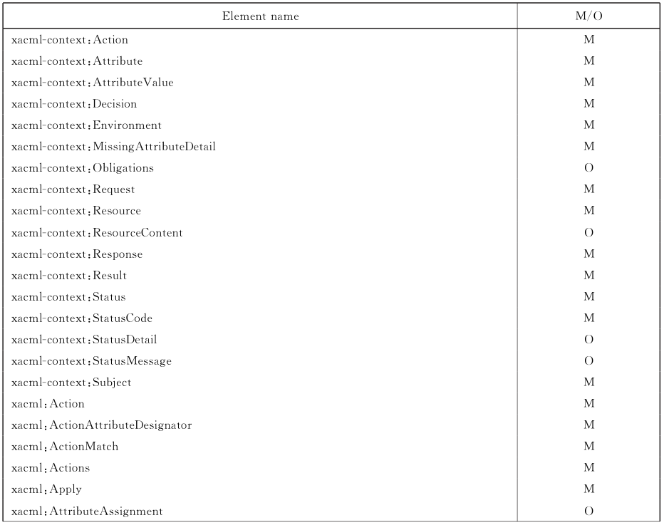

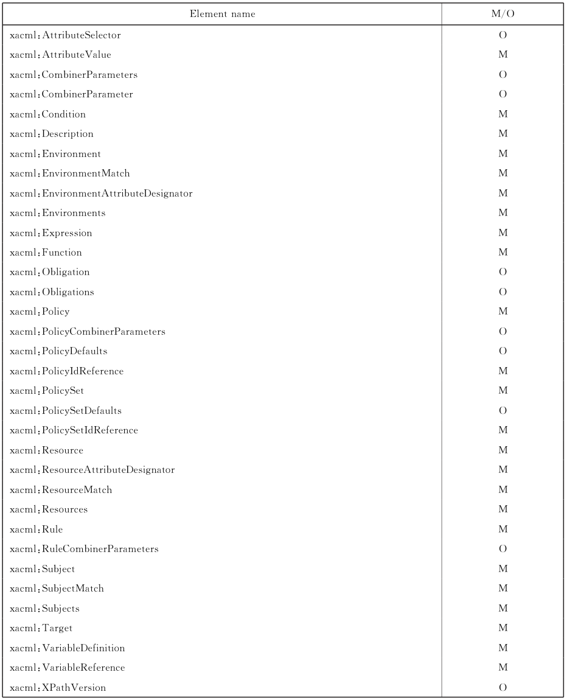

#### 12.2.3 标识符前缀

**表8中是本标准保留的标识符前缀。**

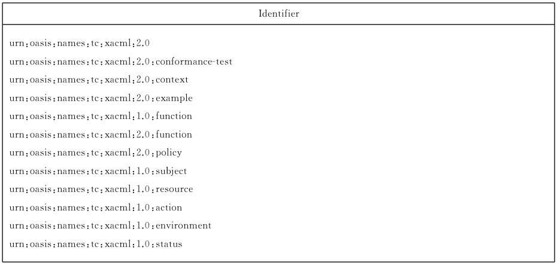

#### 12.2.4 算法

标准实施中应包括标记为“M”的规则组合与策略组合算法，见表9。

**表9 算法列表**

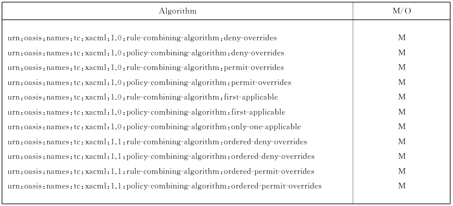

#### 12.2.5 状态代码

具体规范实施对`<StatusCode>`元素的支持是可选的。如果支持，则表10中的状态编码也应被正确理解并实施。

**表 10 状态代码列表**

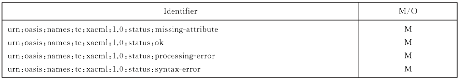

#### 12.2.6 属性

应支持以下标识符描述的属性。如果这些属性的属性值没有在判定请求中提供，则上下文处理器应提供相应属性的具体值。不同于其他属性，这些属性对 PDP 来说是应明确提供的，见表11。

**表11 属性列表**

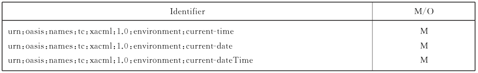

#### 12.2.7 标识符

标准实施中使用的标识符应在表12范围内，并按照标准定义使用。此要求主要针对 PAP 和 PEP的具体实施，PDP 不处理属性的语义表示。

**表12 标识符列表**

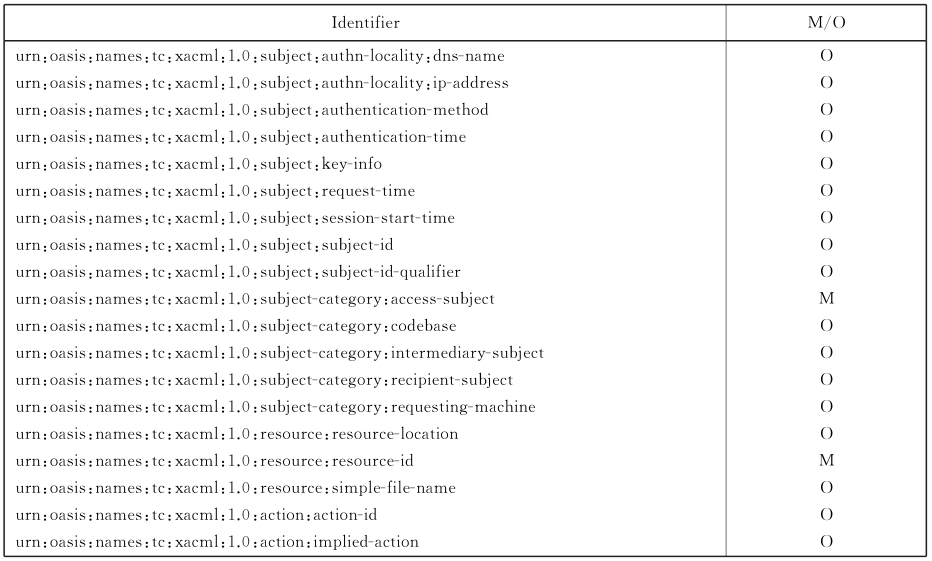

#### 12.2.8 数据类型

标准实施应支持标记“M”的数据类型，见表13。

**表13 数据类型列表**

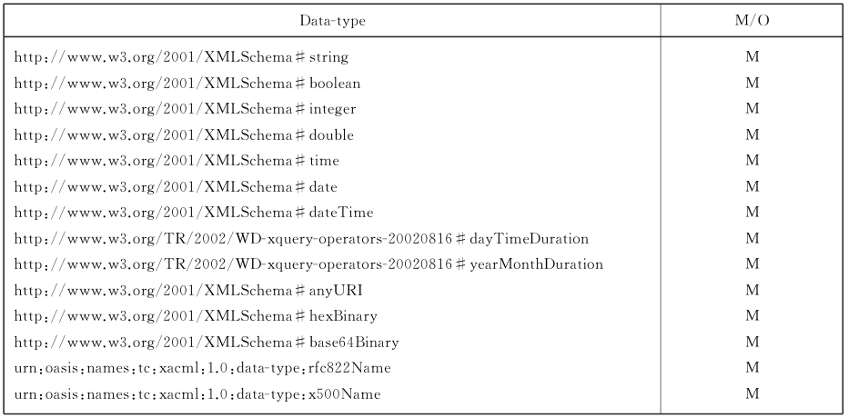

#### 12.2.9 函数

标准实施应能正确处理标记为“M”的功能函数，见表14。

**表14 函数列表**

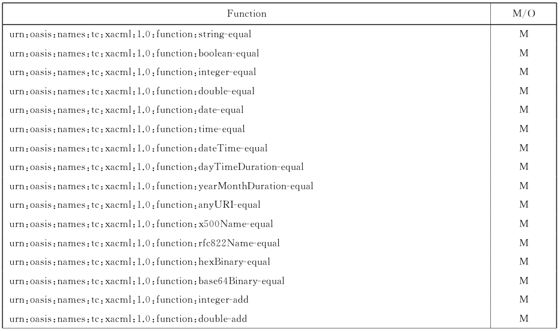

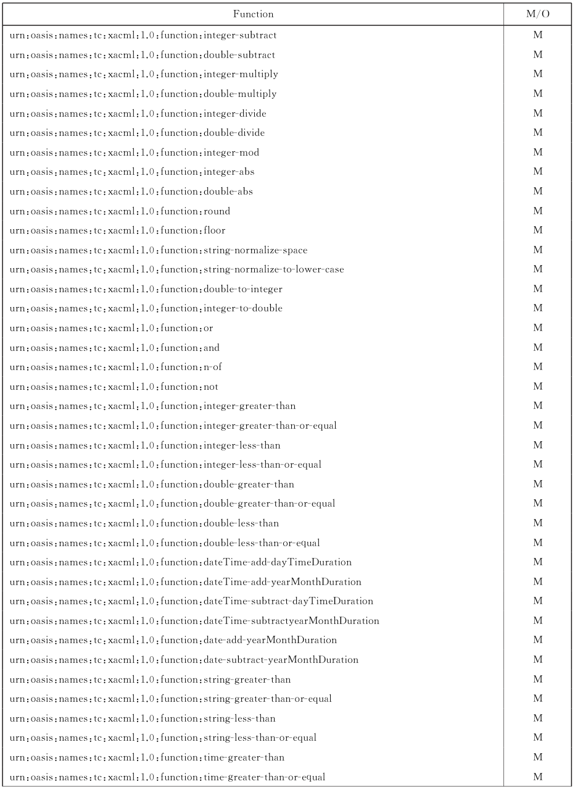

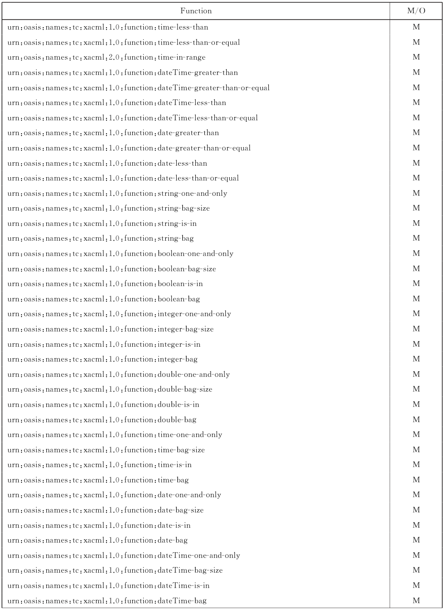

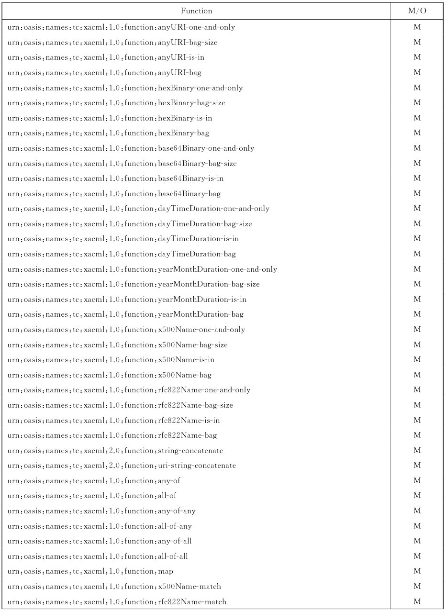

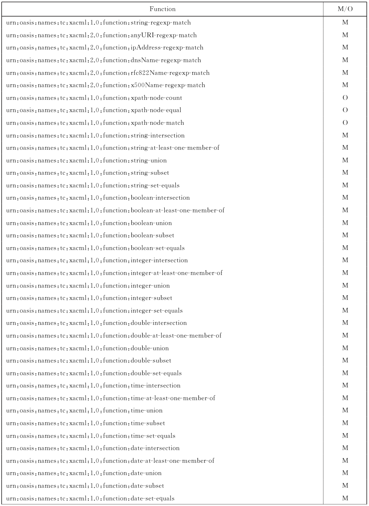

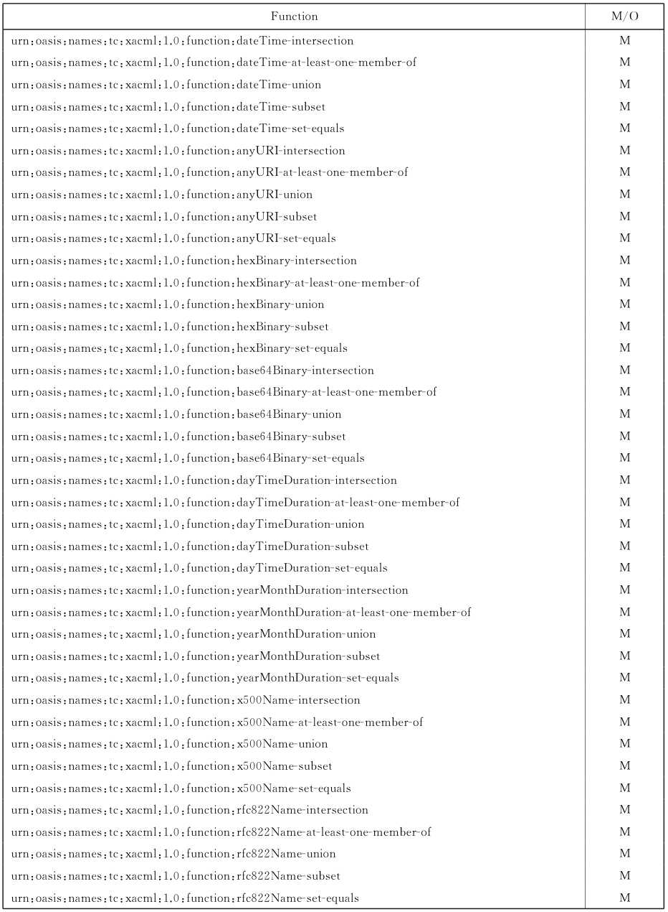

## 附录A（规范性附录）数据类型和函数

### A.1 介绍

本附录描述条件元素和目标元素产生断言而使用的数据类型和函数。


本标准囊括了IEEE 和 ANSI 对数学数值的字符表示和算数函数的评估，它描述了基本数据类型和包，并对标准函数的名称和操作语义进行了说明。

### A.2 数据类型

尽管 XML实例中将所有数据类型理解为字符串，XACML 的PDP 部件应对这些字符串进行实际类型分析。如 Boolean,integer 和 double 等类型应从字符串描述转换为本类型内可比较的值，例如数字。下面是 XACML中用到的基本数据类型，它们都有明确的数据表示：

`http://www.w3.org/2001/XMLSchema#string`

`http://www.w3.org/2001/XMLSchema#boolean`

`http://www.w3.org/2001/XMLSchema#integer`

`http://www.w3.org/2001/XMLSchema#double`

`http://www.w3.org/2001/XMLSchema#time`

`http://www.w3.org/2001/XMLSchema#date`

`http://www.w3.org/2001/XMLSchema#dateTime`

`http://www.w3.org/2001/XMLSchema#anyURI`

`http://www.w3.org/2001/XMLSchema#hexBinary`

`http://www.w3.org/2001/XMLSchema#base64Binary`

`http://www.w3.org/TR/2002/WD-xquery-operators—20020816#dayTimeDuration`

`http://www.w3.org/TR/2002/WD-xquery-operators—20020816#yearMonthDuration`

`urn:oasis:names:tc:xacml:1.0:data-type:x500Name`

`urn:oasis:names:tc:xacml:1.0:data-type:rfc822Name`

`urn:oasis:names:tc:xacml:2.0:data-type:ipAddress`

`urn:oasis:names:tc:xacml:2.0:data-type:dnsName`

为提高互操作性，建议所有的时间引用都采用 UTC格式的时间描述。

本标准实现的 PDP应有能力将字符串转化为不同的基本数据类型。 对于 intergers 和 doubles 类型，本标准按照IEEE754中的描述转换。

XACML 定义了如下4种数据类型：“`urn:oasis:names:tc:xacml:1.0:data-type:x500Name`”“`urn:oasis:names:tc:xacml:1.0:data-type:rfc822Name`”“`urn:oasis:names:tc:xacml:2.0:data-type:ipAddress`”“`urn:oasis:names:tc:xacml:2.0:data-type:dnsName`”以下类型表示主体和资源的标识符并且已经在许多标准应用中出现：X.500 directory name“`urn:oasis:names:tc:xacml:1.0:data-type:x500Name`”基本类型代表 ITU-T 推荐的 X.520辨别名称。该类型的有效语法参见 RFC 2253。

RFC 822 name“`urn:oasis:names:tc:xacml:1.0:data-type:rfc822Name`” 基本类型代表电子邮件地址。

IP address“`urn:oasis:names:tc:xacml:2.0:data-type:ipAddress`”基本类型代表 IPv4 或IPv6 网络地址，可附带选择字符和端口或端口范围。其语法应如下表示：

```text
ipAddress = address ["/" mask] [":" [portrange]]
```

对于 IPv4地址，其地址和字符应按照 RFC 2396中的格式描述。对于IPv6地址，其地址和字符应按照 RFC 2732 中的格式描述。（其中 IPv6 的地址和字符用“［""］"包含）。

DNS name“`urn:oasis:names:tc:xacml:2.0:data-type:dnsName`”基本类型代表域名服务主机名，可附带端口或端口范围。其语法应如下表示：

```text
dnsName = hostname [":" portrange]
```

除了通配符“*”可用在描述域名最左面的部分代表当前域的任何子域，主机名的格式应按照RFC 2396 中的定义。

“`urn:oasis:names:tc:xacml:2.0:data-type:ipAddress`”和“`urn:oasis:names:tc:xacml:2.0:data-type:dnsName`”类型中的端口或端口范围描述语法应如下表示：

```text
portrange = portnumber | "-" portnumber | portnumber "-" [portnumber]
```

“portnumber”用十进制数字表示，如果“-x”表示端口，则“x”表示具体的端口号，端口范围包括小于这个数字的所有端口号。如果“x-”表示端口，则“x”表示具体的端口号，端口范围包括大于这个数字的所有端口号。

### A.3 函数

#### A.3.1 等式断言

> 转写注：附录 A 保留原版标识符及文字异常，如 `double-4265less-than`、`stringr-equal`、`url-string-concatenate`、`XMLSchema#iboolean`、`大些字母`；它们并非本转写新增的实现建议。

下面这些函数是针对各种基本数据类型的等式函数。其中每个函数对应一个数据类型，其后是相关定义的规定。部分函数的详细评估准则参见 IEEE 754 和 W3C:XQuery 1.0 and XPath 2.0 Functions and Operators。

`urn:oasis:names:tc:xacml:1.0:function:string-equal`

此函数接收 2个 `http://www.w3.org/2001/XMLSchema#string`类型的参数，返回一个 http://www.w3.org/2001/XMLSchema#boolean 类型的值。当且仅当2个参数的长度相等，并且对参数每个 byte 调用“integer-equal”函数比较后的结果都相等，返回“True”，否则返回“False”.

`urn:oasis:names:tc:xacml:1.0:function:boolean-equal`

此函数接收2个 `http://www.w3.org/2001/XMLSchema#boolean`类型的参数，返回一个 http://www.w3.org/2001/XMLSchema #boolean 类型的值。当且仅当2个参数的值相等，返回“True”，否则返回“False”

`urn:oasis:names:tc:xacml:1.0:function:integer-equal`

此函数接收2个 `http://www.w3.org/2001/XMLSchema#integer`类型的参数，返回一个 http://www.w3.org/2001/XMLSchema#boolean 类型的值。它将按照 IEEE 754 中的规定对参数进行评估。

`urn:oasis:names:tc:xacml:1.0:function:double-equal`

此函数接收2个 `http://www.w3.org/2001/XMLSchema#double`类型的参数，返回一个 http://www.w3.org/2001/XMLSchema #boolean 类型的值。它将按照 IEEE 754中的规定对参数进行评估。

`urn:oasis:names:tc:xacml:1.0:function:date-equal`

此函数接收 2个 `http://www.w3.org/2001/XMLSchema#date`类型的参数，返回一个`http://www.w3.org/2001/XMLSchema#boolean`类型的值。它将按照“op:date-equal”函数进行评估。

`urn:oasis:names:tc:xacml:1.0:function:time-equal`

此函数接收 2个 `http://www.w3.org/2001/XMLSchema#time`类型的参数，返回一个`http://www.w3.org/2001/XMLSchema#boolean`类型的值。它将按照“op:time-equal”函数进行评估。

`urn:oasis:names:tc:xacml:1.0:function:dateTime-equal`

此函数接收2个 `http://www.w3.org/2001/XMLSchema#dateTime`类型的参数，返回一个`http://www.w3.org/2001/XMLSchema#boolean`类型的值。它将按照“op: dateTime- equal”函数进行评估。

`urn:oasis:names:tc:xacml:1.0:function:dayTimeDuration-equal`

此函数接收2个 `http://www.w3.org/TR/2002/WD-xquery-operators-20020816#dayTimeDuration`类型的参数，返回一个 `http://www.w3.org/2001/XMLSchema#boolean`类型的值。它将按照“op:dayTimeDuration-equal”函数进行评估。参数的词汇表示将被分解为多个部分。

`urn:oasis:names:tc:xacml:1.0:function:yearMonthDuration-equal`

此函数接收2个 `http://www.w3.org/TR/2002/WD-xquery-operators-20020816#yearMonthDuration`类型的参数，返回一个 `http://www.w3.org/2001/XMLSchema#boolean`类型的值。它将按照“op:yearMonthDuration-equal”函数进行评估。参数的词汇表示将被分解为多个部分。

`urn:oasis:names:tc:xacml:1.0:function:anyURI-equal`

此函数接收2个 `http://www.w3.org/2001/XMLSchema#anyURI`类型的参数，返回一个`http://www.w3.org/2001/XMLSchema#boolean`类型的值。它将按照“op: anyURl-equal”函数进行评估。

`urn:oasis:names:tc:xacml:1.0:function:x500Name-equal`

此函数接收2个“`urn:oasis:names:tc:xacml:1.0:data-type:x500Name`”类型的参数，返回一个 `http://www.w3.org/2001/XMLSchema#boolean`类型的值。当且仅当2个参数的相对鉴别名称（RDN）匹配时，返回“True”，否则返回“False”。当且仅当按下列步骤操作返回结果为“True”，则称2个 RDN 匹配。步骤如下：

<ol class="standard-subclauses">
<li>1） 根据 RFC 2253 中的规则格式化 RDN参数。</li>
<li>2） 如果 RDN 中包含多个 TypeAndValue 属性对，重新按字节串的升序排序 RDN 中的属性对。</li>
<li>3） 根据 RFC 3280 4.1.2.4中的规则比较 RDN。</li>
</ol>

`urn:oasis:names:tc:xacml:1.0:function:rfc822Name-equal`

此函数接收2个“`urn:oasis:names:tc:xacml:1.0:data-type:rfc822Name`”类型的参数，返回一个 `http://www.w3.org/2001/XMLSchema#boolean`类型的值。当且仅当2个参数值相等返回“True”，否则返回“False” ’。RFC822中的名称由本地部分加“@”后跟域部分组成。本地部分会随个体不同经常变化，而域部分不易变化。此函数进行如下操作：

<ol class="standard-subclauses">
<li>1） 格式化每个参数的域部分为小写字母表示。</li>
<li>2） 对格式化后的参数调用“<code>urn:oasis:names:tc:xacml:1.0:function:string-equal</code>”函数进行比较。</li>
</ol>

`urn:oasis:names:tc:xacml:1.0:function:hexBinary-equal`

此函数接收2个 `http://www.w3.org/2001/XMLSchema#hexBinary`类型的参数，返回一个`http://www.w3.org/2001/XMLSchema#boolean`类型的值。当且仅当两参数的字节序列长度相等并且调用“`urn:oasis:names:tc:xacml:1.0:function:integer-equal`”函数判定相等时，返回“True”，否则返回“False”。将字符串转化为字节序列的步骤按中的描述进行。

`urn:oasis:names:tc:xacml:1.0:function:base64Binary-equal`

此函数接收2个 `http://www.w3.org/2001/XMLSchema#base64Binary`类型的参数，返回一个 `http://www.w3.org/2001/XMLSchema#boolean`类型的值。当且仅当两参数的字节序列长度相等并且调用“`urn:oasis:names:tc:xacml:1.0:function:integer-equal`”函数判定相等时，返回“True”，否则返回“False”。将字符串转化为字节序列的步骤按中的描述进行。

#### A.3.2 算数函数

以下的所有函数都只接收2个 integer 或 double 类型的参数，且返回值也为相应的2种类型之一。

对于“add”函数集可能有多于2个的参数。每个函数的评估过程应按照 IEEE 754对应逻辑部分进行。

在包含这些函数的表达式中，若有任一函数参数为“Indeterminate”，则表达式的评估结果为“Indeterminate”。当运算除法函数时，如果除数是0，则函数返回结果为“Indeterminate”。

`urn:oasis:names:tc:xacml:1.0:function:integer-add`

此函数可能有多于2个的参数`urn:oasis:names:tc:xacml:1.0:function:double-add`

此函数可能有多于2个的参数`urn:oasis:names:tc:xacml:1.0:function:integer-subtract`

`urn:oasis:names:tc:xacml:1.0:function:double-subtract`

`urn:oasis:names:tc:xacml:1.0:function:integer-multiply`

`urn:oasis:names:tc:xacml:1.0:function:double-multiply`

`urn:oasis:names:tc:xacml:1.0:function:integer-divide`

`urn:oasis:names:tc:xacml:1.0:function:double-divide`

`urn:oasis:names:tc:xacml:1.0:function:integer-mod`

以下的所有函数都只接收1个特定类型的参数。round 和 floor 类的函数接收一个 `http://www.w3.org/2001/XMLSchema#double`类型参数且返回同样类型的值。

`urn:oasis:names:tc:xacml:1.0:function:integer-abs`

`urn:oasis:names:tc:xacml:1.0:function:double-abs`

`urn:oasis:names:tc:xacml:1.0:function:round`

`urn:oasis:names:tc:xacml:1.0:function:floor`

#### A.3.3 字符串变换函数

下列函数对“`http://www.w3.org/2001/XMLSchema#string`”类型值进行变换：

`urn:oasis:names:tc:xacml:1.0:function:string-normalize-space`

此函数接收1个“`http://www.w3.org/2001/XMLSchema#string`”类型参数，格式化参数，去掉开头和结尾的空格字符。

`urn:oasis:names:tc:xacml:1.0:function:string-normalize-to-lower-case`

此函数接收1个“`http://www.w3.org/2001/XMLSchema#string`”类型参数，格式化参数，将其中包含的所有大些字母替换为相应的小写字母。

#### A.3.4 数字类型变换函数

下列函数对“`http://www.w3.org/2001/XMLSchema#integer`”类型值和“`http://www.w3.org/2001/XML-Schema#double`”类型值进行变换：

`urn:oasis:names:tc:xacml:1.0:function:double-to-integer`

此函数接收1个“`http://www.w3.org/2001/XMLSchema#double`”类型参数，将参数修剪获得其整数部分，返回一个“`http://www.w3.org/2001/XMLSchema#integer`”类型值。

`urn:oasis:names:tc:xacml:1.0:function:integer-to-double`

此函数接收1个“`http://www.w3.org/2001/XMLSchema#integer`”类型参数，将参数提高精度，返回一个“`http://www.w3.org/2001/XMLSchema#double`”类型值。

#### A.3.5 逻辑函数

本条描述具有“`http://www.w3.org/2001/XMLSchema#boolean`”类型参数的逻辑函数`urn:oasis:names:tc:xacml:1.0:function:or`

如果此函数没有参数，则返回“False”。如果至少有一个参数被评估为“True”则返回“True”。

参数评估要有序进行，当任一参数被评估为“True”时，对剩余的参数停止评估，函数返回“True”。

`urn:oasis:names:tc:xacml:1.0:function:and`

如果此函数没有参数，则返回“True”。如果任一参数被评估为“False”则返回“False”。

参数评估要有序进行，当任一参数被评估为“False”时，对剩余的参数停止评估，函数返回“False”。

`urn:oasis:names:tc:xacml:1.0:function:n-of`

此函数的第一个参数为“`http://www.w3.org/2001/XMLSchema#integer`”类型，剩余参数都为“`http://www.w3.org/2001/XMLSchema#boolean`”类型。第一个参数规定最小使函数返回“True”的取值为“True”的参数个数。如果第一个参数取0，函数返回“True”。如果剩余参数的总个数小于第一个参数的取值，函数返回“Indeterminate”。函数参数的评估顺序为先获取第一个参数的整数值，然后依次评估其他参数。如果评估取值为“True”的参数个数达到规定值，则停止评估，函数返回“True”。如果确定继续评估仍不能满足规定值则停止评估。

如果此函数没有参数，则返回“False”。如果至少有一个参数被评估为“True”则返回“True”。

参数评估要有序进行，当任一参数被评估为“True”时，对剩余的参数停止评估，函数返回“True”。

`urn:oasis:names:tc:xacml:1.0:function:not`

函数接收一个“`http://www.w3.org/2001/XMLSchema#boolean`”类型参数。如果参数被评估为“True”，则函数返回“False”。如果参数被评估为“False”，则函数返回“True”。

对 and,or，或者 n-of 函数的评估不必对每个参数都完全评估来判断参数是否产生“Indeterminate”评估结果。对参数属性的可用性和可能出现的错误进行分析，例如“除数为o”能使参数避免出错。这类参数错误发生在因评估停止而未被处理的表达式中。

#### A.3.6 数字比较函数

这类函数为要比较的2个数值构造最小集，返回 Boolean 类型结果。它们应遵守 IEEE 754 ［IEEE 754］中的规则。

`urn:oasis:names:tc:xacml:1.0:function:integer-greater-than`

`urn:oasis:names:tc:xacml:1.0:function:integer-greater-than-or-equal`

`urn:oasis:names:tc:xacml:1.0:function:integer-less-than`

`urn:oasis:names:tc:xacml:1.0:function:integer-less-than-or-equal`

`urn:oasis:names:tc:xacml:1.0:function:double-greater-than`

`urn:oasis:names:tc:xacml:1.0:function:double-greater-than-or-equal`

`urn:oasis:names:tc:xacml:1.0:function:double-4265less-than`

`urn:oasis:names:tc:xacml:1.0:function:double-less-than-or-equal`

#### A.3.7 日期和时间算数函数

下列函数对时间和日期进行算数运算。其中时间日期增加规范的详细内容参见 W3CXML 模式第1部分和第2部分。

`urn:oasis:names:tc:xacml:1.0:function:dateTime-add-dayTimeDuration`

此函数接收2个参数，第一个为“`http://www.w3.org/2001/XMLSchema#dateTime`”类型，第2个为“`http://www.w3.org/TR/2002/WD-xquery-operators—20020816#dayTimeDuration`”类型。函数返回一个“`http://www.w3.org/2001/XMLSchema#dateTime`”类型结果。

函数将按照时间日期增加规范把2个参数的值相加。

`urn:oasis:names:tc:xacml:1.0:function:dateTime-add-yearMonthDuration`

此函数接收2个参数，第一个为“`http://www.w3.org/2001/XMLSchema#dateTime`”类型，第2个为“`http://www.w3.org/TR/2002/WD-xquery-operators—20020816#yearMonthDuration`”类型。函数返回一个“`http://www.w3.org/2001/XMLSchema#dateTime`”类型结果。函数将按照时间日期增加规范把2个参数的值相加。

`urn:oasis:names:tc:xacml:1.0:function:dateTime-subtract-dayTimeDuration`

此函数接收2个参数，第一个为“`http://www.w3.org/2001/XMLSchema#dateTime`”类型，第2个为“`http://www.w3.org/TR/2002/WD-xquery-operators—20020816#dayTimeDuration`”类型。函数返回一个“`http://www.w3.org/2001/XMLSchema#dateTime`”类型结果。

如果第2个参数为正值，按照规范把第2个参数取负值，返回2个参数相加后的值。如果第2个参数为负值，取其正值，对2个参数调用“`urn:oasis:names:tc:xacml:1.0:function:dateTime-add-dayTimeDuration`”函数。

`urn:oasis:names:tc:xacml:1.0:function:dateTime-subtract-yearMonthDuration`

此函数接收2个参数，第一个为“`http://www.w3.org/2001/XMLSchema#dateTime`”类型，第2个为“`http://www.w3.org/TR/2002/WD-xquery-operators—20020816#yearMonthDuration`”类型。函数返回一个“`http://www.w3.org/2001/XMLSchema#dateTime`”类型结果。如果第2个参数为正值，按照规范把第2个参数取负值，返回2个参数相加后的值。如果第2个参数负值，取其正值，对2个参数调用“`urn:oasis:names:tc:xacml:1.0:function:dateTime-add-yearMonthDuration`”函数。

`urn:oasis:names:tc:xacml:1.0:function:date-add-yearMonthDuration`

此函数接收2个参数，第一个为“`http://www.w3.org/2001/XMLSchema#date`”类型，第2个“`http://www.w3.org/TR/2002/WD-xquery-operators—20020816#yearMonthDuration`”类型。

函数返回一个“`http://www.w3.org/2001/XMLSchema#date`”类型结果。函数将按照日期增加规范把2个参数的值相加。

`urn:oasis:names:tc:xacml:1.0:function:date-subtract-yearMonthDuration`

此函数接收2个参数，第一个为“`http://www.w3.org/2001/XMLSchema#date`”类型，第2个为“`http://www.w3.org/TR/2002/WD-xquery-operators—20020816#yearMonthDuration`”类型。

函数返回一个“`http://www.w3.org/2001/XMLSchema#date`”类型结果。如果第2个参数为正值，把第2个参数取负值，返回2个参数相加后的值。如果第2个参数为负值，取其正值，对2个参数调用“`urn:oasis:names:tc:xacml:1.0:function:date-add-yearMonthDuration`”函数。

#### A.3.8 非数字比较函数

以下函数对2个非数字型的参数进行比较操作。其中关于 `http://www.w3.org/2001/XMLSchema#dateTime`

和 `http://www.w3.org/2001/XMLSchema#date`

的详细定义规范可参见W3C: XQuery 1.0 and XPath 2.0 Functions and Operators。

`urn:oasis:names:tc:xacml:1.0:function:string-greater-than`

此函数接收 2个“`http://www.w3.org/2001/XMLSchema#string`”类型的参数，返回一个`http://www.w3.org/2001/XMLSchema#boolean`类型的值。当且仅当对两参数字节逐个比较调用“`urn:oasis:names:tc:xacml:1.0:function:integer-equal`”函数若相等则继续对下个字节比较，若不相等则调用“`urn:oasis:names:tc:xacml:2.0:function:integer-greater-than`”调用数判定第一个参数较大时，返回“True”，否则返回“False”。

`urn:oasis:names:tc:xacml:1.0:function:string-greater-than-or-equal`

此函数接收 2个“`http://www.w3.org/2001/XMLSchema#string`”类型的参数，返回一个`http://www.w3.org/2001/XMLSchema#boolean`类型的值。对2个参数分别调“`urn:oasis:names:tc:xacml:1.0:function:stringr-greater-than`”和“`urn:oasis:names:tc:xacml:1.0:function:stringr-equal`”函数，并对2个返回值再调用“`urn:oasis:names:tc:xacml:1.0:function:or`”函数。

`urn:oasis:names:tc:xacml:1.0:function:string-less-than`

此函数接收2个“`http://www.w3.org/2001/XMLSchema#string`”类型的参数，返回一个`http://www.w3.org/2001/XMLSchema#boolean`类型的值。当且仅当对两参数字节逐个比较调用“`urn:oasis:names:tc:xacml:1.0:function:integer-equal`”函数若相等则继续对下个字节比较，若不相等则调用“`urn:oasis:names:tc:xacml:2.0:function:integer-less-than`”调用数判定第一个参数较小时，返回“True”，否则返回“False”。

`urn:oasis:names:tc:xacml:1.0:function:string-less-than-or-equal`

此函数接收 2个“`http://www.w3.org/2001/XMLSchema#string`”类型的参数，返回一个`http://www.w3.org/2001/XMLSchema#boolean`类型的值。对2个参数分别调用“`urn:oasis:names:tc:xacml:1.0:function:stringr-less-than`”和 “`urn:oasis:names:tc:xacml:1.0:function:stringr-equal`” 函数，并对2个返回值再调用“`urn:oasis:names:tc:xacml:1.0:function:or`”函数。

`urn:oasis:names:tc:xacml:1.0:function:time-greater-than`

此函数接收2个“`http://www.w3.org/2001/XMLSchema#time`”类型的参数，返回一个 http://www.w3.org/2001/XMLSchema#boolean 类型的值。当且仅当按照“`http://www.w3.org/2001/XMLSchema#time`”中定义的顺序规范比较，判定第一个参数较大时，返回“True”，否则返回“False”。不允许将带时区标识的时间和不带时区标识的时间格式比较，此时应调用time-in-range 函数。

`urn:oasis:names:tc:xacml:1.0:function:time-greater-than-or-equal`

此函数接收2个“`http://www.w3.org/2001/XMLSchema#time`”类型的参数，返回一个 http://www.w3.org/2001/XMLSchema#boolean 类型的值。当且仅当按照“`http://www.w3.org/2001/XMLSchema#time`”中定义的顺序规范比较，判定第一个参数较大或两者相等时，返回“True”，否则返回“False”。不允许将带时区标识的时间和不带时区标识的时间格式比较，此时应调用 time-in-range 函数。

`urn:oasis:names:tc:xacml:1.0:function:time-less-than`

此函数接收2个“`http://www.w3.org/2001/XMLSchema#time`”类型的参数，返回一个 http://www.w3.org/2001/XMLSchema# boolean 类型的值。当且仅当按照“`http://www.w3.org/2001/XMLSchema#time`”中定义的顺序规范比较，判定第一个参数较小时，返回“True”，否则返回“False”。不允许将带时区标识的时间和不带时区标识的时间格式比较，此时应调用time-in-range 函数。

`urn:oasis:names:tc:xacml:1.0:function:time-less-than-or-equal`

此函数接收2个“`http://www.w3.org/2001/XMLSchema#time`”类型的参数，返回一个 http://www.w3.org/2001/XMLSchema#boolean 类型的值。当且仅当按照“`http://www.w3.org/2001/XMLSchema#time`”中定义的顺序规范比较，判定第一个参数较小或两者相等时，返回“True”，否则返回“False”。不允许将带时区标识的时间和不带时区标识的时间格式比较，此时应调用 time-in-range 函数。

`urn:oasis:names:tc:xacml:1.0:function:time-in-range`

此函数接收 3个“`http://www.w3.org/2001/XMLSchema#time`”类型的参数，返回一个 http://www.w3.org/2001/XMLSchema#boolean 类型的值。如果第一个参数在后两个参数定义的时间区间内，返回“True”，否则返回“False”。第三个参数表示延后于第二个参数的不大于24小时的时间值。如果第一个参数无时区值，则采用上下文中的默认值。如后两个参数不包含时区值，则采用第一个参数的时区值。

`urn:oasis:names:tc:xacml:1.0:function:dateTime-greater-than`

此函数接收 2个“`http://www.w3.org/2001/XMLSchema#dateTime`”类型的参数，返回一个 `http://www.w3.org/2001/XMLSchema#boolean`类型的值。当且仅当按照“`http://www.w3.org/2001/XMLSchema#dateTime`”中定义的顺序规范比较，判定第一个参数较大时，返回“True”，否则返回“False”。如果数据值中没有包含时区值，将赋予一个隐含的时区值。

`urn:oasis:names:tc:xacml:1.0:function:dateTime-greater-than-or-equal`

此函数接收2个“`http://www.w3.org/2001/XMLSchema#dateTime`”类型的参数，返回一个 `http://www.w3.org/2001/XMLSchema#boolean`类型的值。当且仅当按照“`http://www.w3.org/2001/XMLSchema#dateTime`”中定义的顺序规范比较，判定第一个参数较大或两者相等时，返回“True”，否则返回“False”。如果数据值中没有包含时区值，将赋予一个隐含的时区值。

`urn:oasis:names:tc:xacml:1.0:function:dateTime-less-than`

此函数接收2个“`http://www.w3.org/2001/XMLSchema#dateTime`”类型的参数，返回一个 `http://www.w3.org/2001/XMLSchema#boolean`类型的值。当且仅当按照“`http://www.w3.org/2001/XMLSchema#dateTime`”中定义的顺序规范比较，判定第一个参数较小时，返回“True”，否则返回“False”。如果数据值中没有包含时区值，将赋予一个隐含的时区值。

`urn:oasis:names:tc:xacml:1.0:function:dateTime-less-than-or-equal`

此函数接收2个“`http://www.w3.org/2001/XMLSchema#dateTime`”类型的参数，返回一个 `http://www.w3.org/2001/XMLSchema#boolean`类型的值。当且仅当按照“`http://www.w3.org/2001/XMLSchema#dateTime`”中定义的顺序规范比较，判定第一个参数较小或两者相等时，返回“True”，否则返回“False”。如果数据值中没有包含时区值，将赋予一个隐含的时区值。

`urn:oasis:names:tc:xacml:1.0:function:date-greater-than`

此函数接收2个“`http://www.w3.org/2001/XMLSchema#date`”类型的参数，返回一个 http://www.w3.org/2001/XMLSchema#boolean 类型的值。当且仅当按照“`http://www.w3.org/2001/XMLSchema#date`”中定义的顺序规范比较，判定第一个参数较大时，返回“True”，否则返回“False”。如果数据值中没有包含时区值，将赋予一个隐含的时区值。

`urn:oasis:names:tc:xacml:1.0:function:date-greater-than-or-equal`

此函数接收2个“`http://www.w3.org/2001/XMLSchema#date`”类型的参数，返回一个 http://www.w3.org/2001/XMLSchema # boolean 类型的值。当且仅当按照“`http://www.w3.org/2001/XMLSchema#date`”中定义的顺序规范比较，判定第一个参数较大或两者相等时，返回“True”，否则返回“False”。如果数据值中没有包含时区值，将赋予一个隐含的时区值。

`urn:oasis:names:tc:xacml:1.0:function:date-less-than`

此函数接收2个“`http://www.w3.org/2001/XMLSchema#date`”类型的参数，返回一个 http://www.w3.org/2001/XMLSchema#boolean 类型的值。当且仅当按照“`http://www.w3.org/2001/XMLSchema#date`”中定义的顺序规范比较，判定第一个参数较小时，返回“True”，否则返回“False”。如果数据值中没有包含时区值，将赋予一个隐含的时区值。

`urn:oasis:names:tc:xacml:1.0:function:date-less-than-or-equal`

此函数接收2个“`http://www.w3.org/2001/XMLSchema#date`”类型的参数，返回一个 http://www.w3.org/2001/XMLSchema#boolean 类型的值。当且仅当按照“`http://www.w3.org/2001/XMLSchema#date`”中定义的顺序规范比较，判定第一个参数较小或两者相等时，返回“True”，否则返回“False”。如果数据值中没有包含时区值，将赋予一个隐含的时区值。

#### A.3.9 字符串函数

下列函数对字符串和 URIs 进行操作-

`urn:oasis:names:tc:xacml:2.0:function:string-concatenate`

此函数接收2个或以上“`http://www.w3.org/2001/XMLSchema#string`”类型的参数，返回一个“`http://www.w3.org/2001/XMLSchema#String`”类型的值。返回结果是对参数的顺序串联。

`urn:oasis:names:tc:xacml:2.0:function:url-string-concatenate`

此函数接收1个 “`http://www.w3.org/2001/XMLSchema#string`”类型的参数，1个或以上“`http://www.w3.org/2001/XMLSchema#anyURI`”类型的参数。返回一个“`http://www.w3.org/2001/XMLSchema#anyURI`”类型的值。返回结果是将“string”类型参数对“anyURI”类型参数的顺序附加。

#### A.3.10 包函数

将 type 定义为任一中基本数据类型，以下函数对“type”包进行操作。对函数添加一些约束条件，将使表达式的评估结果为“Indeterminate”。

`urn:oasis:names:tc:xacml:1.0:function:type-one-and-only`

此函数接收1个“type”包作为参数，返回一个“type”且此值是包中的唯一值。否则返回“Indeterminate”。

`urn:oasis:names:tc:xacml:1.0:function:type-bag-size`

此函数接收1个“type”包作为参数，返回“`http://www.w3.org/2001/XMLSchema#integer`”类型值标记包中值的个数。

`urn:oasis:names:tc:xacml:1.0:function:type-is-in`

此函数接收 1个“type”值作为第一个参数，接收1个“type”包作为第二个参数。返回“`http://www.w3.org/2001/XMLSchema#boolean`”类型。如果调用“`urn:oasis:names:tc:xacml:x.x:function:type-equal`”函数判断包中存在一个值和第一个参数匹配，则返回“True”，否则返回“False”。

`urn:oasis:names:tc:xacml:1.0:function:type-bag`

此函数接收任意个“type”值作为参数，返回包含这些值的“type”包。若没有参数，返回该类型的空包。

#### A.3.11 集合函数

以下函数对多个类似集合的包进行操作，去除其中的重复元素。

`urn:oasis:names:tc:xacml:1.0:function:type-intersection`

此函数接收2个“type”包作为参数，调用“`urn:oasis:names:tc:xacml:x.x:function:type-equal`”函数返回一个新包，其中包含在2个包中都出现的元素。

`urn:oasis:names:tc:xacml:1.0:function:type-at-least-one-member-of`

此函数接收2个“type”包作为参数，返回“`http://www.w3.org/2001/XMLSchema#boolean`”类型。当且仅当调用“`urn:oasis:names:tc:xacml:x.x:function:type-is-in`”函数判定第一个包中至少有一个元素包含在第二个包中，则返回“True”。

`urn:oasis:names:tc:xacml:1.0:function:type-union`

此函数接收2个“type”包作为参数。调用“`urn:oasis:names:tc:xacml:x.x:function:type-equal`”函数消除重复元素，返回一个包含2个包中所有元素的新包。

`urn:oasis:names:tc:xacml:1.0:function:type-subset`

此函数接收2个“type”包作为参数，返回“`http://www.w3.org/2001/XMLSchema#boolean`”类型。调用“`urn:oasis:names:tc:xacml:x.x:function:type-equal`”函数消除重复元素，当且仅当第一个包是第二个包的子集时，返回“True”。

`urn:oasis:names:tc:xacml:1.0:function:type-set-equals`

此函数接收2个“type”包作为参数，返回“`http://www.w3.org/2001/XMLSchema#boolean`”类型。调用“`urn:oasis:names:tc:xacml:1.0:function:type-subset`”函数，2个参数互换位置后再次调用“`urn:oasis:names:tc:xacml:1.0:function:type-subset`”函数，对2个函数的返回值调用“`urn:oasis:names:tc:xacml:1.0:function:and`”函数，返回结果。

#### A.3.12 高阶包函数

本条列出 XACML 中对包操作的函数。在此用 Haskell[8]提出的函数描述语言形式化描述函数的语义表达。

在下面的 Haskell 符号系统中，用包含列表的字句定义函数。“[]”表示空列表，“（x:xs）”表示非空列表，“x”表示列表的第一个值，“xs”表示列表中的有序剩余值。用 Haskell 中的有序列表描述XACML 中的包。

一个对应“`urn:oasis:names:tc:xacml:1.0:function:and`”函数的简单 Haskell 描述如下：

```haskell
and::[Bool] -> Bool
and [] = True
and (x:xs) = x && (and xs)
```

> 注：第一行中“：：”代表函数类型，［Bool］代表函数的参数，最后一个“Bool”代表返回类型第二行表示 and函数作用于空列表，返回为“True”第三行用逻辑符“&&”表示对列表（x:xs）中的每个值和其剩余部分迭代调用and函数。

以下是高阶包函数列表：

`urn:oasis:names:tc:xacml:1.0:function:any-of`

此函数对一个基本类型值和一个包中的任意值调用 Boolean 函数，若至少有一次调用返回“True”，则该函数返回“True”。

此函数接收3个参数。第一个参数是`<xacml:Function>`元素命名的一个 Boolean 函数，此函数接收2个基本类型参数。第二个参数是基本类型值。第三个参数是基本类型值包。第二个参数与包中的每个值依次调用`<xacml:Function>`命名的 Boolean 函数，把每次的返回结果用“`urn:oasis:names:tc:xacml:1.0:function:or`”函数合并，所得结果为函数返回值。

Haskell 规范中，这个函数操作过程的语义如下：

```haskell
any_of :: (a -> b -> Bool) -> a -> [b] -> Bool
any_of f a [] = False
any_of f a (x:xs) = (f a x) || (any_of f a xs)
```

> 注：在上面的符号中，“f”代表定义的 Boolean函数，“a”代表基本数据类型值。“（x:xs）”中“x”表示列表的第一个值，“xs”表示列表中的剩余值。

`urn:oasis:names:tc:xacml:1.0:function:all-of`

此函数对一个基本类型值和一个包调用 Boolean 函数，当且仅当对包中每个值的评估为“True”该函数返回“True”。

此函数接收3个参数。第一个参数是`<xacml:Function>`元素命名的一个 Boolean 函数，此函数接收2个基本类型参数。第二个参数是基本类型值。第三个参数是基本类型值包。第二个参数与包中的每个值依次调用`<xacml:Function>`命名的Boolean 函数，把每次的返回结果用“`urn:oasis:names:tc:xacml:1.0:function:and`”函数合并，所得结果为函数返回值。

Haskell 规范中，这个函数操作过程的语义如下：

```haskell
all_of :: (a -> b -> Bool) -> a -> [b] -> Bool
all_of f a [] = True
all_of f a (x:xs) = (f a x) && (all_of f a xs)
```

> 注：在上面的符号中，“f”代表定义的Boolean 函数，“a”代表基本数据类型值。“（x:xs）”中“x”表示列表的第一个值，“xs”表示列表中的剩余值。

`urn:oasis:names:tc:xacml:1.0:function:any-of-any`

此函数对2个不同包中元素间的所有一一映射分别调用 Boolean 函数，当且仅当至少有一个调用返回“True”该函数返回“True”。

此函数接收3个参数。第一个参数是`<xacml:Function>`元素命名的一个 Boolean 函数，此函数接收2个基本类型参数。第二个参数是基本类型值包。第三个参数是基本类型值包。对2个包中元素间的所有一一映射调用`<xacml:Function>`命名的Boolean 函数，把每次的返回结果用“`urn:oasis:names:tc:xacml:1.0:function:or`”函数合并，所得结果为函数返回值。至少有一次调用的结果“True”，该函数才返回“True”。

利用上面定义的“any-of”函数，“any-of-any”函数的语义描述如下：

```haskell
any_of_any :: (a -> b -> Bool) -> [a] -> [b] -> Bool
any_of_any f [] ys = False
any_of_any f (x:xs) ys = (any_of f x ys) || (any_of_any f xs ys)
```

> 注：在上面的符号中，“f”代表定义的 Boolean函数，“a”代表基本数据类型值。“（x:xs）”中“x”表示列表的第一个值，“xs”表示列表中的剩余值。

`urn:oasis:names:tc:xacml:1.0:function:all-of-any`

此函数对2个不同包中的元素调用 Boolean 函数。当且仅当第一个包中每个元素都能匹配第二个包中某个元素，该函数返回“True”。

此函数接收3个参数。第一个参数是《xacml;Function〉元素命名的一个 Boolean 函数，此函数接收2个基本类型参数。第二个参数是基本类型值包。第三个参数是基本类型值包。第一个包中每个元素分别与第二个包调用“`urn:oasis:names:tc:xacml:1.0:function:any-of`”函数，把每次的返回结果用“`urn:oasis:names:tc:xacml:1.0:function:and`”函数合并，所得结果为函数返回值。

利用上面定义的“any-of”函数，“all-of-any”函数的语义描述如下：

```haskell
all_of_any :: (a -> b -> Bool) -> [a] -> [b] -> Bool
all_of_any f [] ys = True
all_of_any f (x:xs) ys = (any_of f x ys) && (all_of_any f xs ys)
```

> 注：在上面的符号中，“f”代表定义的Boolean 函数，“a”代表基本数据类型值。“（x:xs）”中“x”表示列表的第一个值，“xs”表示列表中的剩余值。

`urn:oasis:names:tc:xacml:1.0:function:any-of-all`

此函数对2个不同包中的元素调用 Boolean 函数。当且仅当第二个包中每个元素都能匹配第一个包中某个元素，该函数返回“True”此函数接收3个参数。第一个参数是`<xacml:Function>`元素命名的一个 Boolean 函数，此函数接收2个基本类型参数。第二个参数是基本类型值包。第三个参数是基本类型值包。第二个包中每个元素分别与第一个包调用“`urn:oasis:names:tc:xacml:1.0:function:any-of`”函数，把每次的返回结果用“`urn:oasis:names:tc:xacml:1.0:function:and`”函数合并，所得结果为函数返回值。

利用上面定义的“any-of”函数，“any-of-all”函数的语义描述如下：

```haskell
any_of_all :: (a -> b -> Bool) -> [a] -> 4722 [b] -> Bool
any_of_all f [] ys = False
any_of_all f (x:xs) ys = (all_of f x ys) || (any_of_all f xs ys)
```

> 注：在上面的符号中，“f”代表定义的 Boolean函数，“a”代表基本数据类型值。“（x:xs）”中“x”表示列表的第一个值，“xs”表示列表中的剩余值。

`urn:oasis:names:tc:xacml:1.0:function:all-of-all`

此函数对2个不同包中的元素调用 Boolean 函数。当且仅当2个包中的元素一一匹配，该函数返回“True”。

此函数接收3个参数。第一个参数是`<xacml:Function>`元素命名的一个 Boolean 函数，此函数接收2个基本类型参数。第二个参数是基本类型值包。第三个参数是基本类型值包。第一个包中每个元素与第二个包中每个元素调用`<xacml:Function>`元素命名的 Boolean 函数，把每次的返回结果用“`urn:oasis:names:tc:xacml:1.0:function:and`”函数合并，所得结果为函数返回值。当且仅当每次调用的结果都为“True”，函数返回“True”。

利用上面定义的“all-of”函数，“all-of-all”函数的语义描述如下：

```haskell
all_of_all :: (a -> b -> Bool) -> [a] -> [b] -> Bool
all_of_all f [] ys = True
all_of_all f (x:xs) ys = (all_of f x ys) && (all_of_all f xs ys)
```

> 注：在上面的符号中，“f”代表定义的 Boolean 函数，“a”代表基本数据类型值。“（x:xs）”中“x”表示列表的第一个值，“xs”表示列表中的剩余值。

`urn:oasis:names:tc:xacml:1.0:function:map`

此函数将一个包转化为一个新包。

此函数接收2个参数。第一个参数是`<xacml:Function>`元素命名的函数，此函数接收1个基本类型参数，返回一个基本类型值。第二个参数是基本类型值包。对包中每个元素调用`<xacml:Function>`元素命名的函数，返回变换后的新包。

在 Haskell规范中，这个函数操作过程的语义如下：

```haskell
map :: (a -> b) -> [a] -> [b]
map f [] = []
map f (x:xs) = (f x) : (map f xs)
```

> 注：在上面的符号中，“f”代表定义的Boolean 函数，“a”代表基本数据类型值。“（x:xs）”中“x”表示列表的第一个值，“xs”表示列表中的剩余值。

> 转写注：`any_of_all` 类型签名中 `4722` 为原版印字，按原页保留。

#### A.3.13 正规表达函数

此类函数作用于正规表达式类型，返回 Boolean 类型。

`urn:oasis:names:tc:xacml:1.0:function:string-regexp-match`

此函数处理正规表达式匹配。它接收2个“`http://www.w3.org/2001/XMLSchema#string`”类型参数，返回“`http://www.w3.org/2001/XMLSchema#boolean`”类型值。第一个参数为正规表达式，第二个参数为一般字符串，调用颠倒参数次序后的“xf:matches”函数（参见 W3C XQuery 1.0 and XPath 2.0 Functions and Operators）。

`urn:oasis:names:tc:xacml:2.0:function:anyURI-regexp-match`

此函数处理正规表达式匹配。它接收 2个参数，第一个是 `http://www.w3.org/2001/XMLSchema#string`类型，第二个是“`http://www.w3.org/2001/XMLSchema#anyURI`”类型，返回“`http://www.w3.org/2001/XMLSchema#boolean`”类型值。第一个参数为正规表达式，第二个参数为 URI，函数将第二个参数变换为“`http://www.w3.org/2001/XMLSchema#string`”类型，然后调用“`urn:oasis:names:tc:xacml:1.0:function:string-regexp-match`”函数。

`urn:oasis:names:tc:xacml:2.0:function:ipAddress-regexp-match`

此函数处理正规表达式匹配。它接收2个参数，第一个是 `http://www.w3.org/2001/XMLSchema#string`类型，第二个是“`urn:oasis:names:tc:xacml:2.0:data-type:ipAddress`”类型，返回“`http://www.w3.org/2001/XMLSchema#boolean`”类型值。第一个参数为正规表达式，第二个参数为IPv4 或IPv6 地址，函数将第二个参数变换为“`http://www.w3.org/2001/XMLSchema#string`”类型，然后调用“`urn:oasis:names:tc:xacml:1.0:function:string-regexp-match`”函数。

`urn:oasis:names:tc:xacml:2.0:function:dnsName-regexp-match`

此函数处理正规表达式匹配。它接收2个参数，第一个是 `http://www.w3.org/2001/XMLSchema#string`类型，第二个是“`http://www.w3.org/2001/XMLSchema#dnsName`”类型，返回“`http://www.w3.org/2001/XMLSchema#boolean`”类型值。第一个参数为正规表达式，第二个参数 DNS 名称，函数将第二个参数变换为“`http://www.w3.org/2001/XMLSchema#string`”类型，然后调用“`urn:oasis:names:tc:xacml:1.0:function:string-regexp-match`”函数。

`urn:oasis:names:tc:xacml:2.0:function:rfc822Name-regexp-match`

此函数处理正规表达式匹配。它接收2个参数，第一个是 `http://www.w3.org/2001/XMLSchema#string`类型，第二个是“`urn:oasis:names:tc:xacml:1.0:data-type:rfc822Name`”类型，返回“`http://www.w3.org/2001/XMLSchema#boolean`”类型值。第一个参数为正规表达式，第二个参数 RFC 822命名，函数将第二个参数变换“`http://www.w3.org/2001/XMLSchema#string`” 类型，然后调用“`urn:oasis:names:tc:xacml:1.0:function:string-regexp-match`”函数。

`urn:oasis:names:tc:xacml:2.0:function:x500Name-regexp-match`

此函数处理正规表达式匹配。它接收2个参数，第一个是 `http://www.w3.org/2001/XMLSchema#string`类型，第二个是“`urn:oasis:names:tc:xacml:1.0:data-type:x500Name`”类型，返回“`http://www.w3.org/2001/XMLSchema#boolean`”类型值。第一个参数为正规表达式，第二个参数 X.500目录名称，函数将第二个参数变换“`http://www.w3.org/2001/XMLSchema#string`”类型，然后调用“`urn:oasis:names:tc:xacml:1.0:function:string-regexp-match`”函数。

#### A.3.14 特别匹配函数

此类函数作用于多种类型值，通过调用标准匹配算法，返回“`http://www.w3.org/2001/XMLSchema#boolean`”类型值。

`urn:oasis:names:tc:xacml:1.0:function:x500Name-match`

此函数接收2个“`urn:oasis:names:tc:xacml:2.0:data-type:x500Name`”类型的参数，返回一个“`http://www.w3.org/2001/XMLSchema#boolean`”类型的值。当且仅当调用x500Name-equal 函数，判定第一个参数与第二个参数中某个 RDN 序列匹配，返回“True”。

`urn:oasis:names:tc:xacml:1.0:function:rfc822Name-match`

此函数接收2个参数，第一个为“`http://www.w3.org/2001/XMLSchema#string`”类型，第二个为“`urn:oasis:names:tc:xacml:1.0:data-type:rfc822Name`” 类型。函数返回一个“`http://www.w3.org/2001/XMLSchema#boolean`”类型的值。如果第一个参数与第二个参数按照 RFC822中定义的规范匹配，则返回“True”。

#### A.3.15 XPath 函数

本条描述的函数接收 XPath 表达式作为参数。一个 XPath 表达式是一个 XML 节点集合的匹配。

节点或节点集合都不是XACML的标准数据类型。针对节点集合的比较及其他运算操作都在专门的函数中定义。XPath 表达式仅限在 XACML 请求上下文`<xacml-context:Request>`元素中使用。下面是这些函数的定义，其中“op:node-equal”的详细定义参见 W3C XQuery 1.0 and XPath 2.0 Functions and Operators：

`urn:oasis:names:tc:xacml:1.0:function:xpath-node-count`

此函数接收1个“`http://www.w3.org/2001/XMLSchema#string`”类型的参数，该参数被转化为 XPath 表达式，函数返回“`http://www.w3.org/2001/XMLSchema#integer`”类型值，代表与 XPath 表达式匹配的节点集合中节点的个数。

`urn:oasis:names:tc:xacml:1.0:function:xpath-node-equal`

此函数接收2个“`http://www.w3.org/2001/XMLSchema#string`”类型的参数，都被转化为XPath 表达式，函数返回“`http://www.w3.org/2001/XMLSchema#iboolean`”类型值，调用“op:node-equal”函数，如果第一个表达式中包含的所有 XML 节点和第二个表达式中包含的所有 XML 节点匹配，返回“True”。

`urn:oasis:names:tc:xacml:1.0:function:xpath-node-match`

此函数接收2个“`http://www.w3.org/2001/XMLSchema#string`”类型的参数，都被转化为XPath 表达式，函数返回“`http://www.w3.org/2001/XMLSchema#iboolean`”类型值。如果如下条件满足其一，则函数返回“True”：（1）调用“op:node-equal”函数，第一个表达式中包含的所有 XML 节点和第二个表达式中包含的所有 XML 节点匹配（2）调用“op:node-equal”函数，第一个表达式中所有 XML 节点的任何属性和子节点和第二个表达式中的相应XML节点匹配。

第一个条件等价于“xpath-node-equal”，从而确保“xpath-node-equal”是“xpath-node-match”的特例。

#### A.3.16 扩展函数和基本类型

函数和基本类型在 XACML 中都用字符串标识符描述。这种方式允许在现有 XACML 标准中扩展自定义的函数和基本类型。

为了保护 XACML评估策略的完整性，扩展函数的返回结果只依赖于它的参数变量。全局和隐藏的变量不影响评估结果。当评估顺序无法固定时，扩展函数不能产生不利影响。

## 附录B（规范性附录）XACML 标识符

> 转写注：本附录标识符按原版保留，包括 `x500Name.` 的句点、带 `authn-locality` 的 `authentication-method` 以及 `xacmlcontext` 拼写。

### B.1 XACML 命名空间

目前存在2个已定义的XACML命名空间。

策略相关的定义用以下标识符：

`urn:oasis:names:tc:xacml:2.0:policy:schema:os`

请求和应答上下文相关的定义用以下标识符：

`urn:oasis:names:tc:xacml:2.0:context:schema:os`

### B.2 访问主体类别

以下标识符标记发起访问请求的系统实体，即请求链中的最初实体。如果主体类别没有特别说明，则指定该标识符为默认值：

`urn:oasis:names:tc:xacml:1.0:subject-category:access-subject`

以下标识符标记接收请求结果的系统实体（当它区别于 access-subject 时）：

`urn:oasis:names:tc:xacml:1.0:subject-category:recipient-subject`

### B.3 数据类型

下面的标识符标记在 A.2中定义的数据类型：

`urn:oasis:names:tc:xacml:1.0:data-type:x500Name.`

`urn:oasis:names:tc:xacml:1.0:data-type:rfc822Name`

`urn:oasis:names:tc:xacml:2.0:data-type:ipAddress`

`urn:oasis:names:tc:xacml:2.0:data-type:dnsName`

下面的数据类型标识符在 XML模式中已定义：

`http://www.w3.org/2001/XMLSchema#string`

`http://www.w3.org/2001/XMLSchema#boolean`

`http://www.w3.org/2001/XMLSchema#integer`

`http://www.w3.org/2001/XMLSchema#double`

`http://www.w3.org/2001/XMLSchema#time`

`http://www.w3.org/2001/XMLSchema#date`

`http://www.w3.org/2001/XMLSchema#dateTime`

`http://www.w3.org/2001/XMLSchema#anyURI`

`http://www.w3.org/2001/XMLSchema#hexBinary`

`http://www.w3.org/2001/XMLSchema#base64Binary`

下面的数据类型标识符对应于 day TimeDuration 和 yearMonthDuration 数据类型：

`http://www.w3.org/TR/2002/WD-xquery-operators—20020816#dayTimeDuration`

`http://www.w3.org/TR/2002/WD-xquery-operators—20020816#yearMonthDuration`

### B.4 主体属性

这些标识符标记了主体属性，应出现在请求上下文的`<Subject>`元素中。能通过指向请求上下文`<Subject>`元素的`<SubjectAttributeDesignator>`元素或者`<AttributeSelector>`元素获取属性值。

至多每个主体关联这些标识符标记的一个属性，在`<Subject>`元素中包含的认证属性要对应相应的认证事件。

下面的标识符标记了主体的名称，默认数据格式为 `http://www.w3.org/2001/XMLSchema#string`。如果要指定其他格式，使用 B.3中的 DataType 属性。

`urn:oasis:names:tc:xacml:1.0:subject:subject-id`

下面的标识符标记主体类别，“access-subject”是默认值：

`urn:oasis:names:tc:xacml:1.0:subject-category`

下面的标识符标记主体的安全域，它指定主体所在命名空间域的管理者和策略：

`urn:oasis:names:tc:xacml:1.0:subject:subject-id-qualifier`

下面的标识符标记验证主体身份的公钥信息：

`urn:oasis:names:tc:xacml:1.0:subject:key-info`

下面的标识符标记主体被认证的时间：

`urn:oasis:names:tc:xacml:1.0:subject:authentication-time`

下面的标识符标记用于主体的认证方法：

`urn:oasis:names:tc:xacml:1.0:subject:authn-locality:authentication-method`

下面的标识符标记主体向 PEP 发起访问请求的时间：

`urn:oasis:names:tc:xacml:1.0:subject:request-time`

下面的标识符标记主体与 PEP 开始当前会话的时间：

`urn:oasis:names:tc:xacml:1.0:subject:session-start-time`

下列几个标识符标记信任凭证被激活的位置，它们应支持SAML 认证断言中的相应实体描述。

下面的标识符标记用IP地址描述的位置：

`urn:oasis:names:tc:xacml:1.0:subject:authn-locality:ip-address`

对应的属性数据类型为“`http://www.w3.org/2001/XMLSchema#string`”。

下面的标识符标记用 DNS 描述的位置：

`urn:oasis:names:tc:xacml:1.0:subject:authn-locality:dns-name`

对应的属性数据类型沩“`http://www.w3.org/2001/XMLSchema#string`”。

对于已经在 LDAP 中定义好的属性，应把属性名加在LDAP规范 URI之后来代表该属性在XAC- ML. 中的标识符。例如在 RFC2256［7定义的 userPassword 属性应表示为：

`http://www.ietf.org/rfc/rfc2256.txt#userPassword`

### B.5 资源属性

这些标识符标记了资源属性。对应的属性能出现在请求上下文的`<Resource>`元素中。通过指向请求上下文`<Resource>`元素的`<ResourceAttributeDesignator>`元素或者`<AttributeSelector>`元素获取属性值。

下面的属性标识符指定了被访问的资源。如果提供了`<xacmlcontext:ResourceContent>`元素，则要访问的资源应是其全部或部分内容。

`urn:oasis:names:tc:xacml:1.0:resource:resource-id`

下面的标识符指定`<xacmlcontext:ResourceContent>`元素中顶层元素的命名空间。如果请求上下文中包含资源元素并且命名空间在其中已定义，则 PDP应验证该属性定义的命名空间是否与资源元素提供的命名空间一致。该属性对应的数据类型为 `http://www.w3.org/2001/XMLSchema#anyURI.`

`urn:oasis:names:tc:xacml:2.0:resource:target-namespace`

### B.6 动作属性

这些标识符标记了请求的动作属性。它们应出现在请求上下文的`<Action>`元素中。应通过指向请求上下文`<Action>`元素的`<ActionAttributeDesignator>`元素或者`<AttributeSelector>`元素获取属性值。

下列标识符标记具体的请求访问动作：

`urn:oasis:names:tc:xacml:1.0:action:action-id`

当动作隐示描述时，action-id 属性的属性值应为：

`urn:oasis:names:tc:xacml:1.0:action:implied-action`

下列标识符标记 action-id 属性的命名空间：

`urn:oasis:names:tc:xacml:1.0:action:action-namespace`

### B.7 环境属性

这些标识符标记判定请求中被评估的环境属性。它们应出现在请求上下文的`<Environment>`元素中。应通过指向请求上下文`<Environment>`元素的`<EnvironmentAttributeDesignator>`元素或者`<AttributeSelector>`元素获取属性值。

下列标识符标记了上下文处理器的当前时间。在实际中，这个时间指的是请求上下文的创建时间。

因此，如果此类标识符在一个`<Policy>`or `<PolicySet>`元素中多次出现，不管出现的时间间隔是多少，都赋予相同取值。

`urn:oasis:names:tc:xacml:1.0:environment:current-time`

对应的属性数据类型为“`http://www.w3.org/2001/XMLSchema#time`”

`urn:oasis:names:tc:xacml:1.0:environment:current-date`

对应的属性数据类型为“`http://www.w3.org/2001/XMLSchema#date`”

`urn:oasis:names:tc:xacml:1.0:environment:current-dateTime`

对应的属性数据类型为“`http://www.w3.org/2001/XMLSchema#dateTime`”

### B.8 状态代码

以下标识符标记成功：

`urn:oasis:names:tc:xacml:1.0:status:ok`

以下标识符标记策略判定所需的属性不可用：

`urn:oasis:names:tc:xacml:1.0:status:missing-attribute`

以下标识符标记属性值中包含语法错误，例如字母出现在数字中：

`urn:oasis:names:tc:xacml:1.0:status:syntax-error`

以下标识符标记在策略评估过程中发生错误：

`urn:oasis:names:tc:xacml:1.0:status:processing-error`

### B.9 组合算法

以下是拒绝优先规则组合算法对应 ruleCombiningAlgld 属性的属性值：

`urn:oasis:names:tc:xacml:1.0:rule-combining-algorithm:deny-overrides`

以下是拒绝优先策略组合算法对应 policyCombiningAlgld 属性的属性值：

`urn:oasis:names:tc:xacml:1.0:policy-combining-algorithm:deny-overrides`

以下是允许优先规则组合算法对应 ruleCombiningAlgld 属性的属性值：

`urn:oasis:names:tc:xacml:1.0:rule-combining-algorithm:permit-overrides`

以下是允许优先策略组合算法对应 policyCombiningAlgld 属性的属性值：

`urn:oasis:names:tc:xacml:1.0:policy-combining-algorithm:permit-overrides`

以下是首次适用规则组合算法对应 ruleCombiningAlgld 属性的属性值：

`urn:oasis:names:tc:xacml:1.0:rule-combining-algorithm:first-applicable`

以下是首次适用策略组合算法对应 policyCombiningAlgld 属性的属性值：

`urn:oasis:names:tc:xacml:1.0:policy-combining-algorithm:first-applicable`

以下是唯一适用策略组合算法对应 policyCombiningAlgld 属性的属性值：

`urn:oasis:names:tc:xacml:1.0:policy-combining-algorithm:only-one-applicable`

以下是有序拒绝优先规则组合算法对应 ruleCombiningAlgld 属性的属性值：

`urn:oasis:names:tc:xacml:1.1:rule-combining-algorithm:ordered-deny-overrides`

以下是有序拒绝优先策略组合算法对应 policyCombiningAlgld 属性的属性值：

`urn:oasis:names:tc:xacml:1.1:policy-combining-algorithm:ordered-deny-overrides`

以下是有序允许优先规则组合算法对应 ruleCombiningAlgld 属性的属性值：

`urn:oasis:names:tc:xacml:1.1:rule-combining-algorithm:ordered-permit-overrides`

以下是有序允许优先策略组合算法对应 policyCombiningAlgld 属性的属性值：

`urn:oasis:names:tc:xacml:1.1:policy-combining-algorithm:ordered-permit-overrides`

## 附录C（规范性附录）组合算法

### C.1 拒绝优先

> 转写注：本附录伪码按原版保留，包括 C.1 中 `rule`/`rules` 的差异、C.6 函数名 `Alogrithm` 和 `policy[I]`；未改写为可执行实现。

以下定义了针对策略的“Deny-overrides”规则组合算法：

a） 在策略的整个规则集合内，“Deny”优先于其他任何评估结果。只要有一条规则被评估为“Deny”，规则组合的评估结果就为“Deny”。如果一条规则的评估结果为“Permit”，其他所有规则的评估结果为“NotApplicable”，则整个规则组合的结果为“Permit”。如果所有规则的评估结果为“NotApplicable”，则规则组合的评估结果应为“NotApplicable”。

b） 对具有“Deny”结果的规则，如果评估其目标或条件元素时发生错误，则继续评估后继的规则，判断是否存在“Deny”结果，若其他规则都未被评估为“Deny”，则规则组合的评估结果为“Indeterminate”，并附带相应的错误状态码。

c） 若至少有一条规则的评估结果为“Permit”，没有出现评估错误其他规则评估结果为“Permit”或者“NotApplicable”，出现评估错误的规则包含“Permit”结果，则组合后的评估结果为“Permit”。

以下伪码描述了这个规则组合算法：

```text
Decision denyOverridesRuleCombiningAlgorithm(Rule rule[])
{
 Boolean atLeastOneError=false;
 Boolean potentialDeny=false;
 Boolean atLeastOnePermit=false;
 for(i=0 ;i<lengthOf(rules);i++ )
 {
  Decision decision = evaluate(rule[i]);
  if(decision == Deny)
  {
   return Deny;
  }
  if(decision == Permit)
  {
   atLeastOnePermit=true;
   continue;
  }
  if(decision == NotApplicable)
  {
   continue;
  }
  if(decision ==Indeterminate)
  {
atLeastOneError=true;
   if(effect(rule[i])== Deny)
   {
    potentialDeny=true;
   }
   continue;
  }
 }
 if(potentialDeny)
 {
  return Indeterminate;
 }
 if(atLeastOnePermit)
 {
  return Permit;
 }
 if(atLeastOneError)
 {
  return Indeterminate;
 }
 return NotApplicable;
}
```

以下定义了针对策略集的“Deny-overrides”策略组合算法：

a） 在策略集内的任何策略，“Deny”优先于其他任何评估结果。只要有一条策略的评估结果为“Deny”，则整个策略组合的评估结果为“Deny”。如果所有策略的评估结果为“NotApplicable”，则策略集的评估结果应为“NotApplicable”。

b） 在评估策略的目标时出现错误，或者引用的策略无效，或者策略评估的结果为“indeterminate”，则整个策略集应被评估为“Deny”。

以下伪码描述了这个策略组合算法：

```text
Decision denyOverridesPolicyCombiningAlgorithm(Policy policy[])
{
 Boolean atLeastOnePermit=false;
 for(i=0 ;i<lengthOf(policy);i++ )
 {
  Decision decision = evaluate(policy[i]);
  if(decision == Deny)
  {
   return Deny;
  }
  if(decision == Permit)
  {
   atLeastOnePermit=true;
   continue;
}
  if(decision == NotApplicable)
  {
   continue;
  }
  if(decision ==Indeterminate)
  {
   return Deny;
  }
 }
 if(atLeastOnePermit)
 {
  return Permit;
 }
 return NotApplicable;
}
```

每个策略的 Obligations 应按照9.14中的描述被组合。

### C.2 有序拒绝优先

以下定义了针对策略的“Ordered-deny-overrides”规则组合算法：

a） 在此算法执行过程中，规则集合内规则的评估顺序应按照策略中对应的规则出现顺序。

b） 其余实施细则与拒绝优先规则组合算法相同。

以下定义了针对策略集的“Ordered-deny-overrides”策略组合算法：

a） 在此算法执行过程中，策略集合内策略的评估顺序应按照策略集中对应的策略出现顺序。

b） 其余实施细则与拒绝优先策略组合算法相同。

### C.3 允许优先

以下定义了针对策略的“Permit-overrides”规则组合算法：

a） 在策略的整个规则集合内，“Permit”优先于其他任何评估结果。只要有一条规则被评估为“Permit”，规则组合的评估结果就为“Permit”。如果一条规则的评估结果为“Deny”，其他所有规则的评估结果为“NotApplicable”，则整个规则组合的结果为“Deny”。如果所有规则的评估结果为“NotApplicable”，则规则组合的评估结果应为“NotApplicable”。

b） 对具有“Permit”结果的规则，如果评估其目标或条件元素时发生错误，则应继续评估后继规则，判断是否存在“Permit”结果，若其他规则都未被评估为“Permit”，则规则组合的评估结果为“Indeterminate”，并附带相应的错误状态码。

c） 若至少有一条规则的评估结果为“Deny”，没有出现评估错误的其他规则评估结果为“Deny”或者“NotApplicable”，出现评估错误的规则包含“Deny”结果，则组合后的评估结果为“Deny”。

以下伪码描述了这个规则组合算法：

```text
Decision permitOverridesRuleCombiningAlgorithm(Rule rule[])
{
 Boolean atLeastOneError=false;
Boolean potentialPermit=false;
 Boolean atLeastOneDeny=false;
 for(i=0 ;i<lengthOf(rule);i++ )
 {
  Decision decision = evaluate(rule[i]);
  if(decision == Deny)
  {
   atLeastOneDeny=true;
   continue;
  }
  if(decision == Permit)
  {
   return Permit;
  }
  if(decision == NotApplicable)
  {
   continue;
  }
  if(decision ==Indeterminate)
  {
   atLeastOneError=true;
   if(effect(rule[i])== Permit)
   {
    potentialPermit=true;
   }
   continue;
  }
 }
 if(potentialPermit)
 {
  return Indeterminate;
 }
 if(atLeastOneDeny)
 {
  return Deny;
 }
 if(atLeastOneError)
 {
  return Indeterminate;
 }
 return NotApplicable;
}
```

以下定义了针对策略集的“Permit-overrides”策略组合算法：

a） 在策略集内的任何策略，“Permit”优先于其他任何评估结果。只要有一条策略的评估结果为“Permit”，则整个策略组合的评估结果为“Permit”。如果所有策略的评估结果为“NotApplicable”，则策略集的评估结果应为“NotApplicable”。

b） 如果在评估策略的目标时出现错误，或者引用的策略无效，或者策略评估的结果为“indeter- minate”，只要其他策略没有被评估为“Permit”或“Deny”，则整个策略集应被评估为“Interminate”，并附带相应的错误状态码。

以下伪码描述了这个策略组合算法：

```text
Decision permitOverridesPolicyCombiningAlgorithm(Policy policy[])
{
 Boolean atLeastOneError=false;
 Boolean atLeastOneDeny=false;
 for(i=0 ;i<lengthOf(policy);i++ )
 {
  Decision decision = evaluate(policy[i]);
  if(decision == Deny)
  {
   atLeastOneDeny=true;
   continue;
  }
  if(decision == Permit)
  {
   return Permit;
  }
  if(decision == NotApplicable)
  {
   continue;
  }
  if(decision ==Indeterminate)
  {
   atLeastOneError=true;
   continue;
  }
 }
 if(atLeastOneDeny)
 {
  return Deny;
 }
 if(atLeastOneError)
 {
  return Indeterminate;
 }
 return NotApplicable;
}
```

每个策略的 Obligations 应按照9.14中的描述被组合。

### C.4 有序允许优先

以下定义了针对策略的“Ordered-permit-overrides”规则组合算法：在此算法执行过程中，规则集合内规则的评估顺序应按照策略中对应的规则出现顺序。除此之外，实施细则与允许优先规则组合算法相同。

以下描述定义针对策略集的“Ordered-permit-overrides”策略组合算法：在此算法执行过程中，策略集合内策略的评估顺序应按照策略集中对应的策略出现顺序。除此之外，实施细则与允许优先策略组合算法相同。

### C.5 首次适用

以下定义了针对策略的“First-Applicable”规则组合算法：每个规则应按照其在策略中出现的顺序进行评估。针对一个具体的规则，如果它的目标元素匹配并且条件元素评估为“True”，则针对整个策略的评估应停止，此规则的评估结果就是整个策略的评估结果（“Permit”或者“Deny”）。如果这个规则的目标元素匹配为“False”或者条件元素评估为“False”，则对策略中出现的下一个规则继续评估。

若遍历策略中所有规则后仍没有确定的评估结果，则该策略的评估结果“NotApplicable”。

如果在评估规则的目标或条件元素时发生错误，则停止策略评估，定义该策略的评估结果为“Indeterminate”，并且附带相应的错误状态码。

以下伪码描述了这个规则组合算法：

```text
Decision firstApplicableEffectRuleCombiningAlgorithm(Rule rule[])
{
 for(i= 0 ;i<lengthOf(rule);i++ )
 {
  Decision decision = evaluate(rule[i]);
  if(decision == Deny)
  {
   return Deny;
  }
  if(decision == Permit)
  {
   return Permit;
  }
  if(decision == NotApplicable)
  {
   continue;
  }
  if(decision ==Indeterminate)
  {
return Indeterminate;
  }
 }
 return NotApplicable;
}
```

以下定义了针对策略集的“First-Applicable”策略组合算法。

每个策略应按照其在策略集中出现的顺序进行评估。针对一个具体的策略，如果它的目标元素评估为“True”并且策略的评估结果为“Permit”或“Deny”，则针对整个策略集的评估应停止，此策略的评估结果就是整个策略集的评估结果。如果这个策略的目标元素评估为“False”或者策略的评估结果为“NotApplicable”，则对策略集中出现的下一个策略继续评估。若遍历策略集中所有策略后仍没有确定的评估结果，则该策略集的评估结果为“NotApplicable”。

如果在评估目标元素时发生错误，或者评估策略时引用的策略无效，或者策略本身的评估结果为“Indeterminate”，则停止策略组合算法，定义该策略集的评估结果为“Indeterminate”，并且附带相应的错误状态码。

以下伪码描述了这个策略组合算法。

```text
Decision firstApplicableEffectPolicyCombiningAlgorithm(Policy policy[])
{
 for(i= 0 ;i<lengthOf(policy);i++ )
 {
  Decision decision = evaluate(policy[i]);
  if(decision == Deny)
  {
   return Deny;
  }
  if(decision == Permit)
  {
   return Permit;
  }
  if(decision == NotApplicable)
  {
   continue;
  }
  if(decision ==Indeterminate)
  {
   return Indeterminate;
  }
 }
 return NotApplicable;
}
```

每个策略的 Obligations 应按照9.15中的描述被合并。

### C.6 唯一适用

以下定义了针对策略集的“Only-one-applicable”策略组合算法。

a） 对策略集中的所有策略进行目标元素匹配评估，如果不存在任何适用的策略，则该策略集的评估结果为“NotApplicable”。如果策略集中存在一条以上的适用策略，则该策略集的评估结果为“Indeterminate”。

b） 如果策略集中仅有一条适用策略，则该策略的评估结果就是该策略集的评估结果。

c） 如果对目标元素进行匹配评估时发生错误，或者策略评估时引用的策略无效，或者策略评估的结果为“Indeterminate”，则该策略集的评估结果为“Indeterminate”，并且附带相应的错误状态码。

以下伪码描述了这个策略组合算法。

```text
Decision onlyOneApplicablePolicyPolicyCombiningAlogrithm(Policy policy[])
{
 Boolean atLeastOne=false;
 Policy selectedPolicy = null;
 ApplicableResult appResult;
 for(i= 0;i<lengthOf(policy);i++ )
 {
  appResult=isApplicable(policy[I]);
  if(appResult==Indeterminate)
  {
   return Indeterminate;
  }
  if(appResult== Applicable)
  {
   if(atLeastOne)
   {
    return Indeterminate;
   }
   else
   {
    atLeastOne=true;
    selectedPolicy= policy[i];
   }
  }
  if(appResult== NotApplicable)
  {
   continue;
  }
 }
if(atLeastOne)
 {
  return evaluate(selectedPolicy);
 }
 else
 {
  return NotApplicable;
 }
}
```

## 参考文献

- ［1］ Mathematical Markup Language (MathML), Version 2.0, W3C Recommendation, 21 February 2001. http://www.w3.org/TR/MathML2/
- ［2］ Perritt, H. Knowbots, Permissions Headers and Contract Law, Conference on Technological Strategies for Protecting Intellectual Property in the Networked Multimedia Environment, April 1993. Available at: http://www.ifla.org/documents/infopol/copyright/perh2.txt
- ［3］ Sloman, M. Policy Driven Management for Distributed Systems. Journal of Network and Systems Management, Volume 2, part 4. Plenum Press. 1994.
- ［4］ Kudo M and Hada S, XML document security based on provisional authorization, Proceedings of the Seventh ACM Conference on Computer and Communications Security, Nov 2000, Athens, Greece, pp 87-96
- ［5］ Anderson, A., ed., “Multiple resource profile of XACML v2.0”, OASIS Standard, 1 February 2005
- ［6］ Anderson,3919n, A., ed., “Hierarchical resource profile of XACML v2.0”, OASIS Standard, 1 February 2005
- ［7］ RFC 2256: A Summary of the X.500(96) User Schema for use with LDAPv3, http://www.ietf.org/rfc/rfc2256.txt
- ［8］ Haskell：一种标准化的、通用纯函数式编程语言 (a purely functional language)，可在 http://www.haskell.org/ 获取。

> 转写注：参考文献［6］中的“3919n”为原版印字，予以保留。
