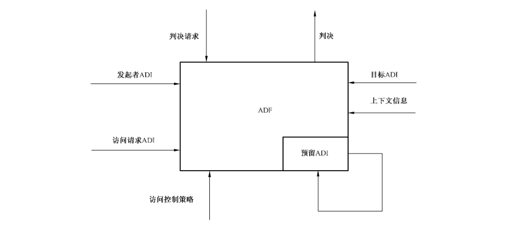
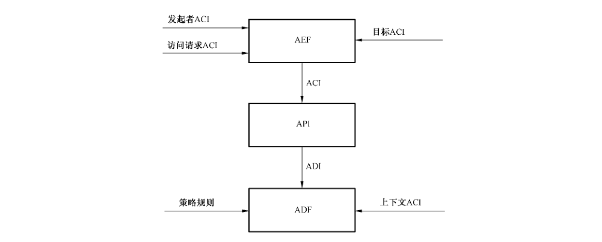
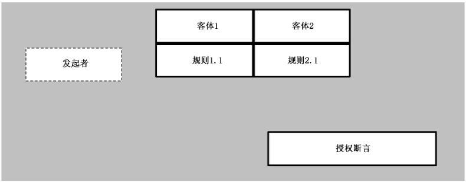
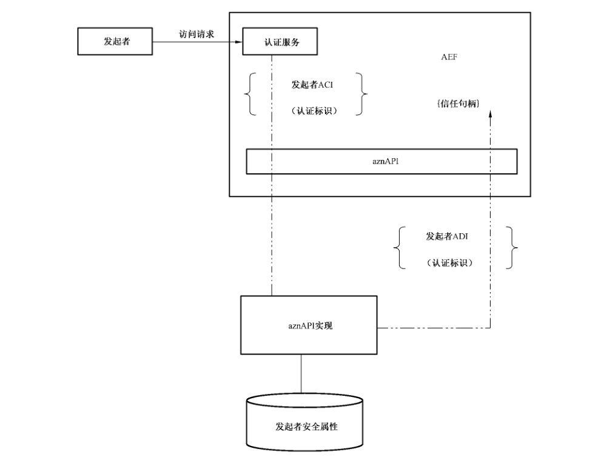
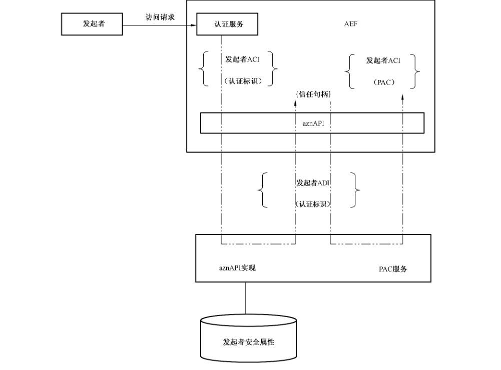
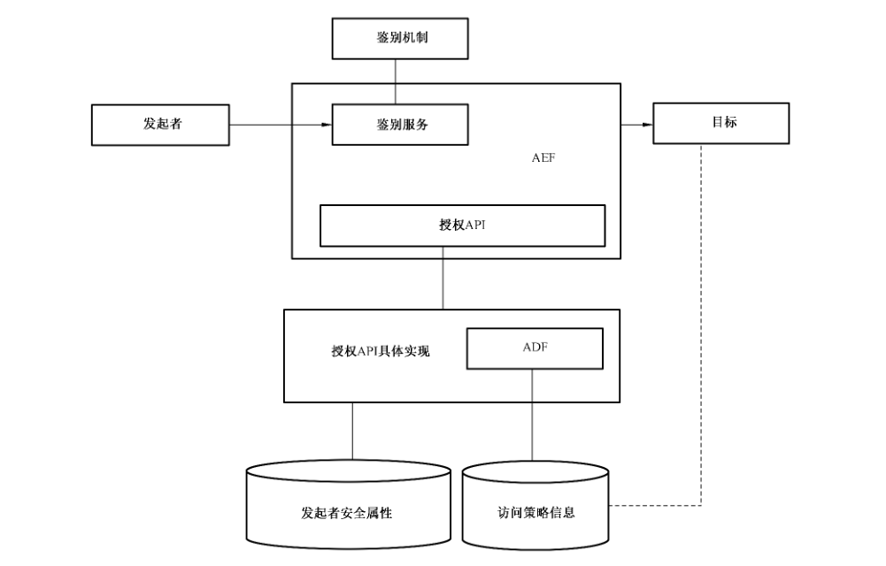
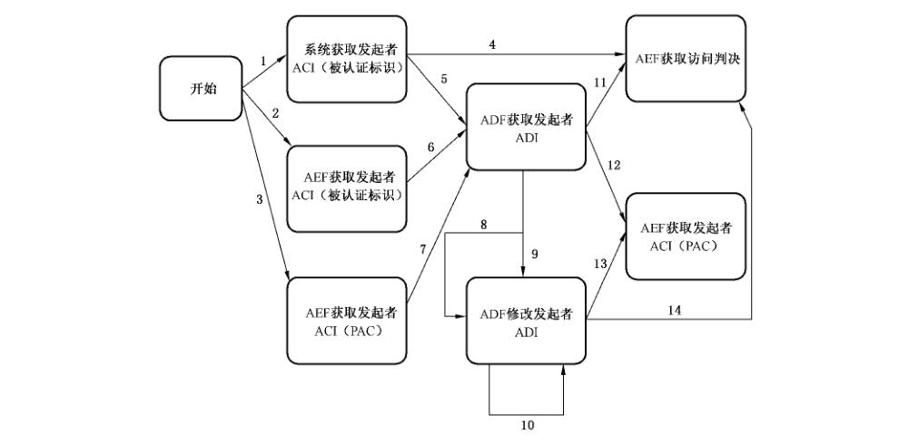
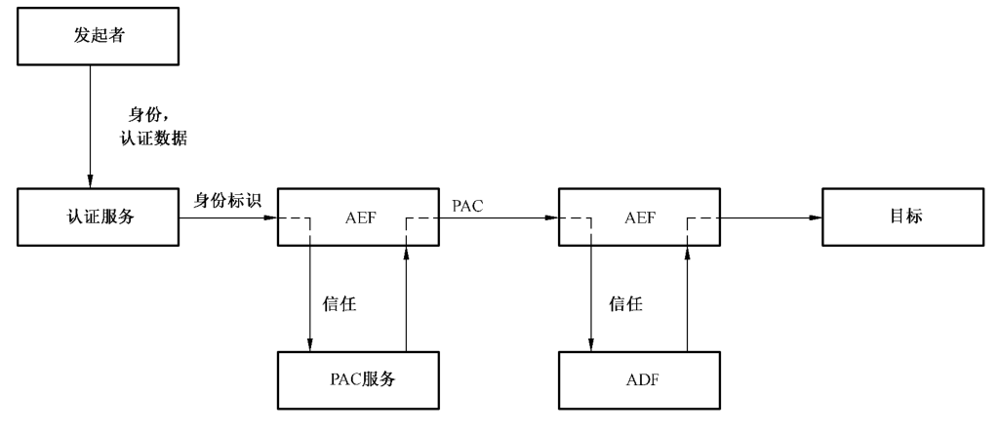
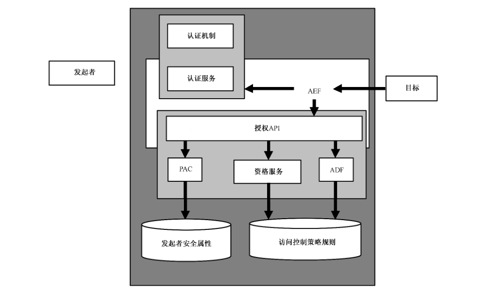

# GB/T 31501-2015 信息安全技术 鉴别与授权 授权应用程序判定接口规范

> 来源：[GB/T 31501-2015 国家标准详情](https://openstd.samr.gov.cn/bzgk/std/newGbInfo?hcno=09A04F841D377085B1B7FBDD4EA7BA78)；封面发布日期：2015-05-15；实施日期：2016-01-01。
> PDF SHA-256：08febe6b5d4f65b3e78214670924dbe61847f7dc93f83b8009a1af0fa2c4826b。
> 转写说明：对照官方 PDF 全部 55 页图像校核；省略封面、目录、页眉和页码，合并跨页表 4，保留图 1—图 11。附录 A.3 和 A.33 的标题与函数定义不一致，按印刷原文照录。正式引用请核对官方原文。

> 转写核验注（不属于标准原文）：原版8.1.3、8.1.4及8.2的三个 typedef 声明未印分号；A.1注释均写“参数1的名称”；A.3、A.33的函数标题与定义不一致；A.8写“出现的的所有属性名”；多处 AZN_S_API_UNINITIALIZED 说明写“在调用 azn_initialize 之前应该调用此函数”；A.34写“具体实现同环境中获取”。这些原件异常按原样保留；未统一原件中的 azn_credential_delete、azn_buffer_release、get_providre 及返回码名称差异。

## 前言

本标准按照GB/T 1.1—2009给出的规则起草。

请注意本文件的某些内容可能涉及专利。本文件的发布机构不承担识别这些专利的责任。

本标准由全国信息安全标准化技术委员会（SAC/TC 260）提出并归口。

本标准起草单位：中国科学院软件研究所、北京数字证书鉴别中心有限公司、中科正阳信息安全技术有限公司。

本标准主要起草人：冯登国、张立武、李晓峰、王雅哲、高志刚、徐震、段美姣、汪丹、黄亮、翟征德、詹榜华。

## 引言

访问控制作为一种基本的安全措施在实际系统中得到广泛的应用，随着访问控制技术的日趋复杂，访问控制已成为一类安全基础服务，而广泛的应用集成需求需要访问控制安全服务能够给应用程序提供一个统一的编程接口，使得应用程序能够在不同的访问控制服务之间具有可移植性，而目前缺少这类国家标准。为了解决这个问题，本标准参考了 Open Group 的技术标准（参考文献［1］）等相关标准和规范，在保证适应多种应用场景的情况下，定义了授权应用程序判定接口规范。

本标准定义的授权应用程序判定接口规范可用于符合GB/T 18794.3访问控制框架的系统中，尽管本标准提供了允许主体控制哪些特权属性可以被用于访问控制授权请求判定中（通常被称为最小特权），但并不提供特权属性管理。

本标准的设计目标如下：

a） 定义一个简单、灵活的 API，安全组件提供者和需要安全保护的应用程序开发者可以通过调用此API来实现授权功能；

b） 访问判定时可以应用透明地进行策略规则的评估；

c） 独立于应用的策略集中管理；

d） 透明地提供广泛的策略规则词法和语义（如访问控制列表、能力、标签、逻辑谓词等）；

e） 将鉴别和授权分离；

f） 允许从鉴别数据中推导出授权属性；

g） 透明地支持任意合理的授权属性类型（如访问标识、组、角色等）；

h） 易于在多层次结构的应用系统中提供授权服务；

i） 在多层应用配置中允许使用外部授权属性；

j） 应用程序可以访问应用于其资源的访问控制策略；

k）API 的实现支持多种访问控制机制；

l） 单一程序可以同时使用多个鉴别和授权服务；

m）支持应用程序访问与授权服务操作相关的审计数据。

本标准不涉及以下内容：

a） 授权策略管理；

b） 描述证书委托服务或语义；

c） 描述一个审计服务 API；

d） 描述授权服务如何以及何时生成审计事件；

e） 在异构环境下，定义用来交换证书信息的PAC格式；

f） 支持每一种可能的授权策略规则词法和语义。

## 1 范围

本标准定义了访问控制服务为授权应用提供的授权判定编程应用接口，并定义了与判定接口相关的数据结构和C语言形式的接口。

本标准适用于访问控制服务中授权判定接口的设计和实现，访问控制服务的测试和产品采购亦可参照使用。

## 2 规范性引用文件

下列文件对于本文件的应用是必不可少的。凡是注日期的引用文件，仅注日期的版本适用于本文件。凡是不注日期的引用文件，其最新版本（包括所有的修改单）适用于本文件。

- GB/T 18794.3—2003 信息技术 开放系统互连 开放系统安全框架 第3部分：访问控制框架

- GB/T 25069—2010 信息安全技术 术语

## 3 术语和定义

GB/T 25069—2010 界定的以及下列术语和定义适用于本文件。

### 3.1 访问控制信息 access control information

用于访问控制目的的任何信息，其中包括上下文信息。

［GB/T 18794.3—2003，定义3.4.5］

### 3.2 访问控制判定功能 access control decision function

一种特定功能，它通过对访问请求、ADI（发起者的、目标的、访问请求的或以前决策保留下来的ADI）以及该访问请求的上下文，使用访问控制策略规则而做出访问控制判定。

［GB/T 18794.3—2003，定义3.4.3］

### 3.3 访问控制判定信息 access control decision information

在作出一个特定访问控制判定时可供 ADF 使用的部分（也可能是全部）ACI。

［GB/T 18794.3—2003，定义3.4.2］

### 3.4 访问控制实施功能 access control enforcement function

一种特定功能，它是每一访问请求中发起者和目标之间访问路径的一部分，并实施由ADF 做出的决策。

［GB/T 18794.3—2003，定义3.4.4］

### 3.5 访问请求 access request

操作和操作数，它们构成一个试图进行的访问的基本成分。

［GB/T 18794.3—2003，定义3.4.9］

### 3.6 属性列表 attribute list

由属性名称和属性值构成的数据列表。

### 3.7 审计标识 audit identity

包含一个用于审计目的标识的属性。

### 3.8 授权机构 authorization authority

管理授权数据的实体。

### 3.9 能力 capability

表明拥有者具有访问某项系统资源的权限的标记。

### 3.10 许可权 clearance

能用来与目标安全标签进行比较的发起者绑定 ACI。

［GB/T 18794.3—2003，定义3.4.13］

### 3.11 凭证链 credentials chain

多个凭证根据相互关系构成的具有层次的结构。

### 3.12 凭证句柄 credential handle

指向凭证链的句柄。

### 3.13 合成凭证链 combined credentials chain

由多个凭证链构成的有序列表。列表中的第一个元素是访问请求发起者的凭证链，列表中的其他元素是传递这个访问请求的一系列中介的凭证链。

### 3.14 判定 decision

ADF 对判定请求的响应。

### 3.15 判定请求 decision request

AEF 发送给 ADF 的信息，此信息询问 ADF“允许还是拒绝一个特定的访问请求”。

### 3.16 资格 entitlement

包含 ADI 和访问控制策略规则信息的数据结构，应用程序可以使用此信息来决定其行为或者在其代码中进行访问控制判定。

### 3.17 标识 identity

传递到 aznAPI 的发起者ACI，本标准使用这个术语来描述所有发起者的信息，包括名称、身份证书和能力。

### 3.18 发起者 initiator

一个试图访问其他实体的实体（如人类用户或基于计算机的实体）。

［GB/T 18794.3—2003，定义3.4.15］

### 3.19 中介 intermediary

负责转发发起者的访问请求的实体。

### 3.20 标签 label

与受保护资源绑定的标记，其标明了此资源的安全相关属性。

### 3.21 操作 operation

发起者的访问请求中要求在受保护资源上执行的具体访问动作。

### 3.22 特权属性证书 privilege attribute certificate;PAC

保护特权属性的数据结构，产生此属性的权威可能对其进行签名。

### 3.23 特权属性 privilege attribute

与发起者相关的属性，当与受保护资源的控制属性匹配时，用来允许或拒绝访问此受保护资源。

### 3.24 受保护资源 protected resource

访问受访问策略限制的目标。

### 3.25 目标 target

被试图访问的实体。

［GB/T 18794.3—2003，定义3.4.23］

## 4 缩略语

下列缩略语适用于本文件。

ACI：访问控制信息（access control information）

ADF：访问控制判定功能（access control decision function）

ADI：访问控制判定信息（access control decision information）

AEF：访问控制实施功能（access control enforcement function）

API：应用程序编程接口（application programming interface）

aznAPI：授权应用程序编程接口（authorization application programming interface）

ID：标识（identity）

PAC：特权属性证书（privilege attribute certificate）

SSL：安全套接层（secure sockets layer）

## 5 框架

### 5.1 访问控制框架

本标准采用的访问控制服务框架的定义见GB/T 18794.3—2003。

### 5.2 访问控制服务组件

#### 5.2.1 ADF

ADF 根据 ADI 做出访问控制判定。ADI 描述了发起者、目标、访问请求、系统和环境安全相关的属性。ADI 的详细定义见 5.3.2.2。

图1描述了 ADF 用来进行访问控制判定的信息。



#### 5.2.2 AEF

访问控制实施功能实施 ADF 的访问控制判定结果。

aznAPI 是一个媒介，通过此 API,AEF 调用 ADF 来获取访问控制判定的结果。AEF 使用此 API向 ADF 传递 ACI。如图2所示，aznAPI 的实现负责从 AEF 提供的ACI 中推导出 ADI，并且将此 ADI提交给 ADF。ADF根据上述 ADI 信息，以及访问控制策略和当前上下文 ADI来做出访问判定。



### 5.3 访问控制信息

#### 5.3.1 概述

ACI是AEF 可获取的与访问控制判定可能相关的信息。aznAPI 的职责是：

a） 确定 AEF 提交的与访问控制判定有关的 ACI 信息；

b） 将 AEF 提交的 ACI 转化为 ADF 可用的 ADI；

c） 将 ADI 提交给 ADF。

#### 5.3.2 发起者信息

##### 5.3.2.1 发起者ACI

发起者 ACI 描述了访问请求发起者安全相关属性，是AEF 可获取的发起者信息。

由鉴别服务生成的发起者ACI 数据结构在本标准中称为标识。标识可以很简单，例如只包括发起者的名称字符串；也可以很复杂，例如包括数字证书。

授权 API 可以接受能力作为标识，能力是由鉴别服务提供的直接断言，如图3所示，在能力中并不是必须要标明发起者，无论谁拥有能力都可以使用。在图3中，发起者使用虚线来表示。能力中包括一个策略入口列表，每个入口指定了一个目标客体，同时定义规则用来描述发起者允许执行的操作。

> 注：aznAPI 实现不要求支持所有的标识格式，同时也不是必须要支持能力。



由授权服务产生的发起者 ACI 数据结构被称为 PAC。并不是只有授权服务可以产生 PAC，鉴别服务也可以产生 PAC 来声称用户标识。在“推模式”中，PAC 是用户特权属性。（aznAPI 实现中，由鉴别服务产生的 PAC 被当作标识来处理，以此来区分 AZN 自己产生的授权数据结构。）aznAPI 实现也可以将 PAC 数据结构作为用户凭证信息的内部表示，AEF 通过 aznAPI 是不可见这些数据结构的，PAC 应符合 5.3.8.1。

##### 5.3.2.2 发起者 ADI

发起者 ADI 是从发起者ACI 中衍生出来的授权相关信息，通过 aznAPI 传递给ADF。aznAPI 将发起者 ADI 存储在称为凭证链的数据结构中。因为凭证链不会传递给 aznAPI 的调用者，同时不同的授权服务可以使用不同的凭证链格式，所以凭证链数据结构格式定义不包括在此标准中。

尽管 aznAPI 不允许调用者直接访问凭证链，但其提供访问凭证链属性信息的接口函数。

图4显示了 aznAPI 如何将发起者ACI 转换为凭证链，并且返回一个凭证句柄给调用者，aznAPI可以用在将特权属性从客户端推到 AEF 的系统中，或者要求AEF 从某个存储或服务中采用拉模式获取特权属性的系统中。在推模式环境下，发起者ACI 中包含被客户端推来的特权属性，并且被转换为可以被 aznAPI 实现使用的内部数据。在拉模式环境下，ACI 发起者只包含单一特权属性（如发起者被鉴别的名称），而 aznAPI 实现在构建发起者凭证链时，从适当的存储或结构中获取发起者的其他特权属性。



#### 5.3.3 目标信息

##### 5.3.3.1 概述

目标信息描述了访问请求中与目标相关的安全信息：

a）目标 ACI:AEF 可以获取的目标信息。

b） 目标 ADI:aznAPI 转换目标 ACI 获得的目标信息。

##### 5.3.3.2 目标 ACI

通常 aznAPI 需要的目标 ACI 数据只是目标名。

安全标签是此规则的特例。aznAPI 可以支持包含安全标签的ADI 的访问控制判定。在某些基于标签的授权系统中，授权服务并不知道标签信息是如何在目标中被编码的，以及标签是如何以与目标相关的元数据的方式存储起来的。在这些例子中，AEF 需要获取目标安全标签，并将它们作为目标 ACI传递给 aznAPI。授权 API 可以被实现为支持处理不同类型的标签。在支持多种标签的实现中，调用者需要明确使用的标签模式 ID，使得 API 知道在此调用中使用哪类标签。

##### 5.3.3.3 目标 ADI

不同的授权服务实现可以包含不同数量的目标 ADI 和数据类型。目标 ADI 数据通常并不返回给调用者，所以目标 ADI 数据格式不在此标准中定义。

由于有些授权 API 调用者可能会因为其他用途使用授权策略数据，所以授权 API 支持将 ADI 数据外部化为数据结构，此数据结构称为资格。资格应符合 5.3.8.2。

#### 5.3.4 请求信息

##### 5.3.4.1 概述

请求信息描述了访问请求相关的安全属性：

a） 请求 ACI 是 AEF 可以获取的请求信息；

b） 请求 ADI 是授权 API 将请求 ACI转换后的请求信息。

##### 5.3.4.2 请求 ACI

aznAPI 要求请求ACI 包含请求的操作名称。

##### 5.3.4.3 请求 ADI

不同授权服务实现可以有不同类型和数量的请求 ADI 数据。请求ADI 数据并不返回给调用者，所以请求ADI 数据格式并不在此标准中定义。

#### 5.3.5 上下文信息

##### 5.3.5.1 概述

上下文信息描述了访问请求发生上下文的安全相关属性。上下文 ACI 是AEF 可以获取的上下文信息。

上下文 ADI 有两个来源：

a） aznAPI 将上下文 ACI 转换后的结果；

b） 授权服务可以直接获取而并非由 ACI 提供的上下文信息。

##### 5.3.5.2 上下文 ACI

aznAPI 定义了四种上下文 ACI 数据，这些数据可以作为上下文信息传递给授权服务：

- 时间：请求发生的时间；
- 地点：请求发起的地点（源地址）；
- 路由：将请求从发起者传递到 AEF 通过的连接；
- 鉴别质量：用于建立发起者身份的鉴别的质量。

上下文信息并不局限于此。aznAPI 允许 AEF 使用非透明类型的参数传递给授权服务，使用这些参数说明应用或授权服务相关的上下文信息。使用这些通过不透明参数传递特定上下文信息格式的授权服务的应用可移植性低。

##### 5.3.5.3 上下文 ADI

不同的授权服务的实现可以有不同数量和类型的上下文ADI 数据。上下文 ADI 数据在 aznAPI中不返回给调用者，所以在此标准中不定义上下文 ADI 数据格式。

#### 5.3.6 预留信息

授权服务可以保留同一发起者请求的操作序列信息，并由此来做出访问控制判定。如，用于 ATM中的授权服务保存了每个用户在当前所取的钱数信息，并以此来实现每天的取钱限制策略。

授权服务为此目的保留的信息是 ADI，并且不会通过授权 API 暴露给应用程序。因此，保留的 ADI 信息的格式在此标准中不涉及。

#### 5.3.7 访问控制策略信息

访问控制策略信息包括用来评估其他的ADI 并且做出访问控制决策的规则。调用者并不能从授权 API 中获取访问控制策略信息，不同的授权服务可以使用不同类型和数量的访问控制策略信息，所以访问控制策略信息格式不在此标准中定义。授权服务可以以资格的形式外部化访问控制策略信息，这部分内容在5.3.8.2中描述。

#### 5.3.8 外部化 ADI

授权 API 对调用者有意隐藏了发起者 ADI 和访问控制策略信息的细节。然而，这些信息在某些情况下对调用者是有用的，因此，授权 API 允许授权服务外部化发起者 ADI 和访问控制策略信息。

##### 5.3.8.1 PACs

授权 API 将外部化的发起者 ADI 放在一个称为 PAC 的数据结构中，图5表明了 PAC 的创建过程。



发起者 ADI 的外部化允许授权服务以它的角度断言发起者的安全相关特征，这与从鉴别服务角度看到的发起者的安全相关特征是不同的。

某授权服务可以使用这个功能产生签名的属性证书，其他服务以此作为授权数据源。

因为此标准只定义了一个不透明的PAC结构，由一个授权服务产生的PAC不能保证被其他授权服务使用。在将来的标准中会定义一个标准的PAC结构，以此为基础，授权服务之间可以传递发起者授权属性的断言。

> 注：签名的PAC 可以用来构建委托协议，aznAPI 不能提供委托服务。一个委托协议必须允许希望成为发起者请求委托的实体可以将以下内容传递给一个目标：被委托的请求、一个可信表示，证明最初从访问发起者处得到的请求已经被鉴别、委托者被授权将请求以发起者的名义转发给目标的可信表示、发起者的信任表示和委托者的凭证信息。

授权服务可以签名 PAC 来形成发起者的信任表示和委托者的凭证信息，甚至可以包含身份信息（如证书发布者标识和身份证书序列号）建立起到发起者鉴别数据的一个链接，但授权服务并不在请求中绑定 PAC（以加密或其他方式）。代表发起者或作为发起者委托者身份的 AEF 必须使用一个独立的加密设施或委托服务来绑定由 aznAPI 生成的 PAC 与委托请求消息。

##### 5.3.8.2 资格

授权 API 将外部化的访问控制策略信息存储在称为资格的数据结构中。

外部化的访问控制策略信息允许应用程序基于授权策略来定制系统的行为。例如，其允许应用程序修改系统菜单来显示发起者可以执行的访问，而不是显示系统中所有的操作。资格信息也可以被应用程序用来做出其自己的访问判定，而不是依赖于在授权服务中实现的 ADF。

授权 API定义了一个可移植的、每个授权服务可以支持的资格数据格式，是一个特定发起者可以在某个特定目标上执行的操作列表。图6显示资格信息的格式示例。主体数据周围的虚线表示发起者数据是隐含的，其并不包含在授权 API 返回的资格数据中。


可移植的资格数据表示保证了在所有的授权服务中都可以被支持，但其不是非常有效的。一些授权服务可能使用单一规则或者使用通配符来表示发起者在许多目标上的操作授权，甚至可以用一个单一规则或表达式来描述多个发起者的授权，然而不同的授权服务使用不同的规则格式，并且不存在一个单一规则格式可以用来有效地表示所有授权服务，基于这个原因，授权 API 允许授权服务以非透明类型参数的形式返回非移植的资格信息，如图7所示，非移植资格信息可通过任意的规则方式进行描述。


使用非移植资格要求调用授权API 的应用程序来理解授权服务规则格式，并且防止调用授权API的应用程序使用有不同规则格式的授权服务。

## 6 授权 API 使用模型

### 6.1 系统结构

图8是使用授权 API 的系统结构。



在使用授权 API 的系统中的资源请求由 AEF 来仲裁。

AEF 鉴别用户（通常使用鉴别服务），同时 AEF 也通过将访问控制信息传递给授权API来授权请求，其完成被授权的请求并且拒绝未被授权的请求。

授权 API 将从 AEF 中发来的ACI转换成 ADI，同时利用 ADF 做出访问判定。

ADF 使用 ADI 和访问策略规则来判定发起者在目标上执行操作的请求是被允许还是拒绝。

### 6.2 支持的函数

表1列出了文献［1］中提供的授权 API 函数集，并且简单描述了每一个函数集的功能。

**表1 授权服务 API 函数**

| 接口集命名前缀 | 接口集支持的功能 |
| --- | --- |
| azn_initialize, azn_shutdown | 初始化授权 API 的实现<br />系统停止运行时，清除授权 API 的实现 |
| azn_creds | 创建、删除、修改和合并链<br />从凭证链中获取信息<br />基于凭证链创建 PAC |
| azn_id | 基于由鉴别服务产生的鉴别标识建立鉴别链 |
| azn_decision | 做出访问判定 |
| azn_entitlement | 获取访问控制策略信息 |
| azn_pac | 基于由授权服务产生的PAC建立凭证链 |
| azn_error | 从由授权 API 函数返回的状态值中获取错误信息 |
| azn_authority | 由 aznAPI 实现支持的鉴别、授权和凭证、标签、pac 发现机制 |
| azn_attrlist | 创建和删除属性/值列表<br />将参数写入属性/值列表<br />从属性/值列表中读取参数数据 |
| azn_release | 释放在授权 API实现中分配的数据 |

### 6.3 状态机

图9概括了调用授权 API 应用的状态机（通常是一个 AEF），AEF 应该按图中的顺序调用授权 API 函数。图中所描述的仅是状态机的大致情况，并没有列举出授权服务实现调用者所有可能的状态。

由于 AEF通过 API 而不是授权 API 调用鉴别服务，所以图中并非每个状态都是由授权 API 函数调用引起的。



表2指明了可以引起状态转移的授权 API 函数调用和其他 AEF 操作。

**表2 授权 API 状态机迁移**

| 迁移 | 引起迁移的操作 |
| --- | --- |
| 1 | AEF 获取已被鉴别服务鉴别的发起者的请求 |
| 2 | AEF 获取请求，AEF 鉴别发起者 |
| 3 | AEF 获取由一个授权 API 实现产生的PAC所描述的发起者的请求 |
| 4 | AEF 调用 azn_decision_access_allowed 来授权请求（授权服务使用从环境中获取的鉴别服务标识隐含地建立凭证链） |
| 5 | AEF 调用 azn_id_get_creds，其参数中的ID 为空（授权服务使用从环境中获取的鉴别标识） |
| 6 | AEF 调用azn_id_get_creds，其参数中的ID 是在鉴别发起者时由AEF产生 |
| 7 | AEF 调用 azn_pac_get_creds |
| 8 | AEF 调用 azn_creds_combine 来给发起者添加凭证链 |
| 9 | AEF 调用 azn_creds_modify 来改变凭证链的属性 |
| 10 | AEF 调用 azn_creds_modify 来改变凭证链的属性 |
| 11 | AEF 调用 azn_decision_access_allowed |
| 12 | AEF 调用 azn_creds_get_pac |
| 13 | AEF 调用 azn_creds_get_pac |
| 14 | AEF 调用 azn_decision_access_allowed |

图9的状态机可以分为三个阶段：

a） 凭证建立。图9中初始状态的最左边一列的状态属于此阶段，在此阶段中，AEF 使用授权API 建立凭证链，授权服务将使用此凭证链作为后续操作的基础。

b） 凭证修改。图9中初始状态的右边的第二列属于此阶段，在此阶段中，AEF 通过修改凭证链中的数据或合并发起者的凭证链来改变发起者的凭证链。

c） 凭证使用。图9中最右边一列的状态属于此阶段，在此阶段中，AEF 在授权判定或创建可传递给其他 AEF 的 PAC 中使用凭证链。

#### 6.3.1 没有包括在状态图中的函数

##### 6.3.1.1 概述

为了简化状态图，状态图中忽略了一些授权 API 函数，这些忽略掉的函数包括：

a） 管理函数；

b） 内存管理；

c） 出错信息的获取；

d） 凭证信息获取；

e）资格。

##### 6.3.1.2 管理函数

管理函数包括授权 API 的初始化和关闭函数。初始化在使用任何授权API 函数前必须调用。关闭函数在调用最后一个授权函数后或在 AEF 退出前必须被调用。

##### 6.3.1.3 内存管理

这些函数包括创建和删除凭证链和属性列表数据结构。这些数据结构必须在使用前被创建。在创建凭证链的调用中假定凭证链的内存通过调用 azn_creds_create已被分配。授权服务不释放凭证链和属性数据结构内存，AEF 必须调用 azn_release 或azn_credential_delete 来释放内存。

##### 6.3.1.4 出错信息的获取

在调用授权 API 函数返回一个出错状态后，可以调用出错信息获取函数。

##### 6.3.1.5 凭证信息获取

在建立凭证链后的任何时候都可以调用此类函数。

##### 6.3.1.6 资格

在建立凭证链后的任何时候都可以调用此类函数。

### 6.4 信任模型

#### 6.4.1 概述

安全系统的每一个组件需要知道其信任哪些组件，以及它们可以被信任来做什么。本条目表述了使用授权 API 的系统组件之间的信任关系。

#### 6.4.2 鉴别和授权的关系

授权 API 将鉴别和授权分离开来，如图 10 所示：



发起者可以使用鉴别服务来创建一个标识，AEF 在接收发起者访问请求时获取此标识。

AEF调用授权 API 将发起者标识转化为凭证链，凭证链被用来做访问控制判定。

在实现中如果需要将发起者的请求传递给另一个 AEF,AEF 可以调用授权 API 将凭证链转化成一个 PAC，此PAC 表示授权服务对发起者的观点（此处不是鉴别服务对发起者的观点，鉴别服务的观点表示为标识）。

另外一个 AEF 接收到此 PAC后，可以将其转化为一个凭证链，此凭证链可用于访问控制判定。

在一个使用授权 API 的系统中：

- 鉴别数据表示为标识；
- 发起者的授权数据 ACI，在授权服务中总是表示为凭证链；
- 关于发起者的授权数据 ACI 在授权服务外总是表示为 PAC。

基于以上原因，可以区分鉴别数据和授权数据。

关于鉴别数据的可信判定取决于 AEF，一个授权 API 实现并不对其他AEF 传递来的身份信息是否可信作出判断。

#### 6.4.3 TCB边界

图11表示 AEF、授权 API、ADF、PAC 服务、鉴别服务和鉴别服务使用的任何机制均位于系统的可信计算基（TCB）中，因此需要防止其未经授权被修改。



系统中的组件有如下信任关系：

a） 目标资源的属主信任AEF，隐含地信任鉴别和授权服务（包含在最外边的灰色框内的所有组件），以此来阻止非授权的发起者访问目标。

b） 鉴别服务信任鉴别机制功能正确，同时能够提供发起者正确的标识。

c） AEF 信任鉴别服务提供正确的和经过鉴别的发起者标识，隐含地信任鉴别机制。

d） 授权 API 信任 AEF 提供正确的 ACI。

e） AEF 信任授权 API 能够做出并且返回正确的访问判定，同时可以返回正确的PAC、资格和凭证链特权属性，AEF 隐含地信任授权服务。

f） 授权服务信任实现基于发起者安全属性存储能够将发起者标识正确地转化为凭证链。

g） 授权 API 信任 PAC 服务能够将凭证链正确地转化为 PAC 服务，并且返回正确的凭证链特权属性。

h）授权 API 实现和 PAC 服务信任安全属性存储能保持正确的信息。

i） 授权 API 信任授权服务ADF 能够基于访问控制策略做出正确的访问判定。

j） 授权 API 信任授权服务的资格服务（ES）能够基于访问控制策略存储返回正确的资格。

k） ADF 和ES 信任访问控制策略存储包含正确的信息。

## 7 功能和可移植性要求

### 7.1 功能要求

#### 7.1.1 函数

表3中描述的函数应该在 aznAPI 中实现，并且要与本标准保持一致。

**表3 必须实现的函数**

| 函数名称 | 说明 |
| --- | --- |
| azn_attrlist_* | `/* all attrlist calls */` |
| azn_creds_create |  |
| azn_creds_delete |  |
| azn_decision_access_allowed |  |
| azn_error_* | `/* all error calls */` |
| azn_id_get_creds |  |
| azn_initialize |  |
| azn_release | `/* all release calls */` |
| azn_shutdown |  |

在第6章中描述的其他函数功能可以选择实现，而对于未实现的功能，函数要返回 AZN_S_UNIMPLEMENTED_FUNCTION。

本标准采用标准C语言格式对 aznAPI 函数进行了定义和描述，参见附录A。

#### 7.1.2 授权、服务、模式和机制

所有的授权服务实现必须支持使用 AZN_NULL_ID，此参数表明使用缺省的权威和缺省的机制 ID。

提供资格服务、标记模式、凭证修改服务和 PAC服务的授权实现必须支持使用 AZN_NULL_ID，此参数表明使用缺省的服务或模式。

授权服务实现不要求支持任何显式权威、模式、机制或服务 ID。

将来，补充标准可以定义授权、模式、机制和服务 ID 的标准可移植集合。

#### 7.1.3 属性

所有授权 API 实现必须能够从 azn_initialize 中返回 AZN_C_VERSION 属性和其字符值。

### 7.2 移植性要求

应用程序如果只使用以上描述的 aznAPI 的功能，并且 aznAPI 的不同实现都支持应用程序的资源和操作，那么这些不同实现之间具有可移植性。

本标准不为受保护的资源或操作定义标准的命名空间或命名词法。

在受保护的资源和操作的命名空间和命名词法定义前，程序开发者需要检查他们的授权API 文档，以此来保证他们的资源名称和操作名称在其使用的授权 API 中被支持。

## 8 常量和变量定义

### 8.1 字符串与类字符串数据

#### 8.1.1 缓冲区

大量的授权 API 程序采用内存缓冲区作为其参数或返回值。内存缓冲区在授权 API 间传递，同时调用者使用 azn_buffer_t 来描述单字节缓冲区，此数据类型是一个指向缓冲区描述符的指针，其缓冲区描述符包括一个长度域和一个值域，长度域描述数据长度，而值域包含一个指向真实数据的指针：

```c
typedef struct azn_buffer_desc_struct {
    size_t length;
    void * value;
} azn_buffer_desc, * azn_buffer_t;
```

azn_buffer_desc 对象内存的分配和释放应由应用程序来执行，新创建的 azn_buffer_desc 对象可以初始化为 AZN_C_EMPTY_BUFFER。

azn_buffer_t 客体在 azn_attrlist_get_entry_buffer_value 和 azn_creds_get_pac 中是一个输出，在这种情况下，在 azn_buffer_desc 中的缓冲区数组分配由授权 API 来实现，此种缓冲区必须由应用程序调用 azn_release_buffer 来释放。

#### 8.1.2 字符串

大量的授权 API 程序以字符串作为其输入参数和返回值，调用者使用 azn_string_t 数据类型在授权 API 间传递字符串：

```c
typedef char * azn_string_t;
```

这是一个字符串数据类型，用来编码标识能力、许可或类似概念。

字符串使用以“\0”为结尾的 UTF-8 字符数组来表示。

#### 8.1.3 凭证句柄

大量的授权 API 以凭证句柄为其参数或返回凭证句柄。调用者使用 azn_creds_h_t 数据类型在授权 API 间传递凭证句柄：

```c
typedef unsigned int azn_creds_h_t
```

各种类型的 azn_creds_h_t 被非透明地处理，这与凭证链的具体实现有关。

在应用程序使用凭证句柄前，其必须调用 azn_creds_create 来初始化句柄，此函数分配一个新的、空的凭证链结构，并将其与一个句柄相关联，并返回此句柄。

当应用程序不再需要一个凭证链结构时，应用程序必须调用 azn_creds_delete 来释放凭证链结构。

#### 8.1.4 属性列表句柄

大量的授权 API 程序以属性列表句柄为其参数或者返回一个属性列表句柄。调用者使用 azn_attrlist_h_t 数据类型在授权 API 间传递属性列表句柄。

```c
typedef unsigned int azn_attrlist_h_t
```

各种 azn_attrlist_h_t 被非透明地处理，这与授权 API 实现维护的名称/值对列表有关。授权 API 提供接口通过属性列表句柄指定属性列表来获取名称/值对。

在应用程序使用属性列表句柄前，应用程序必须调用 azn_attrlist_create 来初始化句柄。

当应用程序不需要此句柄时，需要调用 azn_attrlist_delete 来删除句柄。

### 8.2 状态值

授权 API 程序返回类型为 azn_status_t 的状态编码：

```c
typedef unsigned int azn_status_t
```

为了与标准 C 语言条件测试规则保持一致，授权 API 实现中的 azn_status_t 应该可以映射为一个整数。在 API 调用返回的状态编码中封装了主出错编码和辅出错编码，调用成功应总是返回 AZN_S_COMPLETE（0）。主出错编码如表4所示，其与实现无关，辅出错编码与实现相关，其返回值及其含义应该在实现的文档中定义。

**表4 主出错编码**

| 名称 | 值 | 含义 |
| --- | --- | --- |
| ［AZN_S_COMPLETE］ | 0 | 成功 |
| ［AZN_S_FAILURE］ | 1 | 发生错误 |
| ［AZN_S_AUTHORIZATION_FAILURE］ | 2 | 调用者不拥有所需的授权 |
| ［AZN_S_INVALID_CREDS_HDL］ | 3 | 提供的句柄没有指向一个有效凭证链 |
| ［AZN_S_INVALID_NEW_CREDS_HDL］ | 4 | 提供的句柄没有指向一个有效凭证链 |
| ［AZN_S_INVALID_ENTITLEMENTS_SVC］ | 5 | 属性资格服务标识无效 |
| ［AZN_S_INVALID_COMB_CREDS_HDL］ | 6 | 提供的句柄没有指向一个有效凭证链 |
| ［AZN_S_INVALID_MECHANISM_INFO］ | 7 | 提供的安全机制信息是无效的或错误的 |
| ［AZN_S_INVALID_MECHANISM］ | 8 | 机制标识是无效的 |
| ［AZN_S_INVALID_STRING_VALUE］ | 9 | 提供的字符串是无效的 |
| ［AZN_S_UNKNOWN_LABEL］ | 10 | 提供的标签是无效的 |
| ［AZN_S_INVALID_ADDED_CREDS_HDL］ | 11 | 提供的凭证句柄没有指向一个有效的凭证链 |
| ［AZN_S_INVALID_PROTECTED_RESOURCE］ | 12 | 被包含的资源标识是无效的 |
| ［AZN_S_INVALID_OPERATION］ | 13 | 针对资源的指定操作是无效的 |
| ［AZN_S_INVALID_PAC］ | 14 | 特权属性证书结构是无效的 |
| ［AZN_S_INVALID_PAC_SVC］ | 15 | 特权属性证书服务标识是无效的 |
|  | 16 | 未用 |
| ［AZN_S_INVALID_MOD_FUNCTION］ | 17 | 凭证修改函数标识是无效的 |
| ［AZN_S_INVALID_SUBJECT_INDEX］ | 18 | 用来索引单个凭证的数字是无效的 |
| ［AZN_S_UNIMPLEMENTED_FUNCTION］ | 19 | 本函数未实现 |
| ［AZN_S_INVALID_ATTRLIST_HDL］ | 20 | 属性列表句柄无效 |
| ［AZN_S_ATTR_NAME］ | 21 | 属性名无效 |
| ［AZN_S_INVALID_BUFFER］ | 22 | 缓冲区无效 |
| ［AZN_S_INVALID_BUFFER_REF］ | 23 | 缓冲区引用无效 |
| ［AZN_S_INVALID_STRING_REF］ | 24 | 字符引用无效 |
| ［AZN_S_ATTR_VALUE_NOT_STRING_TYPE］ | 25 | 返回的入口值不是字符串类型 |
| ［AZN_S_ATTR_INVALID_INDEX］ | 26 | 多值属性索引值无效 |
| ［AZN_S_INVALID_INTEGER_REF］ | 27 | 整数引用无效 |
| ［AZN_S_INVALID_PERMISSION_REF］ | 28 | 权限的整数引用无效 |
| ［AZN_S_INVALID_AUTHORITY］ | 29 | 授权的权威 ID 无效 |
| ［AZN_S_INVALID_APP_CONTEXT_HDL］ | 30 | 应用程序上下文的属性列表句柄无效 |
| ［AZN_S_INVALID_ENTITLEMENTS_HDL］ | 31 | 资格的属性列表句柄无效 |
| ［AZN_S_INVALID_LABELING_SCHEME］ | 32 | 标签模式标识未知或无效 |
| ［AZN_S_INVALID_INIT_DATA_HDL］ | 33 | 初始化数据的属性列表句柄无效 |
| ［AZN_S_INVALID_INIT_INFO_HDL］ | 34 | 在初始化信息返回时的属性列表句柄无效 |
| ［AZN_S_ATTR_VALUE_NOT_BUFFER_TYPE］ | 35 | 返回的入口数据不是缓冲区类型 |
| ［AZN_S_API_UNINITIALIZED］ | 36 | 在 azn_initialize 调用前，调用了非 azn_attrlist_* 或 azn_error_* 函数 |
| ［AZN_S_API_ALREADY_INITIALIZED］ | 37 | 在未调用 azn_shutdown 的情况下，azn_initialize 调用了两次 |

函数 azn_error_major 和 azn_error_minor 用来获取主、辅出错编码。

授权 API 函数都可以返回主状态编码，指示传递了一个无效句柄，AZN_S_INVALID_CREDS_HDL 是一个例子。

授权 API 实现不能够检测无效句柄，但是当其能够检测到输入句柄参数无效时，应能够返回一个句柄无效的主状态编码。

授权 API 函数通过句柄释放数据时，应该能够将此句柄置为无效值，以使以后方便句柄的检查。

### 8.3 常量

在授权 API 程序参数中，标准值在此标准中定义为常数。

此节中的表罗列出了标准中定义的所有常数。

函数 azn_decision_* 返回一个有符号整数许可参数，此参数的合法值如表5所示。

**表5 权限常数**

| 名称 | 值 | 含义 |
| --- | --- | --- |
| ［AZN_C_PERMITTED］ | 0 | 凭证链持有者的操作被允许 |
| ［AZN_C_NOT_PERMITTED］ | 1 | 凭证链持有者的操作被拒绝 |

表6中的常数值可以被赋予类型 azn_buffer_t，也可以与此类型参数比较。

**表6 可选的参数常量**

| 名称 | 值 | 含义 |
| --- | --- | --- |
| ［AZN_C_EMPTY_BUFFER］ | NULL | 空数据值缓冲区 |
| ［AZN_C_NO_BUFFER］ | NULL | 未提供或返回值缓冲区 |

表7中定义了大量访问控制属性的名称，以保证应用程序能够以可移植的方式从授权 API 获取或发布信息。

凭证句柄指向一个凭证链，此凭证链包含发起者和一系列中间者的凭证，中间者传递发起者的请求。

授权 API 实现必须保证在凭证链中的第一个索引指向的发起者的凭证，常数［AZN_C_INITIATOR_INDEX］可以在 azn_creds_get_attrlist_for_subject 和 azn_creds_for_subject 来引用发起者的凭证。

azn_creds_get_attrlist_for_subject 函数允许 aznAPI 调用者从一个凭证中获取属性，本标准并未定义所有出现在凭证中的属性。

在授权 API实现中必须支持的属性是审计标识，此属性允许授权 API 调用者产生与发起者请求有关的审计记录，为了不泄漏隐私，在审计日志中记录了个人标识信息。发起者审计 ID 可以从 azn_creds_get_attrlist_for_subject 返回的属性链中利用常数 AZN_C_AUDIT_ID 来获取。授权调用者在 TCB 内，所以其有义务正确处理审计标识信息。授权 API 的调用者必须保证其不向 TCB 外的任一程序泄漏审计 ID。

有几个函数将上下文 ACI 作参数，由于上下文 ACI类型在这些函数中是一个属性列表，所以几乎所有的信息都可以作为上下文 ACI 来使用。然而，有四种类型的上下文 ACI 在许多授权服务实现中都存在，并在GB/T 18794.3 规约中被明确要求，所以可移植属性名称和对应的属性值类型在此定义，使得不同的实现间能够传递上下文参数。

［AZN_C_REQUEST_TIME］.［AZN_C_AUTHN_QUALITY］.［AZN_C_REQUESTER_LOC］和［AZN_C_REQUEST_ROUTE_QOP］可以用来命名那些携带这些通用类型上下文信息的属性列表入口中的属性。

**表7 属性名常数**

| 名称 | 值 | 含义 |
| --- | --- | --- |
| ［AZN_C_INITIATOR_INDEX］ | 0 | 在凭证链中表示发起者主体索引的整数值 |
| ［AZN_C_AUDIT_ID］ | “AZN_AUDIT_ID” | 属性名，对应的字符串包含一个主体审计标识 |
| ［AZN_C_REQUEST_TIME］ | “AZN_REQUEST_TIME” | 属性名，对应的缓冲区值包含一个time_t结构，表示访问请求发生的时间 |
| ［AZN_C_AUTHN_QUALITY］ | “AZN_AUTHN_QUALITY” | 属性名，对应的字符串描述用来建立发起者表示的鉴别的强度和机制 |
| ［AZN_C_REQUESTER_LOC］ | “AZN_REQUESTER_LOC” | 属性名，对应的字符串值包含请求发起位置，如果是IP 地址，其将包括一个标准的文本来表示十进制 IP地址 |
| ［AZN_C_REQUEST_ROUTE_QOP］ | “AZN_REQUEST_ROUTE_QOP” | 属性名，对应的字符串值将描述连接的安全特征 |

函数 azn_initialize 在属性列表中返回版本号，返回版本号的命名属性值如表8所示：

**表8 初始常量**

| 名称 | 值 | 含义 |
| --- | --- | --- |
| ［AZN_C_VERSION］ | “AZN_VERSION” | 属性名称，对应的值包含一个带小数点的版本号（如3.3） |

### 8.4 授权和机制 ID

#### 8.4.1 授权、服务和模式 ID

授权服务 API 实现可以支持下列服务中的多个提供者：

a） azn_id_get_creds：提供者称为权威；

b） azn_decision_has_clearance 和 azn_entitlement_get_labels：提供者称为标签模式；

c） azn_creds_modify：提供者称为凭证修改服务或 mod_svc；

d） azn_creds_get_pac 和 azn_pac_get_creds：提供者称为 pac 服务；

e） azn_entitlement_get_entitlements：提供者称为资格服务。

上述有些服务是可选的。

如果某实现支持单个服务的多个提供者，其必须使用客体标识来标识每一个提供者，实现的文档必须提供一个其所支持的提供者和客体标识的列表。

另外，如果某实现支持单个服务的多个提供者，此实现必须可以通过 get_provider 来调用服务，相关的 get_providre 调用如下：

a） azn_authority_get_authorities；

b） azn_authority_get_labeling_schemes；

c） azn_authority_get_mod_svcs；

d） azn_authority_get_pac_svcs；

e） azn_authority_get_entitlements_svcs。

应用程序在运行时通过给上述调用中传递提供者 OID 来选择服务提供者。

标准并不要求必须支持服务的多提供者。但是所有的实现必须为每个服务指定一个缺省的提供者。

应用程序可以通过传递表9中常数作为权威、服务和模式ID 来选择缺省的服务提供者。

**表9 缺省 ID**

| 名称 | 值 | 含义 |
| --- | --- | --- |
| ［AZN_NULL_ID］ | “” | 实现应该使用缺省的被调用的服务提供者 |

#### 8.4.2 鉴别和机制 ID

授权 API 定义了函数 azn_id_get_creds 来获取凭证链，此函数的实现可以用来自不同发起者的ACI 创建凭证链。

azn_id_get_creds 在调用时可以传入一个鉴别机制标识，以使此函数可以根据机制标识来确定mechanism_info 中存储的是哪一个机制的鉴别数据，从而可以支持多鉴别机制，此函数在实现时应该为每个权威id 指定一个考虑缺省的鉴别机制，在调用azn_id_get_creds 函数时，如果参数 mechanism_id 是 AZN_NULL_ID，表示调用者选择一个缺省的鉴别机制。

#### 8.4.3 移植性——鉴别机制客体标识

为了保证调用支持多鉴别机制的应用程序的可移植性，机制标识和相关机制信息（包括身份信息数据类型）应该在标准部门注册，标准部门保证每一个机制对应一个唯一客体标识。

当应用程序调用 azn_id_get_creds 时，鉴别机制生成传送到 mechanism_info 的数据，用于表示此鉴别机制的客体标识的字符串应该作为 mechanism_id 参数传入此函数。

## 附录 A（资料性附录）函数说明

### A.1 概述

本章给出了 aznAPI 的 C 语言形式的定义。

每个函数的函数定义格式如下（以 azn_attrlist_add_entry 为例）：

```c
azn_status_t                         // 返回值的类型
azn_attrlist_add_entry(              // 函数名字
    azn_attrlist_h_t attr_list /* in */,     // 参数1的类型 参数1的名称
    azn_string_t attr_name /* in */,         // 参数2的类型 参数1的名称
    azn_string_t string_value /* in */       // 参数3的类型 参数1的名称
);
```

> 注：函数的参数个数跟具体的函数有关，每行表示一个参数。`/* in */` 表示输入参数，`/* in,out */` 表示输入输出共用参数，`/* out */` 表示输出参数。

### A.2 azn_attrlist_add_entry

函数名：azn_attrlist_add_entry——在属性列表中添加名称/字符串入口。

函数定义：

```c
azn_status_t
azn_attrlist_add_entry(
    azn_attrlist_h_t attr_list /* in */,
    azn_string_t attr_name /* in */,
    azn_string_t string_value /* in */
);
```

函数说明：此函数在属性列表 attr_list 添加入口，所添加的入口名为 attr_name，值为 string_value。

此函数可以使用相同的 attr_list 和相同的attr_name 调用多次，但不同 string_values，这使得此名称下有多个值。

attr_name 和 string_value 拷贝到新的属性列表入口中，并将值改为输入的值，如果增加的是一个新入口将不会影响现存的值，应用程序在调用完此函数后，应该释放 attr_name 和 string_value。

此函数调用成功后返回 ［AZN_S_COMPLETE］。

参数说明：attr_list （in）— -属性列表句柄。

attr_name （in）——添加的入口属性名。

string_value （in）———添加的入口属性值。

返回值：［AZN_S_COMPLETE］—成功。如果返回的不是［AZN_S_COMPLETE］，可以使用 azn_error_major 获取以下主出错编码［AZN_S_INVALID_ATTRLIST_HDL］—属性列表指针无效。

［AZN_S_INVALID_ATTR_NAME］ ——属性名无效。

［AZN_S_INVALID_STRING_VALUE］—属性值无效。

［AZN_S_FAILURE］——发生一个需由具体实现解释的错误，辅出错编码可以调用 azn_error_minor获取。

### A.3 azn_attrlist_add_entry_buffer

函数名：azn_attrlist_add_entry_buffer——在属性列表中添加名称/缓冲区入口。

函数定义：

```c
azn_status_t
azn_attrlist_add_entry(
    azn_attrlist_h_t attr_list /* in */,
    azn_string_t attr_name /* in */,
    azn_buffer_t buffer_value /* in */
);
```

函数说明：此函数在属性列表 attr_list 中添加一个入口，此入口名称为 attr_name，值为 buffer_value。

此函数可以使用相同的 attr_list 和相同的attr_name 调用多次，但不同 buffer_value，这使得此名称下有多个值。

attr_name 和 buffer_value 拷贝到新的属性列表入口中，并将值改为输入的值，如果增加的是一个新入口将不会影响现存的值，应用程序在调用完此函数后，应该释放 attr_name 和 buffer_value。

如果成功，函数返回［AZN_S_COMPLETE］。

参数说明：attr_list （in）—-—属性列表句柄。

attr_name （in）——添加的入口属性名。

buffer_value （in）———添加的入口属性值。

返回值：［AZN_S_COMPLETE］—成功。如果返回的不是［AZN_S_COMPLETE］，可以使用 azn_error_major 获取以下主错误编码：［AZN_S_INVALID_ATTRLIST_HDL］ -属性列表指针无效。

［AZN_S_INVALID_ATTR_NAME］——属性名无效。

［AZN_S_INVALID_BUFFER］——属性缓冲区无效。

［AZN_S_FAILURE］—发生一个需由具体实现解释的错误，辅错误编码可以调用 azn_error_minor 获取。

### A.4 azn_attrlist_create

函数名：azn_attrlist_create——创建一个有效的空属性列表，并将其赋予一个句柄，并返回此句柄。

函数定义：

```c
azn_status_t
azn_attrlist_create(
    azn_attrlist_h_t * new_attrlist /* out */
);
```

函数说明：此函数创建一个有效的空属性列表，并将其赋予一个句柄，并返回此句柄。

当不需要此属性列表 new_attrlist 时，应该调用 azn_attrlist_delete 释放掉此属性列表。

如果成功，函数返回［AZN_S_COMPLETE］。

参数说明：new_attrlist （out） 新属性列表句柄。

返回值：［AZN_S_COMPLETE］ -成功。如果返回的不是［AZN_S_COMPLETE］，可以使用 azn_error_major 获取以下主错误编码：［AZN_S_INVALID_ATTRLIST_HDL］——属性列表指针无效。

［AZN_S_FAILURE］——发生一个需由具体实现解释的错误，辅错误编码可以调用 azn_error_minor 获取。

### A.5 azn_attrlist_delete

函数名：azn_attrlist_delete——删除由属性列表句柄指定的属性列表。

函数定义：

```c
azn_status_t
azn_attrlist_delete(
    azn_attrlist_h_t * old_attrlist /* in,out */
);
```

函数说明：此函数删除由属性列表句柄指定的属性列表。此函数在删除完属性列表后，将执行属性列表的句柄置为空，使其不能被使用。

如果成功，函数返回［AZN_S_COMPLETE］。

参数说明：old_attrlist （in,out） 存在的属性列表句柄。

返回值：［AZN_S_COMPLETE］ 成功。如果返回的不是［AZN_S_COMPLETE］，可以使用 azn_error_major 获取以下主错误编码：［AZN_S_INVALID_ATTRLIST_HDL］——属性列表指针无效。

［AZN_S_FAILURE］—发生一个需由具体实现解释的错误，辅错误编码可以调用 azn_error_minor获取。

### A.6 azn_attrlist_get_entry_buffer_value

函数名：azn_attrlist_get_entry_buffer_value——返回某个具有多个值的属性名的某个属性值，其属性值是缓冲区。

函数定义：

```c
azn_status_t
azn_attrlist_get_entry_buffer_value(
    azn_attrlist_h_t attr_list /* in */,
    azn_string_t attr_name /* in */,
    unsigned int value_index /* in */,
    azn_buffer_t * buffer_value /* out */
);
```

函数说明：此函数返回一个缓冲区类的属性值，attr_name 表示属性名，value_index 指定返回的属性值的位置，第一个属性值的索引值为 0。

当不需要 buffer_value 时，应用程序应该调用 azn_release_buffer 来释放此缓冲区。

如果成功，函数返回［AZN_S_COMPLETE］。

参数说明：attr_list （in）— 存在的属性列表句柄。

attr_name （in） 需要返回属性值的属性名。

value_index （in）—-—属性值索引值。

buffer_value （out）—指向返回的属性值的指针。

返回值：［AZN_S_COMPLETE］——成功。如果返回的不是［AZN_S_COMPLETE］，可以使用azn_error_major 获取以下主错误编码：［AZN_S_INVALID_ATTRLIST_HDL］——属性列表指针无效。

［AZN_S_INVALID_ATTR_NAME］——属性名无效。

［AZN_S_INVALID_BUFFER_REF］ ——缓冲区引用无效。

［AZN_S_ATTR_VALUE_NOT_BUFFER_TYPE］—指定的属性值不是缓冲区类型的。

［AZN_S_ATTR_INVALID_INDEX］ ——索引值无效。

［AZN_S_FAILURE］———发生一个需由具体实现解释的错误，辅错误编码可以调用 azn_error_minor 获取。

### A.7 azn_attrlist_get_entry_string_value

函数名：azn_attrlist_get_entry_string_value——返回某个具有多个值的属性名的某个属性值，其属性值是字符串。

函数定义：

```c
azn_status_t
azn_attrlist_get_entry_string_value(
    azn_attrlist_h_t attr_list /* in */,
    azn_string_t attr_name /* in */,
    unsigned int value_index /* in */,
    azn_string_t * string_value /* out */
);
```

函数说明：此函数返回一个字符串类型的属性值，attr_name 表示属性名，value_index 指定返回的属性值的位置，第一个属性值的索引值为0。

当不需要 string_value 时，应用程序应该调用 azn_release_buffer 来释放此缓冲区。

如果成功，函数返回［AZN_S_COMPLETE］。

参数说明：attr_list （in）—-—存在的属性列表句柄。

attr_name （in）—-—需要返回属性值的属性名。

value_index （in）—-—属性值索引值。

string_value （out）—-—指向返回的属性值的指针。

返回值：［AZN_S_COMPLETE］——成功。如果返回的不是［AZN_S_COMPLETE］，可以使用 azn_error_major 获取以下主错误编码：［AZN_S_INVALID_ATTRLIST_HDL］——属性列表指针无效。

［AZN_S_INVALID_ATTR_NAME］——属性名无效。

［AZN_S_INVALID_STRING_REF］ -字符串引用无效。

［AZN_S_ATTR_VALUE_NOT_STRING_TYPE］—指定的属性值不是字符串类型的。

［AZN_S_ATTR_INVALID_INDEX］—索引值无效。

［AZN_S_FAILURE］—发生一个需由具体实现解释的错误，辅错误编码可以调用 azn_error_minor 获取。

### A.8 azn_attrlist_get_names

函数名：azn_attrlist_get_names——返回属性列表入口中出现的的所有属性名。

函数定义：

```c
azn_status_t
azn_attrlist_get_names(
    azn_attrlist_h_t attr_list /* in */,
    azn_string_t * attr_names[] /* out */
);
```

函数说明：此函数返回一个以 NULL 结尾的azn_string_t 类型的属性名列表。

当不需要 attr_names 时，需要调用 azn_release_strings 来释放此属性名列表。

如果成功，函数返回［AZN_S_COMPLETE］。

参数说明：attr_list （in）———现存属性列表句柄。

attr_names （out）——指向类型为 azn_string_t 的结构体指针，此结构体内存储属性名列表。

返回值：［AZN_S_COMPLETE］——成功。如果返回的不是［AZN_S_COMPLETE］，可以使用 azn_error_major 获取以下主错误编码：［AZN_S_INVALID_ATTRLIST_HDL］——属性列表指针无效。

［AZN_S_INVALID_STRING_REF］ ——字符串数组指针无效。

［AZN_S_FAILURE］ -发生一个需由具体实现解释的错误，辅错误编码可以调用azn_error_minor 获取。

### A.9 azn_attrlist_name_get_num

函数名：azn_attrlist_name_get_num——获取某个给定属性名的属性值个数。

函数定义：

```c
azn_status_t
azn_attrlist_name_get_num(
    azn_attrlist_h_t attr_list /* in */,
    azn_string_t attr_name /* in */,
    unsigned int * num_values /* out */
);
```

函数说明：此函数获取某个给定属性名的属性值个数。

如果成功，函数返回［AZN_S_COMPLETE］。

参数说明：attr_list （in）———存在的属性列表句柄。

attr_name （in）——属性名。

num_values （out）———指向整数值的指针，此整数值是指定的属性名的属性值个数。

返回值：［AZN_S_COMPLETE］——成功。如果返回的不是［AZN_S_COMPLETE］，可以使用 azn_error_major 获取以下主错误编码：［AZN_S_INVALID_ATTRLIST_HDL］——属性列表指针无效。

［AZN_S_INVALID_ATTR_NAME］—属性名无效。

［AZN_S_ATTR_INVALID_INTEGER_REF］——整数引用无效。

［AZN_S_FAILURE］—发生一个需由具体实现解释的错误，辅错误编码可以调用 azn_error_minor 获取。

### A.10 azn_authority_get_authorities

函数名：azn_authority_get_authorities 返回此实现支持的所有授权权威ID列表。

函数定义：

```c
azn_status_t
azn_authority_get_authorities(
    azn_string_t * azn_authorities[] /* out */
);
```

函数说明：此函数返回此实现支持的所有授权权威ID列表。

授权权威是实现中的组件，其支持 azn_id_get_creds 调用。

使用函数 azn_authority_get_* 和授权 ID 可以找到支持的服务和机制，同时也可以通过 azn_id_get_creds 获取鉴别链。

当不再需要 azn_authorities 时，要调用azn_release_strings 来释放。

如果成功，函数返回［AZN_S_COMPLETE］。

参数说明：authzn_authorities （out） 以 NULL 结尾的 azn_string_t 类型的数据，其包含返回的授权权威ID。

返回值：［AZN_S_COMPLETE］——成功。如果返回的不是［AZN_S_COMPLETE］，可以使用 azn_error_major 获取以下主错误编码：［AZN_S_API_UNINITIALIZED］—此函数应该在 azn_initialize 之前被调用。

［AZN_INVALID_STRING_REF］—无效字符串引用。

［AZN_S_UNIMPLEMENTED_FUNCTION］—此函数未实现。

［AZN_S_FAILURE］—发生一个需由具体实现解释的错误，辅错误编码可以调用 azn_error_minor 获取。

### A.11 azn_authority_get_entitlements_svcs

函数名：azn_authority_get_entitlements_svcs——返回此实现支持的资格服务 ID 列表。

函数定义：

```c
azn_status_t
azn_authority_get_entitlements_svcs(
    azn_string_t * entitlements_svc_ids[] /* out */
);
```

函数说明：此函数返回此实现支持的资格服务 ID列表。这些服务可以在 azn_entitlement_get_entitlements中使用。

当不需要 entitlements_svc_ids 时，应该调用 azn_release_strings 来释放此资格服务ID 数组。

如果成功，函数返回［AZN_S_COMPLETE］。

参数说明：entitlements_svc_ids （out） 以 NULL结尾的 azn_string_t 类型的数据，此数据包含资格服务ID列表。

返回值：［AZN_S_COMPLETE］——成功。如果返回的不是［AZN_S_COMPLETE］，可以使用azn_error_major 获取以下主错误编码：［AZN_S_API_UNINITIALIZED］ 在调用 azn_initialize 之前应该调用此函数。

［AZN_S_INVALID_STRING_REF］ —资格服务字符串引用无效。

［AZN_S_UNIMPLEMENTED_FUNCTION］—此函数未被实现。

［AZN_S_FAILURE］——发生一个需由具体实现解释的错误，辅错误编码可以调用 azn_error_minor 获取。

### A.12 azn_authority_get_labeling_schemes

函数名：azn_authority_get_labeling_schemes——返回此实现支持的标签模式 ID 列表。

函数定义：

```c
azn_status_t
azn_authority_get_labeling_schemes(
    azn_string_t * labeling_scheme_ids[] /* out */
);
```

函数说明：此函数返回此实现支持的标签模式 ID 列表。这些标签模式 ID 可以在函数 azn_entitlement_get_labels 和 azn_decision_has_clearance 中使用。

当不需要 labeling_scheme_ids 时，应调用 azn_release_strings 来释放此列表。

如果成功，函数返回［AZN_S_COMPLETE］。

参数说明：labeling_scheme_ids （out）——以 NULL结尾的azn_string_t 类型的数据，此数据包含标签模式ID 列表。

返回值：［AZN_S_COMPLETE］ —成功。如果返回的不是［AZN_S_COMPLETE］，可以使用 azn_error_major 获取以下主错误编码：［AZN_S_API_UNINITIALIZED］—在调用 azn_initialize 之前应该调用此函数。

［AZN_S_INVALID_STRING_REF］—标签模式 ID 字符串引用无效。

［AZN_S_UNIMPLEMENTED_FUNCTION］——此函数未被实现。

［AZN_S_FAILURE］——发生一个需由具体实现解释的错误，辅错误编码可以调用 azn_error_minor 获取。

### A.13 azn_authority_get_mechanisms

函数名：azn_authority_get_mechanisms——返回指定的授权权威支持的鉴别机制 ID 列表。

函数定义：

```c
azn_status_t
azn_authority_get_mechanisms(
    azn_string_t authority /* in */,
    azn_string_t * mechanism_ids[] /* out */
);
```

函数说明：此函数返回指定的授权权威 authority 支持的鉴别机制 ID 列表。这些机制可以在 azn_id_get_creds 中使用。

当不需要 mechanism_ids 时，应调用 azn_release_strings 来释放此列表。

如果成功，函数返回［AZN_S_COMPLETE］。

参数说明：authority （in） -—azn_string_t 类型的数据，包含授权权威ID，函数将返回此权威支持的鉴别机制ID。

mechanism_ids （out）—以 NULL 结尾的azn_string_t 类型的数据，此数据包含鉴别机制ID列表。

返回值：［AZN_S_COMPLETE］ ——成功。如果返回的不是［AZN_S_COMPLETE］，可以使用azn_error_major 获取以下主错误编码：［AZN_S_API_UNINITIALIZED］ 在调用 azn_initialize 之前应该调用此函数。

［AZN_S_INVALID_STRING_REF］——机制 ID字符串引用无效。

［AZN_S_INVALID_AUTHORITY］ ——授权权威 ID无效。

［AZN_S_UNIMPLEMENTED_FUNCTION］——此函数未被实现。

［AZN_S_FAILURE］ -发生一个需由具体实现解释的错误，辅错误编码可以调用 azn_error_minor 获取。

### A.14 azn_authority_get_mod_svcs

函数名：azn_authority_get_mod_svcs——返回指定的授权权威支持的凭证修改服务 ID 列表。

函数定义：

```c
azn_status_t
azn_authority_get_mod_svcs(
    azn_string_t authority /* in */,
    azn_string_t * mod_svc_ids[] /* out */
);
```

函数说明：此函数返回指定的授权权威支持的凭证修改服务 ID 列表。这些服务可以在 azn_creds_modify 中使用。

当不需要 mod_svc_ids 时，应调用 azn_release_strings 来释放此列表。

如果成功，函数返回［AZN_S_COMPLETE］。

参数说明：authority （in）- -azn_string_t 类型的数据，包含授权权威 ID，函数将返回此权威支持的凭证修改服务 ID。

mod_svc_ids （out） 以 NULL结尾的 azn_string_t 类型的数据，此数据包含凭证修改服务ID列表。

返回值：［AZN_S_COMPLETE］——成功。如果返回的不是［AZN_S_COMPLETE］，可以使用 azn_error_major 获取以下主错误编码：［AZN_S_API_UNINITIALIZED］—在调用azn_initialize 之前应该调用此函数。

［AZN_S_INVALID_STRING_REF］ —凭证修改服务字符串引用无效。

［AZN_S_INVALID_AUTHORITY］ —授权权威ID 无效。

［AZN_S_UNIMPLEMENTED_FUNCTION］—此函数未被实现。

［AZN_S_FAILURE］—发生一个需由具体实现解释的错误，辅错误编码可以调用 azn_error_minor 获取。

### A.15 azn_authority_get_pac_svcs

函数名：azn_authority_get_pac_svcs 返回指定的授权权威支持的特权属性证书（PAC）服务ID列表。

函数定义：

```c
azn_status_t
azn_authority_get_pac_svcs(
    azn_string_t azn_authority /* in */,
    azn_string_t * pac_svc_ids[] /* out */
);
```

函数说明：此函数返回指定的授权权威支持的特权属性证书（PAC）服务 ID 列表。这些服务可以在 azn_creds_get_pac 和 azn_pac_get_creds 函数中用来将凭证链转换为证书或者将证书转换为凭证链。在授权 API 中应该支持多个 PAC 服务，这主要是因为：不同的 PAC 服务产生不同格式的 PAC；不同的 PAC 服务可以产生相同格式的 PAC，但使用了不同的签名机制；不同的 PAC 服务以不同的顺序来组织凭证链中的凭证。按照本标准，授权 API 实现支持多 PAC 服务不是必须的。

当不需要 pac_svc_ids 时，应调用azn_release_strings 来释放此列表。

如果成功，函数返回［AZN_S_COMPLETE］。

参数说明：authority （in）—azn_string_t 类型的数据，包含授权权威ID，函数将返回此权威支持的PAC服务 ID。

pac_svc_ids （out）——以 NULL 结尾的 azn_string_t 类型的数据，此数据包含 PAC 服务 ID 列表。

返回值：［AZN_S_COMPLETE］——成功。如果返回的不是［AZN_S_COMPLETE］，可以使用 azn_error_major 获取以下主错误编码：［AZN_S_API_UNINITIALIZED］—在调用 azn_initialize 之前应该调用此函数。

［AZN_S_INVALID_STRING_REF］—PAC 服务字符串引用无效。

［AZN_S_INVALID_AUTHORITY］—授权权威 ID 无效。

［AZN_S_UNIMPLEMENTED_FUNCTION］—此函数未被实现。

［AZN_S_FAILURE］—发生一个需由具体实现解释的错误，辅错误编码可以调用 azn_error_minor 获取。

### A.16 azn_creds_combine

函数名：azn_creds_combine——合并两个凭证链，并返回合并后的凭证链的句柄。

函数定义：

```c
azn_status_t
azn_creds_combine(
    azn_creds_h_t creds /* in */,
    azn_creds_h_t creds_to_add /* in */,
    azn_creds_h_t * combined_creds /* out */
);
```

函数说明：此函数将句柄 creds 引用的凭证链之后添加 creds_to_add 引用的凭证链，从而形成一个新的凭证链。

凭证链 creds 中的第一个凭证是发起者的，并且可以包含多个发起者代理的凭证。合并后的凭证链句柄在 combined_creds 中返回。此函数不修改输入的凭证链句柄，输入后来的变化，不会影响合成的凭证链。

如果成功，函数返回［AZN_S_COMPLETE］。

参数说明：creds （in）——凭证链句柄，此凭证链中的一个入口是请求发起者的凭证。

creds_to_add （in）扩展的凭证链句柄。

combined_creds （out）指向新凭证链的指针。

返回值：［AZN_S_COMPLETE］ -成功。如果返回的不是［AZN_S_COMPLETE］，可以使用 azn_error_major 获取以下主错误编码：［AZN_S_API_UNINITIALIZED］—在调用 azn_initialize 之前应该调用此函数。

［AZN_S_INVALID_CREDS_HDL］——creds 句柄无效。

［AZN_S_INVALID_ADDED_CREDS_HDL］ -creds_to_add 句柄无效。

［AZN_S_INVALID_COMB_CREDS_HDL］---combined_creds 句柄无效。

［AZN_S_UNIMPLEMENTED_FUNCTION］—此函数未实现。

［AZN_S_FAILURE］—发生一个需由具体实现解释的错误，辅错误编码可以调用 azn_error_minor 获取。

### A.17 azn_creds_create

函数名：azn_creds_create——创建一个新的空凭证链，并且将其赋予一个句柄，返回此句柄。

函数定义：

```c
azn_status_t
azn_creds_create(
    azn_creds_h_t * creds /* out */
);
```

函数说明：此函数创建一个新的空凭证链，并且将其赋予一个句柄，返回此句柄。当不要 creds 时，调用 azn_creds_delete 释放掉此凭证链。

如果成功，函数返回［AZN_S_COMPLETE］。

参数说明：creds （out）———新的凭证链指针。

返回值：［AZN_S_COMPLETE］—成功。如果返回的不是［AZN_S_COMPLETE］，可以使用 azn_error_major 获取以下主错误编码：［AZN_S_API_UNINITIALIZED］—在调用 azn_initialize 之前应该调用此函数。

［AZN_S_INVALID_CREDS_HDL］——提供的凭证链无效。

［AZN_S_FAILURE］—发生一个需由具体实现解释的错误，辅错误编码可以调用 azn_error_minor 获取。

### A.18 azn_creds_delete

函数名：azn_creds_delete——删除凭证链句柄相关的凭证链。

函数定义：

```c
azn_status_t
azn_creds_delete(
    azn_creds_h_t * creds /* in,out */
);
```

函数说明：此函数删除凭证链句柄creds 相关的凭证链。此函数将输入的凭证指针设为无效值，以使其不能被使用。

如果成功，函数返回［AZN_S_COMPLETE］。

参数说明：Creds （in,out）——需删除的凭证链句柄，函数会将此句柄置为一个无效的值。

返回值：［AZN_S_COMPLETE］——成功。如果返回的不是［AZN_S_COMPLETE］，可以使用 azn_error_major 获取以下主错误编码：［AZN_S_API_UNINITIALIZED］—在调用 azn_initialize 之前应该调用此函数。

［AZN_S_INVALID_CREDS_HDL］——提供的凭证链句柄无效。

［AZN_S_FAILURE］——发生一个需由具体实现解释的错误，辅错误编码可以调用azn_error_minor获取。

### A.19 azn_creds_for_subject

函数名：azn_creds_for_subject 从几个主体合成凭证链中获取某个主体的凭证链，并返回此凭证链句柄。

函数定义：

```c
azn_status_t
azn_creds_for_subject(
    azn_creds_h_t creds /* in */,
    unsigned int subject_index /* in */,
    azn_creds_h_t * new_creds /* out */
);
```

函数说明：返回值 new_creds 是几个主体合成的凭证链 creds 中第 subject_index 个主体的凭证链句柄，此函数不会改变输入 creds，其以后的改变也不会影响此函数的输出。

函数 azn_creds_combine 生成合成的凭证链，合成凭证链中的第一个凭证链是发起者的，其索引值为0，调用者可以给 subject_index 赋予常数 AZN_C_INITIATOR_INDEX 来获取发起者的凭证链。

当不需要 new_creds 时，应调用 azn_creds_delete 来释放此凭证链。

如果成功，函数返回［AZN_S_COMPLETE］。

参数说明：creds （in）——几个主体的合成凭证链句柄，其至少包括一个主体的凭证链。函数返回时不修改此句柄引用的结构，返回凭证链的后续修改不会影响此句柄引用的凭证链。

subject_index （in）—-—在合并凭证链中主体的索引值，合并凭证链中第一个凭证链的索引值是0，其一定是请求发起者的凭证链。合并凭证链中的凭证链个数可以调用 azn_creds_num_of_subjects获取。

new_creds （out） —返回的新凭证链的句柄。

返回值：［AZN_S_COMPLETE］—成功。如果返回的不是［AZN_S_COMPLETE］，可以使用 azn_error_major 获取以下主错误编码：［AZN_S_API_UNINITIALIZED］—在调用 azn_initialize 之前应该调用此函数。

［AZN_S_INVALID_CREDS_HDL］-—creds 句柄无效。

［AZN_S_INVALID_NEW_CREDS_HDL］—new_creds 句柄无效。

［AZN_S_INVALID_SUBJECT_INDEX］——提供的索引值无效。

［AZN_S_UNIMPLEMENTED_FUNCTION］—此函数未实现。

［AZN_S_FAILURE］—发生一个需由具体实现解释的错误，辅错误编码可以调用 azn_error_minor 获取。

### A.20 azn_creds_get_attrlist_for_subject

函数名：azn_creds_get_attrlist_for_subject- -返回某个指定凭证链中某主体的凭证链的信息。

函数定义：

```c
azn_status_t
azn_creds_get_attrlist_for_subject(
    azn_creds_h_t creds /* in */,
    unsigned int subject_index /* in */,
    azn_attrlist_h_t * creds_attrlist /* out */
);
```

函数说明：此函数返回凭证结构 creds 中第 subject_index 个主体凭证链中的特权属性信息列表。

函数 azn_creds_combine 创建合成凭证链，合成凭证链中的第一个凭证链是发起者的，其索引值为0，调用者可以给 subject_index 赋予常数 AZN_C_INITIATOR_INDEX 来获取发起者的凭证链属性。

函数不修改 creds 句柄，以后对其所作的修改不会影响此函数返回值 creds_attrlist。

此函数返回的一些属性信息可能不具有可移植性。

调用者可以使用 azn_attrlist_*从 creds_attrlist 中获取单个属性值。与指定的凭证链相关的审计标识也在属性列表中，其将是属性［AZN_C_AUDIT_ID］的属性值。

当不需要 creds_attrlist 时，应调用 azn_attrlist_delete 来释放此凭证链。

如果成功，函数返回［AZN_S_COMPLETE］。

参数说明：creds （in）—-—凭证链句柄。

subject_index （in）———主体索引值，合并凭证链中第一个凭证链的索引值是0，其一定是请求发起者的凭证链。如果 creds 是一个单独的凭证链而不是一个合成凭证链，那么索引值 0 表示整个凭证链。

creds_attrlist （out）——包含返回的属性信息的属性句柄指针。

返回值：［AZN_S_COMPLETE］——成功。如果返回的不是［AZN_S_COMPLETE］，可以使用azn_error_major 获取以下主错误编码：［AZN_S_API_UNINITIALIZED］—在调用 azn_initialize 之前应该调用此函数。

［AZN_S_INVALID_CREDS_HDL］——提供的凭证句柄无效。

［AZN_S_INVALID_SUBJECT_INDEX］——提供的索引无效。

［AZN_S_INVALID_ATTRLIST_HDL］—提供的属性列表句柄无效。

［AZN_S_AUTHORIZATION_FAILURE］——调用者无权调用此函数。

［AZN_S_UNIMPLEMENTED_FUNCTION］—此函数未实现。

［AZN_S_FAILURE］—发生一个需由具体实现解释的错误，辅错误编码可以调用 azn_error_minor 获取。

### A.21 azn_creds_get_pac

函数名：azn_creds_get_pac -利用某个 PAC服务，根据指定的凭证链创建一个特权属性证书（PAC），并返回此 PAC。

函数定义：

```c
azn_status_t
azn_creds_get_pac(
    azn_creds_h_t creds /* in */,
    azn_string_t pac_svc_id /* in */,
    azn_buffer_t * pac /* out */
);
```

函数说明：此函数使用指定的 PAC服务来创建一个新的 PAC。PAC服务使用提供的凭证链来创建新 PAC，不同的PAC 服务可以生成不同格式的PAC，一些PAC 服务可能采用加密保护，一些可能采用签名来保护。

此函数不会修改输入句柄creds，并且其以后的修改不会影响此函数的返回值。

当不需要 pac 时，应调用 azn_buffer_release 来释放此 PAC。

如果成功，函数返回［AZN_S_COMPLETE］。

参数说明：creds （in）——用于创建 PAC 的凭证链句柄。

pac_svc_id （in）——产生 PAC 的服务 id。

pac （out）-—生成的 PAC缓冲区结构指针。

返回值：［AZN_S_COMPLETE］—成功。如果返回的不是［AZN_S_COMPLETE］，可以使用 azn_error_major 获取以下主错误编码：［AZN_S_API_UNINITIALIZED］—在调用 azn_initialize 之前应该调用此函数。

［AZN_S_INVALID_CREDS_HDL］ —提供的凭证链句柄无效。

［AZN_S_INVALID_PAC_SVC］——特权属性证书服务标识无效。

［AZN_S_AUTHORIZATION_FAILURE］—调用者无权调用此函数。

［AZN_S_UNIMPLEMENTED_FUNCTION］—此函数未实现。

［AZN_S_FAILURE］ -发生一个需由具体实现解释的错误，辅错误编码可以调用 azn_error_minor获取。

### A.22 azn_creds_modify

函数名：azn_creds_modify——修改指定的凭证链，根据修改的凭证链产生一个新的凭证链，并返回新生成的凭证链句柄。

函数定义：

```c
azn_status_t
azn_creds_modify(
    azn_creds_h_t creds /* in */,
    azn_string_t mod_svc_id /* in */,
    azn_attrlist_h_t mod_info /* in */,
    azn_creds_h_t * new_creds /* out */
);
```

函数说明：此函数使用指定的修改服务和包含修改信息的属性列表 mod_info 修改某凭证链。函数返回被修改后的凭证链的句柄，输入的凭证链 creds 不发生变化。

如果引用了一个合并的凭证链，那么只有第一个元素发生变化，在这种情况下，输出的凭证链包含第一个被修改的元素和其后未被修改的元素，同时这些元素的顺序不发生变化。

此函数并不需要在所有实现中支持。可以使用凭证修改来支持各种不同的功能，如凭证修改服务允许调用者在使用凭证之前删除特权属性。

当不需要 new_creds 时，应调用 azn_creds_delete 来释放此凭证链。

如果成功，函数返回［AZN_S_COMPLETE］。

参数说明：creds（in）——被修改的凭证链句柄。

mod_svc_id （in）—-—凭证修改服务 ID。

mod_info （in）—-—属性列表，其包含修改服务相关和应用相关的数据，用此列表描述所需的凭证修改。此列表可以为空（不包含属性）。实现的文档中必须描述当传递给此函数一个空的属性列表时如何处理。

new_creds （out）——一个新的凭证链指针，此凭证链包含被修改后的凭证链。

返回值：［AZN_S_COMPLETE］—成功。如果返回的不是［AZN_S_COMPLETE］，可以使用 azn_error_major 获取以下主错误编码：［AZN_S_API_UNINITIALIZED］—在调用 azn_initialize 之前应该调用此函数。

［AZN_S_INVALID_CREDS_HDL］-—句柄 creds 无效。

［AZN_S_INVALID_MOD_FUNCTION］——提供的修改服务无效。

［AZN_S_INVALID_ATTRLIST_HDL］——属性列表指针无效。

［AZN_S_INVALID_NEW_CREDS_HDL］—输出的属性句柄指针无效。

［AZN_S_AUTHORIZATION_FAILURE］—调用者无权调用此函数。

［AZN_S_UNIMPLEMENTED_FUNCTION］—此函数未实现。

［AZN_S_FAILURE］ -发生一个需由具体实现解释的错误，辅错误编码可以调用azn_error_minor获取。

### A.23 azn_creds_num_of_subjects

函数名：azn_creds_num_of_subjects 返回某个合成凭证链中独立主体的凭证链个数。

函数定义：

```c
azn_status_t
azn_creds_num_of_subjects(
    azn_creds_h_t creds /* in */,
    unsigned int * num_of_subjects /* out */
);
```

函数说明：在 num_of_subjects 中返回凭证链 creds 中出现的独立主体的个数。合成凭证链由函数 azn_creds_combine 产生。

如果成功，函数返回［AZN_S_COMPLETE］。

参数说明：creds （in）—-—凭证链句柄。

num_of_subjects （out）——凭证链中出现的不同主体的个数。

返回值：［AZN_S_COMPLETE］——成功。如果返回的不是［AZN_S_COMPLETE］，可以使用 azn_error_major 获取以下主错误编码：［AZN_S_API_UNINITIALIZED］—在调用 azn_initialize 之前应该调用此函数。

［AZN_S_INVALID_CREDS_HDL］-creds 句柄无效。

［AZN_S_ATTR_INVALID_INTEGER_REF］——整数引用无效。

［AZN_S_UNIMPLEMENTED_FUNCTION］——此函数未实现。

［AZN_S_FAILURE］———发生一个需由具体实现解释的错误，辅错误编码可以调用 azn_error_minor 获取。

### A.24 azn_decision_access_allowed

函数名：azn_decision_access_allowed -进行访问控制判定。

函数定义：

```c
azn_status_t
azn_decision_access_allowed(
    azn_creds_h_t creds /* in */,
    azn_string_t protected_resource /* in */,
    azn_string_t operation /* in */,
    int * permission /* out */
);
```

函数说明：此函数决定由 creds 指定的发起者是否有权在目标 protected_resource 上执行指定的操作，判定结果通过权限返回，当 app_context = NULL 并且 permission_info = NULL 时，azn_decision_access_allowed 在语义上与 azn_decision_access_allowed_ext 等价。

如果成功，函数返回［AZN_S_COMPLETE］。

参数说明：creds （in）—在访问控制判定中，用来作为发起者ADI 的凭证链句柄。

protected_resource （in）—-—请求的目标名称。

operation （in）——请求的操作名。

permission （out）———返回的状态指针，如果返回的状态值为［AZN_S_COMPLETE］，返回的许可值将是［AZN_C_PERMITTED］或［AZN_C_NOT_PERMITTED］。

在某些时候判定结果可能不是一个布尔值，应用程序可以调用 azn_decision_access_allowed_ext 来获取附加的信息。当返回值是［AZN_S_COMPLETE］时，返回的许可限制应用程序，当返回的值不是［AZN_S_COMPLETE］，返回的许可值未做定义。

返回值：［AZN_S_COMPLETE］——成功。如果返回的不是［AZN_S_COMPLETE］，可以使用 azn_error_major 获取以下主错误编码：［AZN_S_API_UNINITIALIZED］—在调用 azn_initialize 之前应该调用此函数。

［AZN_S_INVALID_CREDS_HDL］—句柄 creds 无效。

［AZN_S_INVALID_PROTECTED_RESOURCE］——目标名无效。

［AZN_S_INVALID_OPERATION］——在指定的目标中操作无效。

［AZN_S_INVALID_PERMISSION_REF］——返回的权限整数值引用无效。

［AZN_S_FAILURE］——发生一个需由具体实现解释的错误，辅错误编码可以调用 azn_error_minor获取。

### A.25 azn_decision_access_allowed_ext

函数名：azn_decision_access_allowed_ext——根据应用相关的上下文信息作出访问控制判定，返回做出此判定的原因信息。

函数定义：

```c
azn_status_t
azn_decision_access_allowed_ext(
    azn_creds_h_t creds /* in */,
    azn_string_t protected_resource /* in */,
    azn_string_t operation /* in */,
    azn_attrlist_h_t app_context /* in */,
    int * permission /* out */,
    azn_attrlist_h_t * permission_info /* in,out */
);
```

函数说明：此函数决定指定的发起者是否被授权在受保护的资源上执行操作。用户可以使用 app_context 参数提供应用相关的上下文 ACI，判定通过 permission 返回。

此函数可以通过 permission_info 返回判定的实现相关的信息，如在判定中使用了哪些规则。

常数［AZN_C_REQUEST_TIME］、［AZN_C_AUTHN_QUALITY］、［AZN_C_REQUESTER_LOC］和［AZN_C_REQUEST_ROUTE_QOP］可以用来命名 app_context 属性列表中的属性入口，以交流共有的上下文类型信息。

如果成功，函数返回［AZN_S_COMPLETE］。

参数说明：creds （in）——用做发起者ADI 的凭证链句柄。

protected_resource （in）—-—目标资源名。

operation （in）-—请求的操作名。

app_context （in）——包含应用相关的上下文 ACI 的属性列表，如为 NULL，标识没有上下文ACI。

permission （out）———返回的状态值指针。如果返回值是［AZN_S_COMPLETE］，那么返回的权限可以是［AZN_C_PERMITTED］ 或［AZN_C_NOT_PERMITTED］。如果返回的状态码为［AZN_S_COMPLETE］，那么返回的权限参数是受限的。如果返回的状态码不是［AZN_S_COMPLETE］，返回的权限值未做定义。

permission_info （in,out）——属性列表指针，通过此列表，函数可以返回关于判定的与实现有关的信息。如果输入时参数为 NULL，不返回任何信息。可以被用来返回实现相关的信息来说明 AZN_C_NOT_PERMITTED，以帮助调用者和发起者构建一个被授权的请求，这类信息如：仍然不允许、需要额外的特权属性、被限制。在本标准中不定义可移植的 permission_info 值。

返回值：［AZN_S_COMPLETE］——成功。如果返回的不是［AZN_S_COMPLETE］，可以使用 azn_error_major 获取以下主错误编码：［AZN_S_API_UNINITIALIZED］—在调用 azn_initialize 之前应该调用此函数。

［AZN_S_INVALID_CREDS_HDL］-—creds 句柄无效。

［AZN_S_INVALID_PROTECTED_RESOURCE］——目标名无效。

［AZN_S_INVALID_OPERATION］——操作对于指定的目标无意义。

［AZN_S_INVALID_PERMISSION_REF］——返回的许可整数引用无效。

［AZN_S_INVALID_APP_CONTEXT_HDL］——表示上下文 ACI 的属性列表句柄无效。

［AZN_S_INVALID_ATTRLIST_HDL］——表示返回许可的属性列表句柄无效。

［AZN_S_UNIMPLEMENTED_FUNCTION］——此函数未实现。

［AZN_S_FAILURE］—发生一个需由具体实现解释的错误，辅错误编码可以调用 azn_error_minor 获取。

### A.26 azn_decision_has_clearance

函数名：azn_decision_has_clearance 决定发起者是否有所需的级别来访问具有某标签的受保护资源。

函数定义：

```c
azn_status_t
azn_decision_has_clearance(
    azn_creds_h_t creds /* in */,
    azn_string_t labeling_scheme_id /* in */,
    azn_string_t protected_resource /* in */,
    azn_string_t operation /* in */,
    azn_string_t label /* in */,
    int * permission /* out */
);
```

函数说明：利用由 labeling_scheme_id 定义的类别，函数检查由creds 指定的发起者是否有足够的级别来调用针对标记为label 的数据的操作。当应用程序可以获取受保护资源的标签时而授权API 的实现不能获取这些标签时，该函数被用来进行访问控制判定。如果授权 API 的实现可以获取受保护资源的标签，那么应用程序应该使用 azn_decision_access_allowed 或 azn_decision_access_allowed_ext，而不是 azn_decision_has_clearance。

AEF 调用此函数时，数据标签以字符串的形式来传递，如果应用程序获取的标签格式不合适，AEF需要重新编码标签，然后才可以参数的形式传递给此函数，本标准不描述指定的标签模式处理过程。

访问检查的结果在 permission 中返回。

如果成功，函数返回［AZN_S_COMPLETE］。

参数说明：creds （in）——用于表示发起者 ADI 信息的凭证链句柄。

labeling_scheme_id （in）———标签所属的标签模式 ID。

protected_resource （in） 目标资源名。

operation （in）——请求中的操作名，可以为NULL。

label （in）———请求中的目标标签。

permission （out）——如果返回的状态值是［AZN_S_COMPLETE］，那么返回的权限值可以是［AZN_C_PERMITTED］或［AZN_C_NOT_PERMITTED］。

如果资源的标签不是一个有效标签，返回的状态码是［AZN_S_UNKNOWN_LABEL］，权限值是［AZN_C_NOT_PERMITTED］。

如果返回状态码是［AZN_S_COMPLETE］或［AZN_S_UNKNOWN_LABEL］，返回的权限是受限的，如果返回的状态码不是［AZN_S_COMPLETE］或［AZN_S_UNKNOWN_LABEL］，返回的权限值未做定义。

返回值：［AZN_S_COMPLETE］——成功。如果返回的不是［AZN_S_COMPLETE］，可以使用 azn_error_major 获取以下主错误编码：［AZN_S_API_UNINITIALIZED］——在调用 azn_initialize 之前应该调用此函数。

［AZN_S_INVALID_CREDS_HDL］-—creds 句柄无效。

［AZN_S_INVALID_LABELING_SCHEME］—标记模式ID 未知或无效。

［AZN_S_INVALID_PROTECTED_RESOURCE］—目标名无效。

［AZN_S_INVALID_OPERATION］—被请求的操作名无效。

［AZN_S_UNKNOWN_LABEL］——在标签模式中，标签值无效。

［AZN_S_INVALID_PERMISSION_REF］—权限的整数引用无效。

［AZN_S_UNIMPLEMENTED_FUNCTION］—此函数未实现。

［AZN_S_FAILURE］—发生一个需由具体实现解释的错误，辅错误编码可以调用 azn_error_minor 获取。

### A.27 azn_entitlement_get_entitlements

函数名：azn_entitlement_get_entitlements 返回初始者的资格。

函数定义：

```c
azn_status_t
azn_entitlement_get_entitlements(
    azn_creds_h_t creds /* in */,
    azn_string_t entitlements_svc_id /* in */,
    azn_attrlist_h_t app_context /* in */,
    azn_attrlist_h_t * entitlements /* out */
);
```

函数说明：使用 entitlements_svc_id 指定的资格服务返回发起者 creds 的资格，应用程序可以使用属性列表app_context 来传递应用相关或资格服务相关的上下文数据。资格在属性列表 entitlements 中返回。

常数［AZN_C_REQUEST_TIME］、［AZN_C_AUTHN_QUALITY］、［AZN_C_REQUESTER_LOC］和［AZN_C_REQUEST_ROUTE_QOP］可以用来命名 app_context 属性列表中的属性入口，以交流共有的上下文类型信息。

如果成功，函数返回［AZN_S_COMPLETE］。

参数说明：creds （in）———资格所属的主体的凭证链句柄。

entitlements_svc_id （in）—-—使用的资格服务 ID。

app_context （in）—-—属性列表句柄，此属性列表包含应用相关和资格服务相关的上下文信息。如果不用传递应用程序状态，此参数为 NULL。

entitlements （out）—-—包含资格信息的属性列表句柄。

返回值：［AZN_S_COMPLETE］—成功。如果返回的不是［AZN_S_COMPLETE］，可以使用 azn_error_major 获取以下主错误编码：［AZN_S_API_UNINITIALIZED］—在调用 azn_initialize 之前应该调用此函数。

［AZN_S_INVALID_CREDS_HDL］——creds 句柄无效。

［AZN_S_INVALID_ENTITLEMENTS_SVC］——资格服务表示无效。

［AZN_S_INVALID_APP_CONTEXT_HDL］—应用程序上下文属性列表句柄无效。

［AZN_S_INVALID_ENTITLEMENTS_HDL］—资格的属性列表句柄无效。

［AZN_S_AUTHORIZATION_FAILURE］——调用者无权调用此函数。

［AZN_S_UNIMPLEMENTED_FUNCTION］—此函数未实现。

［AZN_S_FAILURE］——发生一个需由具体实现解释的错误，辅错误编码可以调用 azn_error_minor 获取。

### A.28 azn_entitlement_get_labels

函数名：azn_entitlement_get_labels 返回根据凭证链确定的发起者可以访问的标签集合。

函数定义：

```c
azn_status_t
azn_entitlement_get_labels(
    azn_creds_h_t creds /* in */,
    azn_string_t labeling_scheme_id /* in */,
    azn_string_t operation /* in */,
    azn_string_t * labels[] /* out */
);
```

函数说明：此函数返回标签模式 labeling_scheme_id 中的标签集合。由 creds 确定的发起者可以对任何数据标签在该函数的返回集合中的数据执行操作。

如果成功，函数返回［AZN_S_COMPLETE］。

参数说明：creds （in）——凭证链句柄。

labeling_scheme_id（in）——标签模式 ID。

operation （in）——发起者可以在那些标签在返回标签范围内的数据上执行的操作名，如果此值为 NULL，返回那些凭证链允许在其上执行每个操作的标签。

labels （out）-—以 NULL 为尾的字符串数组，函数调用成功后，此参数将包含在指定标签模式中发起者有许可的标签，当应用程序不使用此数据时，应该调用azn_release_strings 来释放。

返回值：［AZN_S_COMPLETE］—成功。如果返回的不是［AZN_S_COMPLETE］，可以使用 azn_error_major 获取以下主错误编码：［AZN_S_API_UNINITIALIZED］—在调用 azn_initialize 之前应该调用此函数。

［AZN_S_INVALID_CREDS_HDL］——凭证句柄无效。

［AZN_S_INVALID_LABELING_SCHEME］——标签模式未知或无效。

［AZN_S_INVALID_STRING_REF］ —引用返回标签的字符串无效。

［AZN_S_INVALID_OPERATION］——被请求的操作名无效或指定的标签模式不能识别。

［AZN_S_AUTHORIZATION_FAILURE］—操作者无权调用此函数。

［AZN_S_UNIMPLEMENTED_FUNCTION］——函数未实现。

［AZN_S_FAILURE］—发生一个需由具体实现解释的错误，辅错误编码可以调用 azn_error_minor 获取。

### A.29 azn_entitlement_get_operations

函数名：azn_entitlement_get_operations——返回某个发起者在某个资源被允许或禁止的操作。

函数定义：

```c
azn_status_t
azn_entitlement_get_operations(
    azn_creds_h_t creds /* in */,
    azn_string_t protected_resource /* in */,
    int permission /* in */,
    azn_string_t * operations[] /* out */
);
```

函数说明：此函数在 operations 中返回操作名列表。

如果 permission 值是［AZN_C_PERMITTED］，operations 将包含发起者 creds 在目标 protected_resource 上被允许的所有操作。如果 permission 是［AZN_C_NOT_PERMITTED］，operations 将包含发起者 creds 在目标 protected_resource 上被禁止的所有操作。

如果成功，函数返回［AZN_S_COMPLETE］。

参数说明：creds （in）——凭证链句柄。

protected_resource （in）——目标资源名。

permission （in）——表明返回的是允许还是禁止的操作，有效值是［AZN_C_PERMITTED］和［AZN_C_NOT_PERMITTED］。不要求所有的实现支持获取禁止操作列表，如果调用者使用参数［AZN_C_NOT_PERMITTED］来查看禁止的操作列表，而实现不支持，那么应该返回 AZN_S_UNIMPLEMENTED_FUNCTION 状态码。

operations （out）—-—操作名列表，此列表是以 NULL 为结束符的 azn_string_t 类型，在不使用时，应该释放此列表。

返回值：［AZN_S_COMPLETE］——成功。如果返回的不是［AZN_S_COMPLETE］，可以使用azn_error_major 获取以下主错误编码：［AZN_S_API_UNINITIALIZED］—在调用 azn_initialize 之前应该调用此函数。

［AZN_S_INVALID_CREDS_HDL］—凭证句柄无效。

［AZN_S_INVALID_PROTECTED_RESOURCE］——目标名无效。

［AZN_S_STRING_REF］—引用返回的操作名的字符串无效。

［AZN_S_AUTHORIZATION_FAILURE］—无权调用。

［AZN_S_UNIMPLEMENTED_FUNCTION］—函数未实现。

［AZN_S_FAILURE］—发生一个需由具体实现解释的错误，辅错误编码可以调用azn_error_minor 获取。

### A.30 azn_entitlement_get_operations_ext

函数名：azn_entitlement_get_operations_ext——利用应用程序相关的上下文信息，返回某个发起者在某个资源被允许或禁止的操作，同时返回判定依据信息。

函数定义：

```c
azn_status_t
azn_entitlement_get_operations_ext(
    azn_creds_h_t creds /* in */,
    azn_string_t protected_resource /* in */,
    azn_attrlist_h_t app_context /* in */,
    int permission /* in */,
    azn_string_t * operations[] /* out */,
    azn_attrlist_h_t * permission_info /* in,out */
);
```

函数说明：此函数在 operations 中返回操作名列表。

如果 permission 值是［AZN_C_PERMITTED］，operations 将包含发起者 creds 在目标 protected_resource 上被允许的所有操作。如果 permission 是［AZN_C_NOT_PERMITTED］，operations 将包含发起者 creds 在目标 protected_resource 上被禁止的所有操作。

调用者可以使用此函数来提供应用程序相关的上下文信息。

函数可以通过 permission_info 返回与实现相关的判定信息。

常数［AZN_C_REQUEST_TIME］、［AZN_C_AUTHN_QUALITY］、［AZN_C_REQUESTER_LOC］和［AZN_C_REQUEST_ROUTE_QOP］可以在属性列表中的入口属性名中使用，从而可以传递通用的上下文信息类。

如果成功，函数返回［AZN_S_COMPLETE］。

参数说明：creds （in）——凭证链句柄，函数将返回其操作列表。

protected_resource （in）——目标资源名。

app_context （in） ——包含应用相关的上下文ACI 信息的属性列表，当为 NULL 是表明此处没有上下文ACI 信息。

permission （in）——指明返回允许的操作列表还是禁止的操作列表，有效的值为［AZN_C_PERMITTED］和［AZN_C_NOT_PERMITTED］。

operations （out）——一个以 NULL 结尾的azn_string_t 类型的操作名列表，必须用函数 azn_release_strings 来释放 operations。

permission_info （in,out）——属性列表指针，此属性表里包含那些允许或禁止操作的实现相关信息，如果返回的为 NULL，那么表示没有返回此类信息。

返回值：［AZN_S_COMPLETE］ ——成功。如果返回的不是［AZN_S_COMPLETE］，可以使用 azn_error_major 获取以下主错误编码：［AZN_S_API_UNINITIALIZED］—在调用 azn_initialize 之前应该调用此函数。

［AZN_S_INVALID_CREDS_HDL］——无效的凭证句柄信息。

［AZN_S_INVALID_PROTECTED_RESOURCE］——指定的资源无效。

［AZN_S_INVALID_APP_CONTEXT_HDL］——用于应用程序上下文的属性列表句柄无效。

［AZN_S_INVALID_ATTRLIST_HDL］—用于许可信息的属性列表句柄无效。

［AZN_S_STRING_REF］——用于操作列表的字符串引用无效。

［AZN_S_AUTHORIZATION_FAILURE］—无权调用。

［AZN_S_UNIMPLEMENTED_FUNCTION］—函数未实现。

［AZN_S_FAILURE］——发生一个需由具体实现解释的错误，辅错误编码可以调用 azn_error_minor获取。

### A.31 azn_error_major

函数名：azn_error_major——返回状态码的主错误码。

函数定义：

```c
unsigned int
azn_error_major(
    azn_status_t status_code /* in */
);
```

函数说明：与前一个返回的状态码相关的主状态码。

参数说明：status_code （in）——由前一个 azn_*程序返回的状态码。

返回值：已定义了主错误码。

### A.32 azn_error_minor

函数名：azn_error_minor——返回状态码的辅错误码。

函数定义：

```c
unsigned int
azn_error_minor(
    azn_status_t status_code /* in */
);
```

函数说明：返回与前一个状态码相关的辅错误码。应用程序可以不用考虑此错误码，所以可以不用调用此函数来获取辅错误码。

那些希望利用与实现相关的错误信息的实现提供辅错误码。

参数说明：status_code （in） 由前一个 azn_*程序返回的状态码。

返回值：与实现相关的辅错误码。

### A.33 azn_error_minor_get_string

函数名：azn_error_minor_get_string —返回一个描述实现相关的辅错误码的字符串。

函数定义：

```c
azn_status_t
azn_error_minor(
    unsigned int minor_error /* in */,
    azn_string_t * minor_error_string /* out */
);
```

函数说明：返回一个对应于前一个状态码中辅错误码的字符串。当不需要 minor_error_string 时，应该调用azn_release_string 来删除此字符串。

参数说明：minor_error （in） 前面的 azn_error_minor 返回的辅错误码。

minor_error_string （out） -字符串指针，此字符串描述了触发产生 minor_error 的条件。

返回值：［AZN_S_COMPLETE］ ——成功。如果返回的不是［AZN_S_COMPLETE］，可以使用 azn_error_major 获取以下主错误编码：［AZN_S_FAILURE］— -指定的 minor_error 无效或是没有可用来描述 minor_error 的字符串可以返回。

### A.34 azn_id_get_creds

函数名：azn_id_get_creds——返回一个由指定授权权威颁发的，且与指定 ID 相对应的凭证链句柄。

函数定义：

```c
azn_status_t
azn_id_get_creds(
    azn_string_t authority /* in */,
    azn_string_t mechanism_id /* in */,
    azn_buffer_t mechanism_info /* in */,
    azn_creds_h_t * new_creds /* out */
);
```

函数说明：此函数为发起者 ACI mechanism_info 中对应的标识新建凭证链，并将此凭证链句柄返回，mechanism_info 是由鉴别机制 mechanism_id 生成。如果具体实现支持多个授权权威，调用者需要在authority 中设置权威 ID 指明使用的权威。

authority 为 NULL 表示使用缺省权威。

mechanism_id 和 mechanism_info 为 NULL，表示使用缺省的鉴别机制和缺省的标识。

使用函数 azn_authority_get_authorities 可以获得具体实现支持的权威，使用函数 azn_authority_get_mechanisms 可以获得权威支持的机制。

如果成功，函数返回［AZN_S_COMPLETE］。

参数说明：authority （in）—— -用来生成凭证链的授权权威 ID，授权权威id 为 NULL 表示选择缺省的权威。

mechanism_id （in）——指明用于生成标识信息 mechanism_info 的鉴别机制，NULL 标识使用了缺省的鉴别机制。

mechanism_info （in）——从鉴别服务获取的包含身份信息的发起者 ACI 缓冲区，所使用的鉴别服务用 mechanism_id 标识。NULL 标识具体实现同环境中获取所选的鉴别机制的缺省标识，如果 mechanism_info 为 NULL，并且具体实现从环境中不能获取缺省标识，函数返回主错误码 AZN_S_INVALID_MECHANISM_INFO。

new_creds （out）——新建凭证链指针。

返回值：［AZN_S_COMPLETE］—成功。如果返回的不是［AZN_S_COMPLETE］，可以使用 azn_error_major 获取以下主错误编码：［AZN_S_API_UNINITIALIZED］—在调用 azn_initialize 之前应该调用此函数。

［AZN_S_INVALID_AUTHORITY］—授权权威 ID无效。

［AZN_S_INVALID_MECHANISM］—所选的授权权威不支持选定的安全机制 ID。

［AZN_S_INVALID_MECHANISM_INFO］——安全机制信息无效。

［AZN_S_INVALID_NEW_CREDS_HDL］-—凭证句柄 new_creds 无效。

［AZN_S_FAILURE］——发生一个需由具体实现解释的错误，辅错误编码可以调用 azn_error_minor 获取。

### A.35 azn_initialize

函数名：azn_initialize——初始化授权服务。

函数定义：

```c
azn_status_t
azn_initialize(
    azn_attrlist_h_t init_data /* in */,
    azn_attrlist_h_t * init_info /* in,out */
);
```

函数说明：在调用任何函数之前（除去 azn_attrlist_*和 azn_error_*），应已调用过 azn_initialize。

在初始化时，具体实现允许通过 init_data 来传递实现相关的数据，也可以使用 init_info返回实现相关信息。

如果 init_info 不是一个空指针，那么此函数必须在属性［AZN_C_VERSION］中返回字符类型的版本号，当不再需要 init_info 时，应该调用 azn_attrlist_delete 释放掉此结构。

如果成功，函数返回［AZN_S_COMPLETE］。

参数说明：init_data （in）—-—包含实现相关的初始化数据的属性列表句柄，如果没有初始化数据，应该传递一个无入口的属性列表。

init_info （in,out）——包含返回的实现相关信息的属性列表句柄，如果输入是 NULL，那么将不会返回任何数据。

返回值：［AZN_S_COMPLETE］—成功。

［AZN_S_API_UNINITIALIZED］—在调用 azn_initialize 之前应该调用此函数。

［AZN_S_API_ALREADY_INITIALIZED］——在没有交替调用azn_shutdown的情况下，azn_initialize 被调用了两次。

［AZN_S_INVALID_INIT_DATA_HDL］——输入的初始化数据的属性列表句柄无效。

［AZN_S_INVALID_INIT_INFO_HDL］输出的初始化数据的属性列表句柄无效。

［AZN_S_FAILURE］——发生一个需由具体实现解释的错误，辅错误编码可以调用 azn_error_minor获取。

### A.36 azn_pac_get_creds

函数名：azn_pac_get_creds- -返回由指定的PAC服务从某个 PAC中推导出的凭证链。

函数定义：

```c
azn_status_t
azn_pac_get_creds(
    azn_buffer_t pac /* in */,
    azn_string_t pac_svc_id /* in */,
    azn_creds_h_t * new_creds /* out */
);
```

函数说明：指定的PAC服务使用提供的PAC信息建立一个新的凭证链。某些 PAC 服务以加密的方式验证接受到的PAC，有些以签名的方式验证，如果 PAC不能被验证，应该返回一个错误信息。

如果成功，函数返回［AZN_S_COMPLETE］。

参数说明：pac （in）——包含 PAC 的缓冲区结构。

pac_svc_id （in）——用于生成凭证链的PAC服务 ID。

new_creds （out）——一个新的空的凭证结构，此结构将用来存储返回的凭证链。

返回值：［AZN_S_COMPLETE］—成功。如果返回的不是［AZN_S_COMPLETE］，可以使用 azn_error_major 获取以下主错误编码：［AZN_S_API_UNINITIALIZED］—在调用 azn_initialize 之前应该调用此函数。

［AZN_S_INVALID_PAC］—PAC 无效或 PAC服务无法验证 PAC。

［AZN_S_INVALID_PAC_SVC］—PAC 服务的ID 无效。

［AZN_S_INVALID_NEW_CREDS_HDL］——凭证句柄 new_creds 无效。

［AZN_S_AUTHORIZATION_FAILURE］—无权调用此函数。

［AZN_S_UNIMPLEMENTED_FUNCTION］—函数未实现。

［AZN_S_FAILURE］—发生一个需由具体实现解释的错误，辅错误编码可以调用 azn_error_minor 获取。

### A.37 azn_release_buffer

函数名：azn_release_buffer———释放与缓冲区相关的存储。

函数定义：

```c
azn_status_t
azn_release_buffer(
    azn_buffer_t * buffer /* in,out */
);
```

函数说明：此函数释放掉指定的azn_buffer_t 结构。此函数需要将输入指针 buffer 设置为无效，避免其被继续使用。

如果成功，函数返回［AZN_S_COMPLETE］。

参数说明：buffer （in,out）——需要被释放的内存缓冲区指针。

返回值：［AZN_S_COMPLETE］—成功。如果返回的不是［AZN_S_COMPLETE］，可以使用 azn_error_major 获取以下主错误编码：［AZN_S_API_UNINITIALIZED］—在调用 azn_initialize 之前应该调用此函数。

［AZN_S_INVALID_BUFFER］——缓冲区无效。

［AZN_S_FAILURE］—发生一个需由具体实现解释的错误，辅错误编码可以调用 azn_error_minor 获取。

### A.38 azn_release_string

函数名：azn_release_string -释放掉与字符串相关的存储。

函数定义：

```c
azn_status_t
azn_release_string(
    azn_string_t * string /* in,out */
);
```

函数说明：此函数释放掉指定的 azn_string_t 结构。

此函数需要将输入指针 buffer 设置为无效，避免其被继续使用。

如果成功，函数返回［AZN_S_COMPLETE］。

参数说明：string （in,out）——被释放的字符串指针。

返回值：［AZN_S_COMPLETE］——成功。如果返回的不是［AZN_S_COMPLETE］，可以使用 azn_error_major 获取以下主错误编码：［AZN_S_API_UNINITIALIZED］—在调用 azn_initialize 之前应该调用此函数。

［AZN_S_INVALID_STRING_REF］—无效的字符串引用。

［AZN_S_FAILURE］——发生一个需由具体实现解释的错误，辅错误编码可以调用azn_error_minor获取。

### A.39 azn_release_strings

函数名：azn_release_strings- 释放掉与字符串数组相关的存储。

函数定义：

```c
azn_status_t
azn_release_strings(
    azn_string_t * strings[] /* in,out */
);
```

函数说明：此函数释放掉以 NULL 结尾的 azn_string_t 结构的数组。

此函数将输入的数组指针置为无效，防止其继续被使用。

如果成功，函数返回［AZN_S_COMPLETE］。

参数说明：strings （in）——被释放的 azn_string_t 结构的数组指针。

返回值：［AZN_S_COMPLETE］——成功。如果返回的不是［AZN_S_COMPLETE］，可以使用 azn_error_major 获取以下主错误编码：［AZN_S_API_UNINITIALIZED］—在调用 azn_initialize 之前应该调用此函数。

［AZN_S_INVALID_STRING_REF］ ——字符串数组引用无效。

［AZN_S_FAILURE］ -发生一个需由具体实现解释的错误，辅错误编码可以调用azn_error_minor 获取。

### A.40 azn_shutdown

函数名：azn_shutdown——在准备关闭时清除掉内部授权服务的状态。

函数定义：

```c
azn_status_t
azn_shutdown(
    void
);
```

函数说明：调用 azn_initialize 函数的应用程序应在退出前调用 azn_shutdown 来清除授权 API 内存和其他内部状态。

除了 azn_attrlist_* and azn_error_*，没有函数可以在调用 azn_shutdown 之后被调用。

在调用之前，所有分配的存储应该调用相应的 azn_*_delete 和 azn_release_* 函数来释放。

如果成功，函数返回［AZN_S_COMPLETE］。

参数说明：函数 azn_shutdown 没有参数。

返回值：［AZN_S_COMPLETE］—成功。如果返回的不是［AZN_S_COMPLETE］，可以使用 azn_error_major 获取以下主错误编码：［AZN_S_API_UNINITIALIZED］—在调用 azn_initialize 之前应该调用此函数。

［AZN_S_FAILURE］—发生一个需由具体实现解释的错误，辅错误编码可以调用 azn_error_minor 获取。

## 参考文献

- ［1］ Technical Standard Authorization (AZN) API. OPEN GROUP, 2000.
