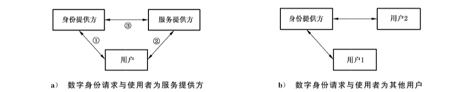
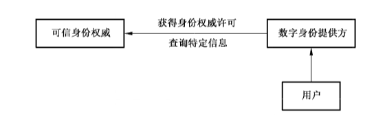

# GB/T 31504-2015 信息安全技术 鉴别与授权 数字身份信息服务框架规范

> 国家标准；ICS 35.040，CCS L 80；国家质量监督检验检疫总局、国家标准化管理委员会发布；2015-05-15 发布，2016-01-01 实施。
> 来源：[GB/T 31504-2015 国家标准详情](https://openstd.samr.gov.cn/bzgk/std/newGbInfo?hcno=1538582FD5B9B2E0CC896B347AB1E566)。
> 官方在线预览截图 SHA-256：b61443956d04e93c32d459b0341f90a813009e5f69484c74bc64b509caefedc7。
> 依据官方在线预览的 57 页截图逐页核对，保留 2 张表、5 幅图和附录中的 XML 示例；省略封面、目录、物理分页和页眉页脚。正式引用请核对官方原文。

## 前言

本标准按照GB/T 1.1—2009给出的规则起草。

请注意本文件的某些内容可能涉及专利。本文件的发布机构不承担识别这些专利的责任。

本标准由全国信息安全标准化技术委员会（SAC/TC 260）提出并归口。

本标准起草单位：中国科学院软件研究所、中兴通讯股份有限公司、北京信息科学技术研究院。

本标准主要起草人：冯登国、张敏、张立武、张妍、付艳艳、段美姣、张严、李强。

## 引言

数字身份作为主体的虚拟标识，是其进行各种网络活动的支撑手段。数字身份管理是数字世界安全事务的核心，为鉴别、授权、访问控制、账户访问以及其他各种与用户属性应用提供支持。然而目前数字身份由各种服务提供方自行管理，不仅格式多样、管理混乱，而且不同服务提供方之间的身份信息难以交互，安全与隐私性也无法得到足够保障。因此迫切需要对我国数字身份管理技术进行规范化管理，使数字身份信息使用者可以准确地访问数字身份信息，身份提供方可以正确维护和管理数字身份信息，确保用户数字身份信息的安全和隐私。

本标准是数字身份管理规范化的基础性标准，致力于规范各种数字身份信息服务。本标准定义一种通用的可扩展的数字身份信息 XML Schema 框架与数字身份信息访问消息格式，支持多种类型的数字身份表示和访问，允许用户自定义格式扩展。支持数字身份信息的定义和访问过程的标准化，为各种类型的数字身份信息服务建立统一的服务框架规范。

本标准参考了 Liberty Alliance 的文件 Liberty ID-WSF Data Services Template v2.1。在原文件的基础上增加了对标准范围的说明以及数字身份信息参考模型部分。

## 1 范围

本标准定义了数字身份信息服务参考模型、XML Schema 的框架、命名空间、扩展方式以及通用的数字身份信息对象属性类型，还定义了通用的数字身份信息创建、查询、修改和删除的交换消息格式以及处理规则。

本标准适用于数字身份信息服务的开发，并可指导对该类系统的检测及相关应用的开发。

## 2 规范性引用文件

下列文件对于本文件的应用是必不可少的。凡是注日期的引用文件，仅注日期的版本适用于本文件。凡是不注日期的引用文件，其最新版本（包括所有的修改单）适用于本文件。

- GB/T 25069—2010 信息安全技术 术语

## 3 术语和定义

GB/T 25069—2010中界定的以及下列术语和定义适用于本文件。

### 3.1 账户 account

一个正式的商业协议，用于处理主体与一个服务提供方之间的交易和服务。

### 3.2 已鉴别身份 authenticated identity

一个已经被断言通过鉴别的主体的身份，可代表此主体。

### 3.3 鉴别 authentication

一个在指定级别的可信度下确定某主体声称的身份的过程。

### 3.4 鉴别权威 authentication authority

是鉴别身份提供方。一个可以鉴别某主体的身份提供方。

### 3.5 授权 authorization

根据对主体数字身份信息的评估，确定一个主体是否可以对资源实施指定类型的访问的过程。一旦某个主体被鉴别，就可能拥有某些类型的访问权限。

### 3.6 数字身份 digital identity

主体在互联网中的虚拟身份表示，关联了与该主体相关的属性信息，通常由一个账户标识其唯一性。

### 3.7 数字身份信息 digital identity information

与数字身份关联的主体相关的属性信息。

### 3.8 数字身份请求与使用者 digital identity requester and consumer

交互过程中需要对方提供数字身份信息的实体。包括服务提供方与普通用户两类。

### 3.9 身份提供方 identity provider

替主体管理数字身份及相关数字身份信息的系统实体，为其他服务提供方提供主体的鉴别断言。

### 3.10 服务提供方 service provider

一个提供在线服务和/或实体商品的系统实体。

### 3.11 主体 subject

一个身份可以被鉴别的实体。主体可以是自然人或者系统实体，其多个身份之间具有内在联系。典型的主体的例子为：单个个体、多个个体的群组、公司、网站等。

### 3.12 可信身份权威 trusted identity authority

存储和管理用户真实身份信息，提供网络真实身份的鉴别服务的机构。由国家指定主管机构担任。

## 4 缩略语

下列缩略语适用于本文件。

XML：可扩展置标语言（eXtensible Markup Language）

DST：数字身份服务框架（Digital Identity Service Framework Template）

SOAP：简单对象访问协议（Simple Object Access Protocol）

SAML：安全断言置标语言（Security Assertion Markup Language）

idS：数字身份（identityS）

## 5 符合性

对于一个特定的应用，并非必须涉及数字身份服务框架的所有特征。鉴于此，本标准提供了一种通过对置标语言的特征进行选择以适用特定应用的方法。本标准中所定义的所有必需的核心特征集合都采用显式的［必需］进行标注，其他可选的特征集合则会采用［可选］进行标注，以方便使用者针对特定的应用进行选择。

## 6 命名空间和通用概念

### 6.1 命名空间

本标准使用的命名空间关联如表1中描述。

**表 1 引用 XML 名空间**

| 前缀 | URI | 描述 |
| --- | --- | --- |
| dst: | urn:liberty:dst:2006-08 | DST 使用 schema 的目标名空间 |
| dstref: | urn:liberty:dst:2006-08:ref | DST 参考模型的目标名空间 |
| xml: | http://www.w3.org/XML/1998/namespace | W3C XML |
| xs: | http://www.w3.org/2001/XMLSchema | W3C XML Schema 定义语言 |
| ds: | urn:liberty:disco:2006-08 | ID-WSF 发现服务 |
| lu: | urn:liberty:util:2006-08 | 特许使用 schema 目标名空间 |

### 6.2 通用概念

本标准遵守以下排版规则：〈Element〉、〈ns:ForeignElement〉、attribute、DataType、OtherCode。为了便于阅读，本标准在实例中使用“1”和“0”描述 XML schema 中 xs:boolean 类型的值，但其对应的值应表述为“true”和“false”。

## 7 参考模型

### 7.1 数字身份信息服务

数字身份是一个真实主体在互联网中的虚拟身份表示，它可以被用于与其他机器或者主体进行交互。一个数字身份关联了与该主体相关的属性信息，描述了该主体的各种特征、偏好或历史行为。基于这些数字身份信息，主体可以在互联网上得到个性化的定制服务。

数字身份信息服务是由管理主体数字身份的数字身份提供方向主体和其他网络实体提供的主体数字身份信息访问服务，包括各种数字身份信息的创建、删除、查询和修改服务。根据数字身份信息类型的不同，数字身份信息服务也分为多种类型，如提供个人轮廓信息、雇员身份信息，或提供个人空间地理信息的数字身份信息服务等。本标准研究各种类型的数字身份信息服务均需要遵循的通用服务规范，为各种类型的数字身份信息服务提供规范的服务框架模板。

### 7.2 数字身份信息服务参考模型

#### 7.2.1 概述

本标准给出了两种数字信息服务参考模型。第一种基本模型中涉及的数字身份信息，仅包括身份提供方与用户交互过程中获得或生成的虚拟身份信息，适用于一般场景下的网络服务。第二种参考模型可以实现网络中虚拟数字身份同自然人真实身份的有效关联，其中用户的真实身份必须经过可信身份权威（如公安机关）的认证，该模型可适用于具有更高安全及信用需求的特殊的应用场景，如电子交易、财产安全、政府民生服务等。

#### 7.2.2 基本参考模型

在数字身份信息服务的基本参考模型中，主要参与者有三方：用户、数字身份提供方、数字身份请求与使用者。其中，用户是拥有数字身份的主体：数字身份提供方是提供和管理用户数字身份的系统实体；数字身份请求与使用者是访问用户数字身份的主体，包括服务提供方与用户两类。

用户首先需要向身份提供方注册一个可用于鉴别的账户，随后身份提供方在与用户的交互过程中获得或者生成各种关于该用户的数字身份信息，包括用户特征、偏好以及历史行为等，这些数字身份信息均与该用户的账户相联系。数字身份提供方基于 Web 服务向外界提供用户数字身份信息访问服务，其中也包括鉴别服务。

典型的数字身份请求与使用者包括：

- 服务提供方：向用户提供各种资源和服务的网络实体，如提供在线订票服务的航空公司网站，提供在线诊断服务的医疗卫生网站等等。身份提供方也可以是一个服务提供方。
- 其他用户：用户的数字身份信息在一些场景中也常被其他用户访问，如与朋友共享的照片。



图 1a）给出了针对第一种数字身份请求与使用者-服务提供方的数字身份参考模型。模型包括三类交互：第一类是身份提供方与用户的交互，旨在管理用户的数字身份，包括数字身份的创建、维护、销毁等生命周期管理过程，以及基于用户意愿的数字身份信息访问控制管理过程。第二类是用户与服务提供方之间的交互，传递用户对服务的请求，以及服务提供方对请求的回复。第三类交互是服务提供方与身份提供方之间的交互，服务提供方接收到用户请求后，调用身份提供方提供的数字身份信息访问服务，获取对该用户的鉴别断言，若鉴别成功，则获取该用户的部分数字身份信息，根据本地策略判定是否授予该用户服务访问权限，在此交互过程中，如有需要，依照用户意愿，与数字身份提供方进行增删查改用户数字身份信息的交互。在这个模型中，服务提供方和身份提供方可以为同一实体，也可以为相异实体。

图 1b）给出了针对第二种数字身份请求与使用者-其他用户的数字身份参考模型。在该模型中身份提供方提供对用户1的数字身份信息管理，用户2的数字身份信息可以由它管理也可以由其他身份提供方管理。用户2向身份提供方提出访问用户1身份信息的请求，身份提供方根据用户1的意愿，向其提供适当的数字身份信息访问权限。

#### 7.2.3 具有可信身份权威的参考模型

在具有可信身份权威的数字身份信息服务参考模型中，主要参与方包括：用户、数字身份提供方、数字身份请求与使用者以及可信身份权威。其中数字身份提供方为数字身份请求与使用者提供数字身份信息访问服务和鉴别服务，与可信身份权威交互确认用户提供的身份信息或凭证的真实性。可信身份权威负责存储和管理用户真实身份信息，包括姓名、性别、年龄等；提供网络真实身份的鉴别服务；由权威部门，如公安机关担任。用户在向身份提供方注册账户之前，需要提供某些真实身份信息的凭证，如是否合法公民、年龄是否大于18岁等；身份提供方与可信身份权威交互，确认用户信息的真实性；随后身份提供方为用户注册账户，并在此后与用户的交互过程中获得、维护或生成关于该用户的账户信息。

图2给出了具有可信身份权威的数字身份参考模型。该模型包括四类交互，第一类是身份提供方与用户的交互，旨在注册前获取用户某些真实身份信息的凭证，管理用户注册后的数字身份，包括数字身份的创建、维护、销毁等生命周期管理过程，以及基于用户意愿的数字身份信息访问控制管理过程。

第二类是用户与数字身份请求与使用者之间的交互，此类交互与基本模型中相同。第三类交互是数字身份请求与使用者与身份提供方之间的交互，此类交互与基本模型中相同。第四类交互是可信身份权威与身份提供方之间的交互，旨在对用户某些真实身份信息进行鉴别，将用户在网络中的虚拟数字身份与其真实身份关联，维护用户真实数字身份。


### 7.3 数字身份信息服务安全模型

#### 7.3.1 概述

在数字身份信息服务的使用场景中，一个数字身份提供方可以为多个数字身份请求与使用者提供身份信息。而对于同一个用户，网络上常常存在多个数字身份提供方为其管理不同的账号和不同类型的数字身份信息，标识这些身份信息的身份账户可相互联合。当多个身份提供方提供的身份被联合后，用户可以使用其中任意一家身份提供方的鉴别凭证，访问其他身份提供方相关的服务提供方提供的服务，即，身份的联合可以实现单点登录的功能。在身份联合的场景下，数字身份提供方维护的数字身份信息被更多的数字身份请求与使用者所访问。数字身份信息的访问需要得到身份信息拥有者的许可和信任，合法的数字身份信息访问者也需要保护数字身份信息的隐私性。

可信身份权威可以分布式的存储用户身份信息，为多个数字身份提供方提供真实数字身份信息鉴别服务。可信身份权威与身份提供方交互过程中需要保护数字身份信息的隐私性。

#### 7.3.2 数字身份信息服务授权模型

基于用户的信任和许可实现数字身份信息服务访问授权的技术实施方式可以有多种，以下我们给出其通用的抽象模型。

在此模型中，数字身份提供方向数字身份请求与使用者提供基于 Web 服务的数字身份信息访问服务。用户，即身份信息拥有者，预先需要对数字身份提供方管理的数字身份信息设立访问控制许可与偏好，该许可与偏好的形式可以由数字身份提供方依应用场景自行定义。一旦一个数字身份服务被发现，数字身份请求与使用者需要从一个可信权威处获取足够的授权信息，递交给数字身份提供方，才可访问该服务。可信权威可以是用户本身，也可以是用户信任的其他系统实体，如其他身份提供方，记录和发布用户在各身份提供方处拥有何种身份信息的服务提供方等。授权信息可以为与用户交互后得到的许可凭证，数字身份请求与使用者的身份信息等。图3展示了此模型的交互过程。


在有可信身份权威参与的数字身份信息服务中，可信身份权威也可以提供身份信息访问服务，涉及如图4所示授权模型。在用户注册阶段数字身份提供者可能需要访问可信身份权威的特定查询服务。

如果数字身份提供者在拥有用户许可和可信身份权威鉴别及授权，则可以访问可信身份权威提供的特定的查询服务。数字身份请求与使用者没有权限访问可信身份权威提供的服务。用户完成注册后，数字身份提供者向数字身份请求与使用者提供基于 Web 服务的数字身份信息访问服务，其授权模型参照图4所示。



#### 7.3.3 数字身份信息隐私保护模型

隐私约束描述了有关传播、使用、保留、存储和出示数字身份信息的基础约束。隐私权威和数字身份请求与使用者可以使用隐私约束来描述对身份所必须的复合约束。隐私权威可以是访问授权模型中的可信权威，数字身份提供方，或其他用户信任的权威机构。由隐私权威颁发的隐私约束可称为“义务”，由数字身份请求与使用者声明的隐私约束通常绑定于数字身份信息请求消息上，可称为“承诺”。

图5是数字身份信息隐私保护概念模型。


## 8 数字身份信息数据 XML schema 框架

### 8.1 概述

一个数字身份信息服务提供对数字身份信息数据的访问。数字身份信息数据由一个或多个对象构成，而且多个对象可以具有相同的类型。不同类型的数字身份信息服务都需要对其支持对象进行定义。

一种类型的数字身份信息服务可能只支持一个对象，可能支持相同类型的多个对象，也可能支持多种类型的对象和相同类型的多实例对象。因此，每个服务类型都需要指定一个 XML schema。一种服务类型可能包括多个 XML schemata，因为不同数据对象可能定义在不同 schemata 中。一种服务类型的 XML schema 定义了该服务类型提供的数据，以及这些数据的结构。

一个数据对象有一个根元素，将数据包含在它的子元素中。这个根元素的名字是数据对象类型标识。可以通过指定对象类型，并给出从指定类型的对象中筛选的准则，从而选定要访问的某个数据对象。筛选准则可以是指定对象实例的标识，指定数据值，指定其他服务类型专有的参数值等等。在数据对象内部的子数据元素也可以被单独挑出访问，比如访问一个身份证件中的名字信息。本标准给出了对这些数据对象进行选择操作的一些通用的规则，但是实际的选择机制需通过今后具体的服务标准进行定义。

数据可能通过一些特定的方法进行存储，但是被遵循本标准和具体服务标准定义的 XML schema 的数字身份信息服务所处理。也就是说通过 schema 定义的 XML 文档是一个概念上的 XML 文档。不涉及实际执行中的许多技术细节。

不同服务类型的 schemata 可能有相同的特征。本章描述各种类型的服务都会使用到的共同的特性，提供 schema 中通用的XML属性和数据类型，并提供一些指导。

### 8.2 Schemata 指导方针

指导方针的目的是在使用数字身份信息服务模板时，更方便的定义和实现服务。不同数字身份信息服务的schemata 应该遵照如下的指导方针：

a） 每个关于主体的数据属性应当被定义为一种合适类型的 XML 元素。

b） XML 属性应当只能被用来修饰定义为XML元素的数据属性，并不能包含与主体相关的实际数据值。

c） XML元素应当要么包含其他XML元素，要么包含实际数据值。一个 XML元素的包含内容不应当是两者的混合，也就是既有值也有子元素。复杂类型 all 和 choice 不应当被使用。

d）一旦一个数据属性在一个服务类型的文档中被发布，它的语法和语义不能被改变。如果语法或语义需要改变，一个数据属性的任何新版本必须被赋予一个不同的名字，拥有新的语义，以便与以前的属性定义区分开。

e） 所有的元素必须被定义为全局元素。当具有复杂类型的元素被定义，需要使用全局元素引用。

这个方针的原因是一个服务提供的 XML schema 不仅定义了服务支持数据的语法，同时定义了解释语义。在许多情况下，应当可以查询和修改实例元素。

f） 当满足条件时，XML schema 提供的类型定义应当被使用。

### 8.3 扩展服务

通过标准和 schema定义的一个服务，可能通过不同方法进行扩展。实际上支持哪些扩展必须通过每种服务标准单独说明，或在本地的数字身份请求与使用者和数字身份提供方之间达成一致。扩展服务应遵循以下规则：

a） 在执行过程中，可能增加新的元素和 XML属性到已经规范过的对象，或者加到一个完全新的对象中。新的数据必须使用其自身的名字空间，并加到官方服务标准和服务类型的schema中。

b） 当一个服务中新的特征被说明（如新元素），应当用〈Option〉元素来列出新的关键字。

c） 新的枚举类型的值可能作为一个特殊服务类型的标准中进行说明。特殊服务类型的标准必须指出新的枚举类型的权威性。

d） 在 XML schema 中定义的一个 XML 元素可能包括一个〈xs:any〉元素来支持任意的 schema 扩展。当 schema 中包括了〈xs:any〉元素，某次执行可能支持这种类型的扩展，但是不是必须的。〈xs:any〉元素应当被放在〈Extension〉元素内。如果执行时支持这种类型的 schema 扩展，它可能注册 urn:liberty:dst:can:extend 选项关键字。当一个服务支持并没有在 schema 中定义的新的数据，而是运用这种扩展存储这种新数据，它就可能注册 urn:liberty:dst:extend 选项关键字。

e） 所有消息都可以有一个〈extension〉元素，向服务提供更多的参数。〈Extension〉元素不应该被用在消息中，除非请求的服务已经规范了它的内容和相关的处理规则。如果接收方不支持〈Extension〉元素的使用，则必须忽略它。

### 8.4 时间值和同步

普通 XML 中的一些属性是时间值。我们规定所有遵循此标准的数字身份信息服务使用的时间值是 dataTime 的类型，遵循 W3C XML Schema 数据类型标准中的定义。

遵循此标准的所有请求者和接受者不应该依赖于任何其他时间分辨率优于秒级的应用程序，因为具体实现可能忽略时间戳中低于一秒的部分。同时，任何实现在执行中都不能产生指定闰秒的时间实例。

用于 DST schemata 中的时间戳只被用来实现数据的同步，不应该假设时钟已同步。由于时钟可能未完全同步，数字身份请求与使用者应该检查在回复信息中的通用时间戳，并与其自身的时钟时间进行比较。这将帮助数字身份请求与使用者更好地评估不同数据项中的时间戳。

### 8.5 通用的 XML属性

#### 8.5.1 概述

在 XML schemata 中为服务定义的 XML 元素，可能包含数据值或其他 XML 元素。因此一个 XML 元素可以是一个叶子元素或一个容器。容器不能有除了 xml 元素和合法的 xml 属性以外的其他数据内容。相反，叶子元素不包含其他的 XML 元素。这些叶子元素可以被进一步划分为两个不同种类：标准的（normal）和局部的（localized）。标准的叶子元素包含一个字符串或 URI 实例。局部的叶子元素包含用本地写系统定义的文件。

叶子和容器中的 XML 元素可以有专为单个服务定义的 XML 属性，但是也有可以用在所有的数字身份信息服务中的 XML 通用属性。这些通用的 XML 属性是技术属性，通常被数字身份服务提供方在数字身份信息服务中创建。这些技术属性并没有强制使用在所有的数字身份信息服务中，但是如果它们被执行，则必须使用本标准的方法。每个服务应该分别指定一个或多个通用 XML 属性在该服务中是否是强制的或可选的。除了通用的 XML 属性，我们定义了属性组包含这些通用的 XML 属性。这里有三个属性组：commonAttribute 主要为容器元素所使用，叶子元素使用 leafAttributes 和 localizedLeafAttributes。

示例：

```xml
<xs:attribute name="id" type="lu:IDType"/>
<xs:attribute name="modificationTime" type="xs:dateTime"/>
<xs:attributeGroup name="commonAttributes">
  <xs:attribute ref="dst:id" use="optional"/>
  <xs:attribute ref="dst:modificationTime" use="optional"/>
</xs:attributeGroup>
<xs:attribute name="ACC" type="xs:anyURI"/>
<xs:attribute name="ACCTime" type="xs:dateTime"/>
<xs:attribute name="modifier" type="xs:string"/>
<xs:attributeGroup name="leafAttributes">
  <xs:attributeGroup ref="dst:commonAttributes"/>
  <xs:attribute ref="dst:ACC" use="optional"/>
  <xs:attribute ref="dst:ACCTime" use="optional"/>
  <xs:attribute ref="dst:modifier" use="optional"/>
</xs:attributeGroup>
<xs:attribute name="script" type="xs:anyURI"/>
<xs:attributeGroup name="localizedLeafAttributes">
  <xs:attributeGroup ref="dst:leafAttributes"/>
  <xs:attribute ref="xml:lang" use="required"/>
  <xs:attribute ref="dst:script" use="optional"/>
</xs:attributeGroup>
<xs:attribute name="refreshOnOrAfter" type="xs:dateTime"/>
<xs:attribute name="destroyOnOrAfter" type="xs:dateTime"/>
```

#### 8.5.2 commonAttribute XML 属性组

本属性组包含两个通用的 XML 属性：

Id［可选］：id 是文档内唯一的标识符。可以用来指明一个元素，尤其当多个 XML 元素拥有相同名字时。如果数字身份信息服务的 schema 没有提供其他方式来区分两个 XML 元素则需要这个函数，id XML 属性必须被使用。即在相同概念的 XML 文档中对 XML 元素进行区分。id 不能作为一个全局唯一的标识符，因为可能构成隐私问题。执行可能设置特定的长度来限制 id XML 属性来执行。当元素的内容被修改时，Id XML 属性应该保持相同，因此当不同时间查询相同元素时，id XML 属性的相同值可以被使用。Id XML 属性不能被用来存储任何数据，而且应该保持短的。

ModificationTime［可选］：modificationTime 指出一个元素被修改的最后时间。修改包括改变元素值，改变元素本身，或者其他子元素。当容器元素有 modificationTime XML 属性，修改的时间必须递归到根元素。如果根元素有 modificationTime XML 属性，它表明最后修改的时间。注意数字身份信息服务可能只将有 modificationTime XML 属性用在叶子元素中，甚至不是可选的。

#### 8.5.3 leafAttribute XML 属性组

本属性组包括 commonAttributes XML 属性组，并在叶子元素中定义了 3 个 XML 属性（XML 元素不包括其他 XML 元素）：

Modifier［可选］：modifier 是最后修改数据元素的服务提供方的 ProviderID。

ACC［可选］：ACC 是 Attribute Collection Context 的缩写，用来描述收集数据的上下文，从而为请求者一些有用的信息，例如在搜集的时候是否做过验证。ACC常指当前数据值，因此当元素值发生改变时，ACC的值必须更新，反应了新的情况。ACC 是一种 anyURI 类型。

下面是对 ACC XML 属性值的定义：

Urn:liberty:dst:acc:unknown

代表这个值没有被验证过，或者是由用户自己输入的值。ACC 可能在信息交换中被忽略，因为这个值等价于没有提供任何 ACC XML 属性信息。

Urn:liberty:dst:acc:incentive

收集数据时提供一些利益驱动，保证用户提供正确的输入。

Urn:liberty:dst:acc:challenge

使用一个挑战机制用来验证收集的数据（例如，一个 email 发送和接受回复，或 SMS 信息发送到一个移动电话包括一个 WAP URL 来完成数据的收集）。

Urn:liberty:dst:acc:secondarydocuments

这个值在二级文档中出现并验证过（例如从 electric bill 中收集地址）。

Urn:liberty:dst:acc:primarydocuments

这个值在一级文档中被验证过（例如，从一个护照中收集的名字和识别号），ACC 允许其他的值，但是本标准主要定义了以上定义的值的使用。当 ACC 包括在回复信息中，回复应该通过服务提供方保证数字身份信息服务被签名。

ACCTime［可选］：该值定义了 ACC XML 属性值被赋予的时间。注意与 modificationTime 不同。

ACC 包括与验证入口相关的信息。这样验证可能比入口产生和修改的发生时间晚。入口可以被验证多次。

#### 8.5.4 localizedLeafAttribute XML 属性组

XML 属性组包括 leafAttribute XML 属性组，并定义了两个 XML 属性来支持局部的数据。UTF-8 是能够通过正确的形式来表述数据，但是很难通过正确的语言和写系统，对具有相同名字的 XML 元素进行访问。这些 XML 属性应该被用在多种语言中，并且使用正确的语言和写系统也非常重要。

Xml:lang［必需］

定义了用作局部叶子元素值的语言。当〈localizedLeafAttributes〉XML 属性组用在一个元素中，则为强制 XML 属性。

Script［可选］

有时，语言没有定义使用的写系统。在这种情况下，本 XML 属性定义了更多写系统的细节。本标准定义了如下的 XML 属性值：urn:liberty:dst:script:kana 和 urn:liberty:dst:script:kanji。

#### 8.5.5 个体通用 XML 属性

除了以前定义的 XML 属性组，更多的普通 XML 属性被定义并提供服务。XML 属性在 XML 属性组中，可以被单独使用，不需要考虑使用整个属性组，但是下面的 XML 属性很少使用，因此并没有包含在任何 XML 属性组中。

refreshOnOrAfter：数字身份请求与使用者可能保存这个元素中的信息，如果选择在指定时间之外使用数据，则应该更新数字身份提供方中的数据。如果数据没有被更新，数字身份请求与使用者可以继续使用。这个参数没有放置数字身份提供方任务来保持数据静态值，因此可能在这段特殊时间中元素发生改变。数字身份请求与使用者需要适时的数据请求更新数据，而不是存储数据。

destroyOnOrAfter：即使数字身份请求与使用者不能更新信息，则应该破坏它，如果在信息中包含的元素有 XML 属性 destroyOnOrAfter，并且指定属性出现的时间。信息可能过时，而且不可用。

### 8.6 通用的数据类型

XML schema 提供的类型定义不能直接被数字身份信息服务使用，因为它们缺乏前面提到的通用的 XML 属性。本标准定义的数据类型是 XML Schema（[XML]）数据类型与前面所述的通用 XML 属性的结合。对于字符串我们有两种类型定义，一种用于本地元素，另一种是通过 Latin 1 字符集标准化的元素，字符串、整型等通用的符合本标准的数据类型定义如下所示：

示例：

```xml
<xs:complexType name="DSTLocalizedString">
  <xs:simpleContent>
    <xs:extension base="xs:string">
      <xs:attributeGroup ref="dst:localizedLeafAttributes"/>
    </xs:extension>
  </xs:simpleContent>
</xs:complexType>
<xs:complexType name="DSTString">
  <xs:simpleContent>
    <xs:extension base="xs:string">
      <xs:attributeGroup ref="dst:leafAttributes"/>
    </xs:extension>
  </xs:simpleContent>
</xs:complexType>
<xs:complexType name="DSTInteger">
  <xs:simpleContent>
    <xs:extension base="xs:integer">
      <xs:attributeGroup ref="dst:leafAttributes"/>
    </xs:extension>
  </xs:simpleContent>
</xs:complexType>
<xs:complexType name="DSTURI">
  <xs:simpleContent>
    <xs:extension base="xs:anyURI">
      <xs:attributeGroup ref="dst:leafAttributes"/>
    </xs:extension>
  </xs:simpleContent>
</xs:complexType>
<xs:complexType name="DSTDate">
  <xs:simpleContent>
    <xs:extension base="xs:date">
      <xs:attributeGroup ref="dst:leafAttributes"/>
    </xs:extension>
  </xs:simpleContent>
</xs:complexType>
<xs:complexType name="DSTMonthDay">
  <xs:simpleContent>
    <xs:extension base="xs:gMonthDay">
      <xs:attributeGroup ref="dst:leafAttributes"/>
    </xs:extension>
  </xs:simpleContent>
</xs:complexType>
```

## 9 数字身份信息服务访问框架

### 9.1 概述

本标准定义了用于数字身份信息服务的一些访问协议。这些协议主要依据请求响应信息交换格式。唯一例外的是通知信息，可能无需获取回复。在本标准中指定的消息可以用在 SOAP 中。文档中不对 SOAP 头进行说明。表 2 例举了本标准中定义的协议元素。

〈Create〉和〈Delete〉被用来创建新的对象并删除已经存在的对象。对象中的数据可以通过〈Modify〉进行修改，包括删除对象中单独数据项。所有的对象或对象中的数据可以通过〈Query〉进行查询。

**表 2 请求和响应**

| 数字身份请求与使用者提出的请求 | 数字身份提供方做出的响应 |
| --- | --- |
| `<Create>` | `<CreateResponse>` |
| `<Delete>` | `<DeleteResponse>` |
| `<Query>` | `<QueryResponse>` |
| `<Modify>` | `<ModifyResponse>` |

不同协议的消息有通用的特征、XML 属性和元素。这些通用的问题会在本章讨论，实际的消息会在第 10 章中进行说明。与通用部分相关的处理规则也被定义。在本标准中，尤其是涉及处理规则的讨论中，RequestElement 在多数情况下被用来取代实际的请求元素。RequestElement 代表真实的〈Create〉、〈Delete〉、〈Query〉或〈Modify〉元素。

在许多情况下 ResponseElement 被用来代替实际的响应元素，即，ResponseElement 代表真实的〈CreateResponse〉、〈DeleteResponse〉、〈QueryResponse〉、〈ModifyResponse〉元素。

示例：〈CreateResponse〉，〈DeleteResponse〉，〈QueryResponse〉， 〈ModifyResponse〉。

```xml
<xs:complexType name="RequestType">
  <xs:sequence>
    <xs:element ref="lu:Extension" minOccurs="0" maxOccurs="unbounded"/>
  </xs:sequence>
  <xs:attribute ref="lu:itemID" use="optional"/>
  <xs:anyAttribute namespace="##other" processContents="lax"/>
</xs:complexType>
<xs:complexType name="DataResponseBaseType">
  <xs:complexContent>
    <xs:extension base="lu:ResponseType">
      <xs:attribute name="timeStamp" use="optional" type="xs:dateTime"/>
    </xs:extension>
  </xs:complexContent>
</xs:complexType>
```

### 9.2 多请求响应事件支持

如果服务标准允许，所有的请求和响应元素可能在消息中发生多次（例如，如果 SOAP 被捆绑，则 SOAP〈body〉被使用）。这种机制可以用作批量优化或者服务标准，选择添加一些时间的语句到这个结构中。

### 9.3 idS 属性及处理规则

不同类型的 id XML 属性被用作连接查询、响应、提示和确认（如图 5 所示）。相关的 SOAP 头应当被定义来联系响应消息与请求消息。在响应消息中 itemID 和 itmeIDRef XML 属性用作指示请求消息中的相关元素细节和提示消息。

在所有消息中一些元素有 id XML 属性 xs:ID，当这些消息中的一部分指向这些元素时，这些 id XML 属性是必须的。例如，如果用到使用指示，则必须指向正确的元素。信息中的一些部分可能被签名，id XML 属性有必要用来表明哪些元素被签名所覆盖。

某种类型的查询项需要与数据项相关联。ItemID 和 itemIDRef XML 属性在这个目的下被使用。

它们与名字空间中通常的 XML ID 属性不同，可以在每一个 Item 类型中各出现一次。例如，相同的 itemID 可以在〈TestItem〉和〈QueryItem〉中显示，没有任何混淆的危险。

### 9.4 timeStamp XML 属性及处理规则

一个响应和通知信息可能包含一个时间戳。通过这个时间戳，接受方可以随后接收到一个回复或者通知后服务方是否有任何修改，只有在收到时间戳之后没有任何修改才是成功的。

如果 RequestElement 的处理是成功的，且数字身份提供方支持 changeSince XML 属性或 notChangedSince XML 属性，或者两者都支持，数字身份提供方必须在 ResponseElement 中加入 timeStamp。TimeStamp XML 属性必须有一个也可以用作 changeSince XML 属性的值，也必须可以被用作 notChangedSince XML 属性值，当在时间戳之后做出修改，修改是不成功的。

### 9.5 状态和出错报告

#### 9.5.1 概述

本标准定义了两种机制用来回答请求者一个请求是处理成功，失败，还是处于两者之间。正常的响应中，一个普通的ID-* 消息被用来返回应用状态，包括普遍的出错条件，当应用检测到一个出错条件，作为部分的正常处理，例如，依据本标准中的处理规则来处理。

从数字身份信息服务模板看，下面的例子中需要使用 ID-* 出错消息：

a） 当数字身份提供方没有识别出任何在 SOAP Body 中的 RequestElement 时，必须返回 ID-* 出错消息，并使用 IDStarMsgNotUnderstood 作为 code XML 属性的值。这个错误可能被应用到执行或实施不支持的特定类型的请求中（如只读服务）。

b） 类似地，当数字身份请求与使用者接收到一个空的或出错提示时，必须返回 ID-* 出错消息，并用 IDStarMsgNotUnderstood 作为 code XML 属性值。

c） 如果基于请求部分的数字身份提供方提示不允许发出任何请求，必须返回 ID-* 出错消息，使用 ActionNotAuthorized 作为 code XML 属性值。

d） 接收部分在处理信息体失败也会产生异常错误，必须返回 ID-* 出错消息，并使用 UnexpectedError 作为 code XML 属性值。

一个服务标准可以定义使用 ID-* 出错消息的多种情况。

即使处理消息中发生错误，数字身份提供方应该依据特殊的处理规则处理消息体，返回正常消息来说明在 status code 中出错的部分。因为一个消息可能包含多个工作请求，每个工作都是有意义的，除非说明在第一个部分处理失败后整个消息失败，否则需要继续执行。

RequestElement 可能包含大量的工作请求（例如，在〈Query〉中有多个〈QueryItem〉元素）。因此，不能完成请求工作时，除非服务指定的处理规则进行说明，否则数字身份提供方应该完成这些消息中其他的部分。

#### 9.5.2 顶层〈Status〉元素

ResponseElement 元素包含一个顶层〈Status〉元素来表示处理一个 RequestElement 是否成功。一个〈Status〉状态可能包含其他〈Status〉元素，提供了更多关于状态细节信息。一个〈status〉元素有一个 XML 属性 code，其值为返回的状态，以字符串的形式出现。这些代码的定义也将在本标准中说明。

在顶层〈Status〉元素中的 code XML 属性必须包含如下的一些值，OK、Partial 或 Failed。

OK：状态 OK 代表处理 RequestElement 成功。第二级状态码可能被用来表示对 RequestElement 处理成功，但是存在的特殊情况。

Partial：Partial 值代表处理部分成功，部分失败。例如在〈Query〉元素处理中，一些〈QueryItem〉元素被成功处理，但是其他〈QueryItem〉元素处理失败。当 Partial 被在〈Status〉元素的 code XML 属性时，高级〈Status〉元素必须用第二级〈Status〉元素来表明 RequestElement 中失败的部分。处理过程并不表示第二级〈Status〉元素中每个处理必须成功。数字身份提供方如果还没有处理整个 RequestElement，不能用 Partial 值。

修改请求中，当一个失败的〈ModifyItem〉元素没有合法的 itemID XML 属性时，数字身份提供方不能使用 Partial 值，例如，一个数字身份提供方不能表明失败的〈ModifyItem〉元素。在这些情况下，数字身份提供方必须使用 Failed 值并且已经处理部分的任何改变必须回滚。

当部分 RequestElement 元素处理可能失败时，如果失败的部分没有有效的 itemID XML 属性，数字身份提供方可以选择 RequestElement 的其他类型。当高级元素值因为一个或多个丢失的 itemID XML 属性为 Failed，而不是 Partial，次级状态码 MissingItemID 必须加到其他次级状态码中。

在一些情况下，大部分第二级状态码不能使用，例如，可能威胁标准的隐私的部分。在这些情况下，当部分失败时需要使用 UnspecifiedError 值被用作次级状态码表明失败部分。

Failed：RequestElement 处理失败时使用 Failed。处理整个 RequestElement 完全失败或部分成功时，数字身份提供方都认为是完全失败。一个服务的标准中，即使部分成功，也可能拒绝使用部分失败来表示。次级状态码应该被用来表明失败的原因。

#### 9.5.3 次级〈Status〉元素

在次级〈Status〉元素的 XML 属性 code 中，使用如下次级状态码：

```text
ActionNotAuthorized
AggregationNotSupported
AllReturned
ChangeHistoryNotSupported
ChangedSinceReturnsAll
DataTooLong
DoesNotExist
EmptyRequest
ExistsAlready
ExtensionNotSupported
Failed
FormatNotSupported
InvalidData
InvalidExpires
InvalidItemIDRef
InvalidObjectType
InvalidPredefined
InvalidSelect
InvalidSetID
InvalidSetReq
InvalidSort
ItemIDDuplicated
ResultQueryNotSupported
MissingCredentials
MissingDataElement
MissingExpiration
MissingItemID
MissingNewDataElement
MissingObjectType
MissingSecurityMechIDElement
MissingSelect
ModifiedSince
NewOrExisting
NoMoreElements
NoMoreObjects
NoMultipleAllowed
NoMultipleResources
NoSuchTest
ObjectTypeMismatch
OK
PaginationNotSupported
Partial
RequestedAggregationNotSupported
RequestedPaginationNotSupported
RequestedSortingNotSupported
RequestedTriggerNotSupported
SecurityMechIDNotAccepted
SetOrNewQuery
SortNotSupported
StaticNotSupported
TimeOut
TriggerNotSupported
UnexpectedError
UnspecifiedError
UnsupportedObjectType
UnsupportedPredefined
```

如果一个请求或提示因为一些原因失败，〈Status〉元素的 ref XML 属性应该包含请求消息中失败元素的 itemID XML 属性的值。当失败的元素没有 itemID XML 属性时，应该通过 id XML 属性来指向它。

如果不能标识失败元素（例如没有 id 或 itemID XML 属性），ref 属性应当包含与该元素最接近的且拥有标识 xml 属性的父元素的标识。

当数字身份请求与使用者生成一个访问消息，应该避免任何两个标识 XML 属性用同样的值，以便在返回状态中可以指出正确的位置。如果两个 XML 属性有相同值，当遇到问题，数字身份提供方需要指出它们中的任何一个，数字身份提供方可能考虑全部信息是失败的或者使用那个值（如果要指出的元素的标识比另一个优先）。优先级顺序是 itemID、id。例如，itemID 和 id 有相同值，则 itemID XML 属性等于此值。

### 9.6 通用错误处理规则

数字身份提供方可能注册一个相关的选项关键字来表示它不支持一定类型的请求。定义如下选项关键字：

```text
Urn:liberty:dst:noQuery
Urn:liberty:dst:noCreate
Urn:liberty:dst:noDelete
Urn:liberty:dst:noModify
```

除了收到的消息中的错误以外，一个数字身份提供方可能遇到各种问题：

a） 如果处理时间过长（例如一些后端系统响应不够快），请求没有在数字身份提供方所需的时间内处理完成，次级 status code Timeout 被用来说明此情况。处理时间依据数字身份提供方进行判断，是不可见的，只有 Timeout 状态码被返回。

b） 除了服务标准中提及的出错条件，其他条件也可能发生。这里有两个状态码定义这些情况。

当数字身份提供方（或者数字身份请求与使用者接到一个提示）可以正常处理，但是并没有特殊的状态码来说明他的状态，可以启用次级状态码 UnspecifiedError。对于其他没有预料的情况，次级状态码 UnexpectedError 应该被使用。

### 9.7 资源标识

若没有显式的ResourceID，则资源通过如下机制进行标识：

a） 隐式的（例如 PAOS 交换）；

b） 从〈TargetIdentity〉SOAP 头；

c） 使用提供的证书：证书持有者的资源被访问；

d） 端点。一个服务对每个访问的资源可能提供不同的访问端点。最简单的例子是将资源作为查询的一部分。

如果被访问的资源需要机密性保护，如〈TargetIdentity〉或者证书，则〈wss:Security〉头内的 SAML 断言应该包括一个加密的 SAML 断言。

### 9.8 选择操作

第二级的选择在 RequestElement 元素中说明。请求消息必须对希望访问的目标进行更详细的描述。这可以通过两种方式进行描述：请求访问的数字身份请求与使用者可以在请求中显式的选择要访问的数据，或者使用预先定义的 selection。若支持预先定义的 selection，数字身份服务提供方需要在服务标准中提前定义，或者通过带外传输来声明。数字身份请求与使用者通过将标识符加入到请求中，指明它想要使用的提前定义的 selection。标识符通过提前定义的 XML 属性值进行说明。而当数字身份请求与使用者显式的选择数据时，同样需要首先指出数据对象的类型，然后选择正确的对象和数据。

XML 属性 objectType 和元素〈Select〉是为显式的选择方式而定义的。

示例：

```xml
<xs:element name="ChangeFormat">
  <xs:simpleType>
    <xs:restriction base="xs:string">
      <xs:enumeration value="ChangedElements"/>
      <xs:enumeration value="CurrentElements"/>
    </xs:restriction>
  </xs:simpleType>
</xs:element>
<xs:attribute name="changeFormat">
  <xs:simpleType>
    <xs:restriction base="xs:string">
      <xs:enumeration value="ChangedElements"/>
      <xs:enumeration value="CurrentElements"/>
      <xs:enumeration value="All"/>
    </xs:restriction>
  </xs:simpleType>
</xs:attribute>
<xs:attribute name="objectType" type="xs:NCName"/>
<xs:attribute name="predefined" type="xs:string"/>
<xs:attributeGroup name="selectQualif">
  <xs:attribute ref="dst:objectType" use="optional"/>
  <xs:attribute ref="dst:predefined" use="optional"/>
</xs:attributeGroup>
```

对象根元素的名字被用作对象类型的标识符（如 XML 属性 objectType）。每个服务标准必须列出支持的对象类型并提供的名字、schemata 和语义。所有用字符（“_”）开始的对象类型为符合本标准规范的定义类型。除此之外，对象类型的名字也需要满足各服务类型自行定义的标准。当一个服务类型仅支持一种对象类型，objectType XML 属性可以从请求信息中省去。同样，一个服务可能指定一个默认的对象类型，假设 objectType XML 属性没有显示。

例如，若资源是个人信息的轮廓，〈Select〉可以指向家庭地址。当在〈Query〉中使用时，意味着需要完全的家庭地址信息，或者在〈Modify〉中使用时意味着全部的地址信息在被修改等。如果家庭地址空间中只有一部分需要被访问，〈Select〉元素必须说明要访问的是哪一部分，在〈Modify〉中使用时，剩下没有被修改的部分，必须运用已经存在值进行重写。资源的不同部分通过相同的 RequestElement 进行访问，因为这些元素可以包括多个〈Select〉元素。

请注意，前面部分只描述了一个例子，〈Select〉元素可以以其他方式被使用。〈Select〉被定义来包含所需的参数，这些参数是通过一个服务类型的标准进行定义的。一个服务可能包含多种类型参数，来形容被访问的数据，例如，〈Select〉元素的内容可能通过一些性质描述来列出一组要访问的数据，而不是把这些数据每一个都指出来。当标准中的所有对象或默认类型都在一个请求中被访问时，该请求中的〈Select〉元素可能被忽略。

〈Select〉的类型是 SelectType。虽然这个类型在标准中写为 this，这个类型可能根据服务标准的不同 schema 发生变化，因此在每个服务 schema 中必须进行定义。〈Select〉元素的类型可能在不同的服务中差别很大，如果本标准定义的处理规则不充分，一个服务标准必须定义额外的规则。如果在服务标准中规则存在冲突，则标准中必须忽略这些规则。

当一个服务定义 SelectType，需要考虑支持哪种类型的查询和修改。典型的〈Select〉指向概念 XML 文档中的一些位置，建议〈Select〉元素中使用包含 XPath 的字符串进行表示。这里有许多其他情况，SelectType 必须满足服务类型的需求。

作为一个服务可能支持不同类型的对象，因此必须定义 SelectType 来支持所有不同类型的对象。

当 XPath 被使用，并不是支持完全的 XPath。当不需要完全的 XPath 表达时，服务应该限制请求的 XPath。一个服务即使不需要，也可能支持完全的 XPath。在那种情况下，服务可能记录为 urn:liberty:dst:fullXPath discovery option 关键字。如果请求的多个 XPath 表达不包括到每个元素的路径，一个服务可能支持所有的路径但不需支持 full XPath。在那种情况下，服务可能登记为 urn:liberty:dst:allPath discovery option 关键字。

### 9.9 选择操作的通用处理规则

#### 9.9.1 Predefined XML 属性的处理规则

Predefined XML 属性应遵循以下处理规则：

a） 当数字身份请求与使用者使用 predefined XML 属性在 RequestElement 子元素中，不能使用 objectType XML 属性、〈Select〉元素或〈Sort〉元素。如果任何或全部的元素都合并在 predefined XML 属性中，当处理那些子元素，数字身份提供方必须忽略它们。

b） 如果提前定义的 XML 属性包含一个提前定义的数字身份提供方不支持的选择标识符，子元素的处理包含提前定义的 XML 元素，必须失败并且返回一个状态表明错误。更多的状态码 unsupportedPredefined 应该被加到高级状态码中。如果提前定义的 XML 属性包含一个未知值，子元素的处理包含一个提前定义的 XML 属性，并且必须失败或返回出错状态。更多的状态码 InvalidPredefined 应该被加到高级状态码中。

c） 数字身份提供方必须满足提前定义的 XML 属性服务标准处理规则。

#### 9.9.2 ObjectType XML 属性的处理规则

ObjectType XML 属性应遵循以下处理规则：

a） 如果 RequestElement 子元素中不存在 objectType XML 属性，当使用时，子元素的处理必须失败，状态码返回失败。更多的 MissingSelect 状态码信息关于应该加入到高级状态码中。这里子元素包括〈QueryItem〉、〈CreateItem〉、〈DeleteItem〉、〈ResultQuery〉和〈ModifyItem〉。

所有这些元素将在其他协议元素中进行定义。注意：一些情况下不需要 objectType XML 属性，例如当一个服务定义一个默认的对象类型，这个对象类型被访问时只支持〈Select〉元素。

b） 如果 objectType XML 属性是关于一个指定对象类型，但是数字身份提供方不支持，包含 objectType XML 属性的子元素的处理过程一定失败。状态码 UnsupportedObjectType 应该被用在高级状态信息中。如果 objectType XML 属性包含一些未知的对象名，包含 objectType XML 属性的子元素处理过程一定失败。更多的状态码 InvalidObjectType 应该被定义在高级状态码中。注意数据服务可能支持扩展，对一个请求者很难知道实际允许的 objectType XML 属性集。

#### 9.9.3 选择元素的处理规则

选择元素应遵循以下处理规则：

a） 如果〈Select〉元素在 RequestElement 元素的子集中不存在，当使用时子元素的处理失败，状态码必须返回失败。关于 MissingSelect 的状态码信息应该加入到高级状态码中。这里定义的子元素包括〈DeleteItem〉、〈QueryItem〉、〈ResultQuery〉和〈ModifyItem〉。所有这些元素将在其他协议元素中定义。注意：一些情况下，〈Select〉元素不需要。

b） 如果〈Select〉元素有非法内容，例如与对象类型 objectType XML 属性不匹配，包含一个非法指向不支持数字身份提供方的数据指针或者不包含指定参数的指针，子元素的处理中包含〈Select〉元素必须失败或返回出错状态码。更多的状态码 InvalidSelect 需要加到高级状态中，除非服务标准指出更多细节状态码更合适。注意：数字身份信息服务可能支持扩展，使得请求者很难知道〈Select〉允许值。

### 9.10 请求元数据和附加数据

当数字身份请求与使用者发送一个请求创建或修改数据，可能希望返回除了正常处理状态的额外数据，例如获取数字身份提供方中的 metadata 增加到新创建的数据中。〈Create〉和〈Modify〉元素允许包括〈ResultQuery〉元素。一个〈ResultQuery〉元素是选择元素的基本数据，可以包含正常选择参数：XML 属性 predefined 和 objectType、〈Select〉元素。正常查询中可能包含其他参数。在一个〈ResultQuery〉元素中查询的数据在〈ItemData〉元素中被返回。〈ItemData〉与〈Data〉元素相似，返回正常查询的数据。唯一的不同是〈Data〉元素可以有与正常查询中 pagination 类似的更多 XML 属性。对于 XML 属性可以改变相同描述，和处理合法规则。示例 1 展示基于查询结果和 ItemData 的 XML 属性，示例 2 展示查询结果和 ItemData 的参考模型。

示例 1：

```xml
<xs:complexType name="ResultQueryBaseType">
  <xs:sequence>
    <xs:element ref="dst:ChangeFormat" minOccurs="0" maxOccurs="2"/>
  </xs:sequence>
  <xs:attributeGroup ref="dst:selectQualif"/>
  <xs:attribute ref="lu:itemIDRef" use="optional"/>
  <xs:attribute name="contingency" use="optional" type="xs:boolean"/>
  <xs:attribute name="includeCommonAttributes" use="optional" type="xs:boolean" default="0"/>
  <xs:attribute name="changedSince" use="optional" type="xs:dateTime"/>
  <xs:attribute ref="lu:itemID" use="optional"/>
</xs:complexType>
<xs:attributeGroup name="ItemDataAttributeGroup">
  <xs:attribute ref="lu:itemIDRef" use="optional"/>
  <xs:attribute name="notSorted" use="optional">
    <xs:simpleType>
      <xs:restriction base="xs:string">
        <xs:enumeration value="Now"/>
        <xs:enumeration value="Never"/>
      </xs:restriction>
    </xs:simpleType>
  </xs:attribute>
  <xs:attribute ref="dst:changeFormat" use="optional"/>
</xs:attributeGroup>
```

示例 2：

```xml
<xs:element name="Select" type="dstref:SelectType"/>
<xs:element name="ResultQuery" type="dstref:ResultQueryType"/>
<xs:complexType name="ResultQueryType">
  <xs:complexContent>
    <xs:extension base="dst:ResultQueryBaseType">
      <xs:sequence>
        <xs:element ref="dstref:Select" minOccurs="0" maxOccurs="1"/>
        <xs:element name="Sort" minOccurs="0" maxOccurs="1" type="dstref:SortType"/>
      </xs:sequence>
    </xs:extension>
  </xs:complexContent>
</xs:complexType>
<xs:element name="ItemData" type="dstref:ItemDataType"/>
<xs:complexType name="ItemDataType">
  <xs:complexContent>
    <xs:extension base="dstref:AppDataType">
      <xs:attributeGroup ref="dst:ItemDataAttributeGroup"/>
    </xs:extension>
  </xs:complexContent>
</xs:complexType>
```

> 注：建议服务标准定制者仔细学习合适允许请求额外数据，与分开的查询比提供足够的优势。

### 9.11 请求元数据和附加数据的通用处理规则

请求元数据和附加数据应遵循以下通用处理规则：

a） 〈ResultQuery〉元素必须处理，作为〈QueryItem〉元素和〈Data〉元素的回应，考虑到〈ResultQuery〉元素通常失败的事实，同时〈ResultQuery〉和〈ItemData〉有很少的特征，用〈ItemData〉取代。见第 7 章。

b） 如果〈ResultQuery〉元素处理失败，剩下的请求信息必须正常处理，除非在服务标准中进行说明。合适的次级状态码应该被用来表明失败处理的原因，但是不能影响高级状态码的值，除非服务标准中说明。

c） 如果数字身份提供方不支持在〈Create〉或〈Modify〉元素中〈ResultQuery〉，必须忽略并正常处理信息。对〈ResultQuery〉不响应不认为是失败，不能影响高级状态码的值，除非服务标准中说明。如果特征在服务标准中允许，次级状态码 ResultQueryNotSupported 必须用来表明数字身份提供方不支持这种特征。

d） 每个〈ResultQuery〉元素必须有 itemID XML 属性。每个〈ItemData〉元素必须有一个 itemIDRef XML 属性与〈ResultQuery〉相关。

e） 数字身份提供方可能返回在〈CreateResponse〉和〈ModifyResponse〉中数字身份请求与使用者没有请求的其他数据。即使不解释，数字身份请求与使用者必须容忍这种主动提供的〈ItemData〉。主动提供的〈ItemData〉不能有 itemIDRef XML 属性。

f） 如果数字身份提供方考虑到数字身份请求与使用者需要这样的输入，主动数据非常有用，例如，稍后可以访问这些数据。举例，数字身份提供方可能指派本地标识 id 到一个新创建的对象中，并且需要返回到数字身份请求与使用者中，因此数字身份请求与使用者可以稍后访问这些对象。

g） 如果在〈CreateResponse〉和〈ModifyResponse〉中使用〈ResultQuery〉，需要使用相关的查询表达，必须在相关的数据对象被创建或修改中解释为查询。

h） 如果在〈CreateResponse〉和〈ModifyResponse〉中使用〈ResultQuery〉，objectType XML 属性必须与后面一致。

## 10 查询数据

### 10.1 概述

本标准支持两种不同类型的查询：一种用来获取当前数据，另一种是仅查询改变的数据。这两种不同类型的查询可以在相同的消息中表达。依据请求，响应消息可以包含带有或不带有通用 XML 属性的数据。一些通用的 XML 属性可能总是要在某些元素中返回。当这里有多个元素匹配查找域时，他们可以在根据需要返回其中的一个小集合，并通过预先定义的方式进行排序。

### 10.2 〈Query〉元素

#### 10.2.1 概述

除非被服务标准所禁止，〈Query〉元素中可以在一个消息体中显示多次，其子元素如下：

〈TestItem〉［可选］：如果存在，测试项可以用来指定对特定数据的测试。测试的结果为真或假，并不返回实际的数字身份信息数据。

〈QueryItem〉［可选］：说明请求者希望从源中获取怎样的数据，如何获取。请求消息中可以有多个〈QueryItem〉元素。或者没有：在这种情况下，查询评估仅为了测试项。一个〈QueryItem〉可以和〈TestItem〉上通过它们的 ID 联系起来。通常用来评估测试的数据集对于查询也非常有用，例如测试可以为查询检验缓存。示例 1 展示 TestItem 和 TestResult 的 Schema，示例 2 展示 TestItem 和 QueryItem 的参考模型。

示例 1：

```xml
<xs:complexType name="TestItemBaseType">
  <xs:attributeGroup ref="dst:selectQualif"/>
  <xs:attribute name="id" use="optional" type="xs:ID"/>
  <xs:attribute ref="lu:itemID" use="optional"/>
</xs:complexType>
<xs:element name="TestResult" type="dst:TestResultType"/>
<xs:complexType name="TestResultType">
  <xs:simpleContent>
    <xs:extension base="xs:boolean">
      <xs:attribute ref="lu:itemIDRef" use="required"/>
    </xs:extension>
  </xs:simpleContent>
</xs:complexType>
```

示例 2：

```xml
<xs:complexType name="QueryType">
  <xs:complexContent>
    <xs:extension base="dst:RequestType">
      <xs:sequence>
        <xs:element ref="dstref:TestItem" minOccurs="0" maxOccurs="unbounded"/>
        <xs:element ref="dstref:QueryItem" minOccurs="0" maxOccurs="unbounded"/>
      </xs:sequence>
    </xs:extension>
  </xs:complexContent>
</xs:complexType>
<xs:element name="TestItem" type="dstref:TestItemType"/>
<xs:complexType name="TestItemType">
  <xs:complexContent>
    <xs:extension base="dst:TestItemBaseType">
      <xs:sequence>
        <xs:element name="TestOp" minOccurs="0" maxOccurs="1" type="dstref:TestOpType"/>
      </xs:sequence>
    </xs:extension>
  </xs:complexContent>
</xs:complexType>
<xs:element name="QueryItem" type="dstref:QueryItemType"/>
<xs:complexType name="QueryItemType">
  <xs:complexContent>
    <xs:extension base="dstref:ResultQueryType">
      <xs:attributeGroup ref="dst:PaginationAttributeGroup"/>
    </xs:extension>
  </xs:complexContent>
</xs:complexType>
```

#### 10.2.2 〈TestItem〉元素

〈TestItem〉中包括适用于某些属性的〈TestOp〉。〈TestOp〉与 objectType 一起使用，用来表明：

a） 本测试所作用的数据；

b） 用于测试1中数据的其他参考数据；

c） 测试的种类。

〈TestOp〉元素的内容 TestOpType，必须通过各种与本标准一致的具体服务标准进行定义。

例如，如果服务标准指定 XPath 为查询语言，数字身份请求与使用者希望查询是否负责人的年龄在合法范围内，可以写为：

```xml
<TestItem objectType="profile">
  <TestOp>//Age >= '21'</TestOp>
</TestItem>
```

在上述例子中，〈TestOp〉内的 XPath 表达式描述了上文提及的 3 个方面的信息。

每个〈TestItem〉依据〈TestOp〉评估为正确或错误。

如果服务标准定义了 XPath 和〈TestOp〉没有表明高级的 XPath Boolean() 函数，数字身份提供方需要对函数做出解释测试表达。

服务定义的 XPath 函数

服务标准定义 XPath 函数来简化可能经常执行的测试表达。例如，一个个人轮廓信息服务的标准可能定义 XPath 函数来简化年龄查询：

```text
number profile:age-compare([//age,] int test-age,string operator)
```

并允许定义如下的 selection：

```xml
<TestOp>profile:age-compare('21','gt')</TestOp>
```

当然，每个服务标准函数需要特定的执行服务，因此这里有一个从 XPath 标准到部分定制或者完全定制的查询语言之间的统一过程，服务标准函数的作者需要作出一点解释。

Predefined XML 属性

虽然 objectClass 和〈TestOp〉被用于声明测试的数据和方法，但是如果消息交换的双方以某种特定的协商方式部署，predefined XML 属性也可以被用来指明一些预先协商好的测试。

#### 10.2.3 〈QueryItem〉元素

〈QueryItem〉元素是 ResultQueryType 的改进，继承了 objectType XML 属性、〈Select〉和〈Sort〉元素，也增加了与页码相关的 XML 属性。

ObjectType 和〈Select〉说明查询需要返回的数据。〈Select〉内容通过服务标准定义的 SelectType 决定。

当〈Select〉定义一个或多个数据元素需要被返回，然后这些元素（包括它们的后代）被返回，除非服务标准参数过滤出一些或全部数据。同样隐私策略可能不允许返回一些或全部请求的数据。

〈QueryItem〉同样可以有一个〈Sort〉元素。这个元素的类型和可能的内容通过服务进行说明。

〈Sort〉元素包含了依据数据相应进行排序的标准。例如，一个联系册中的地址可以基于名字进行分类，使用升序或降序排列。假设服务标准中对资源的分类很仔细，且说明分类基于数据和需要的标准。在多数情况下，服务分类并不需要。当需要分类时，只有一些有限的分类标准被定义。

〈QueryItem〉可以使用〈ChangeFormat〉元素。这个元素值说明了数字服务使用者希望这个数据以什么格式被返回。本标准定义了两种不同的格式。这些格式在处理规则中进行解释。

〈QueryItem〉元素有两个 XML 属性用于说明更多查询细节：

includeCommonAttributes［可选］：includeCommonAttributes 说明请求的响应类型。默认值是 False，意味着只有在服务定义的数据才能被返回。如果本标准定义的用于 container 和叶子元素的通用的 XML 属性也需要被返回，includeCommonAttributes XML 属性则被赋予 True。如果 id XML 属性被用作与区分其他服务的相似元素进行区分，则必须返回，即使 includeCommonAttributes 是 False。

Xml:lang 和 script XML 属性存在时，通常都返回。

changedSince［可选］：changedSince XML 属性应该在请求者需要获取在指定时间中改变的数据时使用。改变的数据可以通过不同方式返回。数字身份请求与使用者应该指出通过元素〈ChangeFormat〉的格式。请注意，使用 changeSince XML 属性不需要支持普通 XML 属性的 modificationTime 服务。服务跟踪修改时间，不需要提供这些时间作为 modificationTime XML 属性作不同的数据元素。

除了 id XML 属性，〈ResultQuery〉或者〈QueryItem〉元素可以有 itemID XML 属性。ItemID XML 属性与〈Data〉元素中 itemIDRef XML 属性相关，是在响应〈QueryItem〉数据时产生。如果〈Query〉元素包含多个〈QueryItem〉元素，这种关联性是很必然的。

#### 10.2.4 分页

当在〈Select〉中定义的查询准则与多个具有相同类型和名字的元素相匹配，数字身份请求与使用者可能希望分批返回少量数据。本标准通过使用〈QueryItem〉中 count、offset、setID 和 setReq 属性实现这一点。最基本的 XML 属性是 count 和 offset：

Count［可选］：count XML 属性定义在响应消息中应当返回多少元素。这是直接通过〈Select〉指明的元素，如果没有其他说明，它们的后代会自动包含在响应消息中。

Offset［可选］：当查询更多数据时，offset XML 属性说明从哪个元素继续查询。默认值是0，表示第一个元素。

示例：

```xml
<xs:attributeGroup name="PaginationAttributeGroup">
  <xs:attribute name="count" use="optional" type="xs:nonNegativeInteger"/>
  <xs:attribute name="offset" use="optional" type="xs:nonNegativeInteger" default="0"/>
  <xs:attribute name="setID" use="optional" type="lu:IDType"/>
  <xs:attribute name="setReq" use="optional">
    <xs:simpleType>
      <xs:restriction base="xs:string">
        <xs:enumeration value="Static"/>
        <xs:enumeration value="DeleteSet"/>
      </xs:restriction>
    </xs:simpleType>
  </xs:attribute>
</xs:attributeGroup>
<xs:attributeGroup name="PaginationResponseAttributeGroup">
  <xs:attribute name="remaining" use="optional" type="xs:integer"/>
  <xs:attribute name="nextOffset" use="optional" type="xs:nonNegativeInteger" default="0"/>
  <xs:attribute name="setID" use="optional" type="lu:IDType"/>
</xs:attributeGroup>
```

小数据集数字身份请求与使用者请求进行的过程中服务器上的数据可能发生改变，因为这个请求进行过程中数字身份请求与使用者发送多个〈Query〉消息，并引起多个〈QueryResponses〉。对于许多服务而言，请求过程中的改变并不是问题，但是一些服务可能引起问题，因为会引起返回给数字身份请求与使用者的数据的不符合性。如果服务类型和数字身份提供方支持的话，数字身份请求与使用者可能要求其他人的修改不能影响正在请求的数字身份请求与使用者。在第一个〈Query〉消息中，请求的数字身份请求与使用者将 setReq XML 属性值置为 static。第一个响应消息返回一个该集合的标识，包含在 setID XML 属性值中，并用之后的响应消息。在数字身份请求与使用者请求的最后，数字身份请求与使用者请求设置 setReq=“DeleteSet”来释放数字身份提供方中的资源。

SetID［可选］：setID XML 属性包含数据集的标识。当数字身份请求与使用者希望其请求过程中其他人不能对数据集做出任何改变，就要启用这个属性。

SetReq［可选］：数字身份请求与使用者使用 setReq XML 属性请求建立由 SetID 标识的符合性集合（设置其值为 Static），和释放该集合（DeleteSet）。

一个服务标准必须说明分页支持的元素。分页并不是要适用于每个请求，只需对一些请求类型适用。使用静态一致集合可能消耗更多服务资源，所以使用静态集必须经过认真考虑。

### 10.3 〈QueryResponse〉元素

除了不同的标识，〈QueryResponse〉中包含：

〈Status〉：查询完全成功或失败；

〈TestResult〉［可选］：在〈Query〉中提供的测试项的输出结果；

〈Data〉［可选］：根据〈QueryItem〉元素的查询准则返回的数据。每个〈Data〉与〈QueryItem〉通过 itemIDRef XML 属性相关。

〈QueryResponse〉元素是与〈Query〉元素（ItemDI XML 属性）通过 ItemID XML 属性相关联的。

请求数据在〈Data〉元素中封装。一个〈Data〉元素包含一个〈QueryItem〉元素请求的数据。如果这里有多个〈QueryItem〉元素在〈Query〉中，通过 itemIDRef XML 属性，〈Data〉元素与相应的〈QueryItem〉相关联。

如果数字身份请求与使用者请求排序，但是数字身份提供方不支持排序，那么返回未排序的数据。

如果数字身份请求与使用者请求转换数据格式，〈Data〉元素包含 XML 属性 changeFormat 来表明返回转换的类型。

当数据中一小部分而不是全部被请求，〈Data〉元素使用 XML 属性 nextOffset 和 remaining 扩展 ItemDataType。响应消息中的 nextOffset XML 属性是不包括在本响应消息中的第一个达标数据的偏移。因此当连续获取数据时，响应中 nextOffset XML 属性的值可以直接被下一个请求中的 offset XML 属性使用。Remaining XML 属性定义，在本响应中最后一个项之后还剩多少个达标项。当访问的数据集合被请求锁定为一个静态集时，SetID XML 属性也包括在响应消息里。

如果在请求消息中有多个〈Query〉元素，〈QueryResponse〉元素与相应的〈Query〉元素通过 itemIDRef XML 属性值对应。

### 10.4 附有条件的〈ResultQuery〉及〈QueryItem〉元素

ResultQueryType 有 itemIDRef 和 contingency 属性，因此查询项可以随时利用〈TestItem〉作为它们的条件。这个 itemIDRef 与〈TestItem〉中的 itemID 相关联。

a） 服务标准可能限制或禁止〈TestItem〉和〈ResultQuery〉或〈QueryItem〉一起使用。如果支持用〈TestItem〉，数字身份提供方可能注册选项关键字：urn:liberty:dst:contigentQueryItems。

b） 如果 contingency 属性出现，itemIDRef 必须被提供，反之亦然。

c） 如果 itemIDRef 属性与〈TestItem〉不匹配，数字身份提供方停止处理〈QueryItem〉或〈ResultQuery〉，并返回第二级别的状态码 NosuchTest。

d） 如果〈QueryItem〉或〈ResultQuery〉有一个 contingency 属性，数字身份提供方只有在 itemIDRef 指向的〈TestItem〉通过评估，且评估值等于 contingency XML 属性的值时处理〈QueryItem〉或〈ResultQuery〉。

e） itemIDRef 的使用范围在〈Query〉、〈Create〉或〈Modify〉之内。ItemIDRef 不能在其他高级别元素中被用于指代 itemID。〈TestItem〉中 itemID XML 属性必须在〈Query〉、〈Create〉或〈Modify〉中唯一。〈TestItem〉、〈ResultQuery〉和〈QueryItem〉共享相同的 itemID 空间。

### 10.5 查询处理规则

#### 10.5.1 多个〈QueryItem〉元素处理规则

一个〈Query〉元素可以包含多个〈QueryItem〉元素。下面的规则说明这些元素怎样被支持和处理：

a） 数字身份提供方必须支持含有一个〈QueryItem〉元素的〈Query〉，而且应当可以支持有多个〈QueryItem〉元素的〈Query〉。如果数字身份提供方仅支持一个〈QueryItem〉元素，它收到〈Query〉中包含多个〈QueryItem〉元素，整个〈Query〉的处理失败，状态码表明失败并返回。更多的细节状态码 NoMultipleAllowed 应该在高级别状态码中使用。如果数字身份提供方支持一个〈Query〉中可含多个〈QueryItem〉元素，需要注册 urn:liberty:dst:multipleQueryItem 选项关键字。

b） 如果〈Query〉中包含多个〈QueryItem〉元素，数字身份请求与使用者必须增加 itemID XML 属性到每个〈QueryItem〉元素。如果〈QueryItem〉元素存在 itemID XML 属性，而且在〈Query〉中有多个〈QueryItem〉元素，数字身份提供方必须通过 itemIDRef XML 属性将〈Data〉元素与相应的〈QueryItem〉元素对应。在〈Data〉元素中的 ItemIDRef XML 属性必须和相应的〈QueryItem〉元素有相同的值。

c） 如果处理〈QueryItem〉失败，任何没有处理的〈QueryItem〉元素不应该被处理。已经处理的〈QueryItem〉元素应该在响应信息中返回，状态码必须表明失败或完全处理完一个〈Query〉。

更详细的状态应该增加到高级别状态码中表明失败处理〈QueryItem〉的原因。

d） 除非服务标准允许一个空的〈Query/〉，〈Query〉必须至少具有一个〈QueryItem〉或〈TestItem〉元素。如果没有，〈Query〉必须失败，返回的消息中第二级状态码为 EmptyRequest。如果允许空的〈Query〉，应该返回一个默认文档的语义。

#### 10.5.2 多个〈Select〉元素处理规则

下面的规则说明存在多个〈Select〉元素的情况如何进行处理：

a） 如果在〈QueryItem〉元素中没有 changeSince XML 属性，且〈Select〉请求合法数据元素，但是没有匹配值，数字身份提供方不能返回任何数据元素到〈QueryItem〉，除非数字身份请求与使用者请求分页。当没有实际数据返回，数字身份提供方必须返回〈Data〉元素，包含 remaining 和 nextOffset XML 属性。

b） 如果〈Select〉请求多个数据元素，数字身份提供方必须返回所有这些数据在〈Data〉元素中对应于〈QueryItem〉的数据元素。

#### 10.5.3 查询结果的排序

下面的规则说明查询结果排序的处理方式：

a） 当〈Sort〉元素被包含在〈QueryItem〉元素中，数据返回到〈Data〉元素中，应该依据〈Sort〉元素定义的准则进行排序。如果一个数字身份提供方不支持排序，它应该返回请求的未排序数据。

当未排序数据返回，notSorted XML 属性必须包含在〈Data〉元素中。如果不支持排序，数字身份提供方可能选择不处理〈QueryItem〉。此时，次级状态码 SortNotSupported 应当被说明。

如果数字身份提供方不支持排序，也可能会注册选项关键字 usn:liberty:dst:noSorting。

b） 如果〈Sort〉元素中的内容并不是根据服务标准编写的，数字身份提供方应该返回请求的未排序数据。当未排序数据返回，notSorted XML 属性必须用在〈Data〉元素中，第二级状态码 InvalidSort 应该被使用。数字身份提供方可能选择不处理〈QueryItem〉，这种情况下，第二级状态码 InvalidSort 应该被加在顶级状态码中。如果〈Sort〉内容是合法的，但是数字身份提供方不支持排序的请求类型，应该返回未排序的请求结果。当未排序的数据被返回，notSorted XML 属性被〈Data〉元素中的属性使用。如果不支持请求类型分类，数字身份提供方可能选择不处理〈QueryItem〉，加第二状态码 RequestedSortingNotSupported 在顶级状态码中。

c） 当数字身份提供方支持排序，但是不支持请求类型或者〈Sort〉元素的内容本身是非法的，notSorted XML 属性被使用且必须取值 NOW。NotSorted XML 属性取值 Never，当数字身份提供方不支持排序。

#### 10.5.4 查询结果的分页

数字身份请求与使用者可能希望一次接受到一小部分数据而不是所有的数据，当这里有许多元素有相同的名字。当〈Select〉有多个元素有相同名字，数字身份请求与使用者表明使用在〈QueryItem〉元素中任一个或两个 XML 属性 count 和 offset 进行说明。在这个数据集中大量的元素进一步被其他参数限制。同样访问权限和策略可能减少数字身份请求与使用者中允许通过的元素。下面的规则说明查询结果分页的处理方式：

a） 数字身份提供方必须使用相同的顺序，当〈Select〉和〈Sort〉元素有相同的值，一个或两个 XML属性 count 和 offset 被用在〈QueryItem〉元素中。如果相同的查询被使用两次，中间没有进行任何修改，结果集一定相同并且顺序相同。

b） 当一个或两个 XML 属性 count 和 offset 被用在〈QueryItem〉元素中，数字身份提供方不支持分页，〈QueryItem〉元素的处理必须失败，第二级状态码 PaginationNotSupported 应该被加在高级状态码中。数字身份提供方可能支持分页，但不支持请求元素。在这种情况下，处理整个〈QueryItem〉元素一定失败，第二级状态码 RequestPaginationNotSupported 应该被用在更高级别状态码中。如果数字身份提供方不支持分页，可能注册选项关键字 urn:liberty:dst:noPagination。

c） 当 count XML 属性被包含在〈QueryItem〉元素中，〈QueryResponse〉相应的〈Data〉元素不能包含更多〈Select〉元素中的值而不是 count XML 属性的元素。数字身份提供方可能返回被数字身份请求与使用者请求的相同名字的一小部分值。如果 count XML 属性值为 0，数字身份提供方不能返回〈Data〉元素中任何数据。count=“0”可能被用作查询从指定偏移开始剩下元素的数量，例如从偏移 0，〈Select〉元素中的全部元素。当 count XML 属性没有被用在〈QueryItem〉元素，数字身份请求与使用者通过其他参数请求所有数据，如〈Select〉元素从指定偏移开始。作为 offset XML 属性值的默认值为 0，当 XML 属性 offset 或 count 不出现，减少到正常的查询。

d） 当数字身份请求与使用者请求分页，在〈Data〉中的元素必须根据其偏移量升序排列。第一个元素必须通过 offset XML 属性在〈QueryItem〉元素说明偏移量。〈Data〉元素必须有 XML 属性 nextOffset 和 remaining。nextOffset XML 属性必须有第一个元素的偏移没有在响应中返回。Remaining XML 属性值需要定义有多少个元素从 nextOffsets 左边开始的偏移量。如果数字身份提供方知道确切的值，必须用 remaining=“−1”，数字身份请求与使用者发出新的请求，直到 remaining=“0”，如果想获取所有数据。

e） 通常当没有数据与不同查询参数匹配，没有〈Data〉元素在〈QueryResponse〉被返回。当一个或两个属性 count 和 offset 被使用，〈Data〉元素必须返回，即使没有数据返回。这是需要的，因为数字身份提供方可以返回 remaining 和 nextOffset XML属性被返回到请求的数字身份请求与使用者中。

f） 当 setReq XML 属性被包含在〈QueryItem〉元素中，有值 Static，数字身份提供方应该返回 setID XML 属性到请求的数字身份请求与使用者，处理〈QueryItem〉元素稍后有这个 setID 基于数据，当 setID 的值被创建数字身份提供方同时也有。如果数字身份提供方接受到一个有 setReq XML 属性 D 的〈QueryItem〉元素，同时不支持请求数据集的静态集，则处理〈QueryItem〉元素必须失败，或者第二级状态码 StaticNotSupported 应该被用在高级别状态码中。如果数字身份提供方不支持静态数据集，可能注册 discovery option 关键字 urn:liberty:dst:noStatic。

g） 当请求中包含 setID XML 属性，下面的参数不能被用在〈QueryItem〉元素中：〈Select〉元素、〈Sort〉元素、changedSince XML 属性、includeCommonXML Attributes XML 属性，或 predefined XML 属性。请求是从早前定义的静态集和 count 和 offset XML 属性被用来定义。如果前面提到的任何参数存在，当 setID XML 属性被使用，显然数字身份请求与使用者使用，并且处理〈QueryItem〉必须失败，第二级状态码 SetOrNewQuery 应该被用在更高级别上。

h） 当 setID XML 属性被包括在〈QueryItem〉元素中并且值有效，在响应中的〈Data〉元素需要有 setID XML 属性。

i） 当一个静态集被创建，请求的数字身份请求与使用者可以查询需要的所有数据，在使用 setReq=“DeleteSet”后立即删除静态集合。即使数字身份请求与使用者没有请求删除，数字身份提供方可能删除静态集。数字身份请求与使用者试图请求一个不存在的静态集，处理整个〈QueryItem〉必须失败，第二级状态码 InvalidSetID 应该被用在高级别状态码中。

j） setReq=“Static”和 setID XML 属性不能在〈QueryItem〉中同时使用。如果被使用，数字身份提供方必须忽略 setReq=“Static”，处理〈QueryItem〉元素像 setReq XML 属性不显示。

k） setReq XML 属性除了 Static、DeleteSet 外还有一些其他值，整个〈QueryItem〉元素的处理失败，第二级状态码 InvalidSetReq 应该被用在高级别上。

有效的访问和隐私策略即使当请求的数据存在，也应该注意资源的拥有者定义的访问和隐私策略可能引起请求返回数据，但是不返回给请求者。

当数字身份提供方处理一个〈QueryItem〉时，必须检查资源所有者是否同意返回请求信息。能够检查数字身份请求与使用者定义的访问权。为了授权数字身份请求与使用者，数字身份提供方必须鉴别数字身份请求与使用者，通过资源拥有者进行定义。如果任意数据的授权检查失败，数字身份提供方返回结果不能包含这一数据。注意资源拥有者可能同意返回一些数据元素，却不同意返回它们的XML属性。例如，一个资源拥有者可能不希望揭示 modifier XML 属性，如果他不希望别人发现他使用的是哪一服务提供方的修改服务。不能通过授权的数据，必须处理的如同没有数据一样。数字身份提供方可能从资源拥有者处获取授权，例如，通过一个交互。数字身份提供方可能首先检查关于使用目的的访问权限和策略，在这种情况下，如果不能通过授权，不需要处理〈Query〉元素，直接返回 ID-* Fault消息。

#### 10.5.5 指定时间的查询改变

使用 changedSince XML 属性查询发生在指定时间内的改变是可能的。该查询的处理遵循以下规则：

a） 如果〈QueryItem〉元素包含 changedSince XML 属性，数字身份提供方应该返回符合〈Select〉描述且在 changedSince XML 属性规定的时间内修改过的元素。这里有两种不同的返回修改过的数据的格式。数字身份请求与使用者应该通过〈ChangeFormat〉元素表明它偏好的格式。

两种格式是 changeElements 和 CurrentElements。如果服务标准不作特别规范，ChangeElements 的值被当做默认值。

b） 如果 changedSince XML 属性不被用在相同的〈QueryItem〉元素中，数字身份提供方必须忽略〈ChangeFormat〉元素。数字身份提供方不能使用数字身份请求与使用者不理解的格式。注意格式 ChangedElements，当数字身份提供方没有所有的历史记录，使用格式 ALL 作为后备方案。同样如果数字身份提供方不支持只请求改变过的数据，它返回所有的数据。

c） 〈QueryItem〉元素可能包含两个有不同值的〈ChangeFormat〉元素。数字身份提供方应该使用第一个〈ChangeFormat〉元素指定的格式，但是如果不支持那个格式，可能使用在第二个〈ChangeFormat〉元素的格式。

d） 数字身份提供方不支持数字身份请求与使用者请求使用的格式，处理〈QueryItem〉失败，第二级的状态码 FormatNotSupported 应该被用在高级别状态码中。

e） 数字身份请求与使用者请求 ChangedElements 格式并且数字身份提供方支持它，数字身份提供方应该只返回改变的信息。如果一些元素已经被删除，数字身份提供方应当返回一个空元素来表明删除〈ElementName+/〉。唯一允许的例外是数字身份提供方没有足够的历史信息来提供返回改变的部分。因此使用格式 ALL，并返回当前元素的值，即使在指定时间内没有发生改变。数字身份请求与使用者请求 CurrentElements 格式，数字身份提供方支持它，数字身份提供方应该返回当前存在的元素。如果元素没有改变，应该返回一个空元素，来表明没有改变发生（〈ElementName/〉）。由于一个空元素被用来表明数据被删除或没有元素被改变过，如果在一个服务中数据可能本身就包含空元素，格式 CurrentElements 和 ChangedElements 工作的就并不是很好。在这些情况下，服务应当要么使用唯一的格式 All，或者为本身为空的元素使用一些其他的 XML 属性。

f） 数字身份请求与使用者已经在请求中使用〈ChangeFormat〉元素，数字身份提供方必须使用 changeFormat XML 属性做出响应。如果〈ChangeFormat〉元素没有用在相应请求中，数字身份提供方在回复中不能使用 changeFormat XML 属性。

g） 如果有多个元素有相同名字，id XML 属性或其他 XML 属性被用来区分不同元素，必须被返回。如果 id XML 属性的值，或其他被用来区分同名的元素的 XML 属性值被改变，数字身份提供方必须认为原始标识值标识的元素已经被删除，并且创建一个新的元素，用此新的标识值标识。为了避免这个，数字身份提供方可能拒绝接受修改不同的 XML 属性，可能需要删除一个元素，并创建一个新元素。

h） 如果存在〈Select〉描述的元素，但它们在 changedSince 属性指定时间内都没有改变，则数字身份提供方返回空的〈Data〉元素。这个空的〈Data〉元素表明没有改变发生。可能有情况数字身份提供方不能返回改变的数据，参见后续处理规则。请注意如果没有符合〈Select〉描述的元素存在时，并不返回任何〈Data〉元素，因此空的〈Data〉元素与没有〈Data〉元素相比，有不同的语义。

i） 如果〈QueryItem〉元素包含 changedSince XML 属性，数字身份提供方并没有跟踪修改时间，应当将其当成为没有 changedSince XML 属性的〈QueryItem〉元素进行处理，并在响应消息中通过第二层状态码 ChangedSinceReturnsALL 指明。这种情况不会被当成错误。同样如果数字身份提供方没有完全记录修改历史，对于一些查询，可能找不到在指定时间之后发生了哪些改变。在这些情况下，WSP 回复所有的当前值，它也应当返回二级状态码 ALLReturned，如果〈ChangeFormat〉元素被用在请求中，changeFormat XML 属性的值 ALL 应该被使用。

j） 对于访问控制和隐私策略的处理常常很复杂，所以有时数字身份提供方应当首先不考虑 changedSince 属性，先把所有符合〈select〉描述的数据挑选出来进行筛选。注意 ALLReturned 和状态码 ChangedSinceReturnsALL 有区别，因 ChangedSinceReturnsALL 意味着数字身份提供方不能正确的处理 changedSince XML 属性。如果数字身份提供方没有正确的使用 changedSince XML 属性处理〈QueryItem〉元素，一个数字身份提供方必须返回第二级别状态码 ALLReturned 或 ChangedSinceReturnsALL。如果数字身份提供方不支持使用 changedSince XML 属性处理〈QueryItem〉元素，一个数字身份提供方必须返回第二级别状态码 ChangedHistoryNotSupported。在这种情况下，数字身份提供方不能为〈QueryItem〉返回任何包含 changedSince XML 属性的〈Data〉元素。如果数字身份提供方处理 changedSince XML 属性，需要支持〈Modify〉中 notChangedSince XML 属性，可能注册 urn:liberty:dst:changeHistorySupported 选项关键字。请注意在一些情况下数字身份提供方可能返回 AllReturned。

k） 如前面所述，数字身份提供方可能在一些情况下返回当前〈Select〉指出的数据，并不仅仅是使用指定的格式的修改过的数据，即使使用了 changedSince XML 属性来要求返回这些改变的数据。因此数字身份请求与使用者必须对返回的数据和前面已经查询的数据作个比较来找出哪些数据发生了改变，即使当数字身份提供方已经正确处理 changedSince。因一些值可能已经被反复改变，现在它们可能和很早以前的值一样，尽管和上一次修改的值不一样。

#### 10.5.6 请求通用的 XML 属性

通用的 XML 属性并不总是成功返回。数字身份请求与使用者可能标识 includeCommonAttributes XML 属性，不论其是否希望访问通用的 XML 属性值。按照以下规则对该请求进行处理：

a） 如果 includeCommonAttributes 被设置为 True，如果请求的元素包括了通用的 XML 属性组 commonAttributes 和 leafAttributes，它们也必须包括在响应中。ACC XML 属性可能被丢失，如果值是 urn:liberty:dst:acc:unknown。

b） 如果 id XML 属性被用作区分服务中的相似元素，则必须返回，即使 includeCommonAttributes 设置为 false。同样，当 XML 属性 xml:lang 和 script 被使用，它们必须被返回，即使 includeCommonAttributes 是 false。

### 10.6 查询处理规则示例

为了便于对标准的理解，本标准给出一个查询处理规则的示例，参见附录 A。

## 11 创建数据对象

### 11.1 概述

当一种服务支持一个类型对应多个对象时，数字身份请求与使用者能一个资源创建一个新的数据对象。如果一种类型只有一个对象，那么只要包含该对象的资源存在，该对象也就存在。数据对象可以被修改和删除。

### 11.2 〈Create〉元素

〈Create〉元素是用来创建新的数据对象的，而不是创建已有数据对象中的新数据。对数据对象中的内容进行创建、删除和修改时使用〈Modify〉来实现。安全机制和〈TargetIdentity〉头可以用来选择合适的资源，以便于向其中添加新的数据对象。〈CreateItem〉元素用来确定新的对象的类型（即 XML 属性 objectType）和对新的对象的内容进行初始化（在〈NewData〉元素内）。〈NewData〉元素可能包含了一些本地寻址元素，这些元素对新创建的对象进行更进一步的修饰。例如：当新增一个地址卡时，服务规范会确定一个地址卡标识符来将该对象与其他相似的对象区别开来（或者标识符的赋值可能由服务自动进行，在这种情况下，〈ResultQuery〉元素迟早会被用来去查找哪些标识符已经被使用）。示例 1 展示 CreateItem 的 XML 属性；示例 2 展示 Create 的引用模块。

示例 1：

```xml
<xs:attributeGroup name="CreateItemAttributeGroup">
  <xs:attribute ref="dst:objectType" use="optional"/>
  <xs:attribute name="id" use="optional" type="xs:ID"/>
  <xs:attribute ref="lu:itemID" use="optional"/>
</xs:attributeGroup>
```

示例 2：

```xml
<xs:complexType name="CreateType">
  <xs:complexContent>
    <xs:extension base="dst:RequestType">
      <xs:sequence>
        <xs:element ref="dstref:CreateItem" minOccurs="1" maxOccurs="unbounded"/>
        <xs:element ref="dstref:ResultQuery" minOccurs="0" maxOccurs="unbounded"/>
      </xs:sequence>
    </xs:extension>
  </xs:complexContent>
</xs:complexType>
<xs:element name="CreateItem" type="dstref:CreateItemType"/>
<xs:complexType name="CreateItemType">
  <xs:sequence>
    <xs:element ref="dstref:NewData" minOccurs="0" maxOccurs="1"/>
  </xs:sequence>
  <xs:attributeGroup ref="dst:CreateItemAttributeGroup"/>
</xs:complexType>
<xs:element name="NewData" type="dstref:AppDataType"/>
<xs:complexType name="CreateResponseType">
  <xs:complexContent>
    <xs:extension base="dstref:DataResponseType"/>
  </xs:complexContent>
</xs:complexType>
<xs:complexType name="DataResponseType">
  <xs:complexContent>
    <xs:extension base="dst:DataResponseBaseType">
      <xs:sequence>
        <xs:element ref="dstref:ItemData" minOccurs="0" maxOccurs="unbounded"/>
      </xs:sequence>
    </xs:extension>
  </xs:complexContent>
</xs:complexType>
```

### 11.3 〈CreateResponse〉元素

〈CreateResponse〉元素除了必然包含的〈Status〉元素，还可能包含〈ItemData〉元素。而〈ItemData〉元素中包含着与刚创建的数据相关的返回数据。例如，返回数据包含了赋给刚创建的数据对象的唯一的 ID。

### 11.4 创建数据对象的处理规则

#### 11.4.1 多个〈CreateItem〉元素

一个〈Create〉元素能包含多个〈CreateItem〉元素，以下的是一些必须支持和遵守的规则：

a） 数字身份提供方必须能支持一个〈Create〉元素包含一个〈CreateItem〉元素，应该支持一个〈Create〉元素包含多个〈CreateItem〉元素。如果数字身份提供方只支持一个〈Create〉元素包含一个〈CreateItem〉元素，而实际上一个〈Create〉元素包含了多个〈CreateItem〉元素，那么整个〈Create〉的处理过程必须产生错误，并且要返回一个表示出错的状态码。除了使用顶层的较抽象的状态码，也应该使用具有更具体的值（如：NoMultipleAllowed）的状态码。如果数字身份提供方支持一个〈Create〉元素包含多个〈CreateItem〉元素，它可能会注册选项关键字 urn:liberty:dst:multipleCreateItems。

b） 如果由于某个原因，〈CreateItem〉的处理过程发生错误，那么根据服务或数字身份提供方的不同，要么〈Create〉的处理过程必须提示出错，要么数字身份提供方必须努力实现部分成功。我们必须使用 Failed 和 Partial 这些顶层的较抽象的状态码来指明错误（是完全错误还是部分错误），而且应该使用一些比较详细的状态码来指出〈Create〉元素的处理过程产生错误的原因。

此外，〈Status〉元素的 XML 属性 ref 中应该包含着错误〈CreateItem〉元素的 itemID 的值，而在部分成功的情况下，ref 必须包含 itemID 的值。在对〈Create〉中的〈CreateItem〉进行处理后，若有对〈CreateItem〉元素的修改操作，则必须对这个修改进行回滚。如果数字身份提供方不支持回滚和不允许部分错误，那么它就不能支持一个〈Create〉包含多个〈CreateItem〉元素。

c） 如果数字身份提供方支持一个〈Create〉元素包含多个〈CreateItem〉，并且允许出现部分成功，那么为了让数字身份提供方能识别出错部分，数字身份请求与使用者在返回出错信息时，必须在每个〈CreateItem〉元素中使用 XML 属性 itemID。

#### 11.4.2 〈CreateItem〉数据对象类型

使用一个〈CreateItem〉元素，数字身份请求与使用者只能添加一种数据对象类型，但对象的数量可以不唯一。

除非在服务标准中另有记载，否则如果服务支持多个对象对应同一类型，那么数字身份提供方必须在〈CreateItem〉的〈NewData〉元素中支持多个数据对象对应同一类型。如果〈NewData〉元素的类型不是由〈CreateItem〉中的〈NewData〉元素的 XML 属性 objectType 来确定的，则〈CreateItem〉的处理过程必须提示出错，并且应使用较详细的状态码 objectTypeMismatch。除非在具体服务标准或者本标准中定义了一些更好的确定服务或对象类型的状态码，否则当〈NewData〉中的数据不能被数字身份提供方所接受时，〈CreateItem〉的处理过程必须提示出错并应该使用较详细的状态码 InvalidData。一个数据对象可能包含〈Extension〉元素，但该元素在服务标准中并没有被详述。一个数字身份提供方可能不支持扩张并且不接受该数据，但这个必须由较详细的状态码 ExtensionNotSupported 来指出。

除非服务的标准中要求对象必须要有数据（如：数字身份请求与使用者通过创建的一个标识符来访问特定的对象，而不是同一类型的其他对象），否则如果〈CreateItem〉中没有〈NewData〉元素，那么必须创建一个类型由 XML属性 objectType 指定空的数据对象。如果请求〈CreateItem〉中的〈NewData〉元素，但该元素丢失了，那么该〈CreateItem〉元素必须提示出错，并使用较详细的状态码 MissingNewData来指出该错误。

#### 11.4.3 commonAttributes 和 leafAttributes 处理

XML 属性组 commonAttributes 和 leafAttributes 中的通用 XML属性应该由托管数字身份信息服务的数字身份提供方确定。在创建数据对象时，还有一些处理这些通用 XML属性的规则：

a） 当在资源中使用 XML 属性 ACC、modifier、ACCTime 和 modificationTime 中的任何一个，托管数字身份信息服务的数字身份提供方必须保持它们的值是最新的。当创建一个数据对象时，XML 属性 modifier 要么包含创建者的 ProviderID，要么没有值，而 modificationTime 中要么没有值，要么是创建操作发生的时间。ACC要么定义了数据元素的当前值的XML属性的集合，要么没有值，而如果 ACC的值有定义或没有值，那么ACCTime必须定义时间。

b） 如果〈NewData〉的任何一个数据元素都包含 XML 属性 modifier、modificationTime 或 ACCTime，数字身份提供方必须忽略这些属性值，并依据数字身份请求与使用者提供的〈NewData〉中除这些 XML 属性外的信息来更新这些数据。如果任何数据元素都包含 XML属性 ACC，数字身份提供方会根据它对委托服务提供者的信任程度来决定是否接受该数据。

数字身份提供方也可能接受〈NewData〉中的 XML 属性id，而一些服务也可能要求 XML 属性id 必须由委托数字身份请求与使用者来提供。

c） XML属性id 禁止被用作全局的唯一标识符。必须选择一个让它只在 XML概念文档中起作用的唯一标识符。

d） 由于请求〈Create〉而创建的数据对象，由托管数字身份信息服务的数字身份提供方确定的该对象中所有元素的 XML 属性 modificationTime 的值可能都一样，但并不能保证其严格一致。

当在上层元素中使用 XML属性 modificationTime 时，必须将修改的时间向上层元素传递直到根元素。所以，根元素总是拥有最新的修改时间。

#### 11.4.4 特定数据的添加限制

当数字身份提供方处理〈CreateItem〉时，它必须检查资源的拥有者（如：Principal）是否同意请求者来创建数据。为了检查特定数字身份请求与使用者的访问权限，数字身份提供方必须对数字身份请求与使用者进行鉴别。只要资源拥有者对请求的数据有一部分不同意访问，数字身份提供方就不能创建在〈CreateItem〉元素中请求的数据，尽管有时仅仅不同意访问一些子元素或 XML 属性。为了从 Principal 获得同意，数字身份提供方在处理请求时使用交互服务。如果不允许创建数据对象，〈CreateItem〉元素的处理过程必须提示出错。如果认为资源所有者的隐私没有泄漏，那么可能使用较详细的状态码 ActionNotAuthorized。如果不允许委托者数字身份请求与使用者创建数据对象，数字身份提供方可能在处理前从一个更高层次来检查其访问权限，可能返回一个 ID-* 的出错信息，而完全不处理〈Create〉元素。

#### 11.4.5 托管数据规则设置

数字身份提供方可能为其托管的数据设置一些规则，本条介绍托管数据规则设置的相关规定：

a） 不同的数字身份信息服务可能有一些元素的规定，因没有明确规定上界是多少。在实际实现时，往往会设定一些限制。如果一个请求试图添加的元素个数超出数字身份提供方的支持范围，数字身份提供方将不接受新的元素，并且〈CreateItem〉的处理过程也将提示出错。数字身份提供方应该使用较详细的状态码 NoMoreElements 来指明错误。如果数字身份请求与使用者试图添加的数据对象的个数超出数字身份提供方的支持范围，〈CreateItem〉的处理过程必须提示出错，并使用较详细的状态码 NoMoreObjects来指明错误。如果只允许由objectType 指定数据对象的类型，而数字身份请求与使用者试图创建一个已经存在的数据对象，那么正确的状态码是 ExistsAlready。

b） 不同的数字身份信息服务可能没有详细说明元素的长度和 XML 属性，特别是字符串。如果请求试图为数据元素或 XML 属性添加的值的长度超过了数字身份提供方的支持范围，数字身份提供方将不接受该值，并〈CreateItem〉的处理过程也会提示出错。数字身份提供方应该使用较详细的状态码 DataTooLong 来指明该错误。

## 12 删除数据对象

### 12.1 〈Delete〉元素

当服务支持多个数据对象对应同一类型时，数字身份请求与使用者能删除一个存在的数据对象。

〈Delete〉元素是用来删除已经存在的数据对象，它删除的不是数据对象中的数据，而是包含数据的整个对象。如果只想删除对象中的数据，数字身份请求与使用者必须使用〈Modify〉来实现。

使用 XML 属性 predefined 或 objectType 以及〈DeleteItem〉中的〈Select〉元素来引用要被删除的数据对象。使用〈DeleteItem〉元素中的 XML 属性 notChangedSince 来处理同步更新。如果在 XML 属性 notChangedSince 所确定的时间后，数据的值被更改了，那么不能完成删除操作。示例 1 展示删除的使用模式；示例 2 展示删除的引用模块。

示例 1：

```xml
<xs:complexType name="DeleteItemBaseType">
  <xs:attributeGroup ref="dst:selectQualif"/>
  <xs:attribute name="notChangedSince" use="optional" type="xs:dateTime"/>
  <xs:attribute name="id" use="optional" type="xs:ID"/>
  <xs:attribute ref="lu:itemID" use="optional"/>
</xs:complexType>
<xs:complexType name="DeleteResponseType">
  <xs:complexContent>
    <xs:extension base="lu:ResponseType"/>
  </xs:complexContent>
</xs:complexType>
```

示例 2：

```xml
<xs:complexType name="DeleteType">
  <xs:complexContent>
    <xs:extension base="dst:RequestType">
      <xs:sequence>
        <xs:element ref="dstref:DeleteItem" minOccurs="1" maxOccurs="unbounded"/>
      </xs:sequence>
    </xs:extension>
  </xs:complexContent>
</xs:complexType>
<xs:element name="DeleteItem" type="dstref:DeleteItemType"/>
<xs:complexType name="DeleteItemType">
  <xs:complexContent>
    <xs:extension base="dst:DeleteItemBaseType">
      <xs:sequence>
        <xs:element ref="dstref:Select" minOccurs="0" maxOccurs="1"/>
      </xs:sequence>
    </xs:extension>
  </xs:complexContent>
</xs:complexType>
<xs:complexType name="DeleteResponseType">
  <xs:complexContent>
    <xs:extension base="lu:ResponseType"/>
  </xs:complexContent>
</xs:complexType>
```

### 12.2 〈DeleteResponse〉元素

〈DeleteResponse〉元素必然包含〈Status〉元素。由于处理该请求之后，该数据将不复存在，所以不会返回时间戳。

### 12.3 删除操作的处理规则

#### 12.3.1 多个〈DeleteItem〉元素

一个〈Delete〉元素能包含多个〈DeleteItem〉元素，以下是一些必须支持和遵守的规则：

a） 数字身份提供方必须能支持一个〈Delete〉元素包含一个〈DeleteItem〉元素，应该支持一个〈Delete〉元素包含多个〈DeleteItem〉元素。如果数字身份提供方只支持一个〈Delete〉元素包含一个〈DeleteItem〉元素，而实际上一个〈Delete〉元素包含了多个〈DeleteItem〉元素，那么整个〈Delete〉的处理过程必须产生出错，并且要返回一个表示出错的状态码。除了使用顶层的较抽象的状态码，也应该使用具有更具体的值（如：NoMultipleAllowed）的状态码。如果数字身份提供方支持一个〈Delete〉元素包含多个〈DeleteItem〉元素，它可能会注册选项关键字 urn:liberty:dst:multipleDeleteItems。

b） 如果由于某个原因，〈DeleteItem〉的处理过程发生错误，那么根据服务或数字身份提供方的不同，要么〈Delete〉的处理过程必须提示出错，要么数字身份提供方必须努力实现部分成功。我们必须使用 Failed 和 Partial 这些顶层的较抽象的状态码来指明错误（是完全错误还是部分错误），而且应该使用一些比较详细的状态码来指出〈Delete〉元素处理过程产生错误的原因。此外，〈Status〉元素的 XML 属性 ref 中应该包含着出错的〈CreateItem〉元素的 itemID 的值，而在部分成功的情况下，ref 必须包含 itemID 的值。在处理经过修改的〈Delete〉中的〈DeleteItem〉元素时出现完全错误，则必须对这个修改进行回滚。如果数字身份提供方不支持回滚和不允许部分错误，那么它就不能支持一个〈Delete〉包含多个〈DeleteItem〉元素。

c） 如果数字身份提供方支持一个〈Delete〉元素包含多个〈DeleteItem〉，并且允许出现部分成功，那么为了让数字身份提供方能识别出错部分，数字身份请求与使用者在返回出错信息时，必须在每个〈DeleteItem〉元素中使用 XML 属性 itemID。

#### 12.3.2 〈DeleteItem〉数据对象类型

除非使用 XML 属性 predefined，否则使用一个〈DeleteItem〉元素，数字身份请求与使用者只能删除一种数据对象类型，但对象的数量可以不唯一。以下是一些必须支持和遵守的规则：

a） 必须删除所有与〈DeleteItem〉元素中的 XML 属性 predefined 或 objectType 和〈Select〉元素指定的相匹配的数据对象。如果所有匹配的数据对象都不能删除，〈DeleteItem〉的处理过程将提示出错，并使用较详细的状态码来指明原因。如果〈DeleteItem〉的处理过程发生错误，数字身份提供方不能使用该元素删除任何数据对象。

b） 如果〈DeleteItem〉中不存在〈Select〉元素，那么所有的类型由 XML 属性 objectType 确定的数据对象都将被删除。服务的说明中也许会要求，当没有使用 XML 属性 predefined 时，要使用〈Select〉元素。

#### 12.3.3 已修改过的数据删除规则

如果别的实体在中途修改了数据，数字身份请求与使用者可能想要避免删除该数据。

当 XML 属性 notChangedSince 存在时，如果在由 notChangedSince 确定的时间之后，〈DeleteItem〉元素所确定的数据的任何一部分发生了改变，那么就不能删除该数据。必须使用较详细的状态码 ModifiedSince 来指明删除操作没有完成的原因是该数据在 XML 属性 notChangedSince 所确定的时间之后发生了改变。如果数字身份提供方不能恰当地对该 XML 属性进行处理，那么不能对该数据进行任何修改，并返回较详细的状态码 ChangeHistoryNotSupported。如果数字身份提供方支持 XML 属性 notChangedSince，那么它必须同时支持〈QueryItem〉元素中的 XML 属性 changedSince 和〈ModifyItem〉元素中的 XML 属性 notChangedSince。

#### 12.3.4 特定数据的删除限制

当数字身份提供方处理〈DeleteItem〉时，它必须检查资源的拥有者（如：Principal）是否同意请求者来删除数据。为了检查特定数字身份请求与使用者的访问权限，数字身份提供方必须对数字身份请求与使用者进行鉴别。只要资源拥有者对请求删除的数据有一部分不同意访问，数字身份提供方就不能删除在〈CreateItem〉元素中请求的数据，尽管有时仅仅不同意访问一些子元素或 XML 属性。为了从Principal 获得同意，数字身份提供方在处理请求时使用交互服务。如果不允许删除数据对象，〈DeleteItem〉元素的处理过程必须提示出错。如果认为资源所有者的隐私没有泄漏，那么可能使用较详细的状态码 ActionNotAuthorized。如果不允许委托者数字身份请求与使用者删除数据对象，数字身份提供方可能在处理前从一个更高层次来检查其访问权限，可能返回一个ID-*的出错信息，而完全不处理〈Delete〉元素。

## 13 修改数据

### 13.1 〈Modify〉元素

可以修改由数字身份信息服务存储的数据对象。通常，Principal 可以使用数字身份信息服务提供的用户接口来直接进行修改，但其他服务提供者可以通过使用〈Modify〉元素来进行修改。不可能使用〈Modify〉来对数据对象进行创建和删除，而只能用来对存在的数据对象进行修改。

〈Modify〉元素有两种类型的子元素。〈ModifyItem〉元素用来确定指定资源的哪个数据元素被修改以及如何进行修改。〈ResultQuery〉元素用来获得刚刚被修改的数据。

XML 属性 objectType 和〈ModifyItem〉元素中的〈Select〉元素用来确定要修改的数据。数字身份信息服务中的资源中，如果类型由 XML 属性 objectType 指定的数据对象只有一个，而且数据对象的全部内容都要修改，那么就不需要〈Select〉元素。如果数字身份信息服务只支持一个 objectType，那么我们将忽略 XML 属性。

〈ModifyItem〉的〈NewData〉子元素定义了由 XML 属性 objectType 和〈Select〉元素确定的数据对象的新值。如果〈ModifyItem〉元素中的 XML 属性 overrideAllowed 被设置真，〈NewData〉元素中的新值将取代所有的选择的数据。

如果〈NewData〉元素不存在或为空，它意味着应该移除当前选择的数据。注意，只能使用独立的〈Delete〉元素来删除数据对象，而不是〈Modify〉。XML 属性 overrideAllowed 的默认值是假，它意味着不能使用〈ModeifyItem〉来数据对象添加新数据，也不能从数据对象中移除或替换已有的数据。

如果一个〈Modify〉元素包含多个〈ModifyItem〉，并且允许出现部分错误，那么为了能识别出错部分，每个〈ModifyItem〉元素必须具有 XML 属性 itemID。

如果数字身份请求与使用者想要返回刚被修改的数据（如：查找刚接受的新数据的详细信息或返回数字身份提供方对被修改数据增加的元数据），〈Modify〉元素可能包含〈ResultQuery〉元素。

示例1展示修改的 XML属性；示例2展示修改的引用模块。

示例 1：

```xml
<xs:attributeGroup name="ModifyItemAttributeGroup">
  <xs:attributeGroup ref="dst:selectQualif"/>
  <xs:attribute name="notChangedSince" use="optional" type="xs:dateTime"/>
  <xs:attribute name="overrideAllowed" use="optional" type="xs:boolean" default="0"/>
  <xs:attribute name="id" use="optional" type="xs:ID"/>
  <xs:attribute ref="lu:itemID" use="optional"/>
</xs:attributeGroup>
```

示例 2：

```xml
<xs:complexType name="ModifyType">
  <xs:complexContent>
    <xs:extension base="dst:RequestType">
      <xs:sequence>
        <xs:element ref="dstref:ModifyItem" minOccurs="1" maxOccurs="unbounded"/>
        <xs:element ref="dstref:ResultQuery" minOccurs="0" maxOccurs="unbounded"/>
      </xs:sequence>
    </xs:extension>
  </xs:complexContent>
</xs:complexType>
<xs:element name="ModifyItem" type="dstref:ModifyItemType"/>
<xs:complexType name="ModifyItemType">
  <xs:sequence>
    <xs:element ref="dstref:Select" minOccurs="0" maxOccurs="1"/>
    <xs:element ref="dstref:NewData" minOccurs="0" maxOccurs="1"/>
  </xs:sequence>
  <xs:attributeGroup ref="dst:ModifyItemAttributeGroup"/>
</xs:complexType>
<xs:complexType name="ModifyResponseType">
  <xs:complexContent>
    <xs:extension base="dstref:DataResponseType"/>
  </xs:complexContent>
</xs:complexType>
```

### 13.2 〈ModifyResponse〉元素

包含在〈ModifyResponse〉元素中的〈Status〉元素阐述了请求的修改操作是否成功执行。也使用 XML 属性时间戳来检查在该时间后是否有修改操作，也使用 XML 属性 itemIDRef 来将〈ModifyResponse〉元素映射到请求中的〈Modify〉元素。

〈ModifyResponse〉也可能包含了〈ItemData〉元素，该元素包含了使用〈ResultQuery〉元素来请求的数据。〈ItemData〉元素中的数据不能超过〈ResultQuery〉元素中请求的数据的范围。注意，如果数字身份提供方认为数字身份请求与使用者需要〈ItemData〉（如：以后会访问），那么尽管数字身份请求与使用者没有要求该元素，数字身份提供方也可能会返回〈ItemData〉的数据。

### 13.3 修改的处理规则

#### 13.3.1 多个〈ModifyItem〉元素

一个〈Moidfy〉元组可能包含多个〈ModifyItem〉元素，以下是一些必须支持和遵守的规则：

a） 数字身份提供方必须能支持一个〈Modify〉元素包含一个〈ModifyItem〉元素，应该支持一个〈Modify〉元素包含多个〈ModifyItem〉元素。如果数字身份提供方只支持一个〈Modify〉元素包含一个〈ModifyItem〉元素，而实际上一个〈Modify〉元素包含了多个〈ModifyItem〉元素，那么整个〈Create〉的处理过程必须产生出错，并且要返回一个表示出错的状态码。应该使用具有较详细的状态码 NoMultipleAllowed。如果数字身份提供方支持一个〈Create〉元素包含多个〈ModifyItem〉元素，它会注册选项关键字 urn:liberty:dst:multipleModifyItem。

b） 如果由于某个原因，〈ModifyItem〉的处理过程发生出错，那么根据服务或数字身份提供方的不同，要么〈Modify〉的处理过程必须提示出错，要么数字身份提供方必须努力实现部分成功。

我们必须使用 Failed 和 Partial 这些顶层的较抽象的状态码来指明错误（是完全错误还是部分错误），而且应该使用一些比较详细的状态码来指出〈Modify〉元素的处理过程产生错误的原因。此外，〈Status〉元素的XML属性ref 中应该包含着出错的〈ModifyItem〉元素的 itemID 的值，而在部分成功的情况下，ref 必须包含itemID 的值。在处理经过修改的〈Create〉中的〈ModifyItem〉元素时出现完全错误，则必须对这个修改进行回滚。如果数字身份提供方不支持回滚和不允许部分错误，那么它就不能支持一个〈Modify〉包含多个〈ModifyItem〉元素。

c） 如果数字身份提供方支持一个〈Modify〉元素包含多个〈ModifyItem〉，并且允许出现部分成功，那么为了让数字身份提供方能识别出错部分，数字身份请求与使用者在返回出错信息时，必须在每个〈ModifyItem〉元素中使用 XML 属性 itemID。

#### 13.3.2 修改内容

修改内容应根据〈Select〉元素中的一些参数、〈NewData〉元素中的内容、XML 属性 overrideAllowed 的值和当前 XML 概念文档的基本内容来进行修改，并支持和遵守的以下规则：

a） 根据 XML 概念文档，当增加新的数据时，〈Select〉元素会指向一个并不存在的元素。〈ModifyItem〉元素的一个处理结果就是增加了新数据。在这种情况下，如果新元素的上层元素不存在，那么为了让处理过程能顺利进行，就必须将增加上层元素作〈ModifyItem〉元素的处理过程的一部分。

b） 如果〈Select〉指向多个位置，而〈NewData〉元素中有新的值，那么由于不能确定新数据要存储的位置，〈ModifyItem〉的处理过程必须提示出错。如果〈NewData〉元素不存在，XML 属性 overrideAllowed 的值为真，那么由于允许一次删除多个数据（如：所有的地址卡），〈ModifyItem〉的处理过程能正常进行。

c） 当 overrideAllowed 的值为假或不存在，应该把〈NewData〉元素的值作为新值来进行添加。如果这个情况中的〈NewData〉元素的值丢失了，那么〈ModifyItem〉的处理过程必须提示出错，除了返回高度抽象的状态码，还应该返回较详细的状态码 MissingNewDataElement。

d） 当〈NewData〉元素有新的值，而且〈Select〉指向了已经存在的信息时，如果 XML 属性 overrideAllowed 的值不为真，那么〈ModifyItem〉的处理过程必须提示出错。当 XML 属性 overrideAllowed 不存在或值为假，〈NewData〉元素中的新值只能在两种情况下被接受：要么〈Select〉所指的是不存在的元素，要么同一类型的多个数据元素可以共存。这意味着，如果〈Select〉指向一个已经存在的上层元素，该上层元素包含一个子元素，而且这样的上层元素只能存在一个，那么尽管〈NewData〉中上层元素包含的唯一的子元素在 XML 概念文档中并不存在，〈ModifyItem〉的处理过程必须提示出错。除了使用高度抽象的状态码，还应该使用较详细的状态码 ExistsAlready 来指明错误的原因。当 XML 属性 overrideAllowed 的值是真时，〈NewData〉中其他的子元素的缺失意味着它们应该被删除。

e） 当允许同一类型的多个元素存在时，如果已经存在两个相同类型的不同元素具有相同的值，那么就不能进行增加新元素的操作。在个人数字身份信息服务中，如果新的元素〈AddressCard〉的 XML 属性id 与一个存在的〈AddressCard〉元素的id具有相同的值，那么就不能进行增加新〈AddressCard〉元素的操作，并应该使用较详细的状态码 ExistsAlready来指明错误的具体原因。

f） 当数字身份提供方不支持〈NewData〉元素中的部分或全部数据，或该元素提供的数据无效时，〈ModifyItem〉的处理过程应该提示出错，并返回较详细的状态码 InvalidData。

g） 当〈ModifyItem〉元素试图通过一些方法来扩展服务，如，用〈Select〉元素指向位于〈Extension〉元素后的新的数据类型或在〈NewData〉元素中的〈Extension〉元素下增加新的子元素，而数字身份提供方不支持一般扩展或对请求数据的扩展时，应该返回较详细的状态码 ExtensionNotSupported 来指明该错误。

h） 当数字身份提供方支持扩展，但不接受〈Select〉或〈NewData〉中的数据，应该使用较详细的状态码 InvalidSelect 和 InvalidData 来指明错误。

#### 13.3.3 commonAttributes 和 leafAttributes 处理

XML 属性组 commonAttributes 和 leafAttributes 中的通用 XML 属性应该由托管数字身份信息服务的数字身份提供方确定。在创建数据对象时，处理这些通用 XML 属性的规则如下：

a） 当在资源中使用 XML 属性 ACC、modifier、ACCTime 和 modificationTime 中的任何一个，托管数字身份信息服务的数字身份提供方必须保持它们的值是最新的。当修改一个数据对象时，XML 属性 modifier 要么包含修改者的 ProviderID，要么没有值，而 modificationTime 中要么没有值，要么是修改操作发生的时间。ACC 要么定义了数据元素的当前值的 XML 属性的集合，要么没有值，而如果 ACC 的值有定义或没有值，那么 ACCTime 必须定义时间。

b） 如果〈NewData〉的任何一个数据元素都包含 XML 属性 modifier、modificationTime 或 ACCTime，数字身份提供方必须忽略这些属性值，并依据数字身份请求与使用者提供的〈NewData〉中除这些 XML 属性外的信息来更新这些数据。如果任何数据元素都包含 XML 属性 ACC，数字身份提供方会根据它对委托服务提供者的信任程度来决定是否接受该数据。

数字身份提供方也可能接受〈NewData〉中的 XML 属性 id，而一些服务也可能要求 XML 属性 id 必须由委托数字身份请求与使用者来提供。

c） XML 属性 id 禁止被用作全局的唯一标识符。必须选择一个能让它在 XML 概念文档中的起作用唯一标识符，而且该值是必须事先确定，那么尽管元素被修改了，XML 属性 id 可以保持不变。数字身份提供方可能不允许修改 XML 属性 id 和其他用来区别具有同一名字的不同元素的 XML 属性。

d） 由于请求〈Modify〉而修改的数据对象，由托管数字身份信息服务的数字身份提供方确定的该对象中所有插入和更新的元素的 XML 属性 modificationTime 的值可能都一样，但并不能保证其严格一致。当在数字身份信息服务中使用 XML 属性 modificationTime 时，无论是使用请求〈Modify〉的方式还是其他方法来进行修改操作，数字身份提供方都对该属性进行更新来指明对元素修改的最新时间。当在上层元素中使用 XML 属性 modificationTime 时，必须将修改的时间向上层元素传递直到根元素。

#### 13.3.4 并发更新计数

本标准中使用〈ModifyItem〉元素中的 XML 属性 notChangedSince 来处理并发更新的计数，其规则如下：

a） 当 XML 属性 notChangedSince 存在时，如果在该属性确定的时间后有数据被修改过，那么就不能进行〈ModifyItem〉元素指定的修改。

b） 必须使用较详细的状态码 ModifiedSince 来指明没有进行修改的原因是数据在由 XML 属性 notChangedSince 确定的时间后被修改过。如果数字身份提供方不能恰当地对该 XML 属性进行处理，那么不能对该数据进行任何修改，并返回较详细的状态码 ChangeHistoryNotSupported。如果数字身份提供方支持 XML 属性 notChangedSince，那么它必须同时支持〈QueryItem〉元素中的 XML 属性 changedSince。

#### 13.3.5 特定数据的修改限制

当数字身份提供方处理〈ModifyItem〉时，它必须检查资源的拥有者（如：Principal）是否同意请求者来修改数据。为了检查特定数字身份请求与使用者的访问权限，数字身份提供方必须对数字身份请求与使用者进行鉴别。只要资源拥有者对请求的数据有一部分不同意访问，尽管有时仅仅不同意访问一些子元素或 XML 属性，数字身份提供方就不能修改在〈CreateItem〉元素中请求的数据。为了从 Principal 获得同意，数字身份提供方在处理请求时使用交互服务。如果不允许修改数据对象，〈ModifyItem〉元素的处理过程必须提示出错。如果认为资源所有者的隐私没有泄漏，那么可能使用较详细的状态码 ActionNotAuthorized。如果不允许委托者数字身份请求与使用者修改数据对象，数字身份提供方可能在处理前从一个更高层次来检查其访问权限，可能返回一个 ID-* 的出错信息，而完全不处理〈Modify〉元素。

#### 13.3.6 托管数据规则设置

数字身份提供方可能为其托管的数据设置一些规则，本条介绍托管数据规则设置的相关规定：

a） 不同的数字身份信息服务可能有一些元素的规定，因为没有明确规定上界是多少。在实际实现时，往往会设定一些限制。如果一个请求试图添加的元素个数超出数字身份提供方的支持范围，数字身份提供方将不接受新的元素，并且〈CreateItem〉的处理过程也将提示出错。数字身份提供方应该使用较详细的状态码 NoMoreElements 来指明错误。

b） 不同的数字身份信息服务可能没有详细说明元素的长度和 XML 属性，特别是字符串。数字身份提供方也可能有这种类型的限制。如果请求试图为数据元素或 XML 属性添加的值的长度超过了数字身份提供方的支持范围，数字身份提供方将不接受该值，并〈CreateItem〉的处理过程也会提示出错。数字身份提供方应该使用较详细的状态码 DataTooLong 来指明该错误。

### 13.4 修改规则处理示例

为了便于对标准的理解，本标准给出一个修改处理规则的示例，参见附录 B。

## 14 服务说明

当需要 SOAP 的功能名时，这些名字是通过在请求名后添上 sevice type（如：Create, Delete，Query,Modify 等等）形成的。例如：urn:liberty:id-sis-dap:2005-10:dst-2.1:Query。

以下的说明是用来定义如发现的可选关键字和被服务类型使用的 XML 类型 SelectType 等情况，也用来描述支持哪个可选的特征。具体服务标准必须为该清单填上特定的值和状态。

对可选的特征而言，必须使用明确的表达来定义这些特征是否能实现和调用。例如，数字身份提供方对特征’可能’的描述意味着它可能或不可能支持该特征，而数字身份请求与使用者必须能处理这两种情况。

除非在服务的标准中明确地规定不支持，在默认情况下，必须支持所有的特征，但每个特征可能在管理中或部署的配置中设置为不可用（如，提供一个只读或只写的服务），应支持的特征包括：

a） 确定服务的类型。如果服务的类型不同，就去确定服务的命名空间。

b） 提供包含作为元素而基于 DST类型的方法的服务规划。服务不需要定义 DST 支持的每个方法，它可能定义服务的明确计划所支持的方法。服务也可能对一些方法进行重命名。如果进行重命名操作，它必须提示哪个 DST 方法与被重命名的方法相对应。可以将多个服务方法映射到一个 DST 方法上。

c） 枚举对象的类型。

d） 解释 AppDataType 及其内容。该解释可以用 XML 模式的形式来表述，或者也可以就用 AppDataType 中的内容来作解释（例如：〈NewData〉、〈Data〉、〈ItemData〉）。数据的解释可能考虑到不同的对象类型。

e） 解释 SelectType 以及如何将其应用到不同类型的对象上。如果选择可以以字符串的形式来解释（如：XPath），服务可能想用 xs:redefine 来重新定义类型。根据请求的对象的类型的不同，可能会应用不同的查询语言或方言。如果真是这样，服务的标准必须解决如何用一个 SelectType 来表示不同的语言的问题。

f） 解释 TestOpType，要考虑到如何测试标准支持的所有的对象类型。根据测试的对象类型的不同，很可能应用的测试语言或方言也不一样。如果真是这样，服务标准必须解决如何使用一个 TestOpType 来表示不同的语言的问题。

g） 解释 SortType。

h） 枚举所支持的与请求相匹配的方法和状态。默认的方法的集合是〈Create〉、〈Query〉、〈Modify〉和〈Delete〉。

默认的方法的支持策略如下：

1） 必须支持所有的方法，但每个方法都可能在管理级或部署的配置中设为不可用（如，提供一个只读或只写的服务）。

2） 如果请求不可用或访问控制使得其几乎不可能成功，那么必须注册可选发现关键字 urn:liberty:dst:noQuery。

3） 如果创建不可用或访问控制使得其几乎不可能成功，那么必须注册可选发现关键字 urn:liberty:dst:noCreate。

4） 如果请求不可用或访问控制使得其几乎不可能成功，那么必须注册可选发现关键字 urn:liberty:dst:noDelete。

5） 如果请求不可用或访问控制使得其几乎不可能成功，那么必须注册可选发现关键字 urn:liberty:dst:noModify。

6） 可选发现关键字可以以语法的形式罗列在这里，也可以通过引用到达标准中的正确章节。请注意，DST 定义了以下的可选发现关键字，而服务说明必须罗列服务可能使用的：

```text
urn:liberty:dst:allPaths
urn:liberty:dst:can:extend
urn:liberty:dst:changeHistorySupported
urn:liberty:dst:contingentQueryItems
urn:liberty:dst:extend
urn:liberty:dst:fullXPath
urn:liberty:dst:multipleCreateItems
urn:liberty:dst:multipleDeleteItems
urn:liberty:dst:multipleModifyItem
urn:liberty:dst:multipleQueryItems
urn:liberty:dst:multipleResources
urn:liberty:dst:noQuery
urn:liberty:dst:noCreate
urn:liberty:dst:noDelete
urn:liberty:dst:noModify
urn:liberty:dst:noPagination
urn:liberty:dst:noSorting
urn:liberty:dst:noStatic
```

i） 元素的唯一性。阐述如何区分具有相同名字的元素。例如：在〈AddressCard〉元素和〈MsgContact〉元素中使用 XML 属性 id，在局部的元素中使用 XML 属性 xml:lang 和 script 等。元素的唯一性必须考虑到不同的对象类型。

j） 支持扩展。阐述是否支持扩展，如果支持，就解释支持的情况。可以提供定义这个的特定条款的引用。例如：“可能定义了新元素和选择发现关键字，更多的细节见条款 Y.X”。扩展的支持应该讨论数据的扩展和协议的扩展，而且应该包含请求〈Extension〉和回复信息在内。协议扩展的默认策略是互相认可的数字身份请求与使用者和数字身份提供方可能使用扩展要点来达到实现独立的目标。可以使用的扩张要点有：

1） 将包含在各种协议消息中的〈Extension〉元素中的扩张要点进行 XML 化，并规定扩展元素是有命名空间限制的。

2） 如果服务说明指定不使用 SelectType、TestOpType 或 SortType，那么扩展部分可能使用它们。规定扩展数据是：

— 以 URI 的格式，并使用域名作为 URI 的一部分来保证各自的扩展不产生冲突。

— 使用命名空间进行限制的 XML 文档。

k） 阐述可选的查询特征（及其在可选发现关键字上的表现）：

1） 支持测试；

2） 支持〈ResultQuery〉；

3） 支持排序；

4） 支持对结果进行分组；

5） 支持在分组中设置静态标识；

6） 支持多个〈Query〉元素；

7） 支持多个〈QueryItem〉元素；

8） 支持多个〈TestItem〉元素；

9） 支持〈ResultQuery〉和〈QueryItem〉中的 changedSince 及其格式；

10） 支持 includeCommonAttributes。

l） 阐述可选的新建特征（及其在可选发现关键字上的表现）：支持多个〈Create〉元素。

m） 阐述可选的删除特征（及其在可选发现关键字上的表现）：支持多个〈Delete〉元素。

n） 阐述可选的修改特征（及其在可选发现关键字上的表现）：

1） 支持多个〈Modify〉元素；

2） 支持多个〈ModifyItem〉元素；

3） 支持部分成功。如果支持多个〈ModifyItem〉元素，那么是支持部分成功还是只允许原子级的修改？

4） 支持 notChangeSince。

## 附录 A（资料性附录）查询处理规则示例

为了便于对标准的理解，本附录中包含一个查询处理规则例子。该例子假定存在的提供个人轮廓信息的数字身份信息服务，请求主体的名字和家庭地址。

查询请求为：

```xml
<hp:Query xmlns:hp="urn:liberty:hp:2005-07">
  <hp:QueryItem itemID="name">
    <hp:Select>/hp:HP/hp:CommonName</hp:Select>
  </hp:QueryItem>
  <hp:QueryItem itemID="home">
    <hp:Select>/hp:HP/hp:AddressCard[hp:AddressType="urn:liberty:id-sis-hp:addrType:home"]</hp:Select>
  </hp:QueryItem>
</hp:Query>
```

查询可能产生如下的响应：

```xml
<hp:QueryResponse xmlns:hp="urn:liberty:hp:2005-07">
  <hp:Status code="OK"/>
  <hp:Data itemIDRef="name">
    <hp:CommonName>
      <hp:CN>Zita Lopes</hp:CN>
      <hp:AnalyzedName nameScheme="firstlast">
        <hp:FN>Zita</hp:FN>
        <hp:SN>Lopes</hp:SN>
        <hp:PersonalTitle>Dr.</hp:PersonalTitle>
      </hp:AnalyzedName>
      <hp:AltCN>Maria Lopes</hp:AltCN>
      <hp:AltCN>Zita Maria Lopes</hp:AltCN>
    </hp:CommonName>
  </hp:Data>
  <hp:Data itemIDRef="home">
    <hp:AddressCard id="9812">
      <hp:AddressType>urn:liberty:id-sis-hp:addrType:home</hp:AddressType>
      <hp:Address>
        <hp:PostalAddress>c/o Carolyn Lewis $ 2378 Madrona Beach Way North</hp:PostalAddress>
        <hp:PostalCode>98503-2341</hp:PostalCode>
        <hp:L>Olympia</hp:L>
        <hp:ST>wa</hp:ST>
        <hp:C>us</hp:C>
      </hp:Address>
    </hp:AddressCard>
  </hp:Data>
</hp:QueryResponse>
```

如果除了所属国家的信息外，用户不愿意泄漏〈hp:CommonName〉元素的内容或具有 [hp:AddressType="urn:liberty:id-sis-hp:addrType:home"] 属性的〈hp:AddressCard〉元素的内容，那么回复的内容如下所示（包含了时间戳，因为这个服务支持记录以前的更改信息）：

```xml
<hp:QueryResponse xmlns:hp="urn:liberty:hp:2005-07" timeStamp="2003-02-28T12:10:12Z">
  <hp:Status code="OK"/>
  <hp:Data itemIDRef="home">
    <hp:AddressCard id="9812">
      <hp:AddressType>urn:liberty:id-sis-hp:addrType:home</hp:AddressType>
      <hp:Address><hp:C>us</hp:C></hp:Address>
    </hp:AddressCard>
  </hp:Data>
</hp:QueryResponse>
```

如果服务器没有查询〈hp:CommonName〉元素的内容或具有 [hp:AddressType="urn:liberty:id-sis-hp:addrType:home"] 属性的〈hp:AddressCard〉的内容，那么回复就变成：

```xml
<hp:QueryResponse xmlns:hp="urn:liberty:hp:2005-07" timeStamp="2003-02-28T12:10:12Z">
  <hp:Status code="OK"/>
</hp:QueryResponse>
```

下面的请求是查询在世界标准时间（UTC）2003-2-28 12:10:12 后更改过的地址信息：

```xml
<hp:Query xmlns:hp="urn:liberty:hp:2005-07">
  <hp:QueryItem changedSince="2003-02-28T12:10:12Z">
    <hp:Select>/hp:HP/hp:AddressCard</hp:Select>
  </hp:QueryItem>
</hp:Query>
```

这个请求会得到如下回复：

```xml
<hp:QueryResponse xmlns:hp="urn:liberty:hp:2005-07" timeStamp="2003-05-30T16:10:12Z">
  <hp:Status code="OK"/>
  <hp:Data>
    <hp:AddressCard id="9812">
      <hp:Address>
        <hp:PostalAddress>2891 Madrona Beach Way North</hp:PostalAddress>
      </hp:Address>
    </hp:AddressCard>
    <hp:AddressCard id="w1q2"/>
  </hp:Data>
</hp:QueryResponse>
```

请注意，这里只返回在〈hp:AddressCard〉元素内的更改过的信息。这个回复表明了，在某个特定的时间之后，有另一个〈hp:AddressCard〉元素存在过，但是已经被删除了。由于可能有很多〈hp:AddressCard〉元素存在，所以返回 XML 属性 id 来区分不同的元素。

如果在某个特定的时间后没有任何更改，那么回复就是：

```xml
<hp:QueryResponse xmlns:hp="urn:liberty:hp:2005-07" timeStamp="2003-05-30T16:10:12Z">
  <hp:Status code="OK"/>
  <hp:Data/>
</hp:QueryResponse>
```

如果该请求同时还要求返回〈hp:ChangeFormat〉元素中的内容：

```xml
<hp:Query xmlns:hp="urn:liberty:hp:2005-07">
  <hp:QueryItem changedSince="2003-02-28T12:10:12Z">
    <hp:Select>/hp:HP/hp:AddressCard</hp:Select>
    <hp:ChangeFormat>CurrentElements</hp:ChangeFormat>
  </hp:QueryItem>
</hp:Query>
```

那么回复中就会返回满足要求的〈hp:AddressCard〉元素中的所有内容：

```xml
<hp:QueryResponse xmlns:hp="urn:liberty:hp:2005-07" timeStamp="2003-05-30T16:10:12Z">
  <hp:Status code="OK"/>
  <hp:Data changeFormat="CurrentElements">
    <hp:AddressCard id="9812">
      <hp:Address>
        <hp:PostalAddress>2891 Madrona Beach Way North</hp:PostalAddress>
        <hp:PostalCode/>
        <hp:L/>
        <hp:ST/>
        <hp:C/>
      </hp:Address>
    </hp:AddressCard>
  </hp:Data>
</hp:QueryResponse>
```

请注意，所有在〈hp:AddressCard〉内部的元素都被返回了。被删除的〈hp:AddressCard〉元素将不再显示，而对于〈hp:AddressCard〉没有被更改过的元素，只返回空元素。

如果数字身份提供方不支持记录以前的更改信息，那么回复就变成了：

```xml
<hp:QueryResponse xmlns:hp="urn:liberty:hp:2005-07" timeStamp="2003-05-30T16:10:12Z">
  <hp:Status code="OK">
    <Status code="ChangeSinceReturnsAll"/>
  </hp:Status>
  <hp:Data changeFormat="All">
    <hp:AddressCard id="9812">
      <hp:AddressType>urn:liberty:id-sis-hp:addrType:home</hp:AddressType>
      <hp:Address>
        <hp:PostalAddress>2891 Madrona Beach Way North</hp:PostalAddress>
        <hp:PostalCode>98503-2341</hp:PostalCode>
        <hp:L>Olympia</hp:L>
        <hp:ST>wa</hp:ST>
        <hp:C>us</hp:C>
      </hp:Address>
    </hp:AddressCard>
  </hp:Data>
</hp:QueryResponse>
```

后面的例子与基于虚拟地址服务（fictional address service）的分页和排序相关，所以所有的元素都属于虚拟地址服务的命名空间。

由于重点是要表现分页的规则和与 XML属性相关的分页的使用方法，所以例子中的参数〈Select〉和〈Sort〉以及返回的〈Data〉元素都没有有效的内容。

一个资源（Resource）包含了 40 个地址卡，而数字身份请求与使用者 A 想要将这些地址卡以 10 个一组，按城市的顺序排列。但由于访问权限和政策的限制，数字身份请求与使用者 A 只能获取其中的 30 个地址卡。数字身份请求与使用者 A 发出第一个请求：

```xml
<ads:Query xmlns:ads="http://www.example.com/2010/12/Addr">
  <ads:QueryItem count="10">
    <ads:Select>Pointing to the AddressCards</ads:Select>
    <ads:Sort>Requesting sorting by the City</ads:Sort>
  </ads:QueryItem>
</ads:Query>
```

它获得了第一组以城市排序的 10 个地址卡：

```xml
<ads:QueryResponse xmlns:ads="http://www.example.com/2010/12/Addr" timeStamp="2004-03-23T03:40:00Z">
  <ads:Status code="OK"/>
  <ads:Data remaining="20" nextOffset="10">first ten address cards</ads:Data>
</ads:QueryResponse>
```

然后，它请求以 10 为偏移量来请求下一组的 10 个地址卡：

```xml
<ads:Query xmlns:ads="http://www.example.com/2010/12/Addr">
  <ads:QueryItem count="10" offset="10">
    <ads:Select>Pointing to the AddressCards</ads:Select>
    <ads:Sort>Requesting sorting by the City</ads:Sort>
  </ads:QueryItem>
</ads:Query>
```

获得如下信息：

```xml
<ads:QueryResponse xmlns:ads="http://www.example.com/2010/12/Addr" timeStamp="2004-03-23T03:40:20Z">
  <ads:Status code="OK"/>
  <ads:Data remaining="10" nextOffset="20">next ten address cards</ads:Data>
</ads:QueryResponse>
```

这时，数字身份请求与使用者 B 向资源中增加 1 个地址卡，这个地址卡可以被数字身份请求与使用者 A 获得。但当按城市进行排序时，发现新的地址卡的偏移量是 15。当数字身份请求与使用者 A 去获取下一组 10 个地址卡时：

```xml
<ads:Query xmlns:ads="http://www.example.com/2010/12/Addr">
  <ads:QueryItem count="10" offset="20">
    <ads:Select>Pointing to the AddressCards</ads:Select>
    <ads:Sort>Requesting sorting by the City</ads:Sort>
  </ads:QueryItem>
</ads:Query>
```

它获得了 10 个地址卡，但其中的第 1 个地址卡已经在先前的回复中获得。

```xml
<ads:QueryResponse xmlns:ads="http://www.example.com/2010/12/Addr" timeStamp="2004-03-23T03:41:00Z">
  <ads:Status code="OK"/>
  <ads:Data remaining="1" nextOffset="30">next ten address cards</ads:Data>
</ads:QueryResponse>
```

最后，数字身份请求与使用者 A 获得了最后的 10 个地址卡。

```xml
<ads:Query xmlns:ads="http://www.example.com/2010/12/Addr">
  <ads:QueryItem count="1" offset="30">
    <ads:Select>Pointing to the AddressCards</ads:Select>
    <ads:Sort>Requesting sorting by the City</ads:Sort>
  </ads:QueryItem>
</ads:Query>
```

并在偏移量为 30 处获得了第 31 个地址。

```xml
<ads:QueryResponse xmlns:ads="http://www.example.com/2010/12/Addr" timeStamp="2004-03-23T03:41:17Z">
  <ads:Status code="OK"/>
  <ads:Data remaining="0" nextOffset="31">the last address card</ads:Data>
</ads:QueryResponse>
```

所以，数字身份请求与使用者 A 并没有获得数字身份请求与使用者 B 增加的地址卡，却两次获得其中的 1 个地址卡。

如果数字身份提供方支持一个修改的场景，那么在这个场景中，数字身份请求与使用者 A 要求创建一个静态标记集，这样同步的更改不会影响数字身份请求与使用者 A 获得的结果。初始请求包含了 XML 属性 setReq：

```xml
<ads:Query xmlns:ads="http://www.example.com/2010/12/Addr">
  <ads:QueryItem count="10" setReq="Static">
    <ads:Select>Pointing to the AddressCards</ads:Select>
    <ads:Sort>Requesting sorting by the City</ads:Sort>
  </ads:QueryItem></ads:Query>
```

在回复中，第一组的 10 个地址卡和静态标记集的标识（XML 属性 setID）一起返回。

```xml
<ads:QueryResponse xmlns:ads="http://www.example.com/2010/12/Addr" timeStamp="2004-03-23T03:40:00Z">
  <ads:Status code="OK"/>
  <ads:Data remaining="20" nextOffset="10" setID="gfkjds98">first ten address cards</ads:Data>
</ads:QueryResponse>
```

在下一个请求中，数字身份请求与使用者 A 使用 XML 属性 setID 来查询静态标记集中下一组的 10 个地址卡，而不再使用〈Select〉元素。

```xml
<ads:Query xmlns:ads="http://www.example.com/2010/12/Addr">
  <ads:QueryItem count="10" offset="10" setID="gfkjds98"/>
</ads:Query>
```

在回复中，返回了下一组的 10 个地址卡和 setID，因为访问静态标记集时，总是需要 setID。

```xml
<ads:QueryResponse xmlns:ads="http://www.example.com/2010/12/Addr" timeStamp="2004-03-23T03:40:00Z">
  <ads:Status code="OK"/>
  <ads:Data remaining="10" nextOffset="20" setID="gfkjds98">next ten address cards</ads:Data>
</ads:QueryResponse>
```

当数字身份请求与使用者 B 试图增加 1 个新的地址卡时，它不影响数字身份请求与使用者 A 在下一次请求时获得数据。

```xml
<ads:Query xmlns:ads="http://www.example.com/2010/12/Addr">
  <ads:QueryItem count="10" offset="20" setID="gfkjds98"/>
</ads:Query>
```

数字身份请求与使用者 A 获得了最后的 10 个地址卡。

```xml
<ads:QueryResponse xmlns:ads="http://www.example.com/2010/12/Addr" timeStamp="2004-03-23T03:40:00Z">
  <ads:Status code="OK"/>
  <ads:Data remaining="0" nextOffset="30" setID="gfkjds98">...next ten address cards...</ads:Data>
</ads:QueryResponse>
```

最后，数字身份请求与使用者 A 删除了静态标记集。其实这个删除操作可以与上一次请求操作同时进行，但数字身份请求与使用者出于安全的考虑，在获得了它想要的所有的数据后才删除了静态标记集。

```xml
<ads:Query xmlns:ads="http://www.example.com/2010/12/Addr">
  <ads:QueryItem count="0" setID="gfkjds98" setReq="DeleteSet"/>
</ads:Query>
```

然后，数字身份提供方告知已经收到请求。

```xml
<ads:QueryResponse xmlns:ads="http://www.example.com/2010/12/Addr" timeStamp="2004-03-23T03:40:00Z">
  <ads:Status code="OK"/>
</ads:QueryResponse>
```

所以，数字身份请求与使用者 B 新增的地址卡将不会出现在静态标记集中。数字身份提供方要么在数字身份请求与使用者 A 访问数据时拒绝增加新的数据，要么为数字身份请求与使用者 B 临时开辟一个的供其修改并供数字身份请求与使用者 A 访问的集合，而不让其出现在为数字身份请求与使用者 A 临时开辟的静态标记集中。在上述的例子中，数字身份提供方创建了一个临时的集合，而且在返回该集合中的数据时返回了相同的时间戳。

## 附录 B（资料性附录）修改处理规则示例

下面例子中为主体的个人简介增加家庭住址。

```xml
<hp:Modify xmlns:hp="urn:liberty:hp:2005-07">
  <hp:ModifyItem>
    <hp:Select>/hp:HP/hp:AddressCard</hp:Select>
    <hp:NewData>
      <hp:AddressCard id="98123">
        <hp:AddressType>urn:liberty:hp:addrType:home</hp:AddressType>
        <hp:Address>
          <hp:PostalAddress>c/o Carolyn Lewis $ 2378 Madrona Beach Way North</hp:PostalAddress>
          <hp:PostalCode>98503-2341</hp:PostalCode>
          <hp:L>Olympia</hp:L>
          <hp:ST>wa</hp:ST>
          <hp:C>us</hp:C>
        </hp:Address>
      </hp:AddressCard>
    </hp:NewData>
  </hp:ModifyItem>
</hp:Modify>
```

下面的例子用新的家庭住址对主体个人简介中的当前家庭住址进行了替换。请注意，如果在个人简介中有多于一个家庭住址存在，那么由于在请求中不清楚要替换哪个地址，该请求将发生错误。在这种情况下，应该使用 XML 属性 id 来明确地指出要被替换的地址。

```xml
<hp:Modify xmlns:hp="urn:liberty:hp:2005-07">
  <hp:ModifyItem overrideAllowed="True">
    <hp:Select>/hp:HP/hp:AddressCard[hp:AddressType='urn:liberty:id-sis-hp:addrType:home']</hp:Select>
    <hp:NewData>
      <hp:AddressCard id="98123">
        <hp:AddressType>urn:liberty:id-sis-hp:addrType:home</hp:AddressType>
        <hp:Address>
          <hp:PostalAddress>c/o Carolyn Lewis $ 2378 Madrona Beach Way</hp:PostalAddress>
          <hp:PostalCode>98503-2342</hp:PostalCode>
          <hp:L>Olympia</hp:L>
          <hp:ST>wa</hp:ST>
          <hp:C>us</hp:C>
        </hp:Address>
      </hp:AddressCard>
    </hp:NewData>
  </hp:ModifyItem>
</hp:Modify>
```

这个例子中，如家庭地址在世界标准时间 2003-1-21 12:40:01 后没有被修改过，那么标识 id 是“98123”的当前地址将被新的家庭地址替换了。

```xml
<hp:Modify xmlns:hp="urn:liberty:hp:2005-07">
  <hp:ModifyItem notChangedSince="2003-01-21T12:40:01Z" overrideAllowed="True">
    <hp:Select>/hp:HP/hp:AddressCard[@hp:id='98123']</hp:Select>
    <hp:NewData>
      <hp:AddressCard id="98123">
        <hp:AddressType>urn:liberty:id-sis-hp:addrType:home</hp:AddressType>
        <hp:Address>
          <hp:PostalAddress>c/o Carolyn Lewis $ 2378 Madrona Beach Way South</hp:PostalAddress>
          <hp:PostalCode>98503-2398</hp:PostalCode>
          <hp:L>Olympia</hp:L>
          <hp:ST>wa</hp:ST>
          <hp:C>us</hp:C>
        </hp:Address>
      </hp:AddressCard>
    </hp:NewData>
  </hp:ModifyItem>
</hp:Modify>
```

下面的例子为 Principal 的个人简介增加了另一个家庭地址，并赋给了该地址一个 id。

```xml
<hp:Modify xmlns:hp="urn:liberty:hp:2005-07">
  <hp:ModifyItem>
    <hp:Select>/hp:HP/hp:AddressCard[hp:AddressType='urn:liberty:id-sis-hp:addrType:home']</hp:Select>
    <hp:NewData>
      <hp:AddressCard id="12398">
        <hp:AddressType>urn:liberty:id-sis-hp:addrType:home</hp:AddressType>
        <hp:Address>
          <hp:PostalAddress>1234 Beach Way</hp:PostalAddress>
          <hp:PostalCode>98765-1234</hp:PostalCode>
          <hp:L>Olympia</hp:L>
          <hp:ST>wa</hp:ST>
          <hp:C>us</hp:C>
        </hp:Address>
      </hp:AddressCard>
    </hp:NewData>
  </hp:ModifyItem>
</hp:Modify>
```

以下的例子将当前所有的家庭地址从 Principal 的个人简介中删除了：

```xml
<hp:Modify xmlns:hp="urn:liberty:hp:2005-07">
  <hp:ModifyItem overrideAllowed="True">
    <hp:Select>/hp:HP/hp:AddressCard[hp:AddressType='urn:liberty:id-sis-hp:addrType:home']</hp:Select>
  </hp:ModifyItem>
</hp:Modify>
```

对有效的〈Modify〉请求的回复，如下：

```xml
<hp:ModifyResponse xmlns:hp="urn:liberty:hp:2005-07" timeStamp="2003-03-23T03:40:00Z">
  <hp:Status code="OK"/>
</hp:ModifyResponse>
```

## 参考文献

[1] Thompson, Henry S., Beech, David, Maloney, Murray, Mendelsohn, Noah, eds. (28 October 2004). "XML Schema Part 1: Structures Second Edition," Recommendation, World Wide Web Consortium. http://www.w3.org/TR/xmlschema-1/

[2] S. Bradner. Key words for use in RFCs to Indicate Requirement Levels [EB/OL]. IETF RFC 2119 March 1997. [2005-03-15]. http://www.ietf.org/rfc/rfc2119.txt

[3] T. Bray et al. Namespaces in XML [EB/OL]. World Wide Web Consortium, January 1999. [2005-03-15]. http://www.w3.org/TR/REC-xml-names

[4] S. Kellomaki, J. Kainulainen, eds. "Liberty ID-WSF Data Service Specification," Version 2.1, Liberty Alliance Project (30 July, 2006). http://www.projectliberty.org/specs
