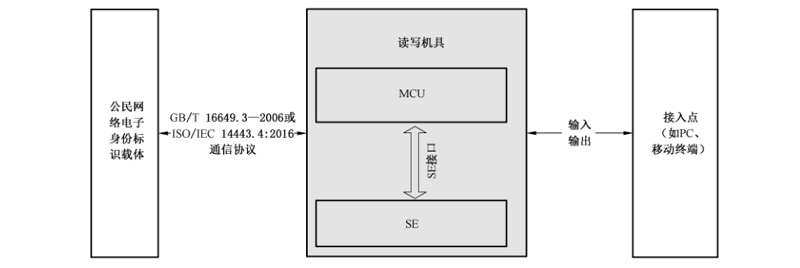

# GB/T 36629.1-2018 信息安全技术 公民网络电子身份标识安全技术要求 第1部分：读写机具安全技术要求

> 来源：[GB/T 36629.1-2018 国家标准详情](https://openstd.samr.gov.cn/bzgk/std/newGbInfo?hcno=7F1DA415D9946662BEFF59A648B25DD9)；发布日期：2018-10-10；实施日期：2019-05-01。
> PDF SHA-256：8eb47b4e8c9f3962e226b41c40aeb97f09c3663d80d774246e4836fb93e5370e。
> 转写说明：按页渲染官方 PDF 并进行图像识别，对照全部 9 页原图校正文字、条款和两张表；图 1 保留原图裁切。省略封面、目录、页眉和页脚，合并跨页段落。正式引用请核对原 PDF。

## 前言

GB/T 36629《信息安全技术 公民网络电子身份标识安全技术要求》分为以下部分：

- 第1部分：读写机具安全技术要求；

- 第2部分：载体安全技术要求；

- 第3部分：验证服务消息及其处理规则。

本部分为 GB/T 36629 的第1部分。

本部分按照 GB/T 1.1—2009 给出的规则起草。

请注意本文件的某些内容可能涉及专利。本文件的发布机构不承担识别这些专利的责任。

本部分由全国信息安全标准化技术委员会（SAC/TC 260）提出并归口。

本部分起草单位：公安部第三研究所、中国科学院软件研究所、国防科学技术大学、中国科学院信息工程研究所、国家信息中心、北京数字认证股份有限公司、上海格尔软件股份有限公司、普华诚信信息技术有限公司、金联汇通信息技术有限公司。

本部分主要起草人：胡传平、邹翔、陈兵、杨明慧、贾焰、张立武、刘丽敏、李新友、国强、张晏、傅大鹏、张妍、梁佐泉、谢超、田文晋、郑强、刘海龙、倪力舜、胥怡心、夏丽娟、周斌、张严。

## 1 范围

GB/T 36629 的本部分规定了公民网络电子身份标识读写机具的基本安全要求、数据初始化安全要求、密码应用管理安全要求和密码应用服务安全要求。

本部分适用于公民网络电子身份标识读写机具的设计、开发、测试、生产和应用。

## 2 规范性引用文件

下列文件对于本文件的应用是必不可少的。凡是注日期的引用文件，仅注日期的版本适用于本文件。凡是不注日期的引用文件，其最新版本（包括所有的修改单）适用于本文件。

- GB/T 16649.3—2006 识别卡 带触点的集成电路卡 第3部分：电信号和传输协议

- GB/T 20518—2018 信息安全技术 公钥基础设施 数字证书格式

- GB/T 32905—2016 信息安全技术 SM3密码杂凑算法

- GB/T 32907—2016 信息安全技术 SM4 分组密码算法

- GB/T 32915—2016 信息安全技术 二元序列随机性检测方法

- GB/T 32918.2—2016 信息安全技术 SM2椭圆曲线公钥密码算法 第2部分：数字签名算法

- GB/T 32918.4—2016 信息安全技术 SM2椭圆曲线公钥密码算法 第4部分：公钥加密算法

- GB/T 36632—2018 信息安全技术 公民网络电子身份标识格式规范

- ISO/IEC 14443.4:2016 识别卡 非接触式集成电路卡 邻近卡 第4部分：传输协议（Identification cards—Contactless integrated circuit cards—Proximity cards—Part 4:Transmission protocol）

## 3 术语和定义

GB/T 36632—2018 界定的以及下列术语和定义适用于本文件。

### 3.1 读写机具 reader

能够读写承载于智能卡、智能密码钥匙等载体中公民网络电子身份标识相关信息的机具。

### 3.2 读写机具安全模块 secure element of reader

读写机具内部的核心硬件电路安全组件。

### 3.3 读写机具数字证书 certificate of reader

用于标识读写机具身份的数字证书。

### 3.4 密码应用管理 cryptographic application management

用于对读写机具安全模块上的密钥进行生成、存储、导入、导出、更新的操作，并对读写机具数字证书进行导入、更新、删除操作。

### 3.5 签名 PIN 码 signature PIN

确认公民网络电子身份标识载体签名操作的个人识别码。

### 3.6 密码应用服务 cryptographic application service

通过读写机具对应用提供数据加解密、签名 PIN 码的校验和修改、数字签名等服务。

### 3.7 数据初始化 data initialization

将读写机具初始化数据加密处理后写入读写机具的过程。

### 3.8 读写机具数字证书颁发系统 issuing system of readers certificate

用于颁发读写机具数字证书的信息系统。

### 3.9 读写机具初始化数据 initialization data of reader

用于实现读写机具初始化的数据信息。

> 注：包括读写机具的对称和非对称密钥数据、读写机具证书和读写机具证书颁发系统的证书。

## 4 缩略语

下列缩略语适用于本文件。

LCD：液晶显示器（Liquid Crystal Display）

MCU：微控制单元（Microcontroller Unit）

PIN：个人识别码（Personal Identification Number）

SE：安全模块（Secure Element）

## 5 读写机具基本安全要求

### 5.1 基本组件

读写机具应包括 MCU、SE、SE 接口等组件，见图1所示。

MCU 是一个通用处理器，应支持通信、设备读写逻辑等指令。

SE 负责对关键数据进行安全存储和运算，确保进行的操作具有不可抵赖性。

SE 接口用于 MCU 和 SE之间的数据交互。

### 5.2 微控制单元

MCU 的安全技术要求如下：

a） 与公民网络电子身份标识载体的通信，应符合 GB/T 16649.3—2006 或 ISO/IEC 14443.4:2016 的要求；

b） 应支持从接入点接入的外部数据交互、数据合规性和数据完整性的验证。

### 5.3 安全模块

SE 的安全技术要求如下：

a） 应具有密钥生成、数字签名和加解密运算功能，保证操作在SE 内进行；

b） 应具备访问控制保护的独立存储空间，存放读写机具对称密钥和证书私钥，私钥不可导出并且不能明文输出对称密钥；

c） 参与密钥运算的随机数应由SE 生成，其随机性指标应符合 GB/T 32915—2016的相关要求。

### 5.4 安全模块接口

SE 接口应支持密码应用管理和密码应用服务的功能。

## 6 读写机具数据初始化要求

### 6.1 读写机具标识数据

读写机具标识数据应包括：

a） 读写机具生产厂商标识码、读写机具生产日期、读写机具标识码；

b） 在读写机具出厂前预置，出厂后禁止更改。

### 6.2 读写机具标识的编码

读写机具标识的编码安全技术要求如下：

a） 读写机具生产厂商标识码应由生产厂商的统一社会信用代码或组织机构代码表示；

b） 读写机具生产日期应由 8 位数字代码组成，编码格式为：YYYYMMDD，如生产日期为 2013 年 07 月 02 日，即为 20130702；

c） 读写机具标识码编码格式应为：通信接口类型＋读写机具类型＋‘_’＋读写机具生产厂商标识码＋读写机具生产日期＋当日序列号。其中，通信接口类型、读写机具类型分别见表 1 和表 2；‘_’表示空格；读写机具生产厂商标识码应由统一社会信用代码表示；当日序列号的值为 000001-999999 之间的顺序编码。

**表1 通信接口类型**

| 通信接口类型 | 含义 |
| --- | --- |
| ‘B’ | 蓝牙通信接口 |
| ‘U’ | USB 通信接口 |
| ‘X’ | 其他类型接口 |

**表2 读写机具类型**

| 读写机具类型 | 含义 |
| --- | --- |
| 1 | 通用接触式读写器 |
| 2 | 具有LCD 和键盘的接触读写器 |
| 3 | 通用双界面读写器 |
| 4 | 具有LCD 和键盘的双界面读写器 |
| 5 | 通用非接触读写器 |
| 6 | 具有 LCD 和键盘的非接触读写器 |
| 0 | 其他类型读写器 |

### 6.3 读写机具数字证书格式

读写机具数字证书格式应符合 GB/T 20518—2018 中 5.2 的要求。其主体项表示读写机具的实体信息，格式应为：

主体项＝读写机具标识码＋组织＋国家；

其中，读写机具标识码编码格式见6.2。组织是读写机具证书颁发系统所属机构的英文或拼音简称，全部大写。国家是中国的英文简称 CN。

### 6.4 读写机具证书颁发系统证书格式

读写机具证书颁发系统证书格式应符合 GB/T 20518—2018 中 5.2 的要求。其主体项表示读写机具证书颁发系统的实体信息，格式应为：

主体项＝名称＋组织＋国家；

其中，名称是发行机构的英文或拼音简称，全部大写。组织是读写机具证书颁发系统的英文或拼音简称，全部大写。国家是中国的英文简称 CN。

## 7 读写机具密码应用管理安全要求

### 7.1 密码算法

密码算法的安全技术要求如下：

a） 公钥密码算法应符合 GB/T 32918.4—2016 的要求；

b） 密码杂凑算法应符合 GB/T 32905—2016的要求；

c） 分组密码算法应符合 GB/T 32907—2016 的要求。

### 7.2 密钥管理

密钥管理的安全技术要求如下：

a） 应支持SM2算法的密钥对生成、存储、导入以及公钥的导出等功能；

b） 应支持 SM4 算法的密钥的生成、存储、加密导入、加密导出等功能。

### 7.3 证书管理

#### 7.3.1 读写机具数字证书管理

读写机具数字证书管理的安全技术要求如下：

a） 应在读写机具的SE 内产生读写机具的公私钥；

b） 读写机具产生的公钥应提交读写机具数字证书颁发系统以制作证书；

c） 读写机具私钥应保存在读写机具的 SE 中，不可导出。

#### 7.3.2 读写机具数字证书颁发系统证书管理

读写机具数字证书颁发系统证书管理的安全技术要求如下：

a） 应在数据初始化过程中将读写机具数字证书颁发系统的证书写入读写机具的SE中；

b） 应能够验证读写机具数字证书的有效性。

### 7.4 读写机具开机口令管理

读写机具开机口令管理的安全技术要求如下：

a） 应支持读写机具开机口令的校验功能；

b） 应支持读写机具开机口令的修改功能；

c） 应支持读写机具开机口令的复位功能。

## 8 读写机具密码应用服务安全要求

### 8.1 数据加解密服务

应支持 GB/T 32918.4—2016 和 GB/T 32907—2016的要求。

### 8.2 签名PIN码服务

应支持签名 PIN码的校验和修改功能。

### 8.3 数字签名服务

应支持 GB/T 32918.2—2016 的要求。

## 参考文献

- ［1］ GB/T 16649.4—2010 识别卡 带触点的集成电路卡 第4部分：用于交换的结构、安全和命令

- ［2］ GB/T 16649.6—2001 识别卡 带触点的集成电路卡 第6 部分：行业间数据元

- ［3］ GB/T 32918.1—2016 信息安全技术 SM2椭圆曲线公钥密码算法 第1部分：总则

- ［4］ GB/T 32918.3—2016 信息安全技术 SM2椭圆曲线公钥密码算法 第3部分：密钥交换协议

- ［5］ GB/T 32918.5—2017 信息安全技术 SM2椭圆曲线公钥密码算法 第5部分：参数定义

- ［6］ On-The-Go Supplement to the USB 2.0 Specification
