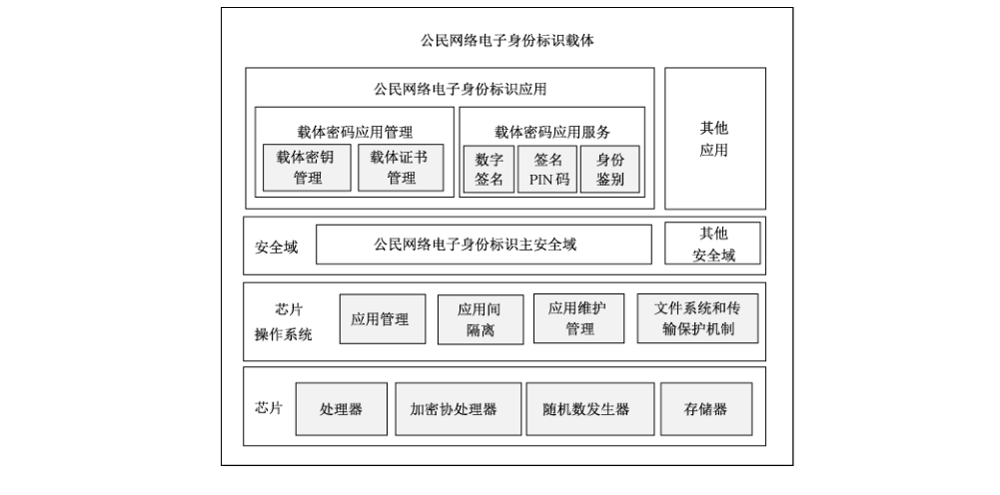

# GB/T 36629.2-2018 信息安全技术 公民网络电子身份标识安全技术要求 第2部分：载体安全技术要求

> 来源：[GB/T 36629.2-2018 国家标准详情](https://openstd.samr.gov.cn/bzgk/std/newGbInfo?hcno=C77A4D2F828E99118793FA62F76DBD2A)。
> PDF SHA-256：cfa308f2a0de87f23fb1906e3fe14f84bc057e0622d343875c2093c15a5e0234。
> 发布日期：2018-10-10；实施日期：2019-05-01。依据官方公开 PDF 的 12 页图像逐页核对，已去除封面、分页和页眉页脚；正式引用请核对原 PDF。

## 前言

GB/T 36629《信息安全技术 公民网络电子身份标识安全技术要求》分为以下部分：

- 第1部分：读写机具安全技术要求；

- 第2部分：载体安全技术要求；

- 第3部分：验证服务消息及其处理规则。

本部分为 GB/T 36629 的第2部分。

本部分按照 GB/T 1.1—2009 给出的规则起草。

请注意本文件的某些内容可能涉及专利。本文件的发布机构不承担识别这些专利的责任。

本部分由全国信息安全标准化技术委员会（SAC/TC 260）提出并归口。

本部分起草单位：公安部第三研究所、中国科学院软件研究所、国防科学技术大学、中国科学院信息工程研究所、国家信息中心、北京数字认证股份有限公司、上海格尔软件股份有限公司、普华诚信信息技术有限公司、金联汇通信息技术有限公司。

本部分主要起草人：胡传平、邹翔、陈兵、杨明慧、贾焰、张立武、刘丽敏、李新友、国强、张晏、傅大鹏、张妍、梁佐泉、谢超、田文晋、郑强、刘海龙、倪力舜、怡心、夏丽娟、周斌、张严。

## 1 范围

GB/T 36629的本部分规定了公民网络电子身份标识载体基本安全要求、芯片操作系统和应用安全要求、载体密钥应用管理安全技术要求和载体密码应用服务安全技术要求。

本部分适用于公民网络电子身份标识载体的设计、开发、测试、生产和应用。

## 2 规范性引用文件

下列文件对于本文件的应用是必不可少的。凡是注日期的引用文件，仅注日期的版本适用于本文件。凡是不注日期的引用文件，其最新版本（包括所有的修改单）适用于本文件。

- GB/T 16649.3—2006 识别卡 带触点的集成电路卡 第3部分：电信号和传输协议

- GB/T 16649.4—2010 识别卡 集成电路卡 第4部分：用于交换的结构、安全和命令

- GB/T 16649.6—2001 识别卡 带触点的集成电路卡 第6部分：行业间数据元

- GB/T 20518 信息安全技术 公钥基础设施 数字证书格式

- GB/T 22186 信息安全技术 具有中央处理器的IC 卡芯片安全技术要求

- GB/T 25069 信息安全技术 术语

- GB/T 32915—2016 信息安全技术 二元序列随机性检测方法

- GB/T 32918.2—2016 信息安全技术 SM2椭圆曲线公钥密码算法 第2部分：数字签名算法

- GB/T 32918.4—2016 信息安全技术 SM2 椭圆曲线公钥密码算法 第4部分：公钥加密算法

- GB/T 20518—2018 信息安全技术 公民网络电子身份标识格式规范

- GM/T 0008—2012 安全芯片密码检测准则

- ISO/IEC 14443.4:2016 识别卡 非接触式集成电路卡 邻近卡 第4部分：传输协议（Identification cards—Contactless integrated circuit cards—Proximity cards—Part 4: Transmission protocol）

## 3 术语和定义

GB/T 25069 和 GB/T 20518—2018界定的以及下列术语和定义适用于本文件。

### 3.1 载体 carrier

用于承载公民网络电子身份标识的介质。

> 注：包括智能密码钥匙、智能芯片卡等形态。

### 3.2 载体数字证书 carrier certificate

颁发给载体的数字证书。

### 3.3 应用维护密钥 application maintenance key

用于载体进行数据传输保护的密钥。

### 3.4 主控密钥 master key

用于向载体内加密装载其他类型密钥以及进行外部认证的密钥。

### 3.5 签名 PIN 码重置密钥 reload key of cyber electronic identity signature PIN

用于重置或者解锁公民网络电子身份标识签名 PIN 码的密钥。

### 3.6 应用管理密钥 application management key

用于管理载体应用的密钥。

> 注：主要包括主控密钥、应用维护密钥和签名 PIN 码重置密钥。

### 3.7 公民网络电子身份标识颁发系统 citizen cyber electronic identity issuing system

用于颁发公民网络电子身份标识的信息系统。

### 3.8 公民网络电子身份标识证书 citizen cyber electronic identity certificate

由公民网络电子身份标识颁发系统按照 GB/T 20518—2018 的要求颁发的数字证书。

### 3.9 密钥容器文件 key container file

用于记载载体内所有非对称密钥、证书的存储信息和算法信息的文件。

### 3.10 会话密钥 session key

用于安全通信会话而随机产生的对称密钥。

## 4 缩略语

下列缩略语适用于本文件。

- DF：专用文件（Dedicated File）
- EF：基本文件（Elementary File）
- PIN：个人识别码（Personal Identification Number）

## 5 载体基本安全要求

### 5.1 概述

公民网络电子身份标识的载体应由芯片、芯片操作系统、安全域和各类应用等部分组成。基本结构见图1。

芯片包括处理器、加密协处理器、随机数发生器和存储器。

芯片操作系统提供独立于读写机具的安全机制，为载体芯片的应用管理提供统一的文件系统和安全服务接口。

安全域负责对载体外实体（例如发卡方、应用提供方、授权管理者）的应用管理需求提供密码支持，分为公民网络电子身份标识主安全域和其他安全域。一个安全域内允许多个主安全域并存。

应用包括公民网络电子身份标识应用和其他应用，由独立的安全域管理，即不同应用的存储区域和运行环境是独立的。

### 5.2 芯片

#### 5.2.1 处理器

应符合 GB/T 22186 的要求。

#### 5.2.2 加密协处理器

公钥密码算法应符合 GB/T 32918.4—2016的要求。

#### 5.2.3 随机数发生器

应符合 GB/T 32915—2016的要求，提供真随机数发生器，实现硬件生成随机数算法并具有自检测功能。

#### 5.2.4 存储器

应提供三种硬件存储器，包括非易失性只读存储器、随机读写存储器和可擦除可编程非易失存储器。

### 5.3 芯片操作系统

应符合 GB/T 16649.3—2006、GB/T 16649.4—2010、GB/T 16649.6—2001、ISO/IEC 14443.4:2016 和 GM/T 0008—2012 的要求。

### 5.4 安全域

安全域应包括但不限于公民网络电子身份标识主安全域和其他安全域。

### 5.5 公民网络电子身份标识应用

应提供载体的密码应用管理和密码应用服务。具体安全技术要求见第7章、第8章。

## 6 芯片操作系统的应用安全要求

### 6.1 应用安全环境

每个应用都应在独立的安全域内存储和执行，以保证每个应用的代码和数据与载体上的其他应用保持独立和安全，防止应用程序被非法对象干扰或篡改。

### 6.2 应用间隔离

应用间隔离安全技术要求如下：

a） 载体应支持多个主安全域的并存，且公民网络电子身份标识的应用应由独立的主安全域管理；

b）载体的各应用之间的安全状态、文件系统、应用代码等应在操作系统层面隔离，防止应用覆盖到其他应用的程序空间或是越界访问其他应用的代码和数据；

c） 当发生应用切换时，当前应用的所有过程及状态数据应自动做清空处理；

d） 应用间不应直接进行通讯，应用间的通讯应通过芯片操作系统的通讯服务实现。

### 6.3 应用维护管理

应具备应用生命周期管理功能、多应用下载功能及应用可扩展性。

### 6.4 文件系统和传输保护机制

文件系统和传输保护机制的安全技术要求见附录 A。

## 7 载体密码应用管理安全技术要求

### 7.1 载体密钥管理

#### 7.1.1 密钥类型

密钥类型安全技术要求如下：

a） 应支持应用管理密钥；

b） 应支持公民网络电子身份标识非对称密钥对；

c） 应支持会话密钥。

#### 7.1.2 密钥属性

密钥属性安全技术要求如下：

a） 应具有密钥索引号，长度为1个字节；

b） 应具有密钥类型，长度为1个字节；

c） 应具有密钥版本，长度为1个字节；

d） 应具有算法标识，长度为1个字节；

e） 应具有使用权限，长度为1个字节；

f） 应具有后续状态，长度为1个字节，通过此密钥验证后，载体上的安全状态，只对PIN 密钥和外部认证密钥有效；

g） 应具有最大重试次数，长度为4个比特，密钥的最大重试次数，只对应用管理密钥有效；

h）应具有当前剩余重试次数，长度为4个比特，密钥当前剩余重试次数，只对应用管理密钥有效；

i） 应具有修改权限，长度1个字节；

j） 应具有密钥值，长度为对应的密钥数据长度。

#### 7.1.3 密钥生成

密钥生成安全技术要求如下：

a） 应用管理密钥应在专用密码设备中产生；

b）公民网络电子身份标识的非对称密钥对生成应符合 GB/T 20518—2018 的5.2中的规定；

c） 会话密钥应在载体内部或在专用密码设备中产生。

#### 7.1.4 密钥导入

密钥导入安全技术要求如下：

a） 应用管理密钥应采用密文传输密钥数据，且附加消息鉴别码，主安全域的主控密钥应可以控制导入应用的密钥；

b） 会话密钥应在专用密码设备中产生，并由载体公钥加密后以密文的形式导入载体。

#### 7.1.5 密钥导出

密钥导出安全技术要求如下：

a） 应用管理密钥和公民网络电子身份标识的私钥不得导出载体；

c） 由载体内部生成的会话密钥，应由通信对方的公钥加密后导出。

#### 7.1.6 密钥存储

密钥存储安全技术要求如下：

a） 应用管理密钥、公民网络电子身份标识的私钥应持久保存在载体内的密钥文件中；

b） 密钥文件中应支持保存多条相同密钥类型的密钥记录，根据密钥索引号加以区分；

c） 会话密钥应临时保存在载体内的随机读写存储器中。

#### 7.1.7 密钥使用

密钥使用安全技术要求如下：

a） 使用密钥的用户应具有密钥的使用权限；

b） 应根据密钥类型和密钥索引进行检索，每种类型的密钥只能用于特定功能，如外部认证或线路保护；

c） 公民网络电子身份标识的私钥不得读取；

d） 会话密钥每次导入或内部生成后应只能使用一次。

#### 7.1.8 密钥更换

密钥更换安全技术要求如下：

a） 密钥的更换应通过修改密钥文件相应内容来完成；

b） 密钥文件修改应具有相应修改权限；

c） 密钥更换数据在传输时应进行线路保护以确保密钥安全。

#### 7.1.9 密钥销毁

密钥销毁安全技术要求如下：

a） 密钥销毁应通过删除密钥文件相应内容来完成；

b） 密钥文件内容删除应具备相应删除操作权限；

c） 应通过卡片掉电或复位，清除随机读写存储器中的会话密钥。

### 7.2 载体数字证书管理安全技术要求

#### 7.2.1 证书导入

##### 7.2.1.1 颁发系统证书

应采用明文方式导入载体。导入操作应满足证书文件的写权限。

##### 7.2.1.2 载体数字证书

应采用明文方式导入载体。导入操作应满足证书文件的写权限，且应在载体内部完成载体数字证书的有效性验证，包括证书链验证和证书公钥一致性验证。载体数字证书格式应符合 GB/T 20518 的要求。

##### 7.2.1.3 公民网络电子身份标识证书

应采用明文方式导入载体。导入操作应满足证书文件的写权限。

#### 7.2.2 证书存储

颁发系统证书、载体数字证书和公民网络电子身份标识证书应分别存储在载体指定密钥容器文件中。

#### 7.2.3 证书更新

应重新生成载体数字证书和公民网络电子身份标识证书，并将两种证书导入载体。应符合 7.2.1 证书导入要求。

## 8 载体密码应用服务安全技术要求

### 8.1 数字签名服务

应支持符合 GB/T 32918.2—2016要求的数字签名功能。

### 8.2 签名 PIN 码服务

签名 PIN 码服务安全技术要求如下：

a） 应支持对签名 PIN 码进行校验；

b） 应支持对签名 PIN 码进行修改，最大尝试次数不超过6次；

c） 应支持对签名 PIN 码进行重置。

### 8.3 身份鉴别服务

身份鉴别服务安全技术要求如下：

a） 应支持签名 PIN 码校验和外部鉴别两种身份鉴别方式；

b） 签名 PIN码校验应比对使用者输入的4～16个字节报文，鉴别通过后方可执行数字签名操作，签名 PIN 码不得明文存储或传输；

c） 外部鉴别应使用鉴别双方共同拥有的主控密钥计算鉴别数据，鉴别通过后外部实体才可以对载体数据进行操作。

## 附录 A（规范性附录）文件系统和传输保护机制

### A.1 文件系统安全技术要求

#### A.1.1 文件系统结构

文件系统结构安全技术要求如下：

a） 应符合 GB/T 16649.4—2010的要求；

b） 文件类型包含：DF、EF 以及密钥文件。

#### A.1.2 文件访问权限管理

##### A.1.2.1 访问权限管理

访问权限管理安全技术要求如下：

a） DF 文件和 EF 文件的访问权限应在文件创建时指定；

b） 密钥文件的访问权限应在密钥写入时指定。

##### A.1.2.2 访问权限规定

###### A.1.2.2.1 DF 文件

DF 文件安全技术要求如下：

a） DF 文件应具有在DF 下创建新文件的权限；

b） DF 文件应具有删除 DF 文件本身的权限。

###### A.1.2.2.2 EF 文件

EF 文件安全技术要求如下：

a） EF 文件应具有读取 EF 中数据的权限；

b） EF 文件应具有向 EF 写入数据的权限；

c） EF 文件应具有使用公私钥文件中公私钥的权限。

###### A.1.2.2.3 密钥文件

密钥文件安全技术要求如下：

a） 密钥文件应具有修改密钥的权限；

b） 密钥文件应具有使用密钥的权限。

### A.2 传输保护机制安全技术

#### A.2.1 安全报文传输格式

安全报文传输格式安全技术要求如下：

a） 应具备操作权限并使用文件或指令指定的安全报文传输格式；

b） 安全报文传送格式应符合 GB/T 16649.4—2010 的要求。

#### A.2.2 报文完整性和验证

报文完整性和验证安全技术要求如下：

a） 数据完整性和对发送方的鉴别应使用消息鉴别码来实现；

b） 消息鉴别码应通过使用命令的所有元素产生；

c） 命令的完整性应通过安全报文传送得以保证。

## 参考文献

- ［1］ GB/T 32918.1—2016 信息安全技术 SM2椭圆曲线公钥密码算法 第1部分：总则

- ［2］ GB/T 32918.3—2016 信息安全技术 SM2椭圆曲线公钥密码算法 第3部分：密钥交换协议

- ［3］ ISO/IEC 14443-1:2016 Identification cards—Contactless integrated circuit cards—Proximity cards—Part 1: Physical characteristics

- ［4］ ISO/IEC 14443-2:2016 Identification cards—Contactless integrated circuit cards—Proximity cards—Part 2: Radio frequency power and signal interface

- ［5］ Global Platform Card Specification v2.3. http://www.globalplatform.org/specificationscard.asp
