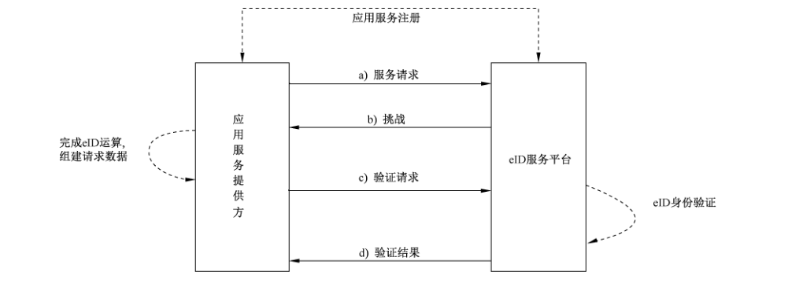

# GB/T 36629.3-2018 信息安全技术 公民网络电子身份标识安全技术要求 第3部分：验证服务消息及其处理规则

> 来源：[GB/T 36629.3-2018 国家标准详情](https://openstd.samr.gov.cn/bzgk/std/newGbInfo?hcno=34D54F6AC1CE1368A6B13CE053216851)。
> PDF SHA-256：2c1fddf83a2bada45a7845cc384887b5987036e22cc58a52ddd430c6d71559ba。
> 发布日期：2018-12-28；实施日期：2019-07-01。依据官方公开 PDF 的 20 页图像逐页核对，已去除封面、目录、分页和页眉页脚，保留原图及示例；正式引用请核对原 PDF。

## 前言

GB/T 36629《信息安全技术 公民网络电子身份标识安全技术要求》分为3个部分：

- 第1部分：读写机具安全技术要求；
- 第2部分：载体安全技术要求；
- 第3部分：验证服务消息及其处理规则。

本部分为 GB/T 36629 的第3部分。

本部分按照 GB/T 1.1—2009 给出的规则起草。

请注意本文件的某些内容可能涉及专利。本文件的发布机构不承担识别这些专利的责任。

本部分由全国信息安全标准化技术委员会（SAC/TC 260）提出并归口。

本部分起草单位：中国科学院软件研究所、公安部第三研究所、国防科学技术大学、金联汇通信息技术有限公司。

本部分主要起草人：张立武、张严、杨明慧、邹翔、冯登国、胡传平、张振峰、陈兵、倪力舜、黄俊、高志刚、夏丽娟、余丹萍、贾焰、刘海龙。

## 1 范围

GB/T 36629 的本部分规定了公民网络电子身份标识验证服务与应用服务提供方间传递的消息及其编码处理规则。

本部分适用于公民网络电子身份标识验证服务及使用该服务的应用与系统的设计和开发。

## 2 规范性引用文件

下列文件对于本文件的应用是必不可少的。凡是注日期的引用文件，仅注日期的版本适用于本文件。凡是不注日期的引用文件，其最新版本（包括所有的修改单）适用于本文件。

- GB/T 13000—2010 信息技术 通用多八位编码字符集（UCS）

- GB/T 20518 信息安全技术 公钥基础设施 数字证书格式

- GB/T 25069—2010 信息安全技术 术语

- GB/T 26231—2017 信息技术 开放系统互连 对象标识符（OID）的国家编号体系和操作规程

- GB/T 36632—2018 信息安全技术 公民网络电子身份标识格式规范

- IETF RFC 4648—2006 Base16、Base32 及 Base64 数据编码（The Base16, Base32, and Base64 Data Encodings）

## 3 术语和定义

GB/T 25069—2010、GB/T 36632—2018 界定的以及下列术语和定义适用于本文件。

### 3.1 eID 服务平台 eID service platform

提供 eID 的生成、存储、使用及维护等全生命周期业务处理相关服务的平台。

### 3.2 eID 身份验证 eID verification

通过将所提交的 eID 身份断言与事先注册的信息进行比较来确认声明的 eID 身份是否正确的过程。

### 3.3 eID 身份注册 eID registration

通过为实体的身份赋予唯一的 eID 标识码，提供一组作为声明的身份和/或权利的证据的数据，并签发 eID 载体，保证其真实性。

### 3.4 eID 移动应用 eID mobile application

在移动客户端上运行的 eID 应用。

### 3.5 eID 验证服务 eID verification service

由 eID 服务平台提供给各应用的进行身份识别及验证的服务。

### 3.6 eID 桌面应用 eID desktop application

通过桌面客户端运行的 eID 应用。

## 4 缩略语

下列缩略语适用于本文件。

- eID：公民网络电子身份标识（Citizen Cyber Electronic Identity）

- HTTPS：安全超文本传输协议（Hypertext Transfer Protocol over Secure Socket Layer）

- OID：对象标识符（Object Identifier）

- PIN：个人识别码（Personal Identification Number）

- SDK：软件开发工具包（Software Development Kit）

## 5 概述

本部分规定 eID 身份验证过程中 eID 服务平台和应用服务提供方间交互流程中传递的消息及其处理规则。当应用服务提供方需要使用 eID 验证服务来验证网络用户的访问请求时，应用服务提供方完成相应的 eID 加密或签名运算，将结果按照本部分所述封装成符合 eID 验证服务接口技术要求的消息，再传输给 eID 服务平台。eID 服务平台在完成 eID 身份验证后，将验证结果按照 eID 验证服务接口技术要求的形式返回给应用服务提供方。上述流程的具体步骤如图1所示。



本部分所规定的接口应采用 HTTPS信道进行传输，且其中使用的涉及保密性、完整性、真实性、不可否认性的相关技术应遵循密码相关国家标准和行业标准。

在接入 eID 验证服务前，应用服务提供商首先在 eID 服务平台中进行注册，并获得对应的应用标识与共享密钥以保证后续流程的执行，注册时发送参数的定义见7.1，eID 服务平台对注册请求的返回结果参数定义见7.2。此过程仅在应用服务提供方首次接入 eID 验证服务前进行。

> 注：为了完成注册，应用服务提供方可能需要通过线下方式向 eID 服务平台递送审核材料，例如：提交ICP 备案号、营业执照副本、税务登记证、组织机构代码证等。

之后，当应用服务提供方需要使用 eID 验证服务时，执行以下操作：

a） 应用服务提供商根据需要向 eID 服务平台发送服务请求。服务请求消息的参数定义见8.2。

b） eID 服务平台返回一个随机数作为本次验证服务的挑战。响应消息的参数定义见8.3。

c） 当应用服务提供方向 eID 服务平台发送服务请求后，应用服务提供方完成相应的 eID 运算，将验证请求数据发送给 eID 服务平台。验证请求消息的参数定义见8.4。

d） eID 服务平台在本地执行相关的验证服务后，将验证结果返回给应用服务提供方。验证结果消息的参数定义见8.5。

## 6 eID 验证服务参数编码规则

### 6.1 消息编码

#### 6.1.1 参数类型

本部分使用如下参数类型：

- Char：表示GB/T 13000—2010中所规定的字符集中的一个字符，本部分中所使用的字符类型参数仅包含可见字符，此外，本部分使用逗号字符（‘,’，编码：U+002C）作为分隔符，因此参数的值不能包含该字符。

- Byte：表示8比特长的单个字节。

- Char/Byte（X）表示长度固定为X个 Char/Byte 类型字符的参数。

- Char/Byte （A..B）表示长度为A至B个 Char/Byte 类型字符的参数。

- Char/Byte （0..A）表示可为空且长度至多为 A个 Char/Byte 类型字节的参数。

#### 6.1.2 参数编码规则

消息发送方（应用服务提供方和 eID 平台）应遵循以下规则生成并发送注册请求、注册返回结果、eID 验证服务请求、eID 验证请求和 eID 验证服务返回结果等消息：

a） 消息发送方应将消息中所有参数类型为 Byte（）的参数的值按照 IETF RFC 4648—2006 中所述 Base64 编码规则进行编码，将其转化为 Char（）类型。

b） 消息发送方应将转化后的所有参数按照如下格式组装成 Char（）类型的字符串：

```text
{
  “参数标识1”：“参数值1”，
  “参数标识2”：“参数值2”，
  …
  “参数标识N”：“参数值N”，
}
```

其中名称/值对的名称应与本部分所规定的参数标识一致，各参数标识间无顺序。在组装时，应忽略所有的不可见字符。若某参数值为空，则在生成的字符串中，该参数的参数标识保留，参数值设为空（长度为0的字符串）。具体的请求参数示例参见附录 A。

c） 消息发送方将组装好的数据放入 http body 域中，并新增下列内容以用来描述本协议内容的版本号。

HEAD：“idsp-protocol-version=2.0.0”

d） 消息发送方使用GB/T 13000—2010中规定的 UTF-8编码格式数据字符串进行编码，然后用POST 方式将消息发送到请求地址，进行接口调用。接口调用示例参见 A.3。

e） 收到消息后，消息接收方应按照本条的参数编码规则的对组装好的参数进行解析，获取各名称对应的参数值。解析步骤示例参见 A.2。

### 6.2 签名参数生成规则

当第三方应用与 eID 服务平台需要生成8.4.4及8.5.4定义的签名值（signature）参数时，应遵循以下规则生成该参数的值，签名值参数生成示例参见附录 B：

a） 应使用8.4.3及8.5.3所述签名方式（sign_type）中指定的签名算法对待签名字符串进行签名，以计算签名值参数的值，使用的签名算法应遵循密码相关国家标准和行业标准。

b） 待签名字符串应以“app_key=”和 app_key 的值为结尾。并包含消息中除去签名值和签名方式两个参数外的其他所有需要使用到的参数的名称和值。

c） 名称/值对间应以‘&’字符进行连接。名称/值对中包含的‘&’字符应使用“`\&`”进行转义。

d） 名称/值对按名称从a到z的顺序排序，若首字母相同，则依照第二个字母进行排序，以此类推。

## 7 注册接口参数

### 7.1 输入参数

#### 7.1.1 应用服务提供方信息

参数标识：`app_info`。

参数类型：Char（1..50）。

参数说明：必选项。待注册的应用服务提供方信息。

#### 7.1.2 应用服务提供方名称

参数标识：`app_name`。

参数类型：Char（1..50）。

参数说明：必选项。待注册的应用服务提供方名称。

#### 7.1.3 机构名称

参数标识：`app_org`。

参数类型：Char（1..50）。

参数说明：必选项。待注册的应用服务提供方所属机构名称。

#### 7.1.4 域名

参数标识：`app_domain`。

参数类型：Char（1..80）。

参数说明：必选项。待注册的应用服务提供方的域名。

#### 7.1.5 IP地址

参数标识：`ip_addr`。

参数类型：Char（1..50）。

参数说明：必选项。待注册的应用服务提供方的IP地址。

#### 7.1.6 结果返回地址

参数标识：`return_url`。

参数类型：Char（1..255）。

参数说明：必选项。返回结果的 URL地址。

#### 7.1.7 保留项

参数标识：`reserved`。

参数类型：Char（1..10000）。

参数说明：可选项。保留字段，为将来定义新的用途所保留。

### 7.2 返回参数

#### 7.2.1 应用服务提供方信息

参数标识：`app_info`。

参数类型：Char（1..50）。

参数说明：必选项。待注册的应用服务提供方信息。应与请求中对应项的值相同。

#### 7.2.2 应用服务提供方名称

参数标识：`app_name`。

参数类型：Char（1..50）。

参数说明：必选项。待注册的应用服务提供方名称。应与请求中对应项的值相同。

#### 7.2.3 机构名称

参数标识：`app_org`。

参数类型：Char（1..50）。

参数说明：必选项。待注册的应用服务提供方所属机构名称。应与请求中对应项的值相同。

#### 7.2.4 域名

参数标识：`app_domain`。

参数类型：Char（1..80）。

参数说明：必选项。待注册的应用服务提供方的域名。应与请求中对应项的值相同。

#### 7.2.5 IP 地址

参数标识：`ip_addr`。

参数类型：Char（1..50）。

参数说明：必选项。待注册的应用服务提供方的IP地址。应与请求中对应项的值相同。

#### 7.2.6 结果返回 URL

参数标识：`return_url`。

参数类型：Char（1..255）。

参数说明：必选项。返回结果的 URL 地址。应与请求中对应项的值相同。

#### 7.2.7 应用服务提供方标识

参数标识：`app_id`。

参数类型：Char（1..39）。

参数说明：必选项。用来标识应用服务提供方的唯一应用号，由 eID 服务平台为应用服务提供方生成。

#### 7.2.8 共享密钥

参数标识：`app_key`。

参数类型：Byte（1..100）。

参数说明：必选项。由 eID 服务平台为应用服务提供方生成的共享对称密钥，用于在后续流程使用预共享密钥对数据进行加密保护，本部分不规定该共享密钥的使用方式。

#### 7.2.9 服务器 URL

参数标识：`server_url`。

参数类型：Char（1..255）。

参数说明：必选项。请求服务的 URL。

#### 7.2.10 服务器公钥证书

参数标识：`server_cert`。

参数类型：Byte（0..10000）。

参数说明：必选项。应用服务提供方对返回结果验签所需的证书文件，证书文件的格式应符合GB/T 20518。在使用此证书对 eID 服务平台的签名进行验签之前，应用服务提供方应验证此证书的有效性，以确保其是受应用服务提供方信任的有效证书，例如：验证证书的有效期、证书链的有效性等。

#### 7.2.11 保留项

参数标识：`reserved`。

参数类型：Char（1..10000）。

参数说明：可选项。保留字段，为将来定义新的用途所保留。

## 8 eID 验证服务消息参数

### 8.1 概述

eID 验证服务接口包含 eID 桌面验证服务接口和 eID 移动验证服务接口，分别为 eID 桌面应用和 eID 移动应用中的应用服务提供方与 eID 服务平台的交互提供交互协议与数据传输格式要求。数据的传输包含应用服务提供方发往 eID 服务平台的请求参数与 eID 服务平台返回给应用服务提供方的返回参数。

在本部分中，所有签名算法参数的值应以算法对应的OID 表示，OID 的相关规定见 GB/T 26231—2017。例如，当使用 SM2 数字签名算法和 SM3散列算法时，该参数的值应为“1.2.156.197.1.501”。

### 8.2 应用服务提供方请求消息参数

#### 8.2.1 消息类型

参数标识：`message_type`。

参数类型：Char（2）。

参数说明：必选项。消息类型，对于请求消息，固定为字符“01”。

#### 8.2.2 应用服务提供方 ID

参数标识：`app_id`。

参数类型：Char（1..39）。

参数说明：必选项。注册在 eID 服务平台的唯一的应用号，前两位为标识位。应与应用服务提供方从注册接口返回参数中获得的值相一致。

#### 8.2.3 业务流水号

参数标识：`biz_sequence_id`。

参数类型：Char（64）。

参数说明：必选项。应用针对本次验证请求的唯一标识串码。

#### 8.2.4 保留项

参数标识：`reserved`。

参数类型：Char（1..10000）。

参数说明：可选项。保留字段，为将来定义新的用途所保留。

### 8.3 eID 服务平台挑战消息参数

#### 8.3.1 消息类型

参数标识：`message_type`。

参数类型：Char（2）。

参数说明：必选项。消息类型，对于挑战消息，固定为字符“11”。

#### 8.3.2 应用服务提供方 ID

参数标识：`app_id`。

参数类型：Char（1..39）。

参数说明：必选项。注册在 eID 服务平台的唯一的应用号，前两位为标识位。应与应用服务提供方在请求消息中发送的值相同。

#### 8.3.3 业务流水号

参数标识：`biz_sequence_id`。

参数类型：Char（64）。

参数说明：必选项。应用针对本次请求的唯一标识串码。应与应用服务提供方在请求消息中发送的值相同。

#### 8.3.4 挑战随机数

参数标识：`challenge_random`。

参数类型：Byte（32..1024）。

参数说明：必选项。eID 服务平台发送的挑战随机数，用来保证 eID 验证过程的新鲜性。该挑战会在计算 eID 签名值（8.4.9）时使用。

#### 8.3.5 消息扩展

参数标识：`extension`。

参数类型：Char（1..200）。

参数说明：可选项。为后续应用提供一些扩展服务。

### 8.4 应用服务提供方验证消息参数

#### 8.4.1 消息类型

参数标识：`message_type`。

参数类型：Char（2）。

参数说明：必选项。消息类型，对于验证消息，固定为字符“02”。

#### 8.4.2 应用服务提供方 ID

参数标识：`app_id`。

参数类型：Char（1..39）。

参数说明：必选项。注册在 eID 服务平台的唯一的应用号，前两位为标识位。应与应用服务提供方从注册接口返回参数中获得的值相一致。

#### 8.4.3 签名方式

参数标识：`sign_type`。

参数类型：Char（1..100）。

参数说明：必选项。签名使用的算法对应的 OID。

#### 8.4.4 签名值

参数标识：`signature`。

参数类型：Byte（1..2000）。

参数说明：必选项。使用 sign_type 中所规定的签名算法对需要参与签名的参数进行签名得到的值，签名的具体规则见 6.2。

#### 8.4.5 结果返回 URL

参数标识：`return_url`。

参数类型：Char（1..255）。

参数说明：必选项。结果返回应用服务提供方路径。

#### 8.4.6 业务流水号

参数标识：`biz_sequence_id`。

参数类型：Char（64）。

参数说明：必选项。应用针对本次请求的唯一标识串码。

#### 8.4.7 请求时间

参数标识：`apply_time`。

参数类型：Char（19）。

参数说明：必选项。时间，格式为 yyyy-MM-dd HH:mm:ss。

#### 8.4.8 业务类型

参数标识：`biz_type`。

参数类型：Char（2）。

参数说明：必选项。具体值的含义如下：

- “01”：桌面账号绑定；

- “02”：桌面账号找回；

- “03”：移动一键账号绑定；

- “04”：移动一键账号找回；

- “05”：桌面安全登录；

- “06”：移动一键安全登录；

- “07”：移动实名认证；

- “08”：后台实名认证。

#### 8.4.9 eID 用户信息

参数标识：`eid_user_info`。

参数类型：Char（1..100）。

参数说明：本参数仅在 eID 桌面应用类型的应用中使用。当使用时为可选项。在支付业务中，通过 eID 支付终端 SDK 签名函数获得的用户信息。

#### 8.4.10 eID 签名值

参数标识：`eid_sign_info`。

参数类型：Byte（1..2000）。

参数说明：本参数仅在 eID 桌面应用类型的应用中使用。当使用时为必选项。实名认证中，通过 eID 支付终端 SDK 签名函数获得的签名结果。

#### 8.4.11 签名算法 ID

参数标识：`sign_algorithm_id`。

参数类型：Char（1..100）。

参数说明：本参数仅在 eID 桌面应用类型的应用中使用。当使用时为必选项。用户使用 eID 设备签名使用的算法对应的 OID。

#### 8.4.12 待签信息原文

参数标识：`data_to_sign`。

参数类型：Char（1..2000）。

参数说明：本参数仅在 eID 桌面应用类型的应用中使用。当使用时为必选项。用户发起的交易原文明文。

#### 8.4.13 eID 属性信息

可选项。保留字段。

#### 8.4.14 消息扩展

参数标识：`extension`。

参数类型：Char（1..200）。

参数说明：可选项。为后续应用提供一些扩展服务。

#### 8.4.15 手机号码

参数标识：`user_phone`。

参数类型：Char（1..15）。

参数说明：本参数仅在 eID 移动应用中使用。当使用时为必选项。当前应用运行平台对应的手机号码。

#### 8.4.16 保留项

参数标识：`reserved`。

参数类型：Char（1..10000）。

参数说明：可选项。保留字段，为将来定义新的用途所保留。

### 8.5 eID 服务平台返回参数

#### 8.5.1 消息类型

参数标识：`message_type`。

参数类型：Char（2）。

参数说明：本参数仅在 eID 移动应用中使用。当使用时为必选项。消息类型，对于返回消息，固定为字符“12”。

#### 8.5.2 返回结果

参数标识：`result`。

参数类型：Char（1..5）。

参数说明：必选项。业务处理结果。

#### 8.5.3 签名方式

参数标识：`sign_type`。

参数类型：Char（1..100）。

参数说明：必选项。签名使用的算法对应的 OID。

#### 8.5.4 签名值

参数标识：`signature`。

参数类型：Byte（1..2000）。

参数说明：必选项。使用 sign_type 中所规定的签名算法对需要参与签名的参数进行签名得到的值，具体格式见 6.2。

#### 8.5.5 业务流水号

参数标识：`biz_sequence_id`。

参数类型：Char（64）。

参数说明：必选项。针对本次请求及应答的唯一标识串码。

#### 8.5.6 返回时间

参数标识：`result_time`。

参数类型：Char（19）。

参数说明：必选项。时间，格式为 yyyy-MM-dd HH:mm:ss。

#### 8.5.7 eID 标识码

参数标识：`eID_code`。

参数类型：Char（1..80）。

参数说明：必选项。用户登录的 eID 标识码。其格式应符合 GB/T 36632—2018 的要求。

#### 8.5.8 用户账户

参数标识：`user_account`。

参数类型：Char（1..80）。

参数说明：本参数仅在 eID 桌面应用类型的应用中使用。当使用时为必选项。用户在应用服务提供方注册的账号。

#### 8.5.9 消息扩展

参数标识：`extension`。

参数类型：Char（1..200）。

参数说明：可选项。保留字段。

#### 8.5.10 保留项

参数标识：`reserved`。

参数类型：Char（1..10000）。

参数说明：可选项。保留字段，为将来定义新的用途所保留。

> 转写注：原版 8.1 的 OID 写作 `1.2.156.197.1.501`，8.3.4 引用“8.4.9”；附录 A 的 OID 为 `1.2.156.10197.1.501`，eID 签名值条款为 8.4.10。上述差异保留原文。

## 附录A（资料性附录）请求与返回消息处理示例

### A.1 概述

本附录描述了第7章和第8章所述各请求与返回消息的解析规则、接口调用方式及消息示例，供应用参考。在应用时，应根据实际情况生成相应的参数内容。为简便起见，示例中省略了证书信息的中间部分并以“…”代替。

### A.2 消息解析步骤示例

对6.1所述消息编码的解析步骤示例如下：

a）消息接收方确定消息字符串的首字符与尾字符分别为‘`{`’与‘`}`’；

b）使用‘,’作为分隔符将消息字符串分割成若干名称/值对；

c）获取相应的名称/值对后，搜索第一个‘:’作为分隔符，将名称/值对解析为名称和值两部分；

d）确定名称和值均以‘“’与‘”’作为起始与结束；

e）将名称的内容与本部分第7章和第8章规定的各参数的参数标识相同的名称/值对进行处理。对名称未在本部分第7章和第8章参数标识中出现的名称/值对，可忽略或根据业务需要进行处理；

f）如果存在多个名称相同的名称/值对，且格式符合本部分的规定，可根据需要仅接收最后出现的名称/值对中的值或报错处理；

g）确认收到的数据中值的长度符合本部分第7章和第8章所规定的消息长度；

h）确认收到的数据中包含所有必选的参数所对应的名称/值对，且这些参数的值符合本部分定义的参数类型。

### A.3 接口调用示例

本部分规定的各接口的调用方式可采用异步调用或同步调用两种方式，相应的调用方式示例如下：

a）当应用服务提供方通过异步调用方式调用接口时，在请求消息中通过 return_url 参数发送一个供 eID 服务平台使用的结果返回地址。eID 服务平台会在收到应用服务提供方发送的消息后返回确认消息。应用服务提供方可根据网络与应用实际情况制定超时时间，在超时时间内未收到 eID 服务平台的同步返回结果，则进行请求失败处理。随后，eID 服务平台会通过参数中 return_url 中包含的结果返回将业务处理结果返回给应用服务提供方，应用服务提供方在接收到 eID 服务平台的处理结果之后，向 eID 服务平台返回确认消息，其内容为：`{“received”：“true”}`，表示已接收到结果。如果 eID 服务平台在一定时间内未收到应用服务提供方的接收确认，会根据策略按一定间隔重复发送直到达到最大重试次数或收到应用服务提供方的接收确认，应用服务提供方采用重复消息判定机制对此进行处理。

b）当应用服务提供方通过同步调用方式调用接口时，eID 服务平台会保持会话，待处理完所有业务以后，按照第7章和第8章中的定义直接返回相关参数。应用服务提供方可根据网络与应用实际情况制定超时时间，在超时时间内未收到 eID 服务平台的同步返回结果，则进行请求失败处理。

### A.4 注册请求与返回消息示例

#### A.4.1 注册请求消息示例

如7.1所示注册请求消息示例如下。

```json
{
  "app_info": "An Example Service Provider",
  "app_name": "example_sp",
  "app_org": "example_org",
  "app_domain": "https://www.eid-service.cn",
  "ip_addr": "101.230.3.98",
  "return_url": "https://www.eid-service.cn/return_url"
}
```

#### A.4.2 注册返回消息示例

如7.2所示注册返回消息示例如下。

```json
{
  "app_info": "An Example Service Provider",
  "app_name": "example_sp",
  "app_org": "example_org",
  "app_domain": "https://www.eid-service.cn",
  "ip_addr": "101.230.3.98",
  "sign_cert": "CERT=0123456789ABCDEF",
  "app_id": "01QT1601011010101111",
  "app_key": "NzcxRUYzREJGRjVGMUNEQzMyQjlDNTcyOTMwNDc2MTkxOTk4QjJCRjdDQjk4MUQ3RjVCMzkyMDI2NDVGMDkzMQ==",
  "server_url": "https://www.eid.cn/server_url",
  "server_cert": "MIIDYz...+75H3TmAzw=="
}
```

### A.5 桌面验证请求与返回消息示例

#### A.5.1 桌面验证请求消息示例

如8.4所示桌面验证请求消息示例如下。

```json
{
  "message_type": "02",
  "app_id": "01QT1601011010101111",
  "sign_type": "1.2.156.10197.1.501",
  "signature": "NkQzRkJBMjZFQUIyQTEwNTRGNUQxOTgzMzJFMzM1ODE3QzhBQzQ1MOVEMjZEMzM5MUNENDQzOUQgODIlQkYyNUI=",
  "return_url": "https://www.eid-service.cn/return_url",
  "biz_sequence_id": "F6F242C3BFFB4F7690C9CE719A2FE9B7",
  "apply_time": "2016-08-16 09:01:23",
  "biz_type": "01",
  "eid_user_info": "vGrRdDdHn5UIXDhZXGFVOOxptpFuyUmdyGkTTE+FNXb8Jx5zTEJCU3uJ7wkq+/qcbSCRsuiwnO8lsBDOG/LoRg==",
  "eid_sign_info": "MzEyNEM1Njg4RDk1RjBBMTAyNTJBOUJFRDAzMOJFQzgON DM5REEzODQ2MjFCNkQ2RkFENzdGOTRCNzRBOTU1Ng==",
  "sign_algorithm_id": "1.2.156.10197.1.501",
  "data_to_sign": "ZqL+WkQxr0bJ6VHBN1k8DH0dH3hLJ113",
  "extension": "some_extension"
}
```

#### A.5.2 桌面验证返回消息示例

如8.5所示桌面验证请求消息示例如下。

```json
{
  "message_type": "12",
  "result": "1",
  "sign_type": "1.2.156.10197.1.501",
  "signature": "NkQzRkJBMjZFQUIyQTEwNTRGNUQxOTgzMzJFMzM1ODE3QzhBQzQ1MOVEMjZEMzM5MUNENDQzOUQgODIlQkYyNUI=",
  "biz_sequence_id": "F6F242C3BFFB4F7690C9CE719A2FE9B7",
  "return_time": "2013-01-01 11:11:11",
  "eID_code": "2016-08-16 09:02:02",
  "user_account": "useraccount",
  "extension": "some_extension"
}
```

### A.6 移动验证请求与返回消息示例

#### A.6.1 移动验证请求消息示例

如8.4所示移动验证请求消息示例如下，在应用时，应根据实际情况生成相应的参数内容。

```json
{
  "message_type": "02",
  "app_id": "01QT1601011010101111",
  "sign_type": "1.2.156.10197.1.501",
  "signature": "NkQzRkJBMjZFQUIyQTEwNTRGNUQxOTgzMzJFMzM1ODE3QzhBQzQ1MOVEMjZEMzM5MUNENDQzOUQgODIlQkYyNUI=",
  "return_url": "https://www.eid-service.cn/return_url",
  "biz_sequence_id": "F6F242C3BFFB4F7690C9CE719A2FE9B7",
  "apply_time": "2016-08-16 09:01:23",
  "user_phone": "13012345678",
  "biz_type": "03",
  "security_class": "1",
  "extension": "some_extension"
}
```

#### A.6.2 移动验证返回消息示例

如8.5所示移动验证请求消息示例如下，在应用时，应根据实际情况生成相应的参数内容。

```json
{
  "message_type": "12",
  "result": "1",
  "sign_type": "1.2.156.10197.1.501",
  "signature": "NkQzRkJBMjZFQUIyQTEwNTRGNUQxOTgzMzJFMzM1ODE3QzhBQzQ1MOVEMjZEMzM5MUNENDQzOUQgODIlQkYyNUI=",
  "biz_sequence_id": "F6F242C3BFFB4F7690C9CE719A2FE9B7",
  "return_time": "2013-01-01 11:11:11",
  "eID_code": "2016-08-16 09:02:02",
  "extension": "some_extension"
}
```

## 附录B（资料性附录）签名参数生成示例

### B.1 签名参数生成步骤示例

6.2所述签名参数的生成步骤示例如下：

a）消息发送方将消息中除去 signature 和 sign_type 两个参数外的其他所有参数作为需签名参数。

b）消息发送方对需签名参数数组里的每一个名称/值对按6.2的规则进行排序。排序完成之后，将结果字符串中的所有‘&’字符改为“`\&`”进行转义，之后再把所有数组值以‘&’字符连接起来。

c）在步骤 b）中得到的字符串后连接“app_key=”和 app_key 的值后得到最终的待签名字符串。

d）使用 sign_type 中规定的签名算法对步骤 c）中得到的待签名字符串进行签名。

待签名字符串的生成示例参见 B.2。

### B.2 待签名字符串示例

例如，对于如下的参数数组：

```text
string[] parameters = {
  "app_id":"1234567890",
  "return_url":"http://www.test.com/verify/return_url.asp",
  "biz_sequence_id":"1234567890123456789012345678901234567890123456789012345678901234",
  "apply_time":"2013-01-01 10:10:10",
  "cellphone":"12345678901"
};
```

则 B.1 步骤 b）所生成的字符串如下：

```text
app_id=001234567890&apply_time=2013-01-01 10:10:10&biz_sequence_id=1234567890123456789012345678901234567890123456789012345678901234&cellphone=12345678901&return_url=http://www.test.com/verify/return_url.asp
```

之后，根据 B.1 步骤 c）的描述，直接连接 app_key 后得到最终的待签名字符串如下（设 app_key="app_key"）：

```text
app_id=1234567890&apply_time=2013-01-01 10:10:10&biz_sequence_id=1234567890123456789012345678901234567890123456789012345678901234&cellphone=12345678901&return_url=http://www.test.com/verify/return_url.aspapp_key
```

此字符串便是最终的待签名字符串。

> 转写注：附录 A.5.1 原版 `eid_sign_info` 值含内部空格，示例值按原文保留。原版 B.2 中间字符串的 `app_id` 多出 `00`，最终字符串直接拼接 `app_key`，与 B.1 c）所述格式不同；附录 A 返回示例使用 `return_time`，正文 8.5.6 使用 `result_time`；参考文献［1］标准号为 `32918.3`，题名为“第2部分：数字签名算法”。均按原文保留。

## 参考文献

- ［1］GB/T 32918.3—2016 信息安全技术 SM2椭圆曲线公钥密码算法 第2部分：数字签名算法
- ［2］ECMA-404 The JSON Data Interchange Format.1st Edition.Oct 2013.ECMA-International.
