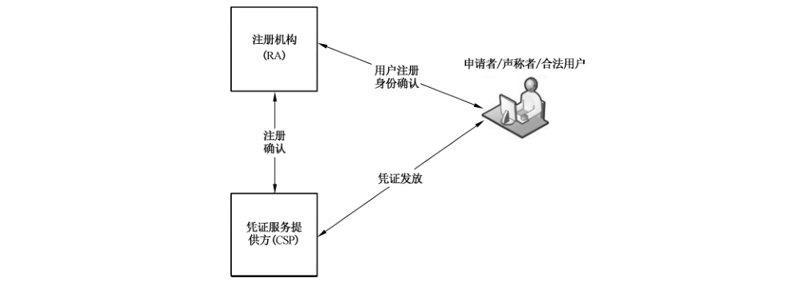
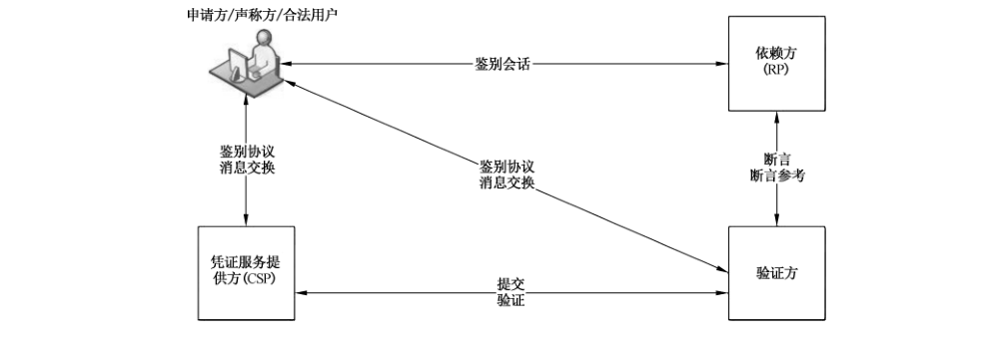
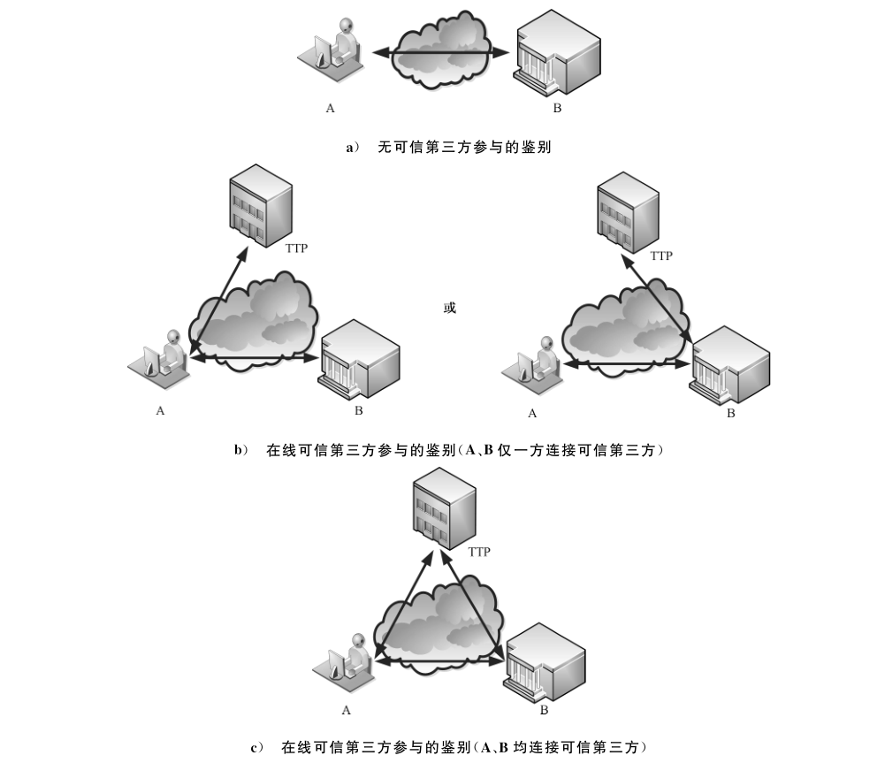
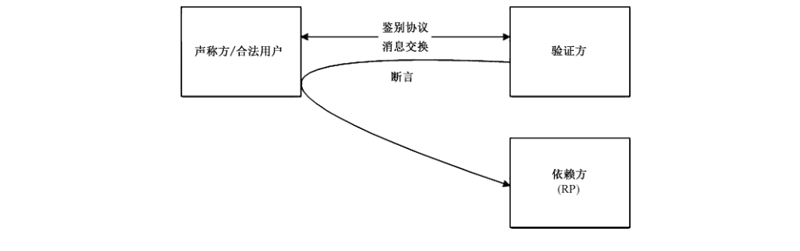
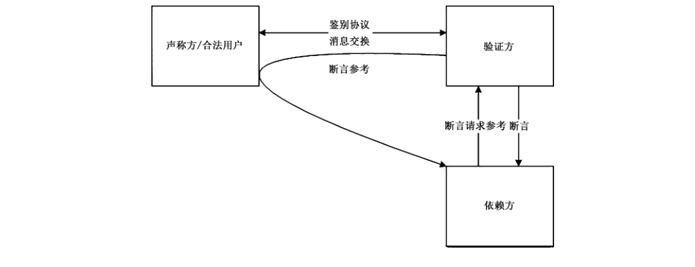
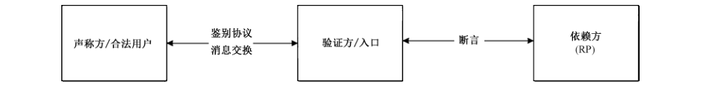

# GB/T 36633-2018 信息安全技术 网络用户身份鉴别技术指南

> 来源：[GB/T 36633-2018 国家标准详情](https://openstd.samr.gov.cn/bzgk/std/newGbInfo?hcno=2D64D0C17D1F97E6ED0427251A992BEC)；发布日期：2018-09-17；实施日期：2019-04-01。
> PDF SHA-256：e20dcc25523bdb541c7e913c82a46b651619cbab3b7860535f0db4e1b27dbe7d。
> 转写说明：将官方 PDF 逐页渲染为图像并进行识别，对照全部 23 页原图校正文字、条款、10 张表和 6 张图；省略封面、目录及页眉页脚，合并跨页表格。正式引用请核对原 PDF。

## 前言

本标准按照 GB/T 1.1—2009 给出的规则起草。

请注意本文件的某些内容可能涉及专利。本文件的发布机构不承担识别这些专利的责任。

本标准由全国信息安全标准化技术委员会（SAC/TC 260）提出并归口。

本标准起草单位：公安部第三研究所、中国电子技术标准化研究院、西安西电捷通无线网络通信股份有限公司、北京工业大学、武汉大学。

本标准主要起草人：顾健、张笑笑、杨元原、陈妍、范科峰、顾玮、俞优、沈亮、王莹莹、沈清泓、许东阳、杜志强、李琴、杨震、王丽娜。

## 1 范围

本标准给出了网络环境下用户身份鉴别的主要过程和常见鉴别技术存在的威胁，并规定了抵御威胁的方法。

本标准适用于网络环境下用户身份鉴别系统的设计、开发与测试。

## 2 规范性引用文件

下列文件对于本文件的应用是必不可少的。凡是注日期的引用文件，仅注日期的版本适用于本文件。凡是不注日期的引用文件，其最新版本（包括所有的修改单）适用于本文件。

- GB/T 15843.1 信息技术 安全技术 实体鉴别 第1部分：总则

- GB/T 15843.2 信息技术 安全技术 实体鉴别 第2部分：采用对称加密算法的机制

- GB/T 15843.3 信息技术 安全技术 实体鉴别 第3部分：采用数字签名技术的机制

- GB/T 15843.4 信息技术 安全技术 实体鉴别 第4部分：采用密码校验函数的机制

- GB/T 15843.5 信息技术 安全技术 实体鉴别 第5部分：使用零知识技术的机制

- GB/T 25069 信息安全技术 术语

- GB/T 28455 信息安全技术 引入可信第三方的实体鉴别及接入架构规范

## 3 术语和定义

GB/T 25069 界定的以及下列术语和定义适用于本文件。

### 3.1 声称方 claimant

为了进行鉴别，本身是本体或者代表本体的个人。

> 注：声称方具备代表本体进行鉴别交换的各种功能。

### 3.2 申请方 applicant

请求分配注册项及其标号的个人。

### 3.3 验证方 verifier

对声称方合法性进行验证的机构或组织。

### 3.4 依赖方 relying party

依赖身份鉴别结果决定是否与声称方建立信任关系的机构或组织。

### 3.5 凭证 credential

身份证明。

### 3.6 凭证服务提供方 credential service provider

发布或者注册合法用户的凭证，并且为合法用户颁发凭证的机构或组织。

### 3.7 合法用户 subscriber

从凭证服务提供方得到凭证的个人。

### 3.8 断言 assertions

验证方所作出的不包含有效证据的声明。

### 3.9 断言参考 assertion reference

和断言结合的，包含验证方标识和断言指针信息的数据对象。

### 3.10 身份确认 identity confirmation

采集用户身份信息，并确认用户身份真实性和一致性的过程。

### 3.11 网络用户身份鉴别 identity authentication over network

在网络中识别用户身份并辨别其合法性的过程。

## 4 缩略语

下列缩略语适用于本文件。

- CSP：凭证服务提供方（Credential Service Provider）
- CSRF：跨站请求伪造（Cross Site Request Forgery）
- DNS：域名系统（Domain Name System）
- HTTP：超文本传送协议（Hypetext Transfer Protocol）
- MF：多因素（Multiple Factor）
- OTP：动态口令（One Time Password）
- PIN：个人识别码（Personal Identification Number）
- PKI：公钥基础设施（Public Key Infrastructure）
- RA：注册机构（Registration Authority）
- RP：依赖方（Relying Party）
- SF：单因素（Single Factor）
- SSL：安全套接层（Secure Sockets Layer）
- TLS：安全传输层协议（Transport Layer Security）
- TTP：可信第三方（Trusted Third Party）
- URL：统一资源定位符（Uniform Resource Location）
- XSS：跨站脚本（Cross Site Scripting）

## 5 概述

### 5.1 网络用户身份鉴别过程

依赖方根据对用户的鉴别结果和用户的身份确定该用户是否拥有访问依赖方的权限。

网络用户身份鉴别的一般过程包括：注册和发放过程、提交和验证以及断言过程。

注册和发放的一般过程如图1所示。在注册和发放过程中，申请方向 RA 申请成为CSP 的合法用户，RA 对申请方进行身份确认。如果 RA 能够确认申请方的身份，CSP 会为申请方注册并颁发一个凭证，同时将凭证和申请方的身份或其他相关属性进行绑定。至此申请方就成为了CSP 的一个合法用户，并且可以在鉴别协议中使用凭证证明其为合法用户。一个用户可以是不同CSP 的合法用户。

提交和验证以及断言的一般过程如图2所示。在提交和验证以及断言过程中，声称方在鉴别协议中通过与验证方的交互来证明他们是特定凭证的合法用户。声称方首先与依赖方交互，发起鉴别会话，当依赖方和验证方是同一机构或组织时，在此鉴别会话中即可完成所有鉴别协议、消息交换；若依赖方与验证方不是同一机构或组织，在鉴别过程中，声称方还需要通过鉴别协议将凭证提交至验证方，验证方验证后将断言或断言参考发送至依赖方进行后续处理。验证方通过鉴别协议验证声称者持有以及控制和断言相关的凭证。一旦持有和控制被证实，验证方通常通过和 CSP交互证明凭证是合法的。

网络用户身份鉴别包括单向或双向鉴别，根据鉴别场景的不同，鉴别双方可能分别为声称方和验证方，也可能同时为声称方和验证方；对于有可信第三方参与的鉴别，TTP 为验证方。三种鉴别模型的鉴别过程参见附录 A。

### 5.2 鉴别协议

验证方和声称方在鉴别协议中的交互过程对于鉴别系统的总体安全性是极其重要的。设计良好的鉴别协议在鉴别期间和之后都能保护声称方和验证方之间会话的完整性和保密性，它能减少攻击者伪装成合法验证方进行破坏造成的损失。此外，验证方能够通过限制攻击者不正确验证的频率从而降低在线猜测攻击的成功率。

鉴别过程建立了声称方与验证方之间的关系，该过程通过鉴别协议消息的交互来实现。其中，鉴别协议消息需要在受保护的会话中传递。

鉴别协议是声称方和验证方之间定义的一个消息序列，表明声称方拥有一个有效的凭证来确定其身份，同时表明该声称方正在与目标验证方交流。声称方和验证方之间交互的鉴别（或鉴别无效）消息就是一个鉴别协议的运行过程。完成或正在进行一个鉴别协议时，会在两者之间生成一个受保护的交互会话；这个受保护的会话可用于交互预定的鉴别协议运行的消息，或者在两者之间交互会话数据。

声称方和验证方的管理机制用于进一步提高鉴别过程的安全性。例如，可以使用公共密钥机制生成信任链，从而实现验证方对声称方的鉴别；也可以限制攻击者在线猜测的口令次数。此外，如果检测出鉴别请求来自于一个未知地址的声称方，或者声称方使用了未知的硬件或软件配置时，也可提高风险等级并要求声称方提供额外的信息用以身份确认。

在鉴别协议运行结束时，验证方有时会颁发一个二次鉴别凭证（例如 cookie）给合法用户，合法用户可以以此代替原有凭证进行鉴别。

鉴别协议的设计应符合 GB/T 15843.1~15843.5 和 GB/T 28455 的规定。

### 5.3 凭证

典型的鉴别系统通常采用以下三个因素作为验证的凭证：知道的信息（例如口令等）；拥有的东西（例如智能卡、动态口令令牌、智能密码钥匙、数字证书等）；固有的特征（例如指纹、虹膜、人脸或者其他生物信息）。

多因素鉴别指多于一个条件的组合。鉴别系统的强度很大程度上是由系统中以上因素的个数决定的。使用两个因素的系统比仅仅使用一个因素要强；使用三个因素的系统要比仅仅使用两个因素的系统要强。

凭证中包含秘密信息以证明声称方是某个凭证的合法用户。在网络用户身份鉴别中，声称方通过证明他拥有且控制某个凭证从而可在网络中通过某个应用的身份鉴别。

CSP 在凭证签发的过程中将凭证和合法用户的标识绑定。凭证由CSP签发和维护，验证方可使用凭证，在基于对凭证拥有和控制的情况下，验证声称方的身份。为了通过凭证验证声称方是否为合法用户，验证方也应验证凭证本身（例如确定凭证是由授权的CSP颁发并且未过期或者被吊销）。如果验证方本身就是CSP，可以直接对凭证有效性进行验证。否则，验证方可以通过安全协议询问CSP，进行交互验证。

以凭证公开的方式绑定的凭证称为公共凭证。典型的公共凭证如公共密钥鉴别，即使知晓相关公共密钥的前提下，也无法计算用户的私有密钥。CSP 不能公开的凭证称为私有凭证，这种凭证一旦泄露，可能威胁到凭证的安全。典型的私有凭证的例子是口令的哈希值，该哈希值一旦泄露，则可能受到口令离线攻击。

### 5.4 验证方

验证方是一个功能角色，常常和CSP 或者RP 实现在一起。如果验证方是和 CSP 分开的机构或组织，应确保验证方在鉴别过程中并不知道合法用户的凭证秘密，或者至少保证验证方只能对CSP保存的凭证秘密进行受限访问。

### 5.5 依赖方

RP依赖于网络用户身份鉴别的结果从而建立合法用户身份或者属性的信任关系，最终可以执行某些事务。验证方和RP可能是同一个机构或组织，或者是不同的机构或组织。如果他们是不同的机构或组织，RP通常从验证方收到断言，此过程中 RP应保证断言是从 RP信任的验证方传过来的。

### 5.6 密码支持

凡涉及密码算法的相关内容，按国家有关法规实施；凡涉及采用密码技术解决保密性、完整性、真实性、不可否认性需求的应遵循密码相关国家标准和行业标准。

## 6 用户注册和凭证发放过程

### 6.1 注册和发放威胁

身份鉴别从注册开始。申请方向 RA申请成为CSP 的合法用户。申请方身份确认成功后，RA为申请方注册，CSP为合法用户颁发一个凭证，并将凭证与用户标识绑定。这个凭证可以是 CSP 签署的，也可以直接由合法用户生成，或者由第三方提供。

RA可以是CSP的一个部分，也可以是一个独立的机构或组织。若RA 与CSP 是分开的机构或组织，则需建立信任关系。RA或 CSP保存注册记录。网络用户身份鉴别过程中，RA和CSP 面向公众提供服务，此时，身份确认过程一般只限于确认其证件、手机号和电子邮件等信息和先前发放的凭证。

注册和身份确认过程应确保 RA/CSP 知道申请方的真实身份。具体来说是为了确保以下内容：

a） 用户与申请方声称的属性存在，且这些属性足够用于唯一标识一个用户；

b） 拥有注册凭证的申请方实际上拥有该身份权；

c） 声称方难以否定该注册。

申请方可当面注册，也可远程注册。不同情况下的身份确认的过程和机制会有所不同。

在注册和身份确认与凭证签发分开的模型中，CSP 负责验证凭证签发给的人与 RA 进行身份确认的人是同一个。在该模型中，发放与注册和身份确认应牢牢绑定，防止攻击者冒充一个新的注册合法用户，尝试收集真实用户的凭证。并且，从凭证起始点到申请方或CSP 的传输安全性需要得到保障，以维护凭证的保密性和完整性，以及凭证被真正的申请方所拥有。

注册过程中通常有两类的威胁：身份假冒威胁和对基础设施（RA 和 CSP）的危害或破坏。本标准关注解决身份假冒威胁。基础设施威胁可通过常用的网络安全技术措施解决（如，职责分离、记录保存、独立审计），不在本标准的范围中。

发放过程的威胁包括身份假冒攻击和凭证或凭证签发传输机制的威胁。表1中详细列举了与注册和发放相关的威胁。

**表1 注册和发放的常见威胁**

| 行为 | 类型 | 实例 |
| --- | --- | --- |
| 注册 | 假冒声称身份 | 申请方通过使用伪造的证件声称一个不正确的身份 |
| 注册 | 否认注册 | 合法用户否认注册，声称他/她没有注册过该凭证 |
| 发放 | 泄露 | CSP 为合法用户创建的凭证在凭证发放过程中从 CSP 传送到合法用户时被攻击者复制 |
| 发放 | 篡改 | 合法用户创建的凭证在递交给 CSP 时被攻击者更改 |
| 发放 | 未经授权发放 | 假冒其他人获得凭证 |

### 6.2 注册和发放威胁的应对策略

注册威胁可以通过增加身份假冒难度来阻止，如规定一定的方法和程序，以来确定申请方就是该身份的有效拥有者，且申请方日后不能否认该注册。

表2列出了抵御注册和发放过程威胁的应对策略。

**表2 注册和发放威胁的应对策略**

| 行为 | 类型 | 应对策略 |
| --- | --- | --- |
| 注册 | 假冒声称身份 | 在申请方身份鉴别时提交的 RA 请求文档具有相当的可信度，使冒名顶替者难以成功通过身份确认阶段，如采用政府签发的经常被用来判断申请方身份的证件（如身份证、驾驶执照、护照等） 身份鉴别时，申请方提供非政府签发文档（例如包含有申请方的姓名和当前所在地址的电费单，或信用卡账单）从而帮助实现更高级别的可信度 当面或者通过摄像头实时交互，比对有效证件的照片与申请方是否一致 |
| 注册 | 否认注册 | 申请方可以签署一份表格承认参与注册活动 |
| 发放 | 泄露 | 当面发放凭证；使用密封的信封邮寄到一个安全的地方，或采取会话保护的方式发送电子凭证 |
| 发放 | 篡改 | 当面发放凭证；使用密封的信封邮寄存储介质，或使用安全的通信协议保护会话数据的完整性 CSP 作为合法用户接收到的所有凭证数据的源头，需建立程序允许合法用户对其进行验证 |
| 发放 | 未经授权发放 | 建立程序以确保获得凭证的人与参加注册程序的人是同一个 |

注册和发放过程包括：注册、身份确认、凭证创建/发放和凭证签发等过程。注册和发放过程中产生的注册记录应由 RA 或CSP保存，且该过程收集的个人信息应受到保护，且应满足所有的隐私要求。

CSP 应能够唯一标识每个合法用户以及与该用户相关的凭证，用户和相关的凭证之间应有一一对应关系。根据 RA 或CSP 政策规定，申请方要提供姓名、地址、电话、出生日期等信息。在某些情况下，CSP可能会选择使用额外的、基于实践的鉴别方法来增加注册过程的可信度。例如，申请方可能被要求提供其在相关机构办理的有助于确认申请方身份的非公开信息。

在注册和身份确认阶段收集的敏感信息在任何时候（如，传输、存储）都应受到保护以确保其安全性和保密性。此外，身份确认过程中的相关结果应妥善保管，并保证数据的保密性和完整性。

如果RA和CSP之间是通过网络进行远程通信，整个 RA 和CSP之间的注册业务应建立在双方已相互鉴别的前提下，并且应对整个会话进行保护。

注册和发放过程允许当面注册和远程注册，其中远程注册过程一般采用全自动化方式实现。某些情况下，作为全自动解决方案的替代或补充，也可以采用呼叫中心或在线辅助方式实现。注册和发放过程的每个场景都应有明确要求，必要时（例如涉及金融服务时）应只允许当面注册。

如果之前已经签发过一个有效的凭证，CSP 可以发放另一个保证等级相同或更低的凭证。在这种情况下，可以使用重复身份确认步骤来代替原始凭证的拥有权和控制权的证明，但仍应需满足在相应的级别上交付凭证的要求。

## 7 鉴别信息提交和验证过程

### 7.1 提交和验证威胁

通常情况下，RA、CSP 和验证方都是由可信实体运行维护的，他们不会故意滥用权利，但网络中的声称方不一定可信，因此需要对其申明的身份进行验证。此外，尽管 RA、CSP 和验证方通常可信，但存在被攻击者破坏的威胁。因此，即使对于可信机构或组织，仍需避免使用暴露过多凭证秘密的鉴别协议。表3列出了对鉴别过程构成威胁的常见问题。

**表3 提交和验证的常见威胁**

| 类型 | 描述 | 实例 |
| --- | --- | --- |
| 在线猜测 | 攻击者通过猜测凭证秘密来进行登录尝试 | 攻击者进入网页，试图使用合法用户的用户名和常用口令登录，例如“password” |
| 钓鱼 | 合法用户被引诱与假冒的验证方互动，并被骗取了凭证秘密、敏感个人数据或可用于伪装成合法用户的鉴别值 | 合法用户收到一封电子邮件，链接到一个欺诈网站，并要求合法用户使用其用户名和口令登录 |
| 网址嫁接 | 想要连接合法验证方的合法用户通过操作域名服务或路由表连接到了攻击者的网站 | 由于 DNS 中毒，合法用户被引导到一个假冒网站，在认为与合法验证方连接的情况下泄露或使用了凭证 |
| 窃听 | 攻击者被动侦听鉴别协议来捕捉信息，并利用这些信息伪装成合法用户进行主动攻击 | 攻击者从合法用户到验证方的传输过程中捕获口令或口令哈希 |
| 重放 | 攻击者能够重放之前捕获的消息（合法用户和验证方之间），伪装成验证方的对应合法用户 | 攻击者从一个真实的鉴别会话中捕获合法用户的口令或口令哈希，过一段时间后并重放给验证方进行访问 |
| 会话劫持 | 攻击者能够将其插入合法用户和验证方之间，继而进入两者之间的一个成功的鉴别交互。攻击者可以假扮成验证方/依赖方的合法用户（反之亦然）从而控制会话数据的交互 | 通过窃听或预测校验 cookies（用于标记合法用户传送的 HTTP 请求）的值，攻击者能够接管一个已鉴别的会话 |
| 中间人 | 攻击者置身于合法用户和验证方之间，从而可以拦截和修改鉴别协议消息的内容。攻击者通常面对合法用户时模仿验证方，同时面对验证方时假装合法用户。在两者之间交互时假扮对应角色时，攻击者可能准许使用合法方传递给另一方的鉴别消息 | 攻击者侵入一个转发验证方和合法用户之间消息的路由器。当转发消息时，攻击者将其公钥代替验证方的公钥。合法用户被欺骗用该密钥加密其口令，从而攻击者可以解密该口令 攻击者设置了一个欺诈网站来冒充验证方。当一个粗心的合法用户试图使用其一次性口令装置登录时，攻击者的网站假装使用合法用户的一次性口令装置登录到真实的验证方 |

威胁不只局限于鉴别协议本身，还可能包括：

a）拒绝服务攻击，攻击者用大量的流量通过鉴别协议的方式淹没了验证方。拒绝服务攻击的目的是淹没鉴别协议的来源，使合法用户无法接触验证方，或者减缓过程从而增加合法用户接触验证方的难度。几乎所有的鉴别协议都容易受到拒绝服务攻击；抵御此类攻击的可行方法是通过使用分布式验证架构和负载均衡技术，将协议请求分派给多个镜像校验系统，或者其他的类似技术。

b）恶意代码攻击，鉴别凭证秘密泄露或被利用。恶意代码可以植入合法用户的电脑系统，从而迫使鉴别凭证秘密泄露或被利用。恶意代码可以通过多种途径传播。许多措施（例如病毒检查和防火墙）可以降低恶意代码对合法用户系统的风险。降低恶意代码威胁风险方法不在本标准讨论的范围之中。

c）欺骗合法用户使用不安全协议的攻击，而合法用户认为还在使用一个安全的协议，或者该攻击欺骗合法用户重写安全机制（例如，接受无效的服务器证书）。

### 7.2 提交和验证威胁的应对策略

表4列出了抵御提交和验证过程威胁的应对策略。

**表4 抵御提交和验证威胁的应对策略**

| 类型 | 应对策略 |
| --- | --- |
| 在线猜测 | 鉴别过程能够抵御某些在线猜测攻击，使得攻击者通过重复具有猜测性质的鉴别尝试无法实现成功鉴别。例如，口令鉴别系统可以通过要求使用具有一定复杂度的口令、限制失败鉴别尝试的次数等方式防止暴力猜测 |
| 钓鱼、网址嫁接 | 鉴别过程能够抵御某些钓鱼和网址嫁接（也称为验证冒领）攻击，而这些冒领并不知晓凭证秘密或者验证方的断言。使用防篡改凭证可以保护秘密免于钓鱼和网址嫁接，防篡改凭证可以避免秘密被凭证鉴别者重构。 为了降低钓鱼和网址嫁接攻击的可能性，建议合法用户在向对应验证方提交凭证验证请求之前，使用加密机制来验证该验证方。此外，验证方还可以使用某些管理机制，在成功鉴别了合法用户后发送一个带声称方个人信息的消息。这样就可以使声称方在与验证方或依赖方进行其他会话之前就掌握的验证方真伪信息 |
| 窃听 | 鉴别过程能够抵御某些窃听攻击，窃听者记录了声称方和验证方之间传递的所有消息，但无法据此获得声称方的凭证秘密。例如，使用受保护的会话协议，例如 TLS，能够抵御窃听 |
| 重放 | 鉴别过程能够抵御某些重放攻击，使得这些攻击无法通过记录和重放一个之前的鉴别消息来实现成功鉴别。使用随机数或质询来保证交互过程实时的协议可以抵御重放攻击，因为验证方可以轻易检测出重放的旧协议消息不包含合适的与当前鉴别会话相关的随机数或实时数据 |
| 会话劫持 | 鉴别过程和数据传输协议的组合能够抵御某些会话劫持的攻击，把鉴别过程绑定在数据传输过程上。通常在鉴别过程中生成一个会话共享密钥，合法用户和验证方或依赖方使用该密钥来实现所有会话数据的鉴别。 即使是那些受 SSL/TLS 保护的 Web 应用，仍然容易遭受 CSRF 会话劫持的攻击。在这种攻击中，一个恶意网站包含一个与合法依赖方的 URL 链接。恶意网站具有通用结构，从而只要 Web 浏览器访问该恶意网站，都会自动发送一个 HTTP 请求给依赖方。如果合法用户访问恶意网站，并且他拥有一个开放的与依赖方的 SSL/TLS 会话，请求就很可能会在相同的会话中传送并携带完好无损的鉴别 cookies。即使攻击者不会从访问会话密钥中获益，该请求也会具有潜在威胁，例如发送一个电子邮件消息或者授权大笔资金的转移。可以构建一个有效的请求来授权依赖方的行动的方式来抵御 CSRF 攻击。在具有潜在威胁的 URL 链接中，以及在依赖方网站的所有隐藏区域中插入依赖方提供的随机数据，可以实现这种抵御。然而，如果攻击者可以在依赖方网站上运行脚本（跨站点脚本或 XSS），这种机制就会失效。为了防止 XSS 漏洞，在将来自声称方或合法用户的输入发布成合法用户的浏览器内容之前，依赖方应对其进行杀毒，保证这些输入不是可执行文件，或者最起码没有恶意 |
| 中间人 | 弱中间人防御——被称为对中间人攻击进行弱抵御的协议，向声称方提供一个机制来确定其是否正在与真实的验证方进行交互，但如果声称方不够警惕，仍然有可能泄露凭证秘密（给未经授权方），从而使对方能够假装成声称方。例如，通过服务器验证 TLS 来传递口令的模式对中间人攻击的抵御很弱，浏览器允许声称方核实验证方的身份，然而，如果声称方不够警惕，口令就可能泄露给未授权方，从而造成信息滥用。零知识口令协议也可以提供弱中间人防御，但攻击者还可能欺骗声称方将其口令通过一个不太安全的协议传递，然后将口令泄露给攻击者。并且，如果声称方很难确认是否在使用合适的协议，那么鉴别过程甚至不会提供弱中间人防御 强中间人防御——被称为对中间人攻击进行强抵御的协议，不允许声称方向伪装成验证方的攻击者泄露凭证秘密。例如浏览器和网络服务器使用 PKI 技术进行相互鉴别。即使是粗心的声称方也不会轻易泄露任何信息给伪装成验证方的攻击者，攻击者就无法使用这些信息通过真实验证方的鉴别。在特定的协议中，声称方的凭证容器只会将鉴别机制泄漏给预设的有效验证方列表，这种协议对中间人攻击也具有强抵御的能力 |

## 8 断言过程

### 8.1 断言威胁

当依赖方和验证方不是同一个机构或组织时，验证方发送断言给依赖方。依赖方使用断言中的信息去识别声称方及其对依赖方资源的使用权利。一个断言可以包含对于合法用户的识别和鉴别，也可能包含更多关于合法用户的属性信息从而支持依赖方的鉴别决策。

在鉴别过程结束后，验证方产生了对鉴别结果的断言，并将断言提交给 RP。如果验证方和 RP实现在一起，无需传递断言。如果验证方是和 RP 分开的，断言则被用来从验证方传递声称方信息或者鉴别过程到 RP。断言可以被直接呈现给 RP，也能由声称方传递给RP。

验证方对声称方的一次鉴别可以为多个依赖方提供服务，即支持声称方的单点登录，使声称方经过验证方的一次鉴别后，不需要更多的鉴别就可以在多个依赖方获得服务。

在经验证方成功鉴别之后，声称方被颁发了一个断言或者断言参考，依赖方可使用该断言或断言参考去鉴别声称方。基于断言的鉴别的基本模型包括直接模式和间接模式，基本断言模型参见附录 B。

本节假设验证方和依赖方是可信的（在正确使用而不是故意滥用的基础上），但声称方并不一定可信（因为声称方可能修改或替换断言从而达到更高的等级来访问依赖方提供的数据/服务）。其他攻击假设潜伏在网络（如互联网）中，可能获取或修改断言和断言参考以假装合法用户访问未经授权的数据或服务。攻击者试图通过破坏断言数据的保密性和完整性来扰乱断言协议。为了抵御这种类型的威胁，那些试图访问超出其权限的声称方可能被视为攻击者。

除了保障断言通过可靠途径从验证方传递到 RP 的之外，断言协议还有更多用途：为了使RP能够识别出合法用户，应颁发给合法用户一些秘密信息，其中所含的知识可以将合法用户与试图假扮合法用户的攻击者区分开来。在密钥持有人断言中，这个秘密通常是申请方的长期凭证秘密，该秘密已经在断言协议起始之前就已经通过CSP建立了。

在某些情况下，验证方会生成一个临时的秘密并传送给成功鉴别的合法用户。而后，当这个秘密被用于向 RP 校验时，通常会以协议的形式替代凭证鉴别，这个临时秘密在这里被称为二次鉴别。

断言的常见威胁见表5。

**表5 断言的常见威胁**

| 类型 | 描述 | 实例 |
| --- | --- | --- |
| 断言伪造/修改 | 攻击者可能生成一个虚假的断言或者修改现有断言的内容（例如鉴别或属性语句），导致依赖方授权合法用户进行不适当的访问 | 例如，攻击者可能会修改断言来延长有效期；合法用户可能修改断言来访问本来不能查看的信息 |
| 断言泄露 | 断言可能包含鉴别和属性语句，这些语句包含敏感的合法用户信息。断言内容的泄露可能使合法用户易于受到其他类型的攻击 | — |
| 验证方否认断言 | 如果没有合适的机制，验证方可能会否认断言 | 例如，如果验证方没有对断言进行数字签名，那么他就可以声称该断言没有通过他的服务生成 |
| 合法用户否认断言 | 如果没有合适的机制，合法用户可能否认与只是使用接收断言进行鉴别的依赖方之间的交互 | — |
| 断言重定向 | 攻击者使用为某依赖方生成的断言来访问另一个依赖方 | — |
| 断言重用 | 攻击者试图使用一个已经被目标依赖方使用过的断言 | — |
| 二次鉴别伪造 | 攻击者可能试图生成一个有效的二次鉴别，并用于冒充合法用户 | — |
| 二次鉴别捕获 | 当验证方将二次鉴别传送给合法用户时，攻击者可能使用会话劫持攻击来捕获二次鉴别，或者攻击者可能在合法用户使用二次鉴别向依赖方进行鉴别时使用中间人攻击来获取该二次鉴别 | 在间接模型中，如果依赖方需要回送二次鉴别给验证方以检查其有效性或者获取响应断言数据，那么攻击者可以通过扰乱验证方和依赖方之间的通信协议从而捕获二次鉴别 |
| 断言替代 | 合法用户可能试图通过扰乱验证方和依赖方之间的通信通道（例如对消息重新排序）来假扮特权合法用户，从而说服依赖方其对应断言数据的二次鉴别可以代表更多的特权合法用户。这主要是间接模型的威胁，因为在直接模型中，断言数据直接在二次鉴别中编码 | — |

### 8.2 断言威胁的应对策略

从逻辑上来讲，断言由验证方颁发，并由依赖方使用。在直接模型中，传输断言的会话通过了合法用户。更进一步，在当前网络环境中，断言过程可能经过两个独立的安全会话（一个是验证方和合法用户之间，另一个是合法用户和依赖方之间），在合法用户的浏览器上有一个安全会话的中断。在间接模型中，断言直接从验证方流向依赖方，应保护这个过程。

表6列出了抵御断言威胁的应对策略，可应用于请求、搜索和提交断言或断言参考。

**表6 断言威胁的应对策略**

| 类型 | 应对策略 |
| --- | --- |
| 断言伪造/修改 | 验证方对断言进行数字签名，依赖方验证签名以确认该签名由真实的验证方签署。通过受保护的会话（如 TLS）传输断言，为了在恶意攻击下保护断言的完整性，还应鉴别验证方 |
| 断言泄露 | 断言通过受保护的会话传送给经过鉴别的依赖方。为了同时防止断言泄露和断言伪造/修改，使用受保护的会话来保护断言，依赖方和验证方均要进行鉴别。 如果断言由验证方签署，很有可能在没有附加完整性保护的情况下为一个特定的依赖方进行加密。 应注意，任何需要双方消息源签署一系列消息并对收件人加密的协议都应提供所有相同的担保，以成为相互鉴别保护的会话，从而可以认为是等价的。抵御断言泄露和断言伪造/修改的一般要求可以描述为相互鉴别保护会话或者验证方和依赖方的等价 |
| 验证方否认断言 | 验证方应使用支持不可否认性的凭证对断言进行数字签名，依赖方验证签名以确认该签名由真实的验证方签署 |
| 合法用户否认断言 | 验证方发送密钥持有者断言给申请方，而不是依赖方。依赖方要求申请方去证明其持有断言所包含的秘密，如果断言中的信息与合法用户的秘密（由 CSP 提供）匹配，他就是经过依赖方鉴别的合法用户，而不是攻击者冒充的 |
| 断言重定向 | 断言应包含其生成对象依赖方的身份，依赖方确认收到的断言包含他的身份 |
| 断言重用 | 断言包含一个时间戳，并且有效期很短。依赖方核查时间戳和生命周期来确保断言是当前有效的。生命周期可以包含在断言中，也可由依赖方设置。 依赖方跟踪在可配置的生命周期中被消耗的断言，确保断言在该时间段内不能被使用一次以上 |
| 二次鉴别伪造 | 二次鉴别可以包含有效的加密随机数，攻击者不能直接访问验证方的随机数生成器，从而无法猜出一个有效二次鉴别的值。 二次鉴别可以包含实时断言数据，该数据由验证方签署或者使用验证方和依赖方共享的秘密凭证进行完整性保护。 验证方可以使用其长期凭证直接向依赖方进行鉴别，从而避免二次鉴别的需要 |
| 二次鉴别捕获 | 为了在验证方和合法用户传输过程中保护二次鉴别，二次鉴别应通过受保护的会话传输；为了防止鉴别过程中敏感数据（在这里就是二次鉴别）不被攻击者劫持，该受保护的会话是由合法用户使用他的凭证进行私钥签名。 为了在提交给依赖方的过程中保护二次鉴别不被捕获，二次鉴别应在一个协议中使用，该协议应能够抵御窃听和中间人攻击。 为了在使用后保护二次鉴别，有效期内的二次鉴别不能在未受保护的会话中传输，或者传送给未经鉴别的一方。二次鉴别只能在传送对象明确保证二次鉴别不会随后被任何其他的依赖方接受的情况下传送。 二次鉴别捕获攻击在多个依赖方的情况下很可能发生，如果该依赖方不接受相同值的二次鉴别，可在超过对应断言的最大生命期限再次请求断言 |

## 9 凭证

### 9.1 凭证的类型

凭证包含鉴别过程中使用的秘密，根据采用的身份鉴别技术进行区分，适用于网络身份鉴别的凭证通常包括以下几种类型：

a）存储秘密凭证——合法用户与 CSP 之间的共享秘密。典型的存储秘密凭证是典型的字符串（如，口令）或数字串（如，PIN 码）。鉴别过程中进行鉴别的就是其秘密本身（如，口令）。存储秘密凭证属于“知道的信息”。

b）预注册知识凭证——一组提示或挑战的系列响应。这些响应可能被认为是一组共享的秘密。这组提示与响应建立于合法用户和 CSP 的注册过程中。在一个单一运行的鉴别过程中，凭证鉴别是对预注册提示的一组存储响应。列举一个根据提示建立响应的预注册知识凭证：提示为“你的第一只宠物的名字是什么？”在鉴别过程中，合法用户要求对系列子集提供适当的响应。另外，在注册过程中，合法用户可能会选择存储图片。在身份鉴别过程中，合法用户被要求从一组类似的图片中识别正确的图像。预先鉴别会话中的事务可接受为预注册知识凭证。预注册知识凭证属于“知道的信息”。

c）查询秘密凭证——存储的一组共享秘密的物品。需要对验证提示（凭证输入）做出响应时，合法用户使用凭证查找合适的秘密。例如，鉴别过程中合法用户可能被要求提供一组特定的印在卡片上表格中的数字串或字符串。凭证鉴别就是经提示鉴别的秘密。查询秘密凭证属于“拥有的东西”。

d）带外凭证——物理凭证，可唯一寻址并可接收验证方签发的一次性使用秘密。凭证被声称方拥有和控制，支持独立于网络用户身份鉴别主要通道的专有通信信道。凭证鉴别过程，需要对通过网络用户身份鉴别以外的途径接收到的秘密进行鉴别。例如，声称方尝试登录到一个网站，需要鉴别在其手机上接收短信（注册阶段在 CSP 预留）的内容。外带凭证属于“拥有的东西”。

e）OTP 凭证——支持自发生成一次性口令的硬件设备。设备具有嵌入的密钥，作为生成一次性口令的种子。鉴别是通过提供一个正确的一次性口令，从而证明对该设备的拥有和控制。凭证鉴别秘密是一次性口令。OTP 设备属于“拥有的东西”。

f）加密凭证——给设备的输入提供加密操作的硬件设备。设备采用嵌入式对称或不对称加密密钥。通过证明拥有此设备进行鉴别。凭证鉴别强度依赖于特定的加密设备和协议。凭证的特征是它们使用的鉴别因子的数量和类型，凭证可能是单因素或多因素的。

g）SF 凭证——使用三个因素的其中一个来实现身份鉴别的凭证。例如，密码是你知道的。激活凭证时并不需要额外的因素，这就是单因素凭证。

h）MF 凭证——使用两个或两个以上的因素来实现身份鉴别的凭证。例如，一个智能卡上的私钥通过 PIN 码被激活是一个多因素凭证。智能卡是你拥有的，激活凭证时还需要你知道的（PIN 码）。

### 9.2 凭证威胁

在网络用户身份鉴别过程中，攻击者通过控制凭证可以冒充合法用户。根据构成凭证的鉴别因素类型，威胁包括以下类型：

a）“知道的东西”可能被泄露。若凭证是一个共享的秘密，例如口令，攻击者可以通过攻击手机银行服务器端、在终端安装恶意软件、通过网络嗅探等方式获得秘密。

b）“拥有的物品”可能丢失、损坏、被盗或被克隆。例如，一个攻击者通过复制软件凭证获得文件型证书。一个硬件凭证（如动态口令令牌、音频型智能密码钥匙）可能被盗、篡改或复制。

c）“固有的特性”可能被复制。例如，攻击者可能获得凭证主人的指纹，从而构造一个副本。

表7中罗列了凭证面临的威胁以及实际例子。

**表7 凭证的常见威胁**

| 类型 | 描述 | 实例 |
| --- | --- | --- |
| 盗窃 | 物理凭证被攻击者盗取 | 硬件加密设备被盗 一次性口令设备被盗 手机被盗 |
| 发现 | 问题提示的答案通过搜索各种数据源很容易被发现 | 问题“你就读的高中是什么学校？”作为一个预注册知识凭证，答案很容易在社交媒体网站上发现 |
| 复制 | 合法用户凭证被复制 | 写在纸上的密码被公开 存储在电子文件中的密码被复制 文件证书（私钥）被复制 |
| 窃取 | 合法用户通过网络提交凭证时凭证秘密被攻击者获得 | 攻击者通过查看键盘输入获得密码 攻击者通过击键记录软件获得密码 口令被嗅探工具捕获 |
| 离线破解 | 采用身份鉴别路径以外的分析方法使凭证秘密暴露 | 在被偷的硬件加密设备上采用差分功率分析提取密钥 软件 PKI 凭证遭受字典攻击，以确定正确的 PIN 码来解密私钥 |
| 网络钓鱼和网址嫁接 | 攻击者伪装成银行或合法用户欺骗合法用户或银行从而捕获凭证秘密 | 合法用户将口令泄露给伪装成校验者的网站 银行泄露预注册知识凭证给冒充合法用户的钓鱼者 合法用户通过 DNS 重路由到达虚假校验网站将密码泄露 |
| 在线猜测 | 攻击者连接到网上验证，了解校验者环境，并尝试对凭证认证的有效猜测 | 通过在线字典攻击方式，猜测合法用户的口令 在线猜测用来猜测使用一次性口令凭证注册合法的用户的凭证身份验证 |

### 9.3 凭证威胁的应对策略

上述问题可以通过一定的安全措施降低其危险性，表8列出了抵御凭证威胁的应对策略。

**表8 凭证威胁的应对策略**

| 类型 | 应对策略 |
| --- | --- |
| 盗窃 | 使用多因素凭证，通过 PIN 码、手势密码或生物特征激活物理凭证 |
| 复制 | 使用难以复制的凭证，如硬件加密凭证 |
| 发现 | 采用一定措施使问题提示的答案不容易被发现 |
| 窃取 | 使用一次性动态口令凭证，其秘密仅能使用一次，不支持随后的验证 使用基于凭证输入值生成认证的凭证 通过加密技术传输口令 通过独立通道传递一次性口令，如手机短信 |
| 离线破解 | 使用具有商用密码型号证书的硬件加密凭证 使用反复激活尝试失败后会锁定的凭证 |
| 网络钓鱼和网址嫁接 | 使用一次性动态口令凭证，其秘密仅能使用一次，不支持随后的验证 |
| 在线猜测 | 使用具有商用密码型号证书的硬件加密凭证 |

此外，以下还有其他几种策略也可以起到抵御威胁的作用：

a）采用多因素鉴别方式——可提高了攻击成功的阈值。如果攻击者需要窃取加密凭证和猜测密码，那么破解这两个因素鉴别秘密的工作量就会很高。

b）采用双向身份鉴别——可用于防止钓鱼网站。在银行端对用户进行鉴别之前，用户先对银行进行鉴别，通常通过 PKI 技术实现。

c）物理安全机制——可用于保护凭证复制。物理安全机制可以提供篡改证据，检测和响应。

d）实施口令复杂性规则和鉴别失败处理措施——可以降低口令猜测攻击成功的可能性。强口令不会出现在常见口令字典中，攻击者无法在有限次数内成功猜测到正确的口令。

## 10 凭证管理

### 10.1 凭证管理活动

CSP建立了机制来实现每个合法用户的鉴别唯一性，注册合法用户的凭证，并对凭证进行跟踪管理。RA创建申请方的标识，而CSP负责生成凭证并向合法用户提供凭证，或者允许声称方以文字描述的形式提交自己的凭证。CSP 还负责某些或全部的凭证管理活动，包括：

a）凭证的存储——凭证生成后，CSP 负责维护存储的凭证。在 CSP 储存凭证的地点确定的情况下，凭证的安全级别取决于凭证的发布类型。对于私有凭证，在存储时需要额外的保密机制，而对于公共凭证来说就不是必需的。同样，对于弱约束凭证，在存储时需要额外的完整性保护。最终，凭证还应允许 CSP 和验证方确定相应凭证持有者的身份。

b）凭证的验证服务——在许多网络用户身份鉴别方案中，验证方和 CSP 并不属于同一个机构或组织。在这种情况下，CSP 负责向验证方提供信息便于凭证验证过程的进行。CSP 还可能向验证方提供凭证验证服务。例如，验证方可能要求 CSP 将声称方提交的口令与本地的口令库进行验证。

c）凭证的续期/补发——某些类型的凭证可以支持续期或补发过程。在续期过程中，可以延长凭证的使用和有效期限，而不需要改变合法用户的身份或凭证。在补发过程中，则需要为合法用户生成一个新身份和/或新凭证。

d）凭证的撤销和销毁——CSP 负责凭证的撤销状态维护以及销毁凭证。“公共凭证”需要缜密的撤销机制，因为这些凭证被广泛传播，而且很可能预先设定有效期。例如，公共凭证在发布后使用撤销列表进行撤销。

CSP 为凭证的续期和补发建立适当的安全策略，凭证的续期和补发应是同时发生的。CSP 可以在凭证过期前建立一个时间段，在这段时间内，申请方可以使用其现存的未过期凭证成功验证身份后申请续期或补发。例如，CSP 可能允许一个凭证的声称方在证明其拥有现有凭证（例如私有密钥）的控制权后，将当前凭证期限后往后延续一年。一旦申请方的凭证已过期，声称方就需要重新建立其 CSP 身份；这是 CSP 颁发数字凭证的通常情况。相反，CSP 给一个过期凭证的续期或补发建立一个宽限期，从而使申请方可以在凭证过期后请求续期/补发，也不需要重新建立 CSP 身份。例如，声称方尝试登录一个基于用户名/口令鉴别的系统，而在该系统中其口令已经过期，如果该系统支持宽限期，那么可能提示用户创建一个新口令，并对旧口令进行验证。当验证方和 CSP 属于同一个机构或组织的情况下，在使用过期凭证或凭证时调用续期/补发是很有用的。

不同类型的凭证采取的续期和补发策略不同，例如，公共密钥可以以相同的公共密钥续期继续使用，或者补发一个新的公共密钥，但通常一个合法用户的用户名/口令凭证通过修改口令进行续期。

“私有凭证”由CSP 严格持有，而这些凭证的撤销和销毁可以通过更新CSP 的本地凭证库轻松实现。如果 CSP 删除了用户标识和凭证之间的映射，绑定用户标识/凭证即时撤销和销毁。某些类型的凭证在凭证失效时需要明确删除或归零，从而永久禁用该凭证以及防止未经授权的重用。

当合法用户不再需要使用硬件凭证时，CSP负责确保硬件凭证的所有数据被回收和清除。CSP 应建立凭证回收策略以避免发生凭证失效后被未经授权使用的情况发生。CSP 可能会销毁这些回收的凭证，或者将其归零从而保证攻击者无法使用残留信息来获得凭证值。例如，CSP 将一个硬件OTP 凭证发放给合法用户，则该合法用户按规定需要在凭证失效时或当合法用户终止与CSP 的关系时将该凭证归还给CSP。

此外，CSP需要负责维护注册、使用历史，以及每个凭证的状态（包括撤销）的记录。并需要设置一个最低记录保存期限，还需要负责实施和维护恰当的安全控制策略。

### 10.2 凭证管理威胁

凭证的强度只与其管理机制的安全强度相关。CSP负责减轻管理运行的威胁。凭证管理的威胁可以按所适用的管理活动进行分类描述。

表9列举了在 CSP 管理活动中，可能导致凭证的保密性、完整性和可用性被破坏的常见威胁。

**表9 凭证管理的常见威胁**

| 凭证管理活动 | 类型 | 实例 |
| --- | --- | --- |
| 凭证储存 | 泄露 | 存储在系统文件中的用户名和口令被攻击者获取 |
| 凭证储存 | 篡改 | CSP 内用户名和口令的映射文件被攻击者攻击，以致映射被修改，或现存口令被攻击者修改 |
| 凭证验证服务 | 泄露 | 攻击者可以查询 CSP 和验证方之间的请求和响应 |
| 凭证验证服务 | 篡改 | 攻击者可以伪装成 CSP 并向验证方的口令验证请求提供假响应 |
| 凭证验证服务 | 不可用 | 口令文件或 CSP 不可用，无法提供口令和用户名映射关系 由于目录系统崩溃（例如处于维护中或者受到拒绝服务攻击），验证方无法使用声称方的公共凭证 |
| 凭证的发布/续期/补发 | 泄露 | 在 CSP 将口令传递给合法用户的过程中，攻击者复制了更新的口令 |
| 凭证的发布/续期/补发 | 篡改 | 合法用户生成的新口令在提交给 CSP 替代过期口令过程中被攻击者修改 |
| 凭证的发布/续期/补发 | 未授权发布 | CSP 允许未经授权的物理或逻辑访问，导致发布了虚假的凭证 |
| 凭证的发布/续期/补发 | 未授权续期/补发 | 攻击者欺骗 CSP，用当前合法用户的身份补发凭证，新凭证将攻击者提供的凭证与当前用户的身份进行绑定 |
| 凭证撤销/销毁 | 延迟撤销/销毁凭证 | 未及时更新的撤销列表允许攻击者使用本应由于凭证的撤销而被锁定账号 当用户不使用却没有删除用户账号，从而可能发生未授权人使用旧账号的情况 |
| 凭证撤销/销毁 | 失效后的凭证使用 | 相应凭证撤销或销毁后还可使用该硬件凭证 |

### 10.3 凭证管理威胁的应对策略

表10总结了抵御上述威胁的应对策略。

**表10 凭证管理威胁的应对策略**

| 凭证管理活动 | 类型 | 应对策略 |
| --- | --- | --- |
| 凭证储存 | 泄露 | 使用访问控制机制来防止存储凭证的未授权泄露 |
| 凭证储存 | 篡改 | 使用访问控制机制来防止凭证的未授权篡改 |
| 凭证的验证服务 | 泄露 | 使用的通信协议提供保密性保护 |
| 凭证的验证服务 | 篡改 | 确保验证方在接受 CSP 的验证响应之前已经对该 CSP 进行了鉴别 使用提供完整性保护的通信协议 |
| 凭证的验证服务 | 不可用 | 确保 CSP 具有一个完善的持续发展和应变计划 |
| 凭证的发布/续期/补发 | 泄露 | 使用提供会话数据保密性保护的通信协议 |
| 凭证的发布/续期/补发 | 篡改 | 使用的通信协议允许合法用户进行凭证补发活动之前对 CSP 进行鉴别并保护传递数据的完整性 |
| 凭证的发布/续期/补发 | 未授权发布 | 应用物理和逻辑访问控制预防未经 CSP 授权的发布 |
| 凭证的发布/续期/补发 | 未授权续期/补发 | 制定应对策略，合法用户应确认处理旧凭证从而成功协调补发过程。任何试图使用过期或者已撤销凭证进行续期/补发的尝试都应被禁止 |
| 凭证撤销/销毁 | 延迟撤销/销毁凭证 | 一旦意识到应撤销或销毁凭证，立即撤销/销毁凭证 |
| 凭证撤销/销毁 | 失效后的凭证使用 | 当相关的凭证被撤销后，及时销毁凭证 |

## 附录 A（资料性附录）三种鉴别模型的鉴别过程

### A.1 概述

为了实现身份鉴别，鉴别双方需要交换鉴别消息。在单向鉴别中至少要交换一次鉴别消息，而在双向鉴别中至少要交换两次鉴别消息。如果涉及 TTP 可能需要再增加几次消息传递。

网络用户身份鉴别的一般模型如图 A.1 所示。

图 A.1 中的连线表示可能存在的信息流。A 和 B 可以相互直接交换消息，也可以直接与可信第三方交互，或分别通过 A、B 间接与可信第三方交互，或利用可信第三方发布的消息。

### A.2 无在线可信第三方参与的鉴别

如图 A.1 a）所示，在单向鉴别过程中，声称方向验证方提出申请并被验证方标明身份，随后声称方将凭证传送给验证方，验证方根据凭证验证的结果是否正确来确定声称方的身份。在双向鉴别过程中，鉴别的双方均既是声称方也是验证方。双方互相提出申请并被对方标明身份，随后互相将凭证传送给对方，双方根据凭证验证的结果是否正确来鉴别对方的身份。

### A.3 有在线可信第三方参与的鉴别（A、B 仅一方连接可信第三方）

如图 A.1 b）所示，在鉴别的过程中加入可信的第三方，包含单向鉴别和双向鉴别两种情况。声称方或验证方通过对方间接与可信第三方交互凭证，利用可信第三方提供的对鉴别双方的凭证验证结果来鉴别对方的身份。这类可信第三方参与的鉴别过程涉及声称方/合法用户、依赖方和验证方。

### A.4 有在线可信第三方参与的鉴别（A、B 均连接可信第三方）

在鉴别的过程中加入可信的第三方，包含单向鉴别和双向鉴别两种情况，如图 A.1 c）所示，声称方和验证方均直接与可信第三方交互凭证，利用可信第三方提供的对端凭证的验证结果来鉴别对方的身份。这类可信第三方参与的鉴别过程涉及声称方/合法用户、依赖方和验证方。

## 附录 B（资料性附录）基本断言模型

基于断言的鉴别的基本模型包括直接模式和间接模式。

直接模式——在直接模式中，声称方使用自己的鉴别凭证到验证方处鉴别。在成功鉴别之后，验证方创建一个断言，然后发送给合法用户并传递给依赖方，依赖方通过断言验证声称方/合法用户（通常由合法用户的浏览器自动处理）。图B.1描述了这个模型。

间接模式——在间接模式中，声称方使用自己的鉴别凭证到验证方处鉴别。在成功鉴别之后，验证方创建一个断言以及断言参考。这个断言参考发送给合法用户并被传递给依赖方，然后依赖方使用断言参考去请求获取来自于验证方的断言。图 B.2 描述了这个模型。

如前所述，一个断言包含了一系列对于鉴别后的合法用户的信息。基于断言的属性，一个鉴别断言可以分为以下两个类型（两类断言均可能在直接和间接模型中发生）：

密钥持有者断言——密钥持有者断言包含合法用户持有的对称密钥或者公钥的引用。依赖方也许会要求合法用户去证明它持有断言包含的秘密。在证明过程中，合法用户也在一定程度上证明了它合法拥有该断言。因此，攻击者使用密钥持有者断言是十分困难的，因为它无法证明它是合法的拥有者。

送信人断言——送信人断言并未提供一种机制来证明声称方是一个合法断言的拥有者。依赖方只能假设向其提交断言的声称方是该断言或断言参考的拥有者。因此，如果属于某个合法用户的送信人断言（直接模型中的）或断言参考（间接模型中的）被攻击者截取、复制或伪造，那么攻击者就能够冒充该合法用户以获得依赖方的服务。为保证送信人断言的安全性，在验证方向用户发送断言或断言参考时，需要在断言或断言参考中加入一些不可预测值并且能够保证这些值的机密性。

还有另一个基本断言模型：代理模型——在代理模型中，声称方使用其电子凭证向验证方进行鉴别。在声称方成功鉴别之后，验证方创建一个断言，并在与依赖方直接交互的时候包含该断言，作为声称方和依赖方的中间人。图B.3描述这个模型。

