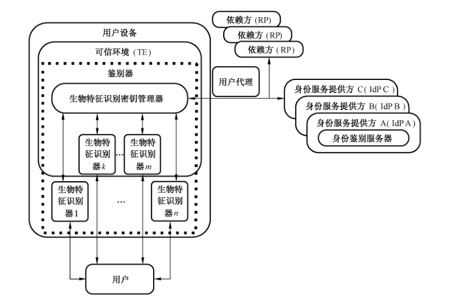
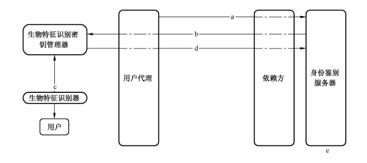
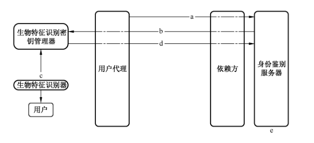
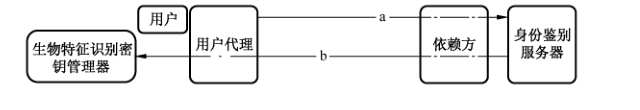
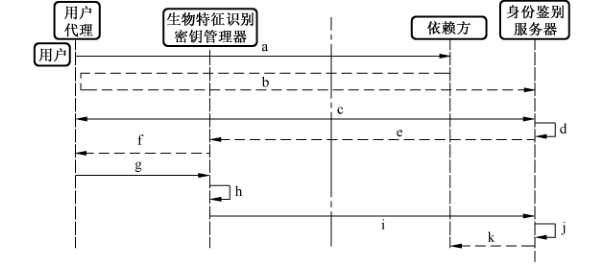
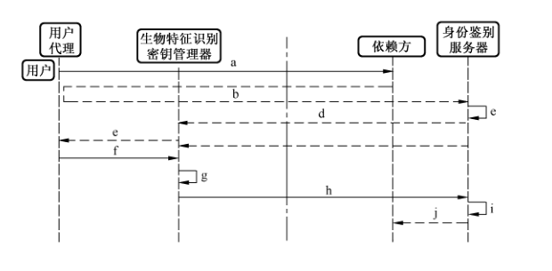
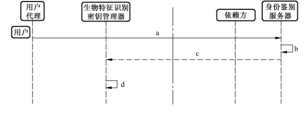
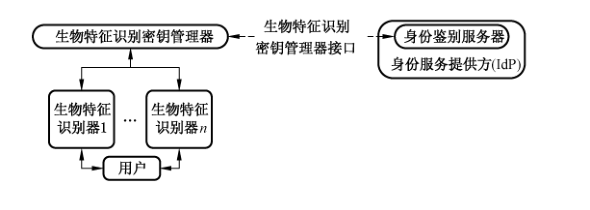

# GB/T 36651-2018 信息安全技术 基于可信环境的生物特征识别身份鉴别协议框架

> 来源：[GB/T 36651-2018 国家标准详情](https://openstd.samr.gov.cn/bzgk/std/newGbInfo?hcno=3E1856AD80B3E398795D29BF525EEDC2)。
> PDF SHA-256：066db39b100f97c21f8084acb3a664e0131888a9564183b1fcf6576339ca76fd。
> 转写说明：对照官方 PDF 的全部 24 页图像整理；省略封面、目录、页眉、页脚和页码，并合并跨页内容。流程图保留原图，ASN.1 结构及接口定义按原页重排为代码块。正式引用请核对官方 PDF。

> 独立转写注：5.4 b）的“鉴别请求消息”、6.1.1 h）的“对鉴别私钥等信息的签名”、6.3.2.2 a）的“注销响应消息”，以及附录中 `RegAssertion`、`SignAssertion` 缺少 `SEQUENCE` 和 B.7 重复的 `publicKeyAlgAndEncoding` 字段说明，均依原文保留。

## 前言

本标准按照 GB/T 1.1—2009给出的规则起草。

请注意本文件的某些内容可能涉及专利。本文件的发布机构不承担识别这些专利的责任。

本标准由全国信息安全标准化技术委员会（SAC/TC 260）提出并归口。

本标准起草单位：中国科学院数据与通信保护研究教育中心、中国银联股份有限公司、联想（北京）有限公司、浙江蚂蚁小微金融服务集团有限公司、国民认证科技（北京）有限公司、北京数字认证股份有限公司、华为技术有限公司、三六零科技股份有限公司、中国信息通信研究院、数安时代科技股份有限公司、广州广电运通金融电子股份有限公司、北京旷视科技有限公司。

本标准主要起草人：荆继武、刘丽敏、回春野、杨楠、钱文飞、李俊、陈星、辛知、傅大鹏、常新苗、程斌、张屹、傅山、张永强、林冠辰、张鑫。

## 1 范围

本标准规定了基于可信环境的生物特征识别身份鉴别协议框架，包括协议框架、协议流程、协议规则以及协议接口等内容。

本标准适用于生物特征识别身份鉴别服务的开发、测试和评估。

## 2 规范性引用文件

下列文件对于本文件的应用是必不可少的。凡是注日期的引用文件，仅注日期的版本适用于本文件。凡是不注日期的引用文件，其最新版本（包括所有的修改单）适用于本文件。

- GB/T 25069—2010 信息安全技术 术语

## 3 术语和定义

GB/T 25069—2010界定的以及下列术语和定义适用于本文件。

### 3.1 可信环境 trusted environment

用户设备上的安全区域，可保证加载到其内部数据的安全性，包括保密性、完整性和可用性等，如可信执行环境（TEE）、安全元件（SE）、可信密码模块（TCM）或其他具备安全边界的保护区域。

### 3.2 生物特征识别身份鉴别 biometric authentication

采用生物特征识别技术对用户的身份进行鉴别。

### 3.3 生物特征识别密钥管理器 biometric authentication key manager

负责维护身份鉴别服务器鉴别用户时需要的相关信息（例如密钥）的实体。

### 3.4 生物特征识别密钥管理器标识符 biometric authentication key manager identifier

用来标识生物特征识别密钥管理器，供身份鉴别服务器检索厂商公钥及生物特征识别密钥管理器相关信息。

### 3.5 用户设备 user device

包含生物特征识别密钥管理器的计算设备。

### 3.6 依赖方 relying party

依赖于其他实体（例如身份鉴别服务器）提供的关于用户的鉴别结果，对用户所使用的资源或者系统进行授权的实体。

### 3.7 应用程序标识符 application identifier

该标识符使用统一资源定位符表示，用来唯一标识依赖方的某一应用程序。

### 3.8 身份服务提供方 identity provider

提供身份管理服务的实体。

### 3.9 生物特征识别器 biometric matcher

利用人体所固有的生理特征或行为特征来进行个人身份识别的组件。

### 3.10 生物特征识别身份鉴别服务器 biometric authentication server

部署在依赖方或者身份服务提供方的生物特征识别身份鉴别服务软件。

> 注：本标准中简称“身份鉴别服务器”。

### 3.11 鉴别器 authenticator

由生物特征识别密钥管理器及其相关联的生物特征识别器组成的实体。

### 3.12 发现 discovery

身份鉴别服务器确定用户设备是否支持本协议，若支持则获取生物特征识别密钥管理器相关信息的过程。

### 3.13 鉴别公钥 user authentication public key

生物特征识别密钥管理器在用户注册过程中生成的密钥对的公钥。

### 3.14 鉴别私钥 user authentication private key

生物特征识别密钥管理器在用户注册过程中生成的密钥对的私钥。

### 3.15 密钥注册 key registration

生物特征识别密钥管理器将其产生的鉴别公钥安全传输到身份鉴别服务器并安全存储的过程。

### 3.16 密钥注册数据 key registration data

由生物特征识别密钥管理器构建的与密钥注册有关的数据，包含生物特征识别密钥管理器的标识符，新生成的鉴别公钥，以及其他一些与生物特征识别密钥管理器相关的数据。

> 注：例如生物特征识别密钥管理器使用的密码算法以及注册计数器和签名计数器的值等。

### 3.17 注册计数器 registration counter

生物特征识别密钥管理器的单调递增的计数器。每使用生物特征识别密钥管理器进行一次注册操作，该计数器值递增一次。

### 3.18 服务器挑战 server challenge

身份鉴别服务器在身份鉴别协议请求中提供的随机值。

### 3.19 签名计数器 sign counter

生物特征识别密钥管理器的单调递增的计数器。每使用一次鉴别私钥，该计数器值递增一次。

### 3.20 用户验证 user verification

生物特征识别密钥管理器使用生物特征识别器识别用户。

### 3.21 厂商公钥 vendor public key

用户设备的制造厂商在生物特征识别密钥管理器中预先植入的用于证明生物特征识别密钥管理器身份的密钥对的公钥。

### 3.22 厂商私钥 vendor private key

用户设备的制造厂商在生物特征识别密钥管理器中预先植入的用于证明生物特征识别密钥管理器身份的密钥对的私钥。

## 4 缩略语

下列缩略语适用于本文件。

- AppID：应用程序标识符（Application Identifier）
- ASN.1：抽象语法标记（Abstract Syntax Notation One）
- BAP：生物特征识别身份鉴别协议（Biometric Authentication Protocol）
- BAPV：生物特征识别身份鉴别协议版本（Biometric Authentication Protocol Version）
- bkmID：生物特征识别密钥管理器标识符（BAP Key Manager Identifier）
- IdP：身份服务提供方（Identity Provider）
- IPSec：IP 安全协议（Internet Protocol Security）
- KeyID：密钥标识符（Key Identifier）
- KRD：密钥注册数据（Key Registration Data）
- SE：安全元件（Secure Element）
- SSL：安全套接层（Secure Sockets Layer）
- TE：可信环境（Trusted Environment）
- TLS：安全传输层协议（Transport Layer Security）
- TCM：可信密码模块（Trusted Cryptography Module）
- VPN：虚拟专用网络（Virtual Private Network）

## 5 协议框架

### 5.1 概述

本标准定义基于可信环境的生物特征识别身份鉴别协议，不规定可信环境（TE）的实现方式。本标准规定可信环境中的生物特征识别密钥管理器应完成的功能以及功能接口参数，不规定具体实现方式。

本标准不规定生物特征识别器验证用户的方式。协议框架如图1所示，在基于可信环境的生物特征识别身份鉴别协议框架中，用户使用用户设备通过用户代理访问依赖方提供的应用，依赖方使用身份服务提供方（IdP）提供的身份鉴别服务对用户的身份进行鉴别。用户代理可以是安装在用户设备上的浏览器或者其他应用。可信环境部署在用户设备内，用于提供安全可靠的环境，保证用户信息的安全性。图中虚线框内表示鉴别器，包括生物特征识别密钥管理器和生物特征识别器。生物特征识别器将生物特征识别结果返回给生物特征识别密钥管理器。生物特征识别密钥管理器应部署在可信环境中。生物特征识别器可以部署在可信环境中，也可以在可信环境外部部署。生物特征识别密钥管理器和依赖方可针对生物特征识别器部署的位置采取不同的安全策略，本标准不规定安全策略的相关内容。

在协议框架中，身份鉴别服务器和生物特征识别密钥管理器直接创建或处理身份鉴别协议消息：

- 身份鉴别服务器可以由依赖方（即依赖方本身也是 IdP 的情况）实现，也可以由与依赖方具有信任关系的 IdP 实现，图 1 中描述的是由与依赖方具有信任关系的 IdP 实现的场景。身份鉴别服务器中存储有用户的鉴别公钥，该公钥是用户在使用生物特征识别密钥管理器向身份鉴别服务器注册时，生物特征识别密钥管理器生成的鉴别公钥。

- 生物特征识别密钥管理器集成在可信环境中，存储有厂商私钥和鉴别私钥。鉴别私钥是用户在使用该生物特征识别密钥管理器向身份鉴别服务器注册时，生物特征识别密钥管理器生成的鉴别私钥，用于身份鉴别服务器鉴别用户的身份。生物特征识别密钥管理器可以与多个生物特征识别器进行交互。

本标准不规定IdP将身份鉴别协议消息递交给生物特征识别密钥管理器的具体实现方式。例如：当身份鉴别服务器属于独立于依赖方的IdP 时，依赖方可将用户设备使用重定向机制重定向到身份鉴别服务器，使得身份鉴别服务器可以直接与用户设备交互，从而将身份鉴别协议消息递交给生物特征识别密钥管理器；当依赖方内部部署IdP 时，应保证转发信息的安全性。

本标准凡涉及密码算法的相关内容，按国家有关法规实施；凡涉及采用密码技术解决保密性、完整性、真实性、不可否认性需求的须遵循密码相关国家标准和行业标准。

基于可信环境的生物特征识别身份鉴别协议由生物特征识别密钥管理器和身份鉴别服务器之间的三种会话组成。在进行这三种会话前，身份鉴别服务器通过调用发现方法检查用户设备是否支持本协议。三种会话如下：

- 注册：用户将生物特征识别密钥管理器生成的鉴别公钥注册到身份鉴别服务器；
- 鉴别：用户使用已注册的生物特征识别密钥管理器进行身份鉴别；
- 注销：用户将注册到身份鉴别服务器的鉴别公钥删除。

在这三种会话的协议流程中，协议参与方应保护协议消息数据的机密性，宜采用安全传输层协议（TLS）、安全套接层虚拟专用网络（SSL VPN）或者 IP 安全协议（IPSec）协议。生物特征识别密钥管理器在收到身份鉴别服务器的消息时，应对身份鉴别服务器的真实性进行验证，本标准中涉及生物特征识别密钥管理器验证身份鉴别服务器真实性的方法，宜采用证书方式或者其他可以验证身份鉴别服务器真实性的方法。

### 5.2 注册

在用户向身份鉴别服务器进行注册的流程中，用户使用的生物特征识别密钥管理器创建一对新的鉴别公私钥并且将鉴别私钥保存在生物特征识别密钥管理器中，将鉴别公钥注册在身份鉴别服务器中。

注册流程见图 2，协议消息参见附录 A。

注册流程如下：

a） 用户使用用户设备中的用户代理访问依赖方，当用户需要进行生物特征识别身份鉴别注册时，依赖方将用户定向到身份鉴别服务器（可以使用 HTTP 重定向方式将用户设备重定向到身份鉴别服务器，或者使用消息转发方式）。

b） 身份鉴别服务器向用户设备中的生物特征识别密钥管理器发送注册请求消息；用户设备的生物特征识别密钥管理器在收到身份鉴别服务器的注册请求消息时，验证身份鉴别服务器的真实性，验证通过则提示用户选择可用的生物特征识别器，否则拒绝该消息。

c） 用户选择合适的生物特征识别器，使用生物特征识别信息解锁生物特征识别密钥管理器（如果用户之前未将生物特征识别信息登记到该生物特征识别器，则进行登记；如果用户已进行登记，则使用已登记的生物特征识别信息完成解锁过程），完成用户生物特征识别验证。用户生物特征识别验证成功后，生物特征识别密钥管理器创建一对与生物特征识别密钥管理器、身份鉴别服务器相关联的唯一的鉴别公私钥，鉴别私钥保存在本地的生物特征识别密钥管理器，并且不允许从生物特征识别密钥管理器导出。如果生物特征识别密钥管理器没有能力保存鉴别私钥，则该生物特征识别密钥管理器将鉴别私钥进行加密，然后将加密后的鉴别私钥保存在用户设备中，用于加密用户私钥的密钥则保存在生物特征识别密钥管理器中并且不允许从生物特征识别密钥管理器导出。

d） 生物特征识别密钥管理器生成密钥注册数据（密钥注册数据中包含上一步生成的鉴别公钥），然后生成注册响应消息（注册响应消息中包含密钥注册数据，以及使用厂商私钥对密钥注册数据进行签名的签名值），将注册响应消息发送到身份鉴别服务器。

e） 身份鉴别服务器使用厂商公钥验证注册响应消息中的签名，签名正确则提取出鉴别公钥并保存该鉴别公钥（同时应保存该鉴别公钥与用户之间的对应关系）。

### 5.3 鉴别

在鉴别流程中，用户通过生物特征识别密钥管理器使用鉴别私钥对服务器挑战签名，向身份鉴别服务器证明其拥有该私钥，完成身份鉴别过程。鉴别流程见图3，协议消息参见附录 A。

鉴别流程如下：

a） 用户使用用户设备中的用户代理访问依赖方，当用户需要进行生物特征识别身份鉴别时，依赖方将用户定向到身份鉴别服务器（可以使用 HTTP 重定向方式将用户设备重定向到身份鉴别服务器，或者使用消息转发方式）。

b） 身份鉴别服务器向用户设备中的生物特征识别密钥管理器发送鉴别请求消息；用户设备的生物特征识别密钥管理器在收到身份鉴别服务器的鉴别请求消息时，验证身份鉴别服务器的真实性，验证通过则提示用户选择可用的生物特征识别器，否则拒绝该消息。

c） 用户选择合适的生物特征识别器，使用生物特征识别信息解锁生物特征识别密钥管理器，生物特征识别密钥管理器选择相应的鉴别私钥对服务器挑战签名。

d） 生物特征识别密钥管理器将签名后的挑战发送到身份鉴别服务器。

e） 身份鉴别服务器使用相应的鉴别公钥对签名验证成功后，用户鉴别成功。

### 5.4 注销

在注销流程中，身份鉴别服务器删除相应的鉴别公钥，生物特征识别密钥管理器删除相应的鉴别私钥。注销流程见图4，协议消息参见附录 A。

注销流程如下：

a） 用户在身份鉴别成功后，发起注销流程，依赖方将用户定向到身份鉴别服务器（可以使用HTTP 重定向方式将用户设备重定向到身份鉴别服务器，或者使用消息转发方式）。

b） 身份鉴别服务器删除相应的鉴别公钥，并向生物特征识别密钥管理器发送注销请求消息。用户设备的生物特征识别密钥管理器在收到身份鉴别服务器的鉴别请求消息时，验证身份鉴别服务器的真实性，验证通过则删除相应的鉴别私钥，否则拒绝该消息。

## 6 协议流程和规则

### 6.1 注册流程

#### 6.1.1 概述

图5描述用户注册流程（图中实线表示消息流由图例中的左侧实体到右侧实体，虚线部分表示消息流由图例中的右侧实体到左侧实体或者是重定向消息流，双向箭头表示两个实体进行交互以完成某操作），其中步骤a）～步骤d）是用户使用已注册的账户（使用用户名口令或者数字证书进行身份鉴别的账户）登陆身份鉴别服务器的过程。

注册流程如下：

a） 用户访问依赖方，发起注册流程；

b） 依赖方将用户导向到身份鉴别服务器；

c） 身份鉴别服务器验证用户身份（如：可使用用户名口令、数字证书等方式，或用户重新注册一个新的账户）；

d） 身份鉴别服务器验证用户通过后，生成注册请求消息；

e） 身份鉴别服务器将注册请求消息发送至生物特征识别密钥管理器；

f） 生物特征识别密钥管理器发起本地用户校验，提示用户使用生物特征识别信息进行身份验证；

g） 用户提交生物识别信息，例如指纹、虹膜等信息；

h） 生物特征识别密钥管理器验证用户提交的生物识别信息，验证通过后，生成一对新的鉴别公私钥，然后生成注册响应消息，注册响应消息中包含使用厂商私钥对鉴别私钥等信息的签名；

i） 生物特征识别密钥管理器将注册响应消息返回给身份鉴别服务器；

j） 身份鉴别服务器使用厂商公钥验证注册响应消息，验证成功后存储相关信息，否则返回错误信息；

k） 身份鉴别服务器将结果返回给依赖方。

#### 6.1.2 注册流程处理规则

##### 6.1.2.1 身份鉴别服务器生成注册请求规则

身份鉴别服务器生成注册请求应遵循以下步骤：

a） 创建注册请求消息，并初始化注册请求消息的各个参数，至少应包括服务器挑战等参数（参见附录 A）；

b） 将注册请求消息发送给生物特征识别密钥管理器。

##### 6.1.2.2 生物特征识别密钥管理器处理注册请求规则

生物特征识别密钥管理器处理注册请求应遵循以下步骤：

a） 验证身份鉴别服务器的真实性，验证成功则执行以下步骤，否则拒绝该消息；

b） 解析注册请求消息，判断注册请求消息是否包含必要的参数以及每个参数是否符合要求，若符合要求则执行以下步骤，否则拒绝该消息；

c） 提示用户选择生物特征识别器，用户选择后，使用用户选择的生物特征识别器验证用户，验证通过后执行以下操作，否则返回错误；

d） 创建注册响应消息，并根据注册请求消息的参数初始化注册响应消息的参数；

e） 将注册响应消息发送给身份鉴别服务器。

##### 6.1.2.3 身份鉴别服务器处理注册响应规则

身份鉴别服务器处理注册响应应遵循以下步骤：

a） 解析注册响应消息，判断注册响应消息是否包含必要的参数以及每个参数是否符合要求，若符合要求则执行以下步骤，否则拒绝该消息；

b） 使用厂商公钥验证注册响应消息中签名的正确性；

c） 如果注册响应消息通过验证，将相关信息保存在身份鉴别服务器。

### 6.2 鉴别流程

#### 6.2.1 概述

图6描述鉴别流程（图中流程实线表示消息流由图例中的左侧实体到右侧实体，虚线部分表示消息流由图例中的右侧实体到左侧实体或者是重定向消息流）。

鉴别流程如下：

a） 用户访问依赖方，发起鉴别流程；

b） 依赖方将用户导向到身份鉴别服务器；

c） 身份鉴别服务器生成鉴别请求消息；

d） 身份鉴别服务器将鉴别请求消息发送至生物特征识别密钥管理器；

e） 生物特征识别密钥管理器发起本地用户校验，提示用户使用生物特征识别信息进行身份验证；

f） 用户提交生物识别信息，例如指纹、虹膜等信息；

g） 生物特征识别密钥管理器验证用户提交的生物识别信息，验证通过后，生成鉴别响应消息；

h） 生物特征识别密钥管理器将鉴别响应消息返回给身份鉴别服务器；

i） 身份鉴别服务器验证鉴别响应消息；

j） 身份鉴别服务器将结果返回给依赖方。

#### 6.2.2 鉴别流程处理规则

##### 6.2.2.1 身份鉴别服务器生成鉴别请求规则

身份鉴别服务器生成鉴别请求应遵循以下步骤：

a） 创建鉴别请求消息，并初始化鉴别请求消息的各个参数，至少应包括服务器挑战等参数（参见附录 A）；

b） 将鉴别请求消息发送给生物特征识别密钥管理器。

##### 6.2.2.2 生物特征识别密钥管理器处理鉴别请求规则

生物特征识别密钥管理器处理鉴别请求应遵循以下步骤：

a） 验证身份鉴别服务器的真实性，验证成功则执行以下步骤，否则拒绝该消息；

b） 解析鉴别请求消息，判断鉴别请求消息是否包含必要的参数以及每个参数是否符合要求，若符合要求则执行以下步骤，否则拒绝该消息；

c） 提示用户选择生物特征识别器，用户选择后，使用用户选择的生物特征识别器验证用户，验证通过后执行以下操作，否则返回错误；

d） 创建鉴别响应消息，并根据鉴别请求消息的参数初始化鉴别响应消息的各个参数；

e） 将鉴别响应消息发送给身份鉴别服务器。

##### 6.2.2.3 身份鉴别服务器处理鉴别响应规则

身份鉴别服务器处理鉴别响应应遵循以下步骤：

a） 解析鉴别响应消息，判断鉴别响应消息是否包含必要的参数以及每个参数是否符合要求，若符合要求则执行以下步骤，否则拒绝该消息；

b） 使用鉴别公钥验证鉴别响应消息的正确性；

c） 如果验证通过，则鉴别成功，否则失败。

### 6.3 注销流程

#### 6.3.1 概述

图7描述注销流程（图中流程实线表示消息流由图例中的左侧实体到右侧实体，虚线部分表示消息流由图例中的右侧实体到左侧实体）。

注销流程如下：

a） 用户登陆身份鉴别服务器，发起注销流程；

b） 身份鉴别服务器生成注销请求消息，删除与该用户相关的数据；

c） 身份鉴别服务器将注销请求消息发送至生物特征识别密钥管理器；

d） 生物特征识别密钥管理器删除用户相关数据。

#### 6.3.2 注销流程处理规则

##### 6.3.2.1 身份鉴别服务器生成注销请求规则

身份鉴别服务器生成注销请求应遵循以下步骤：

a） 创建注销请求消息，并初始化注销请求消息的各个参数（参见附录 A）；

b） 删除身份鉴别服务器上与该用户相关的数据；

c） 将注销请求消息发送到生物特征识别密钥管理器。

##### 6.3.2.2 生物特征识别密钥管理器处理注销请求规则

生物特征识别密钥管理器处理注销请求应遵循以下步骤：

a） 解析注销请求消息，判断注销响应消息是否包含必要的参数以及每个参数是否符合要求，若符合要求则执行以下步骤，否则拒绝该消息；

b） 删除用户的相关数据。

## 7 协议接口

### 7.1 概述

本协议的主要接口是生物特征识别密钥管理器接口，关系如图 8 所示：

生物特征识别密钥管理器接口是生物特征识别密钥管理器提供给身份鉴别服务器的接口，身份鉴别服务器可以通过用户代理（例如浏览器）调用该接口完成本协议规定的操作。

### 7.2 生物特征识别密钥管理器接口

#### 7.2.1 概述

本章定义了生物特征识别密钥管理器的接口，该接口包含三个方法，分别是发现方法、执行操作方法和通知结果方法。

#### 7.2.2 发现方法

身份鉴别服务器调用该方法，检查用户设备是否支持本协议，该方法的参数参见附录C。

#### 7.2.3 执行操作方法

身份鉴别服务器调用该方法，执行本协议的注册操作、鉴别操作或者注销操作。该方法的参数包括传递的协议消息，示例参见附录C。

#### 7.2.4 通知结果方法

当身份鉴别服务器接收并处理协议消息后，应调用该方法，将身份鉴别服务器的处理结果返回给生物特征识别密钥管理器。该方法的参数包括服务器的处理结果，示例参见附录C。

## 附录 A（资料性附录）协议消息

本附录所有数据格式采用 GB/T 16262—2006 的规定描述。

### A.1 协议消息

协议消息是本协议的各个参与方交互时传递的消息，ASN.1 描述如下：

~~~asn1
BAPMessage ::= SEQUENCE {
    bapProtocolMessage OCTET STRING,
    additionalData      OCTET STRING
}
~~~

bapProtocolMessage：协议消息，例如注册请求消息（参见 A.2）、注册响应消息（参见 A.3）、鉴别请求消息（参见 A.4）、鉴别响应消息（参见 A.5）、注销请求消息（参见 A.6）等。

additionalData：附加参数。

### A.2 注册请求消息

~~~asn1
RegistrationRequest ::= SEQUENCE {
    header    OperationHeader,
    challenge PrintableString,
    username  PrintableString
}
~~~

header：操作头，header.op 的值应为“Reg”，ASN.1 描述参见 B.4。

challenge：身份鉴别服务器提供的挑战值。

username：用户在某依赖方的账号名称。

### A.3 注册响应消息

~~~asn1
RegistrationResponse ::= SEQUENCE {
    header    OperationHeader,
    fcParams  FinalChallengeParams,
    assertion RegistrationAssertion
}
~~~

header：操作头，header.op 应为“Reg”，ASN.1 描述参见 B.4。

fcParams：最终挑战参数 FinalChallengeParams，ASN.1 描述参见 B.5。该参数使用 UTF8 编码，然后使用 [RFC 4627] 定义的序列化方法序列化后，再使用 base64url [RFC 4648] 对其进行编码后的值。

assertions：注册请求断言，生物特征识别密钥管理器的响应数据，ASN.1 描述如下：

~~~asn1
RegistrationAssertion ::= SEQUENCE {
    assertionScheme PrintableString(BAPV1TLV),
    assertion       RegAssertion,
    exts            SEQUENCE OF Extension OPTIONAL
}
~~~

assertionScheme：用来编码断言的断言模式名称，该值为“BAPV1TLV”。

exts：生物特征识别密钥管理器支持的扩展，ASN.1 描述参见 B.3。

assertion：注册断言，ASN.1 描述如下：

~~~asn1
RegAssertion ::= {
    krd KRD,
    sig BIT STRING
}
~~~

krd：密钥注册数据，ASN.1 描述参见 B.9。

sig：使用厂商私钥对 krd 进行签名后的签名值。

### A.4 鉴别请求消息

~~~asn1
AuthenticationRequest ::= SEQUENCE {
    header    OperationHeader,
    challenge PrintableString
}
~~~

header：操作头，header.op 的值应为“Auth”，ASN.1 描述参见 B.4。

challenge：服务器提供的挑战值。

### A.5 鉴别响应消息

~~~asn1
AuthenticationResponse ::= SEQUENCE {
    header     OperationHeader,
    fcParams   FinalChallengeParams,
    assertions AuthAssertion
}
~~~

header：操作头，header.op 应为“Auth”，ASN.1 描述参见 B.4。

fcParams：最终挑战参数 FinalChallengeParams，ASN.1 描述参见 B.5。该参数使用 UTF8 编码，然后使用 [RFC 4627] 定义的序列化方法序列化后，再使用 base64url [RFC 4648] 对其进行编码后的值。

assertions：AuthAssertion 对象，生物特征识别密钥管理器针对鉴别请求生成的签名断言，ASN.1 描述如下：

~~~asn1
AuthAssertion ::= SEQUENCE {
    assertionScheme PrintableString(BAPV1TLV),
    assertion       SignAssertion,
    exts            SEQUENCE OF Extension OPTIONAL
}
~~~

assertionScheme：用来编码断言的断言模式名称，该值为“BAPV1TLV”。

exts：生物特征识别密钥管理器支持的扩展，ASN.1 描述参见 B.3。

assertion：生物特征识别密钥管理器针对鉴别请求数据生成的签名断言，ASN.1 描述如下：

~~~asn1
SignAssertion ::= {
    signData SignData,
    sig      BIT STRING
}
~~~

signData：待签名数据，ASN.1 描述参见 B.10。

sig：使用鉴别私钥对 signData 进行签名后的签名值。

### A.6 注销请求消息

~~~asn1
DeregistrationRequest ::= SEQUENCE {
    header         OperationHeader,
    bapKeyManagers SEQUENCE OF DeregisterBAPKeyManager
}
~~~

header：操作头，header.op 应为“Dereg”，ASN.1 描述参见 B.4。

bapKeyManagers：要注销的生物特征识别密钥管理器（DeregisterBAPKeyManager）列表，DeregisterBAPKeyManager 的 ASN.1 描述如下：

~~~asn1
DeregisterBAPKeyManager ::= SEQUENCE {
    bkmaID PrintableString,
    keyID  PrintableString
}
~~~

bkmaID：要注销的生物特征识别密钥管理器的生物特征识别密钥管理器标识符（bkmID）。

keyID：与鉴别私钥相关联的唯一的密钥标识符（KeyID），对于具有相同 bkmID 的生物特征识别密钥管理器，KeyID 是唯一的。

## 附录 B（资料性附录）协议消息相关数据结构

本附录是协议消息相关数据结构的 ASN.1 描述。

### B.1 版本

~~~asn1
Version ::= SEQUENCE {
    major INTEGER,
    minor INTEGER
}
~~~

major：主要版本。

minor：次要版本。

本标准的协议主要版本为 1，次要版本为 0。

### B.2 操作类型

~~~asn1
Operation ::= PrintableString {
    Register(Reg), Authentication(Auth), Deregister(Dereg)
}
~~~

本标准有以下三种操作类型：

- Reg：注册
- Auth：鉴别
- Dereg：注销

### B.3 扩展

~~~asn1
Extension ::= SEQUENCE {
    id              PrintableString,
    data            PrintableString,
    fail_if_unknown BOOLEAN
}
~~~

该结构描述的是在各种操作中使用的通用扩展。

id：扩展的标识符。

data：该值可包含任意字符串，身份鉴别服务器和生物特征识别密钥管理器应对该值的语义协商一致。该值可以为空。

fail_if_unknown：当 fail_if_unknown 是 false 时表示未知扩展应被忽略，当 fail_if_unknown 是 TRUE 时表示未知扩展应导致错误。

### B.4 操作头

~~~asn1
OperationHeader ::= SEQUENCE {
    bapv       Version,
    op         Operation,
    appID      PrintableString,
    serverData PrintableString OPTIONAL,
    exts       SEQUENCE OF Extension OPTIONAL
}
~~~

bapv：基于可信环境的生物特征识别身份鉴别协议版本，ASN.1 描述参见 B.1。

op：值应为“Reg”、“Auth”或者“Dereg”。基于可信环境的生物特征识别身份鉴别协议操作的类型，ASN.1 描述参见 B.2。

appID：依赖方应用程序标识符。

serverData：依赖方创建的会话标识符。

exts：扩展名列表，ASN.1 描述参见 B.3。

### B.5 最终挑战参数

~~~asn1
FinalChallengeParams ::= SEQUENCE {
    appID     PrintableString,
    challenge PrintableString
}
~~~

appID：该参数值设置为操作头的 appID 参数值。

challenge：该参数值设置为注册请求或鉴别请求中的服务器挑战参数值，服务器挑战是服务器提供的随机参数值。

### B.6 生物特征识别密钥管理器信息

身份鉴别服务器可以获取生物特征识别密钥管理器相关信息，例如生物特征识别密钥管理器厂商在生成厂商密钥时所使用的相关算法和信息，以及生物特征识别密钥管理器生成鉴别公私钥时所使用的相关算法和信息。身份鉴别服务器可以使用生物特征识别密钥管理器相关提供方的服务来获取这些信息。

### B.7 断言描述信息

~~~asn1
AssertionInfo ::= SEQUENCE {
    version                 Version,
    mode                    AuthenticationMode,
    signatureAlgAndEncoding INTEGER,
    publicKeyAlgAndEncoding INTEGER OPTIONAL
}
~~~

version：断言的版本，ASN.1 描述参见 B.1。

mode：断言模式。

signatureAlgAndEncoding：该值代表签名算法相关信息，身份鉴别服务器和生物特征识别密钥管理器应对该值的语义协商一致，即能够通过该值在身份鉴别过程中使用一致的签名算法和相关参数。

publicKeyAlgAndEncoding：该值代表公钥算法相关信息，身份鉴别服务器和生物特征识别密钥管理器应对该值的语义协商一致，即能够通过该值在身份鉴别过程中使用一致的公钥算法和相关参数。

publicKeyAlgAndEncoding：用户验证方式，ASN.1 描述如下：

~~~asn1
AuthenticationMode ::= INTEGER {
    explicitly(0x01)
}
~~~

explicitly：应进行显式的用户验证，例如指纹输入、虹膜扫描等。

### B.8 生物特征识别密钥管理器计数器值

~~~asn1
Counters ::= SEQUENCE {
    SignCounter INTEGER,
    RegCounter  INTEGER
}
~~~

SignCounter：签名计数器的值。

RegCounter：注册计数器的值。

### B.9 密钥注册数据

~~~asn1
KRD ::= SEQUENCE {
    bkmID         PrintableString,
    assertionInfo AssertionInfo,
    challengeHash BIT STRING,
    keyID         PrintableString,
    counters      Counters,
    uauthPubKey   OCTET STRING
}
~~~

bkmID：生物特征识别密钥管理器标识符。

assertionInfo：断言描述信息，ASN.1 描述参见 B.7。

challengeHash：服务器挑战的杂凑值。

keyID：鉴别私钥标识符。

counters：生物特征识别密钥管理器计数器值，ASN.1 描述参见 B.8。

uauthPubKey：生成的鉴别公钥。

### B.10 待签名数据

~~~asn1
SignData ::= SEQUENCE {
    bkmID         PrintableString,
    assertionInfo AssertionInfo,
    nonce         OCTET STRING,
    challengeHash OCTET STRING,
    keyID         PrintableString,
    counters      Counters
}
~~~

bkmID：生物特征识别密钥管理器标识符。

assertionInfo：断言描述信息，ASN.1 描述参见 B.7。

nonce：生物特征识别密钥管理器生成的随机临时参数值。

challengeHash：服务器挑战的杂凑值。

keyID：鉴别私钥标识符。

counters：生物特征识别密钥管理器计数器值，ASN.1 描述参见 B.8。

### B.11 发现数据

~~~asn1
DiscoveryData ::= SEQUENCE {
    supportedBAPVersions   SEQUENCE OF Version,
    clientVendor           PrintableString,
    clientVersion          Version,
    availableBAPKeyManagers SEQUENCE OF PrintableString
}
~~~

描述：

supportedBAPVersions：支持的基于可信环境的生物特征识别身份鉴别协议版本，ASN.1 描述参见 B.1。

clientVendor：生物特征识别密钥管理器厂商。

clientVersion：生物特征识别密钥管理器版本。

availableBAPKeyManagers：可使用的生物特征识别密钥管理器标识符。

### B.12 错误码

~~~asn1
ErrorCode ::= INTEGER {
    NO_ERROR(0x0),
    WAIT_USER_ACTION(0x1),
    INSECURE_TRANSPORT(0x2),
    USER_CANCELLED(0x3),
    UNSUPPORTED_VERSION(0x4),
    NO_SUITABLE_BAPKEYMANAGER(0x5),
    PROTOCOL_ERROR(0x6),
    UNTRUSTED_FACET_ID(0x7),
    KEY_DISAPPEARED_PERMANENTLY(0x09),
    BAPKEYMANAGER_ACCESS_DENIED(0x0c),
    USER_NOT_RESPONSIVE(0x0e),
    INSUFFICIENT_BAPKEYMANAGER_RESOURCES(0x0f),
    USER_LOCKOUT(0x10),
    USER_NOT_ENROLLED(0x11),
    UNKNOWN(0xff)
}
~~~

描述：

- NO_ERROR：操作完成，没有错误发生。
- WAIT_USER_ACTION：等待用户操作。
- INSECURE_TRANSPORT：不安全的传输，例如没有使用 HTTPS。
- USER_CANCELLED：用户取消当前操作。
- UNSUPPORTED_VERSION：生物特征识别密钥管理器不支持该版本的协议消息。
- NO_SUITABLE_BAPKEYMANAGER：没有与身份鉴别服务器策略相匹配的生物特征识别密钥管理器。
- PROTOCOL_ERROR：发生协议错误。
- UNTRUSTED_FACET_ID：不受信任的依赖方应用程序。
- KEY_DISAPPEARED_PERMANENTLY：鉴别私钥丢失并且无法恢复。
- BAPKEYMANAGER_ACCESS_DENIED：生物特征识别密钥管理器拒绝访问。
- USER_NOT_RESPONSIVE：用户长时间无响应。
- INSUFFICIENT_BAPKEYMANAGER_RESOURCES：生物特征识别密钥管理器没有足够的资源执行操作。
- USER_LOCKOUT：由于用户锁定，操作无法执行。
- USER_NOT_ENROLLED：用户没有登记。
- UNKNOWN：以上没有列出的其他错误。

## 附录 C（资料性附录）协议接口

### C.1 生物特征识别密钥管理器接口定义

~~~text
interface bap {
    void discover(DiscoveryCallback completionCallback, ErrorCallback errorCallback);
    void processBAPOperation(BAPMessage message, BAPResponseCallback completionCallback, ErrorCallback errorCallback);
    void notifyBAPResult(int responseCode, BAPMessage BAPResponse);
};
~~~

### C.2 发现方法

~~~text
void discover(DiscoveryCallback completionCallback, ErrorCallback errorCallback)
~~~

身份鉴别服务器调用该方法，检查用户设备是否支持本协议，发现方法参数参见表 C.1。

**表 C.1 发现方法参数**

| 参数 | 类型 | 可为空 | 可选 | 描述 |
| --- | --- | --- | --- | --- |
| completionCallback | DiscoveryCallback（参见 C.5） | 否 | 否 | 用于接收生物特征识别密钥管理器发现数据的回调 |
| errorCallback | ErrorCallback（参见 C.7） | 否 | 否 | 用于接收错误码和错误信息的回调 |

返回类型：void。

### C.3 执行操作方法

~~~text
void processBAPOperation(BAPMessage message, BAPResponseCallback completionCallback, ErrorCallback errorCallback)
~~~

身份鉴别服务器调用该方法，执行本协议的三种操作，如注册操作、鉴别操作或者注销操作，执行操作方法参数参见表 C.2。

**表 C.2 执行操作方法参数**

| 参数 | 类型 | 可为空 | 可选 | 描述 |
| --- | --- | --- | --- | --- |
| message | BAPMessage（参见 A.1） | 否 | 否 | 生物特征识别密钥管理器将处理的 BAPMessage |
| completionCallback | BAPResponseCallback（参见 C.6） | 否 | 否 | 用于接收生物特征识别密钥管理器发送给 IdP 的身份鉴别服务器的响应消息 |
| errorCallback | ErrorCallback（参见 C.7） | 否 | 否 | 用于接收错误码和信息的回调 |

返回类型：void。

### C.4 通知结果方法

~~~text
void notifyBAPResult(int responseCode, BAPMessage bapResponse)
~~~

当身份鉴别服务器接收并处理协议消息后，应调用该方法，将身份鉴别服务器响应状态码返回给生物特征识别密钥管理器，通知结果方法参数参见表 C.3。

**表 C.3 通知结果方法参数**

| 参数 | 类型 | 可为空 | 可选 | 描述 |
| --- | --- | --- | --- | --- |
| responseCode | int | 否 | 否 | 服务器响应状态码 |
| bapResponse | BAPMessage（参见 A.1） | 否 | 否 | 该响应状态码对应的响应消息 |

返回类型：void。

### C.5 DiscoveryCallback 回调

DiscoveryCallback 回调用于生物特征识别密钥管理器在异步执行完成发现过程后将发现数据返回给身份鉴别服务器。

~~~text
callback DiscoveryCallback = void (DiscoveryData data);
~~~

参数：

data：DiscoveryData 类型（参见 B.11），描述当前身份鉴别服务器可使用的生物特征识别密钥管理器和生物特征识别密钥管理器当前的状态。

### C.6 BAPResponseCallback 回调

BAPResponseCallback 回调用于生物特征识别密钥管理器在异步执行完成操作（例如注册、鉴别）后将协议消息返回给身份鉴别服务器。

参数：

~~~text
callback BAPResponseCallback = void (BAPMessage bapResponse);
~~~

参数：

bapResponse：BAPMessage 类型（参见 A.1），生物特征识别密钥管理器返回的响应消息。

### C.7 ErrorCallback 回调

ErrorCallback 回调用于生物特征识别密钥管理器在异步执行操作时返回错误码和信息。

~~~text
callback ErrorCallback = void (ErrorCode code);
~~~

参数：

code：ErrorCode 类型，ErrorCode 接口（参见 B.12）中的值，用于描述操作的结果。

## 参考文献

- ［1］ GB/T 16262.1—2006 信息技术 抽象语法记法一（ASN.1） 第1部分：基本记法规范

- ［2］ GB/T 16262.2—2006 信息技术 抽象语法记法一（ASN.1） 第2部分：信息客体规范

- ［3］ GB/T 16262.3—2006 信息技术 抽象语法记法一（ASN.1） 第3部分：约束规范

- ［4］ GB/T 16262.4—2006 信息技术 抽象语法记法一（ASN.1） 第4部分：ASN.1 规范的参数化

- ［5］ FIDO UAF Protocol Specification: FIDO Alliance Review Draft 05 October 2016［S/OL］.［2016-10-05］. https://fidoalliance.org/specs/fido-uaf-v1.1-rd-20161005/fido-uaf-protocol-v1.1-rd-20161005.html

- ［6］ The application/json Media Type for JavaScript Object Notation（JSON）：RFC 4627［S/OL］.［2006-07］. http://www.ietf.org/rfc/rfc4627.txt

- ［7］ The Base16, Base32, and Base64 Data Encodings: RFC 4648［S/OL］.［2006-10］. https://www.ietf.org/rfc/rfc4648.txt
