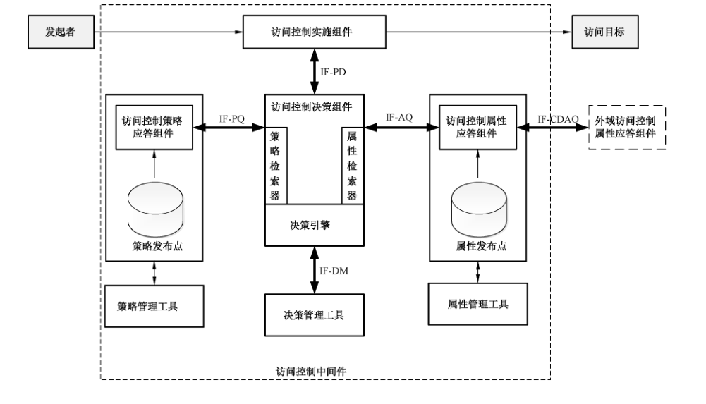
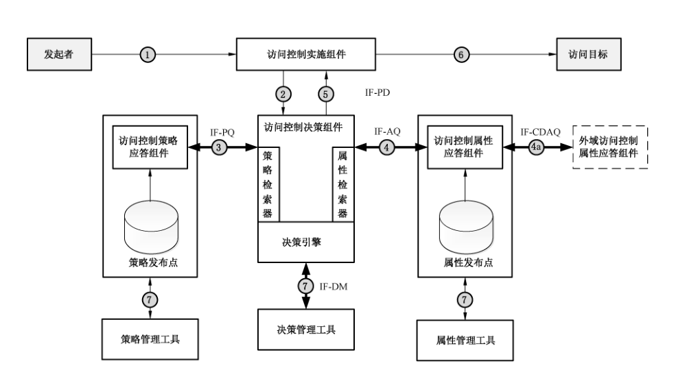
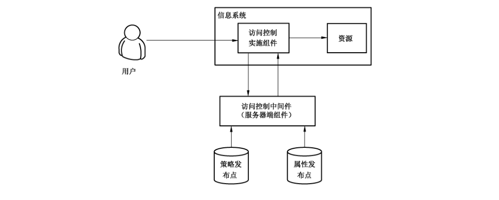
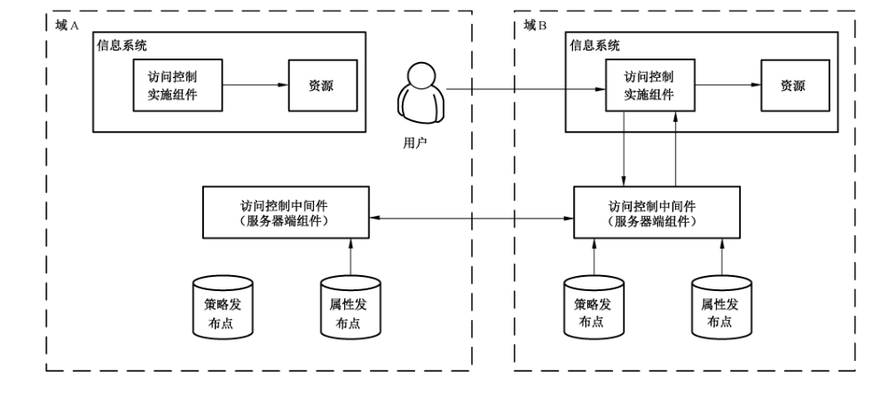

# GB/T 36960-2018 信息安全技术 鉴别与授权 访问控制中间件框架与接口

> 来源：[GB/T 36960-2018 国家标准详情](https://openstd.samr.gov.cn/bzgk/std/newGbInfo?hcno=CC9B0EB9D8122E79FBF98BC95F3FE14D)；封面发布日期：2018-12-28；实施日期：2019-07-01。
> 官方 PDF SHA-256：0c4b32396159aa426e88749e57a98fbeead27f5748ea9501d26c1c5e5d977ec2。
> 依据官方 PDF 全部 42 页页面图像转写与校核；省略封面、目录、页眉、页脚和分页，合并印刷折行。正文中的原有拼写和大小写差异照录。

## 前言

本标准按照 GB/T 1.1—2009 给出的规则起草。

请注意本文件的某些内容可能涉及专利。本文件的发布机构不承担识别这些专利的责任。

本标准由全国信息安全标准化技术委员会（SAC/TC 260）提出并归口。

本标准起草单位：中国科学院软件研究所、中国科学院数据与通信保护研究教育中心、北京数字认证股份有限公司、中国电子技术标准化研究院。

本标准主要起草人：张严、张立武、高志刚、王鹏翩、冯登国、荆继武、吴槟、李强、林雪焰、陈星、高能、闫实。

## 1 范围

本标准确立了鉴别与授权系统中访问控制中间件的框架结构与内部组件关系，规定了访问控制中间件中各组件的功能、操作流程及接口要求。

本标准适用于访问控制中间件及其内部组件的设计与实现，并可指导对该类中间件系统的检测及相关应用的开发，对该类中间件产品的采购亦可参照使用。

## 2 规范性引用文件

下列文件对于本文件的应用是必不可少的。凡是注日期的引用文件，仅注日期的版本适用于本文件。凡是不注日期的引用文件，其最新版本（包括所有的修改单）适用于本文件。

- GB/T 13000 信息技术 通用多八位编码字符集（UCS）
- GB/T 18793—2002 信息技术 可扩展置标语言（XML）1.0
- GB/T 18794.3—2003 信息技术 开放系统互连 开放系统安全框架 第 3 部分：访问控制框架
- GB/T 25069—2010 信息安全技术 术语
- GB/T 31501—2015 信息安全技术 鉴别与授权 授权应用程序判定接口规范

## 3 术语和定义

GB/T 25069—2010、GB/T 18794.3—2003 界定的以及下列术语和定义适用于本文件。

### 3.1 访问控制中间件 access control middleware

通过对适用的访问控制信息进行评估以决定发起者是否可以对访问目标进行特定类型访问的一系列组件及组件间接口的集合。

### 3.2 动作 action

访问控制行为发起者执行的某种操作。

> 注：例如读取、修改、删除等。

### 3.3 属性 attribute

主体、资源、动作和环境的某个特征，该特征可以在策略中被引用。

### 3.4 决策 decision

依据访问控制策略做出的判定结果。

> 注：例如允许或拒绝用户访问特定资源。

### 3.5 环境 environment

一组与决策相关的属性集合，独立于特定的主体、资源或者动作。

### 3.6 发起者 initiator

访问控制过程中执行操作、试图访问目标的实体。

> 注：例如访问系统或服务的用户或是执行操作的应用。

### 3.7 资源 resource

数据、服务或者系统组件。

### 3.8 主体 subject

访问控制策略中访问控制行为发起者的标识。

> 注：例如发起者的用户名，或是执行操作的应用标识。

### 3.9 访问目标 target

访问控制过程中发起者访问的对象。

> 注：例如资源或服务。

### 3.10 用户 user

使用系统和系统资源的自然人。

## 4 缩略语

下列缩略语适用于本文件：

- IF-AQ：属性查询接口（Interface-Attribute Query）
- IF-AQ-SupportAT：属性查询支持类型接口（Interface-Attribute Query-Support Attribute Type）
- IF-AQ-SupportSchema：属性查询支持格式接口（Interface-Attribute Query-Support Schema）
- IF-AQ-ReturnSchema：属性查询返回格式接口（Interface-Attribute Query-Return Schema）
- IF-AQ-GetAttribute：属性查询获取属性接口（Interface-Attribute Query-Get Attribute）
- IF-CDAQ：跨域属性查询接口（Interface-Cross Domain Attribute Query）
- IF-CDAQ-SupportAT：跨域属性查询支持类型接口（Interface-Cross Domain Attribute Query-Support Attribute Type）
- IF-CDAQ-SupportSchema：跨域属性查询支持格式接口（Interface-Cross Domain Attribute Query-Support Schema）
- IF-CDAQ-GetAttribute：跨域属性获取属性查询接口（Interface-Cross Domain Attribute Query-Get Attribute）
- IF-DM：决策管理接口（Interface-Decision Management）
- IF-DM-Login：决策管理登录接口（Interface-Decision Management-Login）
- IF-DM-Logout：决策管理登出接口（Interface-Decision Management-Logout）
- IF-DM-Config：决策管理配置接口（Interface-Decision Management-Configuration）
- IF-DM-Start：决策启动接口（Interface-Decision Management-Start）
- IF-DM-Stop：决策停止接口（Interface-Decision Management-Stop）
- IF-PD：策略决策接口（Interface-Policy Decision）
- IF-PQ：策略查询接口（Interface-Policy Query）
- IF-PQ-SupportPT：策略查询支持类型接口（Interface-Policy Query-Support Policy Type）
- IF-PQ-ReturnPT：策略查询返回类型接口（Interface-Policy Query-Return Policy Type）
- IF-PQ-SearchSchema：策略查询查找模式接口（Interface-Policy Query-Search Schema）
- IF-PQ-ReturnSchema：策略查询返回模式接口（Interface-Policy Query-Return Schema）
- IF-PQ-PolicyCombine：策略查询合并模式接口（Interface-Policy Query-Policy Combine）
- IF-PQ-GetPolicy：策略查询获取策略接口（Interface-Policy Query-Get Policy）
- LDAP：轻量级目录访问协议（Lightweight Directory Access Protocol）
- RPC：远程过程调用（Remote Procedure Call）
- SAML：安全断言置标语言（Security Assertion Markup Language）
- SOAP：简单对象访问协议（Simple Object Access Protocol）
- SSL：安全套接层（Secure Sockets Layer）
- TLS：传输层安全（Transport Layer Security）
- XACML：可扩展访问控制标记语言（eXtensible Access Control Markup Language）
- XML：可扩展置标语言（eXtensible Markup Language）

## 5 访问控制中间件体系框架

### 5.1 概述

访问控制过程包含三个参与方：发起者、访问控制中间件和访问目标。发起者是试图访问访问目标的实体（用户或执行操作的应用）；访问控制中间件是通过对适用的访问控制信息进行评估以决定发起者是否可以对目标进行特定类型访问的一系列组件及组件间接口的集合；访问目标是被试图访问的实体。

访问控制中间件体系框架如图 1 所示。该体系框架对于不同的设备、拓扑结构与应用配置的访问控制需求进行了综合考虑，并且对此类需求是通用的。访问控制中间件包括了访问控制实施组件、访问控制决策组件、访问控制策略应答组件和访问控制属性应答组件。其中访问控制实施组件通常位于访问目标所在的应用系统中，其余组件位于服务端。组件的功能见 5.2，组件的接口定义见 5.3。附录 A 给出了访问控制中间件的典型应用场景。



### 5.2 组件定义

#### 5.2.1 访问控制实施组件

##### 5.2.1.1 概述

访问控制实施组件处于发起者与目标之间，接管处理发起者的访问请求，协助收集访问决策的辅助性信息，传递决策请求至访问控制决策组件并根据返回的判定结果决定访问是否可以执行。

访问控制实施组件是直接面向访问请求的应答模块，将发起者请求和具体的授权决策过程等复杂的业务逻辑进行剥离，是决定访问控制中间件和具体业务应用系统能否实现插拔组装的基础性模块。

访问控制实施组件应实现 5.2.1.2～5.2.1.5 中规定的功能。

##### 5.2.1.2 接收访问请求

访问控制实施组件应能够接收来自发起者的访问请求。访问控制实施组件应根据固定交互模式对来自不同代理方式（例如：“浏览器/服务器”结构、“客户端/服务器”结构等）用户代理的请求进行一致化处理，访问请求的格式宜依据 GB/T 30281—2013。

访问请求信息的传递不限制具体的传输协议，满足访问控制实施组件要求的传输协议都可以负责处理信息传递。

##### 5.2.1.3 收集访问决策相关辅助性信息

访问控制实施组件应能够收集其他对访问决策提供帮助的辅助性信息。例如用户的属性信息、组件本身可以感知的若干系统信息等。应允许管理者通过配置的方式指定优先附加的辅助信息。辅助信息的添加并不一定限制在访问控制实施组件中，其他组件根据需要也可以具备该功能。

根据 GB/T 18794.3—2003 中的说明，辅助信息的获取方式可分为“推”模式和“拉”模式，采用哪种模式取决于系统的决策逻辑和某些强制性选择，本标准在可以添加辅助信息的模块进行显式说明，采用何种方案最终由用户选择。

##### 5.2.1.4 请求格式转换

访问控制实施组件应能够对请求格式进行标准形式的转换。宜采用基于属性的描述机制对访问请求进行统一描述。

##### 5.2.1.5 传递决策请求及接收决策结果

访问控制实施组件应能够传递决策请求至访问控制决策组件并接收决策结果。

访问请求的决策结果可能表示为某种抽象形式，访问实施组件应根据组件所在的应用场景和技术背景将其转换为具体的应用程序执行逻辑，保证高层抽象安全约束和底层程序逻辑的一致性。

#### 5.2.2 访问控制决策组件

##### 5.2.2.1 概述

访问控制决策组件负责从访问控制实施组件接受决策请求，通过查找适用策略和相对应的访问控制属性，依据访问判定逻辑产生一个决策结果，并将该决策结果返回给访问控制实施组件。

访问控制决策组件应实现 5.2.2.2～5.2.2.6 中规定的功能。

##### 5.2.2.2 接收决策请求

访问控制决策组件应能够接收来自访问控制实施组件的决策请求，并对请求内的信息进行解析分类。

##### 5.2.2.3 执行访问决策逻辑

访问控制决策组件应实现访问决策逻辑执行功能。决策逻辑应考虑到已有的多种访问控制模型和访问控制机制，尽可能提高其兼容性。访问控制模型和访问控制机制的类型可参见 GB/T 18794.3—2003。

访问控制决策组件应从宏观角度制定最基本的资源安全策略，以提供最低限度的安全保障。访问控制决策组件通过开放式策略和保守式策略实现这种可预知的和最低限度的安全保障。开放式策略的决策逻辑为：如果没有提供显式策略明确禁止某访问行为，则认为允许该类访问进行；保守式策略的决策逻辑为：如果没有提供显式策略明确允许某访问行为，则认为禁止该类访问进行。采用何种策略取决于具体应用的资源对象敏感性和资源对象使用目的。

访问控制决策组件应在多条策略同时给出明确决策结果，且决策结果存在冲突时指定冲突消解策略，以处理可能产生的决策结果不一致性，常用的消解策略包括：肯定判定优先、否定判定优先、首次判定优先等。

##### 5.2.2.4 对所需访问控制策略进行检索收集

访问控制决策组件内部应具有策略检索收集的功能。例如：组件在运行决策逻辑前，将所有策略一次性导入临时存储区，之后所有的匹配操作都针对存储区内的策略进行。当策略数目较大时，应提供针对性更强的策略检索功能，即根据某些属性特征或者策略标识从策略库中获取规模较小的策略子集，减少实际匹配的策略数量，提高匹配效率。例如：以某个属性类型或者具体的属性值为关键字，或者以某种特定的策略类型为关键字对策略库进行检索。

##### 5.2.2.5 对所需属性信息进行检索收集

访问控制决策组件应具有相关属性信息的检索功能。属性检索过程应考虑能够兼容处理不同的属性格式，例如 X.509 格式的属性证书、SAML 格式的安全断言以及 LDAP 目录中的属性条目等。

##### 5.2.2.6 决策历史记录的相关查询

考虑到和其他安全组件的集成性，例如为安全审计提供历史访问的相关数据等。访问控制决策组件在完成请求决策的同时，应对整个过程涉及的信息进行分类记录。以上信息应保证存储的安全性和与历史记录的一致性，并且可根据特殊的审计需要增加相应的记录信息类型，本标准不对数据存储的形式和方案进行规定。

#### 5.2.3 访问控制策略应答组件

##### 5.2.3.1 概述

访问控制策略应答组件负责响应访问控制决策组件的策略检索请求，对不同形式的策略表达进行一致性转化，完成对适用策略的检索并以安全的方式传输至访问控制决策组件。

访问控制策略应答组件的详细功能描述及细节如下。

访问控制策略应答组件负责响应访问控制决策组件的策略检索请求，负责整个中间件访问控制策略的底层处理。

访问控制策略应答组件应实现 5.2.3.2～5.2.3.5 中规定的功能。

##### 5.2.3.2 统一策略描述方式

访问控制策略应答组件应对不同形式的策略表达进行一致性转化，使决策逻辑所依赖的策略集具有统一的格式和语义。策略转化过程可能需要界定不同策略特征间的转换规则，但应保证策略转化不影响最终的安全目标。

##### 5.2.3.3 策略检索

访问控制策略应答组件应能够处理来自决策组件带有多种查询参数的策略检索请求，并获取满足要求的策略集合。

##### 5.2.3.4 策略传输

访问控制策略应答组件应与访问控制决策组件就策略传输的方式和格式进行统一制定，应答组件完成策略检索后，将响应策略集合以安全可靠的传输协议传输至决策组件。例如：通过网络层的 socket 通信协议直接对策略条目进行编码传输，或针对 XML 类型的策略格式采用类似 SOAP 协议的 XML RPC 方式进行传输。

##### 5.2.3.5 策略管理

访问控制策略应答组件应通过策略管理服务（工具或模块）提供对策略的一般性管理功能，例如策略的添加、修改、删除、更新等，以方便中间件对系统安全策略的控制和掌握。

策略管理服务宜提供策略优先级机制，制定策略冲突消解规则，便于访问控制决策组件执行具体的决策逻辑。

策略管理服务宜提供策略一致性检测功能，在策略实体和高层安全目标间进行一致性验证和测试，保证策略实体符合系统的安全管理初衷。

#### 5.2.4 访问控制属性应答组件

##### 5.2.4.1 概述

访问控制属性应答组件负责对访问判定过程中需要的各种类型属性信息进行收集，生成并发布属性断言，并将属性信息集合以安全的方式传输至访问控制决策组件。

访问控制策略应答组件的详细功能描述及细节如下。

该组件主要负责访问决策可能触发的属性信息收集，辅助访问控制决策组件完成最终的请求决策。

访问控制策略应答组件应实现 5.2.4.2～5.2.4.6 中规定的功能。

##### 5.2.4.2 用户属性信息收集

当决策请求中包含的用户属性信息不足以使决策逻辑给出决策结果时，决策组件需要向访问控制属性应答组件发送属性查询请求。访问控制属性应答组件应能根据用户标识对属性信息进行集成检索，形成统一的属性表达语义。

在对检索后获取的用户属性进行确认前，访问控制属性应答组件应对这些属性信息的有效性进行验证。验证过程可能是针对属性实体的数字签名验证，也可能涉及对属性颁发实体的数字身份验证，验证能否通过取决于对验证信息的可信性。

针对来自外域的用户属性信息，访问控制属性应答组件应实现域间属性转译，根据外域用户属性检索适用的属性映射规则，推导出外域属性对应的本域属性信息，以决策组件可理解的域内属性信息格式进行发布。

##### 5.2.4.3 其他类型属性信息收集

应答组件宜实现对来自信息系统自身状态、上下文环境、网络状况等一些可以描述访问进行时的外界信息感应点的属性进行接收和主动查询。在获取这些属性后，属性应答组件应将这些属性信息转换为决策组件可理解的语义及格式并以属性断言的格式进行转发。

##### 5.2.4.4 属性断言发布

访问控制属性应答组件在获取到查询的属性信息后，应以决策组件可验证的属性断言方式发布属性信息。属性断言应包含属性的主体标识、属性类型或名称、具体的属性值、应答组件及对属性信息摘要的签名等。

属性断言格式的定义宜采用 GB/T 29242—2012 的规定。

##### 5.2.4.5 属性信息传递

访问控制属性应答组件应与决策组件就属性传输的方式和格式进行统一制定，应答组件完成属性检索后，将属性信息集合以安全可靠的传输协议传输至决策组件。

##### 5.2.4.6 属性管理

访问控制属性应答组件应通过属性管理服务（工具或模块）提供对属性信息的一般性管理功能，例如属性的颁发、撤销、更新等，以方便中间件对属性信息的控制和掌握。

为了支持跨域访问控制等多域应用场景，属性管理服务应提供域间属性映射功能，制定属性映射规则，可发布映射断言供外域的属性发布组件进行查询。

属性管理服务应提供属性一致性检测功能，限制用户同时拥有违反安全约束的多个属性。

### 5.3 组件间接口

如图 2 所示，访问控制中间件组件间接口包括位于访问控制实施组件和访问控制决策组件之间的策略决策接口（IF-PD）、位于访问控制决策组件和决策管理工具之间的决策管理接口（IF-DM）、位于访问控制决策组件和访问控制策略应答组件之间的策略查询接口（IF-PQ）、位于访问控制决策组件和访问控制属性应答组件之间的属性查询接口（IF-AQ）和位于不同域的访问控制属性应答组件之间的跨域属性查询接口（IF-CDAQ）。组件间接口的功能与定义细节见 6.3 至 6.7。

### 5.4 接口间工作过程

通过上述定义的各不同接口，访问控制中间件体系结构中的各组件进行消息交换。这些接口间基本的消息流如图 2 所示。



图 2 中描述的访问控制中间件基本工作流程包括：

a) 在发起者开始访问目标之前，访问控制中间件需要通过管理工具进行初始化与配置管理，包括以下三种操作：通过策略管理工具对访问控制中间件的策略进行管理操作；通过属性管理工具进行属性颁发与撤销等管理操作；通过决策管理工具进行决策引擎的管理与配置。（图 2 步骤 7）

b) 当发起者试图对目标进行访问时，访问控制实施组件接管发起者的访问请求。（图 2 步骤 1）

c) 访问控制实施组件拦截访问请求后，向访问控制决策组件发送决策请求。（图 2 步骤 2）

d) 访问控制决策组件以决策请求为参数调用策略检索器从访问控制策略应答组件检索适用策略，并对检索的适用策略进行评估。（图 2 步骤 3）

e) 如果访问控制决策组件在评估过程中发现缺乏相应的属性，则通过属性检索器向本安全域的访问控制属性应答组件发出属性查询请求；访问控制属性应答组件查询并验证属性发布点上存储的属性，生成属性应答返回至访问控制决策组件。（图 2 步骤 4）

f) 如果所查询的属性是其他安全域中的属性，则由本安全域的访问控制属性应答组件向外域的访问控制属性应答组件进行查询，以获得外域中的访问控制属性，并通过属性映射关系确定属性的可信性，生成属性应答消息。（图 2 步骤 4a）

g) 访问控制决策组件依据访问控制策略与访问控制属性完成决策评估，向访问控制实施组件发送最终决策结果。（图 2 步骤 5）

h) 访问控制实施组件根据返回的决策结果拒绝或允许发起者对目标的访问。（图 2 步骤 6）

## 6 访问控制中间件接口

### 6.1 概述

本章主要对访问控制中间件的接口进行说明和定义，对接口的输入参数、输出参数的类型以及逻辑功能进行规范，但不强制定义接口的具体实现方案和形式。

本标准以 XML 格式对输入参数与输出参数应遵循的数据类型进行定义，XML 的具体格式由 GB/T 18793—2002 规定。

本章所规定的接口的输入参数与输出参数的字符编码应符合 GB/T 13000 所规定的编码格式。XML 格式的消息示例参见附录 B。

接口的实现应支持本章所定义的接口，以及接口所定义的输入参数与输出参数，但可根据应用环境进行扩展。

本章所规定的接口的调用需要建立在安全信道的基础上，此安全信道应保证通信数据的机密性和完整性，在实现数据机密性和完整性保护机制时，应遵循密码相关国家标准和行业标准。安全信道宜依据 SSL/TLS 建立。

### 6.2 常量定义

访问控制中间件各接口返回的消息码定义见表 1。

**表 1 消息码定义**

| 返回消息码 | 值 | 语义 |
| --- | --- | --- |
| IF_RESULT_SUCCESS | 0 | 调用接口完成预定功能 |
| IF_RESULT_FAIL | 1 | 调用接口未完成预定功能 |
| IF_RESULT_ILLEGAL_ACTION | 2 | 非法调用接口 |
| IF_RESULT_INVALID_PARAM | 3 | 参数错误 |
| IF_RESULT_NOT_INIT | 4 | 未初始化 |
| IF_RESULT_SELFTEST_ERROR | 5 | 自检错误 |

### 6.3 策略决策接口（IF-PD）

IF-PD 是访问控制实施组件和访问控制决策组件之间的接口。IF-PD 接口主要用于传递决策请求消息至访问控制决策组件，并将访问控制决策组件产生的判定结果以决策应答消息的方式传递给访问控制实施组件。

此接口的具体实现可见 GB/T 31501—2015 中的相关定义。

### 6.4 决策管理接口（IF-DM）

#### 6.4.1 概述

IF-DM 是管理访问控制决策组件的接口。IF-DM 接口主要用于向访问控制决策组件传递消息，控制组件功能的启动与停止，配置组件并控制组件的执行流程与执行环境。

#### 6.4.2 决策管理登录接口（IF-DM-Login）

##### 6.4.2.1 功能

决策管理的实施需要对决策管理员的身份进行认证，并在认证通过后建立会话。决策管理员的所有操作需要基于建立的会话完成。在调用决策管理其他的接口之前，决策管理登录接口应首先被调用。

##### 6.4.2.2 输入参数

IF-DM-Login 接口输入参数描述如下：

a) 输入参数定义：

```xml
<?xml version="1.0" encoding="utf-8"?>
<xs:schema xmlns:xs="http://www.w3.org/2001/XMLSchema">
  <xs:element name="login">
    <xs:complexType>
      <xs:sequence>
        <xs:element name="userId" type="xs:string"/>
        <xs:element name="credential" type="xs:base64Binary"/>
      </xs:sequence>
    </xs:complexType>
  </xs:element>
</xs:schema>
```

b) 输入参数说明：

1. 决策管理员的身份标识；
2. 调用决策管理登录接口应提供调用者的认证信息。认证信息由决策管理组件支持的认证方式决定。例如，若采用证书认证方式，认证信息应包含决策管理员身份证书。

##### 6.4.2.3 输出参数

IF-DM-Login 接口输出参数描述如下：

a) 输出参数定义：

```xml
<?xml version="1.0" encoding="utf-8"?>
<xs:schema xmlns:xs="http://www.w3.org/2001/XMLSchema">
  <xs:element name="message">
    <xs:complexType>
      <xs:sequence>
        <xs:element name="messageCode" type="xs:string"/>
        <xs:element name="sessionId" type="xs:string" minOccurs="0" maxOccurs="1"/>
      </xs:sequence>
    </xs:complexType>
  </xs:element>
</xs:schema>
```

b) 输出参数说明：

1. 调用决策管理登录接口应能够得到一个预定义的消息码，消息码的定义见表 2；
2. 若决策管理员身份通过认证，还需返回所建立的会话的标识。

**表 2 IF-DM-Login 接口可以返回的消息码**

| 返回消息码 | 条件 |
| --- | --- |
| IF_RESULT_SUCCESS | 认证决策管理员身份成功 |
| IF_RESULT_FAIL | 认证决策管理员身份失败 |

#### 6.4.3 决策管理登出接口（IF-DM-Logout）

##### 6.4.3.1 功能

决策管理完成后，需要关闭为完成此次决策管理而创建的会话。此接口提供注销所建立的会话的功能。决策管理员完成所有操作后应调用此接口。

##### 6.4.3.2 输入参数

IF-DM-Logout 接口输入参数描述如下：

a) 输入参数定义：

```xml
<?xml version="1.0" encoding="utf-8"?>
<xs:schema xmlns:xs="http://www.w3.org/2001/XMLSchema">
  <xs:element name="logout">
    <xs:complexType>
      <xs:sequence>
        <xs:element name="sessionId" type="xs:string"/>
      </xs:sequence>
    </xs:complexType>
  </xs:element>
</xs:schema>
```

b) 输入参数说明：

所注销的本次会话的标识。

##### 6.4.3.3 输出参数

IF-DM-Logout 接口输出参数描述如下：

a) 输出参数定义：

```xml
<?xml version="1.0" encoding="utf-8"?>
<xs:schema xmlns:xs="http://www.w3.org/2001/XMLSchema">
  <xs:element name="message">
    <xs:complexType>
      <xs:sequence>
        <xs:element name="messageCode" type="xs:string"/>
      </xs:sequence>
    </xs:complexType>
  </xs:element>
</xs:schema>
```
b) 输出参数说明：

调用决策管理登出接口应能够得到一个预定义的消息码，消息码的定义见表 3。

**表 3 IF-DM-Logout 接口可以返回的消息码**

| 返回消息码 | 条件 |
| --- | --- |
| IF_RESULT_SUCCESS | 注销会话成功 |
| IF_RESULT_FAIL | 注销会话失败 |

#### 6.4.4 决策管理配置接口（IF-DM-Config）

##### 6.4.4.1 功能

访问控制策略决策组件应是可配置的。决策管理员应能够通过配置访问控制策略决策组件，灵活控制访问控制策略决策组件的执行流程及执行环境。决策管理配置接口可以但不是必须提供对配置的检测功能。调用决策配置管理接口后，访问控制策略决策组件可以即时对配置响应，也可通过重新启动对配置进行响应。

##### 6.4.4.2 输入参数

IF-DM-Config 接口输入参数描述如下：

a) 输入参数定义：

```xml
<?xml version="1.0" encoding="utf-8"?>
<xs:schema xmlns:xs="http://www.w3.org/2001/XMLSchema">
  <xs:element name="config">
    <xs:complexType>
      <xs:sequence>
        <xs:element name="plicyStoragePoint" type="xs:anyURI"/>
        <xs:element name="attributeIssuePoint" type="xs:anyURI"/>
        <xs:element name="combiningAlg" type="xs:string"/>
        <xs:element name="supprotPolicy" minOccurs="1" maxOccurs="unbounded">
          <xs:complexType>
            <xs:sequence>
              <xs:element name="supportPolicyType" type="xs:string"/>
              <xs:element name="policySchema" type="xs:base64Binary"/>
            </xs:sequence>
          </xs:complexType>
        </xs:element>
        <xs:element name="sessionId" type="xs:string"/>
      </xs:sequence>
    </xs:complexType>
  </xs:element>
</xs:schema>
```

b) 输入参数说明：

调用决策管理配置接口应提供但不局限于以下配置信息：

1. 策略存储点：访问控制策略决策组件策略查找点。
2. 属性发布点：访问控制策略决策组件属性查找点。
3. 合并方法：访问控制策略决策组件对多个策略评估时的组合逻辑。例如，采用拒绝优先，只要有一个策略的评估结果为拒绝，则最终的决策结果也为拒绝。访问控制策略决策组件只有在对多个策略评估时使用合并方法。
4. 支持的策略：访问控制策略决策组件支持的策略类型以及相应的策略类型模式。访问控制策略决策组件可以根据策略模式，在对查询的策略解析之前，首先判断其是否为自己支持的策略类型。例如，访问控制策略决策组件可以但不限于支持 XACML 格式策略的解析。
5. 本次调用的会话标识。

##### 6.4.4.3 输出参数

IF-DM-Config 接口输出参数描述如下：

a) 输出参数定义：

```xml
<?xml version="1.0" encoding="utf-8"?>
<xs:schema xmlns:xs="http://www.w3.org/2001/XMLSchema">
  <xs:element name="message">
    <xs:complexType>
      <xs:sequence>
        <xs:element name="messageCode" type="xs:string"/>
      </xs:sequence>
    </xs:complexType>
  </xs:element>
</xs:schema>
```

b) 输出参数说明：

调用决策管理配置接口应能够得到一个预定义的消息码，消息码的定义见表 4。

**表 4 IF-DM-Config 接口可以返回的消息码**

| 返回消息码 | 条件 |
| --- | --- |
| IF_RESULT_SUCCESS | 配置访问控制策略决策组件成功 |
| IF_RESULT_FAIL | 配置访问控制策略决策组件失败 |
| IF_RESULT_INVALID_PARAM | 配置参数不符合规定的格式 |

#### 6.4.5 决策启动接口（IF-DM-Start）

##### 6.4.5.1 功能

启动访问控制策略决策组件提供的服务。访问控制策略决策组件启动时，应首先检查配置信息是否完备。决策管理启动接口可以但不是必须提供访问控制策略决策组件检测功能，以确定系统的状态。调用该接口前应先调用决策管理配置接口。

##### 6.4.5.2 输入参数

IF-DM-Start 接口输入参数描述如下：

a) 输入参数定义：

```xml
<?xml version="1.0" encoding="utf-8"?>
<xs:schema xmlns:xs="http://www.w3.org/2001/XMLSchema">
  <xs:element name="start">
    <xs:complexType>
      <xs:sequence>
        <xs:element name="selfTest" type="xs:string" minOccurs="0" maxOccurs="unbounded"/>
        <xs:element name="sessionId" type="xs:string"/>
      </xs:sequence>
    </xs:complexType>
  </xs:element>
</xs:schema>
```

b) 输入参数说明：

1. 调用决策管理启动接口可以但不是必须指定访问控制策略决策组件自检项。
2. 本次调用的会话标识。

##### 6.4.5.3 输出参数

IF-DM-Start 接口输出参数描述如下：

a) 输出参数定义：

```xml
<?xml version="1.0" encoding="utf-8"?>
<xs:schema xmlns:xs="http://www.w3.org/2001/XMLSchema">
  <xs:element name="message">
    <xs:complexType>
      <xs:sequence>
        <xs:element name="messageCode" type="xs:string"/>
      </xs:sequence>
    </xs:complexType>
  </xs:element>
</xs:schema>
```

b) 输出参数说明：

调用决策管理启动接口应能够得到一个预定义的消息码，消息码的定义见表 5。

**表 5 IF-DM-Start 接口可以返回的消息码**

| 返回消息码 | 条件 |
| --- | --- |
| IF_RESULT_SUCCESS | 访问控制策略决策组件启动成功 |
| IF_RESULT_FAIL | 访问控制策略决策组件启动失败 |
| IF_RESULT_NOT_INIT | 访问控制策略决策组件未配置 |
| IF_RESULT_SELFTEST_ERROR | 访问控制策略决策组件启动自检失败 |

#### 6.4.6 决策停止接口（IF-DM-Stop）

##### 6.4.6.1 功能

停止访问控制策略决策组件提供的服务。访问控制策略决策组件停止时，可以采用如下两种模式：可停止正在提供的服务，同时拒绝新的服务请求；继续完成正在提供的服务，但是拒绝新的服务请求。访问控制策略决策组件停止模式由组件开发者自行选择，或同时支持但由调用者选择。

##### 6.4.6.2 输入参数

IF-DM-Stop 接口输入参数描述如下：

a) 输入参数定义：

```xml
<?xml version="1.0" encoding="utf-8"?>
<xs:schema xmlns:xs="http://www.w3.org/2001/XMLSchema">
  <xs:element name="stop">
    <xs:complexType>
      <xs:sequence>
        <xs:element name="stopPattern" type="xs:string"/>
        <xs:element name="sessionId" type="xs:string"/>
      </xs:sequence>
    </xs:complexType>
  </xs:element>
</xs:schema>
```

b) 输入参数说明：

1. 调用决策管理停止接口应提供采用的停止模式的标识。停止模式的标识由访问控制策略决策组件自行规定。
2. 本次调用的会话标识。

##### 6.4.6.3 输出参数

IF-DM-Stop 接口输出参数描述如下：

a) 输出参数定义：

```xml
<?xml version="1.0" encoding="utf-8"?>
<xs:schema xmlns:xs="http://www.w3.org/2001/XMLSchema">
  <xs:element name="message">
    <xs:complexType>
      <xs:sequence>
        <xs:element name="messageCode" type="xs:string"/>
      </xs:sequence>
    </xs:complexType>
  </xs:element>
</xs:schema>
```

b) 输出参数说明：

调用决策管理停止接口应能够得到一个预定义的消息码，消息码的定义见表 6。

**表 6 IF-DM-Stop 接口可以返回的消息码**

| 返回消息码 | 条件 |
| --- | --- |
| IF_RESULT_SUCCESS | 访问控制策略决策组件停止成功 |
| IF_RESULT_FAIL | 访问控制策略决策组件停止失败 |
| IF_RESULT_INVALID_PARAM | 停止模式的标识不被识别 |

### 6.5 策略查询接口（IF-PQ）

#### 6.5.1 概述

IF-PQ 是访问控制决策组件和访问控制策略应答组件之间的接口。IF-PQ 接口主要用于策略的检索以及访问控制策略应答组件的配置。IF-PQ 按照指定的检索模式将获取到的策略转换成指定类型的策略，然后返回给访问控制决策组件。

#### 6.5.2 策略查询支持类型接口（IF-PQ-SupportPT）

##### 6.5.2.1 功能

访问控制策略应答组件应返回支持的策略类型。例如，只支持 XACML 策略。

##### 6.5.2.2 输出参数

IF-PQ-SupportPT 接口输出参数描述如下：

a) 输出参数定义：

```xml
<?xml version="1.0" encoding="utf-8"?>
<xs:schema xmlns:xs="http://www.w3.org/2001/XMLSchema">
  <xs:element name="SupportPT">
    <xs:complexType>
      <xs:sequence>
        <xs:element name="policyTypeId" type="xs:ID" minOccurs="0" maxOccurs="unbounded"/>
        <xs:element name="messageCode" type="xs:string"/>
      </xs:sequence>
    </xs:complexType>
  </xs:element>
</xs:schema>
```

b) 输出参数说明：

1. 调用策略查询支持类型接口应可以获得访问控制策略应答组件支持的策略类型信息。返回值的数据结构，以及策略类型的标识由访问控制策略应答组件自行规定。
2. 调用策略查询支持类型接口应能够得到一个预定义的消息码，消息码定义见表 7。

**表 7 IF-PQ-SupportPT 接口可以返回的消息码**

| 返回消息码 | 条件 |
| --- | --- |
| IF_RESULT_SUCCESS | 查询支持策略类型成功 |
| IF_RESULT_FAIL | 查询支持策略类型失败 |

#### 6.5.3 策略查询返回类型接口（IF-PQ-ReturnPT）

##### 6.5.3.1 功能

访问控制决策组件可能只支持某种类型的组件。访问控制策略应答组件应能够指定返回的策略的类型。调用该接口前应先调用策略查询支持类型接口。

##### 6.5.3.2 输入参数

IF-PQ-ReturnPT 接口输入参数描述如下：

a) 输入参数定义：

```xml
<?xml version="1.0" encoding="utf-8"?>
<xs:schema xmlns:xs="http://www.w3.org/2001/XMLSchema">
  <xs:element name="setRetPolicyType" type="xs:string"/>
</xs:schema>
```

b) 输入参数说明：

调用策略查询返回类型接口应提供指定的返回的策略的类型。策略类型的标识由访问控制策略应答组件自行规定。

##### 6.5.3.3 输出参数

IF-PQ-ReturnPT 接口输出参数描述如下：

a) 输出参数定义：

```xml
<?xml version="1.0" encoding="utf-8"?>
<xs:schema xmlns:xs="http://www.w3.org/2001/XMLSchema">
  <xs:element name="message">
    <xs:complexType>
      <xs:sequence>
        <xs:element name="messageCode" type="xs:string"/>
      </xs:sequence>
    </xs:complexType>
  </xs:element>
</xs:schema>
```

b) 输出参数说明：

调用策略查询返回类型接口应能够得到一个预定义的消息码，消息码的定义见表 8。

**表 8 IF-PQ-ReturnPT 接口可以返回的消息码**

| 返回消息码 | 条件 |
| --- | --- |
| IF_RESULT_SUCCESS | 设置返回的策略的类型成功 |
| IF_RESULT_FAIL | 设置返回的策略的类型失败 |
| IF_RESULT_INVALID_PARAM | 设定的策略类型不被支持 |

#### 6.5.4 策略查询查找模式接口（IF-PQ-SearchSchema）

##### 6.5.4.1 功能

访问控制策略应答组件应能够指定策略查找的模式，即只查询第一条适用的策略，或查询所有适用的策略。

##### 6.5.4.2 输入参数

IF-PQ-SearchSchema 接口输入参数描述如下：

a) 输入参数定义：

```xml
<?xml version="1.0" encoding="utf-8"?>
<xs:schema xmlns:xs="http://www.w3.org/2001/XMLSchema">
  <xs:element name="setSearchPattern" type="xs:string"/>
</xs:schema>
```

b) 输入参数说明：

调用策略查询查找模式接口应提供指定的查找模式标识。策略查找模式标识由访问控制策略应答组件自行规定。

##### 6.5.4.3 输出参数

IF-PQ-SearchSchema 接口输出参数描述如下：

a) 输出参数定义：

```xml
<?xml version="1.0" encoding="utf-8"?>
<xs:schema xmlns:xs="http://www.w3.org/2001/XMLSchema">
  <xs:element name="message">
    <xs:complexType>
      <xs:sequence>
        <xs:element name="messageCode" type="xs:string"/>
      </xs:sequence>
    </xs:complexType>
  </xs:element>
</xs:schema>
```

b) 输出参数说明：

调用策略查询查找模式接口应能够得到一个预定义的消息码，消息码的定义见表 9。

**表 9 IF-PQ-SearchSchema 接口可以返回的消息码**

| 返回消息码 | 条件 |
| --- | --- |
| IF_RESULT_SUCCESS | 设置策略查找模式成功 |
| IF_RESULT_FAIL | 设置策略查找模式失败 |
| IF_RESULT_INVALID_PARAM | 设定的策略查找模式标识不被识别 |

#### 6.5.5 策略查询返回模式接口（IF-PQ-ReturnSchema）

##### 6.5.5.1 功能

访问控制策略应答组件应能够指定策略查询结果返回的模式，即若查询到多个适用策略时，或将这些策略直接返回，或将这些策略合并为一个策略返回。

##### 6.5.5.2 输入参数

IF-PQ-ReturnSchema 接口输入参数描述如下：

a) 输入参数定义：

```xml
<?xml version="1.0" encoding="utf-8"?>
<xs:schema xmlns:xs="http://www.w3.org/2001/XMLSchema">
  <xs:element name="setReturnPattern" type="xs:string"/>
</xs:schema>
```

b) 输入参数说明：

调用策略查询返回模式接口应提供指定的返回模式标识。返回模式标识由访问控制策略应答组件自行规定。

##### 6.5.5.3 输出参数

IF-PQ-ReturnSchema 接口输出参数描述如下：

a) 输出参数定义：

```xml
<?xml version="1.0" encoding="utf-8"?>
<xs:schema xmlns:xs="http://www.w3.org/2001/XMLSchema">
  <xs:element name="message">
    <xs:complexType>
      <xs:sequence>
        <xs:element name="messageCode" type="xs:string"/>
      </xs:sequence>
    </xs:complexType>
  </xs:element>
</xs:schema>
```

b) 输出参数说明：

调用策略查询返回模式接口应能够得到一个预定义的消息码，消息码的定义见表 10。

**表 10 IF-PQ-ReturnSchema 接口可以返回的消息码**

| 返回消息码 | 条件 |
| --- | --- |
| IF_RESULT_SUCCESS | 设置策略查询返回模式成功 |
| IF_RESULT_FAIL | 设置策略查询返回模式失败 |
| IF_RESULT_INVALID_PARAM | 设定的策略查询返回模式标识不被识别 |

#### 6.5.6 策略查询策略合并模式接口（IF-PQ-PolicyCombine）

##### 6.5.6.1 功能

访问控制策略应答组件应指定策略合并的模式。即若访问控制策略应答组件的策略查询返回模式设定为将查询到的多个策略合并为一个策略返回时，应按照通过调用该接口指定的策略合并模式对查询到的策略进行合并。

##### 6.5.6.2 输入参数

IF-PQ-PolicyCombine 接口输入参数描述如下：

a) 输入参数定义：

```xml
<?xml version="1.0" encoding="utf-8"?>
<xs:schema xmlns:xs="http://www.w3.org/2001/XMLSchema">
  <xs:element name="setCombiningAlg" type="xs:string"/>
</xs:schema>
```

b) 输入参数说明：

调用策略查询策略合并模式接口应提供指定的策略合并模式。策略合并模式由访问控制策略应答组件自行规定。

##### 6.5.6.3 输出参数

IF-PQ-PolicyCombine 接口输出参数描述如下：

a) 输出参数定义：

```xml
<?xml version="1.0" encoding="utf-8"?>
<xs:schema xmlns:xs="http://www.w3.org/2001/XMLSchema">
  <xs:element name="message">
    <xs:complexType>
      <xs:sequence>
        <xs:element name="messageCode" type="xs:string"/>
      </xs:sequence>
    </xs:complexType>
  </xs:element>
</xs:schema>
```

b) 输出参数说明：

调用策略查询策略合并模式接口应能够得到一个预定义的消息码，消息码的定义见表 11。

**表 11 IF-PQ-PolicyCombine 接口可以返回的消息码**

| 返回消息码 | 条件 |
| --- | --- |
| IF_RESULT_SUCCESS | 设置策略合并模式成功 |
| IF_RESULT_FAIL | 设置策略合并模式失败 |
| IF_RESULT_INVALID_PARAM | 设定的策略合并模式解析错误 |

#### 6.5.7 策略查询获取策略接口（IF-PQ-GetPolicy）

##### 6.5.7.1 功能

访问控制策略应答组件应能够返回适用于某一次访问控制请求的策略。调用此接口前，应先设定策略查询返回类型、策略查询查找模式、策略查询返回模式、策略查询策略合并模式。

##### 6.5.7.2 输入参数

IF-PQ-GetPolicy 接口输入参数描述如下：

a) 输入参数定义：

```xml
<?xml version="1.0" encoding="utf-8"?>
<xs:schema xmlns:xs="http://www.w3.org/2001/XMLSchema">
  <xs:element name="getPolicyRequest">
    <xs:complexType>
      <xs:sequence>
        <xs:element name="subject" type="xs:string"/>
        <xs:element name="resource" type="xs:string"/>
        <xs:element name="action" type="xs:string"/>
      </xs:sequence>
    </xs:complexType>
  </xs:element>
</xs:schema>
```

b) 输入参数说明：

用策略查询获取策略接口应提供访问控制请求信息。

##### 6.5.7.3 输出参数

IF-PQ-GetPolicy 接口输出参数描述如下：

a) 输出参数定义：

```xml
<?xml version="1.0" encoding="utf-8"?>
<xs:schema xmlns:xs="http://www.w3.org/2001/XMLSchema">
  <xs:element name="getPolicyResponse">
    <xs:complexType>
      <xs:sequence>
        <xs:choice>
          <xs:element name="policy" type="xs:base64Binary" maxOccurs="unbounded"/>
          <xs:element name="policySet" type="xs:base64Binary"/>
        </xs:choice>
        <xs:element name="messageCode" type="xs:string"/>
      </xs:sequence>
    </xs:complexType>
  </xs:element>
</xs:schema>
```

b) 输出参数说明：

1. 调用策略查询获取策略接口应能得到适用于某一个访问控制请求的策略集，或某一个单独的策略。
2. 调用策略查询获取策略接口应能够得到一个预定义的消息码，消息码的定义见表 12。

**表 12 IF-PQ-GetPolicy 接口可以返回的消息码**

| 返回消息码 | 条件 |
| --- | --- |
| IF_RESULT_SUCCESS | 获取适用的策略成功 |
| IF_RESULT_FAIL | 获取适用的策略失败 |
| IF_RESULT_NOT_INIT | 访问控制策略应答组件未配置 |
| IF_RESULT_INVALID_PARAM | 访问控制请求信息解析错误 |

### 6.6 属性查询接口（IF-AQ）

#### 6.6.1 概述

IF-AQ 是访问控制决策组件和访问控制属性应答组件之间的接口。IF-PQ 接口主要用于属性的检索以及访问控制属性应答组件的配置。IF-PQ 获取主体的属性后，将查询到的属性转为指定格式，然后返回给访问控制决策组件。

> 转写说明：本段后两处接口名在原文中为 IF-PQ，按原文保留。

#### 6.6.2 属性查询支持类型接口（IF-AQ-SupportAT）

##### 6.6.2.1 功能

访问控制属性应答组件应提供支持的属性类型。访问控制属性应答组件对于本域可以支持多种类型的属性，也可以仅支持一种类型的属性。例如，只支持“角色”属性。

##### 6.6.2.2 输出参数

IF-AQ-SupportAT 接口输出参数描述如下：

a) 输出参数定义：

```xml
<?xml version="1.0" encoding="utf-8"?>
<xs:schema xmlns:xs="http://www.w3.org/2001/XMLSchema">
  <xs:element name="SupportAT">
    <xs:complexType>
      <xs:sequence>
        <xs:element name="attributeId" type="xs:ID" minOccurs="0" maxOccurs="unbounded"/>
        <xs:element name="messageCode" type="xs:string"/>
      </xs:sequence>
    </xs:complexType>
  </xs:element>
</xs:schema>
```

b) 输出参数说明：

1. 调用属性查询支持类型接口应可以获得访问控制属性应答组件支持的属性类型信息。返回值的数据结构，以及属性类型的标识由访问控制属性应答组件自行规定。
2. 调用属性查询支持类型接口应能够得到一个预定义的消息码，消息码的定义见表 13。

**表 13 IF-AQ-SupportAT 接口可以返回的消息码**

| 返回消息码 | 条件 |
| --- | --- |
| IF_RESULT_SUCCESS | 查询支持属性类型成功 |
| IF_RESULT_FAIL | 查询支持属性类型失败 |

#### 6.6.3 属性查询支持格式接口（IF-AQ-SupportSchema）

##### 6.6.3.1 功能

访问控制属性应答组件应提供属性查询支持的返回格式。例如，或者以 SAML 断言的形式返回属性查询的结果，或者直接返回属性证书。

##### 6.6.3.2 输出参数

IF-AQ-SupportSchema 接口输出参数描述如下：

a) 输出参数定义：

```xml
<?xml version="1.0" encoding="utf-8"?>
<xs:schema xmlns:xs="http://www.w3.org/2001/XMLSchema">
  <xs:element name="SupportSchema">
    <xs:complexType>
      <xs:sequence>
        <xs:element name="schemaName" type="xs:string" minOccurs="0" maxOccurs="unbounded"/>
        <xs:element name="messageCode" type="xs:string"/>
      </xs:sequence>
    </xs:complexType>
  </xs:element>
</xs:schema>
```

b) 输出参数说明：

1. 调用属性查询支持格式接口应可以获得访问控制属性应答组件支持的返回格式。返回格式的标识由访问控制属性应答组件自行规定。
2. 调用属性查询支持格式接口应能够得到一个预定义的消息码，消息码的定义见表 14。

**表 14 IF-AQ-SupportSchema 接口可以返回的消息码**

| 返回消息码 | 条件 |
| --- | --- |
| IF_RESULT_SUCCESS | 查询支持的返回格式成功 |
| IF_RESULT_FAIL | 查询支持的返回格式失败 |

#### 6.6.4 属性查询返回格式接口（IF-AQ-ReturnSchema）

##### 6.6.4.1 功能

访问控制属性应答组件应能够设定属性查询的返回格式。例如，可以设定直接返回属性证书。调用该接口前应先调用属性查询支持格式接口。

##### 6.6.4.2 输入参数

IF-AQ-ReturnSchema 接口输入参数描述如下：

a) 输入参数定义：

```xml
<?xml version="1.0" encoding="utf-8"?>
<xs:schema xmlns:xs="http://www.w3.org/2001/XMLSchema">
  <xs:element name="setReturnSchema" type="xs:string"/>
</xs:schema>
```

b) 输入参数说明：

调用属性查询返回格式接口应提供指定的返回格式。属性查询返回格式的标识由访问控制属性应答组件自行规定。

##### 6.6.4.3 输出参数

IF-AQ-ReturnSchema 接口输出参数描述如下：

a) 输出参数定义：

```xml
<?xml version="1.0" encoding="utf-8"?>
<xs:schema xmlns:xs="http://www.w3.org/2001/XMLSchema">
  <xs:element name="message">
    <xs:complexType>
      <xs:sequence>
        <xs:element name="messageCode" type="xs:string"/>
      </xs:sequence>
    </xs:complexType>
  </xs:element>
</xs:schema>
```

b) 输出参数说明：

调用属性查询返回格式接口应能够得到一个预定义的消息码，消息码的定义见表 15。

**表 15 IF-AQ-ReturnSchema 接口可以返回的消息码**

| 返回消息码 | 条件 |
| --- | --- |
| IF_RESULT_SUCCESS | 设置属性查询返回格式成功 |
| IF_RESULT_FAIL | 设置属性查询返回格式失败 |
| IF_RESULT_INVALID_PARAM | 设定的属性查询返回格式标识未识别 |

#### 6.6.5 属性查询获取属性接口（IF-AQ-GetAttribute）

##### 6.6.5.1 功能

访问控制属性应答组件应能够返回某一主体所具有的属性。调用此接口前，应先设定属性查询返回格式。调用该接口前应先调用属性查询支持类型接口、属性查询返回格式接口。

##### 6.6.5.2 输入参数

IF-AQ-GetAttribute 接口输入参数描述如下：

a) 输入参数定义：

```xml
<?xml version="1.0" encoding="utf-8"?>
<xs:schema xmlns:xs="http://www.w3.org/2001/XMLSchema">
  <xs:element name="getAttributeRequest">
    <xs:complexType>
      <xs:sequence>
        <xs:element name="userId" type="xs:ID"/>
        <xs:element name="attributeId" type="xs:ID" minOccurs="0"/>
        <xs:element name="Issuer" type="xs:QName" minOccurs="0"/>
      </xs:sequence>
    </xs:complexType>
  </xs:element>
</xs:schema>
```

b) 输入参数说明：

1. 调用属性查询获取属性接口应提供所查询主体的唯一标识；
2. 调用属性查询获取属性接口应提供所要查询的属性类型标识；
3. 调用属性查询获取属性接口可以但不是必须提供所查询属性的颁发者。

##### 6.6.5.3 输出参数

IF-AQ-GetAttribute 接口输出参数描述如下：

a) 输出参数定义：

```xml
<?xml version="1.0" encoding="utf-8"?>
<xs:schema xmlns:xs="http://www.w3.org/2001/XMLSchema">
  <xs:element name="getAttributeResponse">
    <xs:complexType>
      <xs:sequence>
        <xs:element name="attribute" maxOccurs="unbounded">
          <xs:complexType>
            <xs:sequence>
              <xs:element name="attributeId" type="xs:ID"/>
              <xs:element name="attributeValue" type="xs:string"/>
            </xs:sequence>
          </xs:complexType>
        </xs:element>
        <xs:element name="messageCode" type="xs:string"/>
      </xs:sequence>
    </xs:complexType>
  </xs:element>
</xs:schema>
```

b) 输出参数说明：

1. 调用属性查询获取属性接口应获得某一主体拥有的属性信息。属性信息的格式通过调用属性查询返回格式指定。
2. 调用属性查询获取接口应能够得到一个预定义的消息码，消息码的定义见表 16。

**表 16 IF-AQ-GetAttribute 接口可以返回的消息码**

| 返回消息码 | 条件 |
| --- | --- |
| IF_RESULT_SUCCESS | 获取某一个主体的属性成功 |
| IF_RESULT_FAIL | 获取某一个主体的属性失败 |
| IF_RESULT_NOT_INIT | 访问控制属性应答组件未配置 |
| IF_RESULT_INVALID_PARAM | 属性查询类型标识未识别 |

### 6.7 跨域属性查询接口（IF-CDAQ）

#### 6.7.1 概述

IF-CDAQ 是不同域的访问控制属性应答组件之间的接口。IF-CDAQ 接口主要用于外域访问控制属性应答组件查询本域某个主体的属性。本域访问控制属性应答组件获取主体的属性后，将查询到的属性转为指定格式，然后返回给外域的访问控制属性应答组件。

#### 6.7.2 跨域属性查询支持类型接口（IF-CDAQ-SupportAT）

##### 6.7.2.1 功能

访问控制属性应答组件应提供外域可查询的属性类型。一般情况下，外域可查询的属性类型要少于本域可查询的属性类型。

##### 6.7.2.2 输出参数

IF-CDAQ-SupportAT 接口输出参数描述如下：

a) 输出参数定义：

```xml
<?xml version="1.0" encoding="utf-8"?>
<xs:schema xmlns:xs="http://www.w3.org/2001/XMLSchema">
  <xs:element name="SupportAT">
    <xs:complexType>
      <xs:sequence>
        <xs:element name="attributeId" type="xs:ID" minOccurs="0" maxOccurs="unbounded"/>
        <xs:element name="messageCode" type="xs:string"/>
      </xs:sequence>
    </xs:complexType>
  </xs:element>
</xs:schema>
```

b) 输出参数说明：

1. 调用跨域属性查询支持类型接口应可以获得访问控制属性应答组件外域可查询的属性类型信息。返回值的数据结构，以及属性类型的标识由访问控制属性应答组件自行规定。
2. 调用跨域属性查询支持类型接口应能够得到一个预定义的消息码，消息码的定义见表 17。

**表 17 IF-CDAQ-SupportAT 接口可以返回的消息码**

| 返回消息码 | 条件 |
| --- | --- |
| IF_RESULT_SUCCESS | 获取跨域属性查询支持属性类型成功 |
| IF_RESULT_FAIL | 获取跨域属性查询支持属性类型失败 |

#### 6.7.3 跨域属性查询返回格式接口（IF-CDAQ-SupportSchema）

##### 6.7.3.1 功能

访问控制属性应答组件应提供跨域属性查询结果返回格式。例如以 SAML 断言格式返回跨域属性查询结果。

##### 6.7.3.2 输出参数

IF-CDAQ-SupportSchema 接口输出参数描述如下：

a) 输出参数定义：

```xml
<?xml version="1.0" encoding="utf-8"?>
<xs:schema xmlns:xs="http://www.w3.org/2001/XMLSchema">
  <xs:element name="SupportSchema">
    <xs:complexType>
      <xs:sequence>
        <xs:element name="schemaName" type="xs:string" minOccurs="0" maxOccurs="unbounded"/>
        <xs:element name="messageCode" type="xs:string"/>
      </xs:sequence>
    </xs:complexType>
  </xs:element>
</xs:schema>
```

b) 输出参数说明：

1. 调用跨域属性查询返回格式接口应可以获得访问控制属性应答组件跨域属性查询结果返回格式。返回格式的标识由访问控制属性应答组件自行规定。
2. 调用属性查询返回格式接口应能够得到一个预定义的消息码，消息码的定义见表 18。

**表 18 IF-CDAQ-SupportSchema 接口可以返回的消息码**

| 返回消息码 | 条件 |
| --- | --- |
| IF_RESULT_SUCCESS | 获取跨域属性查询返回格式成功 |
| IF_RESULT_FAIL | 获取跨域属性查询返回格式失败 |

#### 6.7.4 跨域属性查询获取属性接口（IF-CDAQ-GetAttribute）

##### 6.7.4.1 功能

访问控制属性应答组件应能够返回外域查询的本域某一主体所具有的属性。调用此接口前一般应先调用跨域属性查询支持类型接口和跨域属性查询返回格式接口，以确定外域可查询的属性类型以及属性查询结果的返回格式。

##### 6.7.4.2 输入参数

IF-CDAQ-GetAttribute 接口输入参数描述如下：

a) 输入参数定义：

```xml
<?xml version="1.0" encoding="utf-8"?>
<xs:schema xmlns:xs="http://www.w3.org/2001/XMLSchema">
  <xs:element name="getAttributeRequest">
    <xs:complexType>
      <xs:sequence>
        <xs:element name="userId" type="xs:ID"/>
        <xs:element name="attributeId" type="xs:ID" minOccurs="0"/>
        <xs:element name="Issuer" type="xs:QName" minOccurs="0"/>
      </xs:sequence>
    </xs:complexType>
  </xs:element>
</xs:schema>
```

b) 输入参数说明：

1. 调用跨域属性查询获取属性接口应提供所查询主体的唯一标识；
2. 调用跨域属性查询获取属性接口应提供所要查询的属性类型标识；
3. 调用跨域属性查询获取属性接口可以但不是必须提供所查询属性的颁发者。

##### 6.7.4.3 输出参数

IF-CDAQ-GetAttribute 接口输出参数描述如下：

a) 输出参数定义：

```xml
<?xml version="1.0" encoding="utf-8"?>
<xs:schema xmlns:xs="http://www.w3.org/2001/XMLSchema">
  <xs:element name="getAttributeResponse">
    <xs:complexType>
      <xs:sequence>
        <xs:element name="attribute" maxOccurs="unbounded">
          <xs:complexType>
            <xs:sequence>
              <xs:element name="attributeId" type="xs:ID"/>
              <xs:element name="attributeValue" type="xs:string"/>
            </xs:sequence>
          </xs:complexType>
        </xs:element>
        <xs:element name="messageCode" type="xs:string"/>
      </xs:sequence>
    </xs:complexType>
  </xs:element>
</xs:schema>
```

b) 输出参数说明：

1. 调用属性查询获取属性接口应获得某一主体拥有的属性信息。属性信息的格式通过调用属性查询返回格式指定。
2. 调用属性查询获取接口应能够得到一个预定义的消息码，消息码的定义见表 19。

**表 19 IF-CDAQ-GetAttribute 接口可以返回的消息码**

| 返回消息码 | 条件 |
| --- | --- |
| IF_RESULT_SUCCESS | 获取某一个主体的属性成功 |
| IF_RESULT_FAIL | 获取某一个主体的属性失败 |
| IF_RESULT_INVALID_PARAM | 属性查询类型标识不支持 |

## 附录 A（资料性附录）应用场景

### A.1 介绍

本附录描述了访问控制中间件的两种应用场景，部署访问控制中间件可参考但不局限于此两种应用场景。

### A.2 访问控制中间件应用于单域

一般情况下，访问控制中间件应用于单个域。对域内用户的访问请求进行响应，并将判定结果返回给应用系统。在这种情况下，访问控制中间件在判定过程中若需要查询用户属性，只需在域内的属性查询点查询。

用户请求对需要进行访问控制的资源的访问时，请求由应用系统进行处理，应用系统需要与访问控制中间件交互，中间件此时被调用，如果判断过程需要查询详细信息，则可以访问策略发布点和属性发布点进行查询，借助获取的信息进行判定，并将结果返回给应用系统。应用系统根据判定结果来决定是否允许用户的访问请求。如图 A.1 所示。



### A.3 访问控制中间件应用于跨域

某些情况下，访问控制中间件可能应用于跨域，即需要对外域用户访问本域资源进行判定。在这种情况下，本域访问控制中间件可能需要与外域访问控制中间件交互，查询外域用户拥有的外域属性。

如图 A.2 所示，位于域 A 中的用户在对域 B 中的某些资源发出访问请求时，域 B 中的访问控制实施组件会调用访问控制中间件进行判定。此时域 B 中没有该用户的属性信息，因此域 B 中的访问控制中间件要跨域访问域 A 中的访问控制中间件，以获取该用户的属性信息。域 A 中的访问控制中间件进行查询并返回结果。域 B 中的访问控制中间件根据在本地策略发布点查询到的信息和跨域交互返回的信息来进行判定，将结果返回给访问控制实施组件，访问控制实施组件根据判定结果作出决策。



## 附录 B（资料性附录）接口消息示例

### B.1 概述

本附录对本标准中的访问控制接口的消息给出了采用 XML 描述的具体示例。

### B.2 接口消息示例

#### B.2.1 决策管理登录接口（IF-DM-Login）

决策管理登录接口的消息示例如下：

输入：

```xml
<?xml version="1.0" encoding="utf-8"?>
<login>
  <userId>user</userId>
  <credential>"凭证信息的 Base64 编码"</credential>
</login>
```

输出：

```xml
<?xml version="1.0" encoding="utf-8"?>
<message>
  <messageCode>IF_RESULT_SUCCESS</messageCode>
  <sessionId>0ED41D3E6BA1125A4FF0990128A511FE</sessionId>
</message>
```

#### B.2.2 决策管理登出接口（IF-DM-Logout）

决策管理登出接口的消息示例如下：

输入：

```xml
<?xml version="1.0" encoding="utf-8"?>
<logout>
  <sessionId>0ED41D3E6BA1125A4FF0990128A511FE</sessionId>
</logout>
```

输出：

```xml
<?xml version="1.0" encoding="utf-8"?>
<message>
  <messageCode>IF_RESULT_SUCCESS</messageCode>
</message>
```

#### B.2.3 决策管理配置接口（IF-DM-Config）

决策管理配置接口的消息示例如下：

输入：

```xml
<?xml version="1.0" encoding="utf-8"?>
<config>
  <policyStoragePoint>http://192.168.0.1/policies</policyStoragePoint>
  <attributeIssuePoint>http://192.168.1.2/attributes</attributeIssuePoint>
  <combiningAlg>DenyOverride</combiningAlg>
  <supportPolicy>
    <supprotPolicyType>XACML</supprotPolicyType>
    <policySchema>"策略模式文件 Base64 编码"</policySchema>
  </supportPolicy>
  <sessionId>0ED41D3E6BA1125A4FF0990128A511FE</sessionId>
</config>
```

输出：

```xml
<?xml version="1.0" encoding="utf-8"?>
<message>
  <messageCode>IF_RESULT_SUCCESS</messageCode>
</message>
```

#### B.2.4 决策启动接口（IF-DM-Start）

决策启动接口的消息示例如下：

输入：

```xml
<?xml version="1.0" encoding="utf-8"?>
<start>
  <selfTest>policyStoragePoint</selfTest>
  <selfTest>attributeIssuePoint</selfTest>
  <selfTest>CombiningAlg</selfTest>
  <sessionId>0ED41D3E6BA1125A4FF0990128A511FE</sessionId>
</start>
```

输出：

```xml
<?xml version="1.0" encoding="utf-8"?>
<message>
  <messageCode>IF_RESULT_SUCCESS</messageCode>
</message>
```

#### B.2.5 决策停止接口（IF-DM-Stop）

决策停止接口的消息示例如下：

输入：

```xml
<?xml version="1.0" encoding="utf-8"?>
<stop>
  <stopPattern>StopAllServices</stopPattern>
  <sessionId>0ED41D3E6BA1125A4FF0990128A511FE</sessionId>
</stop>
```

输出：

```xml
<?xml version="1.0" encoding="utf-8"?>
<message>
  <messageCode>IF_RESULT_SUCCESS</messageCode>
</message>
```

#### B.2.6 策略查询支持类型接口（IF-PQ-SupportPT）

策略查询支持类型接口的消息示例如下：

输出：

```xml
<?xml version="1.0" encoding="utf-8"?>
<SupportPT>
  <policyTypeID>XACML</policyTypeID>
  <policyTypeID>Ponder</policyTypeID>
  <messageCode>IF_RESULT_SUCCESS</messageCode>
</SupportPT>
```

#### B.2.7 策略查询返回类型接口（IF-PQ-ReturnPT）

策略查询返回类型接口的消息示例如下：

输入：

```xml
<?xml version="1.0" encoding="utf-8"?>
<SetRetPolicyType>XACML</SetRetPolicyType>
```

输出：

```xml
<?xml version="1.0" encoding="utf-8"?>
<message>
  <messageCode>IF_RESULT_SUCCESS</messageCode>
</message>
```

#### B.2.8 策略查询查找模式接口（IF-PQ-SearchSchema）

策略查询查找模式接口的消息示例如下：

输入：

```xml
<?xml version="1.0" encoding="utf-8"?>
<SetSearchPattern>AllPolicies</SetSearchPattern>
```

输出：

```xml
<?xml version="1.0" encoding="utf-8"?>
<message>
  <messageCode>IF_RESULT_SUCCESS</messageCode>
</message>
```

#### B.2.9 策略查询返回模式接口（IF-PQ-ReturnSchema）

策略查询返回模式接口的消息示例如下：

输入：

```xml
<?xml version="1.0" encoding="utf-8"?>
<SetReturnPattern>SinglePolicy</SetReturnPattern>
```

输出：

```xml
<?xml version="1.0" encoding="utf-8"?>
<message>
  <messageCode>IF_RESULT_SUCCESS</messageCode>
</message>
```

#### B.2.10 策略查询策略合并模式接口（IF-PQ-PolicyCombine）

策略查询策略合并模式接口的消息示例如下：

输入：

```xml
<?xml version="1.0" encoding="utf-8"?>
<SetCombiningAlg>DenyOverride</SetCombiningAlg>
```

输出：

```xml
<?xml version="1.0" encoding="utf-8"?>
<message>
  <messageCode>IF_RESULT_SUCCESS</messageCode>
</message>
```

#### B.2.11 策略查询获取策略接口（IF-PQ-GetPolicy）

策略查询获取策略接口的消息示例如下：

输入：

```xml
<?xml version="1.0" encoding="utf-8"?>
<getPolicyRequest>
  <subject>user</subject>
  <resource>test.txt</resource>
  <action>read</action>
</getPolicyRequest>
```

输出：

```xml
<?xml version="1.0" encoding="utf-8"?>
<getPolicyResponse>
  <policy>"访问控制策略的 BASE64 编码"</policy>
  <policy>"访问控制策略的 BASE64 编码"</policy>
  <messageCode>IF_RESULT_SUCCESS</messageCode>
</getPolicyResponse>
```

#### B.2.12 属性查询支持类型接口（IF-AQ-SupportAT）

属性查询支持类型接口的消息示例如下：

输出：

```xml
<?xml version="1.0" encoding="utf-8"?>
<SupportAT>
  <attributeID>group</attributeID>
  <attributeID>role</attributeID>
  <messageCode>IF_RESULT_SUCCESS</messageCode>
</SupportAT>
```

#### B.2.13 属性查询支持格式接口（IF-AQ-SupportSchema）

属性查询支持格式接口的消息示例如下：

输出：

```xml
<?xml version="1.0" encoding="utf-8"?>
<supportSchema>
  <schemaName>SAML</schemaName>
  <schemaName>Certificate</schemaName>
  <messageCode>IF_RESULT_SUCCESS</messageCode>
</supportSchema>
```

#### B.2.14 属性查询返回格式接口（IF-AQ-ReturnSchema）

属性查询返回格式接口的消息示例如下：

输入：

```xml
<?xml version="1.0" encoding="utf-8"?>
<SetReturnSchema>SAML</SetReturnSchema>
```

输出：

```xml
<?xml version="1.0" encoding="utf-8"?>
<message>
  <messageCode>IF_RESULT_SUCCESS</messageCode>
</message>
```

#### B.2.15 属性查询获取属性接口（IF-AQ-GetAttribute）

属性查询获取属性接口的消息示例如下：

输入：

```xml
<?xml version="1.0" encoding="utf-8"?>
<getAttributeRequest>
  <userID>user</userID>
  <attributeID>role</attributeID>
  <Issuer>iscas</Issuer>
</getAttributeRequest>
```

输出：

```xml
<?xml version="1.0" encoding="utf-8"?>
<getAttributeResponse>
  <attribute>
    <attributeID>role</attributeID>
    <attributeValue>manager</attributeValue>
  </attribute>
  <messageCode>IF_RESULT_SUCCESS</messageCode>
</getAttributeResponse>
```

#### B.2.16 跨域属性查询支持类型接口（IF-CDAQ-SupportAT）

跨域属性查询支持类型接口的消息示例如下：

输出：

```xml
<?xml version="1.0" encoding="utf-8"?>
<SupportAT>
  <attributeID>group</attributeID>
  <messageCode>IF_RESULT_SUCCESS</messageCode>
</SupportAT>
```

#### B.2.17 跨域属性查询返回格式接口（IF-CDAQ-SupportSchema）

跨域属性查询返回格式接口的消息示例如下：

输出：

```xml
<?xml version="1.0" encoding="utf-8"?>
<supportSchema>
  <schemaName>SAML</schemaName>
  <messageCode>IF_RESULT_SUCCESS</messageCode>
</supportSchema>
```

#### B.2.18 属性查询获取属性接口（IF-CDAQ-GetAttribute）

属性查询获取属性接口的消息示例如下：

输入：

```xml
<?xml version="1.0" encoding="utf-8"?>
<getAttributeRequest>
  <userID>user</userID>
  <attributeID>group</attributeID>
  <Issuer>iscas</Issuer>
</getAttributeRequest>
```

输出：

```xml
<?xml version="1.0" encoding="utf-8"?>
<getAttributeResponse>
  <attribute>
    <attributeID>group</attributeID>
    <atributeValue>Technology Department</atributeValue>
  </attribute>
  <messageCode>IF_RESULT_SUCCESS</messageCode>
</getAttributeResponse>
```

## 参考文献

[1] GB/T 9387.2—1995 信息技术 开放系统互连 基本参考模型 第 2 部分：安全体系结构

[2] GB/T 29242—2012 信息安全技术 鉴别与授权 安全断言标记语言

[3] GB/T 30281—2013 信息安全技术 鉴别与授权 可扩展访问控制标记语言
