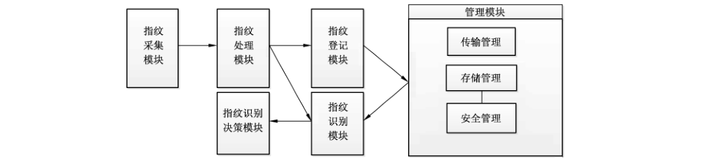
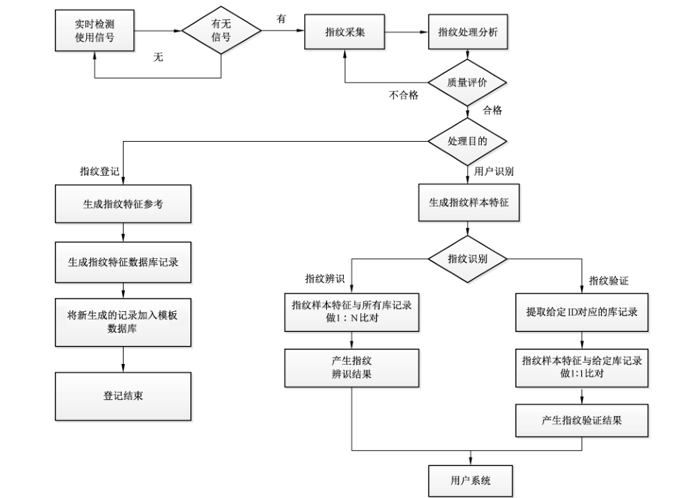

# GB/T 37076-2018 信息安全技术 指纹识别系统技术要求

> 来源：[GB/T 37076-2018 国家标准详情](https://openstd.samr.gov.cn/bzgk/std/newGbInfo?hcno=00299C53425D8D4B29945E298F38E115)；封面发布日期：2018-12-28；实施日期：2019-07-01。
> PDF SHA-256：c93df4d0566d3043e120d4dde8528d7d2a8db5dd56ae74fc204cd717047eb798。
> 转写说明：将 PDF 按页渲染为图像，逐页对照原图校正文字、表格和图示；省略封面、目录、页眉和页脚。正式引用请核对原 PDF。

## 前言

本标准按照 GB/T 1.1—2009给出的规则起草。

请注意本文件的某些内容可能涉及专利。本文件的发布机构不承担识别这些专利的责任。

本标准由全国信息安全标准化技术委员会（SAC/TC 260）提出并归口。

本标准起草单位：公安部安全与警用电子产品质量检测中心、长春鸿达信息科技股份有限公司、山西天地科技有限公司、深圳市亚略特生物识别科技有限公司、浙江维尔科技有限公司、北京凝思软件股份有限公司、中控智慧科技股份有限公司、阿里巴巴（北京）软件服务有限公司、广州广电运通金融电子股份有限公司。

本标准主要起草人：刘军、胡志昂、郑征、张翔、刘琳、滕旭、卢玉华、李淑坤、王云、冷霜、王佳楠、邵宇、陆捷、宫敏、陈书楷、李克鹏、张玮。

## 1 范围

本标准规定了采用指纹识别技术进行身份鉴别的指纹识别系统基本级和增强级的功能、性能、安全要求和等级划分。

本标准适用于指纹识别系统的设计与实现，对指纹识别系统的测试、管理也可参照使用。

## 2 规范性引用文件

下列文件对于本文件的应用是必不可少的。凡是注日期的引用文件，仅注日期的版本适用于本文件。凡是不注日期的引用文件，其最新版本（包括所有的修改单）适用于本文件。

- GB 17859—1999 计算机信息系统安全保护等级划分准则

- GB/T 18336.1—2015 信息技术 安全技术 信息技术安全评估准则 第1部分：简介和一般模型

- GB/T 18336.3—2015 信息技术 安全技术 信息技术安全评估准则 第3部分：安全保障组件

- GB/T 20271—2006 信息安全技术 信息系统通用安全技术要求

- GB/T 26238—2010 信息技术 生物特征识别术语

- GB/T 29268.1—2012 信息技术 生物特征识别性能测试和报告 第 1 部分：原则与框架

- GB/T 35273—2017 信息安全技术 个人信息安全规范

## 3 术语和定义、缩略语

### 3.1 术语和定义

GB/T 20271—2006、GB/T 26238—2010和 GB/T 29268.1—2012 界定的以及下列术语和定义适用于本文件。

#### 3.1.1 指纹识别 fingerprint biometrics; fingerprint authentication;fingerprint recognition

基于个体的指纹特征，对该个体的身份进行的自动识别。

> 注：包括指纹辨识和指纹验证两个过程。

#### 3.1.2 指纹识别系统 fingerprint recognition system

用指纹识别技术为信息系统提供身份鉴别服务的系统。

> 注：包括指纹采集、指纹处理、指纹比对及传输、存储等功能。

#### 3.1.3 指纹特征数据 fingerprint data

处于各个处理阶段的指纹样本或指纹样本的聚集、指纹特征参考、指纹特征项或指纹特征特性的统称。

#### 3.1.4 指纹特征 fingerprint characteristic

个体的指纹在生物学的特征。该特征可被检测，并且可以从中提取有区别的、可重复的指纹特征项，从而达到个体自动识别的目的。

示例：指纹特征包括指纹脊线结构、指形等。

#### 3.1.5 指纹特征项 fingerprint feature

由指纹样本提取的、能够表征该指纹特征的一组数值或标记。

#### 3.1.6 指纹模板 fingerprint template

已存储的指纹特征项集合，可直接与探针指纹样本的指纹特征项进行比对。

#### 3.1.7 指纹样本 fingerprint sample

先于指纹特征提取，且从指纹采集过程获取的模拟的或数字的个体指纹的表示。

#### 3.1.8 指纹采集样本 captured fingerprint sample

指纹采集过程输出的指纹样本。

#### 3.1.9 指纹中间样本 intermediate fingerprint sample

针对指纹特征样本，指纹中间处理过程输出的指纹样本。

示例：可能为了指纹特征项提取而将指纹中间样本增强；为了紧凑存储的目的，而将指纹中间样本压缩。

#### 3.1.10 指纹特征探针 fingerprint probe

输入到算法的、与指纹特征参考数据进行比对的指纹特征数据。

#### 3.1.11 指纹特征参考 fingerprint reference

用于比对的、属于指纹特征数据主体的一个或多个已存储的指纹样本、指纹模板。

#### 3.1.12 指纹登记 fingerprint enrollment

用户登记指纹信息时，采集指纹图像，提取指纹特征，将生成的指纹模板与用户标识绑定并存储的过程。

#### 3.1.13 指纹辨识 fingerprint identification

将所产生的指纹样本与已存贮的指定范围内的所有指纹模板进行比对（1：N 比对），选出相符的用户，以揭示用户的实际身份。

#### 3.1.14 指纹验证 fingerprint verification

将所产生的指纹样本与按用户标识信息给定的已存储的用户的指纹模板进行比对（1：1比对），以确定用户所声称的身份。

#### 3.1.15 活体检测 aliveness check

判断生物特征样本的主体是否来自活体人员。

#### 3.1.16 候选者 candidate

通过指纹辨识所确定的用户。

> 注：该用户是在已进行过用户登记的所有用户中选出的符合当前特征数据要求的用户。

#### 3.1.17 错误接受率 false accept rate

在进行指纹样本与指纹特征参考的比对过程中，对于本不该接受的比对（即结果应为拒绝的比对）错误地判定为接受的次数与总测试次数（不同手指）的比率的测定值。

#### 3.1.18 错误拒绝率 false reject rate

在进行指纹样本与指纹特征参考的比对过程中，对于本不该拒绝的比对（即结果应为接受的比对）错误地判定为拒绝的次数与总测试次数（相同手指）的比率的测定值。

#### 3.1.19 注册失败率 failure-to-enroll rate

注册失败的用户在总注册用户中所占的比例。

#### 3.1.20 （正确）辨识率 （true-positive）identification rate

在辨识过程中，用户被系统正确辨识的次数与总测试次数（不同手指）的比率的测定值。

> 注：辨识率依赖于 a）注册数据库的大小，b）匹配得分的判别阈值以及返回的匹配识别数目。

#### 3.1.21 错误拒绝辨识率 false-negative identification-error rate

在辨识过程中，注册用户被系统错误辨识其他注册用户的次数与总测试次数（不同手指）的比率的测定值。

> 注：错误拒绝辨识率 = 1－正确辨识率。

#### 3.1.22 错误接受辨识率 false-positive identification-error rate

在辨识过程中，非注册用户被系统辨识某个注册用户的次数与总测试次数（不同手指）的比率的测定值。

> 注：错误接受辨识率依赖于 a）注册数据库的大小，b）匹配得分的判别阈值以及返回的匹配识别数目。

### 3.2 缩略语

GB/T 18336.1—2015确定的缩略语和下列缩略语适用于本文件。

- FAR：错误接受率（False Accept Rate）
- FNIR：错误拒绝辨识率（False-Negative Identification-error Rate）
- FPIR：错误接受辨识率（False-Positive Identification-error Rate）
- FRR：错误拒绝率（False Reject Rate）
- FTE：注册失败率（Failure-To-Enroll Rate）
- TOE：评估对象（Target of Evaluation）
- TPIR：正确辨识率（True-Positive Identification Rate）
- TSF：TOE 安全功能（TOE Security Functions）

## 4 指纹识别系统结构

### 4.1 指纹识别系统组成

指纹识别系统的基本组成和相互关系如图1所示。

指纹识别系统包含指纹采集、指纹处理、指纹登记、指纹识别、指纹识别决策和管理等功能模块。这些模块用以实现指纹登记、指纹验证以及指纹辨识三种基础身份鉴别安全功能。指纹登记功能为用户创建指纹特征参考，并将其作为鉴别用户身份唯一标识的依据；指纹验证功能依据某使用者所声称的身份以及提供的指纹特征，对其身份进行鉴别，验证用户的真实身份是否与其声称的身份一致；指纹辨识功能用以确定某使用者是否已经注册在系统中，如果是则确定其身份。

### 4.2 指纹识别系统各功能模块

#### 4.2.1 指纹采集模块

指纹采集模块包括输入设备或传感器，从用户采集指纹特征信息，将其转化成适合指纹识别系统其他部分进行处理的形式，实现信息的转换。

#### 4.2.2 指纹处理模块

指纹处理模块从指纹采集模块接收原始数据，然后将数据转换成指纹比对模块所需要的指纹样本，包含指纹中间样本处理、指纹特征提取、质量控制等功能。

指纹中间样本处理功能针对指纹进行修剪、下采样、压缩、转换成数据交换格式标准以及图像增强等处理操作，形成指纹中间样本。质量控制拒绝接受样本时，指纹采集模块可能会采集新的样本。

指纹特征提取功能针对经过标准化处理的指纹中间样本分离并输出可重复性和辨别性的数值或标记，形成指纹样本，并将其提交给匹配过程。通常来说，一旦原始指纹数据已经处理，通过已经处理的数据或模板重构原始指纹数据是不可行的。

#### 4.2.3 指纹登记模块

根据指纹处理模块提供的信息，进行指纹登记处理，并将指纹特征数据信息提交数据存储管理模块进行存储。

#### 4.2.4 指纹识别模块

根据指纹处理模块提供的指纹样本，以及经存储管理模块提供的指纹特征参考，进行指纹识别比对。比较所产生的分数值表明指纹样本和指纹特征参考匹配的程度。

#### 4.2.5 指纹识别决策模块

指纹识别决策模块接收从指纹识别模块输出的比对数值，根据设置的指纹识别决策策略，为指纹识别应用产生一个声称者是否是其所声称的身份的是非决定。指纹识别决策策略可以包括：

- 匹配阈值；

- 每次识别所允许的匹配尝试次数；

- 每个声称者登记的参考模板数目；

- 在匹配过程中使用内部控制，用以检测指纹特征样本是否相同；

- 使用串行、并行、加权或者融合的决策模型，使用多次参考模板。

#### 4.2.6 管理模块

##### 4.2.6.1 存储管理

存储模块为登记的用户保存指纹特征参考。根据指纹比对模块的需要，它提供登记指纹特征参考的增加、删除和检索功能。存储模块根据系统架构和预期的功能，可为单个用户保存一个或大量指纹模板。

例如，模板可存储在：

- 指纹特征设备中的物理保护介质；

- 计算机系统的常规数据库；

- 便携的令牌，例如智能卡。

##### 4.2.6.2 传输管理

传输管理部分实现各模块节点或子系统以及其他信息系统间的通信与数据传输。

##### 4.2.6.3 安全管理

安全管理部分负责管理指纹识别系统安全策略的执行和应用。

### 4.3 指纹识别系统工作流程

指纹识别系统的工作流程框图如图2所示。

### 4.4 指纹识别基本应用

#### 4.4.1 指纹登记

指纹登记是指将用户身份与指纹特征参考数据绑定并保存的过程。依据指纹特征模板是否允许更新，指纹登记可分为初始登记和再登记。

指纹登记过程一般包括：

a） 指纹样本采集；

b） 指纹特征提取；

c） 指纹特征质量评价，如果不合格则重新采集；

d） 指纹特征模板生成与存储；

e） 测试登记是否成功；

f） 若初始登记不合格，可能允许重复登记尝试。

#### 4.4.2 指纹验证

在指纹验证过程中，用户提交所声称的身份和进行验证所需要的指纹特征。通常基于所声称的身份，系统提取用户的指纹模板，并将其与从所采集指纹样本产生的特征进行比较，以确定用户是否确实是所声称身份的拥有者。

指纹验证一般包括以下步骤：

a） 指纹样本采集；

b） 指纹特征提取；

c） 指纹特征质量评价，如果不合格则重新采集；

d） 比对输入指纹特征与其所声称的身份的对应指纹模板；

e） 判断相似度是否超过确定的门限；

f） 根据指纹识别决策策略和比对得分判断是否匹配。

#### 4.4.3 指纹辨识

指纹辨识的过程是试图确定某使用者是否已经注册在系统中，如果是则确定其身份。

指纹辨识通常包括以下步骤：

a） 指纹样本采集；

b） 指纹特征提取；

c） 指纹特征质量评价，如果不合格则重新采集；

d） 比对输入指纹特征及系统中的待比对指纹模板；

e） 判断是否有匹配上的身份；

f） 根据指纹识别决策策略和输出的一组比对得分做出辨识结论。

## 5 安全分级

指纹识别系统是信息系统身份鉴别的实现方式之一。根据 GB 17859—1999 的安全保护等级划分的思想，并基于 GB/T 18336.3—2015 中 EAL 3 和 EAL 4 的安全保障要求，本标准将指纹识别系统的基本功能、性能和安全要求分为基本级和增强级，黑体字为增强级相对于基本级新增的要求，基本级和增强级的简要描述见附录 A。指纹识别系统的安全描述参见附录 B。凡涉及密码算法的相关内容，按国家有关法规实施；凡涉及采用密码技术解决机密性、完整性、真实性、不可否认性需求的须遵循密码相关国家标准和行业标准。

## 6 功能要求

### 6.1 基本级要求

#### 6.1.1 用户标识

应提供用户标识功能。用户标识应满足以下要求：

a） 所有用户在用户登记时都进行用户标识；

b） 用户标识以用户名和可区分标识符（ID）实现；

c） 应具唯一性；

d） 应对用户标识信息进行管理、维护，确保其不被非授权地访问、修改或删除。

#### 6.1.2 指纹采集与处理

应提供指纹信息采集功能，应满足以下要求：

a） 由经过设备鉴别的指纹采集设备采集用户指纹图像，不应以任何其他方式采集或输入；

b） 采集过程应在独立的逻辑域或物理域中实现；

c） 应提供对所采集的指纹原始数据进行指位判定的功能；

d） 采集过程中应进行防伪造检测；

e） 指纹采集后清除残留信息。

#### 6.1.3 指纹登记

##### 6.1.3.1 指纹登记要求

应提供指纹登记功能，满足以下要求：

a） 指纹登记是一次性过程，即对同一指纹特征数据库的用户只应登记一次；

b） 登记过程中为用户生成指纹模板；

c） 指纹登记后应清除残留信息；

d） 应对指纹登记事件进行审计。

##### 6.1.3.2 初始登记

登记者首次登记指纹特征时，应满足以下要求：

a） 应授权安全管理员执行指纹初始登记功能；

b）登记前要求登记者提供照片等其他身份证明，由安全管理员确认登记者身份；

c） 提供登记者指纹特征信息与登记者绑定功能，确保登记过程采集的指纹特征信息属于该登记者。

##### 6.1.3.3 再登记

登记者再次登记指纹特征时，满足以下要求：

a） 应授权安全管理员执行指纹再登记功能；

b） 再登记过程中应更新指纹模板。

##### 6.1.3.4 用户指纹注销

应提供登记者指纹注销功能，满足以下要求：

a） 应在用户指纹注销过程中终止指纹模板；

b） 应删除指纹登记者绑定的相关信息。

#### 6.1.4 指纹模板管理

##### 6.1.4.1 指纹模板产生

应提供指纹模板产生功能，满足以下要求：

a） 应为指纹模板分配唯一的用户身份标识符；

b） 指纹模板产生前应查重，不同用户的指纹模板不能相同；

c） 参考模板签发者应在所产生的指纹模板中标明唯一的参考模板签发者身份标识符；

d）应将用户的标识、辅助数据与指纹特征模板绑定创建用于存储的指纹特征数据包；

e） 提供对指纹特征数据包完整性保护的功能；

f） 模板应包含足够的指纹特征项，以保证能满足身份确认和身份识别的错误匹配率的要求；

g） 产生指纹模板所需的最少数目和类型等参数应可通过安全策略配置进行加强。

##### 6.1.4.2 指纹模板分发

使用以下的一个或多个机制在指纹识别系统内分发指纹模板：

a） 若使用集中模式，指纹模板集中存储，应确认指纹模板安全分发到集中存储位置；

b） 若使用分布式模式，指纹模板传输到一个或者多个地方，应确认模板安全分发到所有存储位置；

c） 若使用令牌模式，模板存储在可移动的介质中，应确认模板被安全地注入到设备中且令牌被安全地签发给用户。

##### 6.1.4.3 指纹模板终止

应提供模板终止功能，满足以下要求：

a） 应分配安全管理员拥有终止指纹模板的权限；

b） 应规定安全管理员终止指纹模板的安全策略；

c） 终止指纹模板时应确认拥有者的身份和终止者的授权；

d） 当可行的时候，在发生指纹模板终止的时候通知登记者；

e） 当指纹模板终止时，所有模板的实例被清除；

f） 当检测到已终止模板尝试访问系统时应进行报警。

##### 6.1.4.4 指纹模板更新

应提供模板更新功能，满足以下要求：

a） 指纹模板更新前应终止当前指纹模板，并对历史模板进行归档；

b） 产生新指纹模板后应确认成功分发；

c） 在更新过程中应采取安全措施保证用户指纹模板的安全，防止例如替换用户指纹模板等的各种攻击行为。

#### 6.1.5 用户指纹识别

##### 6.1.5.1 指纹验证

指纹验证应满足以下要求：

a） 进行指纹验证时，还应给出用户的其他身份标识信息，如UID 等；

b） 根据所给用户身份标识信息，检索出该用户的指纹模板；

c） 执行数据包验证功能，检验用户指纹模板的完整性；

d） 匹配子系统将实时采集并生成的指纹样本与所检索出的该用户的指纹模板进行比对，产生用于用户验证的比对相似度值；

e） 比对判定模块根据比对阈值输出指纹识别判定；

f） 指纹验证应清除残留信息。

##### 6.1.5.2 指纹辨识

指纹辨识应满足以下要求：

a） 进行指纹辨识时，用户指纹样本是唯一需要的辨识信息；

b） 执行数据包验证功能，检验用户指纹样本数据的完整性；

c） 匹配子系统将实时采集的并生成的指纹样本与已存贮的指纹模板逐一进行比对，产生用于指纹辨识的比对相似度值；

d） 比对判定模块根据比对阈值输出指纹识别判定；

e） 指纹辨识后应清除残留信息。

##### 6.1.5.3 决策反馈保护

指纹识别决策反馈保护应满足以下要求：

a） 根据指纹识别决策策略，返回指纹识别比对结果，并保护反馈结果的完整性。

b） 识别过程中，应避免提供给用户的反馈信息泄露用户的指纹特征信息数据。

##### 6.1.5.4 鉴别时机

应在指纹识别系统安全功能实施所要求的动作之前，先对提出该动作要求的用户成功地进行鉴别。

##### 6.1.5.5 管理员用户鉴别

本级管理员用户应同时通过指纹识别鉴别和非生物特征识别机制来验证：

a） 鉴别机制应在鉴别识别尝试之间设定延时，如由安全管理员设置每分钟尝试次数。

b） 任何使用鉴别机制的尝试反馈不会增加猜测秘密规范的概率。

c） 对于未成功的鉴别过程，鉴别机制不提供鉴别识别反馈信息。

##### 6.1.5.6 识别失败的判定及处理功能

###### 6.1.5.6.1 指纹识别失败判定

在识别过程中，当出现以下情形中的一项或多项时，应能准确地判断出识别失败：

a） 设备故障：指纹采集器故障，不能成功捕捉图像；

b） 像质障碍：捕捉的图像质量不适于生成指纹模板或生成指纹样本；

c） 超时断开：终端操作超时断开；

d） 数据库故障：特征数据库故障且在规定尝试次数内未能消除；

e） 尝试超次：对指纹验证与指纹辨识，应分别设定警告次数阈值，连续警告次数大于该阈值时视作失败。

###### 6.1.5.6.2 指纹识别失败处理

对识别失败的处理，应提供以下功能：

a） 制定识别失败返回值表；

b） 在出现识别失败情况时，返回对应错误代码或错误值；

c） 针对不同识别失败原因进行相应处理。

##### 6.1.5.7 防伪造识别功能

应具有防伪造功能并满足以下要求：

a） 防复制伪造：应能检测或防止对当前用户识别数据的复制和非授权保存；

b） 防照片伪造：应能检测或防止使用照片伪造识别图像；

c） 假体检测：宜能检测或防止使用指纹假体的仿冒行为；

d） 上述攻击或非授权操作事件时应取消服务，并产生报警。

##### 6.1.5.8 警告与报警功能

指纹识别系统的警告与报警应满足以下要求：

a） 进行指纹验证时，如用户不是所给身份标识信息或其他用户身份信息的持有者，或用户已被删除，或在进行指纹辨识时，已存贮的指纹特征中无用户的候选者，指纹管理中心应给出警告信息；

b） 检测出伪造识别图像、识别数据，或复制、非授权保存图像、数据，或非活体指纹，或非授权数据库操作时应给出报警信息。

##### 6.1.5.9 秘密的规范

应能提供机制以验证所提取的用户指纹特征模板是否满足相应的质量度量。

当用来对用户身份鉴别的指纹特征模板等秘密信息由指纹识别系统产生时，指纹识别系统应可生成符合秘密信息质量要求的秘密信息。秘密信息质量包括模板大小等。秘密信息质量量度由管理员制定。

### 6.2 增强级要求

#### 6.2.1 用户标识

应提供用户标识功能。用户标识应满足以下要求：

a） 所有用户在指纹登记时都进行用户标识；

b） 用户标识以用户名和用户标识符（ID）实现；

c） 应确保同一信息系统中用户标识的唯一性；

d） 应对用户标识信息进行管理、维护，确保其不被非授权地访问、修改或删除。

#### 6.2.2 指纹采集与处理

应提供指纹采集功能，满足以下要求：

a） 由确定的指纹采集设备采集用户指纹图像，不应以任何其他方式采集或输入；

b） 采集过程应在独立的逻辑域或物理域中实现；

c） 应提供对所采集的指纹原始数据进行指位判定的功能；

d） 采集过程中应进行防伪造检测；

e） 指纹采集后清除残留信息；

f） 指纹采集设备应具备数据鉴别能力，保证原始指纹数据的真实性；

g） 应保证已经处理的指纹数据或指纹模板不可能重构原始指纹数据。

#### 6.2.3 指纹登记

##### 6.2.3.1 指纹登记要求

应提供指纹登记功能，满足以下要求：

a） 指纹登记是一次性过程，即对同一指纹特征数据库的用户只应登记一次；

b） 登记过程中为用户生成指纹模板；

c） 指纹登记后应清除残留信息；

d） 应对指纹登记事件进行审计。

##### 6.2.3.2 初始登记

登记者首次登记指纹特征时，应满足以下要求：

a） 应授权安全管理员执行指纹初始登记功能；

b） 登记前要求登记者提供照片等其他身份证明，由安全管理员确认登记者身份；

c） 提供登记者指纹特征信息与登记者绑定功能，确保登记过程采集的指纹特征信息属于该登记者。

##### 6.2.3.3 再登记

登记者再次登记指纹特征时，应满足以下要求：

a） 应授权安全管理员执行指纹再登记功能；

b） 再登记过程中应更新指纹模板。

##### 6.2.3.4 用户指纹注销

应提供登记者指纹注销功能，满足以下要求：

a） 应在用户指纹注销过程中终止指纹模板；

b） 应删除指纹登记者绑定的相关信息。

#### 6.2.4 指纹模板管理

##### 6.2.4.1 指纹模板生成

指纹识别系统应在安全可信的环境中生成指纹模板，并满足以下要求：

a） 只应将获准进行登记的用户的指纹特征作为指纹模板存入指纹特征数据库；

b） 应为指纹模板分配唯一的用户标识符；

c） 指纹模板产生前应查重确认其唯一性，不同用户的指纹模板不能相同；

d） 应将用户的标识、辅助数据与指纹特征模板绑定创建用于存储的指纹特征数据包；

e） 提供对指纹特征数据包签名的功能，标明唯一的参考模板签发者身份标识符；

f） 产生指纹模板所需的最少数目和类型等参数应可通过安全策略配置进行加强；

g） 模板应包含足够的指纹特征项，以保证能满足身份确认和身份识别的错误匹配率的要求；

h） 应确保当其产生的参考模板因为某些原因不能使用时，最少数目和类型的可替代、降级鉴别要素可通过安全策略配置进行加强。

##### 6.2.4.2 指纹模板分发

使用以下的一个或多个机制在指纹识别系统内分发指纹模板：

a） 若使用集中模式，指纹模板集中存储，应确认指纹模板安全分发到集中存储位置；

b） 若使用分布式模式，指纹模板传输到一个或者多个地方，应确认模板安全分发到所有存储位置；

c） 若使用令牌模式，模板存储在可移动的介质中，应确认模板被安全地注入到设备中且令牌被安全地签发给用户。

##### 6.2.4.3 指纹模板终止

应提供指纹模板终止功能，满足以下要求：

a） 应分配安全管理员拥有终止指纹模板的权限；

b） 应规定安全管理员终止指纹模板的安全策略；

c） 终止指纹模板时应确认拥有者的身份和终止者的授权；

d） 当可行的时候，在发生指纹模板终止的时候通知登记者；

e） 当指纹模板终止时，所有模板的实例被清除；

f） 当检测到已终止模板尝试访问系统时应进行报警。

##### 6.2.4.4 指纹模板更新

应提供指纹模板更新功能，满足以下要求：

a） 指纹模板更新前应终止当前指纹模板，并对历史模板进行归档；

b） 产生新指纹模板后应确认成功分发；

c） 在更新过程中应采取安全措施保证用户指纹模板的安全，防止例如替换用户指纹模板等的各种攻击行为。

#### 6.2.5 用户指纹识别

##### 6.2.5.1 指纹验证

应提供指纹验证功能，满足以下要求：

a） 进行指纹验证时，还应给出用户标识符，如UID 等；

b） 根据所给用户身份标识信息，检索出该用户的指纹模板；

c） 执行数据包验证功能，检验用户指纹模板的完整性；

d） 执行数据包验证功能，检验用户采集样本的完整性；

e） 匹配子系统将实时采集并生成的指纹样本特征与所检索出的该用户的指纹模板进行比对，产生用于用户验证的比对相似度值；

f） 比对判定模块根据比对阈值输出指纹识别判定；

g） 指纹验证应清除残留信息。

##### 6.2.5.2 指纹辨识

应提供指纹辨识功能，满足以下要求：

a） 进行指纹辨识时，用户指纹样本是唯一需要的辨识信息；

b） 执行数据包验证功能，检验用户采集样本的完整性；

c） 匹配子系统将实时采集的并生成的指纹样本特征与已存贮的指纹模板逐一进行比对，产生用于指纹辨识的比对相似度值；

d） 比对判定模块根据比对阈值输出指纹识别判定；

e） 指纹辨识后应清除残留信息。

##### 6.2.5.3 决策反馈保护

指纹识别决策反馈保护应满足以下要求：

a） 根据指纹识别决策策略，返回指纹识别比对结果，并保护反馈结果的完整性；

b） 识别过程中，应避免提供给用户的反馈信息泄露用户的指纹特征信息数据。

##### 6.2.5.4 鉴别时机

应在指纹识别系统安全功能实施所要求的动作之前，先对提出该动作要求的用户成功地进行鉴别。

##### 6.2.5.5 管理员用户鉴别

本级管理员用户应同时通过指纹识别鉴别和非生物特征识别机制来验证：

a） 鉴别机制应在鉴别识别尝试之间设定延时，如由安全管理员设置每分钟尝试次数；

b） 任何使用鉴别机制的尝试反馈不会增加猜测秘密规范的概率；

c） 对于未成功的鉴别过程，鉴别机制不提供鉴别识别反馈信息。

##### 6.2.5.6 失败的判定及处理

###### 6.2.5.6.1 指纹识别失败判定

指纹识别系统在识别过程中，当出现以下情形中的一项或多项时，应能准确地判断出识别失败：

a） 设备故障：指纹采集器故障，不能成功捕捉图像；

b） 像质障碍：捕捉的指纹图像质量不适于生成指纹模板或生成指纹样本；

c） 超时断开：终端操作超时断开；

d） 数据库故障：指纹特征数据库故障且在规定尝试次数内未能消除；

e） 尝试超次：对指纹验证与指纹辨识，应分别设定警告次数阈值，连续警告次数大于该阈值时视作失败。

###### 6.2.5.6.2 指纹识别失败处理

指纹识别失败的处理应包括检测出现相关的不成功鉴别尝试的次数与所规定的数目相同的情况，并进行预先定义的处理。对失败的处理，应提供以下功能：

a） 制定识别失败返回值表；

b） 在出现识别失败情况时，返回对应的错误代码或错误值；

c） 针对识别失败记录事件日志；

d） 制定明确的识别失败处理策略；

e） 针对不同识别失败原因进行相应处理。

##### 6.2.5.7 防伪造识别功能

应具有防伪造功能并满足以下要求：

a） 防复制伪造：应能检测或防止对当前用户识别数据的复制和非授权保存；

b） 防照片伪造：应能检测或防止使用照片伪造识别图像；

c） 假体检测：应能检测或防止使用绝大多数指纹假体的仿冒行为；

d） 上述攻击或非授权操作事件时应取消服务，并产生报警。

##### 6.2.5.8 警告与报警功能

指纹识别系统的警告与报警应满足以下要求：

a） 进行指纹验证时，如用户不是所给身份标识信息或其他用户身份信息的持有者，或用户已被删除，或在进行指纹辨识时，已存贮的指纹模板中无用户的候选者，应给出警告信息；

b）检测出伪造识别图像、识别数据，或复制、非授权保存图像、数据，或非活体指纹，或非授权数据库操作时应给出报警信息。

##### 6.2.5.9 秘密的规范

应能提供机制以验证所提取的用户指纹特征模板是否满足相应的质量度量。

当用来对用户身份鉴别的指纹特征模板等秘密信息由指纹识别系统产生时，指纹识别系统应可生成符合秘密信息质量要求的秘密信息。秘密信息质量包括模板大小等。秘密信息质量量度由安全管理员制定。

## 7 性能要求

### 7.1 基本级要求

#### 7.1.1 指纹登记

本级指纹识别系统的指纹注册失败率不应超过5%。

#### 7.1.2 指纹验证

本级指纹识别系统在总比对次数不小于 1000 万次、样本来源不少于 5000 枚指纹，当错误接受率为 0.01% 时，错误拒绝率应不大于 3%。

#### 7.1.3 指纹辨识

本级指纹识别系统指纹库规模应不低于 10000 枚指纹，错误接受辨识率为 0.2% 时，辨识率宜不小于 98%。

### 7.2 增强级要求

#### 7.2.1 指纹登记

本级指纹识别系统的指纹注册失败率不应超过5%。

#### 7.2.2 指纹验证

本级指纹识别系统在总比对次数不小于 10000 万次、样本来源不少于 50000 枚指纹，当错误接受率为 0.001% 时，错误拒绝率应不大于 3%。

#### 7.2.3 指纹辨识

本级指纹识别系统指纹库规模应不低于 10 万枚指纹，错误接受辨识率为 0.5% 时，辨识率宜不小于 95%。

## 8 安全要求

### 8.1 基本级要求

#### 8.1.1 安全审计

##### 8.1.1.1 安全审计数据产生

安全审计功能应按以下要求产生审计数据：

a） 为下述可审计事件产生审计记录：

- 审计功能的开启和关闭；
- 使用身份鉴别机制；
- 系统管理员、安全管理员、审计管理员和一般操作员所实施的操作；
- 其他与系统安全有关的事件或专门定义的可审计事件；
- 伪造指纹图像；
- 伪造特征数据或篡改识别结果数据；
- 企图保存指纹图像；
- 非授权保存特征数据；
- 非授权进行数据库操作。

b） 对于每一个事件，其审计记录应包括：事件的日期和时间、用户、事件类型、事件是否成功，及其他与审计相关的信息。

日志记录中不应出现明文形式的指纹特征模板、私钥、对称密钥和其他安全相关的参数。

审计功能部件应能将可审计事件与发起该事件的用户身份相关联。

c） 对于身份鉴别事件，审计记录应包含请求的来源（例如，指纹设备标识符）。

##### 8.1.1.2 安全审计查阅

根据对安全审计的不同要求，安全审计查阅分为：

- 审计功能部件应为管理员提供查看日志所有信息的能力。
- 审计功能部件应以适于阅读和解释的方式向阅读者提供日志信息。

##### 8.1.1.3 安全审计事件选择

审计功能部件应可根据下列属性选择或排除审计事件集中的可审计事件：用户标识、事件类型、主体标识、客体标识等。

##### 8.1.1.4 安全审计事件存储

根据对安全审计的不同要求，安全审计事件存储分为：

a） 受保护的审计踪迹存储：审计踪迹的存储受到应有的保护，能检测或防止对审计记录的修改；

b） 防止审计数据丢失：在审计踪迹存储记满时，应能够阻止除由管理员发起的以外的所有审计事件的发生；

c） 审计数据的可用性确保：在意外情况出现时，能检测或防止对审计记录的修改，以及在发生审计存储已满、存储失败或存储受到攻击时，确保审计记录不被破坏。

##### 8.1.1.5 审计日志保护

审计功能部件应定期对审计日志做数字签名等完整性保护运算。

完整性保护运算的对象是从上次签名后加入的所有审计日志条目以及上次签名的结果。

对审计日志签名的时间周期应是可配置的。

对审计日志签名的事件应写入审计日志中，审计日志签名结果应包含在其中。

#### 8.1.2 用户数据保护

##### 8.1.2.1 访问控制

建立访问控制策略，通过对主、客体设置敏感标记，实现对用户、设备、应用程序等不同主体不同粒度的访问控制机制。

指纹识别系统中有两类主体：一类是特权用户，包括系统管理员、系统安全员和系统审计员；另一类是处理专门事务的系统进程。

指纹识别系统中的客体是指主体所能操作的对象，包括作图像处理、数据存储的对象和用户服务的进程。前者主要包括：已登记指纹模板、指纹样本、指纹识别结果；后者主要包括：系统管理员操作进程、数据库操作进程、安全员操作进程、审计员操作进程。

##### 8.1.2.2 数据存储安全

本项功能应：

a） 具备对指纹等个人信息数据加密存储能力，满足数据保密性保护要求；

b） 利用存储访问控制模块实施指纹数据用户身份标识与鉴别策略、数据访问控制策略，并实现相关安全控制措施，防止非授权的访问用户指纹数据。

##### 8.1.2.3 数据传输安全

应采用满足数据传输安全策略相应的安全控制措施，如数据加密等，对指纹识别数据的传输进行保护。

#### 8.1.3 个人信息保护

应对用户的指纹数据等个人信息进行保护，包括但不限于以下功能：

a） 存储个人指纹信息时，应采用技术措施处理后再进行存储，例如仅存储指纹信息的摘要。除GB/T 35273—2017中5.4 a）、b）、c）规定之外，不应存储指纹原始图像。

b） 无关联保护，应防止通过应用程序或数据库关联到存储的指纹特征模板数据。

c） 保密性保护，应防止非授权用户对指纹特征模板数据的访问。

d） 残余信息保护，要求指纹识别系统安全功能有能力确保，对于安全控制范围内的某个已定义的客体进行资源的配给或回收时，任何资源的任何剩余信息是不可用的，确保已经被删除的信息不再是可访问的。

#### 8.1.4 时间戳

指纹识别系统的安全功能应能为自身的应用提供可靠的时间戳。

#### 8.1.5 备份与恢复

指纹识别系统应具有备份和恢复功能，在系统运行中出现致使信息丢失的故障时，能进行信息恢复；在系统运行中出现致使系统无法运行的故障时，能进行系统恢复。

#### 8.1.6 系统管理

开发者应提供指纹识别系统管理员、安全管理员和审计管理员的角色定义。

系统管理员：安装、配置、维护系统：建立和管理用户账户；执行系统的备份和恢复。

安全管理员：维护用户属性定义；管理秘密信息质量量度；维护指纹算法参数设置、指纹识别决策策略。

审计管理员：配置审计参数；查看和维护审计日志。

系统应具备使主体与角色相关联的能力，并保证一个身份不应同时具备多个角色的权限。一个人不应同时拥有多个角色，开发者应在系统设计时对角色的管理进行相关限制。

角色的安全功能管理应按表1中的配置对授权的角色修改安全功能的能力进行限制。

**表1 授权的角色对于安全功能的管理**

| 功能 | 功能/授权角色 |
| --- | --- |
| 用户指纹登记 | 仅授予安全管理员拥有验证用户指纹模板内容正确性的权限 |
| 指纹模板存储 | 仅授予安全管理员提出请求指纹模板私钥的权限 |
| 指纹模板分发 | 仅授予安全管理员分发指纹模板权限 |
| 指纹模板终止 | 仅授予安全管理员删除指纹模板权限 |
| 指纹模板更新 | 仅授予安全管理员和指纹模板主体申请变更指纹模板的权限 |
| 秘密的规范 | 仅授权安全管理员拥有管理秘密信息质量量度的权限 |
| 用户数据保护 | 仅授予安全管理员请求输入、输出关键和安全相关数据的权限 |
| 安全审计 | 仅授予审计管理员配置审计参数的权限 |
| 备份与恢复 | 仅授予系统管理员配置备份参数的权限；仅授予系统管理员初始化备份或恢复功能的权限 |
| 指纹识别系统配置 | 仅授予系统管理员对系统的资源和运行进行配置、控制和管理的权限，包括用户身份（系统管理员、安全管理员、审计管理员）和授权管理、系统资源配置（指纹设备管理）等。仅授予安全管理员对系统的参数设置进行配置、控制和管理的权限，包括指纹算法参数设置、策略管理等 |

### 8.2 增强级要求

#### 8.2.1 安全审计

##### 8.2.1.1 安全审计数据产生

安全审计功能应按以下要求产生审计数据：

a） 为下述可审计事件产生审计记录：

- 审计功能的开启和关闭；
- 使用身份鉴别机制；
- 系统管理员、安全管理员、审计管理员和一般操作员所实施的操作；
- 其他与系统安全有关的事件或专门定义的可审计事件；
- 伪造指纹图像；
- 指纹假体仿冒；
- 伪造特征数据或篡改识别结果数据；
- 企图保存指纹图像；
- 非授权保存特征数据；
- 非授权进行数据库操作。

b） 对于每一个事件，其审计记录应包括：事件的日期和时间、用户、事件类型、事件是否成功，及其他与审计相关的信息。

日志记录中不应出现明文形式的指纹特征模板、私钥、对称密钥和其他安全相关的参数。

审计功能部件应能将可审计事件与发起该事件的用户身份相关联。

c） 对于身份鉴别事件，审计记录应包含请求的来源（例如，指纹设备标识符）。

##### 8.2.1.2 安全审计查阅

根据对安全审计的不同要求，安全审计查阅分为：

a） 审计功能部件应为管理员提供查看日志所有信息的能力。

b） 审计功能部件应以适于阅读和解释的方式向阅读者提供日志信息。

##### 8.2.1.3 安全审计事件选择

审计功能部件应可根据下列属性选择或排除审计事件集中的可审计事件：用户标识、事件类型、主体标识、客体标识等。

##### 8.2.1.4 安全审计事件存储

根据对安全审计的不同要求，安全审计事件存储分为：

a） 受保护的审计踪迹存储：审计踪迹的存储受到应有的保护，能检测或防止对审计记录的修改；

b） 防止审计数据丢失：在审计踪迹存储记满时，应能够阻止除由管理员发起的以外的所有审计事件的发生；

c） 审计数据的可用性确保：在意外情况出现时，能检测或防止对审计记录的修改，以及在发生审计存储已满、存储失败或存储受到攻击时，确保审计记录不被破坏。

##### 8.2.1.5 审计日志保护

审计功能部件应定期对审计日志做数字签名等完整性保护运算。

完整性保护运算的对象是从上次签名后加入的所有审计日志条目以及上次签名的结果。

对审计日志签名的时间周期应是可配置的。

对审计日志签名的事件应写入审计日志中，审计日志签名结果应包含在其中。

#### 8.2.2 用户数据保护

##### 8.2.2.1 访问控制

建立访问控制策略，通过对主、客体设置附加敏感标记，实现对用户、设备、应用程序等不同主体不同粒度的访问控制机制。对指纹模板数据库的访问控制粒度应为库/表级、记录级、字段级。

指纹识别系统中有两类主体：一类是特权用户，包括系统管理员、系统安全员和系统审计员；另一类是处理专门事务的系统进程。

指纹识别系统中的客体是指主体所能操作的对象，包括作为图像处理、数据存储的对象和用户服务的进程。前者主要包括：已登记指纹模板、指纹样本、指纹识别结果；后者主要包括：系统管理员操作进程、数据库操作进程、安全员操作进程、审计员操作进程。

##### 8.2.2.2 数据存储安全

本项功能应：

a） 具备对指纹等个人信息数据加密存储能力，满足数据保密性和完整性保护要求；

b） 利用存储访问控制模块实施指纹数据用户身份标识与鉴别策略、数据访问控制策略，并实现相关安全控制措施，防止非授权的访问和篡改用户指纹数据；

c） 具备对指纹数据进行备份的能力以及相应的恢复控制措施。

##### 8.2.2.3 数据传输安全

本项功能应：

a） 采用满足数据传输安全策略相应的安全控制措施，如安全通道、可信通道、数据加密等；

b） 具备在构建传输通道前对两端主体身份进行鉴别的能力；

c） 具备对传输数据的完整性进行检测的能力以及相应的恢复控制措施；

d） 支持数据真实性检测，应采用国家规定的签名密码算法及组合算法鉴别数据的来源。

#### 8.2.3 个人信息保护

应对用户的指纹数据等个人信息进行保护，包括但不限于以下功能：

a） 存储个人指纹信息时，应采用技术措施处理后再进行存储，例如仅存储指纹信息的摘要。除 GB/T 35273—2017 5.4 a）、b）、c）规定之外，不应存储指纹原始图像。

b） 不可逆保护，原始指纹模板应通过单向不可逆函数转换生成可撤销模板，保证不能从可撤销模板计算还原生成原始模板，并且可撤销模板不能降低系统的匹配精度。

c） 无关联保护，应防止通过应用程序或数据库关联到存储的指纹特征模板数据。

d） 保密性保护，应防止非授权用户对指纹特征模板数据的访问。

e） 残余信息保护，要求指纹识别系统安全功能有能力确保，对于安全控制范围内的某个已定义的客体进行资源的配给或回收时，任何资源的任何剩余信息是不可用的，确保已经被删除的信息不再是可访问的。

#### 8.2.4 时间戳

指纹识别系统的安全功能应能为自身的应用提供可靠的时间戳。

#### 8.2.5 备份与恢复

指纹识别系统应具有备份和恢复功能，并可在需要时调用备份功能，使在系统失败或者其他严重错误的情况下能够重建系统。执行备份的频率取决于系统或者应用的重要性。在系统备份数据中应保存足够的信息使系统能够重建备份时的系统状态。系统应通过数字签名、Hash 等方式防止备份数据受到未授权的修改。关键安全参数和其他机密信息应以加密形式存储。

#### 8.2.6 系统管理

开发者应提供指纹识别系统管理员、安全管理员和审计管理员的角色定义。

系统管理员：安装、配置、维护系统；建立和管理用户账户；执行系统的备份和恢复。

安全管理员：维护用户属性定义；管理秘密信息质量量度；维护指纹算法参数设置、指纹识别决策策略。

审计管理员：配置审计参数；查看和维护审计日志。

系统应具备使主体与角色相关联的能力，并保证一个身份不应同时具备多个角色的权限。一个人不应同时拥有多个角色，开发者应在系统设计时对角色的管理进行相关限制。

本级指纹识别系统角色的安全功能管理应按表2中的配置对授权的角色修改安全功能的能力进行限制。

**表2 授权的角色对于安全功能的管理**

| 功能 | 功能/授权角色 |
| --- | --- |
| 用户指纹登记 | 仅授予安全管理员拥有验证用户指纹模板内容正确性的权限 |
| 指纹模板存储 | 仅授予安全管理员提出请求指纹模板私钥的权限 |
| 指纹模板分发 | 仅授予安全管理员分发指纹模板权限 |
| 指纹模板终止 | 仅授予安全管理员删除指纹模板权限 |
| 指纹模板更新 | 仅授予安全管理员和指纹模板主体申请变更指纹模板的权限 |
| 秘密的规范 | 仅授权安全管理员拥有管理秘密信息质量量度的权限 |
| 用户数据保护 | 仅授予安全管理员请求输入、输出关键和安全相关数据的权限 |
| 安全审计 | 仅授予审计管理员配置审计参数的权限 |
| 备份与恢复 | 仅授予系统管理员配置备份参数的权限；仅授予系统管理员初始化备份或恢复功能的权限 |
| 指纹识别系统配置 | 仅授予系统管理员对系统的资源和运行进行配置、控制和管理的权限，包括用户身份（系统管理员、安全管理员、审计管理员）和授权管理、系统资源配置（指纹设备管理）等。仅授予安全管理员对系统的参数设置进行配置、控制和管理的权限，包括指纹算法参数设置、策略管理等 |

## 9 安全保障要求

### 9.1 基本级要求

本级的安全保障要求应具备 GB/T 18336.3—2015 中 EAL 3 级能力。

### 9.2 增强级要求

本级的安全保障要求应具备 GB/T 18336.3—2015 中 EAL 4 级能力。

## 附录 A（规范性附录）指纹识别系统基本级和增强级要求

指纹识别系统基本级和增强级的功能要求见表 A.1。

**表 A.1 指纹识别系统功能要求**

| 功能要求 |  | 基本级要求 | 增强级要求 |
| --- | --- | --- | --- |
| 用户标识 |  | \* | \* |
| 指纹采集与处理 |  | \* | \*\* |
| 指纹登记 | 指纹登记 | \* | \* |
| 指纹登记 | 初始登记 | \* | \* |
| 指纹登记 | 再登记 | \* | \* |
| 指纹登记 | 用户指纹注销 | \* | \* |
| 指纹模板管理 | 指纹模板生成 | \* | \*\* |
| 指纹模板管理 | 指纹模板存储 | \* | \* |
| 指纹模板管理 | 指纹模板分发 | \* | \* |
| 指纹模板管理 | 指纹模板终止 | \* | \* |
| 指纹模板管理 | 指纹模板更新 | \* | \* |
| 用户指纹鉴别 | 指纹验证 | \* | \*\* |
| 用户指纹鉴别 | 指纹辨识 | \* | \*\* |
| 用户指纹鉴别 | 决策反馈保护 | \* | \* |
| 用户指纹鉴别 | 鉴别时机 | \* | \* |
| 用户指纹鉴别 | 管理员鉴别 | \* | \* |
| 用户指纹鉴别 | 识别失败判定和处理 | \* | \*\* |
| 用户指纹鉴别 | 防伪造识别 | \* | \*\* |
| 用户指纹鉴别 | 警告与报警 | \* | \* |
| 用户指纹鉴别 | 秘密的规范 | \* | \* |

注：“*”表示具有该要求，“*”数量的增加表示功能要素要求的提高。

指纹识别系统基本级和增强级的性能要求见表 A.2。

**表A.2 指纹识别系统性能要求**

| 性能要求 | 基本级要求 | 增强级要求 |
| --- | --- | --- |
| 指纹登记 | \* | \* |
| 指纹验证 | \* | \*\* |
| 指纹辨识 | \* | \*\* |

注：“*”表示具有该要求，“*”数量的增加表示性能要素要求的提高。

指纹识别系统基本级和增强级的安全功能和安全保障要求见表 A.3。

**表A.3 指纹识别系统安全功能和安全保障要求**

| 安全要求 | 具体要求 | 基本级 | 增强级 |
| --- | --- | --- | --- |
| 安全功能要求：安全审计 | 审计日志产生 | \* | \* |
| 安全功能要求：安全审计 | 审计日志查阅 | \* | \* |
| 安全功能要求：安全审计 | 审计事件选择 | \* | \* |
| 安全功能要求：安全审计 | 审计事件存储 | \* | \* |
| 安全功能要求：安全审计 | 审计日志保护 | \* | \* |
| 安全功能要求：用户数据保护 | 访问控制 | \* | \*\* |
| 安全功能要求：用户数据保护 | 数据存储安全 | \* | \*\* |
| 安全功能要求：用户数据保护 | 数据传输安全 | \* | \*\* |
| 安全功能要求 | 个人信息保护 | \* | \*\* |
| 安全功能要求 | 时间戳 | \* | \* |
| 安全功能要求 | 备份恢复 | \* | \*\* |
| 安全功能要求 | 系统管理 | \* | \* |
| 安全保障要求 | GB/T 18336.3—2015 中 EAL 3 | \* |  |
| 安全保障要求 | GB/T 18336.3—2015 中 EAL 4 |  | \* |

注：“*”表示具有该要求，“*”数量的增加表示安全要素要求的提高。

## 附录 B（资料性附录）指纹识别系统安全描述

### B.1 受保护资产

#### B.1.1 描述目的

在本标准所描述的安全问题描述、安全目的和安全需求，均为了保护本节中所描述的受保护的资产。

#### B.1.2 用户数据类

##### B.1.2.1 概述

用户数据是指由用户产生或为用户产生的数据，这些数据不影响指纹识别系统安全功能的运行。

##### B.1.2.2 系统配置数据

指纹识别设备、指纹比对模块、指纹识别决策模块的系统配置数据。

示例：指纹识别设备中进行指纹图像处理的参数，指纹比对模块中的阈值，指纹识别决策模块中决策规则。

##### B.1.2.3 中间处理数据

为输出指纹识别结果，由指纹识别系统生成的指纹采集样本数据、指纹特征中间数据、指纹特征项数据、指纹特征模板数据、指纹模型数据、匹配结果数据。

##### B.1.2.4 输入数据

指纹识别过程中，人工输入的数据。如指纹登记时用户输入的身份信息。

##### B.1.2.5 传输数据

传输数据包括：

a） 指纹采集设备与指纹处理模块之间传输的数据；

b） 指纹特征数据库与指纹比对模块之间传输的数据；

c） 指纹特征存储介质与指纹比对模块之间传输的数据；

d） 指纹识别系统与指纹识别应用程序之间传输的数据；

e） 指纹识别前端与指纹认证中心之间传输的数据。

#### B.1.3 安全功能数据类

##### B.1.3.1 概述

指纹识别系统安全功能数据是指由指纹识别系统产生或为指纹识别系统产生的数据，这些数据可能会影响指纹识别系统安全功能的运行。

##### B.1.3.2 安全功能受保护数据

除系统的管理者和拥有者外，不允许改变内容但允许公开内容的数据。

> 注：不管是数据的非管理者用户还是数据的非拥有者用户，对指纹识别系统评估对象安全功能受保护数据的改变可能影响该评估对象 TOE 的运行安全，但对这类数据的泄露是可接受的。

示例：用户和设备的标识数据（ID）、用户或系统状态数据、设备和网络状态信息和配置设置、设备安全状态等均为评估对象安全功能受保护数据。

##### B.1.3.3 安全功能保密数据

除系统的管理者和拥有者外，既不允许改变内容也不允许公开内容的数据。

> 注：不管是数据的非管理者用户还是数据的非拥有者的用户，对评估对象安全功能保密数据的改变和泄露均可能影响该评估对象 TOE 的运行安全。

示例：用户和设备的鉴别数据、用户口令、审计记录数据、数字证书的私钥、访问控制表等均为评估对象 TOE 保密数据。

#### B.1.4 安全威胁分析

##### B.1.4.1 概述

指纹识别系统作为身份鉴别机制多因子鉴别之一时，处于信息系统的边界，其安全威胁主要来自恶意用户对真实身份的伪造与隐瞒，包括假冒者试图与他人指纹特征参考匹配，以窃取指纹主体的身份标识，也包括隐瞒身份者试图避免与自己指纹特征参考匹配，以逃脱审计。同时，指纹识别系统作为一种信息系统，自身也面临信息系统通常遇到的各种安全威胁。

##### B.1.4.2 指纹识别信息系统安全威胁分析

根据指纹识别系统的结构组成与数据流向，其安全威胁主要来源于以下环节：

a） 伪造指纹：利用伪造的指纹在指纹采集设备上进行特征采集，进而侵入系统。

b） 重复使用指纹特征数据：利用曾经使用过的指纹数据直接作为指纹特征提取模块的输入，用预先注入的指纹特征来替代现场采集的指纹。

c） 越过指纹特征提取模块：利用木马程序入侵指纹特征提取模块，并使指纹特征提取模块提取出的特征是被预先选定的。

d） 篡改提取后的指纹特征数据：指纹特征被提取后，其特征数据被具有伪装性的特征数据置换。

e） 侵蚀匹配器：人为地修改匹配器，使之能够更容易地输出一个较高的匹配分数。

f） 篡改模板数据库：通过修改存储的指纹数据，利用伪造的特征数据来进行正确的匹配，或者破坏数据，以至于正确的特征被系统拒绝。

g） 攻击模板数据库和匹配器之间的联接渠道：通过攻击传输渠道进行信息包的篡改。

h） 控制输出：改写匹配器的判定结果。

#### B.1.5 指纹识别技术安全性分析

用户每次提交的指纹识别样本都不会完全相同，因此指纹识别系统的性能要求以概率来定义。这样，指纹识别系统存在统计错误，以至冒名顶替者也可能会被授权访问受保护的资源，而合法的用户却被拒绝访问。经授权的管理用户可通过设定阈值来决定系统的错误接受率 FAR 和错误拒绝率 FRR，从而调整系统安全级别。指纹识别系统的 FAR 和 FRR 具有负相关性，为了调整指纹识别系统安全性的设置以降低 FAR，却会导致 FRR 的提高，反之亦然。

指纹识别系统的安全性要求部署人员评估指纹识别决策策略对 FAR和 FRR的影响，以确定指纹识别系统部署后的性能。根据系统的安全需要，基于风险评估，设定整体的决策策略（阈值、注册识别率、尝试次数等）。

### B.2 安全假设

有关指纹识别系统运行环境所做出的假定，其目的是使 TOE 有能力提供安全功能。如果 TOE 放在一个不满足这些假定的运行环境中，那么该 TOE 就不可能提供它的所有安全功能。这样的假定可以是有关该运行环境的物理方面、人员方面和连接方面，主要包括：

- TOE 独立的物理部件之间，TOE 和环境之间的通信路径应进行保护（如物理保护、加密等）。
- 在 TOE 和运行环境之间存储、传输指纹识别数据（包括特征参考模板、与用户标识符的绑定等）时应进行保护，防止指纹识别数据内容的暴露和篡改。
- 假设个体用户的指纹特征是稳定的，并可供传感器识别。
- 假设注册用户的身份可通过正确的程序来验证。
- 管理员是可信的，经过正式培训且遵循管理员指南。
- TOE 无法获得通用的计算和存储能力（例如编译器、编辑器、用户应用程序）。
- TOE 应部署在供应商定义的正常操作环境（如温度、湿度）范围内。

### B.3 安全目的

#### B.3.1 概述

指纹识别系统为指纹识别身份鉴别使用者提供了人类用户主体作为访问者的身份鉴别机制，其安全目的为抵御指纹识别系统安全威胁提供解决方案。

#### B.3.2 针对评估对象的安全目的

##### B.3.2.1 防止系统配置数据和指纹处理数据未授权的泄露和更改

TOE 各模块均应保护系统配置数据和指纹处理数据，以免未经授权泄露和更改。

示例1：对操作用户进行标识与鉴别。

示例2：对不同的操作划分不同的用户权限。

##### B.3.2.2 防止输入数据和传输数据的伪造、抵赖和未授权更改

TOE 系统各模块均应保护输入数据和传输数据，以免伪造、抵赖和未授权变更。

示例1：信息传输应对通信方进行标识和鉴别，其中的标识应可与事先的设置进行比对。

示例2：信息传输应正确鉴别传输数据。但不同组件在物理上部署于同一环境时，其对通信方的标识和鉴别可采用不同于网络传输时标识和鉴别的方式进行，也可不再鉴别传输数据。

##### B.3.2.3 防止受保护数据和保密数据伪造和未授权的更改

TOE 各模块均应保护受保护数据和保密数据，以免伪造和未授权变更。

##### B.3.2.4 防止 TSF 保密数据泄露

TOE 各模块均应保护 TSF 保密数据以免未授权泄露。

##### B.3.2.5 产生安全日志

TOE 各模块均应对所有的涉及指纹识别的事件和安全事件产生日志，并防止伪造、未授权泄露或更改。

##### B.3.2.6 防止旁路攻击

TOE 各模块均应防止旁路攻击，避免攻击者从旁路通道通过非授权的验证。

##### B.3.2.7 密码模块和密码算法安全

TOE 应以一个安全的方式支持密码功能，其使用的密码算法应符合国家、行业或组织要求的密码管理相关标准或规范。

##### B.3.2.8 防伪造攻击

TOE 应防止攻击者使用高质量的伪造假体通过验证。

##### B.3.2.9 防重放攻击

TOE 应提供安全机制以抵御重放攻击，避免攻击者重复提交指纹样本通过验证。

##### B.3.2.10 防遗留信息攻击

TOE 应防止攻击者使用未清除的遗留信息通过验证。

##### B.3.2.11 指纹特征参考模板安全保护

TOE 应防止攻击者在指纹登记、指纹比对过程中伪造、篡改指纹特征参考模板。

#### B.3.3 针对评估对象运行环境的安全目的

TOE 内部应能使用可信信道。

TOE 与指纹识别应用程序之间应使用可信路径。

## 参考文献

- ［1］ GB/T 15843.1—2017 信息技术 安全技术 实体鉴别 第1部分：总则

- ［2］ GB/T 18336.2—2015 信息技术 安全技术 信息技术安全评估准则 第2部分：安全功能组件

- ［3］ GB/T 18794.2—2002 信息技术 开放系统互连 开放系统安全框架 第2部分：鉴别框架

- ［4］ GB/T 20273—2006 信息安全技术 数据库管理系统安全技术要求

- ［5］ GB/T 25070—2010 信息安全技术 信息系统等级保护安全设计技术要求

- ［6］ GB/T 26237.4—2014 信息技术 生物特征识别数据交换格式 第4部分：指纹图像数据

- ［7］ GB/T 27912—2011 金融服务 生物特征识别 安全框架

- ［8］ GB/T 28826.1—2012 信息技术 公用生物特征识别交换格式框架 第1部分：数据元素规范

- ［9］ GB/T 30267.1—2013 信息技术 生物特征识别应用程序接口 第1部分：BioAPI 规范

- ［10］ GB/T 31504—2015 信息安全技术 鉴别与授权 数字身份信息服务框架规范

- ［11］ GB/T 33767.4—2018 信息技术 生物特征样本质量 第4部分：指纹图像数据

- ［12］ ISO/IEC 19790—2012 信息技术 密码模块安全要求
