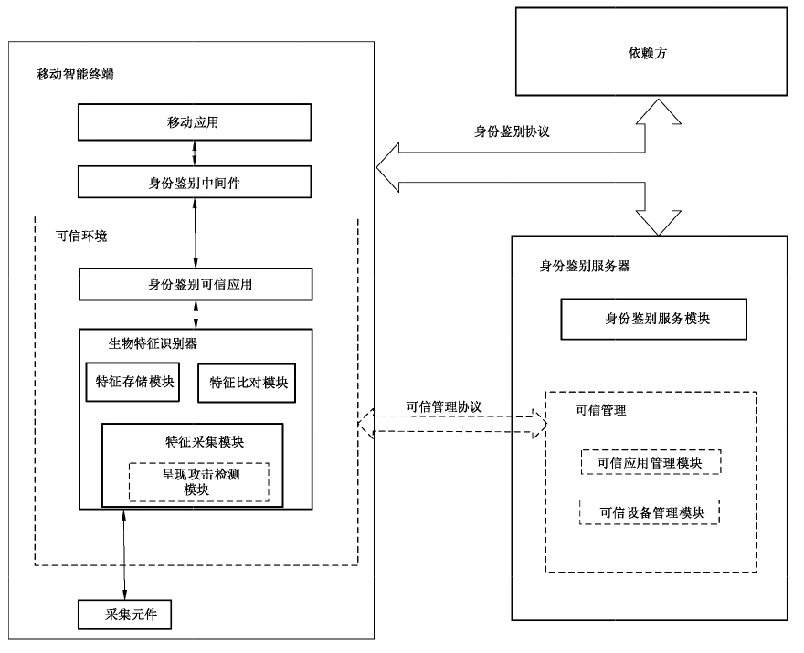

# GB/T 38542-2020 信息安全技术 基于生物特征识别的移动智能终端身份鉴别技术框架

> 来源：[GB/T 38542-2020 国家标准详情](https://openstd.samr.gov.cn/bzgk/std/newGbInfo?hcno=3F32CAE5C4585572F238222160FA6385)。
> 官方在线预览截图 SHA-256：d1a72579fde8259db6cb622a2ce29b2cebe026d520881b3faa20b204caf2d696。
> 发布日期：2020-03-06；实施日期：2020-10-01。依据官方在线预览的 18 页截图逐页核对，保留图 1。已去除封面、目录、分页和页眉页脚，正式引用请核对官方原文。

## 前言

本标准按照GB/T1.1—2009给出的规则起草。

请注意本文件的某些内容可能涉及专利。本文件的发布机构不承担识别这些专利的责任。

本标准由全国信息安全标准化技术委员会（SAC/TC 260）提出并归口。

本标准起草单位：浙江蚂蚁小微金融服务集团股份有限公司、中国科学院数据与通信保护研究教育中心、北京数字认证股份有限公司、中国电子技术标准化研究院、北京中科虹霸科技有限公司、北京旷视科技有限公司、中科天地科技有限公司、广州广电运通金融电子股份有限公司、华为技术有限公司、阿里巴巴（北京）软件服务有限公司、深圳市汇顶科技股份有限公司、国家信息中心、国民技术股份有限公司、北京邮电大学、深圳市腾讯计算机系统有限公司、普华诚信信息技术有限公司、中控智慧科技股份有限公司、紫光同芯微电子有限公司、三六零科技集团有限公司、中国信息通信研究院、公安部第一研究所、北京三星通信技术研究有限公司、高通无线通信技术（中国）有限公司。

本标准主要起草人：冯春培、落红卫、陈星、孙曦、刘丽敏、傅大鹏、许东阳、何召锋、吕盟、曹雷、刘梦涛、王思善、朱红儒、胡荣英、程浩、范琴、欧中洪、杨晓光、梁佐泉、陈书楷、丁义民、张屹、傅山、郑征、吴越、杜志敏。

## 引言

随着越来越多的移动智能终端支持生物特征识别功能，基于生物特征识别技术的用户身份鉴别方式广泛应用于客户端登录、交易确认等场景中。相较于传统的用户名和口令认证方式，生物特征识别技术实现了更为便捷和安全的身份鉴别应用。

移动智能终端功能和处理能力存在较大差异，给生物特征识别技术在移动智能终端的身份鉴别应用与产业链的形成带来了较为严重的碎片化问题。移动智能终端提供的生物特征识别解决方案在功能、接口、安全性的差异，对于需要兼顾不同移动智能终端平台的应用开发商而言，在实施身份鉴别方案时需要考虑兼容多套方案，一方面增加了应用复杂性，另一方面也不利于技术方案的升级，如：多模态生物特征识别技术应用等。

基于上述考虑，制定基于生物特征识别的移动智能终端身份鉴别标准，从技术框架、业务流程、功能和安全要求等方面进行规范，从而实现安全、便捷、统一的移动智能终端生物识别身份鉴别技术框架，实现降低集成成本、提高安全性和促进产业发展的目的。

## 1 范围

本标准规定了基于生物特征识别的移动智能终端身份鉴别的技术框架，包括技术架构、业务流程、功能要求和安全要求。

本标准适用于基于生物特征识别的移动智能终端身份鉴别系统的设计、开发与集成。

## 2 规范性引用文件

下列文件对于本文件的应用是必不可少的。凡是注日期的引用文件，仅注日期的版本适用于本文件。凡是不注日期的引用文件，其最新版本（包括所有的修改单）适用于本文件。

- GB/T 26238—2010 信息技术 生物特征识别术语

- GB/T 34975—2017 信息安全技术 移动智能终端应用软件安全技术要求和测试评价方法

- GB/T 34978—2017 信息安全技术 移动智能终端个人信息保护技术要求

- GB/T 35273—2017 信息安全技术 个人信息安全规范

- GB/T 35281—2017 信息安全技术 移动互联网应用服务器安全技术要求

- GB/T 36651—2018 信息安全技术 基于可信环境的生物特征识别身份鉴别协议框架

## 3 术语和定义、缩略语

### 3.1 术语和定义

GB/T 26238—2010界定的以及下列术语和定义适用于本文件。为了便于使用，以下重复列出了GB/T 26238—2010中的一些术语和定义。

#### 3.1.1 生物特征识别 biometrics

基于个体的行为特征和生物学特征，对该个体进行的自动识别。

> 注：“个体”限指人。

［GB/T 26238—2010，定义2.1.2］

#### 3.1.2 生物特征项 biometric feature

从生物特征样本中提取的，用于比对的数值或标记。

［GB/T 26238—2010，定义2.2.2.2.2.4］

#### 3.1.3 生物特征识别器 biometric matcher

基于个体的行为特征和生物学特征执行用户验证时使用的组件。

#### 3.1.4 生物特征样本 biometric sample

先于生物特征项提取，且从生物特征采集子系统获得的模拟的或数字的生物识别特征的表示。

［GB/T 26238—2010，定义2.2.2.2.2.10］

#### 3.1.5 生物特征模板 biometric template

参考的生物特征项的集合，已存储的生物特征项的集合，可直接与探针生物特征样本的生物特征项进行比对。

［GB/T 26238—2010，定义2.2.2.2.2.9.2］

#### 3.1.6 比对 comparison

估算、计算或测量生物特征探针与生物特征参考之间的相似度和相异度。

［GB/T 26238—2010，定义2.2.4.1.2］

#### 3.1.7 执行环境 execution environment

存在于移动设备中，能够为应用程序在移动设备中的运行提供必要的能力支持的软硬件集合。

> 注：一般包括硬件处理单元、易失性存储单元、非易失性存储单元、操作系统、调用接口等组件。

#### 3.1.8 身份鉴别 identity authentication

验证实体所声称的身份的动作。

#### 3.1.9 呈现攻击 presentation attack

以干扰生物特征识别系统的操作为目的，针对生物特征数据采集模块的一种攻击行为。

［ISO/IEC 30107-1:2016，定义3.5］

#### 3.1.10 依赖方 relying party

依赖于其他实体（例如身份鉴别服务器）提供的关于用户的鉴别结果，对用户所使用的资源或者系统进行授权的实体。

［GB/T 36651—2018，定义3.6］

#### 3.1.11 移动智能终端 smart mobile terminal

能够接入移动通信网，具有能够提供应用程序开发接口的开放操作系统，并能够安装和运行应用软件的移动终端。

#### 3.1.12 可信应用 trusted application

运行在可信环境下，为客户端软件或其他应用提供安全相关服务的软件。

#### 3.1.13 可信应用管理 trusted application management

提供应用发行管理和安全模块管理功能的系统。

#### 3.1.14 可信环境 trusted environment

用户设备上的安全区域，可保证加载到其内部数据的安全性，包括保密性、完整性和可用性等，如可信执行环境（TEE）、安全元件（SE）、可信密码模块（TCM）或其他具备安全边界的保护区域。

［GB/T 36651—2018，定义3.1］

### 3.2 缩略语

下列缩略语适用于本文件。

REE：富执行环境（Rich Execution Environment）

SDK：软件开发工具包（Software Development Kit）

SE：安全元件（Secure Element）

SSL：安全套接层（Secure Socket Layer）

TCM：可信密码模块（Trusted Cryptography Module）

TEE：可信执行环境（Trusted Execution Environment）

TLS：传输层安全（Transport Layer Security）

## 4 概述

本标准规范了基于生物特征识别的移动智能终端身份鉴别技术框架，并通过身份鉴别协议实现身份鉴别注册、身份鉴别和身份鉴别注销等业务流程。

通常用户先进行身份鉴别注册，在成功注册后，会为本次注册过程生成相应的用户鉴别密钥并与本次注册过程进行绑定。在对用户进行身份鉴别时，首先通过移动智能终端所支持的生物特征识别器对用户进行验证，只有在验证通过后才能够具备权限使用注册过程中生成并绑定的用户鉴别密钥，实现服务器端对用户的身份鉴别。在身份鉴别注销过程中，移动智能终端和服务器端将注册关系以及对应绑定的用户鉴别密钥删除。

本标准可为移动智能终端上基于生物特征识别技术的身份鉴别相关应用的设计、开发、使用提供统一的基础技术架构，以此技术框架为基准，为相关功能单元、接口、协议提出功能和安全的基本要求。基于该技术框架实现的指纹识别身份鉴别应用案例可参见附录 A。

本标准涉及个人信息保护的相关技术要求，应符合 GB/T 35273-2017 和 GB/T 34978—2017 的规定。

## 5 技术架构

### 5.1 总体架构

基于生物特征识别的移动智能终端身份鉴别技术框架主要包括移动智能终端和服务器侧的若干功能单元，总体技术架构如图1所示。

> 注：“——”必须具备的模块；“------”可选具备的模块。

移动智能终端侧一般包括移动应用、身份鉴别中间件、身份鉴别可信应用、生物特征识别器、采集元件等功能单元。对于有较高安全需求的应用，本标准所规范的技术框架基于可信环境实现，运行于移动智能终端的身份鉴别协议解析、用户生物特征采集、比对、存储与呈现攻击检测等均在可信环境中进行。

对于大多数移动智能终端而言，本标准中可信环境的具体实现方式可采用但不限于 TEE或TEE与 SE组合使用的方式。

服务器侧包括身份鉴别服务器和依赖方。身份鉴别服务器包括身份鉴别服务模块，可具备可信应用管理和可信设备管理等模块。

注1:TEE（可信执行环境）一般指运行在移动设备中的隔离执行环境，具备较强的安全能力，以确保运行其中的应用程序、敏感数据等在相对可信的环境中得到存储、处理和保护。

注2:SE（安全元件）一般指具有防篡改能力的微处理芯片，能够在其内部安全地运行应用程序并存储敏感数据。

### 5.2 移动智能终端侧功能单元

#### 5.2.1 移动应用

移动应用是移动智能终端中使用生物特征识别身份鉴别功能的应用软件。移动应用通常安装运行在REE 中。当需要基于生物特征识别进行用户身份鉴别时，通过身份鉴别中间件调用位于可信环境中的身份鉴别可信应用进而启动生物特征识别器实现对用户的生物特征识别，并基于身份鉴别协议与依赖方和身份鉴别服务器进行交互完成对用户的身份鉴别过程。

> 注：REE（富执行环境）一般指运行在移动设备中的开放执行环境，为运行其中的应用程序提供开放、丰富的运行能力支持，但安全保护能力相对较弱。

#### 5.2.2 身份鉴别中间件

身份鉴别中间件是位于底层系统资源和应用之间的独立的身份鉴别系统软件或服务程序，这些服务能够适用不同的操作系统和硬件平台，为移动应用提供身份鉴别服务的相关操作接口，并负责 REE中移动应用与可信环境中身份鉴别可信应用之间身份鉴别相关的通信。

身份鉴别中间件可以是集成在移动智能终端操作系统中的身份鉴别系统服务，也可是集成在移动应用中的专有SDK，或者是运行于移动智能终端中的独立应用软件。

#### 5.2.3 身份鉴别可信应用

身份鉴别可信应用负责身份鉴别协议的解析和处理，并负责管理其所支持的生物特征识别器，基于鉴别协议中所选择的生物特征识别器完成对用户的生物特征验证过程。

身份鉴别可信应用负责对身份鉴别相关的用户鉴别密钥的管理，包括用户鉴别密钥的生成、存储、使用和删除。

身份鉴别可信应用可通过预置方式在出厂前安装在移动智能终端中，也可通过远程动态下载方式安装在移动智能终端中。

#### 5.2.4 生物特征识别器

生物特征识别器是位于移动智能终端上的一个生物特征识别系统，能够基于生物特征识别技术对用户生物特征进行验证，一般由特征采集模块、特征存储模块和特征比对模块等构成，其中：

a） 特征采集模块通过生物特征采集元件采集用户的生物特征样本，并对符合采集质量要求的生物特征样本进一步提取出生物特征项，以用于后续的特征存储模块或特征比对模块；

b） 特征存储模块用于存储用户录入的生物特征模板；

c） 特征比对模块通过将所输入的用户生物特征探针与特征存储模块中已录入的一个或多个生物特征模板进行比对，并对比对结果进行识别决策，判断用户是否验证通过。

#### 5.2.5 采集元件

采集元件与生物特征识别器连接，可被生物特征识别器调用并对用户的生物特征样本进行采集。

### 5.3 服务器侧功能单元

#### 5.3.1 依赖方

依赖方主要负责提供移动应用的后台服务，基于身份鉴别协议与移动应用和身份鉴别服务器进行交互，完成身份鉴别的各个业务流程。

在身份鉴别过程中，依赖方从身份鉴别服务器获得用户的身份鉴别结果，并根据鉴别结果提供相应权限的服务或资源。

#### 5.3.2 身份鉴别服务器

##### 5.3.2.1 概述

身份鉴别服务器包括身份鉴别服务模块和可信管理模块。其中，身份鉴别服务模块是必选模块，主要负责在服务器侧对身份鉴别注册关系进行管理，对身份鉴别协议进行解析并验证，并向依赖方提供身份鉴别结果。可信管理模块主要负责对移动智能终端和身份鉴别可信应用进行可信管理。

##### 5.3.2.2 身份鉴别服务模块

身份鉴别服务模块主要负责：

a） 在身份鉴别注册业务流程中，校验注册过程中所使用生物特征识别器的真实性和完整性，创建和存储用户新申请的身份鉴别注册关系，存储注册过程中生成的用户鉴别密钥并与注册关系进行绑定；

b） 在身份鉴别业务流程中，校验鉴别过程中所使用生物特征识别器的真实性和完整性，识别此次业务中所使用的身份鉴别注册关系，并使用绑定的用户鉴别密钥对身份鉴别协议中的信息进行验证；

c） 在身份鉴别注销业务流程中，删除相应的身份鉴别注册关系以及绑定的用户鉴别密钥；

d） 将身份鉴别结果通过可信的方式传递给依赖方。

##### 5.3.2.3 可信管理

可信管理可选功能模块，主要包括：

a） 可信应用管理模块，负责对身份鉴别可信应用的生命周期管理，包括下载、安装、更新以及删除等操作。如在移动智能终端侧使用了安全元件，也负责对安全元件中的可信应用的生命周期进行管理。

b） 可信设备管理模块，负责对移动智能终端可信设备列表进行管理。

## 6 业务流程

基于生物特征识别的移动智能终端身份鉴别一般包括：注册、鉴别和注销三个业务流程，应符合GB/T 36651—2018关于业务流程的规定。

## 7 通信协议

### 7.1 身份鉴别协议

身份鉴别协议应符合 GB/T36651—2018中第7章和附录C关于协议接口的规定与描述。

### 7.2 可信管理协议

服务器侧可通过可信管理协议对智能终端侧的可信应用、可信设备进行生命周期管理，包括对可信应用的安装、卸载、更新等管理操作。本标准中不具体规定可信管理协议。

在进行管理操作之前，应对通信双方进行身份鉴别，并建立安全信道。

## 8 功能要求

### 8.1 移动智能终端侧功能单元

#### 8.1.1 移动应用

移动应用要求如下：

a） 应能基于身份鉴别协议与依赖方进行交互，实现身份鉴别注册、身份鉴别、身份鉴别注销等业务流程；

b） 应能通过调用身份鉴别中间件与身份鉴别可信应用进行交互，实现身份鉴别注册、身份鉴别、身份鉴别注销等业务流程；

c） 应能对用户身份进行唯一性标识，一个用户可对应多个身份鉴别注册关系，一个身份鉴别注册关系应只对应于一个用户；

d） 宜设置生物特征识别身份鉴别失败尝试次数限制，在失败次数超出限制后，应限制用户继续尝试或者引导用户使用其他方式进行身份鉴别。

#### 8.1.2 身份鉴别中间件

身份鉴别中间件提供的功能接口要求如下：

a） 宜支持获取身份鉴别可信应用版本号；

b）宜支持获取可被身份鉴别可信应用支持的生物特征识别器信息，如生物特征识别器的实现模式（指纹、虹膜、人脸等）、版本号等；

c） 应支持身份鉴别注册、身份鉴别以及身份鉴别注销操作接口等；

d） 宜支持获取移动智能终端的设备唯一性标识；

e） 可对移动应用的调用权限进行校验，如采用与身份鉴别服务器直接进行信息交互的方式实现。

#### 8.1.3 身份鉴别可信应用

身份鉴别可信应用要求如下：

a） 宜能向身份鉴别中间件提供身份鉴别可信应用版本号；

b） 应能对身份鉴别协议进行解析并验证其真实性和完整性，实现身份鉴别注册、身份鉴别以及身份鉴别注销等业务流程；

c） 应能支持在移动智能终端侧对身份鉴别注册关系进行管理，包括对与注册关系相绑定的用户鉴别密钥的管理，如生成、存储、使用和删除等；

d） 宜建立生物特征识别器验证过程与用户身份鉴别注册关系之间的对应关系，如通过生物特征模板摘要值进行关联等；

e） 应能对所支持的位于移动智能终端中的生物特征识别器进行管理，包括获取生物特征识别器信息，调用生物特征识别器对用户身份进行验证并获得验证结果等；

f） 应具备对用户鉴别密钥的使用控制，只有当从生物特征识别器获得的验证结果指示用户身份验证通过后才能使用用户鉴别密钥；

g） 宜对所在的移动智能终端进行设备唯一性标识，用于服务器侧的可信设备管理。

#### 8.1.4 生物特征识别器

生物特征识别器功能要求如下：

a） 应提供型号及版本信息，且具有唯一标识。

b）宜具备对呈现攻击检测和防范的能力。

c） 特征采集模块：

1） 应支持使用采集元件采集用户生物特征样本，并将其转化成适合生物特征识别处理的数据格式；

2） 应具有明确的用户提示，告知用户对其生物特征样本进行了采集，若采集过程分为多次进行，宜向用户明示每一次采集的进度；

3） 应支持对采集的用户生物特征样本进行质量判断，并从通过质量判断的用户生物特征样本中提取用户生物特征项，用于后续的生物特征存储或生物特征比对；

4） 宜采用不可逆的方式从用户生物特征样本中提取出生物特征项。

d） 特征存储模块：

1） 同一用户在同一生物特征存储模块中应只对应唯一的身份标识；不能使用相同的用户身份标识去标识两个或以上不同用户；应能够把登记的用户生物特征模板与该用户的身份标识进行关联；

2） 应只允许具有合法权限的实体录入、访问、读取或删除生物特征存储模块中的用户生物特征数据；

3） 宜支持同一用户在生物特征存储模块中登记两个或多个生物特征模板；

4） 应具备异常情况判定及处理能力，如生物特征模板登记、读取或删除失败时应具有相应处理机制。

e） 特征比对模块：

1） 应能够将输入的用户生物特征探针和已在生物特征存储模块中登记的生物特征模板进行比对，计算出比对得分，根据比对得分进行识别结果判定，并能够输出识别结果；

2） 应具备异常情况判定及处理功能，包括但不限于比对失败、识别决策失败时的相应处理机制。

### 8.2 服务器侧功能单元

#### 8.2.1 依赖方

依赖方要求如下：

a） 应能基于身份鉴别协议与移动应用进行交互，实现身份鉴别注册、身份鉴别、身份鉴别注销等业务流程；

b） 应能基于身份鉴别协议与身份鉴别服务器进行交互，实现身份鉴别注册、身份鉴别、身份鉴别注销等业务流程；

c） 应能根据身份鉴别结果授权用户访问服务器相应的服务或资源。

#### 8.2.2 身份鉴别服务器

身份鉴别服务器要求如下：

a） 应能基于身份鉴别协议与依赖方进行交互，对身份鉴别协议进行解析并验证，实现身份鉴别注册、身份鉴别、身份鉴别注销等业务流程；

b） 应能够在服务器侧对身份鉴别注册关系进行管理，包括生成、维护和删除等；

c） 宜在服务器侧校验生物特征识别器验证过程与用户身份鉴别注册关系之间的对应关系，如通过生物特征模板摘要值等方式；

d） 宜具备可信应用管理和可信设备管理能力。

## 9 安全要求

### 9.1 移动智能终端侧安全要求

#### 9.1.1 移动应用

移动应用要求如下：

a） 应符合 GB/T 34975—2017 中第4章所规定的安全要求；

b） 应采取有效的技术手段，确认与其通信的依赖方或身份鉴别服务器的真实性。

#### 9.1.2 可信环境

可信环境应具备安全边界，在环境内部应提供技术手段，对位于可信环境中的代码和数据的安全性提供保证，如保密性、完整性和可用性等。可信环境安全相关的说明可参见附录 B。

#### 9.1.3 身份鉴别可信应用

应采取有效的技术手段，确保身份鉴别可信应用的生命周期管理如下载、安装、更新、卸载等的安全可控。身份鉴别可信应用安全要求如下：

a） 可采取有效的技术手段，对生物特征识别器的真实性和完整性进行校验；

b） 应具备访问控制机制，确保只有具备访问权限的移动应用才能通过身份鉴别中间件对身份鉴别可信应用进行访问调用；

c） 宜支持对生物特征识别器的真实性和完整性进行校验；

d） 在完成身份鉴别业务流程后，身份鉴别可信应用应及时清除内存中的临时数据；

e） 应采取有效的技术手段，确保身份鉴别注册流程中生成的用户鉴别密钥的随机性，并应采取有效的技术手段，确保对生成的用户鉴别密钥的安全存储和使用。

#### 9.1.4 生物特征识别器

应具备有效的技术手段对生物特征识别器的真实性、完整性进行校验。生物特征识别器安全要求如下：

a） 特征采集模块：

1） 应具备有效的安全机制，确保生物特征样本采集、质量判断、呈现攻击检测、生物特征项提取和传输过程中的用户生物特征数据的机密性和完整性；

2） 应及时清除未通过质量判断的用户生物特征样本，并确保其不可恢复；

3） 生物特征项提取结束后应及时清除用户的生物特征样本，并确保其不可恢复；

4） 宜结合移动智能终端所具有的可信执行环境或安全元件实现上述安全机制。

b） 特征存储模块：

1） 应具有有效的安全机制，确保已登记用户生物特征模板与该用户标识之间的正确关联关系，防止被非法修改与获取；

2） 应具备有效的安全机制，确保在对生物特征存储模块中用户生物特征数据进行操作时，如存储和传输时，用户生物特征数据的机密性和完整性，并在操作完成后对操作过程中的临时数据（如存储或传输过程中，留存在设备动态内存中的与生物特征样本等数据），进行及时清除并确保不可恢复；

3） 宜采用加密方式对用户生物特征模板数据进行存储；

4） 对于已删除的用户生物特征模板数据，应及时进行清除并确保不可恢复；

5）宜结合移动设备所具有的可信执行环境或安全元件实现上述安全机制。

c） 特征比对模块：

1） 应具备有效的安全机制，确保在进行生物特征比对操作时，生物特征模板读取的准确性；

2） 生物特征数据不被窃取或篡改；

3） 相似度计算结果不被窃取或篡改；

4） 识别决策结果不被窃取或篡改；

5） 比对结束后，应及时清除用户生物特征数据和比对过程中所产生的其他临时数据（如比对得分等）应设定比对失败尝试次数限制，比对失败次数超出限制后，应采取相应的失败处理机制；

6） 应采取有效的安全机制，确保识别结果输出时的完整性，不被非法篡改。

### 9.2 服务器侧安全要求

#### 9.2.1 依赖方

依赖方安全要求如下：

a） 应符合 GB/T 35281—2017中第6章和第7章所规定的安全要求；

b） 应采取有效的安全机制，校验身份鉴别服务器返回的身份鉴别结果的完整性和真实性，并应通过校验鉴别协议报文中的动态信息如随机数等来防止重放攻击。

#### 9.2.2 身份鉴别服务器

身份鉴别服务器安全要求如下：

a） 应符合GB/T 35281—2017中第6章、第7章和第10 章所规定的安全要求；

b） 应采取有效的安全机制，确保与其通信的依赖方身份的真实性；

c） 应采取有效的技术手段，校验身份鉴别业务流程中所使用的生物特征识别器的真实性和完整性；

d） 应通过校验鉴别协议报文中的动态信息如随机数等来防止身份鉴别业务流程中的重放攻击。

### 9.3 通信安全要求

模块间通信安全要求如下：

a） 应能采用有效的技术手段，确保移动应用与依赖方之间通信双方身份真实性、通信数据的机密性、完整性，包括但不限于采取密码算法和安全协议（如 SSL/TLS 等）；

b） 应能采用有效的技术手段，确保依赖方与身份鉴别服务器之间通信双方身份真实性、通信数据的保密性、完整性，包括但不限于采取密码算法和安全协议（如 SSL/TLS等）；

c） 应能采用有效的技术手段，确保移动应用与身份鉴别可信应用之间通信双方身份真实性、通信数据的完整性；

d） 应能采用有效的技术手段，确保身份鉴别可信应用与生物特征识别器之间通信数据的机密性和完整性。

### 9.4 身份鉴别协议安全要求

身份鉴别协议安全要求如下：

a） 身份鉴别协议中应包含动态信息如挑战码、随机数等用以防止重放攻击；

b） 身份鉴别注册业务中生成的用户鉴别密钥，宜采用非对称密码算法实现。

## 附录 A（资料性附录）基于指纹识别的身份鉴别应用

在实际应用中，基于指纹识别的身份鉴别应用主要可分为注册、鉴别和注销三个流程。

注册流程一般为：

a） 用户在智能终端通过移动应用向移动应用服务器发起指纹身份鉴别注册请求；

b） 移动应用服务器判断是否允许此次指纹身份鉴别注册请求，如允许，向身份鉴别服务器转发身份鉴别注册请求；

c） 身份鉴别服务器判断是否允许此次指纹身份鉴别注册请求，如允许，返回指纹身份鉴别注册请求响应，并经移动应用服务器返回给移动应用；

d） 移动应用通过调用身份鉴别中间件将注册请求响应发送至身份鉴别可信应用中进行处理；

e） 身份鉴别可信应用对身份鉴别注册请求响应进行处理，在用户智能终端本地随机生成与此身份鉴别相关联的用户鉴别非对称密钥对，并调用指纹识别器对用户进行验证；用户验证通过后，将用户鉴别密钥公钥与绑定的用户指纹模板标识等信息进行安全保护处理后返回给移动应用；

f） 移动应用将信息经移动应用服务器转发至身份鉴别服务器进行验证；

g） 身份鉴别服务器对信息进行验证，验证通过后在身份鉴别服务器端保存注册关系以及对应的用户鉴别密钥公钥、用户指纹模板标识等，并返回指纹身份鉴别注册结果至移动应用服务器；

h） 移动应用服务器将指纹身份鉴别注册结果返回至移动应用；

i） 结束指纹身份鉴别注册流程。

鉴别流程一般为：

a） 用户在智能终端侧通过移动应用向移动应用服务器发起指纹身份鉴别请求；

b） 移动应用服务器识别出对应的指纹身份鉴别注册关系并判断是否继续此次身份鉴别请求，如继续，向身份鉴别服务器端转发身份鉴别请求；

c） 身份鉴别服务器识别出对应的身份鉴别注册关系并判断是否继续此次身份鉴别请求，如继续，返回身份鉴别请求响应，并经移动应用服务器返回给移动应用；

d） 移动应用通过调用身份鉴别中间件将指纹身份鉴别请求响应发送至身份鉴别可信应用进行处理；

e） 身份鉴别可信应用对指纹身份鉴别请求响应进行处理，识别出对应的身份鉴别注册关系，并调用指纹识别认证器基于此前绑定的指纹模板标识对用户进行指纹验证；

f） 如果用户通过指纹验证，身份鉴别可信应用使用与该身份鉴别注册关系相关联的用户鉴别密钥私钥对包含用户指纹模板标识信息在内的鉴别数据进行处理后返回给移动应用；

g） 移动应用将鉴别数据经移动应用服务器转发至身份鉴别服务器进行验证；

h） 身份鉴别服务器使用已保存的与该身份鉴别注册关系相关联的用户鉴别密钥公钥对鉴别数据签名进行验证。验证结束后返回身份鉴别结果至移动应用服务器；

i） 移动应用服务器将身份鉴别结果返回至移动应用；

j） 结束身份鉴别流程。

注销流程一般为：

a） 用户在智能终端通过移动应用向移动应用服务器发起指纹身份鉴别注销请求；

b）移动应用服务器判断是否允许此次指纹身份鉴别注销请求，如允许，向身份鉴别服务器转发身份鉴别注销请求；

c） 身份鉴别服务器判断是否允许此次指纹身份鉴别注销请求，如允许，在服务器端删除该身份鉴别注册关系以及相关联的用户鉴别密钥和其他注册信息等，并返回指纹身份鉴别注销请求响应，并经移动应用服务器返回给移动应用；

d） 移动应用通过调用身份鉴别中间件将身份鉴别注销请求响应发送至身份鉴别可信应用中进行处理；

e） 身份鉴别可信应用识别出对应的身份鉴别注册关系，在智能终端中删除该身份鉴别注册关系以及相关联的用户鉴别密钥和其他注册信息等，并将处理结果返回给移动应用；

f） 结束指纹身份鉴别注销流程。

## 附录 B（资料性附录）可信环境安全说明

在本标准中，可信环境一般指用户设备上的安全区域，可保证加载到其内部数据的安全性，包括保密性、完整性和可用性等，常见的可信环境包括可信执行环境（TEE）、安全元件（SE）、可信密码模块（TCM）或其他具备安全边界的保护区域。目前在移动智能终端，TEE、SE 的应用较多。

一般来说，运行在移动智能终端中的开放执行环境被称为富执行环境（REE），富执行环境为运行其中的应用程序提供开放、丰富的运行能力支持，但安全保护能力相对较弱。可信执行环境（TEE）是指运行在移动智能终端中的隔离执行环境，相对于富执行环境，具备较强的安全能力。可信执行环境保证各种敏感数据在一个可信环境中被安全传输、存储、处理，并为可信应用提供一个安全的执行环境。确保移动智能终端中数据的机密性、完整性、可用性和访问权限；为人机交互、口令输入、生物特征交互、信息的输出提供安全的环境。

可信执行环境（TEE）通常可提供如下安全功能：

a） 从可信代码开始进行安全启动，通过签名校验等方法保证信任链的传递以确保TEE 启动过程的完整性；

b） 通过硬件的隔离和系统的控制，保护高安全性数据的存储安全，如用户生物特征数据、用户鉴别密钥、身份鉴别可信应用数据和代码安全等；

c） 通过加密、隔离、认证等方式，对移动智能终端内不同实体间的通信信道、终端同外界的通信通道的数据传输进行安全性保护；

d） 通过访问权限的设置等方式保证功能和数据不被非法访问或者不恰当的访问；

e） 通过软硬件结合的安全措施保证终端的安全配置不被更改并具备相应的提示机制；

f） 通过对固件、密钥、永久数据等数据的保护策略保证TEE自身的安全性，为运行在其上的可信应用提供安全保护；

g） 通过生命周期管理、访问验证等措施保证对运行在其上的可信应用进行安全管理；

h）采集元件可通过TEE 中具有访问权限的可信应用进行调用，调用过程中可保证独占性。

安全元件（SE）通常提供一个安全的数据存储和运算环境，可用于存储密钥、用户生物特征数据等敏感信息，安全元件一般符合 GB/T 22186—2016中第8章所规定的安全要求，具备应用访问控制机制，确保只有具备访问权限的外部实体才能够访问安全元件中的相应应用。

## 参考文献

- ［1］ GB/T 22186—2016 信息安全技术 具有中央处理器的IC卡芯片安全技术要求

- ［2］ ISO/IEC 2382-37:2012 Information technology—Vocabulary—Part 37:Biometrics

- ［3］ ISO/IEC 30107-1:2016 Information technology—Biometric presentation attack detection—Part 1:Framework

- ［4］ ISO/IEC DIS 30124 Code of practice for the implementation of a biometric system

- ［5］ ISO/IEC TR 30125:2016 Information technology—Biometrics—Biometrics used with mobile devices
