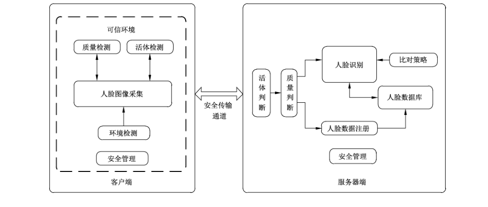

# GB/T 38671-2020 信息安全技术 远程人脸识别系统技术要求

> 来源：[GB/T 38671-2020 国家标准详情](https://openstd.samr.gov.cn/bzgk/std/newGbInfo?hcno=C84D5EA6AC99608C8B9EE8522050B094)；封面发布日期：2020-04-28；实施日期：2020-11-01。
> PDF SHA-256：2c6498201ce38d624aa6c8adf17534a548a07db232472f18fc74e5d975375fff。
> 转写说明：依据官方 PDF 全部 28 页的页面图像核对；省略封面、目录、页眉、页脚和页码，合并跨页段落并重建表格。正式引用请核对原 PDF。

## 前言

本标准按照 GB/T 1.1—2009给出的规则起草。

请注意本文件的某些内容可能涉及专利。本文件的发布机构不承担识别这些专利的责任。

本标准由全国信息安全标准化技术委员会（SAC/TC 260）提出并归口。

本标准起草单位：公安部第一研究所、北京数字认证股份有限公司、浙江蚂蚁小微金融服务集团股份有限公司、北京旷视科技有限公司、重庆中科云从科技有限公司、中国信息安全测评中心、中国金融认证中心、中国电子技术标准化研究院、四川远鉴科技有限公司、深圳市亚略特生物识别科技有限公司、深圳市腾讯计算机系统有限公司、广州广电运通金融电子股份有限公司、中科天地科技有限公司。

本标准主要起草人：郑征、刘军、胡志昂、张翔、李敏、陈星、吕盟、李军、王宇航、李哲、王学华、刘琳、卢玉华、许玉娜、郝春亮、沈思成、王玉坚、汤海鹏、刘梦涛、张默男。

## 1 范围

本标准规定了采用人脸识别技术在服务器端远程进行身份鉴别的信息系统的功能、性能和安全要求、安全保障要求。

本标准适用于采用人脸识别技术在服务器端远程进行身份鉴别的信息系统的研制和测试，系统的管理可参照使用。

## 2 规范性引用文件

下列文件对于本文件的应用是必不可少的。凡是注日期的引用文件，仅注日期的版本适用于本文件。凡是不注日期的引用文件，其最新版本（包括所有的修改单）适用于本文件。

- GB/T 18336.3—2015 信息技术 安全技术 信息技术安全评估准则 第3部分：安全保障组件

- GB/T 20271—2006 信息安全技术 信息系统通用安全技术要求

- GB/T 26238—2010 信息技术 生物特征识别术语

- GB/T 29268.1—2012 信息技术 生物特征识别性能测试和报告 第1 部分：原则与框架

- GB/T 36651—2018 信息安全技术 基于可信环境的生物特征识别身份鉴别协议框架

## 3 术语、定义和缩略语

### 3.1 术语和定义

GB/T 20271—2006、GB/T 26238—2010、GB/T 29268.1—2012 和 GB/T 36651—2018 界定的以及下列术语和定义适用于本文件。

#### 3.1.1 生物特征识别 biometrics;biometric recognition

基于个体的行为特征和生物学特征，对个体进行的识别。

> 注：“个体”限指人。

#### 3.1.2 人脸识别 face recognition

以人面部特征作为识别个体身份的一种个体生物特征识别方法。其通过分析提取用户人脸图像数字特征产生样本特征序列，并将该样本特征序列与已存储的模板特征序列进行比对，用以识别用户身份。

> 注：从应用方式不同，人脸识别可分为人脸验证和人脸辨识。

#### 3.1.3 活体人脸 live face

有生命的真实人脸。

#### 3.1.4 人脸验证 face verification

人脸识别应用之一，将所产生的样本特征序列与按用户标识信息所给定的已存储的用户的模板特征序列进行比对（1:1比对），以确认用户是否为所声明的身份。

#### 3.1.5 人脸辨识 face identification

人脸识别应用之一，将所产生的样本特征序列与已存储的指定范围内的所有模板特征序列进行比对（1：N比对），确定用户身份。

#### 3.1.6 特征序列 characteristic sequence

由人脸图像数字特征组成的数据序列。

> 注：特征序列包括模板特征序列和样本特征序列。

#### 3.1.7 模板特征序列 template characteristic sequence

对采集到的用户登记人脸图像进行分析提取所生成的特征序列。

> 注：产生模板特征序列的目的是用于用户登记。

#### 3.1.8 样本特征序列 sample characteristic sequence

对采集到的用户人脸图像进行分析提取所生成的特征序列。

> 注：产生样本特征序列的目的是用于用户识别。

#### 3.1.9 相似度 similarity

两个生物特性相似程度的一个实数；数值越大两个生物特性越相似。

#### 3.1.10 阈值 threshold

做出判定所依据的边界值（或值集）。

#### 3.1.11 错误接受率 false accept rate

人脸验证过程中，将冒充者识别为已注册个体的比率，用百分比表示。

> 注：错误接受率也被称作认假率。

#### 3.1.12 错误拒绝率 false reject rate

人脸验证过程中，将真实人错误拒绝的比率，用百分比表示。

> 注：错误拒绝率也被称作拒真率。

### 3.2 缩略语

下列缩略语适用于本文件。

CG：计算机动画（Computer Graphics）

EAL：评估保障级（Evaluation Assurance Level）

FAR：错误接受率（False Accept Rate）

FRR：错误拒绝率（False Reject Rate）

SE：安全单元（Secure Element）

TEE：可信应用执行环境（Trusted Execution Environment）

TCM：可信密码模块（Trusted Cryptography Module）

UID：用户标识（User Identification）

## 4 概述

### 4.1 系统参考模型

远程人脸识别系统由客户端、服务器端、安全传输通道组成。系统由客户端实现人脸的采集，经安全传输通道传输，在服务器端远程进行比对。

客户端由环境检测、人脸图像采集、活体检测、质量检测、安全管理等模块组成，模块通常在可信环境中执行。可信环境指用户设备上的安全区域，可保证加载到其内部数据的安全性，包括保密性、完整性和可用性等，如TEE、SE、TCM或其他具备安全边界的保护区域。本标准不规定可信环境的具体实现方式。

服务器端由活体判断、质量判断、人脸数据注册、人脸数据库、人脸识别、比对策略、安全管理等模块组成。

系统参考模型如图1所示。

### 4.2 客户端说明

#### 4.2.1 环境检测

对人脸采集的环境条件进行检测，判断人脸特征采集所处的环境是否满足采集要求，从而决定是否启动人脸采集。

#### 4.2.2 人脸图像采集

对输入的图片或者视频等样本数据进行分析处理，提取满足质量条件的人脸图像，以便进行人脸特征提取和比对。

#### 4.2.3 活体检测

对采集主体是否为活体人脸、是否受到假体人脸攻击进行检测和判断。条件允许时，可在客户端判断人脸比对对象是否为真实有效的人脸。活体检测不通过则不进行下一步处理。

#### 4.2.4 质量检测

对人脸图像的质量进行判断。该模块经常和人脸检测与采集模块在一起，输出质量最佳的人脸图片进行后续的特征建模与比对。人脸质量检测不通过则不进行下一步处理。

#### 4.2.5 安全管理

对客户端密码、配置参数、用户数据等敏感数据等进行安全管理。

### 4.3 服务器端说明

#### 4.3.1 活体判断

对客户端活体人脸检测过程中采集的信息进行二次判断，结合客户端检测结果，完成最终活体判断。

#### 4.3.2 质量判断

对上传到服务器端的生物特征信息的质量进行判断。

#### 4.3.3 人脸数据库

对人脸数据进行生命周期管理，数据内容包括人脸特征模板、人脸辅助信息、用户属性数据、人脸比对数据等。人脸特征模板主要用来存储人脸的特定信息，以便计算机能够快速、准确的进行生物特征比对。辅助信息主要用于活体检测或多模态检测。用户属性数据主要用于用户检索，包括用户标识UID、姓名等。

#### 4.3.4 人脸数据注册

通过客户端采集、服务端批量导入实现人脸数据注册。

通过人脸模板登记过程，实现用户原始人脸图像或用户特征数据（必要时脱敏或加密的数据）与用户标识之间绑定关系的建立。

#### 4.3.5 人脸识别

##### 4.3.5.1 人脸验证

将样本特征序列与注册的模板特征序列进行比对，确定两张人脸是否为同一个人。

##### 4.3.5.2 人脸辨识

将样本特征序列与一定范围内的已登记模板特征序列进行比对，根据比对得分进行排序，找出最为相似的已登记模板特征序列，从而确认用户身份。

#### 4.3.6 比对策略

基于用户信息、客户端信息等不同条件，设置不同环境下的比对策略。

#### 4.3.7 安全管理

服务器端密码管理、安全审计、授权访问等安全管理功能。

### 4.4 安全传输通道

客户端与服务器端应建立数据传输通道的安全策略和规程，通过安全控制措施实现数据传输安全。

## 5 安全分级

远程人脸识别系统的功能、性能和安全要求分为基本级和增强级，黑体字为增强级相对于基本级新增的要求，基本级和增强级的简要对应关系参见附录 A，系统安全描述参见附录 B。本标准凡涉及密码算法的相关内容，按国家有关法规实施；凡涉及采用密码技术解决机密性、完整性、真实性、不可否认性需求的须遵循密码相关国家标准和行业标准。

## 6 功能要求

### 6.1 基本级要求

#### 6.1.1 用户标识

应从以下方面设计和实现系统的身份标识功能：

a） 所有用户在用户登记时都进行用户标识；

b） 应具唯一性；

c） 应对用户标识信息进行管理、维护，确保其不被非授权地访问、修改或删除。

#### 6.1.2 人脸图像采集与处理

人脸图像采集与处理应具有以下功能：

a） 应防止人脸数据采集过程中个人信息等数据被泄露；

b） 宜对采集到的数据进行完整性、一致性校验；

c） 宜跟踪和记录数据采集过程，支持人脸采集数据的可追溯性；

d） 宜确保采集数据的真实性；

e） 采集后应清除残留信息。

#### 6.1.3 人脸图像质量判断

客户端和服务器端均应具备人脸采集样本质量判断的能力，质量判断应至少包括以下几个方面：

a） 人脸图片的模糊程度；

b） 人脸图片的明暗程度；

c） 人脸图片的人脸角度；

d） 人脸图片的完整程度。

#### 6.1.4 活体检测

##### 6.1.4.1 主动配合式活体检测

应支持根据检测主体的主动式反应进行活体人脸检测，通过指令要求用户进行相关动作并判断人脸的真实有效性，指令包括但不限于以下方式：

a） 点头、抬头、左右转头、张嘴、眨眼等；

b） 唇语、说指定的数字或者文字等。

##### 6.1.4.2 被动无交互式活体检测

应支持检测主体无需主动配合动作模式下的活体人脸检测，包括但不限于以下方式：

a） 可见光下根据主体的脸部细节微小变化判断是否活体；

b） 根据检测主体接收特定波段光源照射后产生的反馈，进而判断是否为活体。

示例1：采用近红外光源照射人脸，通过采集人脸在近红外光源下的图像视频进行人脸肤质材料的分析，从而判定是否为活体。

示例2：采用多摄像头、深度传感器等传感器设备，通过采集人脸的三维立体信息进行动态立体重建、动态变焦等三维分析，从而判定是否为活体。

#### 6.1.5 人脸数据注册管理

##### 6.1.5.1 人脸数据注册

注册方式包括现场注册、远程注册两种方式。

若用户使用客户端设备进行注册时，注册过程应在可信环境中进行。

##### 6.1.5.2 人脸数据注销

人脸数据注销应满足以下要求：

a） 注销参与者是有关闭意愿的用户本人。

b） 在注销前对授权注销者进行身份验证。

c） 注销后，存储器中的人脸数据应销毁，不可重复使用，下次使用需重新采集。

##### 6.1.5.3 人脸数据注册加载

人脸数据注册过程中批量加载人脸数据时，本项功能应：

a） 建立不同数据源、不同安全域之间采集数据加载安全策略、加载方式和访问控制机制；

b） 确保人脸数据加载过程中的数据正确性和一致性；

c） 确保人脸数据加载过程中数据的安全保护；

d） 记录并保存人脸数据加载过程中人脸等个人信息数据的处理过程。

#### 6.1.6 用户鉴别

##### 6.1.6.1 鉴别时机

应在人脸识别系统安全功能实施所要求的动作之前，先对提出该动作要求的用户进行鉴别，未通过鉴别者不予执行。

##### 6.1.6.2 人脸验证

若提供人脸验证功能，则应具有以下功能：

a） 进行人脸验证时，应给出 UID；

b） 根据所给用户身份标识信息，检索出该用户的人脸模板；

c） 执行数据包验证功能，检验用户人脸模板的完整性；

d） 将实时采集并生成的人脸样本特征与所检索出的该用户的人脸模板进行比对，产生用于用户验证的比对相似度值；

e） 根据比对阈值输出人脸识别判定；

f） 人脸验证后应清除残留信息。

##### 6.1.6.3 人脸辨识

若提供人脸辨识功能，则应具有以下功能：

a） 将实时采集的并生成的人脸样本特征与已存贮的人脸模板逐一进行比对，产生用于人脸辨识的比对相似度值；

b） 根据比对阈值输出人脸识别判定；

c） 人脸辨识后应清除残留信息。

##### 6.1.6.4 一次性鉴别机制

应防止与人脸识别身份鉴别有关的鉴别数据的重用。

##### 6.1.6.5 防伪造

系统应检测并防止由任何用户伪造的鉴别数据的使用，包括但不限于：

a） 防复制伪造：应能检测或防止对当前用户识别数据的复制和非授权保存；

b） 防照片伪造：应能检测或防止使用照片伪造识别图像（静态攻击：打印的普通人脸照片、纸质高清人脸照片、手机屏幕重放的人脸照片攻击）；

c） 纸质面具伪造：应能检测或防止使用绝大多数人脸纸质面具的仿冒行为；

d） 上述攻击或非授权操作事件时应取消服务，并产生报警。

##### 6.1.6.6 决策反馈保护

人脸识别决策反馈保护应满足以下要求：

a） 根据人脸识别决策策略，返回人脸识别比对结果，并保护反馈结果的完整性；

b） 识别过程中，应避免提供给用户的反馈信息泄露用户的人脸特征信息数据；

c） 应只返回是否通过，不能反馈识别分数，防止爬山攻击。

##### 6.1.6.7 秘密的规范

应能提供机制以验证所提取的人脸特征模板是否满足相应的质量度量。

当用来对用户身份鉴别的人脸特征模板等秘密信息由人脸识别系统产生时，系统应可生成符合秘密信息质量要求的秘密信息。秘密信息质量包括模板大小等。秘密信息质量量度的要求由安全管理员制定。

##### 6.1.6.8 鉴别失败

###### 6.1.6.8.1 基本要求

通过对不成功的鉴别尝试的值（包括尝试次数和时间的阈值）进行预先定义，并明确规定达到该值时应采取的措施来实现鉴别失败的处理。

###### 6.1.6.8.2 失败判定

系统在识别过程中，当出现以下情形时，判断为识别失败：

a） 设备故障：人脸采集器故障，不能成功捕捉图像；

b） 像质障碍：捕捉的人脸图像质量不适于生成人脸模板或生成人脸样本；

c） 超时断开：终端操作超时断开；

d） 数据库故障：人脸数据库故障且在规定尝试次数内未能消除；

e） 尝试超次：对人脸验证与人脸辨识，应分别设定警告次数阈值，连续警告次数大于该阈值时视作失败。

###### 6.1.6.8.3 失败处理

人脸识别失败的处理应符合以下要求：

a） 制定识别失败返回值表；

b） 在出现识别失败情况时，返回对应的错误代码或错误值；

c） 针对识别失败记录事件日志；

d） 制定明确的识别失败处理策略，进行警告与报警；

e） 针对不同识别失败原因进行相应处理。

##### 6.1.6.9 警告与报警

系统的警告与报警应满足以下要求：

a） 进行人脸验证时，如用户不是所给身份标识信息或其他用户身份信息的持有者，或用户已被删除，或在进行人脸辨识时，已存贮的人脸模板中无用户的候选者，应给出警告信息；

b） 检测出伪造识别图像、识别数据，或复制、非授权保存图像、数据，或非活体人脸，或非授权数据库操作时应给出报警信息。

### 6.2 增强级要求

#### 6.2.1 用户标识

应从以下方面设计和实现系统的身份标识功能：

a） 所有用户在用户登记时都进行用户标识；

b） 应具唯一性；

c） 应对用户标识信息进行管理、维护，确保其不被非授权地访问、修改或删除。

#### 6.2.2 人脸图像采集与处理

人脸图像采集与处理应具有以下功能：

a） 采集前客户端、服务器端应进行双向鉴别；

b） 采集活动应由授权模块发起，并确保采集数据的真实性；

c） 采集过程应在可信环境中进行，防止人脸数据采集过程中个人信息等数据不被泄露；

d 应对采集到的数据进行完整性、一致性校验；

e） 应跟踪和记录数据采集过程，支持人脸采集数据的可追溯性；

f） 采集设备应具备数据鉴别能力，保证原始人脸数据的真实性；

g） 采集后应清除残留信息。

#### 6.2.3 人脸图像质量判断

客户端和服务器端均应具备人脸质量判断的能力，质量判断应至少包括以下几个方面：

a） 人脸图片的模糊程度；

b） 人脸图片的明暗程度；

c） 人脸图片的人脸角度；

d） 人脸图片中人脸的大小；

e） 人脸图片的完整程度。

#### 6.2.4 活体检测

##### 6.2.4.1 主动配合式活体检测

应支持根据检测主体的主动式反应进行活体人脸检测，通过指令要求用户进行相关动作并判断人脸的真实有效性，指令包括但不限于以下方式：

a） 点头、抬头、左右转头、张嘴、眨眼等；

b） 唇语、说指定的数字或者文字等。

##### 6.2.4.2 被动无交互式活体检测

应支持检测主体无需主动配合动作模式下的活体人脸检测，包括但不限于以下方式：

a） 可见光下根据主体的脸部细节微小变化判断是否活体；

b） 根据检测主体接收特定波段光源照射后产生的反馈，进而判断是否为活体。

示例1：例如采用近红外光源照射人脸，通过采集人脸在近红外光源下的图像视频进行人脸肤质材料的分析，从而判定是否为活体。

示例2：例如采用多摄像头、深度传感器等传感器设备，通过采集人脸的三维立体信息进行动态立体重建、动态变焦等三维分析，从而判定是否为活体。

#### 6.2.5 人脸数据注册管理

##### 6.2.5.1 人脸数据注册

注册方式包括当场注册、远程注册两种方式。

注册过程应在可信环境中进行，用户使用的应是可信的设备。

##### 6.2.5.2 人脸数据注销

人脸数据注销应满足以下要求：

a） 注销参与者是有关闭意愿的用户本人；

b） 在注销前对授权注销者进行身份验证；

c） 注销后，存储器中的人脸数据必须销毁，不可重复使用，下一次使用需重新采集。

##### 6.2.5.3 人脸数据注册加载

人脸数据注册过程中加载注册数据时，本项功能应：

a） 建立不同数据源、不同安全域之间采集数据加载安全策略、加载方式和访问控制机制；

b） 确保人脸数据加载过程中的数据正确性和一致性；

c） 确保人脸数据加载过程中数据的安全保护；

d） 记录并保存人脸数据加载过程中人脸等个人信息数据的处理过程；

e） 应建立数据加载的故障恢复方法和机制，具备加载数据一致性检测及问题控制的处理能力。

#### 6.2.6 用户鉴别

##### 6.2.6.1 鉴别时机

应在人脸识别系统安全功能实施所要求的动作之前，先对提出该动作要求的用户成功地进行鉴别。

##### 6.2.6.2 人脸验证

若提供人脸验证功能，则应具有以下功能：

a） 进行人脸验证时，应给出用户标识 UID；

b） 根据所给用户身份标识信息，检索出该用户的人脸模板；

c） 执行数据包验证功能，检验用户人脸模板的完整性；

d） 执行数据包验证功能，检验用户采集样本的完整性；

e） 将实时采集并生成的人脸样本特征与所检索出的该用户的人脸模板进行比对，产生用于用户验证的比对相似度值；

f） 根据比对阈值输出人脸识别判定；

g） 人脸验证后应清除残留信息。

##### 6.2.6.3 人脸辨识

若提供人脸辨识功能，则应具有以下功能：

a） 执行数据包验证功能，检验用户采集样本的完整性；

b） 将实时采集的并生成的人脸样本特征与已存贮的人脸模板逐一进行比对，产生用于人脸辨识的比对相似度值；

c） 根据比对阈值输出人脸识别判定；

d） 人脸辨识后应清除残留信息。

##### 6.2.6.4 一次性鉴别机制

应防止与人脸识别身份鉴别有关的鉴别数据的重用。

##### 6.2.6.5 多机制鉴别

应提供除人脸识别身份鉴别机制以外的其他身份鉴别机制，采用口令、令牌、数字证书以及其他具有相应安全强度的两种或两种以上的组合机制。

##### 6.2.6.6 防伪造

系统应检测并防止由任何用户伪造的鉴别数据的使用，包括但不限于：

a） 防复制伪造：应能检测或防止对当前用户识别数据的复制和非授权保存；

b） 防照片伪造：应能检测或防止使用照片伪造识别图像（静态攻击：打印的普通人脸照片、纸质高清人脸照片、手机屏幕重放的人脸照片攻击）；

c） 防纸质面具伪造：应能检测或防止使用绝大多数人脸纸质面具的仿冒行为；

d） 防视频伪造：应能检测或防止使用拼接、替换、翻拍视频进行伪造；

e） 防人脸 CG 合成伪造：应能检测或防止使用 CG 技术将单张或多张人脸图像合成人脸视频或 3D 人脸模型进行伪造；

f） 防假体面具伪造：应能检测或防止使用绝大多数人脸 3D 假体面具（树脂面具、硅胶面具）的仿冒行为；

g） 上述攻击或非授权操作事件时应取消服务，并产生报警。

##### 6.2.6.7 决策反馈保护

人脸识别决策反馈保护应满足以下要求：

a） 根据人脸识别决策策略，返回人脸识别比对结果，并保护反馈结果的完整性；

b） 识别过程中，应避免提供给用户的反馈信息泄露用户的人脸特征信息数据。

##### 6.2.6.8 秘密的规范

应能提供机制以验证所提取的人脸特征模板是否满足相应的质量度量。

当用来对用户身份鉴别的人脸特征模板等秘密信息由人脸识别系统产生时，系统应可生成符合秘密信息质量要求的秘密信息。秘密信息质量包括模板大小等。秘密信息质量量度的要求由安全管理员制定。

##### 6.2.6.9 鉴别失败

###### 6.2.6.9.1 基本要求

通过对不成功的鉴别尝试的值（包括尝试次数和时间的阈值）进行预先定义，并明确规定达到该值时应采取的措施来实现鉴别失败的处理。

###### 6.2.6.9.2 失败判定

系统在识别过程中，当出现以下情形中的一项或多项时，应能准确地判断出识别失败：

a） 设备故障：人脸采集器故障，不能成功捕捉图像；

b） 像质障碍：捕捉的人脸图像质量不适于生成人脸模板或生成人脸样本；

c） 超时断开：终端操作超时断开；

d） 数据库故障：人脸数据库故障且在规定尝试次数内未能消除；

e） 尝试超次：对人脸验证与人脸辨识，应分别设定警告次数阈值，连续警告次数大于该阈值时视作失败。

###### 6.2.6.9.3 失败处理

人脸识别失败的处理符合以下要求：

a） 制定识别失败返回值表；

b） 在出现识别失败情况时，返回对应的错误代码或错误值；

c） 针对识别失败记录事件日志；

d） 制定明确的识别失败处理策略，进行警告与报警；

e） 针对不同识别失败原因进行相应处理。

##### 6.2.6.10 警告与报警

系统的警告与报警应满足以下要求：

a） 进行人脸验证时，如用户不是所给身份标识信息或其他用户身份信息的持有者，或用户已被删除，或在进行人脸辨识时，已存贮的人脸模板中无用户的候选者，应给出警告信息；

b） 检测出伪造识别图像、识别数据，或复制、非授权保存图像、数据，或非活体人脸，或非授权数据库操作时应给出报警信息。

## 7 性能要求

### 7.1 基本级要求

#### 7.1.1 人脸注册

系统人脸注册失败率应不大于1%。

#### 7.1.2 人脸验证

当错误接受率为 0.1%时，错误拒绝率应不大于5%。

#### 7.1.3 活体检测防范能力

##### 7.1.3.1 攻击类型

系统应对以下攻击类型具备防御措施：

- 活体检测基础级（静态攻击），能够对以下攻击手段进行防范：打印的普通人脸照片、纸质高清人脸照片、移动终端屏幕重放的人脸照片、纸质面具。

##### 7.1.3.2 正常通过率

系统活体检测正常通过率应不小于95%。

##### 7.1.3.3 攻击拒绝率

系统活体检测攻击拒绝率应不小于99%。

### 7.2 增强级要求

#### 7.2.1 人脸注册

系统人脸注册失败率应不大于0.1%。

#### 7.2.2 人脸验证

当错误接受率为 0.01%时，错误拒绝率应不大于5％。

#### 7.2.3 活体检测防范能力

##### 7.2.3.1 攻击类型

系统应对以下攻击类型具备防御措施：

- 活体检测基础级（静态攻击），能够对以下攻击手段进行防范：打印的普通人脸照片、纸质高清人脸照片、移动终端屏幕重放的人脸照片、纸质面具。

- 活体检测增强级（合成动态攻击），能够对以下攻击手段进行防范：人脸视频（包含活体动作）、人脸 CG 合成、3D 假体面具。

##### 7.2.3.2 正常通过率

系统活体检测正常通过率应不小于99%。

##### 7.2.3.3 攻击拒绝率

系统活体检测攻击拒绝率应不小于99%。

## 8 安全功能要求

### 8.1 基本级要求

#### 8.1.1 安全审计

##### 8.1.1.1 安全审计数据产生

安全审计功能应按以下要求产生审计数据：

a） 为下述可审计事件产生审计记录：

1） 审计功能的开启和关闭；

2） 使用身份鉴别机制；

3） 系统管理员、安全管理员、审计管理员和一般操作员所实施的操作；

4） 其他与系统安全有关的事件或专门定义的可审计事件；

5） 伪造人脸图像；

6） 人脸假体面具仿冒；

7） 伪造特征数据或篡改识别结果数据、用户属性数据、配置管理数据；

8） 企图保存人脸图像；

9） 非授权保存特征数据；

10） 非授权进行数据库操作。

b） 审计记录至少应包括：事件的日期和时间、用户、事件类型、事件是否成功，及其他与审计相关的信息。

日志记录中不应出现明文形式的人脸特征模板、私钥、对称密钥及其他安全相关的参数。

审计功能部件应能将可审计事件与发起该事件的用户身份相关联。

c） 对于身份鉴别事件，审计记录应包含请求的来源（例如，设备标识符）。

##### 8.1.1.2 安全审计查阅

根据对安全审计的不同要求，安全审计查阅分为：

a） 审计功能部件应为管理员提供查看日志所有信息的能力。

b）审计功能部件应以适于阅读和解释的方式向阅读者提供日志信息。

##### 8.1.1.3 安全审计事件选择

审计功能部件应可根据下列属性选择或排除审计事件集中的可审计事件：用户标识、事件类型、主体标识、客体标识等。

##### 8.1.1.4 安全审计事件存储

根据对安全审计的不同要求，安全审计事件存储分为：

a） 受保护的审计踪迹存储：审计踪迹的存储受到应有的保护，能检测或防止对审计记录的修改；

b） 防止审计数据丢失：在审计踪迹存储记满时，应能够阻止除由管理员发起的以外的所有审计事件的发生；

c） 审计数据的可用性确保：在意外情况出现时，能检测或防止对审计记录的修改，以及在发生审计存储已满、存储失败或存储受到攻击时，确保审计记录不被破坏。

##### 8.1.1.5 审计日志保护

审计功能部件应定期对审计日志做数字签名等完整性保护运算。

完整性保护运算的对象是从上次签名后加入的所有审计日志条目以及上次签名的结果。

对审计日志签名的时间周期应是可配置的。

对审计日志签名的事件应写入审计日志中，审计日志签名结果应包含在其中。

#### 8.1.2 用户数据保护

##### 8.1.2.1 访问控制

建立访问控制策略，通过对主、客体设置敏感标记，实现对用户、设备、应用程序等不同主体不同粒度的访问控制机制。

系统中有两类主体：一类是特权用户，包括系统管理员、系统安全员和系统审计员；另一类是处理专门事务的系统进程。

系统中的客体是指主体所能操作的对象，包括作为图像处理、数据存储的对象和为用户服务的进程。前者主要包括：已登记人脸模板、人脸采集样本、识别结果；后者主要包括：系统管理员操作进程、数据库操作进程、安全员操作进程、审计员操作进程。

##### 8.1.2.2 数据存储安全

本项功能应：

a） 具备对人脸等个人信息数据加密存储能力，满足数据保密性保护要求；

b） 利用存储访问控制模块实施人脸数据用户身份标识与鉴别策略、数据访问控制策略，并实现相关安全控制措施，防止非授权的访问用户人脸数据。

##### 8.1.2.3 数据传输安全

应采用满足数据传输安全策略相应的安全控制措施，如数据加密等，对人脸识别数据的传输进行保护。

#### 8.1.3 个人信息保护

应对用户人脸模板等公民个人隐私信息进行保护，包括但不限于以下功能：

a） 无关联保护，应防止通过应用程序或数据库关联到存储的人脸模板数据；

b） 机密性保护，应防止非授权用户对人脸模板数据的访问；

c） 残余信息保护，要求系统安全功能有能力确保，对于安全控制范围内的某个已定义的客体进行资源的配给或回收时，剩余信息是不可用的。

#### 8.1.4 时间戳

系统的安全功能应能为自身的应用提供可靠的时间戳。

#### 8.1.5 备份与恢复

系统应具有备份和恢复功能，在系统运行中出现致使信息丢失的故障时，能进行信息恢复；在系统运行中出现致使系统无法运行的故障时，能进行系统恢复。

#### 8.1.6 安全管理

系统应提供系统管理员、安全管理员和审计管理员的角色定义。

系统管理员：安装、配置、维护系统；建立和管理用户账户；执行系统的备份和恢复。

安全管理员：维护用户属性定义；管理秘密信息质量量度；维护人脸算法参数设置、识别决策策略。

审计管理员：配置审计参数；查看和维护审计日志。

系统应具备使主体与角色相关联的能力，并保证一个身份不应同时具备多个角色的权限。一个人不应同时拥有多个角色，系统应在系统设计时对角色的管理进行相关限制。

本级系统角色的安全功能管理应按表1中的配置对授权的角色修改安全功能的能力进行限制。

**表1 授权的角色对于安全功能的管理**

| 功能 | 功能/授权角色 |
| --- | --- |
| 用户属性定义 | 仅授予安全管理员拥有用户属性定义权限 |
| 用户人脸注册 | 仅授予安全管理员验证用户人脸模板内容正确性的权限 |
| 秘密的规范 | 仅授予安全管理员拥有管理秘密信息质量量度的权限 |
| 安全审计 | 仅授予审计管理员配置审计参数的权限 |
| 备份与恢复 | 仅授予系统管理员配置备份参数的权限；初始化备份或恢复功能的权限应仅授予系统管理员 |
| 系统配置 | 仅授予系统管理员对系统的资源和运行进行配置、控制和管理，包括用户身份（系统管理员、安全管理员、审计管理员）和授权管理、系统资源配置（人脸设备管理）等。仅授予安全管理员对系统的参数设置进行配置、控制和管理，包括人脸算法参数设置、策略管理等 |

### 8.2 增强级要求

#### 8.2.1 安全审计

##### 8.2.1.1 安全审计数据产生

安全审计功能应按以下要求产生审计数据：

a） 为下述可审计事件产生审计记录：

1） 审计功能的开启和关闭；

2） 使用身份鉴别机制；

3） 系统管理员、安全管理员、审计管理员和一般操作员所实施的操作；

4） 其他与系统安全有关的事件或专门定义的可审计事件；

5） 伪造人脸图像；

6） 人脸假体面具仿冒；

7） 伪造特征数据或篡改识别结果数据、用户属性数据、配置管理数据；

8） 企图保存人脸图像；

9） 非授权保存特征数据；

10） 非授权进行数据库操作。

b）对于每一个事件，其审计记录应包括：事件的日期和时间、用户、事件类型、事件是否成功，及其他与审计相关的信息。

日志记录中不应出现明文形式的人脸特征模板、私钥、对称密钥及其他安全相关的参数。

审计功能部件应能将可审计事件与发起该事件的用户身份相关联。

c） 对于身份鉴别事件，审计记录应包含请求的来源（例如，设备标识符）。

##### 8.2.1.2 安全审计查阅

根据对安全审计的不同要求，安全审计查阅应分别支持：

a） 审计功能部件应为管理员提供查看日志所有信息的能力。

b） 审计功能部件应以适于阅读和解释的方式向阅读者提供日志信息。

##### 8.2.1.3 安全审计事件选择

审计功能部件应可根据下列属性选择或排除审计事件集中的可审计事件：用户标识、事件类型、主体标识、客体标识等。

##### 8.2.1.4 安全审计事件存储

根据对安全审计的不同要求，安全审计事件存储分为：

a） 受保护的审计踪迹存储：审计踪迹的存储受到应有的保护，能检测或防止对审计记录的修改；

b） 防止审计数据丢失：在审计踪迹存储记满时，应能够阻止除由管理员发起的以外的所有审计事件的发生；

c） 审计数据的可用性确保：在意外情况出现时，能检测或防止对审计记录的修改，以及在发生审计存储已满、存储失败或存储受到攻击时，确保审计记录不被破坏。

##### 8.2.1.5 审计日志保护

审计功能部件应定期对审计日志做数字签名等完整性保护运算。

完整性保护运算的对象是从上次签名后加入的所有审计日志条目以及上次签名的结果。

对审计日志签名的时间周期应是可配置的。

对审计日志签名的事件应写入审计日志中，审计日志签名结果应包含在其中。

#### 8.2.2 用户数据保护

##### 8.2.2.1 访问控制

建立访问控制策略，通过对主、客体设置附加敏感标记，实现对用户、设备、应用程序等不同主体不同粒度的访问控制机制。对人脸模板数据库的访问控制粒度应为库/表级、记录级、宇段级。

系统中有两类主体：一类是特权用户，包括系统管理员、系统安全员和系统审计员；另一类是处理专门事务的系统进程。

识别系统中的客体是指主体所能操作的对象，包括作为图像处理、数据存储的对象和为用户服务的进程。前者主要包括：已登记人脸模板、人脸采集样本、人脸识别结果；后者主要包括：系统管理员操作进程、数据库操作进程、安全员操作进程、审计员操作进程。

##### 8.2.2.2 数据存储安全

本项功能应：

a） 具备对人脸等个人信息数据加密存储能力，满足数据保密性和完整性保护要求；

b） 利用存储访问控制模块实施人脸数据用户身份标识与鉴别策略、数据访问控制策略，并实现相关安全控制措施，防止非授权的访问和篡改用户人脸数据；

c） 具备对人脸数据进行备份的能力以及相应的恢复控制措施。

##### 8.2.2.3 数据传输安全

本项功能应：

a） 采用满足数据传输安全策略相应的安全控制措施，如安全通道、可信通道、数据加密等；

b） 具备在构建传输通道前对两端主体身份进行鉴别的能力；

c） 具备对传输数据的完整性进行检测的能力以及相应的恢复控制措施；

d） 支持数据真实性检测，应采用国家规定的签名密码算法及组合算法鉴别数据的来源。

#### 8.2.3 个人信息保护

应对用户人脸模板等公民个人信息进行保护，提供以下功能：

a） 无关联保护，应防止通过应用程序或数据库关联到存储的人脸模板数据。

b） 机密性保护，应防止非授权用户对人脸模板数据的访问。

c） 残余信息保护，要求系统安全功能有能力确保，对于安全控制范围内的某个已定义的客体进行资源的配给或回收时，剩余信息是不可用的。

d） 脱敏处理保护，提供以下功能：

- 配置数据脱敏支持工具或服务组件，支持如泛化、抑制、干扰等数据脱敏技术。

- 配置脱敏数据识别和脱敏效果验证工具或服务组件，确保数据脱敏的合规性。

- 能在屏蔽信息时保留其原始数据格式和属性，满足使用脱敏数据进行开发与测试要求。

- 对数据脱敏处理过程相应的操作进行记录，满足数据脱敏处理安全审计要求。

#### 8.2.4 时间戳

系统的安全功能应能为自身的应用提供可靠的时间戳。

#### 8.2.5 备份与恢复

系统应具有备份和恢复功能，并可在需要时调用备份功能，使在系统失败或者其他严重错误的情况下能够重建系统。执行备份的频率取决于系统或者应用的重要性。在系统备份数据中应保存足够的信息使系统能够重建备份时的系统状态。系统应通过数字签名、杂凑等方式防止备份数据受到未授权的修改。关键安全参数和其他机密信息应以加密形式存储。

#### 8.2.6 安全管理

系统应提供系统管理员、安全管理员和审计管理员的角色定义。

系统管理员：安装、配置、维护系统；建立和管理用户账户；执行系统的备份和恢复。

安全管理员：维护用户属性定义；管理秘密信息质量量度；维护人脸算法参数设置、识别决策策略。

审计管理员：配置审计参数；查看和维护审计日志。

系统应具备使主体与角色相关联的能力，并保证一个身份不应同时具备多个角色的权限。一个人不应同时拥有多个角色，系统应在系统设计时对角色的管理进行相关限制。

本级系统角色的安全功能管理应按表2中的配置对授权的角色修改安全功能的能力进行限制。

**表2 授权的角色对于安全功能的管理**

| 功能 | 功能/授权角色 |
| --- | --- |
| 用户人脸注册 | 仅授予安全管理员验证用户人脸模板内容正确性的权限 |
| 秘密的规范 | 仅授予安全管理员拥有管理秘密信息质量量度的权限 |
| 安全审计 | 仅授予审计管理员配置审计参数的权限 |
| 备份与恢复 | 仅授予系统管理员配置备份参数的权限；初始化备份或恢复功能的权限应仅授予系统管理员 |
| 系统配置 | 仅授予系统管理员对系统的资源和运行进行配置、控制和管理，包括用户身份（系统管理员、安全管理员、审计管理员）和授权管理、系统资源配置（人脸设备管理）等。仅授予安全管理员对系统的参数设置进行配置、控制和管理，包括人脸算法参数设置、策略管理等 |

## 9 安全保障要求

### 9.1 基本级要求

应具备GB/T 18336.3—2015中 EAL 3级能力。

### 9.2 增强级要求

应具备 GB/T 18336.3—2015中 EAL 4级能力。

## 附录 A（资料性附录）远程人脸识别系统基本级和增强级对应关系

### A.1 系统功能要求

系统功能要求见表 A.1。

**表 A.1 系统功能要求**

| 功能要求 | 子项 | 基本级要求 | 增强级要求 |
| --- | --- | --- | --- |
| 用户标识 |  | * | * |
| 人脸图像采集与处理 |  | * | ** |
| 人脸图像质量判断 |  | * | * |
| 活体检测 |  | * | ** |
| 人脸数据注册管理 |  | * | * |
| 用户鉴别 | 鉴别时机 | * | * |
| 用户鉴别 | 人脸验证 | * | ** |
| 用户鉴别 | 人脸辨识 | * | ** |
| 用户鉴别 | 一次性鉴别机制 | * | * |
| 用户鉴别 | 多机制鉴别 |  | * |
| 用户鉴别 | 防伪造 | * | ** |
| 用户鉴别 | 决策反馈保护 | * | * |
| 用户鉴别 | 秘密的规范 | * | * |
| 用户鉴别 | 鉴别失败 | * | ** |
| 用户鉴别 | 警告与报警 | * | * |

“*”表示具有该要求；“**”表示功能要素要求的提高。

### A.2 系统性能要求

系统性能要求见表 A.2。

**表 A.2 系统性能要求**

| 功能要求 | 基本级要求 | 增强级要求 |
| --- | --- | --- |
| 人脸注册 | * | * |
| 人脸验证 | * | ** |
| 活体检测防范能力 | * | ** |

“*”表示具有该要求；“**”表示性能要素要求的提高。

### A.3 系统安全功能要求

系统安全功能要求见表 A.3。

**表 A.3 系统安全功能要求**

| 安全功能要求 | 子项 | 基本级要求 | 增强级要求 |
| --- | --- | --- | --- |
| 安全审计 | 审计日志产生 | * | * |
| 安全审计 | 审计日志查阅 | * | * |
| 安全审计 | 审计事件选择 | * | * |
| 安全审计 | 审计事件存储 | * | * |
| 安全审计 | 审计日志保护 | * | * |
| 用户数据保护 | 访问控制 | * | ** |
| 用户数据保护 | 数据存储安全 | * | ** |
| 用户数据保护 | 数据传输安全 | * | ** |
| 个人信息保护 |  | * | ** |
| 时间戳 |  | * | * |
| 备份恢复 |  | * | ** |
| 系统管理 |  | * | * |

“*”表示具有该要求；“**”表示性能要素要求的提高。

### A.4 系统安全保障要求

系统安全保障要求见表 A.4。

**表 A.4 系统安全保障要求**

| 安全保障要求 | 基本级要求 | 增强级要求 |
| --- | --- | --- |
| GB/T 18336.3—2015 中 EAL 3 | * | — |
| GB/T 18336.3—2015 中 EAL 4 | — | * |

“*”表示具有该要求。

## 附录 B（资料性附录）远程人脸识别系统安全描述

### B.1 受保护资产

#### B.1.1 描述目的

本附录所描述的安全问题描述、安全目的和安全需求，均为了保护本标准中所描述的受保护的资产。

#### B.1.2 用户数据类

##### B.1.2.1 概述

用户数据是指由用户产生或为用户产生的数据，这些数据不影响系统安全功能的运行。

##### B.1.2.2 系统配置数据

人脸采集模块、人脸识别模块、人脸比对策略模块的系统配置数据。

##### B.1.2.3 人脸图像数据

由系统采集的人脸图像数据。

##### B.1.2.4 人脸处理数据

为输出人脸识别结果，由系统生成的人脸特征项数据、人脸模板数据、人脸匹配结果数据。

##### B.1.2.5 输入数据

识别过程中，人工输入的数据。如用户登记时用户输入的身份信息。

##### B.1.2.6 传输数据

传输数据包括：

a） 采集模块与处理模块之间传输的数据；

b） 人脸数据库与比对模块之间传输的数据；

c） 存储介质与比对模块之间传输的数据；

d） 系统与识别应用程序之间传输的数据。

#### B.1.3 安全功能数据类

##### B.1.3.1 概述

系统安全功能数据是指由人脸识别系统产生或为其产生的数据，这些数据可能会影响系统安全功能的运行。

##### B.1.3.2 安全功能受保护数据

除系统的管理者和拥有者外，不准许改变内容但允许公开内容的数据。

> 注：不管是数据的非管理者用户还是数据的非拥有者用户，对系统安全功能受保护数据的改变可能影响该系统的运行安全，但对这类数据的泄露是可接受的。

示例：用户和终端的标识数据、用户或系统状态数据、终端和网络状态信息和配置设置、设备安全状态等均为评估对象安全功能受保护数据。

##### B.1.3.3 安全功能保密数据

除系统的管理者和拥有者外，既不准许改变内容也不准许公开内容的数据。

> 注：不管是数据的非管理者用户还是数据的非拥有者的用户，对评估对象安全功能保密数据的改变和泄露均可能影响该系统的运行安全。

示例：用户和采集前端的鉴别数据、用户口令、审计记录数据、数字证书的私钥、访问控制表等均为系统保密数据。

### B.2 安全威胁分析

#### B.2.1 概述

人脸识别系统作为多种身份鉴别机制之一时，处于信息系统的边界，其安全威胁主要来自恶意用户对真实身份的伪造与隐瞒，包括假冒者试图与他人人脸特征参考匹配，以窃取主体的身份标识，也包括隐瞒身份者试图避免与自己人脸特征参考匹配，以逃脱审计。同时，人脸识别系统作为一种信息系统，自身也面临信息系统通常遇到的各种安全威胁。

#### B.2.2 人脸识别系统安全威胁分析

人脸识别系统在活体检测、人脸质量检测、人脸模板登记、人脸对比流程中存在的主要安全风险有：用户的假冒、伪造、服务器的假冒、人脸数据以及人脸模板（特征）的信息泄露，身份认证协议脆弱性（如中间人、重放攻击等）。具体如下：

a） 活体检测

活体检测功能一般运行在用户终端，其存在检测算法的脆弱性以及软件自身安全脆弱性等风险。

一般是通过检测或挑战来验证摄像头前的人是真实的人，而非假冒的照片、视频等。若检测算法比较脆弱，很可能被攻击者欺骗。

另外，活体检测软件运行在用户终端，比如手机，若软件自身保护不当，容易被攻击者分析、破解、篡改从而实现绕过活体检测。部分活体检测软件需要消耗过多资源，受用户终端性能影响，检测性能有所下降。

b） 人脸质量检测

人脸质量检测是运行在用户终端辅助识别的功能，目的是获取理想的人脸图像。

其存在检测算法脆弱以及软件自身安全脆弱性等风险。

c） 模板登记

人脸模板登记，包括了人脸图像传输、人脸生物特征提取、人脸生物特征存储等过程，是人脸识别认证的重要过程。存在传输过程被嗅探、生物特征数据库信息泄露、服务器端假冒等风险。

同时还存在基于人脸生物特征的身份认证协议的脆弱性风险（如中间人、重放攻击等）。

d） 人脸对比

人脸比对过程中，存在生物特征值、对比策略/阈值等被恶意篡改、替换的风险，直接影响对比的结果。

#### B.2.3 人脸识别技术安全性分析

用户每次提交的人脸识别样本都不会完全相同，因此人脸识别系统的性能要求以概率来定义。这样，人脸识别系统存在统计错误，以至冒名顶替者也可能会被授权访问受保护的资源，而合法的用户却被拒绝访问。经授权的管理用户可通过设定阈值来决定系统的错误接受率 FAR 和错误拒绝率 FRR，从而调整系统安全级别。人脸识别系统的 FAR 和 FRR 具有负相关性，为了调整人脸识别系统安全性的设置以降低 FAR，却会导致 FRR 的提高，反之亦然。

人脸识别系统的安全性要求部署人员评估人脸识别决策策略对 FAR和 FRR的影响，以确定人脸识别系统部署后的性能。根据系统的安全需要，基于风险评估，设定整体的决策策略（不可伪造鉴别、鉴别失败、注册识别率等）。

### B.3 安全假设

有关系统运行环境所做出的假定，其目的是使系统有能力提供安全功能。如果系统放在一个不满足这些假定的运行环境中，那么该系统就不可能提供它的所有安全功能。这样的假定可以是有关该运行环境的物理方面、人员方面和连接方面，主要包括：

- 系统的客户端运行在可信环境中。
- 系统独立的物理部件之间，系统和环境之间的通信路径应进行保护（如物理保护、加密等）。
- 在系统和运行环境之间存储、传输人脸识别数据（包括特征参考模板、与用户标识符的绑定等）时应进行保护，防止人脸识别数据内容的暴露和篡改。
- 假设个体用户的人脸特征在一定时间范围内稳定的，并可供传感器识别。
- 假设注册用户的身份可通过正确的程序来验证。
- 管理员是可信的，经过正式培训且遵循管理员指南。
- 系统应满足运行的环境条件，包括光线、位置、角度、距离、遮挡等人脸识别环境以及声纹、语音等人脸辅助因子的环境检测。
- 系统应满足运行的硬件条件。

### B.4 安全目的

#### B.4.1 概述

人脸识别系统提供了人类用户主体作为访问者的身份鉴别机制，其安全目的是为抵御系统安全威胁提供解决方案。

#### B.4.2 针对评估对象的安全目的

##### B.4.2.1 防止系统配置数据和人脸处理数据未授权的泄露和更改

系统各模块均应保护系统配置数据和人脸处理数据，以免未经授权泄露和更改。

示例1：对操作用户进行标识与鉴别。

示例2：对不同的操作划分不同的用户权限。

##### B.4.2.2 防止输入数据和传输数据的伪造、抵赖和未授权更改

系统各模块均应保护输入数据和传输数据，以免伪造、抵赖和未授权更改。

示例1：信息传输应对通信方进行标识和鉴别，其中的标识应可与事先的设置进行比对。

示例2：信息传输应正确鉴别传输数据。但不同组件在物理上部署于同一环境时，其对通信方的标识和鉴别可采用不同于网络传输时标识和鉴别的方式进行，也可不再鉴别传输数据。

##### B.4.2.3 防止受保护数据和保密数据伪造和未授权的更改

系统各模块均应保护受保护数据和保密数据，以免伪造和未授权更改。

##### B.4.2.4 防止安全功能保密数据泄露

系统各模块均应保护安全功能保密数据以免未授权泄露。

##### B.4.2.5 产生安全日志

系统各模块均应对所有的涉及人脸识别的事件和安全事件产生日志，并防止伪造、未授权泄露或更改。

##### B.4.2.6 防止旁路攻击

系统各模块均应防止旁路攻击，避免攻击者从旁路通道通过非授权的验证。

##### B.4.2.7 密码模块和密码算法安全

系统必须以一个安全的方式支持密码功能，其使用的密码算法必须符合国家、行业或组织要求的密码管理相关标准或规范。

##### B.4.2.8 防伪造攻击

系统应防止攻击者使用高质量的伪造假体通过验证。

##### B.4.2.9 防重放攻击

系统应提供安全机制以抵御重放攻击，避免攻击者重复提交人脸样本通过验证。

##### B.4.2.10 防遗留信息攻击

系统应防止攻击者使用未清除的遗留信息通过验证。

##### B.4.2.11 人脸特征参考模板安全保护

系统应防止攻击者在登记、比对过程中伪造、篡改人脸特征参考模板。

#### B.4.3 针对评估对象运行环境的安全目的

系统内部应能使用可信信道。

系统与人脸识别应用程序之间应使用可信路径。

## 参考文献

- [1] GB 17859—1999 计算机信息系统 安全保护等级划分准则
- [2] GB/T 18336（所有部分）信息技术 安全技术 信息技术安全评估准则
- [3] GB/T 20273—2019 信息安全技术 数据库管理系统安全技术要求
- [4] GB/T 20520—2006 信息安全技术 公钥基础设施 时间戳规范
- [5] GB/T 25070—2019 信息安全技术 网络安全等级保护安全设计技术要求
- [6] GB/T 27912—2011 金融服务 生物特征识别 安全框架
- [7] GB/T 31504—2015 信息安全技术 鉴别与授权 数字身份信息服务框架规范
- [8] GB/T 33767.5—2018 信息技术 生物特征样本质量 第5部分：人脸图像数据
- [9] GB/T 35273—2017 信息安全技术 个人信息安全规范
- [10] GA/T 1212—2014 安防人脸识别应用 防假体攻击测试方法
- [11] ISO/IEC 30107-1:2016 Information technology—Biometric presentation attack detection—Part 1: Framework
