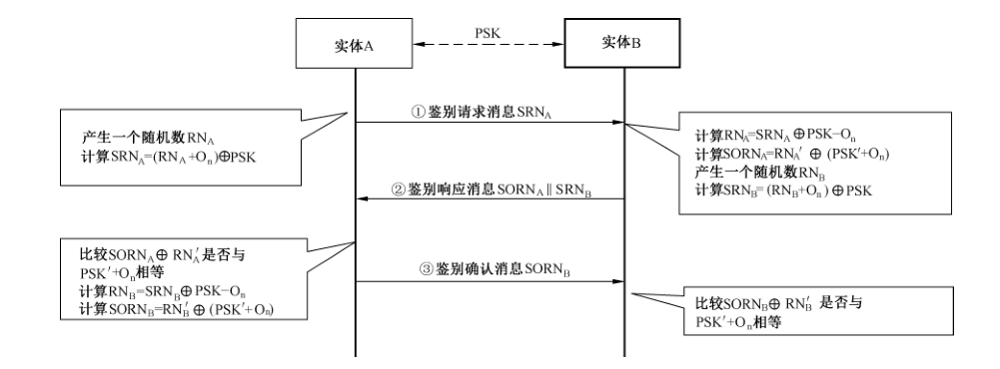
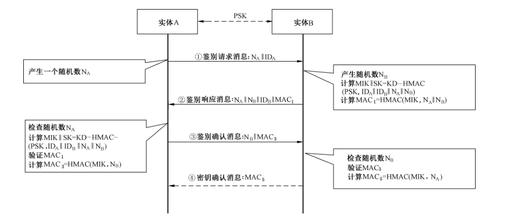
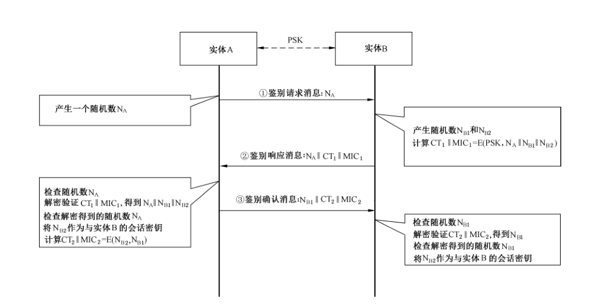
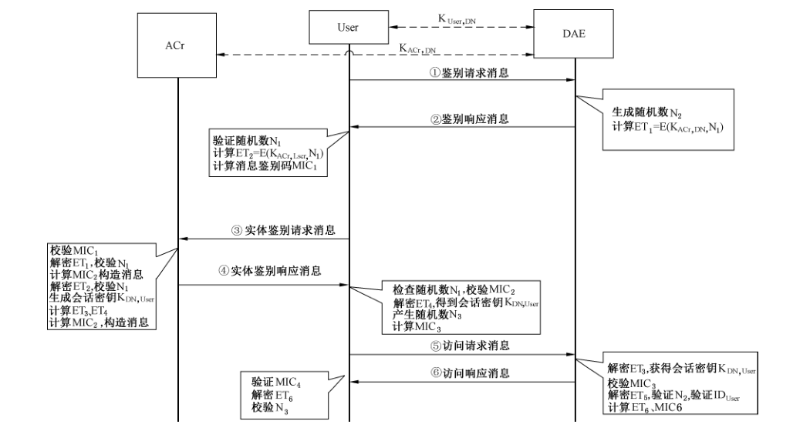
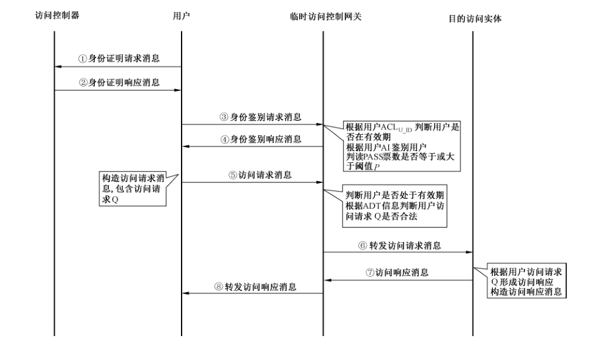

# GB/T 39205-2020 信息安全技术 轻量级鉴别与访问控制机制

> 来源：[GB/T 39205-2020 国家标准详情](https://openstd.samr.gov.cn/bzgk/std/newGbInfo?hcno=32C923969DC181623442776A39C4AB84)；封面发布日期：2020-10-11；实施日期：2021-05-01。
> PDF SHA-256：c4d2a5da3bd13f8bf79b609ace81322190b8c42ae535055cd91b6e02b0926314。
> 转写说明：按页渲染官方 PDF 并对照全部 13 页校正文字、符号和消息交互过程；保留图 1 至图 5，省略封面、目录、页眉、页脚和页码，合并跨页段落。正式引用请核对原 PDF。

## 前言

本标准按照 GB/T 1.1—2009给出的规则起草。

本标准由全国信息安全标准化技术委员会（SAC/TC 260）提出并归口。

本标准起草单位：西安西电捷通无线网络通信股份有限公司、中关村无线网络安全产业联盟、国家无线电监测中心检测中心、国家密码管理局商用密码检测中心、中国电子技术标准化研究院、天津市无线电监测站、中国科学院软件研究所、国家信息技术安全研究中心、北京数字认证股份有限公司、数安时代科技股份有限公司、重庆邮电大学、北京大学深圳研究生院、中国通用技术研究院、北京计算机技术及应用研究所。

本标准主要起草人：李琴、杜志强、黄振海、张国强、颜湘、陶洪波、李冬、李冰、许玉娜、刘景莉、铁满霞、王月辉、吴冬宇、于光明、龙昭华、朱跃生、张永强、张严、熊克琦、刘科伟、赵晓荣、张变玲、高德龙、郑骊、王莹、赵慧、张璐璐、朱正美、黄奎刚、傅强。

## 引言

本文件的发布机构提请注意，声明符合本文件时，可能涉及与 5.2 相关的 ZL201410041837.0、US9,860,070B2、JP6353548B2、EP15743408.5、KR10-1857048，与 5.4 相关的 ZL201010567506.2、US9,450,756B2、EP10858333.7，与 6.2 相关的 ZL201010153096.7，与 6.3 相关的 ZL201010153734.5 等专利的使用。

本文件的发布机构对于上述专利的真实性、有效性和范围无任何立场。

该专利持有人已向本文件的发布机构保证，他愿意同任何申请人在合理且无歧视的条款和条件下，就专利授权许可进行谈判。该专利持有人的声明已在本文件的发布机构备案。相关信息可通过以下联系方式获得：

专利权人：西安西电捷通无线网络通信股份有限公司  
地址：西安市高新区科技二路 68 号西安软件园秦风阁 A201  
联系人：冯玉晨  
邮政编码：710075  
电子邮件：ipri@iwncomm.com  
电话：029-87607836  
传真：029-87607829  
网址：http://www.iwncomm.com

专利权人：国家无线电监测中心检测中心、西安西电捷通无线网络通信股份有限公司  
地址：西安市高新区科技二路 68 号西安软件园秦风阁 A201  
联系人：冯玉晨  
邮政编码：710075  
电子邮件：ipri@iwncomm.com  
电话：029-87607836  
传真：029-87607829  
网址：http://www.iwncomm.com

请注意除上述专利外，本文件的某些内容仍可能涉及专利。本文件的发布机构不承担识别这些专利的责任。

## 1 范围

本标准规定了轻量级的鉴别机制与访问控制机制。

本标准适用于无线传感器网络、射频识别、近场通信等资源受限的应用场景下鉴别与访问控制机制设计开发和应用。

## 2 规范性引用文件

下列文件对于本文件的应用是必不可少的。凡是注日期的引用文件，仅注日期的版本适用于本文件。凡是不注日期的引用文件，其最新版本（包括所有的修改单）适用于本文件。

- GB/T 15629.3—2014 信息技术 系统间远程通信和信息交换 局域网和城域网 特定要求 第 3 部分：带碰撞检测的载波侦听多址访问（CSMA/CD）的访问方法和物理层规范

- GB/T 25069 信息安全技术 术语

- GB/T 32905 信息安全技术 SM3密码杂凑算法

- GB/T 32907 信息安全技术 SM4分组密码算法

- ISO/IEC 29180:2012 信息技术 系统间远程通信和信息交换 泛在传感器网络安全框架（Information technology—Telecommunications and information exchange between systems—Security framework for ubiquitous sensor networks）

## 3 术语和定义

GB/T 25069界定的以及下列术语和定义适用于本文件。

### 3.1 鉴别机制 authentication mechanism

证实实体是其所声称的实体的机制。

### 3.2 访问控制 access control

保证数据处理系统的资源只能由被授权主体按照授权方式进行访问的手段。

### 3.3 可信第三方 trusted third party

在同安全相关的活动方面，被其他实体信任的安全机构或其代理。

> 注：可信第三方是实体 A 和实体 B所信任的第三方实体，可对实体 A和实体B的身份真实性进行验证。

## 4 符号和缩略语

### 4.1 符号

下列符号适用于本文件。

⊕：异或运算（XOR）  
∥：消息串联  
<<<：左循环移位  
+：模加  
−：模减  
Oₙ：长度为 n 比特的二进制常量  
Q：用户对某一资源的访问请求

### 4.2 缩略语

下列缩略语适用于本文件。

ACL：访问控制列表（Access Control List）  
ACr：访问控制器（Access Controller）  
ADT：授权的数据类型（Authorized Data Type）  
AI：鉴别信息（Authenticated Information）  
CT：密文（Cryptographic Text）  
DAE：目的访问实体（Destination Access Entity）  
ET：加密后的文本（Encrypted Text）  
HMAC：基于密码杂凑产生的消息鉴别码（Hash Based Message Authentication Code）  
KD：密钥推导（Key Derivation）  
MAC：消息鉴别码（Message Authentication Code）  
MEK：消息加密密钥（Message Encryption Key）  
MIC：消息完整性校验（Message Integrality Check）  
MIK：消息完整性密钥（Message Integrality Key）  
PSK：预共享密钥（Pre-Shared Key）  
SK：会话密钥（Session Key）  
VP：有效期（Valid Period）

## 5 轻量级鉴别机制

### 5.1 概述

轻量级鉴别机制在实现实体之间的身份真实性确认的同时降低鉴别过程中的计算和通信复杂度。

较之通常的机制，轻量级鉴别机制有如下几个衡量角度：

a） 计算资源占用少；

b） 交互消息少；

c） 耗时短；

d） 所需要的存储空间少。

### 5.2 基于异或运算的鉴别机制

基于异或运算的鉴别机制，通过简单的异或、移位运算来实现实体A 和实体B之间的身份真实性的确认，鉴别过程见图1。

鉴别之前，实体 A 和实体 B 应具备预共享密钥 PSK 和共享常量 Oₙ，用 n 表示机制中随机数和密钥的长度，预共享密钥 PSK 的使用应符合特定场景的需求，随机数的长度应和 PSK 长度保持一致。鉴别过程如下：

a） 实体 A 产生一个随机数 RNₐ，计算 `SRNₐ=(RNₐ+Oₙ)⊕PSK`，并向实体 B 发鉴别请求消息 SRNₐ。其中 Oₙ 是长度为 n 的二进制常量，n 的长度选择与机制中所使用的 PSK 和随机数长度一致，推荐 Oₙ 为长度为 n 比特的 01 交替的二进制常量；其中 `+` 是在 2ⁿ 模加；

b） 实体 B 收到鉴别请求消息后，首先计算 `RNₐ=SRNₐ⊕PSK−Oₙ`，并计算 `SORNₐ=RNₐ′⊕(PSK′+Oₙ)`，其中 `RNₐ′=RNₐ<<<s`，`PSK′=PSK<<<s`，即 RNₐ′ 和 PSK′ 分别表示 RNₐ 和 PSK 在随机数长度比特向量上向左循环移位 s 比特后的值，s 的取值为 RNₐ 中值为 1 的比特的个数；实体 B 产生一个随机数 RNᵦ，计算 `SRNᵦ=(RNᵦ+Oₙ)⊕PSK`。实体 B 发送鉴别响应消息 `SORNₐ∥SRNᵦ` 给实体 A；

c） 实体 A 收到鉴别响应消息后，分别计算 `SORNₐ⊕RNₐ′` 和 `PSK′+Oₙ`，比较 `SORNₐ⊕RNₐ′` 是否与 `PSK′+Oₙ` 相等，如果不相等，则实体 A 丢弃该消息；如果相等，则实体 A 对实体 B 鉴别成功。然后实体 A 计算 `RNᵦ=SRNᵦ⊕PSK−Oₙ`，并计算 `SORNᵦ=RNᵦ′⊕(PSK′+Oₙ)`，其中 `RNᵦ′=RNᵦ<<<m`，`PSK′=PSK<<<m`，m 的取值为 RNᵦ 中值为 1 的比特的个数，实体 A 向实体 B 发送鉴别确认消息 SORNᵦ；其中 `−` 是在 2ⁿ 模减；

d） 实体 B 收到鉴别确认消息后，分别计算 `SORNᵦ⊕RNᵦ′` 和 `PSK′+Oₙ`，比较 `SORNᵦ⊕RNᵦ′` 是否与 `PSK′+Oₙ` 相等，如果相等，则实体 B 对实体 A 鉴别成功。

注 1：上述机制中 RNₐ、RNᵦ 的运算均先算异或后算模减；

注 2：基于异或运算的鉴别机制，利用了异或、移位运算实现鉴别，计算量小，鉴别过程耗时短，所需存储空间少；其安全性相对于 5.3 和 5.4 两种机制较弱，适用于计算资源、存储资源受限，但对安全有一定需求的应用场景。

### 5.3 基于密码杂凑算法的鉴别机制

基于密码杂凑算法的鉴别机制利用密码杂凑算法实现实体 A 和实体 B 之间的身份真实性的确认，交互过程见图 2。该机制中密码杂凑算法应使用 GB/T 32905 定义的 SM3 算法，使用 SM3 算法时，HMAC 为 HAMC-SM3，KD-HMAC 为 KD-HMAC-SM3；其中 HMAC-SM3 和 KD-HMAC-SM3 定义见 GB/T 15629.3—2014 的附录 I 中 I.10.4 和 I.10.5。

鉴别之前，实体 A 应具备身份信息 IDₐ，实体 B 应具备身份信息 IDᵦ，实体 A 和实体 B 应具备预共享密钥 PSK，预共享密钥 PSK 的使用应符合特定场景的需求，随机数的长度应和 PSK 长度保持一致。

鉴别过程如下：

a） 实体 A 产生一个随机数 Nₐ，并向实体 B 发送包含 Nₐ 和 IDₐ 的鉴别请求消息。

b） 实体 B 收到实体 A 的鉴别请求消息后，产生随机数 Nᵦ，并利用密钥列表中与实体 A 预共享的密钥 PSK，根据 IDₐ、IDᵦ、Nₐ、Nᵦ 计算 `MIK∥SK=KD-HMAC(PSK,IDₐ∥IDᵦ∥Nₐ∥Nᵦ)`，其中，IDₐ 和 IDᵦ 分别是实体 A 和实体 B 的身份标识，MIK 为实体 A 与实体 B 之间的消息完整性密钥，SK 为实体 A 与实体 B 之间的会话密钥。然后，实体 B 利用 MIK 计算消息鉴别码 `MAC₁=HMAC(MIK,Nₐ∥Nᵦ)`，并构造鉴别响应消息 `Nₐ∥Nᵦ∥IDᵦ∥MAC₁` 发送给实体 A。

c） 实体 A 收到实体 B 的鉴别响应消息后，首先检查鉴别响应消息中的随机数 Nₐ 与其在步骤 a）中发送给实体 B 的随机数 Nₐ 是否一致，若不一致，实体 A 对实体 B 鉴别失败；若一致，实体 A 计算 `MIK∥SK=KD-HMAC(PSK,IDₐ∥IDᵦ∥Nₐ∥Nᵦ)`，并利用 MIK 计算消息鉴别码 `MAC₂=HMAC(MIK,Nₐ∥Nᵦ)`，如果 MAC₂≠MAC₁，实体 A 对实体 B 鉴别失败；如果 MAC₂=MAC₁，则实体 A 将 SK 保存为与实体 B 的会话密钥，并计算 `MAC₃=HMAC(MIK,Nᵦ)`，构造鉴别确认消息 `Nᵦ∥MAC₃` 发送给实体 B；若实体 A 和实体 B 使用该机制且不含密钥确认消息时，实体 A 在发出鉴别确认消息后的一段时间后或在正确解密实体 B 使用该会话密钥加密发来的消息后，实体 A 对实体 B 鉴别成功，实体 A 启用该会话密钥；若实体 A 和实体 B 使用该机制且含密钥确认消息时，按照步骤 e）执行后续操作。

d） 实体 B 收到实体 A 的鉴别确认消息后，检查鉴别确认消息中的随机数 Nᵦ 与其在步骤 b）中发送给实体 A 的随机数 Nᵦ 是否一致，若不一致，实体 B 对实体 A 鉴别失败；若一致，实体 B 计算消息鉴别码 `MAC₄=HMAC(MIK,Nᵦ)`，如果 MAC₄≠MAC₃，实体 B 对实体 A 鉴别失败；如果 MAC₄=MAC₃，则实体 B 对实体 A 鉴别成功，实体 B 将 SK 保存并启用作为与实体 A 之间的会话密钥。若实体 A 和实体 B 使用该机制且不含密钥确认消息时，实体 B 完成鉴别过程开始与实体 A 进行会话；若实体 A 和实体 B 使用该机制且含密钥确认消息时，计算 `MAC₅=HMAC(MIK,Nₐ)`，并发送密钥确认消息 `Nₐ∥MAC₅` 给实体 A，用于通知实体 A 启用会话密钥 SK。

e） 实体 A 收到实体 B 的密钥确认消息后，实体 A 计算 `MAC₆=HMAC(MIK,Nₐ)`，如果 MAC₆≠MAC₅，实体 A 对实体 B 鉴别失败；如果 MAC₆=MAC₅，则实体 A 对实体 B 鉴别成功，实体 A 启用会话密钥 SK，开始与实体 B 进行会话。

### 5.4 基于分组密码算法的鉴别机制

基于分组密码算法的鉴别机制，利用分组密码算法实现实体A 和实体B之间的身份鉴别，交互过程见图3。该机制中分组密码算法应使用 GB/T 32907定义的SM4算法。

鉴别之前，实体 A 应具备身份信息 IDₐ，实体 B 应具备身份信息 IDᵦ，实体 A 和实体 B 应具备预共享密钥 PSK，预共享密钥 PSK 的使用应符合特定场景的需求，随机数的长度应和 PSK 长度保持一致。

鉴别过程如下：

a） 实体 A 产生一个随机数 Nₐ，并向实体 B 发送包含 Nₐ 的鉴别请求消息；

b） 实体 B 收到实体 A 的鉴别请求消息后，生成随机数 Nᵦ₁ 和 Nᵦ₂，计算 `CT₁∥MIC₁=E(PSK,Nₐ∥Nᵦ₁∥Nᵦ₂)`，并向实体 A 发送包含 `Nₐ∥CT₁∥MIC₁` 的鉴别响应消息；

c） 实体 A 收到实体 B 发送的鉴别响应消息后，首先判断该消息中的 Nₐ 与其在步骤 a）中发送给实体 B 的 Nₐ 是否一致，如果不一致，则实体 A 对实体 B 鉴别失败；如果一致，实体 A 利用 PSK 解密验证 `CT₁∥MIC₁`，如果 MIC₁ 验证不通过，则实体 A 对实体 B 鉴别失败；如果 MIC₁ 验证通过，则进一步验证解密得到 Nₐ 与其在步骤 a）中发送给实体 B 的 Nₐ 是否一致，如果不一致，则实体 A 对实体 B 鉴别失败；如果一致，则实体 A 对实体 B 鉴别成功，实体 A 将解密得到的 Nᵦ₂ 作为与实体 B 的会话密钥，计算 `CT₂∥MIC₂=E(Nᵦ₂,Nᵦ₁)`，并向实体 B 发送鉴别响应确认消息，该消息中包括字段 `Nᵦ₁∥CT₂∥MIC₂`；

d） 实体 B 收到实体 A 的鉴别响应确认消息后，首先判断该消息中的 Nᵦ₁ 与其在步骤 b）中发送给实体 A 的 Nᵦ₁ 是否一致，如果不一致，则实体 B 对实体 A 鉴别失败；如果一致，则实体 B 利用 Nᵦ₂ 解密验证 `CT₂∥MIC₂`，如果 MIC₂ 验证不通过，则实体 B 对实体 A 鉴别失败；如果 MIC₂ 验证通过，则进一步验证解密得到 Nᵦ₁ 与其在步骤 b）中发送给实体 A 的 Nᵦ₁ 是否一致，如果不一致，则实体 B 对实体 A 鉴别失败；如果一致，则实体 B 对实体 A 鉴别成功，实体 B 将 Nᵦ₂ 作为与实体 A 的会话密钥。

> 注：E 为一种分组加密算法，`CT∥MIC=E(KEY,S)` 表示将 KEY 对 S 进行加密并计算完整性校验码，其中 CT 表示密文，MIC 表示完整性校验码，CT 和 MIC 的拆分取决于具体的应用。在一些模式中，需先基于 KEY 导出消息完整性校验密钥和消息加密密钥，然后再分别使用这两个密钥计算完整性校验码和密文。在解密验证时，根据所使用的模式不同，验证完整性校验码和解密的先后顺序可能不同。

## 6 轻量级访问控制机制

### 6.1 概述

轻量级访问控制机制基于分组密码算法或访问控制列表 ACL 等实现对用户的访问控制。较之通常的机制，轻量级访问控制机制从 5.1 所列出的几个角度进行衡量。

### 6.2 基于分组密码算法的访问控制机制

本机制基于分组密码算法实现访问控制。其中，ACr 是访问控制器，User 是用户，DAE 是目的访问实体。ACr 对 User 访问 DAE 的控制过程见图 4。该机制中分组密码算法应使用 GB/T 32907 定义的 SM4 算法；该机制中密码杂凑算法应使用 GB/T 32905 定义的 SM3 算法，使用 SM3 算法时，HMAC 为 HAMC-SM3。分组密钥算法分组的长度应符合特定场景的需求，随机数的长度应和 PSK 长度保持一致。

访问控制过程如下：

a） User 在向网络中的 DAE 发送访问请求之前，首先向 DAE 发送鉴别请求消息，该消息中主要包含 User 产生的随机数 N₁；

b） DAE 收到 User 的鉴别请求消息后，产生随机数 N₂，并利用与 ACr 之间的共享密钥 K_ACr,DAE 计算 `ET₁=E(K_ACr,DAE,N₁)`，将 `N₁∥N₂∥ET₁` 作为鉴别响应消息发送给 User，其中，E 为对称加密算法；

c） User 收到 DAE 的鉴别响应消息后，首先判断消息中的随机数 N₁ 是否是 User 选择的随机数，若不是，直接丢弃该消息；若是，则利用与 ACr 之间的共享密钥 K_ACr,User 计算 `ET₂=E(K_ACr,User,N₁)`，计算消息鉴别码 `MIC₁=HMAC(K_ACr,User,N₁∥ID_DAE∥ET₁∥ET₂)`，构造实体鉴别请求消息 `N₁∥ID_DAE∥ET₁∥ET₂∥MIC₁` 发送给 ACr，其中，ID_DAE 是 DAE 的身份标识；

d） ACr 收到 User 的实体鉴别请求消息后，首先根据 MIC₁ 判断消息的完整性，若验证不通过，丢弃该消息；若验证通过，利用与 DAE 之间的共享密钥 K_ACr,DAE 解密 ET₁，若解密后得到的 N₁ 与 User 在步骤 c）中发送的 N₁ 不相等，ACr 构造实体鉴别响应消息 `N₁∥ID_DAE∥RES(DAE)∥MIC₂` 发送给 User，其中 `MIC₂=HMAC(K_ACr,User,N₁∥ID_DAE∥RES(DAE))`，`RES(DAE)=Failure` 表示 ACr 对 DAE 鉴别失败；若解密后得到的 N₁ 与 User 在步骤 c）中发送的 N₁ 相等，ACr 利用与 User 共享的密钥 K_ACr,User 解密 ET₂，若解密后得到的 N₁ 与 User 在步骤 c）中发送的 N₁ 不相等，终止鉴别；若解密后得到的 N₁ 与 User 在步骤 c）中发送的 N₁ 相等，ACr 生成 User 和 DAE 间的会话密钥 K_DAE,User，并根据 User 的身份标识查询 ACL，获得 User 的访问控制信息 ACL_User，连同 User 的访问期限 Tᵥ，利用 K_ACr,DAE 计算 `ET₃=E(K_ACr,DAE,ID_User∥K_DAE,User∥Tᵥ∥ACL_User)`，并利用 K_ACr,User 计算 `ET₄=E(K_ACr,User,K_DAE,User)`，计算 `MIC₂=HMAC(K_ACr,User,N₁∥ID_DAE∥RES(DAE)∥ET₃∥ET₄)`，构造实体鉴别响应消息 `N₁∥ID_DAE∥RES(DAE)∥ET₃∥ET₄∥MIC₂` 发送给 User，其中，`RES(DAE)=True` 表示 ACr 对 DAE 鉴别成功；

e） User 收到 ACr 的实体鉴别响应消息后，首先判断随机数 N₁ 是否是 User 选择的随机数，若不是，丢弃该消息；若是，根据 MIC₂ 判断消息的完整性；若验证不通过，丢弃该消息；若验证通过，User 根据 RES(DAE) 判断 DAE 的合法性，若 `RES(DAE)=Failure`，表示 DAE 非法，User 终止访问；若 `RES(DAE)=True`，User 解密消息中的 ET₄，产生随机数 N₃，连同 DAE 的随机数 N₂ 以及 User 的访问请求利用解密后获得的与目的访问实体间的会话密钥 K_DAE,User 计算 `ET₅=E(K_DAE,User,N₂∥N₃∥ID_User∥Q_User)`，计算 `MIC₃=HMAC(K_DAE,User,ET₃∥ET₅)`，构造访问请求消息 `ET₃∥ET₅∥MIC₃` 发送给 DAE；

f） DAE 收到 User 的访问请求后，首先解密 ET₃，获得会话密钥 K_DAE,User，根据 MIC₃ 判断消息完整性，若校验不通过，拒绝访问；若校验通过，利用 K_DAE,User 解密 ET₅，判断解密后得到的 N₂ 是否是 DAE 选择的 N₂，若不是，拒绝访问；若是，则确认解密 ET₅ 后获得的 ID_User 是否是请求访问的 User 的身份标识，若不是，拒绝访问；若是，记录当前时刻 `T_c`，从 `T_c` 到（`T_c`＋`T_v`）这段时间即为 User 的访问有效期，用户只能在此有效期内访问网络数据，DAE 根据 ACL_User 判断 User 的访问请求 Q_User 是否合法，若不合法，拒绝访问；若合法，生成应答数据 R_DAE，连同 N₃ 利用 K_DAE,User 计算 `ET₆=E(K_DAE,User,N₃∥R_DAE)`，计算 `MIC₄=HMAC(K_DAE,User,ET₆)`，构造访问响应消息 `ET₆∥MIC₄` 发送给 User；

g） User 收到访问响应消息后，首先根据 MIC₄ 判断消息完整性，若不完整，丢弃该消息；若完整，利用 K_DAE,User 解密 ET₆，判断解密得到的 N₃ 是否是 User 选择的 N₃，若不是，丢弃该消息；若是，User 保存应答数据 R_DAE，后续 User 与 DAE 之间的访问请求和应答数据均利用 K_DAE,User 加以保护。

### 6.3 基于访问控制列表的访问控制机制

基于访问控制列表的访问控制机制适用于网络对各类用户的访问控制，该机制见 ISO/IEC 29180:2012，交互过程见图 5。

访问控制过程如下：

a） 访问控制器 ACr 构造访问控制列表 ACL 以及用户身份信息，并在用户访问网络之前进行协议初始化：

1） ACr 本地构造 ACL，该 ACL 包括 U_ID 字段、ADT 字段、VP 字段、AI 字段，各字段定义如下：U_ID 字段为用户的身份标识；ADT 字段为用户被授权访问的数据类型；VP 字段为用户被授权访问网络的期限；AI 字段为用于鉴别用户身份的依据，可以是证书或者密钥或其他可作为用户身份的依据。在构造 ACL 后，ACr 对用户进行注册，注册过程如下：ACr 首先根据网络用户的身份标识 U_ID 确定该用户的 ADT 和 VP，然后构造用于鉴别该用户身份的依据 AI。ACr 将 U_ID、ADT、VP、AI 作为新条目插入 ACL 列表中，记做 `ACL_U_ID`。

2） 用户访问网络之前，先向 ACr 发送身份证明请求消息。ACr 收到身份证明请求消息后，判断该用户是否已注册，若已注册，则 ACr 发送身份证明响应消息给该用户，该响应消息中包含 ACr 为用户构造的 AI。同时，ACr 将 ACL 列表中与该用户 U_ID 对应的包含 U_ID、ADT、VP、AI 的 `ACL_U_ID` 以安全的方式发送给网络内的所有实体，实体在该用户 VP 截止之前保存该 `ACL_U_ID`；若用户未注册，则 ACr 丢弃该用户的身份证明请求消息。

> 注：安全的方式是指以加密传输等方式保护消息的机密性和完整性。实体间可使用预共享密钥实现加密传输，不限定具体的实现方法，下同。

b） 在用户访问目的访问实体前，先向网络发送身份鉴别请求消息，此时由网络中用户的单跳通信区域内的所有实体构成临时访问控制网关对用户进行鉴别，过程如下：

1） 临时访问控制网关收到用户的身份鉴别请求消息后，临时访问控制网关中的实体首先判断是否存有该用户的 `ACL_U_ID` 信息，如果存有该信息，表明该用户处于有效期内，实体根据 `ACL_U_ID` 中的用户 AI 对用户进行身份鉴别，若实体对用户身份鉴别成功，则投 PASS 票，并广播该 PASS 票，若临时访问控制网关中的实体收到的 PASS 票数大于或等于阈值 P，表示用户鉴别成功；如果网关中的实体收到的 PASS 票小于阈值 P，表示鉴别失败，终止该用户的访问；其中阈值 P 由网络所有者定义，可以是一个 PASS 票数的固定值，也可以是一个 PASS 票的比例值等；

2） 鉴别成功后，在用户访问网络的过程中，当前临时访问控制网关中的实体将根据用户的运动方向、运动速度等对用户将要到达的位置进行测算，并由测算得到的用户将要到达的位置为中心的所有单跳区域内的所有实体构成下一个临时访问控制网关。当前临时访问控制网关中的实体在 t 时间后将用户鉴别成功消息发送给下一个临时访问控制网关中的实体，下一个临时访问控制网关将根据收到的用户鉴别成功的消息条数是否达到阈值 P 来判断该用户是否鉴别成功。若用户仍处于有效期 VP 内，且收到的用户鉴别成功的消息条数大于或等于阈值 P，则下一个临时访问控制网关将承认用户的合法性，并将在时间 t 后将鉴别成功消息再次发送到下一个新的临时访问控制网关内的实体。鉴别成功消息在实体间以安全的方式传输。

c） 用户鉴别成功后，通过临时访问控制网关访问目的访问实体，过程如下：

1） 用户鉴别成功后，以安全的方式发送访问请求消息给临时访问控制网关，该请求消息中包含访问请求 Q，Q 中包含用户请求访问的数据类型；

2） 临时访问控制网关收到用户的访问请求消息后，首先判断用户身份鉴别是否通过且用户是否处于有效期，若用户身份鉴别通过且身份处于有效期，则根据 ADT 信息判断用户的 Q 的合法性，若合法，则将 Q 以安全的方式发送给目的访问实体，该实体将认为由临时访问控制网关转发的 Q 是合法的，并将根据 Q 产生访问响应消息，并将该响应消息发送给临时访问控制网关，该网关将转发访问响应消息给用户。访问过程中，如果用户不在有效期内，或用户在有效期内但 Q 不合法，目的访问实体将直接丢弃用户的 Q，终止该用户的访问。
