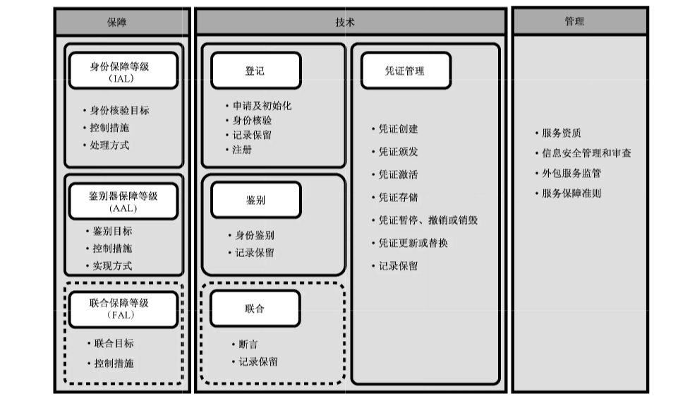

# GB/T 40651-2021 信息安全技术 实体鉴别保障框架

> 来源：[GB/T 40651-2021 国家标准详情](https://openstd.samr.gov.cn/bzgk/std/newGbInfo?hcno=03A4D009D776A1BAA9193CBA20AC7FA5)；封面发布日期：2021-10-11；实施日期：2022-05-01。
> 官方在线预览截图 SHA-256：125632fd1f5a72b0ca3b0e7679d53aa2b68dff03cd0b894cb97d5305dd9ca432。
> 转写说明：逐页对照官方在线预览的全部 26 页截图，校正正文、图示、附录表格和跨页段落；省略封面、目录、页眉、页脚和页码。正式引用请核对官方原件。

## 前言

本文件按照 GB/T 1.1—2020《标准化工作导则 第1部分：标准化文件的结构和起草规则》的规定起草。

请注意本文件的某些内容可能涉及专利。本文件的发布机构不承担识别专利的责任。

本文件由全国信息安全标准化技术委员会（SAC/TC 260）提出并归口。

本文件起草单位：联想（北京）有限公司、国民认证科技（北京）有限公司、中国科学院数据与通信保护研究教育中心、中国科学院软件研究所、中国电子技术标准化研究院、格尔软件股份有限公司、中国信息通信研究院、北京国民安盾科技有限公司。

本文件主要起草人：柴海新、李俊、李汝鑫、吕娜、陈天宇、张严、郝春亮、郑强、宁华、傅山、沈明峰、顾小卓。

## 1 范围

本文件确立了实体鉴别的保障框架，规定了各参与方角色的职责、实体鉴别的主要流程环节以及实体鉴别保障等级的类别和等级划分原则，并规定了实体鉴别保障所需的管理要求。

本文件适用于实体鉴别服务的安全测试和评估，并为其他实体身份鉴别相关标准的制定提供依据和参考。

## 2 规范性引用文件

下列文件中的内容通过文中的规范性引用而构成本文件必不可少的条款。其中，注日期的引用文件，仅该日期对应的版本适用于本文件；不注日期的引用文件，其最新版本（包括所有的修改单）适用于本文件。

- GB/T 25069—2010 信息安全技术 术语

- GB/T 35273—2020 信息安全技术 个人信息安全规范

## 3 术语和定义

GB/T 25069—2010界定的以及下列术语和定义适用于本文件。

### 3.1 断言 assertion

验证方生成的对实体进行鉴别的结果。

> 注：可能包含实体属性信息或授权信息等。

### 3.2 鉴别 authentication

用于对实体和其所呈现身份之间的绑定关系进行充分确认的过程。

### 3.3 鉴别器 authenticator

声称方拥有或掌握的可用于鉴别声称方身份的功能组件或方法。

> 注：鉴别器包含并绑定实体凭证或凭证生成方法，参与并执行特定的鉴别协议。

示例：密码模块、口令、口令生成器等。

### 3.4 鉴别协议 authentication protocol

在声称方和验证方之间定义的消息序列，使得验证方能够执行对声称方的鉴别。

### 3.5 鉴别因素 authentication factor

用于鉴别或验证实体身份的要素。

> 注：鉴别因素可分为三类：实体所拥有的事物（例如，设备签名、护照、包含凭证的硬件设备、私钥等）；实体所知晓的信息（例如，口令、PIN 等）；实体所呈现的本质（例如，生物特征或行为模式等）。

### 3.6 身份 identity

与实体相关的一组属性。

> 注：在特定语境中，身份可以拥有一个或多个标识符，使得身份在此语境中可被唯一识别。

### 3.7 身份核验 identity proofing

注册机构采集并校验充足的信息以在某个特定的保障等级识别实体身份的过程。

### 3.8 声称方 claimant

宣称或标示自己拥有合法身份的实体，需对其进行身份鉴别以确认身份。

［来源：GB/T 25069—2010,2.2.2.171，有修改］

### 3.9 申请方 applicant

请求成为系统的合法用户的实体，需在登记环节对其进行身份核验以确认其真实身份并为其分配标识符。

［来源：GB/T 25069 —2010,2.3.85，有修改］

### 3.10 实体 entity

具有独立且不同存在形式并可在语境中被识别的对象。

### 3.11 验证方 verifier

对实体身份信息及凭证进行检查、核实和验证以鉴别实体的参与方。

### 3.12 依赖方 relying party

依赖于实体鉴别的结果（表现为身份断言或声明）的参与方。

## 4 缩略语

下列缩略语适用于本文件。

- AAL：鉴别器保障等级（Authenticator Assurance Level）
- CA：认证机构（Certification Authority）
- CSP：凭证服务提供方（Credential Service Provider）
- FAL：联合保障等级（Federation Assurance Level）
- IAL：身份保障等级（Identity Assurance Level）
- NPE：非人类实体（Non-Person Entity）
- PIN：个人身份识别码（Personal Identification Number）
- RA：注册机构（Registration Authority）
- RP：依赖方（Relying Party）
- TPM：可信平台模块（Trusted Platform Module）
- TTP：可信第三方（Trusted Third Party）

## 5 保障框架

实体鉴别保障框架（见图1）包含了实体鉴别的主要环节和管理要求，并提出了不同类别的保障等级以及等级划分原则的要素。

实体鉴别分为四个环节：登记（见7.2）、凭证管理（见7.3）、鉴别（见7.4）和联合（见7.5）。其中，联合环节不是实体鉴别的必备环节（在图1中用虚线框表示）。每个环节又可再细分为若干个过程，每个过程都面临相应的安全风险和攻击威胁，也存在相应的控制手段或应对措施（见附录A）。影响实体鉴别保障的管理要求主要涉及以下方面：服务资质、信息安全管理和审查、外包服务监管及服务保障准则等。

由于实体鉴别的多样性和复杂性，单一的保障等级无法准确反映实体鉴别的安全程度。本文件根据实体鉴别的主要环节规定了三种保障等级（见 8.1）：身份保障等级（IAL）、鉴别器保障等级（AAL）和联合保障等级（FAL），从不同维度衡量实体鉴别的安全程度。其中，IAL 的等级划分要素为身份核验目标、控制措施和处理方式（见 8.2）；AAL 的等级划分要素为鉴别目标、控制措施和实现方式（见 8.3）；FAL 为可选项（在图 1 中用虚线框表示），其等级划分要素为联合目标和控制措施（见 8.4）。对于 IAL、AAL 和 FAL 而言，其具体等级数量和等级内容不在本文件规定的范围内。各参与方应根据所采用实体鉴别的业务对于风险控制的需求确定相应的目标、控制措施和实现方式，从而选择合适的保障等级，实现对实体鉴别相关的所有程序、管理活动以及技术实现的可信度衡量。

本文件凡涉及密码算法的相关内容，按国家有关法规实施；凡涉及采用密码技术解决保密性、完整性、真实性、不可否认性需求的应遵循密码相关国家标准和行业标准。

## 6 参与方角色职责

### 6.1 概述

实体鉴别保障框架的参与方包括实体、凭证服务提供方、注册机构、依赖方、验证方和可信第三方。

它们既可属于同一机构，也可属于不同机构。例如，注册机构和凭证服务提供方可以是同一家机构；验证方和依赖方可以是同一家机构：注册机构、凭证服务提供方和验证方可以是同一家机构（此时也称为身份提供方）。

### 6.2 实体

实体可以是自然人或者物品（也称为 NPE）。在实体鉴别保障的各个环节中，同一个实体可具备多种角色。在登记环节之前，实体作为申请方角色开始登记；成功完成登记过程后，实体得到了CSP颁发的相应凭证或鉴别器，并确定了鉴别协议，由申请方成为合法用户。在鉴别环节之前，实体作为声称方角色开始鉴别；成功完成鉴别过程后，实体的身份得到验证，由声称方成为合法用户。

### 6.3 凭证服务提供方

凭证服务提供方是颁发和管理凭证的可信参与方。CSP负责颁发和管理凭证或鉴别器（例如，口令或生物特征识别信息，包含私钥的硬件智能卡或软件密码模块等）以及相关数据。CSP 颁发和管理的凭证或鉴别器及其实施的安全策略，是实体鉴别保障的关键因素。

### 6.4 注册机构

注册机构是为 CSP 创建并担保实体身份的参与方。RA 应获得 CSP 的信任才能履行与登记环节相关的过程，并在完成实体注册后由 CSP 为实体颁发凭证或鉴别器。每个 RA 都应根据规定程序对实体进行身份核验。为将某实体同其他实体区分开来，可为该实体分配一个或多个标识符，使该实体能够在随后相应的语境中得到识别。

### 6.5 依赖方

依赖方是为合法用户提供服务的参与方，其业务需要经鉴别的身份以完成必要的功能（例如，账户管理、访问控制、授权决策等）。

### 6.6 验证方

验证方可参与实体鉴别保障的多个环节，执行身份鉴别和（或）断言生成操作。

### 6.7 可信第三方

可信第三方是在某些活动（例如与安全相关的活动）中被其他参与方信赖的机构或组织。就本文件而言，TTP 为实施鉴别而被实体和（或）验证方所信任。执行实体鉴别的TTP 的实例包括CA 和时间戳机构等。

## 7 主要环节

### 7.1 通则

实体鉴别的主要环节包括：登记环节、凭证管理环节、鉴别环节和联合环节。对实体身份进行授权管理和访问控制的环节不属于实体鉴别的流程，不在本文件规定的范围内。实体鉴别各个主要环节均存在相关安全威胁，提供鉴别服务的各参与方应采取相应的风险控制手段加以防范。实体鉴别各环节的威胁分析和风险控制措施见附录 A。实体鉴别过程中涉及个人信息保护的内容应遵循 GB/T 35273—2020 的要求。附录 B 描述了实体鉴别过程中可能涉及个人信息处理的场景及注意事项，为相关机构在决定采用并实施具体鉴别方法时提供参考。

### 7.2 登记环节

#### 7.2.1 概述

登记环节是实体作为申请方通过注册机构进入实体鉴别过程的初始环节。登记环节包括以下过程：申请和初始化，身份核验，记录保留，注册。

#### 7.2.2 申请和初始化

登记环节可通过多种方式发起，可由实体主动发起，也可由注册机构发起。当实体为自然人时，初始化过程可包括填写申请表；当实体为物品时，初始化过程可包括为物品粘贴标签或将设备标识符写入到安全存储区域中（适用时）。

#### 7.2.3 身份核验

身份核验过程可包括对实体提交的身份信息与权威来源进行核对和验证，以确认身份信息真实且实体客观存在。为达到身份核验要求而提供的身份信息随保障等级的不同而变化。

身份核验过程可包括对实体提交的身份证件（例如，居民身份证等）的物理检查，以检测可能的欺诈、篡改或伪造行为。保障等级越高，身份核验要求就应越严格。

此外，身份核验过程对于实体远程（例如，通过网络）声明其身份应比本地（例如，与RA 面对面现场交互）更加严格。RA 应确保实体和其提交的身份证件的一致性。

#### 7.2.4 记录保留

记录保留是实体登记的必要过程，即创建登记记录的存档过程。这项记录应包括采集的信息和文档、关于身份核验过程的信息、这些步骤的结果及其他相关数据。然后，将对是否接受、拒绝或提交进一步审议或其他后续工作做出决定的结果保存在记录中。

#### 7.2.5 注册

注册是实体为申请使用服务或资源而创建账号（分配标识符）的过程。注册过程是登记环节的一部分，处于登记环节的末尾。实体申请首次访问每项服务或资源都应履行注册过程。

### 7.3 凭证管理环节

#### 7.3.1 概述

凭证管理环节包括与凭证或凭证生成方法的生命周期管理相关的所有过程，贯穿于实体鉴别的整个过程中。凭证管理环节包括以下过程：凭证创建，凭证颁发，凭证激活，凭证存储，凭证暂停、撤销或销毁，凭证更新或替换，记录保留。凭证或凭证生成方法存在多种形式，通常包含于鉴别器中，用于鉴别环节中验证方对声称方的鉴别。

#### 7.3.2 凭证创建

##### 7.3.2.1 凭证的预处理

某些包含于鉴别器中的凭证或凭证生成方法在颁发前需经过预处理。例如，含有凭证的智能卡的预处理措施可包括将未来持卡实体的姓名印刷在卡表面或写入卡的芯片中。某些凭证或凭证生成方法不需要进行预处理，例如口令。

##### 7.3.2.2 凭证初始化

凭证初始化应确保凭证生成方法能够支持其预期功能。例如，需要使用智能卡芯片计算用于生成数字签名所需的密钥对；智能卡可在发行时处于“锁定”状态，并在激活过程中需要使用 PIN 进行保护。

##### 7.3.2.3 凭证绑定

凭证绑定过程确保在包含凭证或凭证生成方法的鉴别器与实体身份之间建立联系。完成绑定的方式和对绑定关系的信任度随所需的保障等级不同而变化。

#### 7.3.3 凭证颁发

凭证颁发过程向实体提供包含凭证或凭证生成方法的鉴别器。应确保鉴别器被安全地颁发给相应的合法实体。此过程的复杂度随所需的保障等级不同而变化。

#### 7.3.4 凭证激活

凭证激活过程将包含凭证或凭证生成方法的鉴别器正式投入使用。激活过程可根据凭证的情况包含多种措施。例如，为防止临时错误使用，凭证或凭证生成方法在初始化之后直到向实体颁发之时可处于“锁定”状态。在这种情况下，需要将凭证“解锁”（例如，使用 PIN）。凭证或凭证生成方法也可以在临时中止其有效性的暂停期之后重新激活。

#### 7.3.5 凭证存储

凭证存储过程将凭证或凭证生成方法以防范非授权泄露、使用、修改或销毁的方式进行安全存储。

此过程的安全性要求随所需的保障等级不同而变化。

#### 7.3.6 凭证暂停、撤销或销毁

凭证暂停过程将凭证的有效性临时停止。凭证撤销或销毁过程则将凭证的有效性永久性终止。出现如下情况，凭证应撤销或销毁：

a） 凭证或凭证生成方法已经被报告丢失、被窃或受到损害；

b） 凭证已过期；

c） 凭证赖以存在的基础已不复存在（例如，实体不再存在）；

d） 凭证被用于未经许可的用途；

e） 已颁发了另一个凭证取代所述凭证。

某些存储在硬件鉴别器（例如，智能卡）中的凭证，可在撤销或销毁时对物理载体进行销毁。以数字文件形式存在的凭证，可在撤销或销毁时进行数据覆盖以便彻底清除。

#### 7.3.7 凭证更新或更换

凭证更新过程将现有凭证有效期进行延长或续期。凭证更换过程则向某个实体发放新凭证或凭证生成方法以替换已撤销或销毁的凭证。凭证更新或更换过程的严格程度随所需保障等级的不同而变化。

#### 7.3.8 记录保留

CSP 应在凭证的整个生命周期内维护适当的记录，包括但不限于以下信息：

a） 生成凭证的事实，

b） 凭证的标识符（适用时），

c） 凭证颁发的对象实体（适用时），

d） 凭证的状态（适用时）。

### 7.4 鉴别环节

#### 7.4.1 概述

在鉴别环节，实体作为声称方采用其凭证（通过鉴别器）向验证方证实其身份。鉴别环节包括以下过程：身份鉴别，记录保留。

#### 7.4.2 身份鉴别

身份鉴别过程可根据不同的使用场景和参与方划分为不同的模型。例如，无可信第三方参与的鉴别、有可信第三方参与的鉴别（仅一方连接可信第三方）和有可信第三方参与的鉴别（双方均连接可信第三方）。有关鉴别的基本模型及过程见 GB/T 36633—2018。

声称方在身份鉴别过程中应通过安全的鉴别协议验证自己拥有正确的凭证或者证明自己拥有已经绑定了正确凭证的鉴别器，以便建立对其身份的信任。应确保鉴别协议消息序列关键部分的完整性和保密性，以减少攻击者伪装成合法验证方或合法用户进行破坏造成的损失。鉴别协议的安全需求根据可适用的保障等级（见8.3）而变化。

#### 7.4.3 记录保留

验证方应在鉴别环节对全过程进行监控并保存记录。

### 7.5 联合环节

#### 7.5.1 概述

当实体鉴别环节结束时，如果验证方和依赖方不是同一个机构或组织，则验证方和依赖方需要完成鉴别而交换信息（即断言），并就交换信息的协议、数据格式和信息结构达成一致。即验证方生成包含鉴别结果的断言并发送给依赖方，而依赖方则根据断言获得实体的身份并提供相应服务。联合环节包括以下过程：断言，记录保留。

#### 7.5.2 断言

断言过程可根据不同的使用场景划分不同的模型。例如，直接断言模型（验证方直接向依赖方发送断言）、间接断言模型（依赖方向验证方请求获取断言）和代理模型（验证方作为声称方和依赖方的中间人）。有关断言的基本模型见 GB/T 36633—2018。

断言过程可使用断言协议表明验证方对实体进行鉴别的结果，可包括实体的属性信息或实体可使用的授权信息等数据。断言协议应保障断言在创建后从验证方传递到依赖方的可靠性以及合法用户的真实性，其安全需求根据可适用的保障等级（见8.4）而变化。有关断言协议的示例见GB/T 29242—2012。

#### 7.5.3 记录保留

验证方应在联合环节对断言的创建和发送过程进行监控并保存记录。依赖方应在联合环节对断言的接收过程进行监控并保存记录。

## 8 保障等级

### 8.1 保障等级分类

保障等级描述了实体鉴别过程所采用的保障措施的可信任程度，反映了实体鉴别过程中管理活动和技术控制手段的综合作用。实体鉴别应在每个环节中采用相应的保障措施。本文件所提出的 IAL、AAL 和 FAL 各自均包含不同的等级，等级由低到高代表了可信任程度的递增。实体鉴别保障等级应为 IAL、AAL 和 FAL 的等级组合。

在登记环节，申请方通过身份核验后完成注册，成为合法用户。此环节所对应的保障等级称为 IAL。IAL 反映了实体鉴别系统在登记环节采取的身份核验措施的可信任程度。

在凭证管理环节，CSP 创建凭证并与鉴别器进行绑定；在鉴别环节，验证方对声称方的鉴别器及凭证的绑定关系向 CSP 进行验证。以上环节所对应的保障等级称 AAL。AAL 反映了实体鉴别系统在凭证管理和鉴别环节采取的相关控制措施的可信任程度。

在联合环节，实体完成鉴别后，进行鉴别结果交换时，验证方提交断言给依赖方。此环节所对应的保障等级称 FAL。FAL 反映了联合环节进行身份联合采取控制措施的可信任程度。

### 8.2 身份保障等级划分原则

IAL 根据身份核验的目标、所采取的控制措施以及处理方式的安全程度划分等级。例如，对于低等级的IAL，可支持实体进行自我声明，不必将实体与特定的真实身份进行关联。对于高等级的IAL，应对实体进行身份核验，确保实体和身份信息的真实性、正确性和一致性（相关控制手段见附录 A）。

a）根据 IAL 的不同等级，身份核验措施具有不同的目标。包括：

1） 身份在特定语境中是唯一的；

2） 身份所属实体客观存在；

3） 身份信息的真实性和完整性得到验证；

4） 身份所属实体与其身份信息保持一致；

b） 所需采取的控制措施包括但不限于：

1） 实体自我声明；

2） 通过使用权威来源提供的身份信息进行身份核验；

3） 通过使用权威来源提供的身份信息进行身份核验以及本人亲临现场或通过摄像头实时交互表明其在场；

c） 身份核验的处理方式包括：

1） 本地，

2） 远程。

### 8.3 鉴别器保障等级划分原则

AAL 根据鉴别的目标、所采取的控制措施以及实现方式的安全程度区分等级。例如，对于低等级的 AAL，可使用基于口令的鉴别方法。对于更高级的 AAL，可采用基于密码学的鉴别协议。低等级 AAL 可仅采用单因素鉴别，而更高等级的 AAL 应采用多因素鉴别（相关控制手段见附录 A）。

a） 根据 AAL 的不同等级，鉴别目标包括：

1）声称方所拥有的凭证得到确认；

2） 声称方所拥有的鉴别器与登记时所绑定凭证的鉴别器相同。

b） 所需采取的控制措施包括但不限于：

1） 单因素鉴别或多因素鉴别；

2） 基于密码学（例如，对称密码算法或非对称密码算法）的鉴别。

c）鉴别器的实现方式包括：

1） 软件，

2） 固件，

3）硬件。

### 8.4 联合保障等级划分原则

FAL 根据联合的目标和所采取的控制措施区分等级。例如，对于低等级的 FAL，可仅采用验证方签名的方式。对于更高级的 FAL，可采用实体签名并且进行加密的方式（相关控制手段见附录 A）。

a） 根据 FAL 的不同等级，联合目标包括：

1） 验证方身份得到确认；

2） 断言消息的机密性得到保护；

3） 验证方所鉴别的实体身份得到确认。

b） 所需采取的控制措施包括但不限于：

1） 验证方到依赖方的断言包含验证方数字签名；

2） 验证方到依赖方的断言经过加密并且仅能由依赖方解密；

3） 验证方到依赖方的断言包含实体的数字签名。

### 8.5 保障等级的选取

应对实体鉴别各环节实施风险评估，对各环节可能存在的安全威胁所带来的危害和影响的结果及其出现的可能性进行评估，并基于评估结果，对 IAL、AAL 和 FAL 分别选择恰当的保障等级（例如，针对较高的已知风险应使用较高的保障等级）。通过将评估结果的影响程度对应到保障等级，所有鉴别过程参与方都可以确定其所需的保障等级，并以此为依据提供或获得适当的鉴别服务。

对安全风险程度的认定，取决于机构为每种可能的影响后果确定的风险级别。此外，对于可能存在多种影响后果的场景，应使用与影响后果相对应的最高保障等级。

在利用风险评估结果确定适当的保障等级时，可根据安全范围以外的其他业务相关因素进行考虑。

这些因素包括但不限于：

a） 机构的残余风险管理方法；

b） 机构的风险偏好；

c） 服务的业务目标（例如，假设机构拥有较强的风险控制能力并能够承受诈骗风险，采用以口令为凭证的较低保障等级更有利于提高用户体验及服务的使用率）。

### 8.6 保障等级的映射和互操作性

不同域可使用不同的保障等级定义。例如，某个域采用 4 级 AAL 划分模式，而另一个域采用 5 级 AAL 划分模式。为实现不同划分模式之间的互操作性，应采取下列措施。

a） 每个域都应给出其保障等级的说明，包括但不限于：

1） 制定清晰定义的实体鉴别保障方法，包括保障等级（IAL、AAL 和 FAL）的明确定义；

2） 广泛公布这一方法，使那些希望实现身份联合的机构能够清楚地理解彼此的过程和需求。

b） 应基于风险评估的结果定义保障等级，并在以下方面对风险评估进行确定和细化：

1） 预期的安全威胁及其影响程度；

2） 识别应在各保障等级进行风险控制的安全威胁；

3） 为用于在各保障等级实行控制措施而推荐的安全技术和过程，例如，规定由硬件设备携带凭证或规定用于创建和存储凭证的必要条件；

4） 确定不同鉴别因素组合的等价性的标准。

为实现不同保障等级模式之间的映射或桥接，可将某个域所定义的保障等级作为基准，并将其他域的划分模式映射到该基准等级。该方法可将不同的鉴别保障模式映射到某个固定等级模式，从而实现安全的身份联合。

## 9 管理要求

### 9.1 概述

对于实体鉴别服务各参与方的管理要求包括但不限于：服务资质、信息安全管理和审查、外包服务监管以及服务保障准则等。

### 9.2 服务资质

提供实体鉴别服务的各参与方应具备相应的资质，符合国家的有关规定。

### 9.3 信息安全管理和审查

提供实体鉴别服务的各参与方应具备信息安全管理和审查能力。包括但不限于：

a） 建立完善安全管理制度；

b） 设置安全管理机构；

c） 进行流程控制和人员控制；

d）加强安全意识教育和培训；

e） 实施安全建设管理和安全运维管理；

f） 为实体鉴别创建实施策略和风险管理方法并确保审计日志得到妥善处理；

g） 制定灾难恢复流程以确保业务连续性。

### 9.4 外包服务监管

提供实体鉴别服务的各参与方应对所采用的外包服务进行监管，其范围和力度应与所需的保障等级和所采用的信息安全管理系统相对应。

### 9.5 服务保障准则

依赖方应制定满足其准备支持的保障等级所要求的具体准则，并应根据具体准则对实体鉴别服务提供方进行评估。相应地，实体鉴别服务提供方（例如，RA、CSP、验证方及 TTP等）应将其整体业务流程以及技术机制与具体准则对照评估，以确定其服务满足所需保障等级的要求。

## 附录 A（资料性）威胁分析和风险控制

### A.1 概述

本附录对实体鉴别各环节存在的安全威胁进行分析，并提出相应的风险控制手段。

### A.2 登记环节的威胁分析和风险控制

#### A.2.1 登记环节的威胁分析

表 A.1 描述了登记环节的威胁分析。

**表 A.1 登记环节的威胁分析**

| 安全威胁 | 风险识别 |
| --- | --- |
| 假冒 | 实体伪装成另一个实体。例如，某个实体通过使用非本人的伪造身份证非法使用另一个实体的身份信息，或某个设备采用其他设备的物理地址在网络中注册 |
| 抵赖 | 实体否认登记。例如，某个实体在完成登记后，声称其没有登记过 |
| 重复 | 已登记实体重复进行登记。例如，某项业务可能为新用户提供优惠服务，某个实体为获取这种优惠服务而大量重复登记为新用户，可能导致业务受损 |

#### A.2.2 防范登记环节安全威胁所需的风险控制

##### A.2.2.1 登记环节风险控制列表

表 A.2 描述了登记环节所需的风险控制手段。

**表 A.2 登记环节的风险控制**

| 安全威胁 | 风险控制 |
| --- | --- |
| 假冒 | 身份核验：是否符合策略；身份核验：本人在场；身份核验：权威信息 |
| 抵赖 | 申请方签字 |
| 重复 | 唯一标识符及身份核验 |

A.2.2.2 控制手段1“身份核验：是否符合策略”的具体措施是：公布身份核验策略并按照策略执行身份核验。

A.2.2.3 控制手段2“身份核验：本人在场”的具体措施是：对自然人实体采用本人在场的身份核验。

A.2.2.4 控制手段3“身份核验：权威信息”的具体措施如下。

a） 身份信息可为实体自我声明。

b） 在a）的基础上，实体从至少一个符合策略的权威来源提供身份信息：

1） 对于自然人，在本人在场的情况下：其拥有至少一份来自符合策略的权威来源并附有与其外貌相符的照片的身份文件，并且其所出示的身份文件在使用时核验真实性，确认签发正确且有效；在本人不在场的情况下：其提供证据以证明其具有符合策略的个人身份信息，并且其所提供证据的真实性和有效性需根据策略要求进行确认；

2） 对于 NPE，其提供来自符合策略的权威来源的记录信息，例如通用名称、描述、序列号、物理地址、拥有者、位置、生产厂商等。

c） 在b）的基础上，对于不同的实体，采取下列措施：

1） 对于自然人，在本人在场的情况下：可验证其身份文件中所列的联系信息的准确性；根据可用的权威信息来源并（在可能时）根据来自其他渠道、足以确保唯一身份的来源证实个人信息；验证此前其提供的信息或只有其知晓的信息；在非本人在场的情况下：由可信第三方检查实体拥有的凭证来自于权威来源；验证此前其提供的信息或只有其知晓的信息；

2） 对于 NPE，采用可信硬件（例如，TPM 或安全单元等）；采用证书通过设备 RA 进行物理登记；对于非计算机的 NPE，设备、所有者、网络或通信运营商与 RA 之间的绑定按照与可信硬件计算机类似的方式加密；软件代码在发放前获得证书进行数字签名并由 RA 联署，作为投入使用前予以接受的证据。

d）在c）的基础上，对于不同的实体，采取下列措施：

1） 对于自然人，通过至少一家符合策略的其他权威来源提供身份信息；如其不在现场可通过摄像头实时交互表明本人在场；

2） 对于 NPE，在发布时登记连接到计算机、智能手机或类似的其他设备并加密绑定到定位器设备上（例如，包含可信硬件的设备、生物特征识别传感器、智能卡、GPS地理定位器等）；设备间绑定协议的任何变更需通过RA管理，在可能的情况下，提醒 RA 或网络管理设备关系发生的任何变化以及采取的校正行动；具备防止任何被更改的设备关系生效的能力并且软件代码在发布前获得证书进行数字签名并由RA 联署，作为投入使用前予以接受的证据。

A.2.2.5 控制手段 4“申请方签字”的具体措施是：实体作为申请方在进行登记时签署一份表格或文件确认其本人参与了登记环节。

A.2.2.6 控制手段5“唯一标识符及身份核验”的具体措施是：RA 为每一个实体分配唯一标识符并进行身份核验，并制定策略以决定是否允许已经分配唯一标识符的实体重复登记（分配不同的唯一标识符）。

### A.3 凭证管理环节的威胁分析和风险控制

#### A.3.1 凭证管理环节的威胁分析

表 A.3 列出了凭证管理环节的威胁分析。

**表 A.3 凭证管理环节的威胁分析**

| 安全威胁 | 风险识别 |
| --- | --- |
| 凭证创建：篡改 | 当信息从登记环节转向凭证管理环节时，攻击者对其进行修改 |
| 凭证创建：非法生成 | 攻击者使得 CSP 在虚假身份基础上创建一个凭证 |
| 凭证颁发：泄露 | 在凭证颁发过程中，当 CSP 向实体传送其凭证时，凭证被攻击者复制 |
| 凭证激活：非法拥有 | 攻击者获得不属于其的凭证并假装为合法实体，使得 CSP 激活凭证 |
| 凭证激活：无效 | 1）与凭证或凭证生成方法有关的实体不处于通常的位置并无法充分向 CSP 证明其身份；2）凭证或凭证生成方法交付延误，无法在规定期限内激活 |
| 凭证存储：泄露 | 存储在系统中的凭证被泄露。例如，用户名和口令的存储记录被攻击者存取 |
| 凭证存储：篡改 | 破坏用户名与凭证的映射关系，导致现有凭证被攻击者提供的凭证所替代 |
| 凭证存储：复制 | 攻击者采用存储的信息生成一份可为非指定实体使用的复制凭证（例如，复制可以生成凭证的智能卡） |
| 凭证存储：实体泄露 | 实体将凭证信息（例如，用户名和口令）泄露给他人 |
| 凭证撤销：撤销延误 | 撤销信息发布不及时，导致在验证方更新有关最新撤销信息之前，已撤销的凭证仍在使用，进而造成对相关实体的威胁 |
| 凭证撤销：除名后使用 | 当人员离开机构后，其账户未删除，导致该账号可能被未授权人员滥用。此外，存储在硬件设备中的凭证在被撤销后仍被使用 |
| 凭证更新：泄露 | CSP 为实体更新的凭证，在传送时被攻击者复制 |
| 凭证更新：篡改 | 实体生成的新口令在提交给 CSP 时被攻击者修改 |
| 凭证更新：非法更新 | 攻击者可利用有缺陷的凭证更新协议延长当前实体的凭证有效期。或者，攻击者欺骗 CSP 为当前实体发放新凭证，且新凭证将当前实体的身份绑定到攻击者提供的凭证上。对于 NPE 实体，在系统组件（例如，RAM 内存）被使用后重新将其标注（重新颁发）为新部件即是一个实例 |
| 凭证记录：抵赖 | 实体宣称一个合法凭证是虚假的或包含有不正确信息，以抵赖曾使用过凭证 |

#### A.3.2 防范凭证管理环节安全威胁所需的风险控制

##### A.3.2.1 凭证管理环节风险控制列表

表 A.4 确定了凭证管理环节各所需的风险控制手段。

**表 A.4 凭证管理环节的风险控制**

| 安全威胁 | 风险控制 |
| --- | --- |
| 凭证创建：篡改 | 合适的凭证创建；仅硬件；状态锁定 |
| 凭证创建：非法生成 | 库存跟踪 |
| 凭证颁发：泄露 | 合适的凭证颁发 |
| 凭证激活：非法拥有；凭证激活：无效 | 由实体激活 |
| 凭证存储：泄露；凭证存储：篡改；凭证存储：复制；凭证存储：实体泄露 | 凭证安全存储 |
| 凭证撤销：撤销延误；凭证撤销：除名后使用 | 凭证安全撤销和销毁 |
| 凭证更新：泄露；凭证更新：篡改；凭证更新：非法更新 | 凭证安全更新 |
| 凭证记录：抵赖 | 记录保留 |

A.3.2.2 控制手段1“合适的凭证创建”的具体措施包括：

a） 用于凭证创建的过程是正式且登记在案的；

b） 最终将凭证绑定到某实体之前，CSP 充分保证该凭证正在且始终将与正确的实体绑定在一起；

c） 凭证绑定提供防篡改保护，采用数字签名或在“状态锁定”（见 A.3.2.4）中所述的措施（对于硬件设备上持有的凭证）。

A.3.2.3 控制手段2“仅硬件”的具体措施为：凭证仅包含在硬件安全模块中。

A.3.2.4 控制手段 3“状态锁定”的具体措施为：硬件设备上的凭证在创建流程结束时置于锁定状态。

A.3.2.5 控制手段 4“库存跟踪”的具体措施为：如果某个凭证或凭证生成方法由硬件鉴别器持有，那么确保该硬件鉴别器存储的物理安全并跟踪库存。例如，将未个人化的智能卡保存在安全的地方并记录其序列号，以免失窃然后被试图生成非法的凭证。

A.3.2.6 控制手段 5“合适的凭证颁发”的具体措施为：

a） 用于凭证颁发的过程是正式且登记在案的；

b） 颁发过程包括确保向正确的实体或其授权代表提供凭证的机制；如果凭证不是当面交付，检查交付地址真实存在且与实体是合法关联的；

c） 如果凭证不是当面交付，采用安全渠道交付，而且由实体或其授权代表签收以确认其收到凭证。

A.3.2.7 控制手段 6“由实体激活”的具体措施为：

a） 存在某种过程，确保凭证或凭证生成方法只有在目标实体的控制下时才被激活，对此过程没有具体的要求；

b） 存在某种过程，确保凭证或凭证生成方法只有在目标实体的控制下时才被激活，该过程证明该实体与凭证的激活是绑定的（例如，挑战一应答协议）；

c） 存在某种过程，确保凭证或凭证生成方法只有在目标实体的控制下时才被激活，该过程证明实体与凭证的激活是绑定的（例如，挑战一应答协议），并且仅允许在策略决定的期限内进行激活。

A.3.2.8 控制手段 7“凭证安全存储”的具体措施为：

a） 制定保护凭证的安全策略，采用访问控制机制，仅限管理员和需要访问的应用可以存取；

b） 对凭证进行加密保护，避免出现明文的口令或密钥；

c） 加密密钥自身加密并存储在密码模块（硬件或软件）中，且加密密钥只在鉴别操作时才进行解密使用；

d） 实体或其授权代表签署文件，确认理解凭证存储的要求并同意按照要求保护凭证。

A.3.2.9 控制手段 8“凭证安全撤销和销毁”的具体措施为：CSP 在规定的时限内撤销或销毁（如可能）由机构策略所定义的各种凭证。

A.3.2.10 控制手段9“凭证安全更新”的具体措施为：

a） CSP 制定凭证更新或更换的适当策略；

b） 实体在CSP 允许更新或更换之前展示当前未过期凭证的持有证据；

c） 口令强度和重复使用满足CSP策略的最低要求；

d） 所有交互使用加密通信通道进行保护；

e） 根据 A.2.2.1（身份核验：是否符合策略、身份核验：权威信息）进行身份核验。

A.3.2.11 控制手段 10“记录保留”的具体措施为：

a） CSP 维护凭证颁发记录，每个凭证的历史和状态（包括撤销），并在CSP策略中规定保留期限；

b）对记录采用加密或物理隔离方式进行保护。

### A.4 鉴别环节的威胁分析和风险控制

#### A.4.1 鉴别环节的威胁分析

鉴别环节的安全威胁包括与鉴别过程中凭证使用有关的安全威胁以及鉴别的一般性安全威胁。鉴别的一般性安全威胁包括但不限于：恶意软件（例如，病毒、木马、击键记录软件等）、社交工程（例如，偷窥、盗窃硬件和 PIN 等）、用户操作错误（例如，使用弱口令、未能保护鉴别信息等）、对错误的抵赖、在数据传输过程中非法截获和（或）修改鉴别数据、拒绝服务以及程序性缺陷等。除使用多因素鉴别外，对于鉴别的一般性威胁的控制不属于本附录的范围。本节侧重于与使用凭证或鉴别器进行鉴别有关的安全威胁，描述了这些安全威胁并列出了针对每种威胁类型的风险控制。

某些风险控制也许不适合所有的语境。例如，对于访问在线杂志订阅用户鉴别风险控制有别于医生读取病历的鉴别风险控制。因此，随着风险和漏洞利用的后果越来越严重，CSP 和验证方需审慎考虑安全（例如，将风险控制分层以适合于运营环境、应用和保障等级），在威胁分析的基础上决定如何以及何时、以哪种组合采用这些风险控制。

用于鉴别的凭证面临着多种安全威胁。表A.5列出了鉴别环节的威胁分析。

**表 A.5 鉴别环节的威胁分析**

| 安全威胁 | 风险识别 |
| --- | --- |
| 一般性威胁 | 鉴别的一般性威胁包括多种常见的安全威胁。例如，击键记录软件、社交工程和用户操作错误等 |
| 在线猜测 | 攻击者通过猜测凭证的可能值，执行重复登录尝试 |
| 离线猜测 | 利用分析方法，在鉴别过程之外暴露与凭证创建有关的秘密。口令破解通常依赖于暴力破解方法，例如字典攻击。攻击者采用某个程序，循环访问一部字典（或不同语言的多部字典）中所有的词，计算每个词的杂凑值并与数据库保存的杂凑值进行对比。采用彩虹表是另一种口令破解方法。彩虹表为预先计算好的明文/杂凑值配对的表格。彩虹表速度快于暴力破解攻击，因采用了还原功能来减少搜索空间。一旦生成或获得以后，彩虹表可被攻击者反复使用 |
| 凭证复制 | 实体的凭证或凭证生成方法被非法复制，例如非经授权复制私钥 |
| 网络欺诈 | 实体被引诱与假冒的验证方往来并被骗提供了其秘密或可用来伪装成实体的敏感个人信息。例如，实体收到一封电子邮件，将其导向一个欺诈网站并要求用户以其用户名和口令登录网站 |
| 窃听 | 攻击者被动窃听鉴别协议消息，以捕获信息，用于在后续主动攻击中伪装成合法实体 |
| 重放攻击 | 攻击者可重放先前截获的（合法实体与 RP 之间的）信息，冒充实体向 RP 鉴别 |
| 会话劫持 | 攻击者可在实体和验证方成功进行鉴别交换之后将自己插入到这两者之间。攻击者可向 RP 伪装成实体，向实体伪装成 RP，从而控制会话数据交换。攻击者可通过窃听或预测用来标记实体所发送的 HTTP 请求的浏览器缓存内容，接管一个已验证的会话 |
| 中间人攻击 | 攻击者将自己置于实体和 RP 之间，以便其可以截获并修改鉴别协议消息的内容。通常攻击者在实体面前伪装成 RP 并同时在验证方面前伪装成实体。与双方同时进行主动交换可使攻击者使用一个合法方发送的鉴别消息成功地向另一方进行鉴别 |
| 凭证失窃 | 生成或包含凭证的鉴别器或设备被攻击者偷窃 |
| 伪装和假装 | 攻击者伪装成另一个实体，以便执行一个原本无法实施的行动（例如，获取一个原先无法获得的资产）的情况。可采用实体的凭证或假装成实体（例如，通过伪造凭证）实现此目的。示例包括：攻击者通过使用硅胶制作一个假体手指伪造一项或多项生物识别特征；攻击者通过令其设备广播属于另一个设备的物理地址来伪装这个物理地址，从而得到访问某个特定网络的权限；或攻击者伪装成合法的软件发布者，负责在线应用软件的下载及更新等 |

#### A.4.2 防范鉴别环节安全威胁所需的风险控制

##### A.4.2.1 鉴别环节风险控制列表

表 A.6 描述了防范鉴别环节安全威胁所需的风险控制手段。

**表 A.6 鉴别环节的风险控制**

| 安全威胁 | 风险控制 |
| --- | --- |
| 一般性威胁 | 多因素鉴别 |
| 在线猜测 | 强口令；凭证锁定；默认账户禁用；审计和分析 |
| 离线猜测 | 口令加盐杂凑 |
| 凭证复制 | 防伪造 |
| 网络欺诈 | 从消息中检测网络欺诈；反网络欺诈；双向鉴别 |
| 窃听 | 不传送口令；加密鉴别；动态的鉴别参数 |
| 重放攻击 | 动态的鉴别参数；时间戳；物理安全 |
| 会话劫持 | 加密会话；修补协议缺陷；加密相互握手 |
| 中间人攻击 | 双向鉴别；加密会话 |
| 凭证失窃 | 凭证激活 |
| 伪装和假装 | 代码数字签名；活体检测 |

A.4.2.2 控制手段1“多因素鉴别”的具体措施为：采用两种或多种实现不同鉴别因素的凭证（例如，用户知道的信息和用户拥有的事物组合而成）。

A.4.2.3 控制手段 2“强口令”的具体措施为：强制使用强口令（例如，包含大小写、数字和特殊符号的非字典字符串）。

A.4.2.4 控制手段3“凭证锁定”的具体措施为：在口令、PIN 或生物特征识别尝试失败若干次数后采用锁定或延时机制。

A.4.2.5 控制手段4“默认账户禁用”的具体措施为：不使用默认的账户名和口令（例如，生产厂商设定的缺省值）。

A.4.2.6 控制手段5“审计和分析”的具体措施为：采用登录失败的审计追踪，以分析尝试在线猜测口令的模式。

A.4.2.7 控制手段 6“口令加盐杂凑”的具体措施为：采用加盐（作为单向函数或加密函数的二次输入而加入的随机变量）杂凑口令，以阻止暴力破解和彩虹表攻击。

A.4.2.8 控制手段7“防伪造”的具体措施为：持有凭证的设备上采用防伪造措施（例如，全息图、缩微印刷或密码学技术等）。

A.4.2.9 控制手段 8“从消息中检测网络欺诈”的具体措施为：采用专门设计用来检测网络欺诈攻击的控制（例如，贝叶斯过滤器、IP 黑名单、URL 过滤器、启发式和唯一特征识别方法等）。

A.4.2.10 控制手段9“反网络欺诈”的具体措施为：禁止来自不可信来源的图像和超文本链接以及在电子邮件客户端中提供视觉提示等方法保护实体免遭网络欺诈攻击。

A.4.2.11 控制手段 10“双向鉴别”的具体措施为：使用双向鉴别机制以确保通信双方能够确认对方身份。

A.4.2.12 控制手段 11“不传送口令”的具体措施：采用不通过网络传送口令的鉴别机制（例如，Kerberos 协议、FIDO UAF协议等）。

A.4.2.13 控制手段12“加密鉴别”的具体措施为：如果有必要通过网络进行鉴别交换，那么数据在传输之前进行加密处理。

A.4.2.14 控制手段13“动态的鉴别参数”的具体措施：每次鉴别过程使用动态的鉴别参数（例如，一次性口令、会话凭证等）。

A.4.2.15 控制手段 14“时间戳”的具体措施为：每条消息以不可伪造的时间戳标注时间。

A.4.2.16 控制手段15“物理安全”的具体措施为：采用物理安全机制（例如，用于检测篡改的封条）。

A.4.2.17 控制手段16“加密会话”的具体措施为：采用加密会话以保护通信安全。

A.4.2.18 控制手段17“修补协议缺陷”的具体措施为：采用修补协议缺陷（例如，TCP/IP漏洞）的平台补丁。

A.4.2.19 控制手段18“加密相互握手”的具体措施为：采用基于加密（例如，TLS 安全传输层）的相互握手交换。

A.4.2.20 控制手段19“凭证激活”的具体措施为：凭证在使用前需激活（例如，向包含凭证的鉴别器或设备中输入 PIN码或生物特征识别信息）。

A.4.2.21 控制手段20“代码数字签名”的具体措施：将数字签名与可信来源进行核对，以防止下载安装被非授权方篡改的软件。

A.4.2.22 控制手段 21“活体检测”的具体措施为：采用活体检测技术识别人造的生物特征（例如，伪造的指纹）。

### A.5 联合环节的威胁分析和风险控制

#### A.5.1 联合环节的威胁分析

联合环节面临多种威胁。声称方可能为了越权访问依赖方的服务而修改或替换断言以提高自身的等级。网络中的攻击者可能截获或篡改断言以伪冒合法用户访问依赖方的服务或数据。表 A.7 列出了联合环节的威胁分析。

**表 A.7 联合环节的威胁分析**

| 安全威胁 | 风险识别 |
| --- | --- |
| 伪造或修改 | 攻击者创建虚假的断言或者修改现有断言的内容，导致 RP 授权实体进行不适当的访问 |
| 泄露 | 断言可能包含鉴别和属性信息。可能包含敏感的个人信息。断言内容的泄露可能导致实体易于受到其他类型的攻击 |
| 验证方抵赖 | 验证方否认创建并发送了断言 |
| 实体抵赖 | 实体否认与断言相关的行为 |
| 重定向 | 攻击者使用为某 RP 创建的断言来访问另一个 RP |
| 重放攻击 | 攻击者将一个已经被 RP 使用过的断言再次重复使用 |

#### A.5.2 防范联合环节安全威胁所需的风险控制

##### A.5.2.1 联合环节风险控制列表

表 A.8 描述了防范联合环节安全威胁所需的风险控制手段。

**表 A.8 联合环节的风险控制**

| 安全威胁 | 风险控制 |
| --- | --- |
| 伪造或修改 | 数字签名 |
| 泄露 | 会话保护 |
| 验证方抵赖 | 数字签名 |
| 实体抵赖 | 密钥持有者断言 |
| 重定向 | 双向鉴别 |
| 重放攻击 | 时间戳 |

A.5.2.2 控制手段1“数字签名”的具体措施为：验证方作为创建者对断言进行数字签名，依赖方作为接受者对断言进行验签。

A.5.2.3 控制手段 2“会话保护”的具体措施为：使用通信双方均经鉴别的加密会话。

A.5.2.4 控制手段 3“密钥持有者断言”的具体措施为：断言中包含实体持有的对称密钥或者公钥的引用。

A.5.2.5 控制手段 4“双向鉴别”的具体措施为：使用双向鉴别机制以确保通信双方能够确认对方身份。

A.5.2.6 控制手段 5“时间戳”的具体措施为：每条消息以不可伪造的时间戳标注时间。

## 附录 B（资料性）个人信息的保护

本附录提供了机构在决定采用并实施某种鉴别方法时需考虑的一些有关个人信息注意事项的提示性指南。

当实体为个人时，绝大多数鉴别方法将在以下环节涉及对个人信息的处理：

- 在登记环节，当收集、核验并校验身份和其他与实体有关的信息时；

- 在凭证管理环节，当生成、颁发和管理凭证时；

- 在鉴别环节，当实体使用凭证以及依赖方和验证方对凭证进行验证时；

- 在联合环节，当产生断言时；

- 在所有环节，当进行记录保留时。

强鉴别和强隐私并不一定互相冲突。存在许多使用密码学的强鉴别方法（例如，匿名凭证、群签名等），这些方法不会对个人信息造成负面影响。此外，保障等级的增强可能（但不一定）反过来影响个人信息的保护。这很大程度上取决于所选的鉴别方法以及如何实施。每个机构都需要仔细考虑保护实体个人信息的需求，采用恰当的原则（例如，“前台匿名、后台实名”）和可靠的技术手段，在实现对实体个人信息有效保护的同时，也能满足对实施了非授权活动的实体进行溯源以问责的需求。

绝大多数鉴别方法涉及使用唯一标识符（例如，身份证号码、设备标识符等），以便在鉴别语境中明确地将一个实体与其他实体区别开来。需要注意的是，同一个实体在不同的语境中重复使用相同的标识符，容易导致该实体失去不可链接性，从而被非授权追踪，造成个人信息泄露。

鉴于上述的考虑，实体鉴别的各参与方需要实现有效的安全保护机制，在实体鉴别的各个环节中保护实体的个人信息。特别是，所选择的鉴别方法通常以将个人信息降低到最低限度进行处理的方式进行设计和实施。

以下给出两个能够有效保护个人信息的身份鉴别方案的示例。

a） 公民网络电子身份标识（即eID）是以密码技术为基础、以安全芯片为载体的用于在网络上远程证明个人真实身份的权威性电子信息文件，采用数字证书形式，由公安部公民网络身份识别系统签发。由于公民网络电子身份标识码采用国家商用密码算法进行杂凑运算生成，不包含任何个人身份信息，可在不泄露身份信息的前提下在线远程鉴别自然人身份。

b） 居民身份网络可信凭证（即CTID，简称“网证”）是基于公安部法定证件制证数据，采用国家商用密码算法，由网证平台对居民身份证所承载的身份信息进行脱敏和去标识化处理，统一生成的不可逆、不含明文信息且与法定证件一一对应的电子文件，能够在不泄露身份信息的前提下实现在线身份鉴别。

## 参考文献

- ［1］ GB/T 22239—2019 信息安全技术 网络安全等级保护基本要求
- ［2］ GB/T 29242—2012 信息安全技术 鉴别与授权 安全断言标记语言
- ［3］ GB/T 36633—2018 信息安全技术 网络用户身份鉴别技术指南
- ［4］ ISO/IEC 9798-1:2010 Information technology—Security techniques—Entity authentication—Part 1: General
- ［5］ ISO/IEC 10181-2:1996 Information technology—Open systems interconnection—Security frameworks for open systems: Authentication framework
- ［6］ ISO/IEC 19790:2012 Information technology—Security techniques—Security requirements for cryptographic modules
- ［7］ ISO/IEC 24760-1:2019 IT Security and privacy—A framework for identity management—Part 1: Terminology and concepts
- ［8］ ISO/IEC 27000:2018 Information technology—Security techniques—Information security management systems—Overview and vocabulary
- ［9］ ISO/IEC 27001:2013 Information technology—Security techniques—Information security management systems—Requirements
- ［10］ ISO/IEC TS 29003:2018 Information technology—Security techniques—Identity proofing
- ［11］ ISO/IEC 29100:2011 Information technology—Security techniques—Privacy framework
- ［12］ ISO/IEC 29101:2018 Information technology—Security techniques—Privacy architecture framework
- ［13］ ISO/IEC 29115:2013 Information technology—Security techniques—Entity authentication assurance framework
- ［14］ ITU-T X.1252（2010）Baseline identity management terms and definitions
- ［15］ NIST SP 800-63 Electronic Authentication Guideline
- ［16］ GPG 45—2014 Identity proofing and verification of an individual
