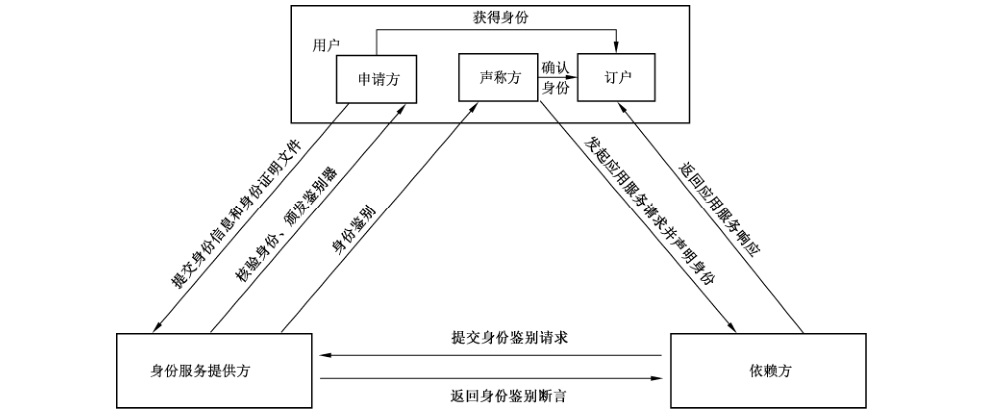
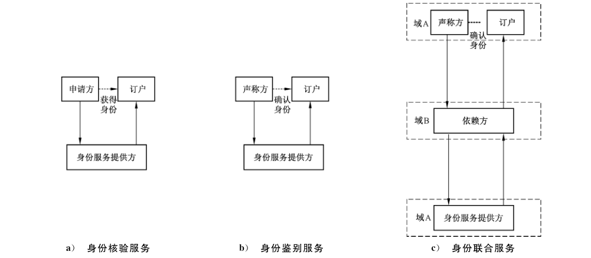

# GB/T 42573-2023 信息安全技术 网络身份服务安全技术要求

> 来源：[GB/T 42573-2023 国家标准详情](https://openstd.samr.gov.cn/bzgk/std/newGbInfo?hcno=8331694273433F56FF7836002242AA52)；发布日期：2023-05-23；实施日期：2023-12-01。
> PDF SHA-256：c2e1e38cb0c78c16f4463d8fc0a472d1bbce7219b3456b00d0e5c44e846ec99f。
> 转写说明：逐页对照官方 PDF 的 28 页图像校核文字、图示和附录表格；保留 5 幅原图，合并跨页表格与段落，省略封面、目录、页眉和页码。正式引用请核对原 PDF。

## 前言

本文件按照 GB/T 1.1—2020《标准化工作导则 第1部分：标准化文件的结构和起草规则》的规定起草。

请注意本文件的某些内容可能涉及专利。本文件的发布机构不承担识别专利的责任。

本文件由全国信息安全标准化技术委员会（SAC/TC 260）提出并归口。

本文件起草单位：北京数字认证股份有限公司、中国科学院数据与通信保护研究教育中心、中国科学院大学、公安部第一研究所、中国电子技术标准化研究院、中国科学院软件研究所、蚂蚁科技集团股份有限公司、国民认证科技（北京）有限公司、联想（北京）有限公司、北京中盾安信科技发展有限公司、北京快手科技有限公司。

本文件主要起草人：高能、李敏、林雪焰、马存庆、荆继武、刘丽敏、彭佳、屠晨阳、查达仁、张逸飞、邵森、傅大鹏、张妍、刘中、张永强、欧阳晖、郝春亮、李彦峰、张立武、张严、落红卫、王昕、李俊、柴海新、白培鑫、王开林。

## 1 范围

本文件确立了面向自然人的网络身份服务的参与方和模型，规定了网络身份服务安全级别和安全技术要求。

本文件适用于面向自然人的网络身份服务的设计、开发、部署和应用。

## 2 规范性引用文件

下列文件中的内容通过文中的规范性引用而构成本文件必不可少的条款。其中，注日期的引用文件，仅该日期对应的版本适用于本文件；不注日期的引用文件，其最新版本（包括所有的修改单）适用于本文件。

- GB/T 15843（所有部分）信息技术 安全技术 实体鉴别

- GB/T 22239 信息安全技术 网络安全等级保护基本要求

- GB/T 25069 信息安全技术 术语

- GB/T 35273 信息安全技术 个人信息安全规范

- GB/T 37036（所有部分）信息技术 移动设备生物特征识别

- GB/T 37092 信息安全技术 密码模块安全要求

- GB/T 40660 信息安全技术 生物特征识别信息保护基本要求

## 3 术语和定义

GB/T 25069界定的以及下列术语和定义适用于本文件。

### 3.1 身份服务提供方 identity service provider

在网络中提供身份服务的实体。

### 3.2 用户 user

使用网络身份服务的自然人。

> 注：申请方、声称方、订户代表了用户在不同场景下的不同角色。

### 3.3 依赖方 relying party

依赖身份鉴别结果以确定是否与用户建立信任关系的实体。

### 3.4 身份核验 identity proofing

收集用户身份信息，并验证用户身份信息的真实性的过程。

### 3.5 身份鉴别 identity authentication

验证用户所声称身份的过程。

### 3.6 身份联合 identity federation

依赖不在同一个安全域的身份服务提供方给出用户身份鉴别结果的过程。

### 3.7 网络身份服务 identity service in network

在网络中为用户提供身份核验、身份鉴别和身份联合服务的活动。

### 3.8 订户 subscriber

接受身份服务提供方提供的身份服务的合法用户。

### 3.9 申请方 applicant

请求成为订户的自然人。

### 3.10 声称方 claimant

宣称自己是订户的自然人。

［来源：GB/T 25069—2022,3.535，有修改］

### 3.11 用户标识 user identification

用于标识用户的一种字符串或模式。

［来源：GB/T 25069—2022,3.734，有修改］

### 3.12 远程递交材料身份核验 remote identity proofing

申请方通过在线或离线方式非现场提供身份证明材料进行身份核验的过程。

### 3.13 本人远程身份核验 in-person over remote channel identity proofing

申请方通过在线方式并亲自操作进行身份核验的过程。

示例：通过视频方式实时验证。

### 3.14 本人现场身份核验 in-person identity proofing

申请方通过亲自到现场的方式进行身份核验的过程。

### 3.15 鉴别器 authenticator

用户拥有或掌握的可用于鉴别其身份的功能组件或方法。

> 注：鉴别器包含实体凭证或凭证生成方法，参与并执行特定的鉴别协议。

### 3.16 声明 claim

在不给出证据的情况下所做的宣称或说明。

### 3.17 断言 assertion

身份服务提供方生成的对用户身份鉴别的结果。

> 注：包括断言主体（被鉴别身份的用户标识符）、断言发放者、断言接收者、签发时间等信息，也可包含用户属性信息等，表明了声称方为订户。

### 3.18 断言引用 assertion reference

和断言关联的，包含身份服务提供方标识的数据对象。

### 3.19 持有型断言 bearer assertion

可将断言持有者看作断言主体的断言类型。

> 注：不能保证断言的持有者就是断言中的主体。

### 3.20 密钥拥有型断言 holder-of-key assertion

可通过断言的持有者拥有的密钥证明其为断言主体的断言类型。

### 3.21 网络身份服务系统 identity service system in network

支撑网络身份服务的软硬件集合。

## 4 缩略语

下列缩略语适用于本文件。

AAL：鉴别保证级（Authentication Assurance Level）
FAL：联合保证级（Federation Assurance Level）
IAL：身份保证级（Identity Assurance Level）
OTP：动态口令（One Time Password）

## 5 网络身份服务概述

### 5.1 参与方

网络身份服务参与方包括用户、身份服务提供方和依赖方（三方交互示意图见图1）。申请方、声称方、订户代表了用户在不同场景下的不同角色。

a） 用户的主要职责包括：

- 向身份服务提供方提交身份信息和身份证明文件；

- 接受身份服务提供方的身份核验；

- 向依赖方发起应用服务请求并声明身份；

- 接受身份服务提供方的身份鉴别；

- 接收依赖方对应用服务请求的响应。

b） 身份服务提供方的主要职责包括：

- 对申请方的身份进行核验；

- 身份核验成功后向申请方颁发鉴别器；

- 接收来自依赖方的身份鉴别请求，并鉴别声称方身份；

- 向依赖方提供身份鉴别断言。

c） 依赖方的主要职责包括：

- 接收声称方的网络应用服务请求及身份声明；

- 向身份服务提供方提交身份鉴别请求；

- 接收身份服务提供方提供的身份鉴别断言；

- 向订户返回应用服务响应。

### 5.2 身份服务模型

网络身份服务模型见图2。网络身份服务分为身份核验服务、身份鉴别服务、身份联合服务三类。

a） 身份核验服务，流程如下。

1） 申请方提交身份信息和身份证明文件，进行登记；

2） 身份服务提供方核验身份信息和身份证明文件，核验通过后，向申请方颁发鉴别器，申请方获得身份成为身份服务提供方的订户。

b） 身份鉴别服务，流程如下。

1） 通过鉴别协议，使用鉴别器证明声称方是绑定到特定鉴别器的订户；

2） 对声称方进行身份鉴别，身份鉴别成功后，确认该声称方为订户。

c） 身份联合服务，发生在依赖方与身份服务提供方在不同安全域的情形，身份服务提供方对声称方进行身份鉴别后，将有关身份鉴别结果的断言或断言引用返回给依赖方，流程如下。

1） 声称方向依赖方发起应用服务请求并声明身份；

2） 依赖方向不同域的身份服务提供方发起身份鉴别请求；

3） 身份服务提供方对声称方进行身份鉴别，向依赖方返回断言或断言引用，声称方身份得到确认；

4） 依赖方向订户返回应用服务响应。

一般情况下，身份服务提供方同时提供身份核验服务和身份鉴别服务，可提供身份联合服务。

### 5.3 服务安全级别

本文件分别针对身份核验服务、身份鉴别服务、身份联合服务分别规定了4个要求逐级递增的安全级别，高安全级别在低安全级别的基础上进一步提出了更高的安全要求。各安全级别主要的区别简要描述如下，具体的安全要求见第6章。

a） 身份核验服务包括下列内容。

1） IAL-1，阐明了身份核验服务最低级别的安全要求：

- 唯一性：身份在特定语境中是唯一的；

- 收集属性类别：收集的用户属性能够唯一标识用户。

2） IAL-2，在IAL-1 的基础上主要增加了收集属性类别、实名核验、远程递交材料身份核验等方面的要求：

- 收集属性类别：收集的用户属性能与现实世界的自然人唯一关联，且拥有联系方式；

- 是否实名：对用户实名核验；

- 核验方法：核验收集的身份属性的真实性，至少采用远程递交材料身份核验等方式进行核验。

3） IAL-3，在IAL-2 的基础上主要增加了环境属性等属性收集要求、本人远程身份核验等方面的要求：

- 收集属性类別：在IAL-2的基础上要求收集用户登录环境信息，根据业务需求收集必要的经济属性、社会属性；

- 核验方法：核验收集的身份属性的真实性，至少采用本人远程身份核验或本人现场身份核验的方式进行核验。

4） IAL-4，阐明了身份核验最高级别的安全要求，在IAL-3 的基础上主要增加了收集属性类别、身份证明文件的数量要求、本人现场身份核验等方面的要求：

- 收集属性类别：在IAL-3的基础上建议收集生物特征属性、行为属性等更多种类的身份属性；

- 核验方法：相较于 IAL-3要求核验更多数量的权威来源身份证明文件，至少采用本人现场身份核验的方式进行核验。

b） 身份鉴别服务包括下列内容。

1） AAL-1，阐明了身份鉴别服务最低级别的安全要求，支持使用单因素鉴别方式来证明声称方是绑定到特定鉴别器的订户；

2） AAL-2，在 AAL-1 的基础上要求使用多因素鉴别方式；

3） AAL-3，在 AAL-2的基础上增加了对鉴别器中密码技术使用要求，动态鉴别要求：

- 鉴别因素：要求多因素鉴别方式中至少使用密码软件鉴别器或密码设备鉴别器来实现；

- 动态鉴别：具备基于网络环境的风险控制措施。

4） AAL-4，阐明了身份鉴别最高级别的安全要求，相较于 AAL-3，要求至少使用密码设备鉴别器，且提高了动态鉴别要求：

- 鉴别因素：要求多因素鉴别方式中至少使用密码设备鉴别器来实现；

- 动态鉴别：具备基于网络环境的风险控制措施，建议具备基于用户行为的风险控制措施。

c） 身份联合服务包括下列内容。

1） FAL-1，阐明了身份联合服务最低级别的安全要求：

- 断言签名：身份服务提供方到依赖方的断言由身份服务提供方进行签名；

- 断言类型：允许使用持有型断言或密钥拥有型断言。

2） FAL-2，在FAL-1 的基础上主要增加了断言加密要求。

3） FAL-3，在 FAL-2的基础上主要提高了断言类型要求、断言主体假名化要求：

- 断言类型：要求使用密钥拥有型断言；

- 断言主体假名化：建议断言主体假名化，依赖方和身份服务提供方可协商确定对不同的依赖方是否使用不同的用户假名。

4） FAL-4，阐明了身份联合最高级别的安全要求，在FAL-3 的基础上主要提高断言假名化要求，要求断言主体假名化，对不同的依赖方生成不同的用户假名。

服务安全级别的选取可基于风险评估的方式来确定。风险评估要素主要包括两方面。一方面，评估网络身份服务安全无法保证时可能导致的风险，风险类型主要包括：对个人的声誉、生活、财产带来影响或损失，对组织的声誉、财产带来影响或损失，造成个人或组织的敏感信息泄露，对社会秩序、经济秩序或公共利益造成危害，对国家安全造成危害等；另一方面，评估风险的影响程度，如个人财产损失程度可分为小额损失、巨额损失等。综合考虑风险及风险的影响程度，确定服务安全级别。针对三类服务可分别选择各自的IAL、AAL、FAL，且服务安全级别可不同。第6章将针对三类服务分别给出每个级别的安全技术要求，安全技术要求参见附录 A。

## 6 服务安全技术要求

### 6.1 身份核验服务

#### 6.1.1 用户标识要求

##### 6.1.1.1 唯一性要求

用户标识的唯一性要求如下：

a） 应确保每个用户在身份服务提供方内拥有唯一的标识；

b） 应确保每个用户在同一依赖方内拥有唯一的标识；

c） 可在不同依赖方内为同一用户分配不同的标识。

##### 6.1.1.2 实名要求

实名要求如下：

a） IAL-1：不要求实名，可使用匿名、假名或实名；

b） IAL-2、IAL-3、IAL-4：应进行实名核验，应具备提供实名、匿名或假名的能力。若提供匿名或假名，具备追溯匿名者或假名者的真实身份的能力。

#### 6.1.2 用户属性收集要求

用户属性类型包括法定属性、通信属性、社会属性、经济属性、生物特征属性、环境属性、行为属性等，常见用户属性的类型见附录 B，用户属性收集要求如下。

a） 应遵循最小化原则收集满足业务功能需要的用户属性。

b） 个人信息的收集和存储应符合 GB/T 35273 的规定。

c） 用户属性的类型要求如下：

1） IAL-1：身份服务提供方收集的用户属性能够唯一标识用户，不需对身份的真实性进行验证；

2） IAL-2：身份服务提供方应收集真实且可被核验的法定属性和通信属性；

3） IAL-3：在IAL-2的基础上，还应收集环境属性，应根据业务需求仅收集必要的经济属性、社会属性；

4） IAL-4：在IAL-3的基础上，还宜收集生物特征属性、行为属性。

> 注：当收集的用户属性为实名认证的手机号时，由于通过该手机号能关联到用户的法定属性（如姓名、身份证号），则该手机号既是通信属性，也是法定属性。

#### 6.1.3 用户身份核验要求

用户身份核验要求包括下列内容。

a） 身份核验方法要求如下：

1） IAL-1：不作要求；

2） IAL-2：法定属性应通过至少一种权威第三方提供的法定身份证明文件进行核验，通信属性应通过发送验证信息等方式进行核验（如向手机号发送确认信息），核验过程应至少采用远程递交材料身份核验的方式；

3） IAL-3：法定属性应通过至少一种权威第三方提供的法定身份证明文件进行核验，通信属性应通过发送验证信息等方式进行核验（如向手机号发送确认信息），经济属性应通过权威第三方提供的证明文件进行核验，社会属性应通过权威第三方提供的证明文件或质询第三方等方式进行核验，核验过程应采用本人远程身份核验或本人现场身份核验的方式；

4） IAL-4：法定属性应通过至少两种权威第三方提供的法定身份证明文件进行核验，通信属性应通过发送验证信息等方式进行核验（如向手机号发送确认信息），经济属性应通过权威第三方提供的证明文件进行核验，社会属性应通过权威第三方提供的证明文件或质询第三方等方式进行核验，核验过程应采用本人现场身份核验的方式。

b） 通信保护要求如下：

1） IAL-1：可采用密码技术保证通信过程数据的完整性，可采用密码技术保证通信过程重要的数据的机密性，可采用密码技术对通信实体进行鉴别；

2） IAL-2：可采用密码技术保证通信过程数据的完整性，宜采用密码技术保证通信过程重要的数据的机密性，宜采用密码技术对通信实体进行鉴别；

3） IAL-3：宜采用密码技术保证通信过程数据的完整性，应采用密码技术保证通信过程重要的数据的机密性，应采用密码技术对通信实体进行鉴别；

4） IAL-4：应采用密码技术保证通信过程数据的完整性，应采用密码技术保证通信过程重要的数据的机密性，应采用密码技术对通信实体进行双向鉴别。

#### 6.1.4 记录和存储要求

身份服务提供方应对身份核验服务的必要信息进行记录和存储，包括但不限于：收集的用户身份信息和身份证明文件、身份核验产生的过程信息、核验结果等数据，并保护重要的数据的机密性和完整性。

#### 6.1.5 风险缓解技术要求

身份核验服务面临的常见风险及缓解措施见附录C的C.1。

风险缓解技术要求如下：

a） IAL-1、IAL-2：应阐明能够缓解的风险，以及采取的风险缓解措施，并提供可以证明每个缓解措施有效性的证据；

b） IAL-3：应阐明能够缓解的风险，以及采取的风险缓解措施，提供可以证明每个缓解措施有效性的证据，并提供检测方法；

c） IAL-4：应阐明能够缓解的风险，以及采取的风险缓解措施，提供可以证明每个缓解措施有效性的证据，提供检测方法，并接受检测以证明其缓解风险措施的有效性。

#### 6.1.6 个人信息保护要求

身份核验服务中，个人信息保护要求如下：

a） 身份核验服务中个人信息的收集应符合GB/T 35273 中个人信息的收集要求；

b） 收集的用户身份信息和身份证明文件、身份核验产生的过程信息、核验结果等个人信息的存储应符合 GB/T 35273 中个人信息的存储要求；

c） 对个人信息的核验、访问、展示等使用环节，应符合GB/T 35273中个人信息的使用要求；

d） 身份核验服务中若涉及生物特征识别信息，还应符合GB/T 40660 的规定。

#### 6.1.7 系统安全保护要求

网络身份服务系统具备相应的保护能力：

a） IAL-1、IAL-2：网络身份服务系统应至少符合 GB/T 22239规定的第一级安全要求；

b） IAL-3：网络身份服务系统应至少符合 GB/T 22239规定的第二级安全要求；

c） IAL-4：网络身份服务系统应至少符合 GB/T 22239规定的第三级安全要求。

### 6.2 身份鉴别服务

#### 6.2.1 鉴别器要求

##### 6.2.1.1 概述

适用于身份鉴别服务的鉴别器通常包括以下几种类型（见附录 D）：

- 记忆秘密鉴别器；
- 查询秘密鉴别器；
- 带外鉴别器；
- 生物特征鉴别器；
- 单因素 OTP 设备鉴别器；
- 多因素 OTP 设备鉴别器；
- 单因素密码软件鉴别器；
- 多因素密码软件鉴别器；
- 单因素密码设备鉴别器；
- 多因素密码设备鉴别器。

单因素鉴别实现的方式包括但不限于使用如下鉴别器：

- 记忆秘密鉴别器；
- 查询秘密鉴别器；
- 带外鉴别器；
- 单因素 OTP 设备鉴别器；
- 单因素密码软件鉴别器；
- 单因素密码设备鉴别器。

多因素鉴别实现的方式包括但不限于使用如下鉴别器：

- 记忆秘密鉴别器和查询秘密鉴别器；
- 记忆秘密鉴别器和带外鉴别器；
- 记忆秘密鉴别器和单因素 OTP 设备鉴别器；
- 记忆秘密鉴别器和单因素密码软件鉴别器；
- 记忆秘密鉴别器和单因素密码设备鉴别器；
- 生物特征鉴别器；
- 多因素 OTP 设备鉴别器；
- 多因素密码软件鉴别器；
- 多因素密码设备鉴别器。

> 注：生物特征用于身份鉴别通常分为两种情况：第一种情况，生物特征作为多因素鉴别器的鉴别因素之一，例如，多因素密码设备鉴别器中使用生物特征激活密钥；第二种情况，作为生物特征鉴别器使用，该情况下，生物特征与设备关联，鉴别因素包括生物特征（自身属性）和关联设备（所拥有的）两种因素，属于多因素鉴别。

##### 6.2.1.2 绑定

鉴别器绑定要求如下：

a） 应维护鉴别器的绑定记录，包括当前绑定的或绑定过的鉴别器；

b） 应记录关于绑定的信息，包括但不限于绑定日期；

c） 应确保在身份核验和鉴别器绑定的整个过程中是同一个用户；

d） 应支持用户在已有鉴别器的基础上，申请绑定新的鉴别器；

e） AAL-2及以上的安全级别，宜为用户身份绑定两种或两种以上类型的鉴别器。

##### 6.2.1.3 使用

鉴别器使用要求如下：

a） AAL-1：应至少支持单因素鉴别方式，可使用任一种鉴别器进行身份鉴别；

b） AAL-2：应使用多因素鉴别方式，不应将生物特征鉴别器作为唯一可选的多因素鉴别方式，以避免强制个人同意收集其生物特征信息；

c） AAL-3：应使用多因素鉴别方式，其中一种鉴别因素至少使用密码软件鉴别器或密码设备鉴别器来实现，且所采用的密码模块应达到 GB/T 37092二级及以上安全要求；

d） AAL-4：应使用多因素鉴别方式，其中一种鉴别因素至少使用密码设备鉴别器来实现，且所采用的密码模块应达到 GB/T 37092三级及以上安全要求，多因素鉴别方式宜包含生物特征鉴别因素，包括但不限于人脸、声纹、指纹、虹膜等。

##### 6.2.1.4 更新

鉴别器更新要求如下：

a） 应在现有鉴别器到期前一段合适的时间要求用户更新鉴别器；

> 注：身份鉴别服务级别越高，提醒用户更新鉴别器的频次越多，例如：AAL-1 和 AAL-2设置为到期前一周提醒一次，AAL-3和 AAL-4设置为到期前一个月、一周、一天分别提醒一次。

b） 应与初始鉴别器颁发程序保持一致；

c） 更新成功后，应撤销被替代的鉴别器。

##### 6.2.1.5 失窃、损坏和复制

鉴别器失窃、损坏和复制要求如下：

a） 应采取安全措施防止鉴别器中的秘密信息被提取；

b） 应支持鉴别器的挂起和重新激活；

c） 应支持对用户身份进行重新核验，并绑定新的鉴别器。

##### 6.2.1.6 到期

鉴别器到期要求如下：

a） 到期的鉴别器不应再用于身份鉴别；

b） 当用户使用到期的鉴别器时，应告知鉴别器已到期；

c） 应对到期的鉴别器进行合理处置。

##### 6.2.1.7 撤销

鉴别器撤销要求如下：

a） 定期检查身份是否存在、身份是否满足资格要求、鉴别器风险状态等信息，当身份不存在，或用户提出撤销请求，或确定身份不再满足资格要求时，或鉴别器更新后，应及时撤销与该身份绑定的鉴别器；

> 注：身份鉴别服务级别越高，检查频率越高，例如：AAL-1和 AAL-2设置为每半年检查一次，AAL-3设置为每个月检查一次，AAL-4 设置为每周检查一次。

b） 撤销的鉴别器不应再用于身份鉴别；

c） 当鉴别器被撤销时，应对鉴别器进行合理处置，如回收后销毁、彻底清除鉴别器相关数据等。

#### 6.2.2 鉴别要求

##### 6.2.2.1 鉴别协议要求

鉴别协议要求如下：

a） 应建立安全的通信连接，通信保护要求如下：

1） AAL-1：可采用密码技术保证通信过程数据的完整性，可采用密码技术保证通信过程重要的数据的机密性，可采用密码技术对通信实体进行鉴别；

2） AAL-2：可采用密码技术保证通信过程数据的完整性，宜采用密码技术保证通信过程重要的数据的机密性，宜采用密码技术对通信实体进行鉴别；

3） AAL-3：宜采用密码技术保证通信过程数据的完整性，应采用密码技术保证通信过程重要的数据的机密性，应采用密码技术对通信实体进行鉴别；

4） AAL-4：应采用密码技术保证通信过程数据的完整性，应采用密码技术保证通信过程重要的数据的机密性，应采用密码技术对通信实体进行双向鉴别。

b）应采用动态信息（例如，随机数、挑战码）、时间戳等方式以防重放攻击。

c） 使用密码技术进行身份鉴别时，应符合 GB/T 15843（所有部分）的规定。

d） 应限制一定时间内身份鉴别的尝试次数，例如，1 min 之内的尝试次数不高于5次。

e） 应具备防止恶意登录的安全机制，例如，滑动图块、文字点选等机制。

f） 移动设备生物特征识别要求应符合GB/T 37036（所有部分）的规定。

##### 6.2.2.2 动态鉴别要求

动态鉴别要求如下：

a） AAL-1、AAL-2：不作要求；

b） AAL-3：应具备基于网络环境（例如，IP地址、终端设备、登录地点等）的风险控制措施，发现异常或在业务关键操作时，应及时通过多渠道向用户发送通知，并对用户身份重新鉴别；

c） AAL-4：应具备基于网络环境的风险控制措施，宜具备基于用户行为（例如，用户登录时间、时长、浏览习惯等）的风险控制措施，发现异常或在业务关键操作时，应及时通过多渠道向用户发送通知，并对用户身份重新鉴别。

#### 6.2.3 会话管理要求

身份鉴别成功后，身份服务提供方和用户之间可启动会话。当会话持续活跃超过一定时间或一段时间内不活跃时，应对用户身份重新鉴别，重新鉴别要求如下：

a） AAL-1：宜在7d 内进行重新鉴别；

b） AAL-2：宜在持续 12h活跃后或30 min 不活跃后，进行重新鉴别；

c） AAL-3：宜在持续12h 活跃后或10 min 不活跃后，进行重新鉴别；

d） AAL-4：宜在持续 12h 活跃后或5min 不活跃后，进行重新鉴别。

#### 6.2.4 记录和存储要求

身份服务提供方应对身份鉴别的必要信息进行记录和存储，包括但不限于：使用的身份鉴别协议、身份鉴别方法、鉴别器相关数据及身份鉴别产生的过程信息、鉴别结果等数据，并保护重要的数据的机密性和完整性。

#### 6.2.5 风险缓解技术要求

身份鉴别服务面临的常见风险及缓解措施见 C.2。

风险缓解技术要求如下：

a） AAL-1、AAL-2：应阐明能够缓解的风险，以及采取的风险缓解措施，并提供能证明每个缓解措施有效性的证据；

b） AAL-3：应阐明能够缓解的风险，以及采取的风险缓解措施，提供能证明每个缓解措施有效性的证据，并提供检测方法；

c） AAL-4：应阐明能够缓解的风险，以及采取的风险缓解措施，提供能证明每个缓解措施有效性的证据，提供检测方法，并接受检测以证明其缓解风险措施的有效性。

#### 6.2.6 个人信息保护要求

身份鉴别服务中，个人信息保护要求如下：

a） 应仅要求用户提供完成身份鉴别服务必要的个人信息，身份鉴别服务中个人信息的收集应符合GB/T 35273 中个人信息的收集要求；

b） 身份鉴别服务收集的鉴别器相关数据、身份鉴别产生的过程信息、鉴别结果等个人信息的存储应符合 GB/T 35273 中个人信息的存储要求；

c） 使用鉴别器完成身份鉴别时，涉及的个人信息使用应符合 GB/T 35273 中个人信息的使用要求；

d） 身份鉴别服务中若涉及生物特征识别信息，还应符合GB/T 40660 的规定。

#### 6.2.7 系统安全保护要求

网络身份服务系统应具备相应的保护能力：

a） AAL-1、AAL-2：网络身份服务系统应至少符合 GB/T 22239规定的第一级安全要求；

b） AAL-3：网络身份服务系统应至少符合 GB/T 22239规定的第二级安全要求；

c） AAL-4：网络身份服务系统应至少符合GB/T 22239规定的第三级安全要求。

### 6.3 身份联合服务

#### 6.3.1 身份联合服务建立要求

身份联合服务建立模式包括手动注册模式、动态注册模式，基于权威机构的模式，基于代理的模式等类型（见附录E），身份联合服务建立模式的要求如下。

a） 应使用安全的方法交换用于建立身份联合服务关系的密钥信息，包括公钥或共享的对称密钥。

使用的对称密钥对于一对身份服务提供方和依赖方应是唯一的。

b） 身份联合服务关系中，应建立身份服务提供方和依赖方预期可达到的以及可接受的IAL、AAL、FAL 的级别。

c） 动态注册模式中，身份服务提供方可对依赖方使用的属性类型及其他信息进行限定，依赖方可对期望接受的身份服务提供方进行限定。

d） 动态注册模式中，身份服务提供方应提供相应的配置信息（例如，IP 地址、端口），以减少系统管理员的人工配置操作。

e） 动态注册模式中，身份服务提供方可对正在动态注册中的依赖方的属性使用密码技术进行验证。

f） 基于权威机构的模式中，权威机构应对身份服务提供方生成的断言进行审查，确定其符合相应的断言要求（见 6.3.2、6.3.3、6.3.4、6.3.5）。

g） 基于权威机构的模式中，权威机构应审查确保依赖方遵守身份服务提供方的有关个人信息保护的要求。

h）基于权威机构的模式中，权威机构应审查确保身份服务提供方和依赖方使用安全的联合协议。

#### 6.3.2 断言传递要求

身份联合服务中，身份服务提供方将身份鉴别断言传递给依赖方时，应采用前端通道模式或后端通道模式。

a） 前端通道模式流程如下（见图3）：

1） 身份服务提供方对用户成功进行身份鉴别后，生成断言并传递给用户；

2） 用户将断言传递给依赖方。

b） 后端通道模式其流程如下（见图4）：

1） 身份服务提供方对用户成功进行身份鉴别后，生成断言和断言引用，并将断言引用传递给用户；

2） 用户将断言引用传递给依赖方；

3） 当收到断言引用后，依赖方向身份服务提供方发起断言请求；

4） 身份服务提供方将断言发送给依赖方。

#### 6.3.3 断言内容要求

断言内容要求如下。

a） 可只包含鉴别结果，也可同时包含用户身份信息。

b）应至少包含如下内容：

1） 主体：用户的标识符；

2） 发放者：发出断言的身份服务提供方的标识符；

3） 接收者：接收断言的依赖方的标识符；

4） 签发时间：身份服务提供方发出断言的时间戳；

5） 截止时间：断言何时失效的时间戳；

6） 断言标识符：唯一标识此断言的值；

7） 签名：身份服务提供方对断言的数字签名或消息鉴别码；

8） 鉴别时间：身份服务提供方最近一次对用户进行身份鉴别的时间戳。

c） 可包含如下内容：

1） 密钥绑定：用户拥有的密钥标识符或公钥；

2） 属性和属性引用：用户属性信息；

3） 属性元数据：描述用户属性的附加信息。

#### 6.3.4 断言类型要求

断言可分为持有型断言和密钥拥有型断言。使用持有型断言时，不需要验证断言的持有者为断言主体。使用密钥拥有型断言时，需要采用密码技术验证断言的持有者为断言主体。

断言类型要求如下：

a） FAL-1、FAL-2：可使用持有型断言或密钥拥有型断言；

b） FAL-3、FAL-4：应使用密钥拥有型断言。

#### 6.3.5 断言保护要求

##### 6.3.5.1 断言标识

断言应被唯一标识，确保依赖方能够区分。依赖方可基于签发时间、断言标识符等区分断言。

##### 6.3.5.2 断言签名

断言签名要求如下。

a） 签名内容应覆盖所有重要字段，包括但不限于标识符、发放者、接收者、主体和截止时间。

b） 应由身份服务提供方进行签名，并由依赖方对身份服务提供方的签名进行验证，以保证断言的完整性。

c） 断言签名可通过以下方式实现：

1） 使用身份服务提供方的签名私钥，生成断言的数字签名；

2） 使用身份服务提供方和依赖方共享的秘密信息，生成断言的消息鉴别码。

d） 使用数字签名作为断言签名时，依赖方可在运行时以安全的方式获取用于验证数字签名的公钥。

e） 使用消息鉴别码时，身份服务提供方应和不同依赖方共享不同的秘密信息。

##### 6.3.5.3 断言加密

可使用依赖方的公钥或依赖方和身份服务提供方共享的对称密钥，对断言进行加密，防止非授权用户获取断言信息，要求如下：

a） FAL-1：不作要求；

b） FAL-2、FAL-3、FAL-4：应对断言加密。

##### 6.3.5.4 接收者限制

接收者限制要求如下：

a） 身份服务提供方应确保依赖方能识别自身是否为断言的预期接收方；

b） 依赖方应检查断言的接收方是否包含自身的标识符。

##### 6.3.5.5 断言主体假名化

如果同一用户在多个依赖方处具有相同的用户标识符，那么这些依赖方可以通过该标识符关联到该用户在身份服务提供方的身份信息，断言主体假名化可避免这种情况。断言主体假名化要求如下：

a） FAL-1、FAL-2：不作要求；

b） FAL-3：宜将断言主体假名化，当使用假名时，假名应不包含关于用户的身份信息，确保依赖方无法关联到用户的真实身份；

c） FAL-4：应将断言主体假名化，假名应不包含关于用户的身份信息，确保依赖方无法关联到用户的真实身份，断言主体应使用假名，且应对不同的依赖方生成不同的用户假名。

#### 6.3.6 通信保护要求

通信保护要求如下：

a） FAL-1：可采用密码技术保证通信过程数据的完整性，可采用密码技术保证通信过程重要的数据的机密性，可采用密码技术对通信实体进行鉴别；

b） FAL-2：可采用密码技术保证通信过程数据的完整性，宜采用密码技术保证通信过程重要的数据的机密性，宜采用密码技术对通信实体进行鉴别；

c） FAL-3：宜采用密码技术保证通信过程数据的完整性，应采用密码技术保证通信过程重要的数据的机密性，应采用密码技术对通信实体进行鉴别；

d） FAL-4：应采用密码技术保证通信过程数据的完整性，应采用密码技术保证通信过程重要的数据的机密性，应采用密码技术对通信实体进行双向鉴别。

#### 6.3.7 会话管理要求

会话管理要求如下：

a） 身份联合服务中，身份服务提供方和用户之间的会话、依赖方和用户之间的会话独立管理，不应假定会话间具有关联性；

b） 当依赖方的会话到期且需要对用户身份重新鉴别时，身份服务提供方的会话可能未到期，身份服务提供方可根据该会话生成新的断言传递给依赖方，并告知依赖方最近一次用户身份鉴别时间，依赖方可根据该时间决定是否需要对用户身份重新鉴别；

c） 当依赖方规定了可接受的身份服务提供方鉴别用户身份的最长期限，若到期后用户未通过身份鉴别，则身份服务提供方应对用户身份重新鉴别后再生成断言。

#### 6.3.8 记录和存储要求

身份服务提供方应对身份联合的必要信息进行记录和存储，包括但不限于：断言接收者、签发时间、截止时间、断言类型、签名和加密信息及其他身份联合服务产生的相关数据，并保护重要的数据的机密性和完整性。

#### 6.3.9 风险缓解技术要求

身份联合服务面临的常见风险及缓解措施见 C.3。

风险缓解技术要求如下：

a） FAL-1、FAL-2：应阐明能够缓解的风险，以及采取的风险缓解措施，并提供可以证明每个缓解措施有效性的证据；

b） FAL-3：应阐明能够缓解的风险，以及采取的风险缓解措施，提供可以证明每个缓解措施有效性的证据，并提供检测方法；

c） FAL-4：应阐明能够缓解的风险，以及采取的风险缓解措施，提供可以证明每个缓解措施有效性的证据，提供检测方法，并接受检测以证明其缓解风险措施的有效性。

#### 6.3.10 个人信息保护要求

身份联合服务中，个人信息保护要求如下：

a） 身份服务提供方为依赖方提供的用户属性、断言等个人信息应符合GB/T 35273 中个人信息的共享要求；

b） 身份联合服务中产生的相关个人信息的存储应符合 GB/T 35273 中个人信息的存储要求；

c） 身份联合服务中涉及的个人信息使用应符合 GB/T 35273 中个人信息的使用要求；

d） 身份服务提供方应审查确保依赖方遵守身份服务提供方的有关个人信息保护的要求，包括但不限于收集、存储、使用等要求。

#### 6.3.11 系统安全保护要求

网络身份服务系统应具备相应的保护能力：

a） FAL-1、FAL-2：网络身份服务系统应至少符合 GB/T 22239规定的第一级安全要求；

b） FAL-3：网络身份服务系统应至少符合 GB/T 22239规定的第二级安全要求；

c） FAL-4：网络身份服务系统应至少符合GB/T 22239规定的第三级安全要求。

## 附录 A（资料性）网络身份服务安全技术要求

身份核验服务、身份鉴别服务、身份联合服务的安全技术要求汇总表见表 A.1、表 A.2 和表 A.3。

**表 A.1 身份核验服务安全技术要求汇总表**

| 安全要素 | IAL-1 | IAL-2 | IAL-3 | IAL-4 |
| --- | --- | --- | --- | --- |
| 1. 用户标识要求：唯一性 | 每个用户在同一个身份服务提供方标识是唯一的，在同一依赖方内标识是唯一的 | 同 IAL-1 | 同 IAL-1 | 同 IAL-1 |
| 1. 用户标识要求：实名 | 不要求实名认证 | 应进行实名认证 | 应进行实名认证 | 应进行实名认证 |
| 2. 用户属性收集要求 | 收集的用户属性能够唯一标识用户 | 应收集真实且可被核验的法定属性和通信属性 | 在 IAL-2 基础上还应收集环境属性，应根据业务需求仅收集必要的经济属性、社会属性 | 在 IAL-3 的基础上，还宜收集生物特征属性、行为属性 |
| 3. 用户身份核验要求：核验方法 | 对身份核验方法不作要求 | 法定属性应通过至少一种权威第三方提供的法定身份证明文件进行核验，通信属性应通过发送验证信息等方式进行核验（如向手机号发送确认信息），核验过程应至少采用远程递交材料身份核验的方式 | 法定属性、通信属性的核验方式与 IAL-2 相同，经济属性应通过权威第三方提供的证明文件进行核验，社会属性应通过权威第三方提供的证明文件或质询第三方等方式进行核验，核验过程应采用本人远程身份核验或本人现场身份核验的方式 | 法定属性应通过至少两种权威第三方提供的法定身份证明文件进行核验，通信属性、经济属性、社会属性的核验方式与 IAL-3 相同，核验过程应采用本人现场身份核验的方式 |
| 3. 用户身份核验要求：通信保护 | 可采用密码技术保证数据完整性和重要的数据的机密性，可采用密码技术对通信实体进行鉴别 | 可采用密码技术保证数据完整性，宜采用密码技术保证重要的数据的机密性，宜采用密码技术对通信实体进行鉴别 | 宜采用密码技术保证数据完整性，应采用密码技术保证重要的数据的机密性，应采用密码技术对通信实体进行鉴别 | 应采用密码技术保证通信过程数据的完整性，应采用密码技术保证通信过程重要的数据的机密性，应采用密码技术对通信实体进行双向鉴别 |
| 4. 记录和存储要求 | 对身份核验服务的必要信息进行记录和存储，包括但不限于：收集的用户身份信息和身份证明文件、身份核验产生的过程信息、核验结果等数据，并保护重要的数据的机密性和完整性 | 同 IAL-1 | 同 IAL-1 | 同 IAL-1 |
| 5. 风险缓解技术要求：风险 | 可能面临的风险至少考虑伪造、抵赖、泄露、篡改、钓鱼攻击等风险 | 同 IAL-1 | 同 IAL-1 | 同 IAL-1 |
| 5. 风险缓解技术要求：措施 | 应阐明能够缓解的风险，以及采取的风险缓解措施，提供可以证明每个缓解措施有效性的证据 | 同 IAL-1 | 提供可以证明每个缓解措施有效性的证据，并提供检测方法 | 提供可以证明每个缓解措施有效性的证据，提供检测方法，并接受检测 |
| 6. 个人信息保护要求 | 身份核验服务中个人信息保护要求见 6.1.6 | 同 IAL-1 | 同 IAL-1 | 同 IAL-1 |
| 7. 系统安全保护要求 | 至少符合 GB/T 22239 规定的第一级安全要求 | 至少符合 GB/T 22239 规定的第一级安全要求 | 至少符合 GB/T 22239 规定的第二级安全要求 | 至少符合 GB/T 22239 规定的第三级安全要求 |

**表 A.2 身份鉴别服务安全技术要求汇总表**

| 安全要素 | AAL-1 | AAL-2 | AAL-3 | AAL-4 |
| --- | --- | --- | --- | --- |
| 1. 鉴别器要求：绑定类型 | 对绑定类型不作要求 | 宜为用户身份绑定两种或两种以上类型的鉴别器 | 同 AAL-2 | 同 AAL-2 |
| 1. 鉴别器要求：鉴别方式 | 单因素鉴别方式，可使用任一种鉴别器 | 应使用多因素鉴别方式 | 应使用多因素鉴别方式，其中一种鉴别因素至少使用密码软件鉴别器或密码设备鉴别器来实现，且所采用的密码模块应达到 GB/T 37092 二级及以上安全要求 | 应使用多因素鉴别方式，其中一种鉴别因素至少使用密码设备鉴别器来实现，且所采用的密码模块应达到 GB/T 37092 三级及以上安全要求，多因素鉴别方式宜包含生物特征鉴别因素 |
| 1. 鉴别器要求：生命周期 | 鉴别器的更新、失窃、损坏和复制、到期、撤销见 6.2.1.4～6.2.1.6 | 同 AAL-1 | 同 AAL-1 | 同 AAL-1 |
| 2. 鉴别要求：重放与尝试次数 | 应采用动态信息等方式以防重放攻击，应限制身份鉴别的尝试次数等 | 同 AAL-1 | 同 AAL-1 | 同 AAL-1 |
| 2. 鉴别要求：通信保护 | 可采用密码技术保证数据完整性和重要的数据的机密性，可采用密码技术对通信实体进行鉴别 | 可采用密码技术保证数据完整性，宜采用密码技术保证重要的数据的机密性，宜采用密码技术对通信实体进行鉴别 | 宜采用密码技术保证数据完整性，应采用密码技术保证重要的数据的机密性，应采用密码技术对通信实体进行鉴别 | 应采用密码技术保证通信过程数据的完整性，应采用密码技术保证通信过程重要的数据的机密性，应采用密码技术对通信实体进行双向鉴别 |
| 2. 鉴别要求：动态鉴别 | 对动态鉴别不作要求 | 同 AAL-1 | 宜具备基于网络环境的风险控制措施，发现异常或在业务关键操作时，应及时通过多渠道向用户发送通知，并对用户身份重新鉴别 | 应具备基于网络环境的风险控制措施，宜具备基于用户行为的风险控制措施，发现异常或在业务关键操作时，应及时通过多渠道向用户发送通知，并对用户身份重新鉴别 |
| 3. 会话管理要求 | 宜在 7 d 内进行重新鉴别 | 宜在持续 12 h 活跃后或 30 min 不活跃后，进行重新鉴别 | 宜在持续 12 h 活跃后或 10 min 不活跃后，进行重新鉴别 | 宜在持续 12 h 活跃后或 5 min 不活跃后，进行重新鉴别 |
| 4. 记录和存储要求 | 身份服务提供方应对身份鉴别的必要信息进行记录和存储，记录和存储的信息包括但不限于：使用的身份鉴别协议、身份鉴别方法、鉴别器相关数据及身份鉴别产生的过程信息、鉴别结果等数据，并保护重要的数据的机密性和完整性 | 同 AAL-1 | 同 AAL-1 | 同 AAL-1 |
| 5. 风险缓解技术要求：风险 | 可能面临的风险至少考虑鉴别器失窃、鉴别器复制、窃听、离线猜测、在线猜测、侧信道攻击、钓鱼攻击、中间人攻击等风险 | 同 AAL-1 | 同 AAL-1 | 同 AAL-1 |
| 5. 风险缓解技术要求：措施 | 应阐明能够缓解的风险，以及采取的风险缓解措施，提供可以证明每个缓解措施有效性的证据 | 同 AAL-1 | 提供可以证明每个缓解措施有效性的证据，并提供检测方法 | 提供可以证明每个缓解措施有效性的证据，提供检测方法，并接受检测以证明其缓解风险措施的有效性 |
| 6. 个人信息保护要求 | 身份鉴别服务中个人信息保护要求见 6.2.6 | 同 AAL-1 | 同 AAL-1 | 同 AAL-1 |
| 7. 系统安全保护要求 | 至少符合 GB/T 22239 规定的第一级安全要求 | 至少符合 GB/T 22239 规定的第一级安全要求 | 至少符合 GB/T 22239 规定的第二级安全要求 | 至少符合 GB/T 22239 规定的第三级安全要求 |

**表 A.3 身份联合服务安全技术要求汇总表**

| 安全要素 | FAL-1 | FAL-2 | FAL-3 | FAL-4 |
| --- | --- | --- | --- | --- |
| 1. 身份联合服务建立要求 | 身份联合服务建立模式要求见 6.3.1 | 同 FAL-1 | 同 FAL-1 | 同 FAL-1 |
| 2. 断言传递要求 | 断言传递要求见 6.3.2 | 同 FAL-1 | 同 FAL-1 | 同 FAL-1 |
| 3. 断言内容要求 | 断言内容要求见 6.3.3 | 同 FAL-1 | 同 FAL-1 | 同 FAL-1 |
| 4. 断言类型要求 | 可使用持有型断言或密钥拥有型断言 | 同 FAL-1 | 应使用密钥拥有型断言 | 同 FAL-3 |
| 5. 断言保护要求：唯一标识 | 断言应被唯一标识，确保依赖方能够区分 | 同 FAL-1 | 同 FAL-1 | 同 FAL-1 |
| 5. 断言保护要求：签名 | 身份服务提供方对断言签名 | 同 FAL-1 | 同 FAL-1 | 同 FAL-1 |
| 5. 断言保护要求：加密 | 对断言加密不作要求 | 应对断言加密 | 同 FAL-2 | 同 FAL-2 |
| 5. 断言保护要求：接收者限制 | 接收者限制要求见 6.3.5.4 | 同 FAL-1 | 同 FAL-1 | 同 FAL-1 |
| 5. 断言保护要求：主体假名化 | 断言主体假名化要求见 6.3.5.5 | 同 FAL-1 | 同 FAL-1 | 同 FAL-1 |
| 6. 通信保护要求 | 可采用密码技术保证数据完整性和重要的数据的机密性，可采用密码技术对通信实体进行鉴别 | 可采用密码技术保证数据完整性，宜采用密码技术保证重要的数据的机密性，宜采用密码技术对通信实体进行鉴别 | 宜采用密码技术保证数据完整性，应采用密码技术保证重要的数据的机密性，应采用密码技术对通信实体进行鉴别 | 应采用密码技术保证通信过程数据的完整性，应采用密码技术保证通信过程重要的数据的机密性，应采用密码技术对通信实体进行双向鉴别 |
| 7. 会话管理要求 | 会话管理要求见 6.3.7 | 同 FAL-1 | 同 FAL-1 | 同 FAL-1 |
| 8. 记录和存储要求 | 身份服务提供方应对身份联合的必要信息进行记录和存储，记录和存储的信息包括但不限于：断言接收者、签发时间、截止时间、断言类型等，并保护重要的数据的机密性和完整性 | 同 FAL-1 | 同 FAL-1 | 同 FAL-1 |
| 9. 风险缓解技术要求：风险 | 可能面临的风险至少考虑断言泄露、身份服务提供方抵赖、用户抵赖、断言重放等风险 | 同 FAL-1 | 同 FAL-1 | 同 FAL-1 |
| 9. 风险缓解技术要求：措施 | 应阐明能够缓解的风险，以及采取的风险缓解措施，提供可以证明每个缓解措施有效性的证据 | 同 FAL-1 | 提供可以证明每个缓解措施有效性的证据，并提供检测方法 | 提供可以证明每个缓解措施有效性的证据，提供检测方法，并接受检测以证明其缓解风险措施的有效性 |
| 10. 个人信息保护要求 | 身份联合服务中个人信息保护要求见 6.3.10 | 同 FAL-1 | 同 FAL-1 | 同 FAL-1 |
| 11. 系统安全保护要求 | 至少符合 GB/T 22239 规定的第一级安全要求 | 至少符合 GB/T 22239 规定的第一级安全要求 | 至少符合 GB/T 22239 规定的第二级安全要求 | 至少符合 GB/T 22239 规定的第三级安全要求 |

## 附录 B（资料性）用户属性的类型

用户通常有多种用户属性，常见的用户属性可按照如下方式进行分类。

a） 法定属性：包括但不限于用户的姓名、性别、出生日期、身份证件号码、证件中的照片、住址等。

这些属性通常由政府颁发的具备法律效应的文件（例如，身份证、出生证明、护照等）来证明其真实性。

b）通信属性：包括但不限于用户的联系电话、邮箱、联系地址等。这些属性是可反映用户联系方式的信息。

c） 社会属性：包括但不限于用户的社会关系、教育背景、工作经历、是否有欺诈记录等。这些属性是可反映用户社会活动情况的信息。

d） 经济属性：包括但不限于用户的资产情况、收入情况等。这些属性是可以反映用户经济状况的信息，其真实性可通过财产证明、银行流水等方式来证明。这些属性直接与经济利益相关，需受到严格保护。

e） 生物特征属性：包括但不限于指纹、虹膜、声纹等。这些属性是用户所拥有的反映生物特征的信息。一旦被盗用则无法被替换，需受到严格保护。

f） 环境属性：包括但不限于执行登录过程时的IP 地址、终端设备、登录地点、终端等。这些属性用于反映用户所处的环境特征。可用于动态监测用户在使用网络身份服务过程中的环境安全性。

g） 行为属性：包括但不限于用户的登录时间、时长、浏览习惯、键盘鼠标操作习惯等。这些属性用于反映用户的行为特征。

## 附录 C（资料性）网络身份服务风险缓解

### C.1 身份核验服务的风险缓解

身份核验服务中，至少考虑到表 C.1 列出的风险，并采取措施进行缓解。

**表C.1 身份核验服务可能面临的风险和缓解措施**

| 序号 | 可能的风险 | 示例 | 可采取的缓解措施 |
| --- | --- | --- | --- |
| 1 | 伪造 | 伪造身份证明文件 | 1）核验身份证明文件的物理安全性；2） 通过比对权威第三方数据核验身份证明文件中的身份信息 |
| 2 | 抵赖 | 某个申请方在完成登记后，声称其没有登记过 | 要求申请方提交一份签名表单 |
| 3 | 泄露 | 口令在传输过程中被攻击者复制 | 采用安全的渠道交付并确认 |
| 4 | 篡改 | 口令在传输过程中被攻击者篡改 | 1）采用安全的渠道交付并确认；2） 支持用户对所接收的信息进行完整性校验 |
| 5 | 钓鱼攻击 | 用户身份信息被冒充的网站所窃取 | 1）使用来自正规来源的网站地址；2） 基于密码技术对网站进行鉴别 |

### C.2 身份鉴别服务的风险缓解

身份鉴别服务中，至少考虑到表 C.2 列出的风险，并采取措施进行缓解。

**表C.2 身份鉴别服务可能面临的风险和缓解措施**

| 序号 | 可能的风险 | 示例 | 可采取的缓解措施 |
| --- | --- | --- | --- |
| 1 | 鉴别器失窃 | 鉴别器丢失或被盗取 | 1）提供挂失措施；2） 使用多因素鉴别器 |
| 2 | 鉴别器复制 | 鉴别器被非法复制 | 采用防伪造技术（例如，密码技术） |
| 3 | 窃听 | 通过未加密的网络传输鉴别器的秘密信息，被攻击者截取 | 1）鉴别过程使用动态的鉴别参数（例如，动态口令）；2） 秘密信息在传输之前进行加密处理 |
| 4 | 重放攻击 | 攻击者可重放先前截获的用户与依赖方之间的信息，冒充用户向依赖方鉴别 | 鉴别协议中使用挑战码、随机数等 |
| 5 | 离线猜测 | 通过对需要口令激活的多因素密码硬件鉴别器进行字典攻击，识别出正确口令 | 限制激活鉴别器的尝试次数 |
| 6 | 在线猜测 | 猜测记忆秘密鉴别器或单因素 OTP 设备鉴别器的输出 | 1）使用强口令；2）限制身份鉴别的尝试次数 |
| 7 | 侧信道攻击 | 通过对鉴别器进行差分功耗分析或通过分析多次交互的响应时间来提取密钥 | 使用抗功耗分析的密码技术实现 |
| 8 | 钓鱼攻击 | 口令被冒充的网站所窃取 | 1）禁止来自不可信来源的图像和超文本链接以及在电子邮件客户端中提供视觉提示等方法保护实体免遭网络欺诈攻击；2）通信前基于密码技术对通信双方进行鉴别 |
| 9 | 中间人攻击 | 攻击者将自己置于用户和身份服务提供方之间，截获并修改鉴别协议消息的内容 | 1）使用双向鉴别机制，确保通信双方能够确认对方身份；2）采用数字签名保护消息的完整性 |

### C.3 身份联合服务的风险缓解

身份联合服务中，至少考虑到表 C.3 列出的风险，并采取措施进行缓解。

**表C.3 身份联合服务可能面临的风险和缓解措施**

| 序号 | 可能的风险 | 示例 | 可采取的缓解措施 |
| --- | --- | --- | --- |
| 1 | 断言泄露 | 断言可能包含用户身份鉴别结果、用户身份信息，断言泄露导致用户受到攻击 | 1）断言由身份服务提供方为依赖方加密；2） 使用双向鉴别机制，确保通信双方能够确认对方身份 |
| 2 | 身份服务提供方抵赖 | 断言签名为消息鉴别码，身份服务提供方否认断言是自己生成的 | 1） 断言签名使用数字签名；2） 使用引入可信第三方的消息鉴别码 |
| 3 | 用户抵赖 | 在前端通道模式下，用户否认向依赖方传递了断言 | 使用密钥拥有型断言 |
| 4 | 断言重放 | 攻击者将一个已经被依赖方使用过的断言再次重复使用 | 1）断言具有短的有效期；2）依赖方对要求在一定时间窗口（可配置）内使用的断言进行跟踪，以确保断言在该时间窗口内不被多次使用 |

## 附录 D（资料性）鉴别器类型

### D.1 记忆秘密鉴别器

记忆秘密鉴别器是用户选择和可记忆的秘密值（如口令）。

### D.2 查询秘密鉴别器

查询秘密鉴别器是存储用户和身份服务提供方共享的秘密的物理或电子记录，用户使用该鉴别器查找适当的秘密以回复来自验证者的挑战命令。例如，身份服务提供方可能要求用户从打印在表格中的数字或字符串中提供特定子集。

### D.3 带外鉴别器

带外鉴别器是唯一可寻址的硬件设备，可通过特殊信道或辅助信道安全地与验证者进行远程交互。

设备由用户拥有和控制，支持独立于用户身份鉴别主通道的专有通信信道。例如，用户尝试登录时，需要鉴别用户在手机上接收短信的内容。

### D.4 生物特征鉴别器

用户的生物特征包括但不限于人脸、声纹、指纹、虹膜等。使用生物特征鉴别器进行鉴别时，生物特征与设备关联，鉴别因素包括关联设备（所拥有的）和生物特征（自身属性）两种因素，属于多因素鉴别。

### D.5 单因素/多因素 OTP 设备鉴别器

OTP 设备是支持自发生成动态口令的硬件设备，包括硬件设备以及安装在硬件之上的基于软件的动态口令生成器。通过将显示在设备上的动态口令，由用户输入给验证者，从而证明用户对设备的拥有和控制。OTP 设备分为单因素 OTP 和多因素 OTP 设备。单因素 OTP 设备是指使用动态口令作鉴别因素以完成鉴别的 OTP 设备。多因素 OTP 设备是指使用多种因素协同完成鉴别的 OTP 设备，其中动态口令用来完成身份鉴别，而其他身份鉴别因素（例如，记忆秘密或生物特征）用来激活设备中的动态口令生成器。

### D.6 单因素/多因素密码软件鉴别器

密码软件是存储在磁盘或其他介质中具有密钥存储和密码运算功能的软件，通过证明对密钥的拥有和控制完成鉴别。可分为单因素密码软件和多因素密码软件。单因素密码软件是指使用密钥作为鉴别因素来执行密码运算以完成鉴别的密码软件。多因素密码软件是指使用多种因素协同完成鉴别的密码软件，其中密钥用来执行密码运算以完成身份鉴别，而其他身份鉴别因素（例如，记忆秘密或生物特征）用来激活该密钥。

### D.7 单因素/多因素密码设备鉴别器

密码设备可分为单因素密码设备和多因素密码设备。单因素密码设备是指使用密钥作为鉴别因素来执行密码运算以完成鉴别的密码设备。多因素密码设备是指使用多种因素协同完成鉴别的密码设备，其中密钥用来执行密码运算以完成身份鉴别，而其他身份鉴别因素（例如，记忆秘密或生物特征）用来激活该密钥。

## 附录 E（资料性）身份联合服务建立模式

身份联合服务可通过以下模式建立。

a） 手动注册模式：身份服务提供方和依赖方可通过手动配置信息的方式建立身份联合服务关系。

b） 动态注册模式：身份服务提供方和依赖方在交互过程中协商建立身份联合服务关系。

c） 基于权威机构的模式：身份服务提供方和依赖方依托双方信任的权威机构建立身份联合服务关系。权威机构对身份服务提供方和依赖方进行一定程度的审查，以验证是否符合预定的安全要求。经权威机构审查，确定身份服务提供方可提供的服务安全级别，依赖方根据该结果以及自身期望的服务安全级别，确定哪些身份服务提供方满足要求。权威机构审查匹配结果示例见表E.1。

**表E.1 权威机构审查匹配结果示例**

| 身份服务提供方 | 对身份服务提供方的审查结果 | 依赖方 1：IAL-1、AAL-1、FAL-1 | 依赖方 2：IAL-1、AAL-2、FAL-2 | 依赖方 3：IAL-3、AAL-4、FAL-4 |
| --- | --- | --- | --- | --- |
| 身份服务提供方 1 | IAL-1 AAL-1 FAL-1 | 匹配 | 不匹配 | 不匹配 |
| 身份服务提供方 2 | IAL-1、IAL-2 AAL-1、AAL-2 FAL-1、FAL-2 | 匹配 | 匹配 | 不匹配 |
| 身份服务提供方 3 | IAL-1、IAL-2、IAL-3、IAL-4 AAL-1、AAL-2、AAL-3、AAL-4 FAL-1、FAL-2、FAL-3、FAL-4 | 匹配 | 匹配 | 匹配 |

d） 基于代理的模式：身份服务提供方和依赖方通过代理建立身份联合服务关系。基于代理的模式见图E.1，对于身份服务提供方 A，代理充当依赖方的角色，对于依赖方B而言，代理则充当身份服务提供方的角色。

## 参考文献

- ［1］ GB/T 36633 信息安全技术 网络用户身份鉴别技术指南

- ［2］ GB/T 40651 信息安全技术 实体鉴别保障框架

- ［3］ ISO/IEC TS 29003 Information technology—Security techniques—Identity proofing

- ［4］ ISO/IEC 29115 Security technique—Entity authentication assurance framework

- ［5］ NIST SP 800-63-3 Digital Identity Guidelines

- ［6］ NIST SP 800-63A Digital Identity Guidelines—Enrollment and Identity Proofing

- ［7］ NIST SP 800-63B Digital Identity Guidelines—Authentication and Lifecycle Management

- ［8］ NIST SP 800-63C Digital Identity Guidelines—Federation and Assertions

- ［9］ GPG No.45 Identity Proofing and Verification of an Individual
