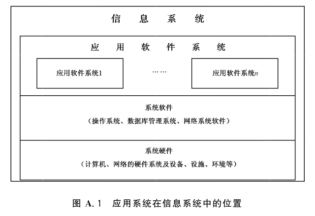

# GB/T 28452-2012 信息安全技术 应用软件系统通用安全技术要求

> 来源：[GB/T 28452-2012 国家标准详情](https://openstd.samr.gov.cn/bzgk/std/newGbInfo?hcno=A7CE21302D6D3CAF95C8993ABF42FB62)；封面发布日期：2012-06-29；实施日期：2012-10-01。
> 官方在线预览截图 SHA-256：34bb3cfde74c7f705f5dc316edeb7b349627c9e139df75004374e517f4f5d3bb。
> 依据官方在线预览全部 56 页的页面图像转写与校核；省略封面、目录、页眉、页脚和分页，合并跨页表格及印刷折行。图 A.1 保留为原页图像。

## 前言

本标准按照 GB/T 1.1—2009给出的规则起草。

请注意本文件的某些内容可能涉及专利。本文件的发布机构不承担识别这些专利的责任。

本标准由全国信息安全标准化技术委员会（SAC/TC 260）提出并归口。

本标准起草单位：北京江南天安科技有限公司、北京思源新创信息安全资讯有限公司。

本标准主要起草人：吉增瑞、陈冠直、王志强、景乾元。

## 引言

本标准描述为实现 GB 17859—1999所规定的每一个安全保护等级的应用软件系统应达到的安全技术要求，为按照信息系统安全等级保护的要求设计和实现所要求的安全等级的应用软件系统提供指导。

从广义角度，应用软件系统应该包括针对特定应用开发的业务处理软件，以及为这些业务处理软件的开发和运行提供支持的各种工具软件和中间件等。本标准仅对各个安全保护等级的业务处理软件的安全保护应采取的安全技术进行描述。

应用软件系统是信息系统的重要组成部分，是信息系统中对应用业务进行处理的软件的总和。业务应用的安全需求，是信息系统安全需求的出发点和归宿。信息系统安全所采取的一切技术和管理措施，最终都是确保业务应用安全的。这些安全措施，有的可以在应用软件系统中实现，有的需要在信息系统的其他组成部分实现。

本标准主要是对各个应用领域的应用软件系统普遍适用的安全技术要素的安全技术要求的描述。

不同应用领域的应用软件系统可选取不同的安全技术要素，以满足各自应用业务的具体安全需求。本标准同时对应用软件系统生存周期的各个阶段应遵循的安全技术要求进行了简要描述。

按照标准编写的规范性要求，本标准在第1章范围、第2章规范性引用文件及第3章术语和定义、缩略语之后，第4章应用软件生存周期安全技术要求，从应用软件生存周期的角度，分别对应用软件的开始阶段、获得或开发阶段、实现和评估阶段、运行和维护阶段以及结束和处置阶段的安全技术要求进行了简要描述。标准从第5章到第9章，以 GB 17859—1999的五个安全等级的划分为基本依据，以GB/T 20271—2006关于信息系统通用安全技术要求的等级划分为基础，对每一个安全等级的应用软件系统的安全技术要求进行了描述，包括：安全功能技术要求和安全保证技术要求（含应用软件系统安全子系统自身保护要求、应用软件系统安全子系统设计和实现要求、应用软件系统安全子系统安全管理要求）。在第5章到第9章的分等级描述中，“加粗宋体”表示在较高等级中比较低一级增加或增强的内容。本标准附录A（资料性附录）应用软件系统安全的有关概念说明，对应用软件系统在信息系统中的位置和应用软件系统安全在信息系统安全中的作用等进行了说明。附录 B（资料性附录）应用软件系统安全与信息系统安全的关系，对应用软件系统安全是信息系统安全的核心和应用软件系统安全需求就是信息系统安全需求进行了描述。附录C（资料性附录）给出了应用软件系统安全要素与安全分等级要求之间的对应关系。表C.1是安全功能技术要素与安全功能技术分等级要求的对应关系；表C.2是安全保证技术要素与安全保证技术分等级要求的对应关系。

## 1 范围

本标准规定了按照 GB 17859—1999的5个安全保护等级的划分对应用软件系统进行等级保护所涉及的通用技术要求。

本标准适用于按照 GB 17859—1999的5个安全保护等级的划分对应用软件系统进行的安全等级保护的设计与实现。对于按照 GB 17859—1999的5个安全保护等级的划分对应用软件系统进行的安全等级保护的测试、管理也可参照使用。

## 2 规范性引用文件

下列文件对于本文件的应用是必不可少的。凡是注日期的引用文件，仅注日期的版本适用于本文件。凡是不注日期的引用文件，其最新版本（包括所有的修改单）适用于本文件。

GB 17859—1999 计算机信息系统安全保护等级划分准则

- GB/T 20271—2006 信息安全技术 信息系统通用安全技术要求

- GB/T 20272—2006 信息安全技术 操作系统安全技术要求

- GB/T 20273—2006 信息安全技术 数据库管理系统安全技术要求

## 3 术语和定义、缩略语

### 3.1 术语和定义

GB/T 20271—2006 界定的以及下列术语和定义适用于本文件。

#### 3.1.1 应用软件系统 application software system

信息系统的重要组成部分，是指信息系统中对特定业务进行处理的软件系统。

#### 3.1.2 应用软件系统安全技术 application software system security technology

为确保应用软件系统达到确定的安全性目标的安全技术措施中可采用的技术。

#### 3.1.3 应用软件系统安全子系统（SSOASS） security subsystem of application software system

应用软件系统中安全保护模块的总称。它建立了应用软件系统的一个基本安全保护环境，并提供安全应用软件系统要求的附加用户服务。按照 GB 17859—1999对可信计算基（TCB）的定义，SSOASS属于应用软件系统的TCB。其中所需要的硬件和固件支持由低层的安全机制提供。

#### 3.1.4 SSOASS 安全策略（SSP） SSOASS security policy

对 SSOASS 中的资源进行管理、保护和分配的规则。一个 SSOASS 中可以有一种或多种安全策略。

#### 3.1.5 安全功能策略（SFP） security function policy

为实现 SSOASS安全要素的功能所采用的安全策略。

#### 3.1.6 安全技术要素 security technique element

本标准中各安全保护等级的安全技术要求所包含的安全内容的组成成分。

#### 3.1.7 SSOASS 安全功能（SSF） SSOASS security function

正确实施SSOASS安全策略的全部硬件、固件、软件所提供的功能。每一种安全策略的实现，体现在SSOASS 的某一个安全功能模块之中。一个 SSOASS 的所有安全功能模块共同组成该 SSOASS的安全功能。

#### 3.1.8 SSF 控制范围（SSC） SSF scope of control

SSOASS 的操作所涉及的主体和客体的范围。

#### 3.1.9 用户公开数据 user published data

在应用软件系统中向所有用户公开的数据，该类数据的安全性受到破坏，将会对业务应用相关的公民、法人和其他组织的权益有一定影响，但不会危害国家安全、社会秩序、经济建设和公共利益。

#### 3.1.10 用户一般数据 user general data

在应用软件系统中具有一般使用价值和保密程度，需要进行一定保护的单位内部的一般数据。该类数据的安全性受到破坏，将会对业务应用相关的公民、法人和其他组织的权益有较大影响或对国家安全、社会秩序、经济建设和公共利益造成一定的损害。

#### 3.1.11 用户重要数据 user important data

在应用软件系统中具有重要使用价值或保密程度，需要进行重点保护的单位的重要数据。该类数据的安全性受到破坏，将会对业务应用相关的公民、法人和其他组织的权益有重大影响或对国家安全、社会秩序、经济建设和公共利益造成较大损害。

#### 3.1.12 用户关键数据 user chief data

在应用软件系统中具有很高使用价值或保密程度，需要进行特别保护的单位的关键数据。该类数据的安全性受到破坏，将会对业务应用相关的公民、法人和其他组织的权益有特别重大影响或对国家安全、社会秩序、经济建设和公共利益造成严重损害。

#### 3.1.13 用户核心数据 user kernel data

在应用软件系统中具有最高使用价值或保密程度，需要进行绝对保护的单位的核心数据。该类数据的安全性受到破坏，将会对相关的业务应用和用户单位利益造成特别严重损害。

#### 3.1.14 一般用户 general user

以普通用户身份注册到应用软件系统，运行应用软件系统的用户或通过系统提供的用户操作界面对应用软件系统的运行进行操作控制的用户。

#### 3.1.15 系统用户 system user

在应用软件系统中，通过系统操作界面进行特定操作实现对应用软件系统的特定功能进行控制的用户，如应用软件系统的管理员、安全员和审计员等。系统用户具有一般用户所不具有的特殊权限，所以也称特权用户。

### 3.2 缩略语

下列缩略语适用于本文件。

- SSOASS：应用软件系统安全子系统（security subsystem of application software system）；
- SSP：SSOASS 安全策略（SSOASS security policy）；
- SFP：安全功能策略（security function policy）；
- SSF：SSOASS 安全功能（SSOASS security function）；
- SSC：SSF 控制范围（SSF scope of control）。

## 4 应用软件生存周期安全技术要求

### 4.1 应用软件开始阶段安全技术要求

为确保应用软件系统的安全性达到相应安全等级的安全技术要求，应用软件生存周期开始阶段的安全技术要求如下：

a） 详细说明相应安全等级的应用软件系统的保密性、完整性和可用性指标；

b） 详细说明应用软件系统中需要保护的用户资产；

c） 完成初步的应用软件系统风险评估；

d）详细说明应用软件系统安全应采用的整体安全策略。

### 4.2 应用软件获得或开发阶段安全技术要求

为确保应用软件系统在软件获得或开发过程中的安全性达到相应安全等级的安全技术要求，对于通过各种途径获得的应用软件或自主开发的应用软件，在本阶段的安全技术要求如下：

a） 选择并确定相应安全等级的应用软件系统的安全技术要求；

b） 自主开发的应用软件，应按照确定的安全技术要求进行安全设计和实现；

c） 获得的应用软件，应确认其满足所确定的安全技术要求；

d） 自主开发的应用软件，应对其开发和运行中的安全附加开销和性能进行分析，并对成本和风险进行折中平衡；

e） 获得的应用软件，应对其运行中安全附加开销和性能进行分析，确认其成本和风险符合折中平衡的要求。

### 4.3 应用软件实现和评估阶段安全技术要求

为了确保应用软件系统在安全设计和评估过程中达到确定的安全等级所要求的安全目标要求，应用软件实现和评估阶段的安全技术要求如下：

a） 编程语言、编译器和程序库应按照确定的满足相应安全等级要求的安全准则进行鉴定；

b） 应用程序的代码应被检验，以确保保密性、完整性和可用性目标已经达到，并且安全性没有降低；

c） 测试软件成分和评估一个系统需要一个静态方法的组合（例如，按照适当选择的设想测试软件和固件）；

d） 软件部件的安全测试和分布式软件的安全测试是关键性的开发活动之一，应按照相应安全等级的要求进行安全性测试；

e） 对高等级的应用软件系统，应使用形式化方法对应用软件的安全设计进行验证；

f） 通过测试与评估确认应用软件的安全性是否达到所确定的安全技术要求，对于未达到安全技术要求的，应从应用软件获得或开发阶段重新开始开展工作。

### 4.4 应用软件运行和维护阶段安全技术要求

为了确保应用软件系统在运行维护过程中达到相应安全等级确定的安全目标，并能根据情况的变化及时改变安全设计，应用软件系统运行和维护阶段安全技术要求如下：

a） 按照相关文档的操作说明和所确定的操作规程，进行应用软件系统安全机制的配置和操作；

b） 定期或根据情况的变化及时进行应用软件系统安全性评估，并在必要时对安全性要求进行重新定义和设计，形成新的修订版本；

c） 对应用软件系统的修订版本进行严格的测试和必要的控制，确认其达到新目标的要求，且未产生不良影响。

### 4.5 应用软件结束和处置阶段安全技术要求

为了确保应用软件系统的安全目标在其生存周期结束时不会受到影响，结束和处置阶段安全技术要求如下：

a） 对于结束运行的应用软件，应进行认真处置，确保该软件系统在结束运行后，不会带来安全相关问题；

b） 对于信息系统中所有与该应用软件系统相关的程序和数据信息均应进行妥善处理，除了根据信息系统的需要保留一些与业务应用无关的数据信息（如用户名和标识）以外，信息系统中不应有与该应用软件的业务有关的残留信息；

c） 对于该应用软件系统运行过程中使用过的可移动的记录介质，应进行记录内容的消除，确保介质中不残留任何与该应用软件相关的信息。

## 5 第一级应用软件系统安全技术要求

### 5.1 安全功能技术要求

#### 5.1.1 用户身份鉴别

用户身份鉴别包括对一般用户和系统用户（如系统管理员）的身份进行标识和鉴别。应按GB/T 20271—2006中6.1.3.1的要求，从以下方面设计和实现应用软件系统的身份鉴别功能：

a） 用户注册：对应用软件系统的注册用户，按以下要求设计和实现标识功能：

1） 凡需进入应用软件系统的用户，应先进行标识（建立注册账号）；

2） 应用软件系统的用户应以用户名和用户标识符（UID）等信息进行标识；

b） 用户登录：对登录到应用软件系统的用户，应按以下要求进行身份的真实性鉴别：

1） 采用口令进行鉴别，并在每次用户登录系统时进行鉴别；

2） 口令应是不可见的，具有相应的抗攻击能力，并在存储时有安全保护；

3） 通过对不成功的鉴别尝试的值（包括尝试次数和时间的阈值）进行预先定义，并明确规定达到该值时所应采取的具有规范性和安全性的措施来实现鉴别失败的处理；

c） 用户-主体绑定：对注册到应用软件系统的用户，应按以下要求设计和实现用户-主体绑定功能：

1） 将用户进程与所有者用户相关联，使用户进程的行为可以追溯到进程的所有者用户；

2） 将系统进程动态地与当前服务要求者用户相关联，使系统进程的行为可以追溯到当前服务要求者用户。

#### 5.1.2 自主访问控制

应按 GB/T 20271—2006 中6.1.3.2的要求，从以下方面设计和实现应用软件系统的自主访问控制功能：

a） 自主访问控制功能：对命名用户以用户/用户组规定并控制其对客体的访问，并阻止非授权用户对客体的访问；可以有多个自主访问控制功能，但其访问控制策略应具有一致性；

b） 自主访问控制策略：提供用户按照确定的访问控制策略对自身创建的客体的访问进行控制的功能，包括：

1） 客体创建者有权以各种操作方式访问自身所创建的客体；

2） 客体创建者有权对其他用户进行“访问授权”，使其可对客体拥有者创建的指定客体能按授权的操作方式进行访问；

3） 客体创建者有权对其他用户进行“授权传播”，使其可以获得将该拥有者的指定客体的访问权限授予其他用户的权限；

4） 客体创建者有权收回其所授予其他用户的“访问授权”和“授权传播”；

5） 未经授权的用户不得以任何操作方式访问客体；

6） 授权用户不得以未授权的操作方式访问客体；

c） 操作系统支持的自主访问控制：以文件形式存储和操作的用户数据，在操作系统的支持下，按GB/T 20272—2006 中4.1.1.2的要求，可实现文件级粒度的自主访问控制；

d） 数据库管理系统支持的自主访问控制：以数据库形式存储和操作的用户数据，在数据库管理系统的支持下，按GB/T 20273—2006中5.1.1.2的要求，可实现对表级粒度的自主访问控制；

e） 应用软件系统自身的自主访问控制：在应用软件系统中，通过设置自主访问控制的安全机制，可实现文件级粒度的自主访问控制。

#### 5.1.3 用户数据完整性保护

应按 GB/T 20271—2006 中 6.1.3.3 的要求，对在应用软件系统控制范围内存储和传输的用户数据，从以下方面设计和实现完整性保护功能：

用户公开数据的传输保护：对应用软件系统中通过网络传输的用户公开数据，进行完整性检测，发现其完整性被破坏的情况。

#### 5.1.4 备份与故障恢复

应按 GB/T 20271—2006 中 6.1.2.4 的要求，从以下方面设计和实现应用软件系统的备份与故障恢复：

用户自我信息备份与恢复：提供用户有选择地备份重要信息的功能；当由于某种原因引起信息系统中用户信息丢失或破坏时，能提供用户按自我信息备份所保留的信息进行信息恢复的功能。

### 5.2 安全保证技术要求

#### 5.2.1 安全子系统自身安全保护要求

##### 5.2.1.1 SSF 物理安全保护

应按GB/T 20271—2006中6.1.4.1的要求，从以下方面实现应用软件系统 SSF 的物理安全保护：物理攻击检测。

##### 5.2.1.2 SSF 运行安全保护

应按 GB/T 20271—2006 中6.1.4.2的要求，从以下方面设计和实现应用软件系统 SSF 的运行安全保护：

a） 后门控制：系统在设计时不应留有“后门”。即不应以维护、支持或操作需要为借口，设计有违反或绕过安全规则的任何类型的入口和文档中未说明的任何模式的入口。

b） 安全系统子集结构：安全系统应是一个独立的、严格定义的应用软件系统的一个子集，并应防止外部干扰和破坏，如修改其代码或数据结构。

c） 用户和管理员安全属性定义：应提供设置和升级配置参数的安装机制；在初始化和对与安全有关的数据结构进行保护之前，应对用户和管理员的安全策略属性进行定义。

d） 安全系统失败或中断的处理：在 SSOASS 失败或中断后，应按照失败保护中所描述的内容，保护其以最小的损害实现对 SSF 出现失败时的处理。

##### 5.2.1.3 SSF 数据安全保护

应按 GB/T 20271—2006中6.1.4.3的要求，对在SSOASS 内传输的SSF 数据进行以下安全保护：SSF 数据传输保护：实现 SSOASS 内 SSF数据的基本传输保护。

##### 5.2.1.4 安全子系统资源利用

应按GB/T 20271-2006 中6.1.4.4的要求，从以下方面实现 SSOASS的资源利用：

a） 通过一定措施确保当系统出现某些确定的故障时，SSF 也能维持正常运行；

b） 对主体使用 SSC内某个资源子集，按有限服务优先级，进行 SSOASS 资源的管理和分配；

c） 按资源分配中最大限额的要求，进行 SSOASS 资源的管理和分配，确保用户和主体不会独占某种受控资源。

##### 5.2.1.5 安全子系统访问控制

应按 GB/T 20271-2006 中6.1.4.5的要求，从以下方面实现 SSOASS的访问控制：

a） 按会话建立机制，对会话建立的管理进行设计。

b） 按可选属性范围限定的要求，从访问方法、访问地址和访问时间等方面，对用来建立会话的安全属性的范围进行限制。

c） 按多重并发会话限定中基本限定的要求，进行会话管理的设计。在基于基本标识的基础上，SSF 应限制系统的并发会话的最大次数，并就会话次数的限定数设置默认值。

#### 5.2.2 安全子系统设计和实现要求

##### 5.2.2.1 配置管理

应按 GB/T 20271-2006 中6.1.5.1的要求，提供基本的配置管理能力，即要求开发者所使用的版本号与所表示的SSOASS样本完全对应。

##### 5.2.2.2 分发和操作

应按 GB/T 20271—2006 中6.1.5.2的要求，从以下方面实现 SSOASS的分发和操作：

a） 以文档形式描述对SSOASS 安全地进行分发的过程，对安装、初始化、启动并最终生成安全配置的过程进行说明。文档中所描述的内容应包括：

1） 分发的过程；

2） 安全启动和操作的过程。

b）在交付过程中，应将系统的未授权修改风险控制到最低限度。包装及安全分送和安装过程中的安全性应由最终用户确认。

c） 所有软件应提供安全安装默认值，在客户不做选择时，使安全机制自动地发挥作用。

d） 随同系统交付的全部默认用户标识码，应在交付时处于非激活状态，并在使用前由管理员激活。

e） 用户文档应同交付的软件一起包装，并有相应的规程确保交付的软件是严格按照最新的版本制作的。

##### 5.2.2.3 开发

应按 GB/T 20271—2006中 6.1.5.3的要求，从以下方面进行 SSOASS 的开发：

a） 按非形式化功能说明、描述性高层设计、SSF 子集实现、SSF 内部结构模块化、描述性低层设计和非形式化对应性说明的要求，进行SSOASS 的设计；

b） 开发过程应保护数据的完整性，例如，检查数据更新的规则，多重输入的正确处理，返回状态的检查，中间结果的检查，异常值输入检查，事务处理更新的正确性检查等；

c） 通过对内部代码的检查，解决潜在的安全缺陷，关闭或取消所有的后门；

d） 对交付的软件和文档，应进行关于安全缺陷的定期的和书面的检查，并将检查结果告知用户；

e） 由系统控制的敏感数据，如口令、密钥等，不应在未受保护的程序或文档中以明文形式存储；

f） 应以书面形式提供给用户关于软件所有权法律保护的指南。

##### 5.2.2.4 文档

应按 GB/T 20271—2006中 6.1.5.4的要求，从以下方面编制 SSOASS 的文档：

a） 用户文档应提供关于不同类型用户的可见的安全机制，并说明它们的用途和提供有关它们使用的指南；

b） 安全管理员文档应提供有关如何设置、维护和分析系统安全的详细说明，以及与安全有关的管理员功能的详细描述，包括增加和删除一个用户，改变主、客体的安全属性等；

c） 文档中不应提供任何一旦泄露将会危及本安全级范围内系统安全的信息；

d） 有关安全的指令和文档根据权限应分别提供给一般用户、系统管理员、系统安全员和系统审计员；这些文档应为独立的文档，或作为独立的章、条插入到安全管理指南和用户指南中。

##### 5.2.2.5 生存周期支持

应按 GB/T 20271-2006中6.1.5.5的要求，从以下方面实现 SSOASS的生存周期支持：

a） 生存周期模型：按开发者定义生存周期模型进行 SSOASS 开发；

b） 生存周期文档要求：文档应详细阐述安全启动和操作的过程，详细说明安全功能在启动、正常操作维护时是否能被撤销或修改，说明在故障或系统出错时如何恢复系统至安全状态。

##### 5.2.2.6 测试

应按 GB/T 20271—2006 中6.1.5.6 的要求，从以下方面对 SSOASS 进行测试：

a）通过一般功能测试，符合性独立测试，确认 SSOASS 的功能与所要求功能的一致性；

b） 所有系统的安全特性，应被全面测试；

c） 所有发现的漏洞应被改正、消除或使其无效，并在消除漏洞后重新测试，以证实它们已被消除，且没有引出新的漏洞；

d）应提供测试文档，详细描述测试计划、测试过程、测试结果。

#### 5.2.3 安全子系统安全管理要求

应根据本安全等级中安全功能技术要求和安全保证技术要求所涉及的 SSOASS 自身保护、SSOASS 设计和实现等有关内容，按GB/T 20271—2006中6.1.6 的要求，从以下方面实现SSOASS的安全管理：

a） 操作规程和规章制度：对安全保证措施所涉及的SSOASS 自身保护、SSOASS 设计和实现等有关内容，以及与一般的安装、配置等有关的功能，制定相应的操作、运行规程和行为规章制度；

b） SSF 安全功能管理：对SSOASS中的每个安全功能模块，根据安全功能技术和安全保证技术所实现的安全功能，实现 SSF 安全功能的管理。

## 6 第二级应用软件系统安全技术要求

### 6.1 安全功能技术要求

#### 6.1.1 用户身份鉴别

用户身份鉴别包括对一般用户和系统用户（如系统管理员、审计员）的身份进行标识和鉴别。应按 GB/T 20271—2006 中 6.2.3.1 的要求，从以下方面设计和实现应用软件系统的用户身份鉴别功能：

a） 用户注册：对应用软件系统的注册用户，按以下要求设计和实现标识功能：

1） 凡需进入应用软件系统的用户，应先进行标识（建立注册帐号）；

2） 应用软件系统的用户应以用户名和用户标识符（UID）等信息进行标识，并在应用软件系统的整个生存周期实现用户的唯一性标识，以及用户名或别名、UID 等之间的一致性；

b） 用户登录：对登录到应用软件系统的用户，应按以下要求进行身份的真实性鉴别：

1） 采用强化管理的口令鉴别/基于令牌的动态口令鉴别/生物特征鉴别机制进行用户身份鉴别，并在每次用户登录系统时进行鉴别；

2） 鉴别信息应是不可见的，具有相应的抗攻击能力，并在存储和传输时进行安全保护；

3） 通过对不成功的鉴别尝试的值（包括尝试次数和时间的阈值）进行预先定义，并明确规定达到该值时所应采取的具有规范性和安全性的措施来实现鉴别失败的处理；

c） 用户-主体绑定：对注册到应用软件系统的用户，应按以下要求设计和实现用户-主体绑定功能：

1） 将用户进程与所有者用户相关联，使用户进程的行为可以追溯到进程的所有者用户；

2） 将系统进程动态地与当前服务要求者用户相关联，使系统进程的行为可以追溯到当前服务要求者用户。

#### 6.1.2 自主访问控制

应按 GB/T 20271—2006中6.2.3.2的要求，从以下方面设计和实现应用软件系统的自主访问控制功能：

a） 自主访问控制功能：命名用户以用户的身份规定并控制对客体的访问，并阻止非授权用户对客体的访问；可以有多个自主访问控制功能，但其访问控制策略必须具有一致性；

b） 自主访问控制策略：提供用户按照确定的访问控制策略对自身创建的客体的访问进行控制的功能，包括：

1） 客体创建者有权以各种操作方式访问自身所创建的客体；

2） 客体创建者有权对其他用户进行“访问授权”，使其可对客体拥有者创建的指定客体能按授权的操作方式进行访问；

3） 客体创建者有权对其他用户进行“授权传播”，使其可以获得将该拥有者的指定客体的访问权限授予其他用户的权限；

4） 客体创建者有权收回其所授予其他用户的“访问授权”和“授权传播”；

5） 未经授权的用户不得以任何操作方式访问客体；

6） 授权用户不得以未授权的操作方式访问客体；

c） 操作系统支持的自主访问控制：以文件形式存储和操作的用户数据，在操作系统的支持下，按GB/T 20272—2006中 4.2.1.2的要求，可实现文件级粒度的自主访问控制；

d） 数据库管理系统支持的自主访问控制：以数据库形式存储和操作的用户数据，在数据库管理系统的支持下，按GB/T 20273-2006中5.2.1.2的要求，可实现对表级/记录、字段级粒度的自主访问控制；

e） 应用软件系统自身的自主访问控制：在应用软件系统中，通过设置自主访问控制的安全机制，可实现文件级粒度的自主访问控制。

#### 6.1.3 安全审计

应按 GB/T 20271—2006 中 6.2.2.3的要求，从以下方面设计和实现应用软件系统的安全审计功能：

a） 安全审计内容：安全审计功能的设计应与用户标识与鉴别、自主访问控制等安全功能的设计紧密结合；

b） 安全审计处理：提供审计日志，潜在侵害分析，基本审计查阅和有限审计查阅，安全审计事件选择，以及受保护的审计踪迹存储等功能。

#### 6.1.4 用户数据完整性保护

应按GB/T 20271—2006中6.2.3.3的要求，对在应用软件系统控制范围内存储和传输的用户数据，从以下方面设计和实现完整性保护功能：

a） 用户公开数据的传输保护：对应用软件系统中通过网络传输的用户公开数据，进行完整性检测，发现其完整性被破坏的情况；

b） 用户一般数据的存储保护：对在应用软件系统中存储的用户一般数据，进行完整性检测，在数据被使用前发现其完整性被破坏的情况；

c） 用户一般数据的传输保护：对应用软件系统中通过网络传输的用户一般数据，进行完整性检测，发现其完整性被破坏的情况；

d） 用户一般数据的处理保护：对应用软件系统中进行处理的用户一般数据，通过操作序列的回退等措施，实现完整性保护。

#### 6.1.5 用户数据保密性保护

应按 GB/T 20271—2006 中 6.2.3.4 的要求，对在应用软件系统控制范围内存储和传输的用户数据，从以下方面设计和实现保密性保护功能：

a） 用户一般数据的存储保护：对在应用软件系统中存储的用户一般数据，通过相应安全级别/强度的密码机制或其他安全机制，实现保密性保护；

b） 用户一般数据的传输保护：对应用软件系统中通过网络传输的用户一般数据，通过相应安全级别/强度的密码机制或其他安全机制，实现保密性保护；

c） 用户一般数据的剩余信息保护：对应用软件系统中由用户一般数据使用的缓冲存储器及其他动态记录介质，通过在释放其使用权时对剩余信息进行删除等措施，确保不会由于动态记录介质中的剩余信息引起信息泄漏。

#### 6.1.6 备份与故障恢复

应按GB/T 20271—2006中6.2.2.5的要求，从以下方面设计和实现应用软件系统的备份与故障恢复：

a） 用户自我信息备份与恢复：提供用户有选择地备份重要信息的功能；当由于某种原因引起信息系统中用户信息丢失或破坏时，能提供用户按自我信息备份所保留的信息进行信息恢复的功能；

b） 增量信息备份与恢复：提供由应用软件系统定时对新增信息进行备份的功能；当由于某种原因引起应用软件系统中的某些信息丢失或破坏时，提供用户按增量信息备份所保留的信息进行信息恢复的功能。

#### 6.1.7 系统安全性检测分析

应按 GB/T 20271—2006 中6.2.2.2的要求，检测分析应用软件系统的安全性，并结合本级的安全性要求加以改进。

### 6.2 安全保证技术要求

#### 6.2.1 安全子系统自身保护要求

##### 6.2.1.1 SSF 物理安全保护

应按 GB/T 20271—2006 中 6.2.4.1 的要求，从以下方面实现应用软件系统 SSF 的物理安全保护：物理攻击检测。

##### 6.2.1.2 SSF 运行安全保护

应按GB/T 20271—2006 中6.2.4.2 的要求，从以下方面实现应用软件系统SSF 的运行安全保护：

a） 后门控制：系统在设计时不应留有“后门”。即不应以维护、支持或操作需要为借口，设计有违反或绕过安全规则的任何类型的入口和文档中未说明的任何模式的入口；

b） 安全系统子集结构：安全系统应是一个独立的、严格定义的应用软件系统的一个子集，并应防止外部干扰和破坏，如修改其代码或数据结构；

c） 用户和管理员安全属性定义：应提供设置和升级配置参数的安装机制；在初始化和对与安全有关的数据结构进行保护之前，应对用户和管理员的安全策略属性进行定义；

d） 安全系统失败或中断的处理：在SSOASS 失败或中断后，应按照失败保护中所描述的内容，保护其以最小的损害实现对 SSF 出现失败时的处理；

e） 安全系统配置：当应用软件系统安装完成后，在普通用户访问之前，系统应配置好初始用户和管理员职责、审计参数、系统审计跟踪设置以及对客体的合适的访问控制。

##### 6.2.1.3 SSF 数据安全保护

应按 GB/T 20271—2006 中 6.2.4.3 的要求，对在 SSOASS 内传输的 SSF 数据进行以下安全保护：

a） SSF 数据传输保护：实现 SSOASS 内SSF 数据的基本传输保护；

b） SSF 数据一致性保护：实现 SSOASS 内 SSF 数据复制的一致性保护。

##### 6.2.1.4 安全子系统资源利用

应按 GB/T 20271—2006 中6.2.4.4 的要求，从以下方面实现 SSOASS的资源利用：

a） 通过一定措施确保当系统出现某些确定的故障时，SSF 也能维持正常运行；

b） 对SSC 内某个资源子集，按有限服务优先级，进行资源的管理和分配；

c） 按资源分配中最大限额的要求，进行 SSOASS 资源的管理和分配，确保用户和主体不会独占某种受控资源；

d）确保在被授权的主体发出请求时，资源能被访问和利用；

e） 当系统资源的服务水平降低到预先规定的最小值时，应能检测和报警。

##### 6.2.1.5 安全子系统访问控制

应按 GB/T 20271—2006 中 6.2.4.5 的要求，从以下方面实现 SSOASS 的访问控制：

a） 按会话建立机制的要求，设计会话建立的管理；在建立SSOASS会话之前，应鉴别用户的身份，并不允许鉴别机制本身被旁路；

b）按可选属性范围限定的要求，从访问方法、访问地址和访问时间等方面，对用来建立会话的安全属性的范围进行限制；

c） 按多重并发会话限定中基本限定的要求，进行会话管理的设计；在基于基本标识的基础上，SSF 应限制系统的并发会话的最大次数，并就会话次数的限定数设置默认值。

d） 在用户成功登录系统后，SSOASS 应记录并向用户显示以下数据：

1） 日期、时间、来源和上次成功登录系统的情况；

2） 上次成功访问系统以来用户身份鉴别失败的情况；

3） 应显示口令到期的天数；

4） 成功或不成功的事件次数的显示可以用整数计数、时间戳列表等表述方法。

#### 6.2.2 安全子系统设计和实现要求

##### 6.2.2.1 配置管理

应按GB/T 20271—2006中6.2.5.1的要求，从以下方面实现 SSOASS 的配置管理：

a） 在配置管理能力方面，实现对版本号、配置项、授权控制等方面的管理；

b） 配置管理范围方面，将SSOASS的实现表示、设计文档、测试文档、用户文档、管理员文档以及配置管理文档等置于配置管理之下；

c） 在系统的整个生存周期，即在其开发、测试和运行维护期间，只有被授权的代码和代码修改才允许被加进已交付的源码的基本部分；所有变更应被记载和检查，以确保不危及系统的安全；通过技术、物理和规章方面的结合，充分保护生成系统所用到的源码免遭未授权的修改和毁坏；

d） 在软件配置管理系统中，应包含以下方面的工具：

1） 从源码产生出系统新版本；

2） 鉴定新生成的系统版本（如不同版本源码对比）；

3） 保护源码免遭未授权修改。

##### 6.2.2.2 分发和操作

应按GB/T 20271—2006中6.2.5.2的要求，从以下方面实现 SSOASS 的分发和操作：

a） 以文档形式提供对 SSOASS 安全地进行分发的过程，对安装、生成和启动并最终生成安全配置的过程进行说明。文档中所描述的内容应包括：

1） 提供分发的过程；

2） 安全启动和操作的过程；

3） 建立日志的过程；

b） 在交付过程中，应将系统的未授权修改风险控制到最低限度。包装及安全分送和安装过程中的安全性应由最终用户确认；

c） 所有软件应提供安全安装默认值，在客户不做选择时，使安全机制自动地发挥作用；

d） 随同系统交付的全部默认用户标识码，应在交付时处于非激活状态，并在使用前由管理员激活；

e） 用户文档应同交付的软件一起包装，并有相应的规程确保交付的软件是严格按照最新的版本制作的。

##### 6.2.2.3 开发

应按GB/T 20271—2006中6.2.5.3的要求，从以下方面进行 SSOASS 的开发：

a） 按非形式化安全策略模型、完全定义的外部接口、描述性高层设计、SSF 子集实现、SSF 内部结构层次化、描述性低层设计、非形式化对应性说明的要求，进行 SSOASS 的设计；

b） 系统的设计和开发应保护数据的完整性，例如，检查数据更新的规则，多重输入的正确处理，返回状态的检查，中间结果的检查，异常值输入检查，事务处理更新的正确性检查等；

c） 在内部代码检查时，应解决潜在的安全缺陷，关闭或取消所有的后门；

d） 交付的软件和文档，应进行关于安全缺陷的定期的和书面的检查，并将检查结果告知用户；

e） 由系统控制的敏感数据，如口令、密钥等，不应在未受保护的程序或文档中以明文形式存储；

f） 应以书面形式提供给用户关于软件所有权法律保护的指南。

##### 6.2.2.4 文档

应按GB/T 20271—2006中6.2.5.4的要求，从以下方面编制 SSOASS 的文档：

a） 用户文档应提供关于不同类型用户的可见的安全机制，并说明它们的用途和提供有关它们使用的指南；

b） 安全管理员文档应提供有关如何设置、维护和分析系统安全的详细说明，包括当运行一个安全设备时，需要控制的有关功能和特权的警告，以及与安全有关的管理员功能的详细描述，包括增加和删除一个用户，改变主、客体的安全属性等；

c） 文档中不应提供任何一旦泄露将会危及本安全级范围内系统安全的信息；

d） 有关安全的指令和文档根据权限应分别提供给一般用户、系统管理员、系统安全员和系统审计员；这些文档应为独立的文档，或作为独立的章、条插入到安全管理指南和用户指南中；

e） 提供关于所有审计工具的文档，包括为检查和保持审计文件所推荐的过程、针对每种审计事件的详细审计记录、为周期性备份和删除审计记录所推荐的过程等；

f） 提供如何进行系统自我评估（带有网络管理、口令要求、拨号访问控制、意外事故计划的安全报告）和为灾害恢复计划所做的建议，以及描述普通入侵技术、其他威胁及其检查和阻止的方法。

##### 6.2.2.5 生存周期支持

应按GB/T 20271—2006中6.2.5.5的要求，从以下方面实现SSOASS 的生存周期支持：

a） 生存周期模型：按开发者定义生存周期模型明确定义开发工具的要求进行 SSOASS 开发，并提供开发过程中的安全措施说明；

b） 生存周期文档要求：文档应详细阐述安全启动和操作的过程，详细说明安全功能在启动、正常操作维护时是否能被撤销或修改，说明在故障或系统出错时如何恢复系统至安全状态。

##### 6.2.2.6 测试

应按GB/T 20271—2006中 6.2.5.6的要求，从以下方面对 SSOASS 进行测试：

a） 通过范围证据和范围分析，高层设计的测试，一般功能测试和符合性独立测试，确认 SSOASS的功能与所要求功能的一致性；

b） 所有系统的安全特性，应被全面测试，包括查找漏洞，如允许违反系统访问控制要求、允许违反资源访问控制要求、允许拒绝服务、允许验证数据进行未授权访问等；

c） 所有发现的漏洞应被改正、消除或使其无效，并在消除漏洞后重新测试，以证实它们已被消除，且没有引出新的漏洞；

d） 应提供测试文档，详细描述测试计划、测试过程、测试结果。

##### 6.2.2.7 脆弱性评定

应按 GB/T 20271-2006 中6.2.5.7 的要求，从以下方面对 SSOASS 进行脆弱性评定：

a） 对防止误用的评定，通过对文档的检查，查找SSOASS以不安全的方式进行使用或配置而不为人们所察觉的情况；

b） 对SSOASS安全功能强度评估，通过对安全机制的安全行为的合格性或统计结果的分析，证明其达到或超过安全目标要求所定义的最低强度；

c） 开发者脆弱性分析，确定明显的安全脆弱性的存在，并确认在所期望的环境中所存在的脆弱性不会被利用。

#### 6.2.3 安全子系统安全管理要求

应根据本安全等级中安全功能技术要求所涉及的安全功能技术要求和安全保证技术要求所涉及的SSOASS 自身保护、SSOASS设计和实现等有关内容，按GB/T 20271—2006 中6.2.6的要求，从以下方面实现 SSOASS的安全管理：

a） 操作规程和规章制度：对安全保证措施所涉及的SSOASS自身保护、SSOASS 设计和实现等有关内容，以及与一般的安装、配置等有关的功能，制定相应的操作、运行规程和行为规章制度；

b） SSF 安全功能管理：对SSOASS 中的每个安全功能模块，根据安全功能技术和安全保证技术所实现的安全功能，实现SSF 安全功能的管理；

c） SSF 安全属性管理：对SSOASS 中的每个安全功能模块，根据安全功能技术和安全保证技术所涉及的安全属性，从管理安全属性、安全的安全属性、静态属性初始化、安全属性终止和安全属性撤销等方面，实现 SSF 安全属性的安全管理；

d） SSF 安全数据管理：对SSOASS 中的每个安全功能模块，根据安全功能技术和安全保证技术所涉及的安全数据，从管理SSF 数据、SSF 数据界限的管理和安全的SSF数据等方面，实现SSF 安全数据的安全管理。

## 7 第三级应用软件系统安全技术要求

### 7.1 安全功能技术要求

#### 7.1.1 用户身份鉴别

用户身份鉴别包括对一般用户和系统用户（如系统安全员、审计员和安全员）的身份进行标识和鉴别。应按 GB/T 20271—2006 中 6.3.3.1的要求，从以下方面设计和实现应用软件系统的用户身份鉴别：

a） 用户注册：对应用软件系统的注册用户，按以下要求设计和实现标识功能：

1） 凡需进入应用软件系统的用户，应先进行标识（建立注册账号）；

2） 应用软件系统的用户应以用户名和用户标识符（UID）等信息进行标识，并在应用软件系统的整个生存周期实现用户的唯一性标识，以及用户名或别名、UID 等之间的一致性；

3） 对提供单点登录的分布式应用软件系统的用户应提供单点标识，且单点标识应具有与常规标识相同的安全性；

b） 用户登录：对登录到应用软件系统的用户，应按以下要求进行身份的真实性鉴别：

1） 采用强化管理的口令鉴别/基于令牌的动态口令鉴别/生物特征鉴别/数字证书鉴别机制进行用户身份鉴别，并在每次用户登录系统时进行鉴别；对系统用户应采用两种或两种以上组合的鉴别机制进行身份鉴别；

2） 鉴别信息应是不可见的，具有相应的抗攻击能力，并在存储和传输时按GB/T 20271—2006 中 6.3.3.9的要求，用加密方法/具有相同安全强度的其他方法进行安全保护；

3） 通过对不成功的鉴别尝试的值（包括尝试次数和时间的阈值）进行预先定义，并明确规定达到该值时所应采取的具有规范性和安全性的措施来实现鉴别失败的处理；

4） 对提供单点登录的分布式应用软件系统的用户应提供单点鉴别，且单点鉴别应具有与常规鉴别相同的安全性；

c） 用户-主体绑定：对注册到应用软件系统的用户，应按以下要求设计和实现用户-主体绑定功能：

1） 将用户进程与所有者用户相关联，使用户进程的行为可以追溯到进程的所有者用户；

2） 将系统进程动态地与当前服务要求者用户相关联，使系统进程的行为可以追溯到当前服务要求者用户。

#### 7.1.2 抗抵赖

抗抵赖包括以下内容：

a） 抗原发抵赖：对于在网络环境进行数据交换的情况，应按GB/T 20271-2006 中 6.3.3.2a）的要求，通过提供选择性原发证据，实现抗原发抵赖功能；

b） 抗接收抵赖：对于在网络环境进行数据交换的情况，应按 GB/T 20271—2006 中6.3.3.2b）的要求，通过提供选择性接收证据，实现抗接收抵赖功能。

#### 7.1.3 自主访问控制

应按 GB/T 20271—2006 中 6.3.3.3 的要求，从以下方面设计和实现应用软件系统的自主访问控制：

a） 自主访问控制功能：命名用户以用户的身份规定并控制对客体的访问，并阻止非授权用户对客体的访问；可以有多个自主访问控制功能，但其访问控制策略必须具有一致性；

b） 自主访问控制策略：提供用户按照确定的访问控制策略对自身创建的客体的访问进行控制的功能，包括：

1） 客体创建者有权以各种操作方式访问自身所创建的客体；

2） 客体创建者有权对其他用户进行“访问授权”，使其可对客体拥有者创建的指定客体能按授权的操作方式进行访问；

3） 客体创建者有权对其他用户进行“授权传播”，使其可以获得将该拥有者的指定客体的访问权限授予其他用户的权限；

4） 客体创建者有权收回其所授予其他用户的“访问授权”和“授权传播”，并对授权传播进行限制，对不可传播的授权进行明确定义，由系统自动检查并限制这些授权的传播；

5） 未经授权的用户不得以任何操作方式访问客体；

6） 授权用户不得以未授权的操作方式访问客体；

c） 操作系统支持的自主访问控制：以文件形式存储和操作的用户数据，在操作系统的支持下，按GB/T 20272—2006 中4.3.1.2的要求，可实现文件级粒度的自主访问控制；

d） 数据库管理系统支持的自主访问控制：以数据库形式存储和操作的用户数据，在数据库管理系统的支持下，按GB/T 20273—2006中5.3.1.2的要求，可实现对表级/记录、字段级粒度的自主访问控制；

e）应用软件系统自身的自主访问控制：在应用软件系统中，通过设置自主访问控制安全机制，可实现文件级粒度的自主访问控制；

f） 分布式系统的自主访问控制：对分布式应用软件系统，应实行统一的自主访问控制安全策略，确保每一个场地的主、客体具有一致的安全属性，并执行相同的访问规则；

g） 网络环境的自主访问控制：对分布于网络环境的应用软件系统，应根据业务应用的实际需要确定实行统一的或各自独立的自主访问控制安全策略。

#### 7.1.4 标记

应按 GB/T 20271—2006中6.3.3.4的要求，从以下方面设计和实现主、客体标记功能：

a） 用户的敏感标记：应在用户建立注册帐户后由系统安全员通过SSOASS所提供的安全员界面操作进行标记；

b） 客体的敏感标记：应在数据输入到SSOASS 安全功能的控制范围内时，以默认方式生成或由安全员通过操作界面进行标记；

c） 标记的范围：对分布式应用软件系统，实施相同强制访问控制安全策略的各个场地的主、客体，应以相同的敏感信息进行标记；

d） 分布式系统标记的一致性：对分布式应用软件系统，实施相同强制访问控制安全策略的各个场地的主、客体，应以相同的敏感信息进行标记；

e） 网络环境标记的独立性/一致性：对分布于网络环境的应用软件系统，应根据统一的或各自独立的强制访问控制策略，对主、客体进行统一的或各自独立的敏感信息的标记。

#### 7.1.5 强制访问控制

应按 GB/T 20271—2006 中6.3.3.5的要求，从以下方面设计和实现应用软件系统的强制访问控制：

a） 强制访问控制功能：按确定的强制访问控制安全策略，设计和实现相应的强制访问控制功能；可以有多个强制访问控制功能，但其访问控制策略应具有一致性。

b） 操作系统支持的强制访问控制：以文件形式存储和操作的用户数据，在操作系统的支持下，按GB/T 20272—2006 中4.3.1.4的要求，可实现文件级粒度的强制访问控制；

c） 数据库管理系统支持的强制访问控制：以数据库形式存储和操作的用户数据，在数据库管理系统的支持下，按GB/T 20273—2006中5.3.1.4的要求，可实现表/记录、字段级粒度的强制访问控制；

d） 应用软件系统自身的强制访问控制：在应用软件系统中，在 PMI（授权管理基础设施）支持下，可实现文件级粒度的强制访问控制；

e） 强制访问控制的范围：应将强制访问控制的范围限定在所定义的主体与客体；

f） 权限分离与最小授权：将系统的常规管理、与安全有关的管理以及审计管理，分别由系统管理员、系统安全员和系统审计员来承担，按最小授权原则分别授予它们各自为完成自己所承担任务所需的最小权限，并在它们之间形成相互制约的关系；

g） 分布式系统的强制访问控制：对实施相同强制访问控制安全策略的分布式应用软件系统，各个场地应具有一致的主、客体标记和相同的访问规则；

h） 网络环境的强制访问控制：对分布于网络环境的应用软件系统，应根据业务应用的实际需要确定统一的或各自独立的强制访问控制安全策略。

#### 7.1.6 安全审计

应按GB/T 20271—2006中6.3.2.4的要求，从以下方面设计和实现应用软件系统的安全审计：

a） 安全审计内容：安全审计功能的设计应与用户标识与鉴别、自主访问控制、标记与强制访问控制等安全功能的设计紧密结合；

b） 安全审计处理：提供审计日志、实时报警生成，潜在侵害分析、基于异常检测，基本审计查阅、有限审计查阅和可选审计查阅，安全审计事件选择，以及受保护的审计踪迹存储和审计数据的可用性确保等功能；

c） 安全审计的统一管理：对网络环境下运行的应用软件系统，应建立统一管理和控制的安全审计机制。

#### 7.1.7 用户数据完整性保护

应按GB/T 20271—2006中6.3.3.7的要求，对在应用软件系统控制范围内存储和传输的用户数据，从以下方面设计和实现完整性保护：

a） 用户公开数据的传输保护：对应用软件系统中通过网络传输的用户公开数据，进行完整性检测，发现其完整性被破坏的情况；

b） 用户一般数据的存储保护：对在应用软件系统中存储的用户一般数据，进行完整性检测，在数据被使用前发现其完整性被破坏的情况；

c） 用户一般数据的传输保护：对应用软件系统中通过网络传输的用户一般数据，进行完整性检测，发现其完整性被破坏的情况；

d） 用户一般数据的处理保护：对应用软件系统中进行处理的用户一般数据，通过操作序列的回退等措施，实现完整性保护；

e） 用户重要数据的存储保护：对在应用软件系统中存储的用户重要数据，通过设置完整性标签等进行完整性检测，在数据被使用前发现其完整性被破坏的情况，并在完整性受到破坏时能采取相应措施进行一定恢复；

f） 用户重要数据的传输保护：对应用软件系统中通过网络传输的用户重要数据，通过设置完整性标签等进行完整性检测，发现其完整性被破坏的情况，并在完整性受到破坏时能采取相应措施进行一定恢复；

g） 用户重要数据的处理保护：对应用软件系统中进行处理的用户重要数据，通过操作序列的回退等措施，实现完整性保护。

#### 7.1.8 用户数据保密性保护

应按 GB/T 20271—2006 中 6.3.3.8 的要求，对在应用软件系统控制范围内存储和传输的用户数据，从以下方面设计和实现保密性保护：

a） 用户一般数据的存储保护：对在应用软件系统中存储的用户一般数据，通过相应安全级别/强度的密码机制或其他安全机制，实现保密性保护；

b） 用户一般数据的传输保护：对应用软件系统中通过网络传输的用户一般数据，通过相应安全级别/强度的密码机制或其他安全机制，实现保密性保护；

c） 用户一般数据的处理保护：对应用软件系统中由用户一般数据使用的缓冲存储器及其他动态记录介质，通过在释放其使用权时对剩余信息进行删除等措施，确保不会由于动态记录介质中的剩余信息引起信息泄漏；

d）用户重要数据的存储保护：对在应用软件系统中存储的用户重要数据，通过相应安全级别/强度的密码机制或其他安全机制，实现保密性保护；

e） 用户重要数据的传输保护：对应用软件系统中通过网络传输的用户重要数据，通过相应安全级别/强度的密码机制或其他安全机制，实现保密性保护；

f） 用户重要数据的剩余信息保护：对应用软件系统中由用户重要数据使用的缓冲存储器及其他动态记录介质，通过在释放其使用权时对剩余信息进行删除等措施，确保不会由于动态记录介质中的剩余信息引起信息泄漏。

#### 7.1.9 备份与故障恢复

应按GB/T 20271—2006中6.3.2.6的要求，从以下方面设计和实现应用软件系统的备份与故障恢复：

a） 用户自我信息备份与恢复：提供用户有选择地备份重要信息的功能；当由于某种原因引起信息系统中用户信息丢失或破坏时，能提供用户按自我信息备份所保留的信息进行信息恢复的功能；

b） 增量信息备份与恢复：提供由应用软件系统定时对新增信息进行备份的功能；当由于某种原因引起应用软件系统中的某些信息丢失或破坏时，提供用户按增量信息备份所保留的信息进行信息恢复的功能。

#### 7.1.10 系统安全性检测分析

应按GB/T 20271—2006 中6.3.2.2 的要求，检测分析应用软件系统的安全性，并结合本级的安全性要求加以改进。

### 7.2 安全保证技术要求

#### 7.2.1 安全子系统自身保护要求

##### 7.2.1.1 SSF 物理安全保护

应按GB/T 20271—2006中6.3.4.1的要求，从以下方面实现应用软件系统 SSF 的物理安全保护：

a） 物理攻击检测；

b） 物理检测自动报告。

##### 7.2.1.2 SSF 运行安全保护

应按GB/T 20271—2006中6.3.4.2的要求，从以下方面实现应用软件系统 SSF 的运行安全保护：

a） 后门控制：系统在设计时不应留有“后门”。即不应以维护、支持或操作需要为借口，设计有违反或绕过安全规则的任何类型的入口和文档中未说明的任何模式的入口；

b） 安全系统子集结构：安全系统应是一个独立的、严格定义的应用软件系统的一个子集，并应防止外部干扰和破坏，如修改其代码或数据结构；

c） 用户和管理员安全属性定义：应提供设置和升级配置参数的安装机制，在初始化和对与安全有关的数据结构进行保护之前，应对用户和管理员的安全策略属性进行定义；

d） 安全系统失败或中断的处理：在SSOASS 失败或中断后，应按照失败保护中所描述的内容，保护其以最小的损害实现对SSF 出现失败时的处理；

e） 安全系统配置：当应用软件系统安装完成后，在普通用户访问之前，系统应配置好初始用户和管理员职责、审计参数、系统审计跟踪设置以及对客体的合适的访问控制；

f） 安全参数值详细报告机制：系统应为应用软件系统安全管理人员提供一种机制，来产生安全参数值的详细报告。

##### 7.2.1.3 SSF 数据安全保护

应按GB/T 20271—2006中6.3.4.3的要求，对在 SSOASS 内传输的SSF 数据，从以下方面实现安全保护：

a） SSF 数据传输保护：实现 SSOASS 内SSF 数据的基本传输保护、数据分离传输、传输数据的完整性保护；

b） SSF 数据一致性保护：实现SSF 间的 SSF数据的一致性和 SSOASS 内SSF 数据复制的一致性保护；

c） SSF 输出数据保护：实现对SSF 输出数据的可用性、保密性和完整性保护。

##### 7.2.1.4 安全子系统资源利用

应按GB/T 20271—2006中6.3.4.4的要求，从以下方面实现 SSOASS 的资源利用：

a） 通过一定措施确保当系统出现某些确定的故障时，SSF 也能维持正常运行；

b） 对SSC 内某个资源子集，按有限服务优先级，进行资源的管理和分配；

c） 按资源分配中最大限额的要求，进行 SSOASS 资源的管理和分配，确保用户和主体不会独占某种受控资源；

d） 确保在被授权的主体发出请求时，资源能被访问和利用；

e） 当系统资源的服务水平降低到预先规定的最小值时，应能检测和报警；

f） 系统应提供软件及数据备份和恢复的机制；

g） 系统应能提供命名的或用户可访问的系统资源的修改历史记录。

##### 7.2.1.5 安全子系统访问控制

应按GB/T 20271—2006中6.3.4.5的要求，从以下方面实现 SSOASS 的访问控制：

a） 按会话建立机制的要求，对会话建立的管理进行设计。在建立 SSOASS会话之前，应鉴别用户的身份，不允许鉴别机制本身被旁路；

b）按可选属性范围限定的要求，从访问方法、访问地址和访问时间等方面，对用来建立会话的安全属性的范围进行限制；

c） 按多重并发会话限定中基本限定的要求，进行会话管理的设计；在基于基本标识的基础上，SSF 应限制系统的并发会话的最大次数，并就会话次数的限定数设置默认值；

d） 在用户成功登录系统后，SSOASS 应记录并向用户显示以下数据：

- 日期、时间、来源和上次成功登录系统的情况；
- 上次成功访问系统以来用户身份鉴别失败的情况；
- 应显示口令到期的天数；
- 成功或不成功的事件次数的显示可以用整数计数、时间戳列表等表述方法；

e） 当用户鉴别过程不正确的次数达到系统规定的次数时，系统应退出登录过程并终止与用户的交互；

f） 系统应提供一种机制，能按时间、进入方式、地点、网络地址或端口等条件规定哪些用户能进入系统；

g） 在规定的未使用时限后，系统应断开会话或重新鉴别用户，系统应提供时限的默认值。

#### 7.2.2 安全子系统设计和实现要求

##### 7.2.2.1 配置管理

应按GB/T 20271—2006中6.3.5.1的要求，从以下方面实现 SSOASS 的配置管理：

a） 在配置管理能力方面，实现对版本号、配置项、授权控制等方面的管理；

b） 在配置管理自动化方面，实现部分的配置管理自动化；

c） 配置管理范围方面，将SSOASS的实现表示、设计文档、测试文档、用户文档、管理员文档以及配置管理文档等置于配置管理之下，实现对配置管理范围内安全缺陷问题的跟踪；

d） 在系统的整个生存周期，即在其开发、测试和运行维护期间，应有一个软件配置管理系统处于保持对改变源码和文件的控制状态，确保只有被授权的代码和代码修改才允许被加进已交付的源码的基本部分；所有变更应被记载和检查，以确保不危及系统的安全；通过技术，物理和规章方面的结合，充分保护生成系统所用到的源码免遭未授权的修改和毁坏；

e） 在软件配置管理系统中，应包含以下方面的工具规程：

1） 从源码产生出系统新版本；

2） 鉴定新生成的系统版本（如不同版本源码对比）；

3） 保护源码免遭未授权修改。

##### 7.2.2.2 分发和操作

应按GB/T 20271—2006中6.3.5.2 的要求，从以下方面实现 SSOASS 的分发和操作：

a） 以文档形式提供对SSOASS 安全地进行分发的过程，并对修改检测及最终生成安全配置的过程进行说明。文档中所描述的内容应包括：

1） 分发过程、安全启动和操作过程、建立日志过程及修改检测内容的说明；

2） 对任何安全加强功能在启动、正常操作维护时能被撤销或修改的说明；

3） 在故障或硬件、软件出错后恢复系统至安全状态的规程说明；

4） 对含有加强安全性的硬件，说明用户或自动诊断测试的操作环境和使用方法；

5） 对所有加强安全性的硬件部件的诊断测试过程，提供例证的结果；

6） 在启动和操作时产生审计踪迹输出的例证；

b） 对系统的未授权修改的风险，应在交付时控制到最低限度。在包装及安全分送和安装过程中，这种控制应采取软件控制的方式，安全性由末端用户确认，所有安全机制都应以功能状态交付；

c） 所有软件应提供安全安装默认值，在客户不做选择时，默认值应使安全机制有效地发挥作用；

d） 随同系统交付的全部默认用户标识码，应在交付时处于非激活状态，并在使用前由管理员激活；

e） 用户文档应同交付的软件一起包装，并应有一套规程确保当前送给用户的软件是严格按照最新的版本制作的；

f） 以安全方式开发并交付系统后，仍应提供对产品的长期维护和评估的支持，及时以书面形式向用户通告新的安全问题；

g） 对已知的可能出现的所有的安全问题，均应描述其特点，并被作为主要问题对待，直到它被解决或在用户同意下降级使用；

h）安全漏洞应及时修改；安全功能的增加和改进应独立于系统版本的升级；

i） 新版本不应违反最初的安全策略和设想，应避免在维护，增加或功能升级中引入安全漏洞。所有功能的改变和安全结构设置的默认值都应在提交用户的文档中说明。

##### 7.2.2.3 开发

应按GB/T 20271—2006 中6.3.5.3的要求，从以下方面进行 SSOASS 的开发：

a） 应按非形式化安全策略模型、非形式化功能说明、完全定义的外部接口、安全加强的高层设计、SSF完全实现、SSF 内部结构层次化、描述性低层设计、非形式化对应性说明的要求，进行SSOASS的设计；

b） 系统的设计和开发应保护数据的完整性，例如，检查数据更新的规则，多重输入的正确处理，返回状态的检查，中间结果的检查，异常值输入检查，事务处理更新的正确性检查等；

c） 在内部代码检查时，应解决潜在的安全缺陷，关闭或取消所有的后门；

d） 交付的软件和文档，应进行关于安全缺陷的定期的和书面的检查，并将检查结果告知用户；

e） 系统控制数据，如口令、密钥，不应在未受保护的程序或文档中以明文形式存储，应以书面形式提供给用户关于软件所有权法律保护的指南；

f） SSOASS 的开发过程应保持一个安全环境，该安全环境要求：

- 系统开发所使用的计算机系统的安全使用和维护情况的安全策略和措施应有书面记载，并可供检查；

- 系统开发过程中使用的所有计算机系统应接受定期的和有书面记载的内部安全审查，描述审查过程的文件和真实的审查报告应可供检查；

- 除授权的分发机构外，不应在开发环境外部复制或分发内部文档；

- 系统开发环境的计算机系统使用的所有软件应当合法地从确定的渠道获得；

- 系统开发者个人独自开发的软件，应在被开发管理者审核后才能用于开发的系统。

##### 7.2.2.4 文档

应按GB/T 20271—2006中6.3.5.4的要求，从以下方面编制 SSOASS 的文档：

a） 用户文档应提供关于不同类型用户的可见的安全机制，并说明它们的用途和提供有关它们使用的指南；

b） 安全管理员文档应提供有关如何设置、维护和分析系统安全的详细说明，包括当运行一个安全设备时，需要控制的有关功能和特权的警告，以及与安全有关的管理员功能的详细描述，包括增加和删除一个用户，改变主、客体的安全属性等；

c） 文档中不应提供任何一旦泄露将会危及本安全级范围内系统安全的信息；

d） 有关安全的指令和文档根据权限应分别提供给一般用户、系统管理员、系统安全员和系统审计员；这些文档应为独立的文档，或作为独立的章、条插入到管理员指南和用户指南中；

e） 文档也可为硬拷贝，电子文档或联机文档，如果是联机文档应控制对其的访问；

f） 应提供关于所有审计工具的文档，包括为检查和保持审计文件所推荐的过程、针对每种审计事件的详细审计记录、为周期性备份和删除审计记录所推荐的过程等；

g） 提供如何进行系统自我评估（如：带有网络管理、口令要求、拨号访问控制、意外事故计划的安全报告）和灾害恢复计划所做的建议，以及描述普通入侵技术，其他威胁及其检查和阻止的方法；

h） 安全管理员文档应提供安全管理员如何以安全的方式管理系统，除了给出一般的安全忠告，还要明确：

- 在系统用安全的方法安装时，围绕用户、用户账户、用户组成员关系、主体和客体的属性等，以及如何安装或终止安装；

- 在系统的生存周期内，如何用安全的方法维护系统，包括为了防止系统被破坏而进行的每天、每周、每月的常规备份等；

- 如何用安全的方法重建部分 SSOASS（如内核）的方法（如果允许在系统上重建 SSOASS）；

- 说明安全审计机制，使授权用户可以有效地使用安全审计来检查安全策略；

- 必要时，如何调整系统的安全默认配置。

##### 7.2.2.5 生存周期支持

应按GB/T 20271—2006中6.3.5.5的要求，从以下方面实现SSOASS 的生存周期支持：

a） 生存周期模型：按标准的生存周期模型和明确定义开发工具的要求进行安全系统的开发，提供安全措施说明和基本的缺陷纠正；

b） 生存周期文档要求：文档应详细阐述安全启动和操作的过程，详细说明安全功能在启动、正常操作维护时是否能被撤销或修改，说明在故障或系统出错时如何恢复系统至安全状态；

c） 加强安全性硬件的要求：如果系统含有加强安全性的硬件（如密码机），那么管理员、终端用户或自动的诊断测试，应能在各自的操作环境中运行它并详细说明操作过程。

##### 7.2.2.6 测试

应按GB/T 20271—2006中6.3.5.6的要求，从以下方面对SSOASS 进行测试：

a） 通过范围证据和范围分析，高层设计测试和低层设计测试，顺序的功能测试，符合性独立测试和抽样独立性测试等，确认 SSOASS 的功能与所要求的功能相一致；

b）所有系统的安全特性，应被全面测试，包括查找漏洞，如允许违反系统访问控制要求、允许违反资源访问控制要求、允许拒绝服务、允许验证数据进行未授权访问等；

c） 所有发现的漏洞应被改正、消除或使其无效，并在消除漏洞后重新测试，以证实它们已被消除，且没有引出新的漏洞；

d） 应提供测试文档，详细描述测试计划、测试过程、测试结果。

##### 7.2.2.7 脆弱性评定

应按GB/T 20271—2006中6.3.5.7的要求，从以下方面对SSOASS 进行脆弱性评定：

a） 对防止误用的评定，通过对文档的检查和分析确认，查找SSOASS以不安全的方式进行使用或配置而不为人们所察觉的情况；

b） 对SSOASS 安全功能强度评估，通过对安全机制的安全行为的合格性或统计结果的分析，证明其达到或超过安全目标要求所定义的最低强度；

c） 独立脆弱性分析，应通过独立穿透测试，确定 SSOASS 可以抵御的低攻击能力攻击者发起的攻击。

#### 7.2.3 安全子系统安全管理要求

应根据本安全等级中安全功能技术要求所涉及的基础安全技术要求、安全功能技术要求和安全保证技术要求所涉及的 SSOASS 自身保护、SSOASS 设计和实现等有关内容，按 GB/T 20271—2006 中 6.3.6 的要求，从以下方面实现 SSOASS 的安全管理：

a） 操作规程和规章制度：对安全保证措施所涉及的SSOASS自身保护、SSOASS 设计和实现等有关内容，以及与一般的安装、配置等有关的功能，制定相应的操作、运行规程和行为规章制度；

b） SSF 安全功能管理：对SSOASS 中的每个安全功能模块，根据安全功能技术和安全保证技术所实现的安全功能，实现SSF 安全功能的管理；

c） SSF 安全属性管理：对SSOASS 中的每个安全功能模块，根据安全功能技术和安全保证技术所涉及的安全属性，从管理安全属性、安全的安全属性、静态属性初始化、安全属性终止和安全属性撤销等方面，实现 SSF 安全属性的安全管理；

d） SSF 安全数据管理：对SSOASS 中的每个安全功能模块，根据安全功能技术和安全保证技术所涉及的安全数据，从管理SSF 数据、SSF 数据界限的管理和安全的SSF 数据等方面，实现SSF 安全数据的安全管理；

e） 安全角色的定义与管理：将应用软件系统管理员、安全员和审计员等重要安全角色分别设置专人担任，并按最小授权原则分别授予他们各自为完成自身任务所需的最小权限，并形成相互制约的关系；

f） SSOASS 安全机制集中管理：对网络环境运行的应用软件系统，实现 SSOASS安全机制的集中管理。

## 8 第四级应用软件系统安全技术要求

### 8.1 安全功能技术要求

#### 8.1.1 用户身份鉴别

用户身份鉴别包括对用户的身份进行标识和鉴别。应按GB/T 20271—2006 中6.4.3.1 的要求，从以下方面设计和实现应用软件系统的用户身份鉴别：

a） 用户注册：对应用软件系统的注册用户，按以下要求设计和实现标识功能：

- 凡需进入应用软件系统的用户，应先进行标识（建立注册账号）；
- 应用软件系统的用户应以用户名和用户标识符（UID）等信息进行标识，并在应用软件系统的整个生存周期实现用户的唯一性标识，以及用户名或别名、UID 等之间的一致性；
- 对提供单点登录的分布式应用软件系统的用户应提供单点标识，且单点标识应具有与常规标识相同的安全性；

b） 用户登录：对登录到应用软件系统的用户，应按以下要求进行身份的真实性鉴别：

- 采用强化管理的口令和/或基于令牌的动态口令和/或生物特征鉴别和/或数字证书等相结合的方式，采用多鉴别机制，进行用户的身份鉴别，并在每次用户登录系统时和重新连接时进行鉴别；对系统用户应采用两种或两种以上组合的鉴别机制进行身份鉴别；
- 鉴别信息应是不可见的，具有相应的抗攻击能力，并在存储和传输时应按 GB/T 20271—2006 中 6.4.3.10 的要求，用加密方法/具有相同安全强度的其他方法进行安全保护；
- 通过对不成功的鉴别尝试的值（包括尝试次数和时间的阈值）进行预先定义，并明确规定达到该值时所应采取的具有规范性和安全性的措施来实现鉴别失败的处理；
- 对提供单点登录的分布式应用软件系统的用户应提供单点鉴别，且单点鉴别应具有与常规鉴别相同的安全性；

c） 用户-主体绑定：对注册到应用软件系统的用户，应按以下要求设计和实现用户-主体绑定功能：

- 将用户进程与所有者用户相关联，使用户进程的行为可以追溯到进程的所有者用户；
- 将系统进程动态地与当前服务要求者用户相关联，使系统进程的行为可以追溯到当前服务要求者用户。

#### 8.1.2 抗抵赖

抗抵赖包括以下内容：

a） 抗原发抵赖：对于在网络环境进行数据交换的情况，应按GB/T 20271—2006 中 6.4.3.2a）的要求，通过提供强制性原发证明，实现抗原发抵赖功能；

b） 抗接收抵赖：对于在网络环境进行数据交换的情况，应按GB/T 20271—2006 中 6.4.3.2b）的要求，通过提供强制性接收证明，实现抗接收抵赖功能。

#### 8.1.3 自主访问控制

应按 GB/T 20271—2006 中 6.4.3.3 的要求，从以下方面设计和实现应用软件系统的自主访问控制：

a） 自主访问控制功能：命名用户以用户的身份规定并控制对客体的访问，并阻止非授权用户对客体的访问；可以有多个自主访问控制功能，但其访问控制策略必须具有一致性；

b） 自主访问控制策略：提供用户按照确定的访问控制策略对自身创建的客体的访问进行控制的功能，包括：

- 客体创建者有权以各种操作方式访问自身所创建的客体；

- 客体创建者有权对其他用户进行“访问授权”，使其可对客体拥有者创建的指定客体能按授权的操作方式进行访问；

- 客体创建者有权对其他用户进行“授权传播”，使其可以获得将该拥有者的指定客体的访问权限授予其他用户的权限；

- 客体创建者有权收回其所授予其他用户的“访问授权”和“授权传播”，并对授权传播进行限制，对不可传播的授权进行明确定义，由系统自动检查并限制这些授权的传播；

- 未经授权的用户不得以任何操作方式访问客体；

- 授权用户不得以未授权的操作方式访问客体；

c） 操作系统支持的自主访问控制：以文件形式存储和操作的用户数据，在操作系统的支持下，按GB/T 20272—2006中4.4.1.2的要求，可实现文件级粒度的自主访问控制；

d） 数据库管理系统支持的自主访问控制：以数据库形式存储和操作的用户数据，在数据库管理系统的支持下，按GB/T 20273—2006 中5.4.1.2的要求，可实现表级/记录、字段级粒度的自主访问控制；

e） 应用软件系统自身的自主访问控制：在应用软件系统中，通过设置自主访问控制安全机制，可实现文件级粒度的自主访问控制；

f） 分布式系统的自主访问控制：对分布式应用软件系统应实行统一的自主访问控制安全策略，确保每一个场地的主、客体具有一致的安全属性，并执行相同的访问规则；

g） 网络环境的自主访问控制：对分布于网络环境的应用软件系统，应根据业务应用的实际需要确定实行统一的或各自独立的自主访问控制安全策略。

#### 8.1.4 标记

应按GB/T 20271—2006中6.4.3.4的要求，从以下方面设计和实现主、客体标记：

a） 用户敏感标记：应在用户建立注册账户后由系统安全员通过 SSOASS 所提供的安全员界面操作进行标记；

b） 客体的敏感标记：应在数据输入到SSOASS 安全功能的控制范围内时，以默认方式生成或由安全员通过操作界面进行标记；

c） 标记的范围：将标记的范围扩展到应用软件系统中的所有主体与客体；对于从 SSOASS 控制范围外输入的未标记数据，应进行默认标记或由系统安全员进行标记；对于输出到 SSOASS控制范围以外的数据，如打印输出的数据，应明显地标明该数据的安全标记；

d） 分布式系统标记的一致性：对分布式应用软件系统，实施相同强制访问控制安全策略的各个场地的主、客体，应以相同的敏感信息进行标记；

e） 网络环境标记的独立性/一致性：对分布于网络环境的应用软件系统，应根据统一的或各自独立的强制访问控制策略，对主、客体进行统一的或各自独立的敏感信息的标记。

#### 8.1.5 强制访问控制

应按 GB/T 20271—2006 中 6.4.3.5 的要求，从以下方面设计和实现应用软件系统的强制访问控制：

a） 强制访问控制功能：按确定的强制访问控制安全策略，设计和实现相应的强制访问控制功能；可以有多个强制访问控制功能，但其访问控制策略应具有一致性；

b） 操作系统支持的强制访问控制：以文件形式存储和操作的用户数据，在操作系统的支持下，按GB/T 20272—2006中 4.4.1.4的要求，可实现文件级粒度的强制访问控制；

c） 数据库管理系统支持的强制访问控制：以数据库形式存储和操作的用户数据，在数据库管理系统的支持下，按 GB/T 20273—2006 中 5.4.1.4 的要求，可实现表级/记录、字段级粒度的强制访问控制；

d） 应用软件系统自身的强制访问控制：在应用软件系统中，在PMI（授权管理基础设施）的支持下，可实现文件级粒度的强制访问控制；

e） 强制访问控制的范围：将强制访问控制的范围扩展到应用软件系统的所有主体与客体；

f） 权限分离与最小授权：将系统的常规管理、与安全有关的管理以及审计管理，分别由系统管理员、系统安全员和系统审计员来承担，按最小授权原则分别授予它们各自为完成自己所承担任务所需的最小权限，并在它们之间形成相互制约的关系；

g） 分布式系统的强制访问控制：对实施相同强制访问控制安全策略的分布式应用软件系统，各个场地应具有一致的主、客体标记和相同的访问规则；

h） 网络环境的强制访问控制：对分布于网络环境的应用软件系统，应根据业务应用的实际需要确定统一的或各自独立的强制访问控制安全策略。

#### 8.1.6 安全审计

应按GB/T 20271—2006中6.4.2.4的要求，从以下方面设计和实现应用软件系统的安全审计：

a） 安全审计内容：安全审计功能的设计应与用户标识与鉴别、自主访问控制、标记与强制访问控制等安全功能的设计紧密结合；

b） 安全审计处理：提供审计日志、实时报警生成和违例进程终止，潜在侵害分析、基于异常检测和简单攻击探测，基本审计查阅、有限审计查阅和可选审计查阅，安全审计事件选择，以及受保护的审计踪迹存储、审计数据的可用性确保和防止审计数据丢失的措施等功能；

c） 安全审计的统一管理：对网络环境下运行的应用软件系统，应建立统一管理和控制的安全审计机制。

#### 8.1.7 用户数据完整性保护

应按GB/T 20271—2006中6.4.3.7的要求，对在应用软件系统控制范围内存储和传输的用户数据，从以下方面设计和实现完整性保护：

a） 用户公开数据的传输保护：对应用软件系统中通过网络传输的用户公开数据，进行完整性检测，发现其完整性被破坏的情况；

b） 用户一般数据的存储保护：对在应用软件系统中存储的用户一般数据，进行完整性检测，在数据被使用前发现其完整性被破坏的情况；

c） 用户一般数据的传输保护：对应用软件系统中通过网络传输的用户一般数据，进行完整性检测，发现其完整性被破坏的情况；

d） 用户一般数据的处理保护：对应用软件系统中进行处理的用户一般数据，通过操作序列的回退等措施，实现完整性保护；

e） 用户重要数据的存储保护：对在应用软件系统中存储的用户重要数据，通过设置完整性标签等进行完整性检测，在数据被使用前发现其完整性被破坏的情况，并在完整性受到破坏时能采取相应措施进行一定恢复；

f） 用户重要数据的传输保护：对应用软件系统中通过网络传输的用户重要数据，通过设置完整性标签等进行完整性检测，发现其完整性被破坏的情况，并在完整性受到破坏时能采取相应措施进行一定恢复；

g） 用户重要数据的处理保护：对应用软件系统中进行处理的用户重要数据，通过操作序列的回退等措施，实现完整性保护；

h）用户关键数据的存储保护：对在应用软件系统中存储的用户关键数据，通过制定完整性安全策略进行完整性保护，在数据被使用前发现其完整性被破坏的情况，并在完整性受到破坏时能采取相应措施进行恢复；

i） 用户关键数据的传输保护：对应用软件系统中通过网络传输的用户关键数据，通过制定完整性安全策略进行完整性保护，发现其完整性被破坏的情况，并在完整性受到破坏时能采取相应措施进行恢复；

j） 用户关键数据的处理保护：对应用软件系统中进行处理的用户关键数据，通过操作序列的回退等措施，实现完整性保护。

#### 8.1.8 用户数据保密性保护

应按 GB/T 20271—2006 中 6.4.3.8 的要求，对在应用软件系统控制范围内存储和传输的用户数据，从以下方面设计和实现保密性保护：

a） 用户一般数据的存储保护：对在应用软件系统中存储的用户一般数据，通过相应安全级别/强度的密码机制或其他安全机制，实现保密性保护；

b） 用户一般数据的传输保护：对应用软件系统中通过网络传输的用户一般数据，通过相应安全级别/强度的密码机制或其他安全机制，实现保密性保护；

c） 用户一般数据的剩余信息保护：对应用软件系统中由用户一般数据使用的缓冲存储器及其他动态记录介质，通过在释放其使用权时对剩余信息进行删除等措施，确保不会由于动态记录介质中的剩余信息引起信息泄漏；

d） 用户重要数据的存储保护：对在应用软件系统中存储的用户重要数据，通过相应安全级别/强度的密码机制或其他安全机制，实现保密性保护；

e） 用户重要数据的传输保护：对应用软件系统中通过网络传输的用户重要数据，通过相应安全级别/强度的密码机制或其他安全机制，实现保密性保护；

f） 用户重要数据的剩余信息保护：对应用软件系统中由用户重要数据使用的缓冲存储器及其他动态记录介质，通过在释放其使用权时对剩余信息进行删除等措施，确保不会由于动态记录介质中的剩余信息引起信息泄漏；

g） 用户关键数据的存储保护：对在应用软件系统中存储的用户关键数据，通过相应安全级别/强度的密码机制或其他安全机制，实现保密性保护；

h）用户关键数据的传输保护：对应用软件系统中通过网络传输的用户关键数据，通过相应安全级别/强度的密码机制或其他安全机制，实现保密性保护；

i） 用户关键数据的剩余信息保护：对应用软件系统中由用户关键数据使用的缓冲存储器及其他动态记录介质，通过在释放其使用权时对剩余信息进行删除等措施，确保不会由于动态记录介质中的剩余信息引起信息泄漏。

#### 8.1.9 可信路径

对用户进行初始登录和鉴别或用户与 SSOASS 间进行数据传送，应按 GB/T 20271—2006中6.4.3.9的要求，设计和实现应用软件系统的可信路径。

#### 8.1.10 备份与故障恢复

应按GB/T 20271—2006中6.4.2.6的要求，从以下方面设计和实现应用软件系统的备份与故障恢复：

a） 用户自我信息备份与恢复：提供用户有选择地备份重要信息的功能；当由于某种原因引起信息系统中用户信息丢失或破坏时，能提供用户按自我信息备份所保留的信息进行信息恢复的功能；

b） 增量信息备份与恢复：提供由应用软件系统定时对新增信息进行备份的功能；当由于某种原因引起应用软件系统中的某些信息丢失或破坏时，提供用户按增量信息备份所保留的信息进行信息恢复的功能。

#### 8.1.11 系统安全性检测分析

应按 GB/T 20271—2006 中6.4.2.2的要求，检测分析应用软件系统的安全性，并结合本级的安全性要求加以改进。

### 8.2 安全保证技术要求

#### 8.2.1 安全子系统自身保护要求

##### 8.2.1.1 SSF 物理安全保护

应按 GB/T 20271—2006 中 6.4.4.1 的要求，防止以物理方式的攻击对 SSF 造成的威胁和破坏实现应用 SSF 的物理安全保护：

a） 物理攻击检测；

b） 物理攻击自动报告；

c） 物理攻击抵抗。

##### 8.2.1.2 SSF 运行安全保护

应按GB/T 20271—2006中6.4.4.2的要求，从以下方面实现SSF 的运行安全保护：

a） 后门控制：系统在设计时不应留有“后门”，即不应以维护、支持或操作需要为借口，设计有违反或绕过安全规则的任何类型的入口和文档中未说明的任何模式的入口；

b） 安全系统子集结构：安全系统应是一个独立的、严格定义的应用软件系统的一个子集，并应防止外部干扰和破坏，如修改其代码或数据结构；

c） 用户和管理员安全属性定义：应提供设置和升级配置参数的安装机制；在初始化和对与安全有关的数据结构进行保护之前，应对用户和管理员的安全策略属性进行定义；

d） 安全系统失败或中断的处理：在SSOASS失败或中断后，应按照失败保护中所描述的内容，保护其以最小的损害实现对 SSF 出现失败时的处理；

e） 安全系统配置：当应用软件系统安装完成后，在普通用户访问之前，系统应配置好初始用户和管理员职责、审计参数、系统审计跟踪设置以及对客体的合适的访问控制；

f） 安全参数值详细报告机制：系统应为应用软件系统安全管理人员提供一种机制，来产生安全参数值的详细报告。

##### 8.2.1.3 SSF 数据安全保护

应按 GB/T 20271—2006 中 6.4.4.3 的要求，对在 SSOASS 内传输的 SSF 数据，从以下方面进行安全保护：

a） SSF 输出数据保护：实现对SSF 输出数据的可用性、保密性和完整性保护；

b） SSF 数据传输保护：实现 SSOASS 内 SSF 数据的基本传输保护、数据分离传输、传授数据的完整性检测等；

c） SSF 数据一致性保护：实现 SSF 间的SSF 数据的一致性和 SSOASS 内SSF 数据复制的一致性保护；

d） 可信路径：实现用户与 SSF 间的可信路径。

##### 8.2.1.4 安全子系统资源利用

应按GB/T 20271—2006中6.4.4.4的要求，从以下方面实现 SSOASS 的资源利用：

a） 通过一定措施确保当系统出现某些确定的故障时，SSF 也能维持正常运行；

b）对SSC 内某个资源子集，按有限服务优先级，进行资源的管理和分配；

c） 按资源分配中最大限额的要求，进行SSOASS资源的管理和分配，确保用户和主体不会独占某种受控资源；

d） 确保在被授权的主体发出请求时，资源能被访问和利用；

e） 当系统资源的服务水平降低到预先规定的最小值时，应能检测和报警；

f） 系统应提供软件及数据备份和恢复的机制；

g） 系统应能提供命名的或用户可访问的系统资源的修改历史记录。

##### 8.2.1.5 安全子系统访问控制

应按GB/T 20271—2006中6.4.4.5的要求，从以下方面实现 SSOASS 的访问控制：

a） 按会话建立机制的要求，对会话建立的管理进行设计。在建立SSOASS会话之前，应鉴别用户的身份，不允许鉴别机制本身被旁路；

b）按可选属性范围限定的要求，从访问方法、访问地址和访问时间等方面，对用来建立会话的安全属性的范围进行限制；

c） 按多重并发会话限定中基本限定的要求，进行会话管理的设计；在基于基本标识的基础上，SSF 应限制系统的并发会话的最大次数，并就会话次数的限定数设置默认值；

d） 在用户成功登录系统后，SSOASS 应记录并向用户显示以下数据：

- 日期、时间、来源和上次成功登录系统的情况；
- 上次成功访问系统以来用户身份鉴别失败的情况；
- 应显示口令到期的天数；
- 成功或不成功的事件次数的显示可以用整数计数、时间戳列表等表述方法；

e） 当用户鉴别过程不正确的次数达到系统规定的次数时，系统应退出登录过程并终止与用户的交互；

f） 系统应提供一种机制，能按时间、进入方式、地点、网络地址或端口等条件规定哪些用户能进入系统；

g） 在规定的未使用时限后，系统应断开会话或重新鉴别用户，系统应提供时限的默认值。

#### 8.2.2 安全子系统设计和实现要求

##### 8.2.2.1 配置管理

应按GB/T 20271—2006 中6.4.5.1 的要求，从以下方面实现SSOASS 的配置管理：

a） 在配置管理能力方面，实现生成支持和验收过程的要求；

b） 在配置管理自动化方面，实现部分的配置管理自动化；

c） 在配置管理范围方面，将SSOASS的实现表示、设计文档、测试文档、用户文档、管理员文档以及配置管理文档等置于配置管理之下，实现对开发工具配置管理范围的管理；

d） 在系统的整个生存周期，即在其开发、测试和运行维护期间，应有一个软件配置管理系统处于保持对改变源码和文件的控制状态，确保只有被授权的代码和代码修改才允许被加进已交付的源码的基本部分；所有变更应被记载和检查，以确保不危及系统的安全；通过技术、物理和规章方面的结合，充分保护生成系统所用到的源码免遭未授权的修改和毁坏；

e） 在软件配置管理系统中，应包含以下方面的工具规程：

- 从源码产生出系统新版本；

- 鉴定新生成的系统版本（如不同版本源码对比）；

- 保护源码免遭未授权修改。

##### 8.2.2.2 分发和操作

应按GB/T 20271—2006中6.4.5.2的要求，从以下方面实现SSOASS 的分发和操作：

a） 以文档形式提供对SSOASS安全地进行分发的过程，并对防止修改及最终生成安全配置的过程进行说明。文档中所描述的内容应包括：

- 分发过程、安全启动和操作过程、建立日志过程及修改检测内容的说明；

- 对任何安全加强功能在启动、正常操作维护时能被撤销或修改的说明；

- 在故障或硬件、软件出错后恢复系统至安全状态的规程说明；

- 对含有加强安全性的硬件，说明用户或自动诊断测试的操作环境和使用方法；

- 对所有加强安全性的硬件部件的诊断测试过程，提供例证的结果；

- 在启动和操作时产生审计踪迹输出的例证。

b） 对系统的未授权修改的风险，应在交付时控制到最低限度。在包装及安全分送和安装过程中，这种控制应采取软件控制的方式，安全性由末端用户确认，所有安全机制都应以功能状态交付。

c） 所有软件应提供安全安装默认值，在客户不做选择时，默认值应使安全机制有效地发挥作用。

d） 随同系统交付的全部默认用户标识码，应在交付时处于非激活状态，并在使用前由管理员激活。

e） 用户文档应同交付的软件一起包装，并应有一套规程确保当前送给用户的软件是严格按照最新的版本制作的。

f） 以安全方式开发并交付系统后，仍应提供对产品的长期维护和评估的支持，及时以书面形式向用户通告新的安全问题。

g） 对已知的可能出现的所有的安全问题，均应描述其特点，并被作为主要问题对待，直到它被解决或在用户同意下降级使用。

h） 安全漏洞应及时修改；安全功能的增加和改进应独立于系统版本的升级。

i） 新版本不应违反最初的安全策略和设想，应避免在维护、增加或功能升级中引入安全漏洞。所有功能的改变和安全结构设置的默认值都应在提交用户的文档中说明。

##### 8.2.2.3 开发

应按GB/T 20271—2006 中6.4.5.3的要求，从以下方面进行SSOASS 的开发：

a） 按半形式化的SSOASS 安全策略模型、半形式化功能说明、半形式化高层设计、SSF 的结构化实现、SSF 内部结构复杂度最小化、半形式化低层设计、半形式化对应性说明的要求，进行SSOASS 的设计；

b） 系统的设计和开发应保护数据的完整性，例如，检查数据更新的规则，多重输入的正确处理，返回状态的检查，中间结果的检查，异常值输入检查，事务处理更新的正确性检查等；

c） 在内部代码检查时，应解决潜在的安全缺陷，关闭或取消所有的后门；

d） 交付的软件和文档，应进行关于安全缺陷的定期的和书面的检查，并将检查结果告知用户；

e） 系统控制数据，如口令、密钥，不应在未受保护的程序或文档中以明文形式存储，应以书面形式提供给用户关于软件所有权法律保护的指南；

f） SSOASS 的开发过程应保持一个安全环境，该安全环境要求：

- 系统开发所使用的计算机系统的安全使用和维护情况的安全策略和措施应有书面记载，并可供检查；

- 系统开发过程中使用的所有计算机系统应接受定期的和有书面记载的内部安全审查，描述审查过程的文件和真实的审查报告应可供检查；

- 除授权的分发机构外，不应在开发环境外部复制或分发内部文档；

- 系统开发环境的计算机系统使用的所有软件应当合法地从确定的渠道获得；

- 系统开发者个人独自开发的软件，应在被开发管理者审核后才能用于开发的系统。

##### 8.2.2.4 文档

应按GB/T 20271—2006中6.4.5.4的要求，从以下方面编制 SSOASS 的文档：

a） 用户文档应提供关于不同类型用户的可见的安全机制，并说明它们的用途和提供有关它们使用的指南；

b） 安全管理员文档应提供有关如何设置、维护和分析系统安全的详细说明，包括当运行一个安全设备时，需要控制的有关功能和特权的警告，以及与安全有关的管理员功能的详细描述，包括增加和删除一个用户，改变主、客体的安全属性等；

c） 文档中不应提供任何一旦泄露将会危及本安全级范围内系统安全的信息；

d） 有关安全的指令和文档根据权限应分别提供给一般用户、系统管理员、系统安全员和系统审计员；这些文档应为独立的文档，或作为独立的章、条插入到管理员指南和用户指南中；

e） 文档也可为硬拷贝，电子文档或联机文档，如果是联机文档应控制对其的访问；

f） 应提供关于所有审计工具的文档，包括为检查和保持审计文件所推荐的过程、针对每种审计事件的详细审计记录、为周期性备份和删除审计记录所推荐的过程等；

g） 提供如何进行系统自我评估（如：带有网络管理、口令要求、拨号访问控制、意外事故计划的安全报告）和灾害恢复计划所做的建议，以及描述普通入侵技术、其他威胁及其检查和阻止的方法；

h） 安全管理员文档应提供安全管理员如何以安全的方式管理系统，除了给出一般的安全忠告，还要明确：

- 在系统用安全的方法安装时，围绕用户、用户账户、用户组成员关系、主体和客体的属性等，以及如何安装或终止安装；

- 在系统的生存周期内，如何用安全的方法维护系统，包括为了防止系统被破坏而进行的每天、每周、每月的常规备份等；

- 如何用安全的方法重建部分 SSOASS（如内核）的方法（如果允许在系统上重建 SSOASS）；

- 说明安全审计机制，使授权用户可以有效地使用安全审计来检查安全策略；

- 必要时，如何调整系统的安全默认配置。

##### 8.2.2.5 生存周期支持

应按GB/T 20271—2006中6.4.5.5的要求，从以下方面实现 SSOASS 的生存周期支持：

a） 生存周期模型：按标准的生存周期模型和遵照实现标准-应用部分的工具和技术的要求进行开发，并提供充分的安全措施和缺陷报告；

b） 生存周期文档要求：文档应详细阐述安全启动和操作的过程，详细说明安全功能在启动、正常操作维护时是否能被撤销或修改，说明在故障或系统出错时如何恢复系统至安全状态；

c） 加强安全性硬件的要求：如果系统含有加强安全性的硬件（如密码机），那么管理员、终端用户或自动的诊断测试，应能在各自的操作环境中运行它并详细说明操作过程。

##### 8.2.2.6 测试

应按GB/T 20271—2006 中6.4.5.6的要求，从以下方面对 SSOASS 进行测试：

a） 通过范围证据和严格的范围分析，高层设计测试、低层设计测试和实现表示测试，顺序的功能测试，符合性独立测试和抽样独立性测试等，确认 SSOASS 的功能与所要求的功能相一致；

b）所有系统的安全特性，应被全面测试，包括查找漏洞，如允许违反系统访问控制要求、允许违反资源访问控制要求、允许拒绝服务、允许验证数据进行未授权访问等；

c） 所有发现的漏洞应被改正、消除或使其无效，并在消除漏洞后重新测试，以证实它们已被消除，且没有引出新的漏洞；

d） 应提供测试文档，详细描述测试计划、测试过程、测试结果。

##### 8.2.2.7 脆弱性评定

应按 GB/T 20271—2006 中 6.4.5.7 的要求，从以下方面对所开发的 SSOASS 进行脆弱性评定：

a） 通过一般性的隐蔽信道分析，对隐蔽存储信道进行搜索，标识出可识别的隐蔽存储信道；

b） 对防止误用的评定，通过对文档的检查和分析确认，查找SSOASS以不安全的方式进行使用或配置而不为人们所察觉的情况；

c） 对 SSOASS 安全功能强度评估，通过对安全机制的安全行为的合格性或统计结果的分析，证明其达到或超过安全目标要求所定义的最低强度；

d） 中抵抗力分析：通过独立穿透测试和对脆弱性的系统化搜索，确定 SSOASS 可以抵御中攻击能力攻击者发起的穿透性攻击。

#### 8.2.3 安全子系统安全管理要求

应根据本安全等级中安全功能技术要求和安全保证技术要求所涉及的SSOASS 自身保护、SSOASS 设计和实现等有关内容，按GB/T 20271—2006 中6.4.6 的要求，从以下方面实现 SSOASS 的安全管理：

a） 操作规程和规章制度：对安全保证措施所涉及的SSOASS 自身保护、SSOASS设计和实现等有关内容，以及与一般的安装、配置等有关的功能，制定相应的操作、运行规程和行为规章制度；

b） SSF 安全功能管理：对SSOASS 中的每个安全功能模块，根据安全功能技术和安全保证技术所实现的安全功能，实现 SSF 安全功能的管理；

c） SSF 安全属性管理：对SSOASS 中的每个安全功能模块，根据安全功能技术和安全保证技术所涉及的安全属性，从管理安全属性、安全的安全属性、静态属性初始化、安全属性终止和安全属性撤销等方面，实现 SSF 安全属性的安全管理；

d） SSF 安全数据管理：对SSOASS 中的每个安全功能模块，根据安全功能技术和安全保证技术所涉及的安全数据，从管理SSF 数据、SSF 数据界限的管理和安全的SSF数据等方面，实现SSF 安全数据的安全管理；

e） 安全角色的定义与管理：将应用软件系统管理员、安全员和审计员等重要安全角色分别设置专人担任，并按最小授权原则分别授予他们各自为完成自身任务所需的最小权限，并形成相互制约的关系；

f） SSOASS 安全机制集中管理：对网络环境运行的应用软件系统，实现SSOASS 安全机制的集中管理。

## 9 第五级应用软件系统安全技术要求

### 9.1 安全功能技术要求

#### 9.1.1 用户身份鉴别

用户身份鉴别包括对用户的身份进行标识和鉴别。应按GB/T 20271-2006 中6.5.3.1 的要求，从以下方面设计和实现应用软件系统的用户身份鉴别：

a） 用户注册：对应用软件系统的注册用户，按以下要求设计和实现标识功能：

- 凡需进入应用软件系统的用户，应先进行标识（建立注册账号）；
- 应用软件系统的用户应以用户名和用户标识符（UID）等信息进行标识，并在应用软件系统的整个生存周期实现用户的唯一性标识，以及用户名或别名、UID 等之间的一致性；
- 对提供单点登录的分布式应用软件系统的用户应提供单点标识，且单点标识应具有与常规标识相同的安全属性；

b） 用户登录：对登录到应用软件系统的用户，应按以下要求进行身份的真实性鉴别：

- 采用强化管理的口令和/或基于令牌的动态口令和/或生物特征鉴别和/或数字证书和/或以协议形式化分析为基础的鉴别等相结合的方式，采用多鉴别机制，进行用户的身份鉴别，并在每次用户登录系统时和重新连接时进行鉴别；
- 鉴别信息应是不可见的，具有相应的抗攻击能力，并在存储和传输时应按 GB/T 20271—2006 中 6.5.3.10 的要求，用加密方法/具有相同安全强度的其他方法进行安全保护；
- 通过对不成功的鉴别尝试的值（包括尝试次数和时间的阈值）进行预先定义，并明确规定达到该值时所应采取的具有规范性和安全性的措施来实现鉴别失败的处理；
- 对提供单点登录的分布式应用软件系统的用户应提供单点标识，且单点标识应具有与常规标识相同的安全属性；

c） 用户-主体绑定：对注册到应用软件系统的用户，应按以下要求设计和实现用户-主体绑定功能：

- 将用户进程与所有者用户相关联，使用户进程的行为可以追溯到进程的所有者用户；
- 将系统进程动态地与当前服务要求者用户相关联，使系统进程的行为可以追溯到当前服务要求者用户。

#### 9.1.2 抗抵赖

抗抵赖包括以下内容：

a） 抗原发抵赖：对于在网络环境进行数据交换的情况，应按GB/T 20271—2006中6.5.3.2a）的要求，通过提供强制性原发证明，设计和实现抗原发抵赖功能；

b） 抗接收抵赖：对于在网络环境进行数据交换的情况，应按GB/T 20271—2006 中6.5.3.2b）的要求，通过提供强制性接收证明，设计和实现抗接收抵赖功能。

#### 9.1.3 自主访问控制

应按GB/T 20271—2006 中6.5.3.3的要求，从以下方面设计和实现应用软件系统的自主访问控制：

a） 自主访问控制功能：命名用户以用户的身份规定并控制对客体的访问，并阻止非授权用户对客体的访问；可以有多个自主访问控制功能，但其访问控制策略应具有一致性；

b） 自主访问控制策略：提供用户按照确定的访问控制策略对自身创建的客体的访问进行控制的功能，包括：

- 客体创建者有权以各种操作方式访问自身所创建的客体；

- 客体创建者有权对其他用户进行“访问授权”，使其可对客体拥有者创建的指定客体能按授权的操作方式进行访问；

- 客体创建者有权对其他用户进行“授权传播”，使其可以获得将该拥有者的指定客体的访问权限授予其他用户的权限；

- 客体创建者有权收回其所授予其他用户的“访问授权”和“授权传播”，并对授权传播进行限制，对不可传播的授权进行明确定义，由系统自动检查并限制这些授权的传播；

- 未经授权的用户不得以任何操作方式访问客体；

- 授权用户不得以未授权的操作方式访问客体；

c） 操作系统支持的自主访问控制：以文件形式存储和操作的用户数据，在操作系统的支持下，按GB/T 20272—2006 中4.5.1.2的要求，可实现文件级粒度的自主访问控制；

d） 数据库管理系统支持的自主访问控制：以数据库形式存储和操作的用户数据，在数据库管理系统的支持下，按 GB/T 20273—2006 中 5.5.1.2 的要求，可实现表级/记录、字段/元素级粒度的自主访问控制；

e） 应用软件系统自身的自主访问控制：在应用软件系统中，通过设置自主访问控制安全机制，可实现文件级粒度的自主访问控制；

f） 分布式系统的自主访问控制：对分布式应用软件系统应实行统一的自主访问控制安全策略，确保每一个场地的主、客体具有一致的安全属性，并执行相同的访问规则；

g） 网络环境的自主访问控制：对分布于网络环境的应用软件系统，应根据业务应用的实际需要确定实行统一的或各自独立的自主访问控制安全策略。

#### 9.1.4 标记

应按GB/T 20271—2006中6.5.3.4的要求，从以下方面设计和实现主、客体标记：

a） 用户敏感标记：应在用户建立注册账户后由系统安全员通过SSOASS 所提供的安全员界面操作进行标记；

b） 客体敏感标记：应在数据输入到SSOASS 安全功能的控制范围内时，以默认方式生成或由安全员通过操作界面进行标记；

c） 标记的范围：将标记扩展到信息系统中的所有主体与客体；对于从 SSOASS 控制范围外输入的未标记数据，应进行默认标记或由系统安全员进行标记；对于输出到 SSOASS 控制范围以外的数据，如打印输出的数据，应明显地标明该数据的安全标记；

d） 分布式系统标记的一致性：对分布式应用软件系统，实施相同强制访问控制安全策略的各个场地的主、客体，应以相同的敏感信息进行标记；

e） 网络环境标记的独立性/一致性：对分布于网络环境的应用软件系统，应根据统一的或各自独立的强制访问控制策略，对主、客体进行统一的或各自独立的敏感信息的标记。

#### 9.1.5 强制访问控制

应按GB/T 20271—2006 中6.5.3.5的要求，从以下方面设计和实现应用软件系统的强制访问控制：

a） 强制访问控制功能：按确定的强制访问控制安全策略，设计和实现相应的强制访问控制功能；可以有多个强制访问控制功能，但其访问控制策略必须具有一致性；

b） 操作系统支持的强制访问控制：以文件形式存储和操作的用户数据，在操作系统的支持下，按GB/T 20272—2006中4.5.1.4的要求，可实现文件级粒度的强制访问控制；

c） 数据库管理系统支持的强制访问控制：以数据库形式存储和操作的用户数据，在数据库管理系统的支持下，按GB/T 20273—2006中5.5.1.4的要求，可实现表级/记录、字段/元素级粒度的强制访问控制；

d） 应用软件系统自身的强制访问控制：在应用软件系统中，在 PMI（授权管理基础设施）支持下，可实现文件级粒度的强制访问控制；

e）强制访问控制的范围：将强制访问控制的范围扩展到应用软件系统的所有主体与客体；

f） 权限分离与最小授权：将系统的常规管理、与安全有关的管理以及审计管理，分别由系统管理员、系统安全员和系统审计员来承担，按最小授权原则分别授予它们各自为完成自己所承担任务所需的最小权限，并在它们之间形成相互制约的关系；

g） 分布式系统的强制访问控制：对实施相同强制访问控制安全策略的分布式应用软件系统，各个场地应具有一致的主、客体标记和相同的访问规则；

h） 网络环境的强制访问控制：对分布于网络环境的应用软件系统，应根据业务应用的实际需要确定统一的或各自独立的强制访问控制安全策略。

#### 9.1.6 安全审计

应按 GB/T 20271—2006 中 6.5.2.4 的要求，从以下方面设计和实现应用软件系统的安全审计：

a） 安全审计内容：安全审计功能的设计应与用户标识与鉴别、自主访问控制、标记与强制访问控制等安全功能的设计紧密结合；

b）安全审计处理：提供审计日志、实时报警生成、违例进程终止、服务取消和用户账号断开与失效，潜在侵害分析、基于异常检测和复杂攻击探测，基本审计查阅、有限审计查阅和可选审计查阅，安全审计事件选择，以及受保护的审计踪迹存储、审计数据的可用性确保和防止审计数据丢失的措施等功能；

c） 安全审计的统一管理：对分布式系统及网络环境下运行的应用软件系统，应建立统一管理和控制的安全审计机制。

#### 9.1.7 用户数据完整性保护

应按GB/T 20271—2006中6.5.3.7的要求，对在应用软件系统控制范围内存储和传输的用户数据，从以下方面设计和实现完整性保护：

a） 用户公开数据的传输保护：对应用软件系统中通过网络传输的用户公开数据，进行完整性检测，发现其完整性被破坏的情况；

b） 用户一般数据的存储保护：对在应用软件系统中存储的用户一般数据，进行完整性检测，在数据被使用前发现其完整性被破坏的情况；

c） 用户一般数据的传输保护：对应用软件系统中通过网络传输的用户一般数据，进行完整性检测，发现其完整性被破坏的情况；

d） 用户一般数据的处理保护：对应用软件系统中进行处理的用户一般数据，通过操作序列的回退等措施，实现完整性保护；

e） 用户重要数据的存储保护：对在应用软件系统中存储的用户重要数据，通过设置完整性标签等进行完整性检测，在数据被使用前发现其完整性被破坏的情况，并在完整性受到破坏时能采取相应措施进行一定恢复；

f） 用户重要数据的传输保护：对应用软件系统中通过网络传输的用户重要数据，通过设置完整性标签等进行完整性检测，发现其完整性被破坏的情况，并在完整性受到破坏时能采取相应措施进行一定恢复；

g） 用户重要数据的处理保护：对应用软件系统中进行处理的用户重要数据，通过操作序列的回退等措施，实现完整性保护；

h） 用户关键数据的存储保护：对在应用软件系统中存储的用户关键数据，通过制定完整性安全策略进行完整性保护，在数据被使用前发现其完整性被破坏的情况，并在完整性受到破坏时能采取相应措施进行恢复；

i） 用户关键数据的传输保护：对应用软件系统中通过网络传输的用户关键数据，通过制定完整性安全策略进行完整性保护，发现其完整性被破坏的情况，并在完整性受到破坏时能采取相应措施进行恢复；

j） 用户关键数据的处理保护：对应用软件系统中进行处理的用户关键数据，通过操作序列的回退等措施，实现完整性保护；

k）用户核心数据的存储保护：对在应用软件系统中存储的用户核心数据，通过制定严格的完整性安全策略进行完整性保护，在数据被使用前发现其完整性被破坏的情况，并在完整性受到破坏时能采取相应措施进行一定恢复；

l） 用户核心数据的传输保护：对应用软件系统中通过网络传输的用户核心数据，通过制定严格的完整性安全策略进行完整性保护，发现其完整性被破坏的情况，并在完整性受到破坏时能采取相应措施进行恢复；

m）用户核心数据的处理保护：对应用软件系统中进行处理的用户核心数据，通过操作序列的回退等措施，实现完整性保护。

#### 9.1.8 用户数据保密性保护

应按GB/T 20271—2006中6.5.3.8的要求，对在应用软件系统控制范围内存储和传输的用户数据，从以下方面设计和实现保密性保护：

a） 用户一般数据的存储保护：对在应用软件系统中存储的用户一般数据，通过相应安全级别/强度的密码机制或其他安全机制，实现保密性保护；

b） 用户一般数据的传输保护：对应用软件系统中通过网络传输的用户一般数据，通过相应安全级别/强度的密码机制或其他安全机制，实现保密性保护；

c） 用户一般数据的剩余信息保护：对应用软件系统中由用户一般数据使用的缓冲存储器及其他动态记录介质，通过在释放其使用权时对剩余信息进行删除等措施，确保不会由于动态记录介质中的剩余信息引起信息泄漏；

d） 用户重要数据的存储保护：对在应用软件系统中存储的用户重要数据，通过相应安全级别/强度的密码机制或其他安全机制，实现保密性保护；

e） 用户重要数据的传输保护：对应用软件系统中通过网络传输的用户重要数据，通过相应安全级别/强度的密码机制或其他安全机制，实现保密性保护；

f） 用户重要数据的剩余信息保护：对应用软件系统中由用户重要数据使用的缓冲存储器及其他动态记录介质，通过在释放其使用权时对剩余信息进行删除等措施，确保不会由于动态记录介质中的剩余信息引起信息泄漏；

g） 用户关键数据的存储保护：对在应用软件系统中存储的用户关键数据，通过相应安全级别/强度的密码机制或其他安全机制，实现保密性保护；

h）用户关键数据的传输保护：对应用软件系统中通过网络传输的用户关键数据，通过相应安全级别/强度的密码机制或其他安全机制，实现保密性保护；

i） 用户关键数据的剩余信息保护：对应用软件系统中由用户关键数据使用的缓冲存储器及其他动态记录介质，通过在释放其使用权时对剩余信息进行删除等措施，确保不会由于动态记录介质中的剩余信息引起信息泄漏；

j） 用户核心数据的存储保护：对在应用软件系统中存储的用户核心数据，通过相应安全级别/强度的密码机制或其他安全机制，实现保密性保护；

k）用户核心数据的传输保护：对应用软件系统中通过网络传输的用户核心数据，通过相应安全级别/强度的密码机制或其他安全机制，实现保密性保护；

l） 用户核心数据的剩余信息保护：对应用软件系统中由用户核心数据使用的缓冲存储器及其他动态记录介质，通过在释放其使用权时采用特殊措施对剩余信息进行删除，确保不会由于动态记录介质中的剩余信息引起信息泄漏。

#### 9.1.9 可信路径

对用户进行初始登录和鉴别或用户与 SSOASS 间进行数据传送，应按 GB/T 20271—2006中6.5.3.9的要求，设计和实现应用软件系统的可信路径。

#### 9.1.10 备份与故障恢复

应按GB/T 20271—2006中6.5.2.6的要求，从以下方面设计和实现应用软件系统的备份与故障恢复：

a） 用户自我信息备份与恢复：提供用户有选择地备份重要信息的功能；当由于某种原因引起信息系统中用户信息丢失或破坏时，能提供用户按自我信息备份所保留的信息进行信息恢复的功能；

b） 增量信息备份与恢复：提供由应用软件系统定时对新增信息进行备份的功能；当由于某种原因引起应用软件系统中的某些信息丢失或破坏时，提供用户按增量信息备份所保留的信息进行信息恢复的功能。

#### 9.1.11 系统安全性检测分析

应按GB/T 20271—2006 中6.5.2.2 的要求，检测分析应用软件系统的安全性，并结合本级的安全性要求加以改进。

### 9.2 安全保证技术要求

#### 9.2.1 安全子系统自身保护要求

##### 9.2.1.1 SSF 物理安全保护

应按GB/T 20271—2006 中6.5.4.1 的要求，从以下方面防止以物理方式的攻击对SSF造成的威胁和破坏：

a） 物理攻击检测；

b） 物理攻击自动报告；

c） 物理攻击抵抗。

##### 9.2.1.2 SSF 运行安全保护

应按GB/T 20271—2006中6.5.4.2的要求，从以下方面实现 SSF 的运行安全保护：

a） 后门控制：系统在设计时不应留有“后门”，即不应以维护、支持或操作需要为借口，设计有违反或绕过安全规则的任何类型的入口和文档中未说明的任何模式的入口；

b） 安全系统子集结构：安全系统应是一个独立的、严格定义的应用软件系统的一个子集，并应防止外部干扰和破坏，如修改其代码或数据结构；

c） 用户和管理员安全属性定义：应提供设置和升级配置参数的安装机制；在初始化和对与安全有关的数据结构进行保护之前，应对用户和管理员的安全策略属性进行定义；

d） 安全系统失败或中断的处理：在SSOASS失败或中断后，应按照失败保护中所描述的内容，保护其以最小的损害实现对SSF 出现失败时的处理；

e） 安全系统配置：当应用软件系统安装完成后，在普通用户访问之前，系统应配置好初始用户和管理员职责、审计参数、系统审计跟踪设置以及对客体的合适的访问控制；

f） 安全参数值详细报告机制：系统应为应用软件系统安全管理人员提供一种机制，来产生安全参数值的详细报告；

g） 安全系统手动或自动恢复：应在确定不减弱保护的情况下启动 SSOASS，并在 SSF 运行中断后能在不减弱 SSP 保护的情况下以手动或自动方式恢复运行。

##### 9.2.1.3 SSF 数据安全保护

应按GB/T 20271—2006中6.5.4.3的要求，对在SSOASS 内传输的SSF 数据，从以下方面进行安全保护：

a） SSF 输出数据保护：实现对 SSF 输出数据的可用性、保密性和完整性保护；

b） SSF 数据传输保护：实现 SSOASS 内SSF 数据的基本传输保护、数据分离传输、传授数据的完整性检测和改正等；

c） SSF 数据一致性保护：实现 SSF 间的SSF 数据的一致性和 SSOASS 内SSF 数据复制的一致性保护；

d） 可信路径：实现用户与 SSF 间及各SSF 之间的可信路径。

##### 9.2.1.4 安全子系统资源利用

应按GB/T 20271—2006中6.5.4.4的要求，从以下方面实现 SSOASS 的资源利用：

a） 通过一定措施确保当系统出现某些确定的故障时，SSF 也能维持正常运行；

b）对SSC 内某个资源子集，按有限服务优先级，进行资源的管理和分配；

c） 按资源分配中最大限额的要求，进行 SSOASS 资源的管理和分配，确保用户和主体不会独占某种受控资源；

d） 确保在被授权的主体发出请求时，资源能被访问和利用；

e） 当系统资源的服务水平降低到预先规定的最小值时，应能检测和报警；

f） 系统应提供软件及数据备份和恢复的机制；

g） 系统应能提供命名的或用户可访问的系统资源的修改历史记录。

##### 9.2.1.5 安全子系统访问控制

应按GB/T 20271—2006中6.5.4.5的要求，从以下方面实现 SSOASS 的访问控制：

a） 按会话建立机制的要求，对会话建立的管理进行设计。在建立 SSOASS会话之前，应鉴别用户的身份，不允许鉴别机制本身被旁路。

b）按可选属性范围限定的要求，从访问方法、访问地址和访问时间等方面，对用来建立会话的安全属性的范围进行限制。

c） 按多重并发会话限定中基本限定的要求，进行会话管理的设计；在基于基本标识的基础上，SSF 应限制系统的并发会话的最大次数，并就会话次数的限定数设置默认值。

d） 在用户成功登录系统后，SSOASS 应记录并向用户显示以下数据：

- 日期、时间、来源和上次成功登录系统的情况；
- 上次成功访问系统以来用户身份鉴别失败的情况；
- 应显示口令到期的天数；
- 成功或不成功的事件次数的显示可以用整数计数、时间戳列表等表述方法。

e） 当用户鉴别过程不正确的次数达到系统规定的次数时，系统应退出登录过程并终止与用户的交互。

f） 系统应提供一种机制，能按时间、进入方式、地点、网络地址或端口等条件规定哪些用户能进入系统。

g） 在规定的未使用时限后，系统应断开会话或重新鉴别用户，系统应提供时限的默认值。

#### 9.2.2 安全子系统设计和实现要求

##### 9.2.2.1 配置管理

应按GB/T 20271—2006中6.5.5.1的要求，从以下方面实现 SSOASS 的配置管理：

a） 在配置管理能力方面，实现生成支持和验收过程及进一步支持的要求；

b） 在配置管理自动化方面，实现完全的配置管理自动化；

c） 在配置管理范围方面，将SSOASS 的实现表示、设计文档、测试文档、用户文档、管理员文档以及配置管理文档等置于配置管理之下，实现对开发工具配置管理范围的管理；

d） 在系统的整个生存周期，即在其开发、测试和运行维护期间，应有一个软件配置管理系统处于保持对改变源码和文件的控制状态，确保只有被授权的代码和代码修改才允许被加进已交付的源码的基本部分；所有变更应被记载和检查，以确保不危及系统的安全；通过技术、物理和规章方面的结合，充分保护生成系统所用到的源码免遭未授权的修改和毁坏；

e） 在软件配置管理系统中，应包含以下方面的工具规程：

- 从源码产生出系统新版本；
- 鉴定新生成的系统版本（如不同版本源码对比）；
- 保护源码免遭未授权修改。

##### 9.2.2.2 分发和操作

应按GB/T 20271—2006 中6.5.5.2的要求，从以下方面实现 SSOASS 的分发和操作：

a） 以文档形式提供对SSOASS 安全地进行分发的过程，并对防止修改及最终生成安全配置的过程进行说明。文档中所描述的内容应包括：

- 分发过程、安全启动和操作过程、建立日志过程及修改检测内容的说明；

- 对任何安全加强功能在启动、正常操作维护时能被撤销或修改的说明；

- 在故障或硬件、软件出错后恢复系统至安全状态的规程说明；

- 对含有加强安全性的硬件，说明用户或自动诊断测试的操作环境和使用方法；

- 对所有加强安全性的硬件部件的诊断测试过程，提供例证的结果；

- 在启动和操作时产生审计踪迹输出的例证。

b） 对系统的未授权修改的风险，应在交付时控制到最低限度。在包装及安全分送和安装过程中，这种控制应采取软件控制的方式，安全性由末端用户确认，所有安全机制都应以功能状态交付。

c） 所有软件应提供安全安装默认值，在客户不做选择时，默认值应使安全机制有效地发挥作用。

d） 随同系统交付的全部默认用户标识码，应在交付时处于非激活状态，并在使用前由管理员激活。

e） 用户文档应同交付的软件一起包装，并应有一套规程确保当前送给用户的软件是严格按照最新的版本制作的。

f） 以安全方式开发并交付系统后，仍应提供对产品的长期维护和评估的支持，及时以书面形式向用户通告新的安全问题。

g） 对已知的可能出现的所有的安全问题，均应描述其特点，并被作为主要问题对待，直到它被解决或在用户同意下降级使用。

h） 安全漏洞应及时修改；安全功能的增加和改进应独立于系统版本的升级。

i） 新版本不应违反最初的安全策略和设想，应避免在维护、增加或功能升级中引入安全漏洞。所有功能的改变和安全结构设置的默认值都应在提交用户的文档中说明。

##### 9.2.2.3 开发

应按GB/T 20271—2006中6.5.5.3的要求，从以下方面进行 SSOASS 的开发：

a） 按形式化的SSOASS 安全策略模型、形式化功能说明、形式化高层设计、SSF 的结构化实现、SSF 内部结构复杂度最小化、形式化低层设计、形式化对应性说明的要求，进行SSOASS 的设计；

b） 系统的设计和开发应保护数据的完整性，例如，检查数据更新的规则，多重输入的正确处理，返回状态的检查，中间结果的检查，异常值输入检查，事务处理更新的正确性检查等；

c） 在内部代码检查时，应解决潜在的安全缺陷，关闭或取消所有的后门；

d） 交付的软件和文档，应进行关于安全缺陷的定期的和书面的检查，并将检查结果告知用户；

e） 系统控制数据，如口令、密钥，不应在未受保护的程序或文档中以明文形式存储，应以书面形式提供给用户关于软件所有权法律保护的指南；

f） SSOASS 的开发过程应保持一个安全环境，该安全环境要求：

- 系统开发所使用的计算机系统的安全使用和维护情况的安全策略和措施应有书面记载，并可供检查；

- 系统开发过程中使用的所有计算机系统应接受定期的和有书面记载的内部安全审查，描述审查过程的文件和真实的审查报告应可供检查；

- 除授权的分发机构外，不应在开发环境外部复制或分发内部文档；

- 系统开发环境的计算机系统使用的所有软件应当合法地从确定的渠道获得；

- 系统开发者个人独自开发的软件，应在被开发管理者审核后才能用于开发的系统。

##### 9.2.2.4 文档

应按GB/T 20271—2006中6.5.5.4的要求，从以下方面编制 SSOASS 的文档：

a）用户文档应提供关于不同类型用户的可见的安全机制，并说明它们的用途和提供有关它们使用的指南；

b） 安全管理员文档应提供有关如何设置、维护和分析系统安全的详细说明，包括当运行一个安全设备时，需要控制的有关功能和特权的警告，以及与安全有关的管理员功能的详细描述，包括增加和删除一个用户，改变主、客体的安全属性等；

c） 文档中不应提供任何一旦泄露将会危及本安全级范围内系统安全的信息；

d） 有关安全的指令和文档根据权限应分别提供给一般用户、系统管理员、系统安全员和系统审计员；这些文档应为独立的文档，或作为独立的章条插入到安全管理指南和用户指南中；

e） 文档也可为硬拷贝、电子文档或联机文档，如果是联机文档应控制对其的访问；

f） 应提供关于所有审计工具的文档，包括为检查和保持审计文件所推荐的过程、针对每种审计事件的详细审计记录、为周期性备份和删除审计记录所推荐的过程等；

g） 提供如何进行系统自我评估（如带有网络管理、口令要求、拨号访问控制、意外事故计划的安全报告）和为灾害恢复计划所做的建议，以及描述普通入侵技术、其他威胁及其检查和阻止的方法；

h） 安全管理员文档应提供安全管理员如何以安全的方式管理系统，除了给出一般的安全忠告，还要明确：

- 在系统用安全的方法安装时，围绕用户、用户账户、用户组成员关系、主体和客体的属性等，以及如何安装或终止安装；

- 在系统的生存周期内，如何用安全的方法维护系统，包括为了防止系统被破坏而进行的每天、每周、每月的常规备份等；

- 如何用安全的方法重建部分 SSOASS（如内核）的方法（如果允许在系统上重建 SSOASS）；

- 说明安全审计机制，使授权用户可以有效地使用安全审计来检查安全策略；

- 必要时，如何调整系统的安全默认配置。

##### 9.2.2.5 生存周期支持

应按GB/T 20271—2006中6.5.5.5的要求，从以下方面实现SSOASS 的生存周期支持：

a） 生存周期模型：按可测量的生存周期模型和遵照实现标准-所有部分的工具和技术的要求进行SSOASS 的开发，并提供充分的安全措施和有组织的缺陷纠正；

b）生存周期文档要求：文档应详细阐述安全启动和操作的过程，详细说明安全功能在启动、正常操作维护时是否能被撤销或修改，说明在故障或系统出错时如何恢复系统至安全状态；

c） 加强安全性硬件的要求：如果系统含有加强安全性的硬件（如密码机），那么管理员、终端用户或自动的诊断测试，应能在各自的操作环境中运行它并详细说明操作过程。

##### 9.2.2.6 测试

应按GB/T 20271—2006中6.5.5.6的要求，从以下方面对SSOASS进行测试：

a） 通过范围证据和严格的范围分析，高层设计测试、低层设计测试和实现表示测试，顺序的功能测试，符合性独立测试和完全独立性测试等，确认 SSOASS 的功能与所要求的功能相一致；

b） 所有系统的安全特性，应被全面测试，包括查找漏洞，如允许违反系统访问控制要求、允许违反资源访问控制要求、允许拒绝服务、允许验证数据进行未授权访问等；

c） 所有发现的漏洞应被改正、消除或使其无效，并在消除漏洞后重新测试，以证实它们已被消除，且没有引出新的漏洞；

d） 提供测试文档，详细描述测试计划、测试过程、测试结果。

##### 9.2.2.7 脆弱性评定

应按GB/T 20271—2006中6.5.5.7的要求，从以下方面对 SSOASS 进行脆弱性评定：

a） 通过严格的隐蔽信道分析，对隐蔽信道进行严格搜索，标识出可识别的隐蔽信道；

b） 对防止误用的评定，应通过对文档的检查和分析确认，查找SSOASS 以不安全的方式进行使用或配置而不为人们所察觉的情况；

c） 对SSOASS安全功能强度评估，应通过对安全机制的安全行为的合格性或统计结果的分析，证明其达到或超过安全目标要求所定义的最低强度；

d） 高抵抗力分析，应通过独立穿透测试和对脆弱性的系统化搜索和完备性分析，确定 SSOASS可以抵御高攻击能力攻击者发起的穿透性攻击。

#### 9.2.3 安全子系统安全管理要求

应根据本安全等级中安全功能技术要求所涉及的基础安全技术要求、安全功能技术要求和安全保证技术要求所涉及的SSOASS 自身保护、SSOASS 设计和实现等有关内容，按GB/T 20271—2006 中6.5.6的要求，从以下方面实现 SSOASS 的安全管理：

a） 操作规程和规章制度：对安全保证措施所涉及的SSOASS自身保护、SSOASS 设计和实现等有关内容，以及与一般的安装、配置等有关的功能，制定相应的操作、运行规程和行为规章制度；

b） SSF 安全功能管理：对SSOASS 中的每个安全功能模块，根据安全功能技术和安全保证技术所实现的安全功能，实现SSF 安全功能的管理；

c） SSF 安全属性管理：对SSOASS 中的每个安全功能模块，根据安全功能技术和安全保证技术所涉及的安全属性，从管理安全属性、安全的安全属性、静态属性初始化、安全属性终止和安全属性撤销等方面，实现 SSF 安全属性的安全管理；

d） SSF 安全数据管理：对SSOASS 中的每个安全功能模块，根据安全功能技术和安全保证技术所涉及的安全数据，从管理SSF 数据、SSF 数据界限的管理和安全的SSF 数据等方面，实现SSF 安全数据的安全管理；

e） 安全角色的定义与管理：将应用软件系统管理员，系统安全员和系统审计员等重要安全角色分别设置专人担任，并按最小授权原则分别授予他们各自为完成自身任务所需的最小权限，并形成相互制约的关系；

f） SSOASS 安全机制集中管理：对网络环境运行的应用软件系统，实现 SSOASS 安全机制的集中管理。

## 附录 A（资料性附录）应用软件系统安全的有关概念说明

### A.1 应用软件系统在信息系统中的位置

应用软件系统位于信息系统最上层，是在信息系统的硬件系统、操作系统、网络系统、数据库管理系统的支持下运行的，是构成信息系统的最重要部分，是信息系统中直接为用户提供服务的部分。上述其他系统都是为应用软件系统的运行提供支持和服务的。应用软件系统在信息系统中的位置如图 A.1 所示。

### A.2 应用软件系统安全在信息系统安全中的作用

应用软件系统的安全是信息系统安全的重要组成部分。应用软件系统的安全需求是信息系统安全需求的来源和基础。为了实现应用软件系统的安全，需要有支持应用软件系统运行的硬件系统、操作系统、网络系统、数据库管理系统等各层安全的支持。应用软件系统的安全需求，根据具体情况，可以在应用软件系统层实现，也可以在支持应用软件系统运行的各层的支持下实现。

## 附录 B（资料性附录）应用软件系统安全与信息系统安全的关系

### B.1 应用软件系统安全是信息系统安全的核心

应用软件系统是由业务应用处理软件组成的系统。信息系统（也称应用系统）是实现业务应用的所有软硬件的总称。其中，应用软件是对业务应用进行处理的软件，其他软件和硬件，包括组成计算机平台和网络平台的所有软件和硬件，都是为了支持应用软件正常运行而配制的。为了确保业务应用的安全，首先和主要的是确保应用软件系统的安全。而为了实现应用软件系统的安全，除了在应用软件系统中实现必要的安全功能外，大量的是需要支持其运行的计算机平台和网络平台的安全作为支持和保证，也就是组成信息系统平台的计算机的软硬件的安全和网络软硬件的安全。这些安全要求进一步分解为计算机和网络系统的物理安全，计算机操作系统的安全、数据库管理系统的安全等，网络协议安全、网络软件安全和网络数据交换与传输安全等。这些安全机制确保信息系统的各个组成部分各自安全地运行以提供确定的服务，并对各自控制范围的用户数据信息进行安全保护，确保其达到确定的保密性、完整性和可用性目标。

### B.2 应用软件系统安全需求就是信息系统的安全需求

风险分析是确定信息系统安全需求的基本方法。其实，信息系统的风险分析核心是对其支持的业务应用的风险分析。信息系统的资产价值主要是其所存储、传输和处理的信息资产的价值，也就是业务应用所涉及的数据信息的资产价值。而应用软件系统的风险分析所确定的安全需求，也就成为信息系统的安全需求的基本依据。所以，在对应用软件系统进行安全设计时必须认真进行风险分析，确定其安全需求。确定应用软件系统的安全需求需要考虑以下方面：

a） 应用软件系统运行的环境条件——决定安全威胁；

b） 应用软件系统的业务数据价值——确定资产价值的主要内容；

c） 应用软件系统已有安全功能决定脆弱性；

d） 应用软件系统所需要的安全服务支持（如密码支持）的强度/等级的需求；

e） 应用软件系统的其他安全需求。

## 附录 C（资料性附录）安全技术要素与安全技术分等级要求的对应关系

### C.1 应用软件系统安全功能技术要素与安全功能分等级要求的对应关系

表 C.1 给出了应用软件系统安全技术要素与安全技术分等级要求的对应关系。

**表 C.1 安全功能技术要素与安全功能技术分等级要求的对应关系**

| 安全功能技术要素 | 第一级 | 第二级 | 第三级 | 第四级 | 第五级 |
| --- | --- | --- | --- | --- | --- |
| C.1.1 用户身份鉴别 | * | *+ | *++ | *+++ | *++++ |
| a）用户注册 | * | *+ | *++ | *+++ | *+++ |
| b）用户登录 | * | *+ | *++ | *+++ | *++++ |
| c）用户-主体绑定 | * | * | * | * | * |
| C.1.2 抗抵赖 |  |  | * | *+ | *+ |
| a）抗原发抵赖 |  |  | * | *+ | *+ |
| b）抗接收抵赖 |  |  | * | *+ | *+ |
| C.1.3 自主访问控制 | * | *+ | *++ | *++ | *+++ |
| a）自主访问控制功能 | * | *+ | *+ | *+ | *+ |
| b）自主访问控制策略 | * | * | *+ | *+ | *+ |
| c）操作系统支持的自主访问控制 | * | * | * | * | * |
| d）数据库管理系统支持的自主访问控制 | * | *+ | *+ | *+ | *++ |
| e）应用软件系统自身的自主访问控制 | * | * | * | * | * |
| f）分布式系统的自主访问控制 |  |  | * | * | * |
| g）网络环境的自主访问控制 |  |  | * | * | * |
| C.1.4 标记 |  |  | * | *+ | *+ |
| a）用户敏感标记 |  |  | * | * | * |
| b）客体敏感标记 |  |  | * | * | * |
| c）标记的范围 |  |  |  | * | * |
| d）分布式系统标记的一致性 |  |  | * | * | * |
| e）网络环境标记的独立性/一致性 |  |  | * | * | * |
| C.1.5 强制访问控制 |  |  | * | *+ | *++ |
| a）强制访问控制功能 |  |  | * | *+ | *++ |
| b）操作系统支持的强制访问控制 |  |  | * | *+ | *++ |
| c）数据库管理系统支持的强制访问控制 |  |  | * | *+ | *++ |
| d）应用软件系统自身的强制访问控制 |  |  | * | *+ | *++ |
| e）强制访问控制的范围 |  |  |  | * | * |
| f）权限分离与最小授权 |  |  | * | * | * |
| g）分布式系统的强制访问控制 |  |  | * | * | * |
| h）网络环境的强制访问控制 |  |  | * | * | * |
| C.1.6 安全审计 |  | * | *+ | *++ | *+++ |
| a）安全审计内容 |  | * | *+ | *+ | *+ |
| b）安全审计处理 |  | * | *+ | *++ | *+++ |
| c）安全审计统一管理 |  |  | * | * | * |
| C.1.7 用户数据完整性保护 | * | * | * | * | * |
| a）用户公开数据的传输保护 | * | * | * | * | * |
| b）用户一般数据的存储保护 |  | * | * | * | * |
| c）用户一般数据的传输保护 |  | * | * | * | * |
| d）用户一般数据的处理保护 |  | * | * | * | * |
| e）用户重要数据的存储保护 |  |  | * | * | * |
| f）用户重要数据的传输保护 |  |  | * | * | * |
| g）用户重要数据的处理保护 |  |  | * | * | * |
| h）用户关键数据的存储保护 |  |  |  | * | * |
| i）用户关键数据的传输保护 |  |  |  | * | * |
| j）用户关键数据的处理保护 |  |  |  | * | * |
| k）用户核心数据的存储保护 |  |  |  |  | * |
| l）用户核心数据的传输保护 |  |  |  |  | * |
| m）用户核心数据的处理保护 |  |  |  |  | * |
| C.1.8 用户数据保密性保护 |  | * | * | * | * |
| a）用户一般数据的存储保护 |  | * | * | * | * |
| b）用户一般数据的传输保护 |  | * | * | * | * |
| c）用户一般数据的剩余信息保护 |  | * | * | * | * |
| d）用户重要数据的存储保护 |  |  | * | * | * |
| e）用户重要数据的传输保护 |  |  | * | * | * |
| f）用户重要数据的剩余信息保护 |  |  | * | * | * |
| g）用户关键数据的存储保护 |  |  |  | * | * |
| h）用户关键数据的传输保护 |  |  |  | * | * |
| i）用户关键数据的剩余信息保护 |  |  |  | * | * |
| j）用户核心数据的存储保护 |  |  |  |  | * |
| k）用户核心数据的传输保护 |  |  |  |  | * |
| l）用户核心数据的剩余信息保护 |  |  |  |  | * |
| C.1.9 可信路径 |  |  |  | * | * |
| C.1.10 备份与故障恢复 | * | * | * | * | * |
| a）用户自我信息备份与恢复 | * | * | * | * | * |
| b）增量信息备份与恢复 |  | * | * | * | * |
| C.1.11 系统安全性检测分析 |  | * | * | * | * |

> 注：“*”表示具有该要求，增强一个“+”表示要求有增加或增强。每个安全保护等级的具体要求可能不同，详见各章的描述。

### C.2 应用软件系统安全保证技术要素与安全保证分等级要求的对应关系

表 C.2 给出了应用软件系统安全保证技术要素与安全保证技术分等级要求的对应关系。

**表 C.2 安全保证技术要素与安全保证技术分等级要求的对应关系**

| 安全保证技术要素 | 第一级 | 第二级 | 第三级 | 第四级 | 第五级 |
| --- | --- | --- | --- | --- | --- |
| C.2.1 安全子系统自身安全保护 | * | * | *+ | *++ | *++ |
| C.2.1.1 SSF 物理安全保护 | * | * | * | * | * |
| a）物理攻击检测 | * | * | * | * | * |
| b）物理攻击自动报告 |  |  | * | * | * |
| c）物理攻击抵抗 |  |  |  | * | * |
| C.2.1.2 SSF 运行安全保护 | * | *+ | *++ | *++ | *+++ |
| a）后门控制 | * | * | * | * | * |
| b）安全系统子集结构 | * | * | * | * | * |
| c）用户和管理员安全属性定义 | * | * | * | * | * |
| d）安全系统失败或中断的处理 | * | * | * | * | * |
| e）安全系统配置 |  | * | * | * | * |
| f）安全参数值详细报告机制 |  |  | * | * | * |
| g）安全系统手动或自动恢复 |  |  |  |  | * |
| C.2.1.3 SSF 数据安全保护 | * | *+ | *++ | *+++ | *++++ |
| a）SSF 数据传输保护 | * | * | *+ | *+ | *+ |
| b）SSF 数据一致性保护 |  | * | *+ | *+ | *+ |
| c）SSF 输出数据保护 |  |  | * | * | * |
| d）可信路径 |  |  |  | * | * |
| C.2.1.4 安全子系统资源利用 | * | *+ | *++ | *++ | *++ |
| C.2.1.5 安全子系统访问控制 | * | *+ | *++ | *++ | *++ |
| C.2.2 安全子系统设计和实现 | * | *+ | *++ | *+++ | *++++ |
| C.2.2.1 配置管理 | * | *+ | *++ | *+++ | *++++ |
| C.2.2.2 分发和操作 | * | *+ | *++ | *+++ | *+++ |
| C.2.2.3 开发 | * | *+ | *++ | *+++ | *++++ |
| C.2.2.4 文档要求 | * | *+ | *++ | *++ | *++ |
| C.2.2.5 生存周期支持 | * | *+ | *++ | *+++ | *++++ |
| a）生存周期模型 | * | *+ | *++ | *+++ | *++++ |
| b）生存周期文档要求 | * | * | * | * | * |
| c）加强安全性硬件的要求 |  |  | * | * | * |
| C.2.2.6 测试 | * | *+ | *++ | *+++ | *++++ |
| C.2.2.7 脆弱性评定 |  | * | *+ | *++ | *+++ |
| C.2.3 安全子系统安全管理 | * | *+ | *++ | *++ | *++ |
| a）操作规程和规章制度 | * | * | * | * | * |
| b）SSF 安全功能管理 | * | * | * | * | * |
| c）SSF 安全属性管理 |  | * | * | * | * |
| d）SSF 安全数据管理 |  | * | * | * | * |
| e）安全角色的定义与管理 |  |  | * | * | * |
| f）安全子系统安全机制集中管理 |  |  | * | * | * |

> 注：“*”表示具有该要求，增加一个“+”表示要求有增加或增强，具体要求详见各章的描述。

## 参考文献

- ［1］ GA/T 711—2007 信息安全技术 应用软件系统等级保护通用技术指南

- ［2］ GB/T 21052—2007 信息安全技术 信息系统物理安全技术要求

- ［3］ GB/T 18336—2008 信息技术 安全技术 信息技术安全性评估准则

- ［4］ Federal plan for syber security and information assurance research and development. A Report by the Interagency Working Group on Syber Secureity and Information Assurance Subcommittee on Infrastructure and Subcommittee on Networking and Information Technology Research and Development, April 2006
