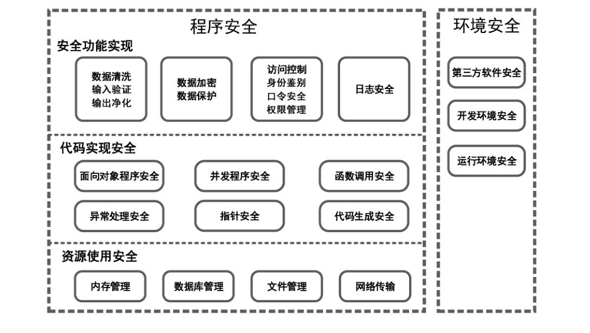

# GB/T 38674-2020 信息安全技术 应用软件安全编程指南

> 来源：[GB/T 38674-2020 国家标准详情](https://openstd.samr.gov.cn/bzgk/std/newGbInfo?hcno=910B7DBAEB214FE027F163E361960208)。
> PDF SHA-256：7a14b912605e91dba06cdc1b651c5ed74ddb011b82f51592353970557fd43dcb。
> 转写说明：将官方 PDF 全部页面渲染为图像并用图像识别核对文字、标题、列表和表格；省略页眉页脚及页码，合并跨页内容。正式引用请核对原页面图像。

## 前言

本标准按照 GB/T 1.1—2009给出的规则起草。

请注意本文件的某些内容可能涉及专利。本文件的发布机构不承担识别这些专利的责任。

本标准由全国信息安全标准化技术委员会（SAC/TC 260）提出并归口。

本标准起草单位：国家计算机网络应急技术处理协调中心、北京邮电大学、北京奇虎测腾安全技术有限公司、中国电力科学研究院有限公司、上海计算机软件技术开发中心、海通证券股份有限公司、北京银行股份有限公司、信息安全共性技术国家工程研究中心。

本标准主要起草人：舒敏、王博、吴倩、王文磊、黄元 、张家旺、林星辰、陈禹、王鹏翩、李燕伟、高强、杨鹏、陈亮、范乐君、张晓娜、杜薇、夏剑锋、李晔、张森、徐国爱、郭燕慧、李祺、杨昕雨、王晨宇、葛慧晗、黄永刚、韩建、章磊、王彦杰、胡建勋、李凌。

## 1 范围

本标准提出了应用软件安全编程的通用框架，从提升软件安全性的角度对应用软件编程过程进行指导。

本标准适用于客户端/服务器架构的应用软件开发，其他架构的应用软件开发也可参照使用，并根据其应用环境的特性补充必要的安全防护措施。

## 2 规范性引用文件

下列文件对于本文件的应用是必不可少的。凡是注日期的引用文件，仅注日期的版本适用于本文件。凡是不注日期的引用文件，其最新版本（包括所有的修改单）适用于本文件。

- GB/T 25069—2010 信息安全技术 术语

## 3 术语和定义、缩略语

### 3.1 术语和定义

GB/T 25069—2010界定的以及下列术语和定义适用于本文件。为了便于使用，以下重复列出了GB/T 25069—2010中的某些术语和定义。

#### 3.1.1 缓冲区溢出 buffer overflow

向程序的缓冲区写人超出其长度的内容，从而破坏程序堆栈，使程序转而执行其他指令，以获取程序或系统的控制权。

#### 3.1.2 命令注入 command injection

通过应用程序将用户输入的恶意内容拼接到命令中，并提交给后台引擎执行的攻击行为。

#### 3.1.3 应用软件日志 application softwarelog

用于记录系统操作事件的文件集合。

#### 3.1.4 线程安全 thread safe

某个函数、函数库在多线程环境中被调用时能够正确地处理多个线程之间的共享变量，使程序功能正确执行的能力。

#### 3.1.5 线程同步 thread synchronization

多个线程通过特定手段来控制线程之间执行顺序的一种机制。

> 注：当有一个线程在对内存进行操作时，其他线程就不能对该内存地址执行操作，直到该线程操作完成，此时，其他线程被设置处于等待状态。

#### 3.1.6 死锁 deadlock

两个或两个以上的进程在执行过程中，因竞争资源或彼此通信而造成的一种阻塞现象。

#### 3.1.7 阻塞 block

进程/线程暂停执行过程，等待请求被应答的状态。

#### 3.1.8 游标 cursor

一种用于操纵数据库查询返回的多行结果集的机制。

#### 3.1.9 敏感数据 sensitive data

必须受保护的，其泄露、修改、破坏或丢失会对人或事产生可预知的损害的信息。

> 注：常见的敏感数据包括但不限于身份鉴别数据、会话标识符、口令、连接字符串等。

#### 3.1.10 秘密数据 secret data

为了执行特定安全功能策略，只能由授权用户或被评对象安全功能知晓的信息。

#### 3.1.11 添加变量 salt

作为单向函数或加密函数的二次输入而加入的随机变量，可用于导出口令验证数据。

［GB/T 25069—2010，定义2.2.2.186］

#### 3.1.12 信任边界 trust boundary

由编程人员直接控制的系统部件组成。

#### 3.1.13 线程挂起 thread suspension

暂停线程运行的操作。

> 注：在线程挂起后，可以通过重新唤醒线程使之恢复运行。

#### 3.1.14 异常 exception

导致程序中断运行的一种指令流。

> 注：如果不对异常进行正确的处理，则可能导致程序的中断执行。

#### 3.1.15 错误 error

系统运行中出现的可能导致系统崩溃或者暂停运行的非预期问题。

#### 3.1.16 硬编码 hardcode

在编码过程中将可变变量用一个固定数值表示。

#### 3.1.17 封装 encapsulation

将系统功能、一组数据和在这些数据上的操作隔离在一个模块中，并该模块提供精确的规格说明的软件开发技术。

#### 3.1.18 泛型 generic type

程序设计语言的一种特性。

> 注：通过引入参数化数据类型，允许程序员在强类型程序设计语言中定义类型时包含一些可变部分，这些部分在使用前应作出指明。

#### 3.1.19 堆污染 heappollution

当将一个参数化的数据类型指向一个对象，而该对象不是参数化数据类型，或不是同类型的参数化数据类型时，会产生堆污染。

#### 3.1.20 嵌套类 nestedclass

声明在另一个类或接口代码块中的任意类。

#### 3.1.21 并发程序 concurrent program

可通过多进程、多线程机制实现的，允许在同一时间段执行多个程序模块的机制。

### 3.2 缩略语

下列缩略语适用于本文件。

API：应用程序编程接口 （Application Programming Interface）DNS：域名系统（Domain Name System）FTP：文件传输协议（File Transfer Protocol）HTTP：超级文本传输协议（Hyper Text Transfer Protocol）IMAP：互联网消息访问协议 （Internet Message Access Protocol）LDAP：轻量目录访问协议（Lightweight Directory Access Protocol）POP：邮局协议 （Post Office Protocol）SQL：结构化查询语言（Structured Query Language）SSL：安全套接子层（Secure Sockets Layer）TLS：传输层安全（Transport Layer Security）URL ：统一资源定位符（Uniform Resource Locator）UTF-8：针对 Unicode 的可变长度字符编码（8-bit Unicode Transformation Format）XML：可扩展置标语言（Extensible Markup Language）

## 4 概述

本标准从程序安全和环境安全两个方面提出了提升应用软件安全性的编程最佳实践。其中，程序安全部分描述软件在资源使用、代码实现、安全功能方面的安全技术规范，环境安全部分描述软件的安全管理配置规范。图1给出了应用软件编程安全框架。

## 5 安全功能实现

### 5.1 数据清洗

#### 5.1.1 输入验证

应用软件需确保对所有输入到应用的数据进行验证，拒绝接受验证失败的数据。在设计和实现数据验证功能时需重点关注以下方面内容，包括但不限于：

a） 验证所有输入数据的安全性，包括但不限于：检测输入数据的数据类型。

检测输入数据的长度，验证允许输入的最小和最大长度。

检测输入数据的值，包括进行最小值、最大值边界值检查。

-验证文件的安全性［见 7.4c）］。

b） 特别关注如下场景的数据验证：验证来自 HTTP 请求中的所有数据，恶意数据可以从表单域，URL 参数，cookie,HTTP头以及 URL.自身传入。

验证来自重定向输入的数据。攻击者可能向重定向的目标直接提交恶意代码，从而避开应用程序逻辑以及在重定向前执行的验证，所以对重定向输入数据需再次验证。

对来自命令行、环境以及配置文件的输入进行校验。

-对发送给文件系统、浏览器、数据库或者其他系统的命令进行验证，防止采用不可信来源的数据构建命令。

c） 对重要业务操作相关的输入数据，验证数据的真实性和完整性，宜验证数据发送方的数字签名，以确认数据发送方的身份。

d） 对输入的数据进行过滤或标准化处理，然后进行验证。

e） 禁止试图对验证失败的数据进行修复，自动错误恢复代码很可能改变请求的初始意图或者截断验证逻辑。

f） 在可信任环境中执行输入验证。

g） 集中输入验证，把输入验证作为软件框架的一部分，为应用程序提供一个统一的输入验证策略。

h） 为所有输入明确恰当的字符集，例如：UTF-8。确定系统是否支持 UTF-8扩展字符集，如果支持，在 UTF-8解码完成以后进行输入验证。

i） 在程序中定义清晰的信任边界，将可信和不可信数据（比如：数据库，文件流）分别存储。当数据要从不可信的一侧传输到可信一侧的时候，使用验证逻辑进行判断。

相关的规范和不规范的代码示例参见附录 A的A.2.1.1。

#### 5.1.2 输出净化

应用软件需对所有输出到客户端的，来自于应用程序信任边界之外的数据进行净化。应用软件在设计和实现输出净化功能时需重点关注以下方面内容，包括但不限于：

a） 除非明确对目标编译器是安全的，否则对所有字符进行编码。

b） 在可信任环境中执行输出编码。

c） 以国际、国家、行业标准为基础，结合实际情况制定编码规则。

d） 关注 SQL、XML 和LDAP 查询语句以及操作系统命令，这些命令可能存在潜在的危险字符，需进行语义净化。

e） 禁止将 URL 重定向到用户可控的不可信站点。

相关的规范和不规范的代码示例参见 A.2.1.2。

### 5.2 数据加密与保护

#### 5.2.1 数据加密

应用软件应对敏感数据进行加密，数据加密的设计和实现需关注以下方面内容，包括但不限于：

a） 凡涉及采用密码技术解决保密性、完整性、真实性、不可否认性需求的，应遵循国家有关法律法规。

b） 即使在服务器端，仍然要加密存储敏感数据。

c） 在可信任环境中执行数据的加密过程。

d） 确保密码运算过程安全，基于指定的算法和特定长度的密钥来进行密码运算。

e） 安全地处理加密模块的失败操作。如果加密模块加密失败或报错，需重新加密。

f） 按照用途尽量減少需要保存的秘密信息。

g） 建立并使用相关的安全策略和流程以实现加、解密的密钥管理。

h）使用安全的随机数生成器：—采用能产生充分信息熵的算法或方案。

一避免将具有密码学弱点的伪随机数生成器（PRNG）用于加密场景。

-使用密码学的伪随机数生成器时，使用信息熵最大的信息作为密码学伪随机数生成器的种子。如果信息熵不可用，可使用变化的种子来降低安全威胁，避免使用可预测的种子（如进程ID 或系统时间的当前值）、或空间太小的种子。

i 维护密钥的安全：—规定安全的密钥强度，仅使用高于规定强度的密钥。

—规定密钥有效期，禁止使用已经过期的密钥。

一禁止使用硬编码密钥，硬编码密钥将显著增加加密数据被攻击者破解的可能性。

相关的规范和不规范的代码示例参见 A.2.2.1。

#### 5.2.2 数据保护

应用软件需要注意从以下方面保护数据的安全，包括但不限于：

a） 明确应用软件中的敏感数据、隐私数据的范围，以及有权访问这些数据的用户范围。

b〉 在软件中明确划定信任边界，禁止敏感数据跨越信任边界。

c） 对数据的授权访问遵循最小权限原则。

d） 按照5.2.1 的内容对敏感数据进行加密存储和传输。

e） 对重要数据进行完整性检查。

f） 尽量缩短敏感数据的存储时间，并减少敏感数据的存储地点，以降低敏感数据泄露的风险。

g） 避免在错误消息、进程信息、调试信息、日志文件、源代码或注释中包含敏感数据。

h）在设计 WEB 登录表单的时候，可考虑禁止浏览器的口令自动填充功能。

i） 在资源释放前清理敏感数据。

j） 保护所有在服务器上缓存的或临时拷贝的敏感数据，并在不需要时尽快清除。

k） 禁止在客户端保存敏感数据。

I） 当敏感数据丢失或破坏时，确保可通过备份数据进行数据恢复。

m）在将数据发送到客户端的时候，基于任何通过客户端共享的数据都是不安全的假设对数据进行操作。

相关的规范和不规范的代码示例参见 A.2.2.2。

### 5.3 访问控制

#### 5.3.1 身份鉴别

身份鉴别的设计和实现需注意以下方面内容，包括但不限于：

a） 建立并使用标准的、已通过测试的身份鉴别策略。

b） 根据业务安全要求选择身份鉴别方式，安全性要求高的系统建议采用多因素身份鉴别方式。

c） 为所有身份鉴别使用一个集中实现的方法，包括利用库文件请求外部身份鉴别服务。

d） 所有的身份鉴别过程应在可信任环境中执行，且在每次用户登录时进行身份鉴别。避免仅在客户端而非服务器端执行身份鉴别。

e） 最小化角色授权，一个账号对应一个人而不是一个组，使用软件的每个人拥有唯一的用户名。

f） 在进行关键的安全操作时，避免依赖不可靠信息进行身份鉴别：避免信任 cookie 中的数据。

避免依赖反向 DNS解析获取的主机信息。

g） 验证数字证书。应检查证书的状态和证书持有者，只有有效的、未过期的且证书的实际持有者与证书中声明的持有者一致的证书才能被信任和使用。

h） 避免鉴别过程被绕过：一严格控制用户访问系统的可选途径或通道，保证用户只能通过指定的途径或通道访问系统，避免身份鉴别被绕过。

使用安全的鉴别算法，且算法的关键步骤没有被省略或跳过。

i） 避免在处理身份鉴别的过程中透露多余信息：—处理每个认证请求所花费的时间相同。避免攻击者根据登录尝试失败的时间来判断登录尝试是否成功。

-安全地处理未成功的认证。认证和注册的错误信息不能包含可被攻击者利用的信息，例如，判断一个特定的用户名是否有效的信息。

确保鉴别反馈的内容中不包含敏感数据。

j） 对鉴别尝试的频率进行限制，连续多次登录失败强制锁定账户：—限制同一个账号能够进行鉴别尝试的频率和次数。

—设定用户登录失败次数的阈值，在用户登录失败次数达到阈值后锁定用户账号，防止攻击者进行暴力破解。

k） 如果允许一次身份鉴别后，可进行较长时间的通话，则需要周期性地重新鉴别用户的身份，以确保其权限没有改变。如果发生改变，注销该用户，并强制重新执行身份鉴别。

I） 在用户执行关键或者不可逆的操作（如修改口令）之前，再次鉴别用户身份，以減少不安全会话带来的损失。

m）避免使用过于严格的账户锁定机制（账户锁定保护机制过于严格且容易被触发，就允许攻击者通过锁定合法用户的账户来拒绝服务合法的系统用户）。

n） 实现用户与主体的绑定：—用户进程与所有者用户相关联，使用户进程的行为可以追溯到进程的所有者用户。

——系统进程与当前服务要求者用户动态关联，使系统进程的行为可以追溯到当前服务要求者用户。

相关的规范和不规范的代码示例参见 A.2.3.1。

#### 5.3.2 口令安全

应用软件需从以下方面保护口令的安全，包括但不限于：

a） 登录过程中，确保口令不可见。

b） 使用强口令，口令的复杂度（包括口令组成、口令长度等）需要满足安全策略要求。

c） 禁止使用弱口令、空口令或已泄露的口令。

d） 对于默认的初始口令，强制用户初次登录时更改默认口令。

e） 不使用过期口令：-—过期口令不可继续使用。

一定期更改口令，关键系统可要求更频繁地更改。

一明确口令更改时间周期。

f） 保护口令重置信息：——使用保护口令信息的安全策略保护口令重置信息。

一口令重置操作采取与账户创建、身份鉴别同等级别的安全控制策略。

一口令重置问题宜支持尽可能随机的提问。

g） 安全地存储口令：-禁止明文存储口令。

-使用不可逆的加密算法或单向杂凑函数对口令进行加密存储。

-在散列过程使用添加变量，将口令转化为不可还原或难以使用字典攻击猜测的形式。

-将加密后的口令存储在配置文件、数据库或者其他外部数据源中。

-禁止在源代码中写人口令。

h）所有的口令加密过程必须在可信任环境中执行。

i） 尽可能地减少口令、加密密钥的保存时间。

j） 使用安全的口令传输：—禁止在不安全的信道中传输口令，也禁止接受来自不安全信道的口令。

禁止传递明文口令。

传统协议，如FTP,HTTP,POP以及IMAP，需要在使用了安全传输协议（例如 SSL）的情况下才可被用于传输口令。

k） 用户信息改变时使用单独的信道通知：-允许用户改变其口令，当用户改变其账号信息时（例如重置口令）需要发送确认信息，并使用单独的通道发送确认信息。

-可要求用户通过邮件等方式来确认信息的变更，但禁止在确认邮件中包含身份鉴别信息。

-当用户改变其联系信息时，发送两次变更通知：分别包含旧的和新的信息。

相关的规范和不规范的代码示例参见 A.2.3.2。

#### 5.3.3 权限管理

应用软件对于权限管理的设计和实现需重点关注以下方面内容，包括但不限于：

a） 遵循最小权限原则：-确保服务账户或连接到外部系统的账号，仅具有执行经授权的任务所需的最小权限（或最低的安全许可）。

将许可权限尽可能地细化，使用细粒度的访问控制。

b） 所有的访问授权操作需在可信任环境中执行。

c） 将访问控制作为集中化程序框架的一部分，建立统一的访问控制策略。

d） 对每个用户交互都要检测访问控制状态。

e） 确保访问控制策略检查了用户访问或操作的数据。

只有授权的用户才能访问秘密数据或敏感数据。通常，这类数据有：与用户信息或应用软件自身安全密切相关的状态信息、文件或其他资源、受保护的URL、受保护的功能、直接对象引用、应用程序数据以及与安全相关的配置信息等。

g） 执行账户审计并强制失效长期不使用的账户。建议明确允许账户不使用的最长期限，支持账户的强制失效，并在账户停止时终止会话。

相关的规范和不规范的代码示例参见 A.2.3.3。

### 5.4 日志安全

应用软件日志记录了系统运行状况，通常包括软硬件故障、系统重要事件等。日志记录的设计和实现需从以下方面提升安全性，包括但不限于：

a） 保护日志文件：一对日志文件进行安全存储。例如将日志文件独立保存于应用程序目录外，使用严格的访问权限来控制日志文件使用。

使用消息摘要算法以验证日志记录的完整性。

b） 在可信任的环境中执行日志记录操作。

c） 将日志记录作为集中化程序框架的一部分。

d） 在每个日志条目中增加精确的时间戳，同时确保时间戳的可靠性。

e） 对每个重要的行为都记录日志：一确保系统在发生重要安全事件时创建日志。

一通常重要安全事件包括：重要数据更改、认证尝试（特别是失败的认证）、失败的访问控制、失效或者已过期的会话令牌尝试、系统例外、管理功能行为、失败的后端TLS链接、加密模块的错误。

f） 对日志记录进行完善的异常捕获处理，确保即使日志记录过程发生异常，日志记录仍然能够继续正确的执行。

g9） 对日志中的特殊元素进行过滤和验证。确保日志记录中的不可信数据，不会在查看界面或者运行软件时以代码的形式被执行。

h）采取安全措施防止攻击者写任意的数据到日志中。

i） 避免在日志中保存敏感数据。

相关的规范和不规范的代码示例参见 A.2.4。

## 6 代码实现安全

### 6.1 面向对象程序安全

面向对象程序的设计和开发需从以下方面提升软件的安全性，包括但不限于：

a） 子类对基类的扩展需从以下角度进行安全控制：——对基类的扩展，应保持由基类提供的不变性。

-对于关键基类仅允许受信任的子类进行扩展。

> 注：不变性是指在程序运行的特定段或规定点被认为是真（true）的属性。

b） 修改基类时，应保证基类中的修改不触动其子类所依赖的程序不变性。

c） 对类的数据成员进行访问控制：——数据成员需要声明为私有。

一当类成员需要在声明该类的包以外被访问时，使用暴露类成员的封装器方法监视并控制对数据成员的修改。

d） 避免混用泛型和非泛型的数据类型。如为了兼容遗留代码而混用泛型和非泛型数据类型，需警惕堆污染。

e） 为可变类实现防御性复制功能，该功能可创建可变类实例的副本，通过此功能允许将可变类实例传递给非受信代码。

f） 禁止返回类的私有可变成员的引用。可返回一个指向内部可变成员的防御性副本的引用，从而保护内部状态不会被非预期地修改。

g） 对可变变量（或可变的内部对象）创建防御性副本：一如果程序逻辑依赖可变变量，则需警惕竞态攻击。可变变量的特点在于它的数值会发生变化，多次访问该变量会得到不同的值。如果程序逻辑对可变变量进行验证和安全检查后，该变量的值被篡改，就会发生 Time-of-Check Time-of-Use（TOCTOU）漏洞。

-在需要访问可变变量（或可变的内部对象）时，可使用返回可变变量（或可变的内部对象）的封装器方法来实现。

h） 禁止复制或者序列化包含秘密或者其他敏感数据的类。

i 那些不敏感但是需要维持其他不变性的类，应对恶意子类访问或者操作它们的数据及破坏其不可变性的可能性做出防御。

j 禁止嵌套类将其所依附的外部类的私有成员暴露给其他外部的类或者包。

k）当判定一个对象是否属于特定的类，或两个对象的类是否相同时，比较类对象，而非仅基于类名称进行判定。

I 谨慎处理构造函数抛出异常的情况。在一个构造方法开始创建对象但并末结束时，对象会被部分地初始化。只要对象没有被完全初始化，就应对其他类不可见。

m）避免将不可序列化的对象存储到磁盘。

相关的规范和不规范的代码示例参见 A.3.1。

### 6.2 并发程序安全

并发程序设计和开发需从以下方面提升软件的安全性，包括但不限于：

a） 确保共享数据的线程安全：一确保所有的全局变量、线程间的共享可变数据是线程安全的。

一对所有需确保线程安全的数据通过同步方法或代码块进行保护。

b） 确保共享变量、数据的可见性：-对共享变量、数据的读或写操作均使用同步访问。

所有执行读或写操作的线程都应在同一个锁上同步，以确保所有线程都能看到共享变量或数据的最新值。

c） 确保同步对象上的锁按相同的顺序获得和释放，以避免当两个或多个线程互相等待时被阻塞进而发生死锁。

d） 需确保能够终止处于阻塞状态的任务和线程。

e） 对锁实行严格的访问控制，避免锁被不可信的外部实体影响或控制。

f） 保护线程池安全：一使用线程池来处理请求，以抵御拒绝服务攻击。

禁止在一个有限的线程池中执行需要依赖其他线程的任务，以避免死锁。

确保提交至线程池的任务是可被中断的。

所有线程池中的任务应提供将任务执行的异常情况通报应用程序的机制。

g） 及时释放线程专有对象，防止内存泄漏与拒绝服务式攻击。

h） 注意共享对象的存储周期，禁止在一个线程中访问其他线程的非静态局部变量。

i） 仅在循环体中执行线程的挂起操作，并在每次挂起线程之前检查线程继续执行要满足的条件。

j 不要加入或分离已进行过加人或分离操作的线程。

k）谨慎处理原子变量。禁止在一个表达式中两次访问同一个原子变量。程序无法确保在两次访问该变量之间，其值不被其他线程修改。

I） 进行特权让渡时，遵守正确的特权废除顺序，确保特权让渡过程成功。

m）不要使用异步取消的线程，防止产生资源泄露。

n） 不要在条件变量同步等待操作中使用多于一个的互斥条件。

o） 释放互斥锁时，建议线程通知所有正在等待该锁的线程，而不是单一线程。

p） 在多线程环境下，确保应用的不同会话之间不会发生信息泄露。

相关的规范和不规范的代码示例参见 A.3.2。

### 6.3 函数调用安全

应用软件需重点从如下方面保障函数调用安全，包括但不限于：

a） 函数需要对传入的参数进行合法性、安全性验证，包括但不限于对参数数量、顺序、类型、值的验证。

b） 确保函数能正确并安全的处理传入参数的数量、顺序、类型、值不满足预期的情况。

c） 谨慎处理来自不可信数据源的格式化字符串，避免直接用于构造命令。

d） 宜检查函数的返回值是否符合预期，避免忽略函数的返回值。

e） 避免在函数中返回栈变量地址。

f） 避免在 API 或与外部交互的接口中暴露那些原本设计为仅限内部或部分用户访问的危险方法或函数，否则可能会导致非授权访问攻击。

g） 避免使用在不同版本具有不一致实现的函数或方法。

相关的规范和不规范的代码示例参见 A.3.3。

### 6.4 异常处理安全

应用软件需建立完善的异常和错误处理机制，确保异常与错误可以被及时识别并处理。需要注意从以下方面提升异常和错误处理的安全性，包括但不限于：

a） 自行处理程序错误，并且不依赖于服务器配置。

b） 避免在越过执行边界时抛出异常。

c） 避免在静态对象的构造器和线程存储周期内抛出异常。

d） 异常处理时保持数据的状态一致性。

e） 异常处理时及时回收并释放系统资源。

f） 精确捕获异常，并对捕获的异常进行恰当的处理，避免在捕获异常后不做任何处理。

g） 不在软件执行异常时暴露敏感信息：一向用户展示通用的错误提示信息。

-在系统发生异常状况时禁止向用户暴露的敏感信息包括但不限于：系统的详细信息、会话标识符、账号信息、调试或堆栈跟踪信息。

相关的规范和不规范的代码示例参见 A.3.4。

### 6.5 指针安全

程序的设计和开发有关指针的操作需从以下方面提升软件的安全性，包括但不限于：

a） 在使用指针的过程中，确保指针的有效性。

b） 确保指针类型的正确使用：—明确指针类型的兼容性。

-不将非结构体类型指针强制转换为指向结构类型。

c） 确保正确地使用指针运算：——不要在非数组对象的指针上执行指针运算。

一避免使用指针的加减法来确定内存大小。

d） 避免将固定地址赋值给指针。

e） 使用指针时防止偏移越界。

相关的规范和不规范的代码示例参见 A.3.5。

### 6.6 代码生成安全

程序的源代码编写完成后，在编译以及链接过程中，需要注意从以下几方面保证安全性，包括但不限于：

a） 对编译所依赖的库进行版本判断。

b） 对某些重要的库（比如加密、通信等）进行哈希校验。

c） 编译命令中的宏定义不能存在冲突。

d） 针对同一个工程的编译，对 Release/Debug 进行统一设置。

e） 不要通过 makefile 参数直接配置宏名，以可选的选项形式提供。

f） 不要通过编译参数配置软件的版本信息。

g） 引用头文件的路径不能直接开放。

h）引用头文件的路径中，不能有存在歧义的头文件路径。

i） 同一个工程中，不同的编译过程如果使用了同一个库的不同版本时，进行明确的注释或提示说明。

j） 如果编译的源代码来自不同的代码仓库，则配置统一的版本、分支控制脚本。

k）编译生成的结果文件（.。文件、.obj文件）保存在独立于源代码的路径中。

1）. 谨慎使用编译过程中自动生成的源代码。

## 7 资源使用安全

### 7.1 资源管理

应用软件需对所使用的各种资源（如文件、数据库、网络）从以下方面进行安全管理，包括但不限于：

a） 确保系统中的每个资源具有唯一的标识符。

b） 使用重要资源前进行正确初始化，并确保初始化失败后可以安全退出程序。

c） 正确的更新资源的引用计数。

d） 正确释放系统资源：一及时释放系统资源。

禁止再次释放已经释放的资源。

确保释放资源前完全清除敏感信息。

确保应用软件在使用资源后恰当地执行临时文件或辅助资源的清理，避免清理环节不完整。

e） 不使用已过期或已释放的资源。

f） 对分配的资源数量、使用权限、有效时间做限制，防止消耗过多资源。

g） 合理控制递归。

h）执行迭代或循环时恰当地限制循环执行的次数，避免无限循环。

i） 系统提供的资源池需能满足高峰期的业务需求。

j） 对外部资源，如下载的文件，进行完整性和发布源检验，确保外部资源的安全性。

相关的规范和不规范的代码示例参见 A.4.1。

### 7.2 内存管理

除了7.1规定的内容外，应用软件还需注意从以下方面提升内存管理安全性，包括但不限于：

a） 保持一致的内存管理约定：一使用同样的模式分配和释放内存。

-在同一个模块中，在同一个抽象层次中，分配和释放内存。

——分配和释放应配对。

b） 谨慎操作缓冲区：——对缓冲区的读写操作进行边界检查，避免向指定的缓冲区外读取或者写入数据。

—对不可信数据进行输入和输出控制。

-字符串操作时，检查字符串长度和终止符，保证字符串的存储具有足够的空间容纳字符数据和终止符。

在循环中调用函数时，注意检查缓冲区空间大小，确保不存在超出分配空间的访问。

—不要在无关的智能指针中存储已有的指针值。

c） 避免对同一块内存释放两次。

d） 已释放的内存，在再次分配前禁止写人。

e） 及时释放内存，避免依赖垃圾回收机制。

f） 保护堆安全：—执行堆完整性检测。

-在可能的情况下，使用不可执行的堆栈。

一限制堆空间的消耗，谨慎处理创建线程、解压文件、反序列化等消耗空间的操作，防止堆空间耗尽。

g） 尽量避免使用不进行自变量检查的、已知存在漏洞的字符串操作函数，如 printf、strcat、strcpy，并使用其他函数替代。

h）尽量避免对过度整齐的数据类型使用默认操作。

相关的规范和不规范的代码示例参见 A.4.2。

### 7.3 数据库管理

除了7.1规定的内容外，应用软件还需要注意从以下方面提升数据库管理安全性，包括但不限于：

a） 当应用程序访问数据库时，禁止使用默认的角色、账户与默认数据库口令访问数据库。

b） 使用数据库进行数据存储时，确保数据的完整性。

c） 使用参数化 SQL.语句，禁止改变数据定向的上下文环境，并强制区分数据和命令。

d） 使用存储过程以实现抽象访问数据，并允许对数据库中表的删除权限。

e） 当应用程序访问数据库时，仅提供给应用程序满足其需求的最低权限，以降低访问数据库的风险。

f） 规定不同信任级别用户连接数据库的角色，比如用户、只读用户、访问用户、管理员。

g） 使用行级别的访问控制，禁止依赖应用程序访问控制来保护数据库的数据，限制每个请求使用户只能访问他们自己的数据。

h）为所有变量指定数据类型，并在编译期间进行严格检查。

i 对来自数据库的数据进行验证，确保从数据库读出的数据符合预期。

j） 及时释放数据库资源，例如连接、游标等。

k） 关闭所有不必要的数据库功能，如不必要的存储过程或服务、应用程序包，最小化需安装的功能和选项。

相关的规范和不规范的代码示例参见 A.4.3。

### 7.4 文件管理

除了7.1规定的内容外，应用软件还需要注意从以下方面提升文件管理安全性，包括但不限于：

a） 采用最小权限原则进行文件访问授权。

b）对来自文件系统的所有信息（包括但不限于文件路径、文件名的内容和长度）进行标准化，然后进行验证。

c） 确保文件上传安全：一上传文档前进行身份鉴别。

验证文件类型，仅允许上传满足业务需要的相关文件类型。除验证文件类型打展名外，还需至少检查文件报头中的类型信息。

访问上传的文件之前，进行恶意代码的扫描，并校验文件完整性。

—关闭在文件上传目录的运行权限。

d）禁止传递目录或绝对文件路径给用户，建议使用预先设置的路径列表中的匹配索引值。

e） 使用安全的临时文件：一建议在程序初始化时采用严格的权限策略建立安全的临时文件夹，存放可能产生的临时文件，并且只对该应用程序开放访问权限。

-最小化临时文件存储时间，并及时删除临时文件。

f） 禁止用户修改应用程序文件和资源，权限仅限于可读。

g） 避免文件访问竞争，使用文件句柄来保证针对某文件的多次操作确实是对同一个文件的操作。

h）确保及时释放文件系统资源：-保证诸如文件句柄之类的文件系统访问结构在不再需要时会被及时释放。

禁止依赖Java 和.NET 等的垃圾回收机制来回收资源。

检测和处理文件相关的错误。比如，Java 文件操作往往通过返回值来表示操作是否失败，Java程序应检查1/0方法的返回值。

j） 禁止使用过期的文件句柄。

k） 在调用子进程之前关闭敏感文件句柄，避免子进程使用这些句柄来执行未授权的1/O操作。

相关的规范和不规范的代码示例参见 A.4.4。

### 7.5 网络传输

除了7.1规定的内容外，应用软件还需要注意从以下方面提升网络传输安全性，包括但不限于：

a） 验证通信通道源，确保数据来自预期源。

b） 对来自网络的数据进行验证以确保数据包符合预期要求。

c） 使用加密传输确保通信安全：一采用加密传输方式保护敏感数据，特别是要求身份鉴别的数据内容、与外部系统交换的数据内容等。

宜使用配置合理的单一标准 TLS 或SSL， 对连接保护，并支持对敏感文件或非基于HTTP连接的不连续加密。

避免将没有成功的 TL.S连接后退为一个不安全的连接。

为在 TLS连接上传输的cookie 设置“安全”属性。

确保 TLS 证书是有效的，有正确且未过期的域名，并且在需要时，和中间证书一起安装。

d） 对信道中传输的消息进行完整性验证。

e） 使用时间戳和随机数组合的方式进行重放检测。

f） 至少从以下方面管理会话安全：—使用服务器或者框架的会话管理控制，只识别有效的会话标识符。

—会话标识符应总是在一个可信系统上创建。

-确保会话标识符的随机性。

一建议在账户登出后完全终止相关的会话或连接。

在平衡风险和业务功能需求的基础上，最小化会话超时时间（通常小于几个小时）。

如果一个会话在登录以前就建立，在成功登录以后，宜关闭该会话并创建一个新的会话。

任何重新进行身份鉴别的过程，宜建立一个新的会话标识符。

-不允许同一用户ID 的并发登录。

-在身份鉴别的时候，如果连接从 HTTP变为 HTTPS，则生成一个新的会话标识符。在应用程序中，宜持续使用 HTTPS，而非在 HTTP 和 HTTPS之间转换。

-为服务器端的操作执行标准的会话管理，比如，通过在每个会话中使用强随机令牌或参数来管理账户。

g） 避免将多个套接字绑定到相同端口，从而导致该端口上的服务有被盗或被欺骗的风险。

h）提供跟踪网络传输流量的机制，控制网络传输流量不超过被允许的值。

相关的规范和不规范的代码示例参见 A.4.5。

## 8 环境安全

### 8.1 第三方软件使用安全

在应用软件的构建、运行等环节，可从如下方面提升应用软件所使用的第三方软件的安全性，包括但不限于：

a）： 搭建并维护统一的第三方软件仓库，并仅能从内部搭建的组件仓库获取第三方软件，不允许自行下载组件进行使用。

b） 从官方渠道获取第三方软件，并确保所有组件都及时升级到不存在已知高危漏洞的版本。

c） 对第三方软件进行完整性验证测试，确保所用第三方软件未被篡改。

d） 定期对第三方软件进行安全性检测，避免使用已知存在高危漏洞的组件版本。

e） 确保第三方软件许可证的真实有效性，避免使用存在许可证冲突的组件。

f） 建议使用软件成分分析工具和漏洞检测工具，及时识别并规避存在安全风险的第三方组件。

g） 在采用容器作为运行环境的场景中，确保容器中所使用第三方软件的安全性。

h）建议使用经国家权威第三方安全检测机构检测认证的第三方软件进行应用软件开发。

相关的规范和不规范的代码示例参见 A.5.1。

### 8.2 开发环境安全

开发者需重点从以下方面保障软件开发环境的安全，包括但不限于：

a） 构建安全的编译环境：—从官方渠道获取编译器，并确保安装了所有补丁。

一去掉不必要的编译功能，如去掉调试开关。

-正确配置并使用编译器的安全编译选项。

b） 合理存储源代码，制定权限控制策略，保护源代码不被非法用户访问。

c） 建议使用软件变更管理系统，以管理和记录在开发和产品迭代过程中代码的变更。

d） 确保开发环境与实际运行环境的物理隔离，并只提供给授权的开发和测试团队访问。在实际工作中，可实行开发环境、测试环境及生产环境的分离控制，或开发环境、测试环境、用户验收测试环境及生产环境的分离控制。

相关的规范和不规范的代码示例参见 A.5.2。

### 8.3 运行环境安全

开发者需重点从以下方面保障软件运行环境的安全，包括但不限于：

a） 应用软件发布前去除所有与调试和测试相关的代码、配置、文件等。

b） 应用程序的安全配置信息以可读的形式输出，以支持审计。

c） 对重要的配置信息进行安全保护。

d） 删除用户可访问的源码中的注释，避免用户通过逆向或者直接获取网页源代码方式获取源代码注释。

e） 如果应用软件部署在客户端，例如移动 APP，宜使用混淆、签名、加固等措施防止逆向获取源代码。

f） 及时删除服务器上不需要的应用程序和系统文档。

g） 关闭服务器上不需要的服务。

h） 建议禁止自动目录列表功能。如果必须开启目录列表功能，则需对目录下的文件进行详细检查，确保不包含敏感文件。

i） 确保软件运行服务器的系统组件均为相对安全的稳定版本，并安装了该版本的所有补丁。避免使用存在已知漏洞的组件版本。

相关的规范和不规范的代码示例参见 A.5.3。

附录A（资料性附录）代码示例A.1 概述本附录给出了第5章～第8章中安全编程指南内容的规范和不规范的示例，包含详细说明和代码实例。

A.2 安全功能实现A.2.1 数据清洗A.2.1.1 输入验证A.2.1.1.1 概述针对输入验证的示例及与标准正文的对照关系如表 A.1 所示。

**表 A.1 针对输入验证的示例及与标准正文的对照关系**

| 示例内容 | 示例语言 | 本标准章条号 |
| --- | --- | --- |
| 预防 SQL. 注入 | Java | 5.1.1a）.5.1.1b）.5.1.1d） |
| 从 ZipInputStream 安全解压文件 | Java | 5.1.1a）.5.1.1d） |
| 净化传递给 Runtime.exec（）方法的非受信数据 | Java | 5.1.1a）.5.1.1b）.5.1.1d） |
| 不要信任隐藏字段的内容 | Java | 5.1.1a）.5.1.1b）.5.1.1d） |
| 预防 XML. 注入 | Java | 5.1.1a）.5.1.1b）.5.1.1d） |
| 预防 XMI. 外部实体攻击 | Java | 5.1.1a）.5.1.1b）.5.1.1d） |
| 当比较 local 相关的数据时，指定恰当的 local | Java | 5.1.1h） |
| 污点数据作为循环边界 | C/C++ | 5.1.12）.5.1.1b）.5.1.1d） |
| 从外部系统接收的数据应该转换为本地字节序 | C/C+十 | 5.1.1a）、5.1.1b）、5.1.1d） |
| 注意被污染的内存分配 | C/C++ | 5.1.1a）.5.1.1b）、5.1.1d） |
| 禁止使用被污染的数据进行操纵设置 | C/C++ | 5.1.1a）、5.1.1b）.5.1.1d） |
| 禁止使用被污染的数据进行路径遍历 | C/C++ | 5.1.1a）.5.1.1b）.5.1.1d） |
| 禁止使用被污染的数据进行进程控制 | C/C++ | 5.1.1a）.5.1.1b）.5.1.1d） |
| 禁止使用被污染的数据作为缓冲区长度 | C/C++ | 5.1.1a）.5.1.1b）.5.1.1d） |
| 禁止使用被污染的数据作为缓冲区 | C/C++ | 5.1.1a）.5.1.1b）、5.1.1d） |

A.2.1.1.2 预防 SQL 注入SQL 注入是一种数据库攻击手段。攻击者通过向应用程序提交恶意代码来改变原 SQL.语句的含义，进而执行任意 SQL 命令，达到入侵数据库乃至操作系统的目的。防止SQL.注入的主要方法有：净化并验证非受信输入，采用参数化查询。

对于预防 SQL注入的情况，示例1给出了不规范用法（Java 语言）示例。示例2给出了规范用法（Java 语言）示例。

示例1：public void doPrivilegedAction（String username, char［］ password）throws SQLException‹Connection connection = getConnection（）；

//⋯.. try｛String pwd = hashPassword（password）；

String sqlString = "SELECT * FROM db_user WHERE username =" + username ＋"AND password = " + pwd + ""；

Statement stmt = connection.createStatement（）；

ResultSetrs = stmt.executeQuery（sqlString）；

//...｝finally ｛| try〈connection.close（）；

｝ catch （SQLException x）〈//⋯.在这个不规范的代码示例中，使用JDBC 来认证用户，提交 stmt.executeQuery （sqlString） 查询的SQL. 为 sqIString，它是通过一个拼接字符串组合而来，并且 sqIString 未经过净化或验证，当pwd 为'OR 1=1 时，sqIString 就会变成：SELECT * FROM db_user WHERE username =" AND password="OR1'=1’。Statement.executeQuery（String）方法不能防止SQL. 注入，该代码将会引发SQL 注入漏洞攻击。

示例 2：public void doPrivilegedAction（String username, charL］ password）throws SQLException｛Connection connection = getConnection（）；

try〈String pwd = hashPassword（password）；

if （username.length（）〉8）〈//... String sqIString = "select * from db_user where username=？ and password=？"；

PreparedStatementstmt = connection.prepareStatement（sqIString）；

stmt.setString（1, username）；

stmt.setString（2, pwd）；

//⋯.｝finally｛try｛connection.close（）；

｝catch （SQLException x）｛| //.｝在这个规范的代码示例中，采用 java.sql.PreparedStatement 执行参数化查询，可以避免含有注入代码的SQL.语句提交执行。通过使用 prepareStatement 类的set *（）方法，可以进行强类型检查。程序会正确的转义双引号内的输入数据，以减少 SQL 注入漏洞。类似的，对数据的增删改操作也应使用prepareStatement。

A.2.1.1.3 从 ZiplnputStream 安全解压文件对java.util.ZiplnputStream 的输入进行检查可以防止消耗过多的系统资源。解压一个文件，比如zip、gif或者gzip 编码的HTTP 内容，可能会消耗过多的资源，并且在压缩率极高的情况下，可能会导致zip 炸弹的出现。

对于从 ZiplnputStream 安全解压文件的情况，示例1给出了不规范用法（Java 语言）示例。示例2给出了规范用法（Java 语言）示例。

示例1：static final int BUFFER = 512；

//⋯. public final void unzip（String filename） throws java.io.IOException《FilelnputStreamfis = new FilelnputStream（filename）；

ZipInputStreamzis = new ZipInputStream（new BufferedInputStream（fis））；

ZipEntry entry；

try ｛while （（entry = zis.getNextEntry（））！ = null）〈System.out.println（"Extracting： " + entry）；；

int count；

byte data［］ = new byte［BUFFER］；

// Write the files to the disk FileOutputStreamfos = new FileOutputStream（entry.getName（））；

BufferedOutputStreamdest = new BufferedOutputStream（fos, BUFFER）；

while （（count = zis.read（data, 0, BUFFER））！ = —1）〈dest.write（data, 0, count）；

dest.flush（）；

dest.close（）；

zis.closeEntry（）；

｝ finally‹zis.close（）；

这个不规范的代码示例没有检查解压一个文件时所消耗的资源。它会允许操作持续进行直至完成，或者直至本地资源耗尽为止。

示例2：static final int BUFFER = 512；

static final int TOOBIG = 0x6400000； // Max size of unzipped data, 100MB static final int TOOMANY = 1024； // Max number of files //⋯. private String validateFilename（String filename, String intendedDir）throws java.io.IOException ｛File f = new File（filename）；

String canonicalPath = f.getCanonicalPath（）；

File iD = new File（intendedDir）；

String canonicalID = iD.getCanonicalPath（）；

if （canonicalPath.startsWith（canonicalID））｛return canonicalPath；

｝else人throw new IllegalStateException（"File is outside extraction target directory."）；

public final void unzip（String filename） throws java.io.IOException ｛FileInputStreamfis = new FileInputStream（filename）；

ZipInputStreamzis = new ZipInputStream（new BufferedInputStream（fis））；

ZipEntry entry；

int entries = 0；

long total = 0；

try〈while （（entry = zis.getNextEntry（））！ = null）｛System.out.println（"Extracting： " + entry）；

int count：byte dataL］ = new byte_BUFFER］；

// Write the files to the disk, but ensure that the filename is valid，// and that the file is not insanely big String name = validateFilename（entry.getName（）， ”."）；

if （entry.isDirectory（））〈System.out.println（"Creating directory " + name）；

new File（name）.mkdir（）；

continue；

FileOutputStreamfos = new FileOutputStream（name）；

BufferedOutputStreamdest = new BufferedOutputStream （fos, BUFFER）；

while （total + BUFFER〈= TOOBIG &. &. （count = zis.read（data, 0, BUFFER））！ = —1）〈dest.write（data, 0, count）；

total += count：dest.flush（）；

dest.close（）；

zis.closeEntry（）；

entries十十；

if （entries 〉TOOMANY）《throw new IllegalStateException（"Too many files to unzip."）；

if （total 〉TOOBIG）〈throw new IllegalStateException（"File being unzipped is too big."） ；

〉 finally｛zis.close（）；

在这个规范的代码示例中，代码在提取条目之前验证每个条目的名称。如果名称无效，那么整个提取就会被中止。while 循环中的代码将判断 zip 归档中每个条目的文件大小，同时提取条目。如果提取的条目太大，在本例中100 MB，则会抛出异常。代码不要使用 ZipEntry.getSize（）方法，因为攻击者可以伪造ZIP文档中未压缩的文件的大小。最后，代码还计算压缩包中文件条目的数量，如果超过1024个条目，则抛出异常。

A.2.1.1.4 净化传递给 Runtime.exec（）方法的非受信数据每个Java 应用都有一个 Runtime 类的实例，一般需要使用shell 时调用它，从而可以在POSIX 中使用/bin/sh 或者在 Windows 平台中使用cmd.exe。当参数中包含以空格、双引号或者其他以一/开头的用来表示分支的字符时，就可能发生参数注入攻击。任何源于程序受信边界之外的字符串数据，在当前平台作为命令来执行之前，都应经过净化。

对于净化传递给 Runtime.exec（）方法的非受信数据的情况，示例1给出了不规范用法（Java 语言）示例。示例2给出了规范用法（Java 语言）示例。

示例 1（Windows）：class DirList｛public static void main（StringL］ args） throws Exception ｛String dir = System.getProperty（"dir"）；

Runtime rt = Runtime.getRuntime（）；

Process proc = rt.exec（"cmd.exe /C dir " + dir）；

int result = proc.waitFor（）；

if （result ！ = 0）｛| System.out.println（"process error： " + result）；

InputStream in = （result == 0）？ proc.getInputStream（）：proc.getErrorStream（）；

int c；

while （（c = in.read（））！= —1）〈System.out.print（ （char） c）；

该代码示例使用 dir 命令列出目录列表。这是通过 Runtime.exec（）方法调用 Windows 的dir 命令来实现的。因为 Runtime.exec（）方法接受源于运行环境的未经净化的数据，所以这些代码会引起命令注人攻击。

攻击者可以通过以下命令利用该程序：java -Ddir='dummy &. echo bad’ Java该命令实际上执行的是两条命令：cmd.exe /C dir dummy &. echo bad第一条命令会列出并不存在的dummy 文件夹，并且在控制台上输出 bad。

示例2（净化）：if （！ Pattern.matches（"［0-9A-Za-z@.J+"， dir））〈//..｝这个符合规范的代码实例会对非受信的用户输入进行净化，只允许白名单中的字符出现在参数中，并传给 Runtime.exec（）方法，其他所有的字符都会被排除掉。

A.2.1.1.5 不要信任隐藏字段的内容HTML 允许 web 表单中的字段可见或隐藏。隐藏字段向 web 服务器提供值，但不能被用户修改其内容。但是，攻击者仍然可以通过特殊方式来修改隐藏字段。

对于不信任隐藏字段的内容的情况，示例1给出了不规范用法（Java 语言）示例。示例2给出了规范用法（Java 语言）示例。

示例 1：public class SampleServlet extends HttpServlet｛public void doGet（ HttpServletRequest request, HttpServletResponse response）throws IOException，ServletException｛response.setContentType（"text/html"）；

PrintWriter out = response.getWriter（）；

out.println（"《html》"）；

String visible = request.getParameter（"visible"）；

String hidden = request.getParameter（"hidden"）；

if （visible ！ = null || hidden ！ = null）｛out.println（"Visible Parameter："）；

out.println（ sanitize（ visible））；

out.println（"<br） Hidden Parameter："）；

out.println（hidden）；

｝else｛out.println（"（p〉"）；

out.print（"<form action=\""）；

out.print（"SampleServlet\ " "）；

out.println（"method=POST）"）；

out.println（"Parameter： "）；

out.println（"<input type=text size=20 name=visible〉"）；

out.println（"《br》 "）；

out.println（"<input type= hidden name= hidden value=\a benign valuel'）"）；

out.println（"《input type=submit）"）；

out.println（"</form》"）；

public void doPost（HttpServletRequest request, HttpServletResponse response）throws IOException, ServletException｛doGet（request, response）；

// Filter the specified message string for characters // that are sensitive in HTML. public static String sanitize（String message）｛//..｝〉上面代码演示了一个 servlet，它接受一个可见的字段和一个隐藏的字段，并将其返回给用户。在传递给浏览器之前，可见的参数是经过验证处理的，但是隐藏的字段没有验证。

当输入参数paraml 时，web 页面将显示以下内容：Visible Parameter: paraml Hidden Parameter: a benign value但是，攻击者可以通过在 URL. 中编码来为隐藏参数提供一个值，如下：http://localhost:8080/sample/SampleServlet?visible= dummy&.hidden=%3Cfont%20color= red%3ESurprise%3C/font%3E！！！当这个 URL 被提供给浏览器时，浏览器会显示：Visible Parameter: dummy Hidden Parameter: Surprise！！！示例2：public class SampleServlet extends HttpServlet｛public void doGet（ HttpServletRequest request, HttpServletResponse response）throws IOException, ServletException ｛response.setContentType（"text/html"）；

PrintWriter out = response.getWriter（）；

out.println（"（html》"）；

String visible = request.getParameter（"visible"）；

String hidden = request.getParameter（"hidden"）；

if （visible ！ = null || hidden ！ = null）《out.println（"Visible Parameter： "）；

out.println（ sanitize（visible））；

out.println（" <br） Hidden Parameter： "）；

out.println（ sanitize（hidden））； // Hidden variable sanitized｝else ｛out.println（"（p》"）；

out.print（"（form action=\""）；

out.print（"SampleServlet\" "）；

out.println（"method=POST》"）；

out.println（"Parameter： "） ；

out.println（"（input type=text size=20 name=visible〉"）；

out.println（"（br）"）；

out.println（"<input type=hidden name= hidden value=\a benign valuel'）"）；

out.println（"《input type=submit）"）；

out.println（"</form〉"）；

public void doPost（ HttpServletRequest request, HttpServletResponse response）throws IOException, ServletException〈doGet （request, response）；

// Filter the specified message string for characters // that are sensitive in HTML. public static String sanitize（String message）〈//⋯｝上面代码片段对隐藏字段进行净化，因此，当恶意 URL. 进入浏览器时，servlet 产生以下内容：Visible Parameter: dummy Hidden Parameter： 〈font color=red〉Surprise（/font〉！！！A.2.1.1.6 预防 XML 注入如果用户有能力使用结构化 XML 文档作为输入，那么他能够通过在数据字段中插入 XML. 标签来重写这个 XML.文档的内容。XMI.解析器会将这些标签按照正常标签进行解析。下面是一段在线商店的XML. 代码，主要用于查询后台数据库。

〈item〉《description》Widget（/description〉《price〉500.0</price〉《quantity〉 1/quantity〉《/item〉恶意用户可以在<quantity〉元素中输入以下字符串：1</quantity〉〈price〉1.0</price〉（quantity〉 1会生成以下的 XML 文档：《item〉《description》Widget（/description〉《price〉500.0</price〉《quantity〉1《/quantity〉〈price〉1.0</price〉《quantity〉 1《/quantity〉《/item〉通过使用简单的 API 解析器（org.xml.sax and javax.xml.parsers.SAXParser）可以解析该 XML.文件，如果解析 XML.的代码获取的是最后一个元素《price〉的值，那么商品价格就被设置为1.0。

对于预防 XML注入的情况，示例1给出了不规范用法（Java 语言）示例。示例2给出了规范用法（Java 语言）示例。

示例1：public class OnlineStore｛private static void createXML,StreamBad（final BufferedOutputStreamoutStream, final String quantity） throws 10- Exception｛String xmlString =“《item〉n（description）Widget（/description）\n"十 "《price》500</price）\n" + "《quantity）"+ quantity + "《/quantity〉</item〉"；

outStream.write（xmlString.getBytes（））；

outStream.flush（）；

上面的代码样例中，一个方法简单的使用了字符串拼接来创建一个 XML. 查询，然后将其发送到服务器。在这时就有可能出现 XMI.注入问题，因这个方法没有进行任何输入验证。

当 XMI. 可能已经载人还未处理的输入数据时，一般情况下使用XML 模板或者 DTD 验证 XML。

如果还没有创建这样的XMI.字符串，那么应在创建XML.之前处理输入，这种方式性能较高。

示例2（输入验证）：public class OnlineStore ｛private static void createXML.Stream（final BufferedOutputStreamoutStream，final String quantity） throws IOException, NumberFormatException〈// Write XML string only if quantity is an unsigned integer （count）. int count = Integer.parseUnsignedInt（quantity）；

String xmiString = "（item）\n（description）Widget（/description）\n"十"《price〉500</price》\n" + "《quantity〉" + count + "</quantity〉《/item》"；

outStream.write（xmIString.getBytes（））；

outStream.flush（）；

代码的解决方案是验证 quantity 是一个无符号整数。

A.2.1.1.7 预防 XML 外部实体攻击XML. 文档可以从一个很小的逻辑块（实体）开始动态构建。实体可以是内部的、外部的或者基于参数的。外部实体运行是将外部文件中的XML包含进来。攻击者可以通过操作实例的URI，使其指向特定的在当前文件系统中保存的文件，从而造成拒绝服务或程序崩溃，比如：指定/dev/random 或者/ dev/tty 作为输入的 URI，这可能造成永久阻塞程序或者程序崩溃。

对于预防 XML外部实体攻击的情况，示例1给出了不规范用法（Java 语言）示例。示例2给出了规范用法（Java 语言）示例。

示例 1：class XXE｛private static void receiveXML.Stream（InputStreaminStream，Default Handlerdefault Handler）throws ParserConfigurationException, SAXException, IOException｛SAXParserFactory factory = SAXParserFactory.newInstance（）；

SAXParsersaxParser = factory.newSAXParser（）；

saxParser.parse（inStream, default Handler）；

public static void main（StringL］ args） throws ParserConfigurationException，SAXException, IOException｛try｛receiveX ML.Stream（new FileInputStream（"evil.xml"）， new Default Handler（））；

｝catch （java.net.MalformedURLExceptionmue）｛System.err.println（"Malformed URL. Exception： " + mue）；

上面的代码尝试对evil.xml 进行解析，并且报告相关错误后退出。然而，SAX或者 DOM 解析器会尝试访问在SYSTEM属性中标识的URL，这意味着它将读取一个本地的/dev/try 文件的内容。在POSIX 系统中，读取这个文件会导致程序阻塞，直到可以通过计算机控制台得到输入数据为止。攻击者可以使用这一类的恶意 XML.文件来导致系统挂起。

如果 evil.xml 文件中包含以下文本，程序会受到远程 XXE 攻击。

《？ xml version="1.0"？〉《！ DOCTYPE foo SYSTEM "file:/dev/tty"）〈foo〉bar《/foo〉使用 EntityResolver 方案来防止 XMI.外部实体注入。

示例 2：class CustomResolver implements EntityResolver ｛public InputSourceresolveEntity（String publicld, String systemld）throws SAXException, IOException｛// Check for known good entities String entityPath = "file:/Users/onlinestore/good.xml”；

if （systemld.equals（entityPath））｛System.out.println（"Resolving entity： " + publicld + " " + systemld）；

return new InputSource（entityPath）；

｝ else｛// Disallow unknown entities by returning a blank path return new InputSource（）；

针对不规范的代码示例的解决方案是，定义一个 CustomResolver 类，这个类实现了 org.xml.sax. EntityResolver 接口。它可以让 SAX 应用定制对外部实体的处理。这个定制的处理器使用的是一个为外部实体定义的简单的白名单。当输入不是任何指定的、安全的实体源路径时，resolverEntity（）方法会返回一个空的 InputSource 对象。

setEntityResolver（）方法可以将对应的SAX 驱动实例注册进来。当解析恶意输入时，这个由自定义解析器返回的空的 InputStream 对象会抛出 java.net.MalformedURLException 异常。需要注意的是，应创建一个 XMLReader 对象，以便通过这个对象来设置自定义的实体解析器。

class XXE〈private static void receiveXMLStream（InputStreaminStream, Default HandlerdefaultHandler）throws ParserConfigurationException, SAXException,IOException ｛SAXParserFactory factory = SAXParserFactory.newInstance（）；

SAXParsersaxParser = factory.newSAXParser（）；

// To set the Entity Resolver, an XML reader needs to be created XML.Reader reader = saxParser.getXMLReader（）；

reader.setEntityResolver（new CustomResolver（））；

reader.setErrorHandler（defaultHandler）；

InputSource is = new InputSource（inStream）；

reader.parse（is）；

public static void main（String［］ args） throws ParserConfigurationException, SAXException, I0Exception〈receiveXML.Stream（new FileInputStream（"evil.xml"），new DefaultHandler（））；

A.2.1.1.8 当比较 local 相关的数据时，指定恰当的 local当locale 没有明确指定的时候，使用locale 相关的方法处理与local相关的数据会产生意想不到的结果。编程语言标识符、协议关键字以及 HTML 标签通常会指定 Locale.ENGLISH 作为一个特定的locale。在不同的locale 环境中运行程序可能会导致意外的程序行为，甚至允许攻击者绕过输入过滤器。由于这些原因，在比较数据时，如果可能与 locale 方法相关，则应指定相应的locale。

例如下面程序代码：public class Example ｛public static void main（StringL］ args）｛System.out.println（"Title".toUpperCase（））；

在英文locale 环境下：TITLE然而，大多数语言使用的拉丁字母i的大写形式是1，但土耳其语言环境是个例外：有一个点的i的大写形式也有一个点（I），没有点的，大写形式没有点（I）。在土耳其locale（API 2006）会产生下面预期之外的结果：TITLE许多程序只使用依赖于locale 方法来输出信息，如果locale 相关的数据，程序没有显示设置 locale，则可以安全地依赖于默认的locale 设置。

对于指定恰当的local 的情况，示例1给出了不规范用法（Java 语言）示例。示例2给出了规范用法（Java 语言）示例。

示例1：public static void processTag（String tag）〈if （tag.toUpperCase（）.equals（"SCRIPT"））｛return；

// Process tag在英语locale 中 “script” 大写转换成"SCRIPT"，而在土耳其locale 环境中，将"script"大写转换成"SCRiPT”。

示例 2：public static void processTag（String tag）〈if （tag.toUpperCase（Locale.ENGL.ISH）.equals（"SCRIPT"））〈return；

// Process tag代码中将locale 设置为英文，从而避免意外的情况。

A.2.1.1.9 污点数据作为循环边界将污点数据作为循环边界可能导致程序无限循环，进而导致消耗过多的系统资源，造成拒绝服务攻击（denial-of-service （DoS） attack）。

对于污点数据作为循环边界的情况，示例1给出了不规范用法（C/C＋十语言）示例。示例2给出了规范用法（C/C＋＋语言）示例。

示例 1：void iterateFoo_bad（）〈unsigned num；

int i；

scanf（"%u"， &.num）；

for （i = 0;i num;i++）/ foo（）；

｝｝在如上函数中，循环次数由用户直接输入，而未进行验证。该行为可被攻击者控制。

示例 2：void iterateFoo_good（）｛unsigned num；

int i；

scanf（"%u"， &num）；

if （num〉20）return；

for i= 0;it num;it+）｛foo（）；

｝｝在如上代码中，添加了对污点数据的前置判断，避免了过多次数的循环。

A.2.1.1.10 从外部系统接收的数据应该转换为本地字节序在操作系统中，有大端存储和小端存储两种主要的存储方式。在不同的系统间进行数据传输时，需要注意进行本机字节序和网络字节序之间的相互转换。在调用 recv 或read 函数从外部系统接收数据后，如果不调用 ntohs 或ntohl 函数将网络字节序转换为本地字节序，会造成数据错误，进而导致预料之外的行为。

对于从外部系统接收的数据应该转换为本地字节序的情况，示例1给出了不规范用法（C/语言）示例。示例2给出了规范用法（C/C＋＋语言）示例。

示例1：int badl （int s）｛short u；

recv（s， &.u, sizeof（u）， 0）；

return u - 12;//《== error在调用 recv 函数之前，没有调用 ntohs 或 ntohl 函数将u转换网络字节序。

从外部系统接收数据后调用系统 API（ntohs、ntohl）进行数据字节序转换，然后再使用。

示例 2：int goodl（int ss）《short uu；

recv（ss， &.uu, sizeof（uu）， 0）；

short vv = ntohs（uu）；

return vv- 12；

A.2.1.1.11 注意被污染的内存分配直接将用户输入的整数作为内存分配的长度可能会导致极端的资源分配：如果用户传入了一个极大的整数值，程序就会相应的分配一块极大的内存。这将会给系统造成极大的内存开销，甚至可能会导致系统挂起，进而并造成拒绝服务攻击（denial-of-service （DoS） attack）。

对于注意被污染的内存分配的情况，示例1给出了不规范用法（C/C＋十语言）示例。示例2给出了规范用法（C/C十＋语言）示例。

示例1；

char xbuffer = NULL；

void allocateBuffer（） ｛unsigned size；

scanf（"%u"，&-size）；

buffer = malloc（size）；

在如上函数中，变量 size 的值通过函数 scanf（）由用户直接输入，该值未经过任何验证便直接传入函数 malloc（用于分配内存长度。

示例 2：# define MAX_BUFFER_SIZE 512 char xbuffer = NULL；

void allocateBuffer（）｛unsigned size；

scanf（"%u"， &.size）；

// validate input before using it in a memory allocation if （size〈= MAX_BUFFER_SIZE）〈buffer = malloc（size）；

在如上示例中，使用变量 size 前，对其进行了有效的长度验证，确保其大小不会超过512，从而避免了过大长度的内存分配。

A.2.1.1.12 禁止使用被污染的数据进行操纵设置在调用某些对系统进行配置的库函数、API 时，直接使用污点数据作为相关的配置参数，会为恶意攻击者提供篡改操作系统的可能性，进而对操作系统造成破坏。

对于禁止使用被污染的数据进行操纵设置的情况，示例1给出了不规范用法（C/C十十语言）示例。

示例2给出了规范用法（C/C十十语言）示例。

示例1：#include〈Windows.h）void f（LPCTSTR IpFileName, DWORD dwFileAttributes）｛scanf（"%d"， &.dwFileAttributes）；

SetFileAttributes（lpFileName, dwFileAttributes）；

在如上示例中，函数 SetFileAttributes（）对文件进行属性设置，其属性值是污点数据，该行为会导致文件的属性可被攻击者任意设置。

示例 2：#include〈Windows.h〉void f（LPCTSTR IpFileName）｛if（CASE1 ）SetFileAttributes（IpFileName, dwFileAttributes_value_1 ）；

｝else if （CASE2 ）（SetFileAttributes（IpFileName, dwFileAttributes_value_2 ）；

在如上示例中，通过if 语句，对CASE 情况进行判断，进而对文件属性值进行具体的设置，即用预先获知的可能的固定情况，代替了污点数据，保证了文件属性的安全性。

A.2.1.1.13 禁止使用被污染的数据进行路径遍历直接将污点数据作为参数传递给进行路径操作的库函数、API，会为攻击者提供篡改系统路径的机会。

对于禁止使用被污染的数据进行路径遍历的情况，示例1给出了不规范用法（C/C＋＋语言）示例。

示例2、示例3给出了规范用法（C/C十十语言）示例。

示例1：void f（LPCTSTR IpTemplateDirectory, LPCTSTR IpNewDirectory，L.PSECURITY_ATTRIBUTES IpSecurityAttributes）〈scanf（"%s"， IpTemplateDirectory）；

CreateDirectoryEx（IpTemplateDirectory ,IpNewDirectory, IpSecurity Attributes）；

在如上示例中，函数 CreateDirectoryEx（）创建的路径参数为污点数据。

用明确的固定的数据来进行路径操作，如果路径操作的参数，确实需要从外界获取，在这种情况下，需要注意设计并实现完备的验证机制。

示例2：void f（LPCTSTR IpTemplateDirectory, LPCTSTR IpNewDirectory，L.PSECURITY_ATTRIBUTES IpSecurityAttributes）〈CreateDirectoryEx（"C:/Temp"， IpNewDirectory, IpSecurityAttributes）；

在规范的代码示例2中，直接使用了绝对路径来替代用户输入的路径。

示例3：bool isDirectoryValid（LPCTSTR IpTemplateDirectory）〈// validate IpTemplateDirectory return true；

｝vOid f（LPCTSTR IpTemplateDirectory, LPCTSTR IpNewDirectory，LPSECURITY_ATTRIBUTES IpSecurityAttributes）｛scanf（"%s"， IpTemplateDirectory）；

if （！ isDirectory Valid（IpTemplateDirectory））return；

CreateDirectoryEx（IpTemplateDirectory, IpNewDirectory, IpSecurityAttributes）；

在规范的代码示例3中，调用相应接口验证了用户输入的路径是否合法。

A.2.1.1.14 禁止使用被污染的数据进行进程控制直接将污点数据作为动态库加载路径，会为攻击者提供加载恶意库的机会：攻击者可以将篡改后的，带有恶意功能的库进行加载，使程序在运行过程中执行危险动作，甚至被攻击者控制。

对于禁止使用被污染的数据进行进程控制的情况，示例1给出了不规范用法（C/C＋十语言）示例。

示例2给出了规范用法（C/C＋＋语言）示例。

示例 1：#include〈Windows.h〉void f（LPCTSTR IpFileName）〈scanf（" %s"， IpFileName）；

LoadLibrary（IpFileName）；

在如上示例中，函数 LoadLibrary（）加载库的参数为污点数据。

用明确的固定的数据来进行动态库加载，如果加载动态库的参数，确实需要从外界获取，在这种情况下，需要注意设计并实现完备的验证机制。

示例 2：#include〈Windows.h〉void f（LPCTSTR IpFileName）｛scanf（" %s"， IpFileName）；

IpFileName = CheckArgStr（IpFileName）；

LoadLibrary（IpFileName）；

在如上示例中，函数 LoadLibrary（）加载库的参数经过了校验函数CheckArgStr（）的验证。

A.2.1.1.15 禁止使用被污染的数据作为缓冲区长度很多库函数、API 在对缓冲区进行操作的时候，需要通过一个整型参数来指定这个缓冲区的长度限制。直接将污点数据作为长度限制参数，可能会造成缓冲区溢出。

对于禁止使用被污染的数据作为缓冲区长度的情况，示例1给出了不规范用法（C/C＋＋语言）示例。示例2给出了规范用法（C/C＋＋语言）示例。

示例 1：#include〈memory.h〉void f（void xdest, const void *src, size_t count）｛scanf（"%d"， &.count）；

memcpy（dest, src, count）；

在如上示例中，函数 memcpy（）指定复制内存长度的参数为污点数据。

示例 2：#include〈memory.h》void f（void xdest, const void *src, size_t count）〈memcpy（dest, src, count）；

如上示例中，复制内存的长度参数 count 没有被污染。但在调用该函数前，仍需要对其长度进行验证，以确保该长度值不会超过目的缓冲区的长度。

A.2.1.1.16 禁止使用被污染的数据作为缓冲区将被污染的数据直接作为参数传递给对缓冲区进行处理的库函数、API 可能会造成缓冲区溢出。

对于禁止使用被污染的数据作为缓冲区的情况，示例1给出了不规范用法（C/C＋＋语言）示例。

示例2给出了规范用法（C/C十十语言）示例。

示例 1：#include 《stdio.h> void f（char xbuffer, char *str） 〈scanf（"%s"， str）；

-stprintf（buffer， "%s"， str）；

在如上示例中，函数_stprintf（）通过字符串打印的方式，将 str 复制到目的缓冲区 buffer 中。由于源字符串 str 是污点数据，其长度可能会超过目的缓冲区 buffer 的长度，该复制动作，可能会导致缓冲区溢出。

示例 2：#include 〈stdio.h》void f（char xbuffer, char *str）〈-stprintf（buffer，"%s"，str）；

如上示例中，str 没有被污染。但在调用该函数前，仍需要对其长度进行验证，以确保该长度值不会超过目的缓冲区的长度。

A.2.1.2 输出净化A.2.1.2.1 概述针对输出净化的示例及与标准正文的对照关系如表A.2所示。

**表A.2 针对输出净化的示例及与标准正文的对照关系**

| 示例内容 | 示例语言 | 本标准章条号 |
| --- | --- | --- |
| 预防反射型 XSS | Java | 5.1.2a） |
| 预防基于 DOM 的 XSS | Java | 5.1.2a） |
| 预防存储型 XSS | Java | 5.1.2a） |
| 向外部系统传输数据前应该转换为网络字节序 | C/C++ | 5.1.2a） |

A.2.1.2.2 预防反射型 XSS应用程序通过Web 请求获取不可信赖的数据，在未检验数据是否存在恶意代码的情况下，便将其传送给了 Web 用户，应用程序将易于受到反射型 XSS 攻击。

对于预防反射型XSS 的情况，示例给出了不规范用法（Java 语言）示例。

示例：下面JSP 代码片段的功能是从 HTTP 请求中读取雇员的 IDCeid），并将其显示给用户。

<% String name= request.getParameter（"username"）；%〉姓名：〈%= name%〉如果 name 里有包含恶意代码，那么 Web 浏览器就会像显示 HTTP 响应那样执行该代码，应用程序将受到反射型 XSS攻击。

为了避免反射型 XSS攻击，建议采用以下方式进行防御：

a） 对用户的输入进行合理验证（如年龄只能是数字），对特殊字符（如 、〉、、"以及〈script〉、javas- cript 等）进行过滤。

b） 根据数据将要置于 HTML 上下文中的不同位置（HTML 标签、HTML 属性、JavaScript 脚本、CSS、URL），对所有不可信数据进行恰当的输出编码。

例如：采用 OWASP ESAPI 对数据输出 HTML 上下文中不同位置，编码方法如下。

//HTML encode ESAPl.encoder（）.encodeForHTML.（"inputData"）；

//HTML attribute encode ESAPI.encoder（）.encodeForHTMLAttribute（"inputData"）；

//JavaScript encode ESAPI.encoder（）.encodeForJavaScript（"inputData"）；

//CSS encode ESAPI.encoder（）.encodeForCSS（"inputData"）；

//URL encode ESAPI.encoder（）.encodeForURL（"inputData"）；

c） 设置 HttpOnly属性，避免攻击者利用跨站脚本漏洞进行Cookie 劫持攻击。在Java EE 中，给Cookie 添加 HttpOnly 的代码如下：response.set Header（" Set-Cookie"， " cookiename = cookievalue; path =/； Domain = domainvaule; Max - age = seconds； HttpOnly"）；

A.2.1.2.3 预防基于 DOM 的 XSS DOM 型XSS 从效果上来说也属于反射型XSS，由于形成的原因比较特殊所以进行单独划分。在网站页面中有许多页面的元素，当页面到达浏览器时浏览器会为页面创建一个顶级的 Document object文档对象，接着生成各个子文档对象，每个页面元素对应一个文档对象，每个文档对象包含属性、方法和事件。可以通过JS脚本对文档对象进行编辑从而修改页面的元素。也就是说，客户端的脚本程序可以通过DOM 来动态修改页面内容，从客户端获取 DOM中的数据并在本地执行。当应用程序的客户端代码将不受信的参数直接用于动态更新页面的 DOM 节点，应用程序将易于受到基于 DOM 的 XSS攻击。

对于预防基于 DOM的 XSS的情况，示例给出了不规范用法（javascript 语言）示例。

示例：《script》function test（）var str = document.getElementById（"text"）.value；

document.getElementById（"test"）.innerHTML="（a href="+str+"）testLink （/a）"；

《/script〉《div id="test"） 《/div》《input type="text" id="text" value="" /〉《input type="button" value="write" onclick="test（）"/〉上面的JavaScript 代码片段可从元素 input 中读取text 信息，并将其显示给用户。

在这里，’write’按钮的 onclick 事件调用了 test（）方法，而该函数直接引用用户输入的值修改页面的DOM 节点，当用户输入onclick=alert（/xss/）//，应用程序将受到基于 DOM 的XSS 攻击。

为了避免基于 Dom 的XSS攻击，建议采用以下方式进行防御：

a） 与预防反射型 XSS 相同，对用户的输入进行合理验证（如年龄只能是数字），对特殊字符（如《、》、、"以及《script〉、javascript 等进行过滤。

b） 与预防反射型 XSS 相同，根据数据将要置于 HTML 上下文中的不同位置（HTML 标签、HTML 属性、JavaScript 脚本、CSS、URL），对所有不可信数据进行恰当的输出编码。

c） 与预防反射型 XSS 相同，设置 HttpOnly 属性。

A.2.1.2.4 预防存储型 XSS应用程序从数据库或其他后端数据存储获取不可信赖的数据，在未检验数据是否存在恶意代码的情况下，便将其传送给了 Web 用户，应用程序将易于受到存储型 XSS 攻击。

对于预防存储型 XSS 的情况，示例给出了不规范用法（Java 语言）示例。

示例：<%…. Statement stmt = conn.createStatement（）；

ResultSetrs = stmt.executeQuery（"select * from users where id =" + id）；

String address = null；

if （rs！ = null）｛rs.next（）；

address = rs.getString（"address"）；

%〉家庭地址：（%= address %>上面JSP代码片段的功能是根据一个已知雇员 ID（eid）从数据库中查询出该雇员的姓名，并显示在JSP 页面上。

如果 name 的值是由用户提供的，且存入数据库时没有进行合理的校验，那么攻击者就可以利用上面的代码进行存储型XSS 攻击。

为了避免存储型 XSS 攻击，建议采用以下方式进行防御：

a） 与预防反射型 XSS相同，对用户的输入进行合理验证（如年龄只能是数字），对特殊字符（如《、>.、"以及《script〉、javascript 等）进行过滤。

b） 与预防反射型 XSS 相同，根据数据将要置于 HTML 上下文中的不同位置（HTML 标签、HTML 属性、JavaScript 脚本、CSS、URL），对所有不可信数据进行恰当的输出编码。

c） 与预防反射型 XSS 相同，设置 HttpOnly 属性。

A.2.1.2.5 向外部系统传输数据前应该转换为网络字节序在操作系统中，有大端存储和小端存储两种主要的存储方式。在不同的系统间进行数据传输时，需要注意进行本机字节序和网络字节序之间的相互转换。在调用 send 和 write 函数时，如果不调用htons 或 htonl 函数将本机字节序转换为网络字节序，会造成数据错误，进而导致预料之外的行为。

对于向外部系统传输数据前应该转换为网络字节序的情况，示例1给出了不规范用法（C/C十十语言）示例。示例2给出了规范用法（C/C十十语言）示例。

示例1：void badl（int s, short x）｛short u = x + 12；

send（s， &：u, sizeof（u）， 0）；//《== error在调用 send 函数之前，没有调用htons或 htonl函数将u转换为网络字节序。

示例 2：void goodl （int s, short x）〈short u = x + 12；

short v = htons（u）；

send（s， &：v,sizeof（v）， 0）；// ok〉在外部系统传输数据前调用系统 API（htons、htonl）进行数据字节序转换，然后再发送数据。

A.2.2 数据加密与保护A.2.2.1 加密规范A.2.2.1.1 概述针对加密规范的示例及与标准正文的对照关系如表 A.3所示。

**表 A.3 针对加密规范的示例及与标准正文的对照关系**

| 示例内容 | 示例语言 | 本标准章条号 |
| --- | --- | --- |
| 生成强随机数 | Java | 5.2.1h） |
| 避免使用不安全的哈希算法 | Java | 5.2.1d |
| 密钥长度应该足够长 | Java | 5.2.1d |
| 避免使用不安全的加密算法 | Java | 5.2.1d） |
| 避免使用不安全的操作模式 | Java | 5.2.1d） |
| 不要使用硬编码密匙 | Java | 5.2.1i） |
| 考虑对函数指针进行加密 | C/C++ | 5.2.1b） |

A.2.2.1.2 ．生成强随机数JavaAPI 提供了 java.util.Random 类来实现 PRNG。这个 PRNG 是可移植和可重复的。因此，如果两个 java.util.Random 类的实例使用了相同的种子，会在所有的Java 实现中生成相同的数值序列。

在应用初始化时，或者在每一次系统重启后，种子常常会被重用。在其他情况下，种子会从系统时钟基于当前的时刻获取。攻击者可以通过对有漏洞的目标系统做探查而获取种子数值，然后可以建立一个查找表来对所有的种子值进行估计。

因此，java.util.Random 不能在安全应用或者在需对敏感数据进行保护的场合使用（如：密码学），应该使用更安全的随机数生成器，比如 java.security.SecureRandom、java.util.concurrent.Threadl.ocal- Random类。可预测的随机数序列在像密码学这样的关键应用中会消弱其安全性。

对于生成强随机数的情况，示例1给出了不规范用法（Java 语言）示例。示例2给出了规范用法（Java 语言）示例。

示例1：import java.util.Random；

//⋯Random number = new Random（123L）；

for （inti = 0; i< 20;i++）《// Generate another random integer in the range ［o, 20］int n = number.nextInt（21）；

System.out.println（n）；

在如上示例中，使用了 java.util.Random 生成随机数。

示例2：import java.security.SecureRandom；

import java.security.NoSuchAlgorithmException；

//⋯. public static void main （String argsC］）｛try人SecureRandom number = SecureRandom.getInstance（"SHA1PRNG"）；

// Generate 20 integers 0.20 for （inti= 0; i｛ 20;i十+）｛System.out.println（number.nextInt（21））；

｝ catch （NoSuchAlgorithmExceptionsae）｛// Forward to handler在如上示例中，使用了 java.security.SecureRandom 生成随机数。

A.2.2.1.3 避免使用不安全的哈希算法在安全性要求较高的系统中，不可使用被业界公认不安全的哈希算法（如 MID2、MD4、MD5、SHA、SHA1等）来保证数据的完整性。

对于避免使用不安全的哈希算法的情况，示例1给出了不规范用法（Java 语言）示例。示例2给出了规范用法（Java 语言）示例。

示例1：byte［］ b = str.getBytes（）；

MessageDigest md = null；

try〈md = MessageDigest.getInstance（"MD5"）；

md.update（b）；

Jcatch （NoSuchAlgorithm Excepion e）：｝以上代码片段中，采用MD5算法来保证数据的完整性。

示例2：byteL］ b = str.getBytes（）；

MessageDigest md = null；

try｛md = MessageDigest.getInstance（"SHA-256"）；

md.update（b）；

｝ catch （NoSuchAlgorithmException e）〈在安全性要求较高的系统中，应采用散列值〉=224 比特的SHA 系列算法（如SHA-224、SHA- 256、SHA-384和 SHA-512）来保证敏感数据的完整性。以上代码片段中，使用SHA-256算法取代MD5算法保证数据完整性。

A.2.2.1.4 密钥长度应该足够长加密算法中使用的密钥长度较短，会降低系统安全。

对于密钥长度应足够长的情况，示例给出了不规范用法（Java 语言）示例。

示例：KeyPairGeneratorkeyPairGen = KeyPairGenerator.getInstance（"RSA”）；

keyPairGen.initialize（1024）；

KeyPairkeyPair = keyPairGen.generateKeyPair（）；

PublicKeypublicKey = （RSAPublicKey） keyPair.getPublic（）；

PrivateKeyprivateKey = （RSAPrivateKey） keyPair.getPrivate（）；

byte［］ publicKeyData = publicKey.getEncoded（）；

byte［］ privateKeyData = privateKey.getEncoded（）；

以上代码片段中，KeyPairGenerator 使用 RSA加密算法，长度1024位。

对于对称加密算法，建议使用长度大于或等于128位的密钥。对于非对称加密算法（如RSA），建议使用长度大于或等于2048位的密钥。

A.2.2.1.5 避免使用不安全的加密算法在安全性要求较高的系统中，使用不安全的加密算法（如 DES、3DES、RC4、RC5等），将无法保证敏感数据的保密性。

对于避免使用不安全的加密算法的情况，示例1给出了不规范用法（Java 语言）示例。示例2给出了规范用法（Java 语言）示例。

示例 1：BufferedReader bufread2 = null；

InputStreamReader inread2 = null；

try｛inread2 = new InputStreamReader（System.in）；

bufread2 = new BufferedReader（inread2）；

String str = bufread2.readLine（）；

/ * FLAW: Insecure cryptographic algorithm （DES）* / Cipher des = Cipher.getInstance（ "DES"）；

SecretKey key = KeyGenerator.getInstance（"DES"）.generateKey（）；

des.init（Cipher.ENCRYPT_MODE, key）；

byte［］ enc_str = des.doFinal（str.getBytes（））；

1O.writeLine（IO.toHex （enc_str））；

｝ catch（IOException e）｛log_bsnk.warning（"Error reading from console"）；

｝finally｛｝以上代码片段中，采用 DES对数据进行加密。

在安全性要求较高的系统中，建议使用安全的加密算法（如 AES、RSA）对敏感数据进行加密。

示例 2：BufferedReader bufread2 = null；

InputStreamReader inread2 = null；

try｛inread2 = new InputStream Reader（System.in）；

bufread2 = new BufferedReader（inread2）；

String str = bufread2.readLine（）；

/ * FIX: Secure cryptographic algorithm （AES）* / Cipher aes = Cipher.getInstance（"AES"）；

KeyGenerator kg = KeyGenerator.getInstance（"AES"）；

kg.init（128）；

SecretKey key = kg.generateKey（）；

aes.init （Cipher.ENCRYPT_MODE, key）；

byte［］ enc_str = aes.doFinal（str.getBytes（））；

IO.writeLine（IO.toHex（enc_str））；

｝ catch（IOException e）｛log_gsnk.warning（"Error reading from console"）；

｝ finally｛以上代码片段中，使用 AES取代 DES保证数据完整性。

A.2.2.1.6 避免使用不安全的操作模式块密码又称为分组加密，一次加密明文中的一个块。将明文按一定的位长分组，明文组经过加密运算得到密文组，密文组经过解密运算（加密运算的逆运算），还原成明文组。这种加密算法共有四种操作模式用于描述如何重复地应用密码的单块操作来安全的转换大于块的数据量，分别是电子代码（ECB）、密码块链（CBC）、密码反馈（CFB）以及输出反馈（OFB）。其中ECB模式下相同的明文块总是会得到相同的密文，故不能抵挡回放攻击，而CBC模式则没有这个缺陷。

对于避免使用不安全的操作模式的情况，示例1给出了不规范用法（Java 语言）示例。示例2给出了规范用法（Java 语言）示例。

示例 1：Cipher cipher = Cipher.getInstance（"AES/ECB/PKCS7Padding"， "BC"）；

cipher.init（Cipher.ENCRYPT_MODE, createSecretKey（seed））；

以上代码将 AES密码用于 ECB 模式。

加密大于块的数据时，需要注意避免使用 ECB 模式。由于CBC模式不会对相同的明文块生成相同的密文块，所以 CBC模式更好。然而，CBC模式效率较低，并且在和SSL一起使用时会造成严重风险。可以改用 CCM（Counter with CBC-MAC）模式，如果更注重性能，在可用的情况下则使用GCM（Galois/Counter）模式。

示例2：Cipher cipher = Cipher.getInstance（ "AES/CBC/PKCS7Padding"， "BC"）；

cipher.init（Cipher.ENCRYPT_MODE, createSecretKey（seed））；

以上代码将 AES密码用于 CBC 模式。

A.2.2.1.7 不要使用硬编码密匙当程序中使用硬编码加密密匙时，所有项目开发人员都可以查看该密匙，甚至如果攻击者能够获取程序 class 文件，可通过反编译得到密匙，硬编码加密密匙会大大降低系统安全性。

对于避免使用硬编码密匙的情况，示例1给出了不规范用法（Java 语言）示例。示例2给出了规范用法（Java 语言）示例。

示例 1：private static String encryptionKey = "dfashsdsdfsdgagascv"；

byte［］ keyBytes = encryptionKey.getBytes（）；

SecretKeySpec key = new SecretKeySpec（keyBytes， "AES"）；

Cipher encryptCipher = Cipher.getInstance（ "AES"）；

encryptCipher.init（Cipher.ENCRYPT_MODE, key）；

上述代码使用硬编码加密密钥执行 AES 加密。

程序应采用不小于8个字节的随机生成的字符串作为密匙。

示例 2：KeyGeneratorkeyGen = KeyGenerator.getInstance（"AES"）；

keyGen.init（128, new SecureRandom（password.getBytes（）））；

SecretKeysecretKey = kgen.generateKey（）；

byte［］ keyBytes = secretKey.getEncoded（）；

SecretKeySpec key = new SecretKeySpec（keyBytes， "AES"）；

Cipher encryptCipher = Cipher.getInstance（" AES"）；

encryptCipher.init（Cipher.ENCRYPT_MODE, key）；

上述代码使用 KeyGenerator 来生成密匙。

A.2.2.1.8 考虑对函数指针进行加密在某些情况下，攻击者可以通过修改内存甚至函数指针来执行任意代码。为了减少这类攻击的影响，函数指针应该在运行时进行加密，并在执行程序时才进行解密。

对于考虑对函数指针进行加密的情况，示例1给出了不规范用法（C/C十十语言）示例。示例2给出了规范用法（C/C＋＋语言）示例。

示例1：int （* log_fn） （const char *， ...）= printf；

/*…*/ log_fn（"foo"）；

这个不规范的代码示例将 printf（）函数赋给 log_fn 函数指针，并且它能够分配在栈的数据段里。

如果允许攻击者修改log_fn 函数指针，则将出现可攻击点，例如缓冲区溢出或者内存任意写入。

攻击者可能用本地的任意函数覆盖 printf 的值。

示例 2（Windows）：#include〈Windows.h）void x log_fn = EncodePointer（printf）；

/*… */ int （* fn） （const char *，..） = （int （*）（const char *，..））DecodePointer（log_fn）；

fn（"foo"）；

Microsoft Windows 提供了 EncodePointer（）和 DecodePointer（）函数对指针进行加密和解密，确保只对给定的程序调用。

注意，DecodePointer（）没有返回成功或者失败。如果攻击者能够重写指针包括 log_fn，那么将会返回非法的指针并且会导致程序崩溃。但是，与给攻击者提供执行任意代码的能力相比，这种情况的安全风险更低。

A.2.2.2 数据保护A.2.2.2.1 概述针对数据保护的示例及与标准正文的对照关系如表 A.4所示。

**表 A.4 针对数据保护的示例及与标准正文的对照关系**

| 示例内容 | 示例语言 | 本标准章条号 |
| --- | --- | --- |
| 避免在注释中保留密码 | Java | 5.2.2f）、5.2.2g） |
| 不要硬编码敏感信息 | Java | 5.2.2f）、5.2.2g） |

A.2.2.2.2 避免在注释中保留密码应用程序注释中保留密码等敏感信息，将使敏感信息对任何能够获取到该文件的人员可见。应用程序注释中不可保留密码等敏感信息。

A.2.2.2.3 不要硬编码敏感信息硬编码如密码、服务器IP地址、加密密匙这样的敏感信息，会将信息暴露给攻击者。任何一个可以访问类文件的人都可以对其进行反编译，然后得到敏感信息。因此，程序不能对敏感信息进行硬编码。

对敏感信息进行硬编码会使代码管理变得更复杂。例如，在一个已部署的程序中，改变其硬编码密码需要发布补丁。对敏感数据进行硬编码会向攻击者泄露信息。

对于不要硬编码敏感信息的情况，示例1给出了不规范用法（Java 语言）示例。示例2给出了规范用法（Java 语言）示例。

示例1：class IPaddress ｛String ipAddress = new String（"172.16.254.1"）；

public static void main（String［］ args）｛/..代码在一个 String 常量中对服务器 IP 地址进行了硬编码。使用 java 反编译工具（例如：javap —c IPaddress）进行反汇编，从而可以得到硬编码的服务器IP 地址。

示例2：class IPaddress〈public static void main（String［］ args） throws I0Exception ｛char［］ ipAddress = new char［100］；

BufferedReaderbr = new BufferedReader（new InputStreamReader（new FileInputStream（"serveripaddress.txt"）））；

// Reads the server IP address into the char array，// returns the number of bytes read int n = br.read（ipAddress）；

// Validate server IP address // Manually clear out the server IP address // immediately after use for （int i = n-l;i）= 0;i--）ipAddress［i］ = 0；

br.close（）；

代码通过一个安全目录下的外部文件得到服务器IP地址。通过使用后立即清除内存中的服务器IP，可以防止进一步泄露。

A.2.3 访问控制A.2.3.1 身份鉴别A.2.3.1.1 概述针对身份鉴别的示例及与标准正文的对照关系如表 A.5所示。

**表 A.5 针对身份鉴别的示例及与标准正文的对照关系**

| 示例内容 | 示例语言 | 本标准章条号 |
| --- | --- | --- |
| 避免使用 DNS名称作为安全性的依据 | Java | 5.3.1f） |
| SSL. 连接时要进行服务器身份验证 | Java | 5.3.1g） |
| 保证必要加密步骤 | Java | 5.3.1h） |

A.2.3.1.2 避免使用 DNS名称作为安全性的依据程序中采用 DNS名称进行安全认证，但 DNS名称是容易被攻击者进行欺骗的。

对避免使用 DNS名称作为安全性的依据的情况，示例给出了不规范用法（Java 语言）示例。

示例：String ip = request.getRemoteAddr（）；

InetAddressinet Address = InetAddress.getByName（ip）；

if （inetAddress.getCanonicalHostName（）.endsWith（"demo.com"））〈//Verification passed以上代码片段中，如果发生 DNS欺骗，会绕过安全验证。

不要依赖 DNS名称进行安全认证。

A.2.3.1.3 SSL. 连接时要进行服务器身份验证当进行 SSI.连接时，服务器身份验证处于禁用状态。在某些使用SSL. 连接的库中，默认情况下不验证服务器证书。这相当于信任所有证书。

对SSL连接时要进行服务器身份验证的情况，示例1给出了不规范用法（Java 语言）示例。示例2给出了规范用法（Java 语言）示例。

示例1：SimpleEmail email = new SimpleEmail（）；

email.set HostName（"smtp.testemail.com"）；

email.setCharset（"UTF-8"）；

email. setSmtpPort（25）；

email. setAuthenticator（new DefaultAuthenticator（name, pwd））；

email.setSSLOnConnect（true）；

email.setFrom（"test@163.com"）；

email.setSubject（"测试主题"）；

email.setMsg（"邮件内容）"）；

email.addTo（"admin@163.com"）；

email. send（）；

上述代码片段没有明确地验证服务器证书。

当尝试连接到 smtp.testemail.com:25时，此应用程序将随时接受颁发给“hackedserver.com”的证书。此时，当服务器被黑客攻击发生SSI. 连接中断时，应用程序可能会泄露用户敏感信息。

当进行 SSL.连接时，需要注意进行服务器验证检查。根据所使用的库，验证服务器身份并建立安全的 SSL连接。

示例2：SimpleEmail email = new SimpleEmail（）；

email.setHostName（"smtp.testemail.com"）；

email.setCharset（"UTF-8"）；

email.setSmtpPort（25）；

email. setAuthenticator（new Default Authenticator（name, pwd））；

email.setSSLCheckServerIdentity（true）；

email.setSSLOnConnect（true）；

email.setFrom（"test@163.com"）；

email.setSubject（"测试主题"）；

email.setMsg（"邮件内容）"）；

email.addTo（"admin@163.com"）；

email.send（；

上述代码示例中，明确验证服务器证书。

A.2.3.1.4 保证必要加密步骤在生成加密签名过程中，代码缺少必要的步骤，会削弱所生成签名的强度。

对于保证必要加密步骤的情况，示例1给出了不规范用法（Java 语言）示例。示例2给出了规范用法（Java 语言）示例。

示例 1：Signature signetcheck = Signature.getInstance（ "SHA256withRSA"）；

signetcheck.initSign（key）；

//signetcheck.update（message）； //lack of necessary steps return signetcheck.sign（）；

上述代码片段中，缺少 update 的调用，导致创建不基于任何数据的签名。

在生成加密签名过程中，执行所有必需的步骤，确保不会削弱签名的强度。

示例2：Signature signetcheck = Signature.getInstance（"SHA256withRSA”）；

signetcheck.initSign（key）；

signetcheck.update（message）；

return signetcheck.sign（）；

上述代码片段中，添加 update 的调用。

A.2.3.2 口令安全A.2.3.2.1 概述针对口令安全的示例及与标准正文的对照关系如表 A.6所示。

**表A.6 针对口令安全的示例及与标准正文的对照关系**

| 示例内容 | 示例语言 | 本标准章条号 |
| --- | --- | --- |
| 避免使用 null 密码 | Java | 5.3.2c）. |
| 避免使用空密码 | Java | 5.3.2c） |
| 避免使用明文密码 | Java | 5.3.2g） |
| 避免使用弱加密算法保护密码 | Java | 5.3.2g） |

A.2.3.2.2 避免使用null 密码null 密码会削弱系统的安全性，甚至引起系统异常。

对于避免使用null 密码的情况，示例1给出了不规范用法（Java 语言）示例。示例2给出了规范用法（Java 语言）示例。

示例1：conn = Driver Manager.getConnection（url，"root”，null）；

上述代码中采用硬编码密码获取数据库连接。

程序中不可采用null 密码，程序所需密码应从配置文件中获取加密的密码值。

示例 2：String password = getEncryptedPass（）；

conn = DriverManager.getConnection（url,user, password）；

上述代码中采用经过加密的密码值来获取数据库连接。

A.2.3.2.3 避免使用空密码程序中使用了空的密码值，系统安全性将会受到威胁。

对于避免使用空密码的情况，示例1给出了不规范用法（Java 语言）示例。示例2给出了规范用法（Java 语言）示例。

示例1：conn = DriverManager.getConnection（url，"root”， ""）；

上述代码中采用空密码获取数据库连接。

程序中所需密码应从配置文件中获取经过加密的密码值。

示例2：String password = getEncryptedPass（）；

conn = Driver Manager.getConnection（url, user, password）；

上述代码中采用经过加密的密码值来获取数据库连接。

A.2.3.2.4 避免使用明文密码程序中使用了来自文件或者网络的未进行加密的明文密码。

对于避免使用明文密码的情况，示例1给出了不规范用法（Java 语言）示例。示例2给出了规范用法（Java 语言）示例。

示例1：String password = request.getParamter（"password"）；

dBConnection = DriverManager.getConnection（url, name, password） ；

上述代码片段中，使用来自网络的明文密码用于获取 connection。

明文密码会降低系统安全性，应对程序中使用的密码值进行加密。

示例 2：SecretKeySpecsecretKeySpec = new SecretKeySpec（key.getBytes（"UTF-8"）， "AES"）；

aesCipher.init（Cipher.DECRYPT_MODE, secretKeySpec）；

String decryptedPassword = new String（aesCipher.doFinal（password.getBytes（"UTF-8"）），"UTF—8"）；

dBConnection = DriverManager.getConnection（url, name, decryptedPassword）；

上述代码片段中，获取 connection 时使用已经加密的密码。

A.2.3.2.5 避免使用弱加密算法保护密码程序采用简单的编码（如 base64）或弱哈希算法（如 MD5、SHA-1）对密码进行加密不能有效地保护密码。应用程序需要注意对密码进行恰当的哈希运算（如 SHA-224、SHA-256、SHA-384 和 SHA-512）进行保护。

A.2.3.3 权限管理A.2.3.3.1 概述针对权限管理的示例及与标准正文的对照关系如表 A.7所示。

**表A.7 针对权限管理的示例及与标准正文的对照关系**

| 示例内容 | 示例语言 | 本标准章条号 |
| --- | --- | --- |
| 避免越权访问 | Java | 5.3.3a）、5.3.3f） |
| 注意权限提升操作 | C/C++ | 5.3.3a）.5.3.3f） |
| 避免不当的 Windows API 权限参数配置 | C/C++ | 5.3.3a） |

A.2.3.3.2 避免越权访问多用户系统中的文件通常为某一特定用户所有，文件所有者会指定系统中的用户可以访问这些文件的内容。当一个程序使用不充分的限制性的访问权限创建文件时，攻击者可以在程序修改权限之前读取或者修改这些文件。如果允许用户输入直接更改文件权限，则攻击者将能够访问其他受保护的系统资源。

对于避免越权访问的情况，示例1给出了不规范用法（Java 语言）示例。示例2给出了规范用法（Java 语言）示例。

示例1：String permissionMask = System.getProperty（"fileMask"）；

Path path= testFile.toPath（）；

Set《PosixFilePermission〉permission= PosixFilePermissions.fromString（permissionMask）；

Files.setPosixFilePermissions（path, permission）；

以上代码使用来自系统属性的参数作为默认的权限代码。但是系统属性中的值未必是可信的，如果系统属性中的值为攻击者可控，则可以使用该程序获得其所处理文件的访问权限。如果程序还易受路径篡改攻击，那么攻击者可能会利用这一漏洞访问系统中的任意文件。

示例2：String permissionMask = System.getProperty（"fileMask"）；

Path path= testFile.toPath（）；

StringF1 validPermissions =｛"r- -一”，“r r————-"｝；

for （String validPermission :validPermissions）〈if （permissionMask.equals（validPermission）（Set<PosixFilePermission〉permission = PosixFilePermissions.fromString（validPermission）；

Files.setPosixFilePermissions（path,permission）；

｝上述代码可以通过允许用户设置文件权限来防止此类文件权限操纵。如果必须确保用户拥有能够设置文件的权限，则可以采用一种间接方式，即创建一个允许用户进行指定的合法文件权限列表，并且仅允许用户从列表中进行选择。通过这种方式，用户提供的输入将不会直接更改文件权限。

A.2.3.3.3 注意权限提升操作某些函数只能被特定的权限或者拥有特定权限的用户或用户组（例如本地管理员等）调用执行。某些函数会对同时访问的用户数量进行限制，例如获取系统资源的相关函数。

在很多网络服务程序中，超级管理员用户权限均可以开启 TCP或UDP端口，而一般的用户则不具备该权限。

尽管在某些特定的情况下可能需要临时提升权限来进行相应的操作，然而很多程序在获取了相关的权限并执行了相应的操作后，并没有将其及时降低到级别较低的原初始权限，而是在较高级别的权限中继续运行。

为降低权限，进程需要权限较低的用户，有效的设定用户和组的ID。通过调用函数 seteuid（）和setegid（）能够临时或长期的更改用户权限。

如果需要提升程序权限以执行高权限操作，例如打开私有文件等，程序可以通过函数 seteuid（）来获取权限。函数 seteuid（）允许可执行文件以用户角色执行管理员权限的操作。然而，在完成高权限的操作动作后，程序不会自己立刻降低回到较低的用户权限。

为降低未授权的代码获得控制权的可能性，需要注意让程序在其最小权限内运行。应用程序的提升权限操作，很可能会将系统开放给攻击者。程序提升权限的时间，应被设计为尽可能的短，并将潜在的安全隐患告知用户。

A.2.3.3.4 避免不当的 Windows Api 权限参数配置很多的 Microsoft Windows 函数都存在危险宏参数的问题，在调用相关函数时，将不安全的宏作为参数，将会允许恶意攻击者访问注册表或者运行任意指令。

对于避免不当的 Windows Api 权限参数配置的情况，示例1给出了不规范用法（C/C十十语言）示例。示例2给出了规范用法（C/C＋十语言）示例。

示例 1：LONG foo（LPCTSTR IpSubKey, DWORD ulOptions, PHKEY phkResult）〈REGSAM samDesired = KEY_ALL_ACCESS；

return RegOpenKeyEx（HKEY_USERS, IpSubKey, ulOptions, samDesired, phkResult）；

上述示例中，在危险函数 RegOpenKeyEx 中使用了危险宏 KEY_ALL_ACCESS。

示例 2：SC_HANDLE foo（SC_HANDLE hSCManager, LPCTSTR IpServiceName，L.PCTSTR IpDisplayName, DWORD dwDesiredAccess, DWORD dwStartType，DWORD dwErrorControl, LPCTSTR IpBinaryPathName，L.PCTSTR IploadOrderGroup, LPDWORD IpdwTagld，LPCTSTR IpDependencies, LPCTSTR IpServiceStartName，LPCTSTR IpPassword）｛return CreateService（hSCManager, IpServiceName, IpDisplayName，dwDesiredAccess, SERVICE_WIN32_OWN_PROCESS，dwStartType, dwErrorControl, IpBinaryPathName，IpL.oadOrderGroup, IpdwTagld, IpDependencies，IpServiceStartName, IpPassword）；

使用了宏 SERVICE_WIN32_OWN_PROCESS对访问类型进行了限制。

A.2.4 日志安全A.2.4.1概述针对日志安全的示例及与标准正文的对照关系如表 A.8所示。

**表A.8 针对日志安全的示例及与标准正文的对照关系**

| 示例内容 | 示例语言 | 本标准章条号 |
| --- | --- | --- |
| 不要将未经验证的用户输入记录日志 | Java | 5.4h） |

A.2.4.2 不要将未经验证的用户输入记录日志当日志条目包含未经净化的用户输入时会引发记录注人漏洞。恶意用户会插入伪造的日志数据，从而让系统管理员以为是系统行为［OWASP 2008］。例如，用户在将冗长的日志记录拆分成两份时，日志中使用的回车和换行符可能会被误解。记录注入攻击可以通过对任何非受信的发送到日志的输入进行净化和验证来阻止。

对于不要将未经验证的用户输入记录日志的情况，示例1给出了不规范用法（Java 语言）示例。示例2给出了规范用法（Java 语言）示例。

示例1：if （loginSuccessful）〈logger.severe（"User login succeeded for： "+ username）；

else｛logger.severe（"User login failed for： "+ username）；

这个不符合规则的代码示例中，在接收到非法请求的时候，会记录用户的用户名。这时没有执行任何输入净化。

如果没有净化，那么可能会出现日志注入攻击。当出现username 是david 时，标准的日志信息如下所示：May 15, 2011 2:19:10 PM java.util.logging.LogManager $ Rootl.ogger log SEVERE: User login failed for: david如果日志信息中使用的username 不是 david 而是多行字符串，如下所示：david May 15, 2011 2:25:52 PM java.util.logging.LogManager ＄ RootLogger log SEVERE: User login succeeded for: administrator那么日志中包含了以下可能引起误导的信息：May 15, 2011 2:19:10 PM java.util.logging.LogManager $ RootLogger log SEVERE: User login failed for: david May 15, 2011 2:25:52 PM java.util.logging.LogManager $ Rootlogger log SEVERE: User login succeeded for: administrator示例2：if（！ Pattern.matches（"［A—Za-20—9_］+"， username））｛// Unsanitized username logger.severe（"User login failed for unauthorized user"）；

｝else if （loginSuccessful）《logger.severe（"User login succeeded for： "+ username）；

｝else｛logger.severe（"User login failed for： "+ username）；

这个符合规范的代码在登录之前会净化用户名输入，从而防止注入攻击。

A.3 代码实现安全A.3.1 面向对象程序安全A.3.1.1 概述针对面向对象程序安全的示例及与标准正文的对照关系如表 A.9所示。

**表A.9 针对面向对象程序安全的示例及与标准正文的对照关系**

| 示例内容 | 示例语言 | 本标准章条号 |
| --- | --- | --- |
| 比较类而不是类名 | Java | 6.1k） |
| 确保可变对象的引用没有被泄露 | Java | 6.1f、6.1g） |
| 构造方法中不要调用可覆写的方法 | Java | 6.1a） |
| 进行安全检测的方法应声明为 private 或 final | Java | 6.1a） |
| 不要增加可被覆写方法和被隐藏方法的可访问性 | Java | 6.1a） |
| 不要定义方法来隐藏基类或基类接口中声明的方法 | Java | 6.1a） |

A.3.1.2 比较类而不是类名在JVM 中，如果两个类可以被同一个类装载器装载，并且拥有相同的全名，那么这两个类被认为是相同的类（并且具有相同的类型）。

如果一个受保护的资源的访问是需要授权的，而该授权是基于类名的比较，如果攻击者提供一个完全与目标类全名相同的恶意类，那么攻击者就能访问到受保护的资源。仅使用类的名称来比较类，会允许恶意类绕过安全检查并且获得受保护的资源。

对于比较类而不是类名的情况，示例1给出了不规范用法（Java 语言）示例。示例2给出了规范用法（Java 语言）示例。

示例1：if（auth.getClass（）.getName（）.equals（"com.application.auth.DefaultAuthenticationHandler"））/1...访问受保护资源的代码比较两个类是否相同的时候，需要注意比较两个类对象。

示例2：// Determine whether object auth has required/expected class name if（auth.getClass（） = =this.getClass（）.getClassloader（）.loadClass（"com.application.auth. Default Authentication- Handler"））〈//...访问受保护资源的代码｝上述示例中，使用 class 来比较两个类是否相同。

A.3.1.3 确保可变对象的引用没有被泄露不要将可变对象的引用暴露给客户端代码。永远不要可变对象字段初始化到客户端提供的对象引用，或者从访问器返回对象引用。暴露一个公共静态 final 对象允许客户修改对象的内容（尽管它们不能改变对象本身，因为它是 final 的）。

对于确保可变对象的引用没有被泄露的情况，示例1给出了不规范用法（Java 语言）示例。示例 2给出了规范用法（Java 语言）示例。

示例1：public static final SomeType CJ SOMETHINGS = ｛.. 〉；

不规范的代码中，SOMETHINGS 中数组的值可以被客户端的代码修改。

示例2：private static final SomeType ［］ SOMETHINGS = ｛ .. ｝；

public static final SomeType ［］ somethings（）〈return SOMETHINGS.clone（）；

在上面规范的代码中，数组的值不能被客户端修改。

A.3.1.4 构造方法中不要调用可覆写的方法在创建对象时调用可覆写的方法可能造成未初始化的数据，进而导致执行异常或是预期外的结果。

在构造函数中调用可覆写的方法同时会在对象创建完成前泄露 this 引用，这使得其他线程可访问到未初始化或不一致的数据。

对于构造方法中不要调用可覆写的方法的情况，示例1给出了不规范用法（Java 语言）示例。示例2 给出了规范用法（Java 语言）示例。

示例1：class SuperClass｛public SuperClass（）〈doLogic（）；

public void doLogic（）〈System.out.println（"This is superclass！"）；

class SubClass extends SuperClass ｛private String color = null；

public SubClass（）｛super（）；

color = "Red"；

public void doLogic（）< System.out.println（"This is subclass! The color is ： " + color）；

//….｝public class Overridable ｛public static void main（StringL］ args）｛SuperClassbc = new SuperClass（）；

// Prints "This is superclass！" SuperClasssc = new SubClass（）；

// Prints "This is subclass! The color is :null"这个不符合规则的代码示例中，方法 doLogic（）使用了未初始化的数据。

方法 dologic（）是在基类的构造函数中调用的。当直接创建基类的实例时，将调用基类的方法do- Logic（），从而正确的执行。然而，当子类发起基类的创建时，却调用了子类的 dologic（）方法，这种情况下，因为子类的构造函数还没有完成执行，所有 color 的数值还是 null。

构造函数只能调用 final 或 private的方法。

示例 2：class SuperClass public SuperClass （）｛doLogic（）；

public final void doL.ogic（）｛System.out.println（"This is superclass！"）；

这个符合规范的方案将 doLogic（）声明为 final 的，从而确保了 dologic（）方法不会被覆写。

A.3.1.5 进行安全检测的方法应声明为 private 或 final恶意子类可以覆写进行安全检测的 Nonfinal 类的成员方法，并忽略这些检测。从而使安全检测不起作用。因此，这些方法应声明为 private 或final 来避免覆写。

对于进行安全检测的方法应声明为 private 或final 的情况，示例1给出了不规范用法（Java 语言）示例。示例2给出了规范用法（Java 语言）示例。

示例1：public void readSensitiveFile（）｛try‹SecurityManagersm = System.getSecurity Manager（）；

if （sm ！ = null） ｛ // Check for permission to read file sm.checkRead（"/temp/tempFile"）；

//Access the file｝catch （SecurityException se）｛// Log exception｝这个不符合规范的代码示例允许子类覆写方法 readSensitiveFile（），并省略了所需的安全检测。

示例 2：public final void readSensitiveFile（）｛try｛SecurityManagersm = System.getSecurityManager（）；

if （sm ！ = null）〈 // Check for permission to read file sm.checkRead（"/temp/tempFile"）；

// Access the file｝ catch （SecurityException se）〈// Log exception这个符合规范的方案将 readSensitiveFile（）声明 final的，从而避免了覆写。

A.3.1.6 不要增加可被覆写方法和被隐藏方法的可访问性如果增加了被覆写方法和被隐藏方法的可访问性，恶意子类将拥有这些受限制的方法更大的访问权限。因此，程序只能在必要的时候对方法进行覆写，并且应尽可能地将方法声明为final 以避免恶意扩展。如果不能将方法声明为final的，程序应防止增加被覆写方法的访问性。扩展允许弱化可访问性的限制，这会危及Java 应用的安全性。

对于不要增加可被覆写方法和被隐藏方法的可访问性的情况，示例1给出了不规范用法（Java 语言）示例。示例2给出了规范用法（Java 语言）示例。

示例1：class Super｛protected void doLogic（）｛System.out.println（"Super invoked"）；

public class Sub extends Super ｛public void doLogic（）｛System.out.println（"Sub invoked"）；

// Do sensitive operations对于实现了 java.lang.Cloneable 接口的类，需要注意将方法 Object.clone（）的可访问性增加为 pub- lic。

示例 2：class Super ｛protected final void dol.ogic（）｛System.out.println（"Super invoked"）；

声明方法为final 的。

A.3.1.7 不要定义方法来隐藏基类或基类接口中声明的方法当方法使用相同的名字、相同数目和类型的参数，以及相同的返回类型时，在子类中定义的实例方法会覆写基类中的实例方法。

对于不要定义方法来隐藏基类或基类接口中声明的方法的情况，示例1给出了不规范用法（Java语言）示例。示例2给出了规范用法（Java 语言）示例。

示例 1：class GrantAccess｛public static void display AccountStatus（） / System.out.println（"Account details for admin: XX"）；

class GrantUser Access extends GrantAccess ｛public static void display AccountStatus（） / System.out.println（"Account details for user: XX"）；

public class StatMethod ｛public static void choose（String username） ｛| GrantAccess admin = new GrantAccess（）；

GrantAccess user = new GrantUserAccess（）；

if （username.equals（"admin"））〈admin.display AccountStatus（）；

｝else< user.displayAccountStatus（）；

public static void main（StringL］ args）｛choose（"user"）；

代码中程序员隐藏了 static 方法而不是将其覆写。因此，代码在两个不同的地方调用了基类中的displayAccountStatus（）方法，而不是在一处调用基类的方法，另一处调用子类的方法。

示例 2：class GrantAccess ｛public void display AccountStatus（）〈System.out.println（"Account details for admin: XX"）；

class GrantUserAccess extends GrantAccess ｛@ Override public void display AccountStatus（）〈System.out.println（"Account details for user: XX"）；

public class StatMethod ｛public static void choose（ String username）｛GrantAccess admin = new GrantAccess（）；

GrantAccess user = new GrantUserAccess（）；

if （username.equals（"admin"））《admin.displayAccountStatus（）；

｝else｛| user.display AccountStatus（）；

public static void main（String［］ args）〈choose（ "user"）；

去掉了方法 displayAccountStatus（）的关键字 static, display AccountStatus（） 即成了一个实例方法。因此，调用方法的动态方法扩展使执行得到了预期结果。

从理论上说，一个 private 方法是不能被隐藏或被覆写的。没有任何要求指定子类和基类中具有相同签名的 private 方法有任何联系，即使方法具有相同的返回类型和抛出异常，这是隐藏的必要条件。

A.3.2 并发程序安全A.3.2.1 概述针对并发程序安全的示例及与标准正文的对照关系如表 A.10所示。

**表 A.10 针对并发程序安全的示例及与标准正文的对照关系**

| 示例内容 | 示例语言 | 本标准章条号 |
| --- | --- | --- |
| 不要基于可被重用的对象进行同步 | Java | 6.2b） |
| 不要基于非 final 对象进行同步 | Java | 6.2b） |
|  | Java | 6.2b） |
| 不要基于高层并发对象的内置锁来实现同步 | Java | 6.2b） |
| 不要基于集合视图使用同步 | Java | 6.2b） |
| 不要使用实例锁来保护共享静态数据 | Java | 6.2b） |
| 在异常时保证释放已持有的锁 | Java | 6.2c） |
| 通知所有等待中的线程而不是单一的线程 | Java | 6.2n） |
| 不要调用 ThreadGroup 方法 | Java | 6.2a） |
| 始终在循环中调用 wait（）和 await（）方法 | Java | 6.2i） |
| 确保可以終止受阻线程 | Java | 6.2d） |
| 不要使用非线程安全方法来覆写线程安全方法 | Java | 6.2a） |
| 不要在初始化类的时候使用后台线程 | Java | 6.2c） |
| 不要在 servlet 中泄露会话信息 | Java | 6.2a）、6.2b） |
| 避免日期格式化缺陷 | Java | 6.2a）、6.2b） |
| 不要使用单例对象下的成员变量 | Java | 6.2a）、6.2b） |

**表A.10**

| 示例内容 | 示例语言 | 本标准章条号 |
| --- | --- | --- |
| getter 方法和 setter 方法应该成对同步 | Java | 6.2a）、6.2b） |
| 不要使用双重检查锁定 | Java | 6.2a） |
| 不要在临界区内调用阻塞函数 | C/C++ | 6.2c） |
| 使用恰当的解锁顺序 | C/C++ | 6.2c） |
| 使用恰当的锁销毁方法 | C/C++ | 6.2c） |

A.3.2.2 不要基于可被重用的对象进行同步错误的使用基础数据类型进行同步是引发并发问题的一个常见原因。基于那些可被重用的对象进行同步，会导致死锁和不确定的行为。可重用的对象包括但不限于以下几种：Boolean、封装过的基础数据类型、进入字符串池的 String 对象。

对于不要基于可被重用的对象进行同步的情况，示例1给出了不规范用法（Java 语言）示例。示例2给出了规范用法（Java 语言）示例。

示例1:Boolean 类型private final Boolean initialized = Boolean.FAL.SE；

public void doSomething（）｛synchronized （initialized）｛11... Boolean类型不适合作锁来使用，因它只允许有两个值：true 和 false。包含相同数值的Boolean 数据，并且在Java 虚拟机中共享一个 Boolean 类实例。在这个例子中，initialized 指向对应于值 Boolean.FALSE 的实例。如果在其他任何代码中，不经意的使用了具有这个 Boolean 类型进行同步，这个锁实例会被重用，并且系统会失去响应或者产生死锁。使用错误的对象类型进行锁定，会产生并发漏洞。封装过的基础数据类型会使用整型范围内的同一个实例，它们会遇到与 Boolean 常量同样的重用问题。

示例 2:Integer对象int lock =0；

private final Integer Lock = new Integer（lock）；

public void doSomething（）｛synchronized （Lock）｛/...当显式创建一个 Integer 对象时，这个对象只有唯一一个引用，并且它的内置锁不但区别于其他In- teger 对象，并且区别于具有同一个数值经过封装的整数。

A.3.2.3 不要基于非 final 对象进行同步非final 对象意味着此对象可修改，基于可能被修改的对象进行同步，可能会导致死锁和不确定的行为。

对于不要基于非final 对象进行同步的情况，示例1给出了不规范用法（Java 语言）示例。示例2给出了规范用法（Java语言）示例。

示例1：public Object lock = new Object（）；

public void doSomething （） 〈synchronized （lock）｛//..上述代码片段中锁定了一个非 final 的对象。当程序中创建 Object 对象，并将此对象赋给 lock，这将导致这个新的 Object 对象控制锁对象。

程序中可使用 private、final 的 Object 对象作为锁对象。

示例 2：private final Object lock = new Object（）；

public void doSomething（）〈synchronized（lock）｛//⋯..上述代码使用了 private、final 的 Object 对象作为锁对象。

A.3.2.4 不要基于通过 getClass（）返回的类对象进行同步基于 Object.getClass（）方法的返回值进行同步，会导致不可预期的行为。当类实现继承时，子类会对基类进行锁定。对于子类的Class 对象来说，它与其基类的 Class 对象是完全不同的。

对于不要基于通过 getClass（）返回的类对象进行同步的情况，示例1给出了不规范用法（Java 语言）示例。示例2给出了规范用法（Java 语言）示例。

示例1：class Base｛static DateFormat format = DateFormat.getDateInstance（DateFormat.MEDIUM）；

public Date parse（String str） throws ParseException〈synchronized （getClass（））｛return format.parse（str）；

class Derived extends Base｛public Date doSomethingAndParse（String str） throws ParseException ‹synchronized（Base.class）｛//... return format.parse（str）；

Base 类的方法 parse（）方法会解析一个日期并且直接使用 getClass（）方法返回的对象进行同步。

Derived 同样继承了 parse（）方法。然而，这个继承方法基于 Derived 类实现同步，因为继承的 parse（）方法对 getClass（）进行调用，实际上调用的是 this.getClass（），这个 this 参数实际上是指向 Derived 类实例的一个引用。

示例 2：class Base｛static DateFormat format = DateFormat.getDateInstance（DateFormat.MEDIUM） ；

public Date parse（String str） throws ParseException｛synchronized（Base.class）｛| return format.parse（str）；

这个代码样例是基于 Base.class 进行同步，也可使用 Class.forName（"••"）进行同步。

A.3.2.5 不要基于高层并发对象的内置锁来实现同步那些实现其中一个或者都实现了在java.util.concurrent.locks 包中 Lock 和 Condition 接口的类，被认为是高层的并发对象。对这样的对象使用内置锁是有问题的，尽管看起来代码的功能是正确的。因此，与这些对象交互的那些程序需要注意仅仅使用由接口提供的锁，而不允许使用内置锁。

对于不要基于高层并发对象的内置锁来实现同步的情况，示例1给出了不规范用法（Java 语言）示例。示例2给出了规范用法（Java 语言）示例。

示例 1：private final Lock lock = new ReentrantLock（）；

public void doSomething（） ｛| synchronized （lock）｛/...这个代码中，基于 ReentrantLock 的内置锁实现同步，对这样的对象使用内置锁是有问题的。

示例 2：使用 lock（）和 unlock（）private final Lock lock = new Reentrantlock（）；

public void doSomething（）｛lock.lock（）try｛// do something｝finally｛lock.unlock（）这个代码中，基于被 Reentrantlock 封装的可重入的互斥锁实现同步。

A.3.2.6 不要基于集合视图使用同步任何一个使用集合视图而不是集合做为锁对象的类时，当多个线程可以后台访问集合时，基于集合视图实现锁的类违反了线程安全的属性，是不安全的。因此，当程序需要迭代集合视图并访问集合时，需要注意程序基于集合进行同步。

对于不要基于集合视图使用同步的情况，示例1给出了不规范用法（Java 语言）示例。示例2给出了规范用法（Java 语言）示例。

示例1：private final Map（ Integer, String》 mapView = Collections.synchronizedMap（new HashMap（ Integer, String〉 （））；

private final Set（ Integer）set View = mapView.keySet（）；

public Map《Integer, String） getMap（）｛return mapView；

public void doSomething（）〈synchronized （setView） ｛ // Incorrectly synchronizes on setView for （Integer k :setView）｛//...代码创建了一个 HashMap 对象和两个视图对象：一个空的 HashMap 同步视图，这个空的HashMap 视图被 mapView 数据成员封装；另一个是被 setView 数据成员封装的 mapView 的索引视图。这个 HashMap 对象是不可访问的，但mapView 可以通过公有的 getMap（）方法访问。因为同步的语句使用了 setView 的内在锁而不是 mapView 的，另一个线程可以修改这个同步的 map 且使k迭代器失效。

示例 2：private final Map（Integer, String》mapView = Collections.synchronizedMap（new HashMap（Integer, String〉（））；

private final Set （Integer） setView = mapView.keySet（）；

public Map（Integer, String）getMap（）｛return mapView；

public void doSomething（） ｛synchronized （mapView） 〈 //Synchronize on map, rather than set for （Integer k : setView）｛11...这个代码基于 mapView 字段实现了同步，在map 的底层结构中，它在迭代过程中是不能改变的。

A.3.2.7 不要使用实例锁来保护共享静态数据程序不可使用实例锁来保护共享静态数据，原因在于实例锁在两个或者多个实例的情况下是无效的。因此，如果不使用一个静态的锁对象，会导致共享状态在并发进入时是不被保护的。

对于不要使用实例锁来保护共享静态数据的情况，示例1给出了不规范用法（Java 语言）示例。示例2给出了规范用法（Java 语言）示例。

示例 1：public final class CountBoxes implements Runnable ｛private static volatile int counter；

/1⋯.. private final Object lock = new Object（）；

@Override public void run（）｛| synchronized （lock）〈counter十十；

/... public static void main（StringL］ args）（for （inti= 0; i｛ 2;i++）｛new Thread（new CountBoxes（））.start（）；

代码通过一个非静态的锁对象来保护静态 counter 字段的进入。当启动两个 Runnable 任务时，它们创建了两个锁对象实例，并且分别基于每一个实例进行锁定。然而，这个代码不能防止线程得到一个不一致的 counter 的数值，这是因为 volatile 字段的递增操作不是原子性的。

示例 2：public class CountBoxes implements Runnable private static int counter；

//... private static final Object lock = new Object（）；

public void run（）｛synchronized （lock）〈counter十+；

/...｝｝1..代码通过静态对象实现的锁来保证递增操作的原子性。

A.3.2.8 在异常时保证释放已持有的锁一个在任何线程中没有被释放的锁会阻止其他线程得到这个锁。在发生异常条件的情况下，线程应释放当前持有的锁。如果在异常条件下释放锁失败，会导致线程饥饿或死锁。

对于在异常时保证释放已持有的锁的情况，示例1给出了不规范用法（Java 语言）示例。示例2给出了规范用法（Java 语言）示例。

示例 1：public final class Client〈public void doSomething（File file）｛final Lock lock = new ReentrantLock（）；

InputStream in = null；

try｛lock.lock（）；

in = new FileInputStream（file）；

// Perform operations on the open file lock.unlock（）；

｝ catch （FileNotFoundException x）〈// Handle exception｝ finally｛if （in！ = null）｛try｛in.close（）；

｝ catch （IOException x）｛// Handle exception代码使用了 ReentrantLock 来保护资源，当打开的文件进行操作而发生异常时，却不能释放持有的锁。当发生异常时，控制权会移交给 catch 代码块，并且 unlock（）方法不会执行。

示例 2：public final class Client ｛public void doSomething（File file） 〈final Lock lock = new ReentrantLock（）；

InputStream in = null；

try｛lock.lock（）；

in = new FileInputStream（file）；

// Perform operations on the open file lock.unlock（）；

｝catch （FileNotFoundException x）〈// Handle exception｝finally ‹lock.unlock（）；

if （in！ = null）｛try｛in.close（）；

｝catch （IOException x）｛// Handle exception代码使用了 ReentrantLock 来保护资源，当打开的文件进行操作而发生异常或不发生异常时，程序都会走到 finally代码块，lock.unlock（）方法执行，可成功释放持有的锁。

A.3.2.9 通知所有等待中的线程而不是单一的线程notify（）方法只唤醒一个线程，而并不保证哪一个线程会接到通知。如果没有满足等候条件，那么选中的线程会继续等待，这通常违背了通知的目的。另外，Condition.signal（） 和 Condition.signalAll（）方法唤醒在调用 Condition.await（）时受阻线程的原理也与 Object.notify （）和 Object.notifyAlI（）方法相同。

对于通知所有等待中的线程而不是单一的线程的情况，示例1给出了不规范用法（Java 语言）示例。示例2给出了规范用法（Java 语言）示例。

示例1：public final class ProcessStep implements Runnable ｛private static final Object lock = new Object（）；

private static int time = 0；

private final int step; // Perform operations when field time // reaches this value public ProcessStep（int step）〈this.step = step；

@ Override public void run（）｛try｛synchronized （lock）〈while （time ！ = step）〈lock.wait（）；

// Perform operations time十十；

lock.notify（）；

｝ catch（InterruptedExceptionie）｛Thread.currentThread（）.interrupt（）； // Reset interrupted status public static void main（String［］ args）｛for （inti = 4;i）= 0;i——）｛new Thread（new ProcessStep（i））.start（）；

这个代码演示了一个由多线程执行的复杂的多步过程。每一个线程的执行由time 字段决定步骤。

线程会等待 time 字段的指示，来确定是否执行对应线程的步骤。在执行任务后，每一个线程先是增加time，然后再通知负责下一个步骤的线程。但是，每一个线程拥有不同的等候条件，Object.notify（）每次只唤醒一个线程。除非正好唤醒执行下一个步骤的线程，否则这个程序会发生死锁。

示例 2：public final class ProcessStep implements Runnable ｛private static final Object lock = new Object（）；

private static int time = 0；

private final int step; // Perform operations when field time // reaches this value public ProcessStep（int step）｛this.step = step；

@Override public void run（）〈try｛synchronized （lock）｛| while （time ！ = step）｛lock.wait（）；

// Perform operations time++；

lock.notifyAll（）； // Use notify All（） instead of notify（）｝ catch （InterruptedExceptionie）〈Thread.current Thread（）.interrupt（）；// Reset interrupted status代码中每一个限制在完成它自己的步骤后调用 Object.notifyAlI（）方法来通知所有等待中的线程，准备好的线程可以执行它的任务，而那些其他等待条件为假的线程则会继续等待。

A.3.2.10 不要调用 ThreadGroup 方法Java 中每一个线程在创建时都赋予了一个线程组。这些线程组是由java.lang.ThreadGroup 类来实现的。如果没有明确的指定线程组的名字，JVM 会分配一个默认的主线程组。ThreadGroup 类提供了针对属于同一个线程组的线程进行同时操作的便利方法。但是 ThreadGroup 类中很多方法是不提倡使用的，如：allow ThreadSuspension（）、resume（）、stop（）、suspend（），而且有些方法不是线程安全的，如：activeCount（）、enumerate（）。使用 ThreadGroup API 中的某些方法［如：allow ThreadSuspension（）、resume（）、stop（）、suspend（）、activeCount（）、enumerate（）］可能会导致竞态、内存泄漏，以及不一致的对象状态。

对于不要调用 ThreadGroup 方法的情况，示例1给出了不规范用法（Java 语言）示例。示例2给出了规范用法（Java 语言）示例。

示例 1：public int docreate（ ThreadGrouptg）｛int alive = tg.activeCount（）：return alive：代码调用了 ThreadGroup.activeCount（）方法，该方法在API 中描述为返回线程组中活跃线程数的一个估计值，该方法可能不能正确的反应线程组中那些正在运行的线程的数量。

示例 2：public final class NetworkHandler （private final ExecutorService executor；

NetworkHandler（int poolSize）｛this.executor = Executors.newFixedThreadPool（poolSize）；

｝public void startThreads（）｛for （inti = 0;i 3;i+ 十）｛executor.execute（new HandleRequest（））；

public void shutdownPool（）｛executor.shutdown（）；

｝public static void main（StringL］ args）｛NetworkHandlernh = new Network Handler（3）；

nh.startThreads（）；

nh.shutdownPool（）；

代码使用了一个固定的线程池来管理它的3个线程，而不是采用 ThreadGroup。接口 java.util. concurrent.ExecutorService 提供了管理线程池的方法。虽然这个接口没有提供方法来获取活跃线程的数量或是进行线程列举，但是逻辑上的分组可以有助于全局化管理线程组。如：代码中shutdownPool（）方法可以终止属于同一线程组的所有线程。

A.3.2.11 始终在循环中调用 wait（）和 await（）方法Object.wait（）方法会暂时放弃所拥有的锁，这让其他线程可以有机会得到锁并继续执行。Object. wait（）方法通常会在同步代码块及方法中调用。等待的线程只有在它接到通知后才会恢复执行，不管是在调用 wait（）之前还是之后，while 循环都是检查等候条件的最好方式。类似 Condition接口中的a- wait（）方法也应是在循环中调用。违反该条准则可能会导致无限期的阻塞，导致拒绝服务漏洞。

对于始终在循环中调用 wait（）和 await（）方法的情况，示例1给出了不规范用法（Java 语言）示例。

示例2给出了规范用法（Java 语言）示例。

示例 1：private Vector vector；

public void consumeElement（） throws InterruptedException ｛synchronized （vector）｛if （vector.isEmpty（））｛vector.wait（）；

// Resume when condition holds｝｝示例 2：private Vector vector；

public void consumeElement（） throws InterruptedException｛synchronized （vector）〈while （vector.isEmpty（））《vector.wait（）；

// Resume when condition holds A.3.2.12 确保可以终止受阻线程Thread.stop（）方法会导致线程抛出一个 ThreadDeath 异常，通常会停止线程。调用 Thread.stop（）会使得一个线程释放它获得的所有锁，这有可能暴露这些锁保护的对象，而这些对象正处于一个不一致的状态中。线程可以捕获 ThreadDeath 异常，并使用finally 来尝试修复处于不一致的状态对象。

对于确保可以终止受阻线程的情况，示例1给出了不规范用法（Java 语言）示例。示例2给出了规范用法（Java 语言）示例。

示例 1：public final class Container implements Runnable ｛private final Vector（Integer〉 vector = new Vector（Integer〉 （1000）；

public Vector（Integer〉getVector（）｛| return vector；

@Override public synchronized void run（）｛Random number = new Random（123L）；

int i = vector.capacity（）；

while （i〉0）〈vector.add（number.nextInt（100））；

1—一；

｝public static void main（StringL］ args） throws InterruptedException〈Thread thread = new Thread（new Container（））；

thread.start（）；

Thread.sleep（5000）；

thread.stop（）；

Vector 类是线程安全的，所以多个线程对共享实例进行的操作时不会让其处于一个不一致的状态的。vector 实例是使用自身的隐含锁来防止在实例状态暂时不一致时其他线程对它的访问。然而，Thread.stop（）方法会造成线程停止正在进行的操作并抛出一个 ThreadDeath 异常。所有获得的锁则会被释放。如果线程是在加入一个新的整数至 vector 时被停止，就有可能导致访问处于不一致状态的vector。

示例 2：public final class Container implements Runnable ‹private final Vector（Integer》 vector = new Vector 〈Integer〉 （1000）；

public Vector（Integer）getVector（）｛@ Override public synchronized void run（）〈Random number = new Random（123L）；

int i = vector.capacity（）；

while （i> 0）｛vector.add（number.nextInt （100））；

i——；

public static void main（StringL］ args） throws InterruptedException ｛Thread thread = new Thread（new Container（））；

thread.start（）；

Thread.sleep（5000）；

thread.interrupt（）；

调用 Thread.interrupt（）方法设置了一个内部的中断状态标志。线程可以通过 Thread.interrupt（）方法来查询这个标志。这个方法会在当前线程被中断时返回 true，并会清除中断状态标志。

A.3.2.13 不要使用非线程安全方法来覆写线程安全方法当一个依赖于基类提供线程安全的客户无意中对子类的实例进行操作时，如果使用对并发不安全的方法来覆写线程安全的方法，会导致不恰当的同步。比如，如果子类提供了对并发操作不安全的实现，那么可能会违反一个被覆写的同步方法的合约。这样的覆写很容易造成难以诊断的错误。因此，程序禁止使用非并发安全的方法来覆写线程安全方法。

对于不要使用非线程安全方法来覆写线程安全方法的情况，示例1给出了不规范用法（Java 语言）示例。示例2给出了规范用法（Java 语言）示例。

示例1（同步方法）：class Base｛public synchronized void doSomething（）｛｝class Derived extends Base ｛@ Override public void doSomething（）｛//..这个不符合规范的代码示例在 Derived 类中使用了一个非同步的方法覆写了Base 类中的同步方法 doSomething。

Base 类中的doSomething（）方法可以安全的被多个线程使用，但这并不适用于 Derived 子类的实例。

因为接受 Base 实例的线程同时也接受它的子类的实例，所以可能很难诊断这个程序的错误。因此，客户可能不会意识到他们是在对继承了线程安全的类的非线程安全的子类实例进行操作。

示例 2（同步方法）：class Base / public synchronized void doSomething（）〈//⋯〉class Derived extends Base ｛@Override public synchronized void doSomething（）｛//⋯这个符合规范的方案同步了基类中的 doSomething（）方法。

A.3.2.14 不要在初始化类的时候使用后台线程在类初始化时启动和使用后台线程，会造成类的初始化循环和死锁。例如，负责类初始化的 main线程可能会阻塞并等待后台线程，而后台线程也会等待 main 线程完成类的初始化。例如，在初始化类的过程中使用后台线程创建数据库连接时。

对于不要在初始化类的时候使用后台线程的情况，示例1给出了不规范用法（Java 语言）示例。示例2 给出了规范用法（Java 语言）示例。

示例1：public final class ConnectionFactory ｛private static Connection dbConnection；

// Other fields... static｛Thread dbInitializerThread = new Thread（new Runnable（）〈@Override public void run（）｛// Initialize the database connection try｛dbConnection = Driver Manager.getConnection （"connection string"）；

｝ catch （SQLException e）〈dbConnection = null；

｝）；

// Other initialization, for example, start other threads dbInitializerThread.start（）；

try｛dbInitializerThread.join（）；

｝ catch （InterruptedExceptionie）〈throw new AssertionError（ie）；

public static Connection getConnection（） ｛if （dbConnection == null）《throw new IllegalStateException（"Error initializing connection"）；

return dbConnection；

public static void main（StringL］ args）｛/1... Connection connection = getConnection（）；

作为类初始化的一部分，静态的初始化方法启动了一个后台线程。这个后台线程尝试创建一个数据库连接，但是它应该等待 ConnectionFactory 类中所有成员（包括 dbConnection） 完成初始化。后台代码在执行之前应该等待 main 前台线程完成初始化。然后，样例中 ConnectionFactory 类的 main（）线程调用了join（）方法，这会等候后台线程的结束。这种相互依赖的关系会造成类初始化的循环，从而导致死锁。

示例 2：在 main（）线程初始化所有的成员，而不是从静态的初始化方法中生成一个后台线程。

public final class ConnectionFactory ｛private static Connection dbConnection；

// Other fields... static〈// Initialize a database connection try〈dbConnection = Driver Manager.getConnection（"connection string"）；

｝ catch （SQL.Exception e）｛dbConnection = null；

// Other initialization （do not start any threads）1..｝A.3.2.15 不要在 servlet 中泄露会话信息Java servlet 提供了一个用于存储会话相关数据的 HttpSession 类，这些数据被编码在每个 web 请求中。这个类的使用可以防止跨会话信息泄漏和数据竞争。

对于不要在 servlet 中泄露会话信息的情况，示例1给出了不规范用法（Java 语言）示例。示例2给出了规范用法（Java 语言）示例。

示例 1：public class SampleServlet extends HttpServlet ｛private String lastAddr = "nobody@nowhere.com"；

public void doGet（HttpServletRequest request, HttpServletResponse response）throws IOException, ServletException〈response.setContentType（"text/html"）；

Print Writer out = response.getWriter（）；

out.println（"（html》"）；

String emailAddr = request.getParameter（"emailAddr"）；

if （emailAddr ！ = null）｛out.println（"Email Address："）；

out.println（sanitize（emailAddr））；

out.println（"<br） Previous Address："）；

out.println（sanitize（lastAddr））；

｝；

out.println（" （p》"）；

out.print（"<form action=\""）；

out.print（"SampleServlet\”“）；

out.println（"method=POST》"）；

out.println（"Parameter："）；

out.printin（"<input type=text size=20 name=emailAddr）"）；

out.println（"<br）"）；

out.println（"<input type=submit》"）；

out.println（"</form〉"）；

lastAddr = emailAddr；

public void doPost（HttpServletRequest request, HttpServletResponse response）throws IOException, ServletException ｛doGet （request, response）；

// Filter the specified message string for characters // that are sensitive in HTML. public static String sanitize（String message）｛这个不符合规范的代码示例创建了一个 servlet，它会提示用户输入一个电子邮件地址，然后将地址返回给用户。地址存储在 lastAddr 变量，这是一个实例字段。

因为 HttpServlet 类是单例的，每一个客户访问 servlet 共享一个 lastAddr 字段。因此，lastAddr字段的内容可以是一个不同的客户端先前设置的字段。另外，由于这个代码示例缺少线程安全性，因此，lastAddr 字段可以在两个客户端同时请求该参数时使用一个陈旧的值，保证对一个不可变对象的共享引用的可见性。

示例2：public class SampleServlet extends HttpServlet｛public void doGet（ HttpServlet Request request, HttpServletResponse response）throws IOException, ServletException ｛response.setContentType（"text/html"）；

Print Writer out = response.getWriter（）；

out.println（"<html）"）；

String emailAddr = request.getParameter（"emailAddr"）；

HttpSession session = request.getSession（）；

Object attr = session.getAttribute（"lastAddr"）；

String lastAddr = （attr == null）？“null" ：attr.toString（）；

if （emailAddr ！ = null）｛out.println（"Email Address：："）；

out.println（sanitize（emailAddr））；

out.println（"<br） Previous Email Address： ："）；

out.println（sanitize（lastAddr））；

｝；

out.println（"《p〉"）；

out.print（" （form action=\""）；

out.print（"SampleServlet\""）；

out.println（"method=POST）"）；

out.println（"Parameter："）；

out.println（"《input type=text size=20 name=emailAddr）"）；

out.println（"<br〉"）；

out.println（"<input type=submit）"）；

out.println（"</form〉"）；

session.setAttribute（"lastAddr"， emailAddr）；

｝public void doPost（HttpServletRequest request, HttpServletResponse response）throws IOException, ServletException‹doGet （request, response）；

｝// Filter the specified message string for characters // that are sensitive in HTML. public static String sanitize（String message） 〈//..｝上面符合规范的代码中，在 HttpSession 对象中存储的lastAddr 参数。servlet 机制跟踪会话，为客户机提供会话 ID，它由客户端浏览器作为 cookie 存储。会话中的其他信息，包括 lastAddr 属性，由服务器存储。因此，servlet 提供了在同一会话中向 servlet 提交的最后一个电子邮件地址（避免了其他会话请求的竞争条件）。在这个例子中保存数据的临时变量，不会受到竞争条件的危害。

A.3.2.16 避免日期格式化缺陷日期格式对象是非线程安全的，java.text.Format 中的 parse（）和 format（）方法包含一个可导致用户看到其他用户数据的 race condition。

对于避免日期格式化缺陷的情况，示例给出了不规范用法（Java 语言）示例。

示例：public class DateFormat extends Thread（private static SimpleDateFormatsdf = new SimpleDateFormat（"yyyy-MM-dd"）；

private String name；

private String dateStr；

public DateFormat（String name, String dateStr） 〈this.name = name；

this.dateStr = dateStr；

@ Override public void run（） 〈try｛Date date = sdf.parse（dateStr）；

System.out.println（"线程"+name+"运行"+"：date："+date）；

｝ catch （ParseException e）｛e.printStackTrace（）；

public static void main（String［］ args）〈ExecutorServiceexecutorService = Executors.newFixedThreadPool（3）；

executorService.execute（new DateFormat（"A"， "2017-06-10"））；

executorService.execute（new DateFormat（"B"， "2016-06-06"））；

executorService.shutdown（）；

上述代码片段中，定义了一个成员变量（静态的日期格式对象）。

如上代码中输出会有3种情况，一种情况是正常运行，一种情况是报错，还有一种情况是两个线程输出一致。出现两个线程输出一致的原因是因为 SimpleDateFormat 类内部有一个 Calendar 对象引用，它用来储存和这个 SimpleDateFormat 相关的日期信息。这样就会导致一个问题，如果 SimpleDate- Format 是 static 的，那么多个 thread 之间就会共享 SimpleDateFormat，同时也是共享 Calendar 引用。

在高并发的情况下，容易出现幻读成员变量的现象。

有如下4种解决方法：

a） 将 SimpleDateFormat 定义成局部变量，但是每调用一次方法意味创建一个 SimpleDateFormat对象，浪费内存。

b） 方法加同步锁 synchronized，在同一时刻，只有一个线程可以执行类中的某个方法。这样性能较差，每次都要等待锁释放后其他线程才能进入。

C）， 使用第三方库joda-time，由第三方考虑线程不安全的问题。

d） 使用 Threadlocal：每个线程拥有自己的 SimpleDateFormat 对象。

A.3.2.17 不要使用单例对象下的成员变量org.apache.struts. action. Action 的对象以及 Spring 框架下单例类（比如使用@Controller、@ Service 和@Repository 注解的类默认都是单例类）都不是线程安全的。Web 容器默认采用单实例多线程的方式来处理 Http 请求，单例对象将在一个多线程的环境中并发执行，这将导致单例对象成员变量访问的线程安全问题。

对于不要使用单例对象下的成员变量的情况，示例1给出了不规范用法（Java 语言）示例。示例2给出了规范用法（Java 语言）示例。

示例 1：@ Controller public class User｛String username；

@ RequestMapping（"/login"， method = GET）public String greet（String username）｛this.username= username：••return"欢迎您，"+username+"！"；

上面是一段使用 Spring 框架搭建的 WEB 服务中的 Controller 代码片断，变量 username 为成员变量，当User 的对象处理多个请求时，变量 username将被多个请求共享，这将导致线程间数据泄露。

使用 struts1 的 Action 或Spring 框架写的一些单例类时，应保证其是线程安全的。修复方式如下：示例 2：@ Controller @Scope（"prototype"）public class User｛String username；

@ RequestMapping（"/login"， method = GET）public String greet（String username）〈this.username= username；

return "欢迎您，"+username+"！"；

上面代码示例，可以将 User 控制器设为多例，每一次请求将会新建一个 User 对象，从而保证线程安全。

同样，也可以使用局部变量解决此问题。

A.3.2.18 getter 方法和 setter 方法应该成对同步当 getter/setter 对的一个方法同步时，另一个方法也应该同步。当调用者访问不一致的方法状态时，在运行时未能同步可能导致不一致的行为。

对于 getter 方法和 setter 方法需要注意成对同步的情况，示例1给出了不规范用法（Java 语言）示例。示例2给出了规范用法（Java 语言）示例。

示例 1：public class User ｛String name；

int age；

public synchronized void setName（String name）｛| this.name = name；

public String getName（） 〈// 对应的 setName 方法使用了 synchronized 修饰进行同步return this.name；

public void setAge（int age） ｛// 对应的 getAge 方法使用了 synchronized 块进行同步this.age = age；

public int getAge（）｛synchronized （this）｛return this.age；

｝〉上面代码示例中，getter 方法和 setter 方法没有成对同步。

成对的 getter 方法和 setter 方法当有一个方法进行同步时，都需要进行同步。

示例 2：public class User ｛String name；

int age；

public synchronized void setName（String name）｛this.name = name；

｝public synchronized String getName（）〈return this.name；

public void setAge（int age） ｛synchronized （this）< this.age = age；

｝public int getAge（） ｛synchronized （this）〈return this.age；

上面代码示例中，getter 方法和 setter 方法成对同步。

A.3.2.19 不要使用双重检查锁定在程序开发中，有时需要推迟一些高开销的对象初始化操作，并且只有在使用这些对象时才进行初始化，此时开发者可能会采用延迟初始化。但要正确实现线程安全的延迟初始化需要一些技巧，否则容易出现问题，如下例所示。

对于不要使用双重检查锁定的情况，示例1给出了不规范用法（Java 语言）示例。示例2给出了规范用法（Java 语言）示例。

开发人员想通过双重检查锁定来降低同步的开销。示例代码如下：示例1：public class DoubleCheckedL.ocking｛ //1 private static Instance instance； //2 public static Instance getInstance（） ｛ //3 if （instance == null）〈 //4:first check synchronized （DoubleCheckedl.ocking.class）｛ //5:lock if （instance == null） //6:second check instance = new Instance（）； //7:problem 1/9 return instance； //10 //11上面代码示例中，使用双重校验锁来实现延迟初始化。在示例3的代码示例中，开发者试图通过检测第一次 instance 不为null，就不需要执行下面的加锁和初始化操作。希望可以大幅降低例2同步方法带来的性能开销。然而，这是一个错误的优化。在线程执行到第4行代码读取到 instance 不为 null时，instance 引用的对象有可能还没有完成初始化。原因如下：第7行（instance = new Singleton（）；）创建一个对象。这一行代码可以分解为如下的三行伪代码：memory = allocate（）； //1：分配对象的内存空间ctorInstance（memory）；//2：初始化对象instance = memory； //3：设置 instance 指向刚分配的内存地址上面三行伪代码中的2和3之间，可能会被重排序。2和3之间重排序之后的执行时序如下：memory = allocate（）； //1：分配对象的内存空间instance = memory； //3：设置 instance 指向刚分配的内存地址//注意，此时对象还没有被初始化ctorInstance（memory）；//2：初始化对象如果需要对实例字段使用线程安全的延迟初始化，需使用基于 volatile 的延迟初始化的方案。如果需要对静态字段使用线程安全的延迟初始化，基于类初始化的方案。两种方式示例如下。

示例 2：public class SafeDoubleCheckedl.ocking｛private volatile static Instance instance；

public static Instance getlnstance（）〈if （instance == null）｛synchronized （SafeDoubleCheckedl.ocking.class）｛if （instance == null）instance = new Instance（）；//volatile instance｝return instance；

基于 volatile 的双重检查锁定的解决方案。

这个解决方案需要JDK5或更高版本，因为从JDK5 开始使用新的JSR-133 内存模型规范，这个规范增强了 volatile 的语义。

A.3.2.20 不要在临界区内调用阻塞函数在将锁释放前，调用了 sleep（）等拥堵函数。由于在程序运行中，可能会有其他的线程对该锁控制的资源进行等待，锁释放前对 sleep（）等拥堵函数的调用会造成全系统的拥堵。进而可能会造成不可预知的行为。

对于不要在临界区内调用阻塞函数的情况，示例给出了不规范用法（C/C＋＋语言）示例。

示例：#include〈pthread.h）void foo（pthread_mutex_t * mutex）〈pthread_mutex_lock （mutex）；

sleep（30000）；

pthread_mutex_unlock（mutex）；

A.3.2.21 使用恰当的解锁顺序所有的针对互斥量的加锁解锁操作，都应针对同一模块，并且在同一抽象层面进行。否则，将会可能导致某些加锁/解锁操作不会依照多线程设计而被执行，甚至依照锁的类型，最终导致死锁、资源竞争等其他漏洞的爆发。

在对加锁对象进行解锁过程中，错误的解锁顺序，容易造成死锁。

对于使用恰当的解锁顺序的情况，示例1给出了不规范用法（C/C十十语言）示例。示例2给出了规范用法（C/C＋＋语言）示例。

示例 1：#include〈pthread.h〉void foo（pthread_mutex_t xmutexl，pthread_mutex_t *mutex2）〈pthread_mutex_lock（mutexl）；

//... pthread_mutex_lock（mutex2）；

// ... pthread_mutex_unlock（mutexl）；

//. pthread_mutex_unlock（mutex2）；

如上示例中，mutex1 的解锁操作早于 mutex2 的解锁操作，这种顺序是错误的，将会导致死锁。

所有的针对互斥量的加锁解锁操作，都应针对同一模块，并且在同一抽象层面进行。应正确地理清锁对象的加锁、解锁顺序。

示例 2：#include〈pthread.h〉void foo（pthread_mutex_t *mutexl,pthread_mutex_t *mutex2）〈pthread_mutex_lock（mutexl）；

//…. pthread_mutex_lock（mutex2）；

//... pthread_mutex_unlock（mutex2）；

// ... pthread_mutex_unlock（mutexl）；

按照栈的顺序处理加锁、解锁顺序。

A.3.2.22 使用恰当的锁销毁方法所有的针对互斥量的加锁解锁操作，都应针对同一模块，并且在同一抽象层面进行。否则，将会可能导致某些加锁/解锁操作不会依照多线程设计而被执行，甚至依照锁的类型，最终导致死锁、资源竞争等其他漏洞的爆发。

在对资源进行加锁/解锁操作前，很多库都需要对锁进行初始化操作，并在完成对锁资源进行加锁/解锁操作后，对锁进行清理。对锁资源错误的清理销毁，会造成程序使用未初始化资源，运行逻辑错误等。

对于使用恰当的锁销毁方法的情况，示例1给出了不规范用法（C/C十十语言）示例。示例2给出了规范用法（C/C＋＋语言）示例。

示例1：#include〈pthread.h〉void foo（pthread_mutex_t *mutex） ｛pthread_mutex_lock （mutex）；

pthread_mutex_destroy（mutex）；

如上示例中，在对锁资源加锁操作后，未进行有效的解锁操作，便对锁进行销毁。

示例 2：#include〈pthread.h》void foo（pthread_mutex_t *mutex）｛pthread_ mutex_lock（mutex）；

pthread_mutex_unlock （mutex）；

pthread_mutex_destroy（mutex）；

正确处理解锁后的锁销毁操作。

如上示例中，在对加锁操作后，进行锁进行销毁前，进行了解锁操作。

A.3.3 函数调用安全A.3.3.1 概述针对函数调用安全的示例及与标准正文的对照关系如表A.11所示。

**表A.11 针对函数调用安全的示例及与标准正文的对照关系**

| 示例内容 | 示例语言 | 本标准章条号 |
| --- | --- | --- |
| 从格式化字符串中排除用户输入 | Java | 6.3c） |
| 净化传递给正则表达式的非受信数据 | Java | 6.3c） |
| 函数应该验证它们的参数 | C/C++ | 6.3a）、6.3b） |

A.3.3.2 从格式化字符串中排除用户输入java.io 包中的 PrintStream 类包含两个等效的格式化方法：format（）和 printf （）。System.out 和System.err PrintStream 对象，允许在标准输出和错误流上调用 PrintStream 方法。当任何转换参数无法匹配相应的格式符时，标准类库的实现将抛出一个相应的异常。虽然抛出异常能降低被恶意利用的可能，但如果将不受信任的数据包含到格式字符串中，则可能会造成信息泄露或拒绝服务。因此，不能在格式字符串中使用非受信来源的字符串。

对于从格式化字符串中排除用户输入的情况，示例1给出了不规范用法（Java 语言）示例。示例2给出了规范用法（Java 语言）示例。

示例1：class Format｛static Calendar c = new GregorianCalendar（1995, GregorianCalendar.MAY, 23）；

public static void main（StringL］ args） ｛// argsCo］ should contain the credit card expiration date // but might contain %1$tm， %1$te or %1$tY format specifiers System.out.format（args［o］ + " did not match! HINT: It was issued on %1＄terd of some month"， c）；

以上代码在格式字符串中包含不受信任的数据，可能会出现信息泄露问题。

在没有适当的输入验证的情况下，攻击者可以通过提供包含%1$tm，%1$te，或者%1$tY格式符的输入字符串来确定输入被验证的日期。在此例中，这些格式符分别打印 05（5月），23（日）和 1995（年）。

示例 2：class Format｛static Calendar c = new GregorianCalendar（1995, GregorianCalendar.MAY, 23）；

public static void main（String_」 args）〈// argsLo］ is the credit card expiration date // Perform comparison with c，// if it doesn't match,print the following line System.out.format（"%s did not match! HINT: It was issued on %terd of some month”，args［o］，c以上示例能保证用户产生的输入会被排除在格式化字符串之外。

A.3.3.3 净化传递给正则表达式的非受信数据非受信的输入应该在使用前净化，从而防止发生正则表达式注入。当用户应指定正则表达式作为输入时，应注意需要保证初始的正则表达式没有被无限制修改。在用户输入字符串提交给正则解析之前，进行白名单字符处理（比如字母和数字）是一个很好的输入净化策略。开发人员应仅仅提供最有限的正则表达式功能给用户，从而减少被误用的可能。

正则表达式注入示例：假设一个系统日志文件包含一系列系统过程的输出信息。其中一些过程会产生公开的信息，而另一些会产生被标识为“private”的敏感信息。以下是这个日志文件的例子：10:47:03 private［423］ Successful logout name: usrl ssn: 111223333 10:47:04 public［48964］ Failed to resolve network service 10:47:04 public［1］ （public.message［49367］） Exited with exit code: 255 10:47:43 private［423］ Successful login name: usr2 ssn: 444556666 10:48:08 public［48964］ Backup failed with error: 19用户希望搜索日志文件以寻找感兴趣的信息，然而又应防止读取私有数据。程序可能会采用以下的方式，它允许用户将搜索文本作为下面所示正则表达式的一部分：（.*？+public\［ld+\］ +.* 《SEARCHTEXT〉.*）然而，攻击者可以用任何字符串替代<SEARCHTEXT》，这样他就可以通过下面的文本实现正则表达式注人：.*）（.*注入后的正则表达式为：（.* ？ +public\［\d+\］ +.*.*）|（.*.*）这个正则表达式会匹配日志文件中的所有信息，包括那些私有的信息。

对于净化传递给正则表达式的非受信数据的情况，示例1给出了不规范用法（Java 语言）示例。示例2 给出了规范用法（Java 语言）示例。

示例 1：public static void FindLogEntry（String search）〈String regex = "（.* ？ +public\\［\\d+\\］ +.* " + search +". * ）"；

Pattern searchPattern = Pattern.compile（regex）；

try （FileInputStreamfis = new FileInputStream（"log.txt"））｛FileChannel channel = fis.getChannel（）；

long size = channel.sizeC）；

final MappedByteBuffermappedBuffer = channel.map（FileChannel.MapMode.READ_ONLY, 0, size）；

Charset charset = Charset.forName（ "ISO-8859-15"）；

final CharsetDecoder decoder = charset.newDecoder（）；

CharBuffer log = decoder.decode（mappedBuffer）；

Matcher logMatcher = searchPattern.matcher（log）；

while （logMatcher.find（））｛String match = logMatcher.group（）；

if（！ match.isEmpty（））｛| System.out.println（match）；

｝ catch （IOException ex）｛System.err.println（"thrown exception： " + ex.toString（））；

Throwable［］ suppressed = ex.getSuppressed（）；

for （int i = 0; iksuppressed.length; i+ +）〈System.err.println（"suppressed exception："+ suppressed［i.toString（））；

return；

这个不规范的代码使用非受信的用户输入查找日志文件，会导致正则表达式注入。

示例2（白名单）：public static void FindLogEntry（String search）〈// Sanitize search string StringBuilder sb = new StringBuilder（search.length（））；

for （inti = 0; i｛search.length（）； 十十i）〈char ch = search.charAt（i）；

if（Character.isLetterOrDigit（ch） || ch ==：|| ch == 1）｛sb.append（ch）；

search = sb.toString（）；

// Construct regex dynamically from user string String regex = "（.* ？ +public\\［\\d+\\］ +.* " + search + ".*）"；

//..｝这个符合规则的方案过滤搜索字符串中的非字母数字的字符（除了空格和单引号外），这种方案可以阻止正则表达式注入。

A.3.3.4 函数应该验证它们的参数调用函数时需要注意进行参数验证。有效的检测可以使避免不当的甚至错误的函数调用，从而保证应用程序正常运行。

对于验证函数参数的情况，示例1给出了不规范用法（C/C+＋语言）示例。示例2给出了规范用法（C/C十十语言）示例。

示例1：/ × Sets some internal state in the library * /| extern int setfile（FILE xfile）；

/ * Performs some action using the file passed earlier * / extern int usefile（）；

static FILE *myFile；

void setfile（FILE *file） ｛| myFile = file；

void usefile（void）｛/ * Perform some action here * /在这个不规范的代码示例中，setfile（）和 usefile（）函数没有验证它们的参数。一个非法文件指针可能会被库函数使用，污染了库函数的内部状态并暴露出程序的安全隐患。

如果内部状态引用了敏感或系统数据，安全隐患将会更加严重。

示例 2：/ * Sets some internal state in the library */ extern errno_tsetfile（FILE * file）；

/ × Performs some action using the file passed earlier * /| extern errno_tusefile（void）；

static FILE *myFile；

errno_tsetfile（FILE xfile）〈if （file &.&. ！ ferror（file） &.&. ！ feof（file））〈myFile = file；

return 0；

/ x Error safety: leave myFile unchanged */ return -1；

errno_tusefile（void）｛if （！ myFile）return-1：/* x Perform other checks if needed; return * error condition. x/ / x Perform some action here * / return O；

验证函数的参数并且核实内部状态，这会保证程序执行的一致性并消除潜在的安全隐患。另外，执行委托或回滚语义（在出现错误时不改变程序状态）是一种较安全的错误处理做法。

A.3.4 异常处理安全A.3.4.1 概述针对异常处理安全的示例及与标准正文的对照关系如表A.12所示。

**表A.12 针对异常处理安全的示例及与标准正文的对照关系**

| 示例内容 | 示例语言 | 本标准章条号 |
| --- | --- | --- |
| 不要消除或忽略可检查异常 | Java | 6.4a）、6.4f） |
| 不能允许异常泄露敏感信息 | Java | 6.4g） |
| 不要在 finally 块中非正常退出 | Java | 6.4f） |
| 不要在 finally 块中遗漏可检测异常 | Java | 6.4a）、6.4f） |
| 不要抛出 RuntimeException、Exception、Throwable | Java | 6.4f） |
| 不要忽略 SSL. 异常 | Java | 6.4a）、6.4f） |
| 优先选择支持错误检测的函数 | C | 6.4a） |
| 带有静态或线程持久存储周期的对象的构造器不能抛出异常 | C++ | 6.4c） |
| 抛出匿名的临时变量并通过引用捕获 | C++ | 6.4d） |
| catch 操作应对其参数依照最少派生到最多派生进行排序 | C++ | 6.4） |

A.3.4.2 不要消除或忽略可检查异常异常是为了中断预期外的应用程序流程。例如，在try 程序段中，不会执行在异常抛出之后的表达式或语句。因此，应恰当地处理异常。

对于不要消除或忽略可检查异常的情况，示例1给出了不规范用法（Java 语言）示例。示例2给出了规范用法（Java 语言）示例。

示例 1：try｛//.｝catch （IOExceptionioe）〈//do nothing｝对于捕获的异常，需要进行对应的处理，而不是忽略异常，或者消除异常。

示例 2：try｛//..｝catch （IOExceptionioe）〈Logger.info（e， "file is not find"）采用日志记录工具记录异常。

A.3.4.3 不能允许异常泄露敏感信息在异常传递的过程中，如果不对敏感信息进行过滤，会导致信息泄露，这将有助于攻击者实现对系统的攻击。

对于不能允许异常泄露敏感信息的情况，示例1给出了不规范用法（Java 语言）示例。示例2给出了规范用法（Java 语言）示例。

示例 1：class ExceptionExample public static void main（String［］ args） throws FileNotFoundException ｛// Linux stores a user's home directory path in // the environment variable $ HOME, Windows in %APPDATA% FileInputStreamfis = new FilelnputStream（System.getenv（"APPDATA"） + args［O］）；

〉〉在这个不合规范的代码示例中，如果要求的文件不存在，将会抛出 FileNotFoundException 异常，通过不断的传递虚构的路径给程序，攻击者可以重建内部文件系统结构。

示例 2：class ExceptionExample ｛public static void main（String［］ args）〈File file = null；

try ｛file = new File（System.getenv（"APPDATA"）+ args［o］）.getCanonicalFile（）；

if （！ file.getPath（）.startsWith（"c：\\homepath"））〈System.out.println（"Invalid file"）；

return；

｝catch （IOException x）｛System.out.println（"Invalid file"）；

return；

try｛FileInputStreamfis = new FileInputStream（file）；

｝ catch （FileNotFoundException x）〈System.out.println（"Invalid file"）；

return；

这个符合规范的方案实现了一个安全策略，用户只能打开c：\homepath 中的文件。当文件不能打开或不在正确的目录内时，这个方案将会返回一个简洁的错误信息。c：\homepath 目录外文件的任何信息都被屏蔽了。

这个方案还使用了 File.getCanonicalFile（）方法对文件进行标准化，简化了之后的对路径名进行比较的过程。

A.3.4.4 不要在 finally块中非正常退出不要在 finally 块中使用 return、break、continue 或throw 语句。当程序进入带有 finally 块的try 块时，不管try 块代码（或catch 块代码）是否完成执行，finally 程序块总是会执行的。造成 finally 块程序非正常终止的语句也会导致整个 try 块非正常终止，从而消除了从 try 或者 catch 块抛出的任何异常。

对于不要在 finally块中非正常退出的情况，示例1给出了不规范用法（Java 语言）示例。示例2给出了规范用法（Java 语言）示例。

示例1：class TryFinally ｛private static booleandol.ogic（）｛try throw new IIlegalStateException（）；

｝finally《System.out.println（"logic done"）；

return true；

｝｝｝finally 块中只能存在不会异常终止程序的语句。

示例2：class TryFinally｛private static booleandol.ogic（）｛try｛throw new IllegalStateException（）；

｝finally｛System.out.println（"logic done"）；

｝在 finally 块中不返回，仅打印 logic done。

A.3.4.5 不要在 finally 块中遗漏可检测异常在finally 块中调用会抛出异常的方法，如果没有捕获这样的异常会造成整个 try 块的非正常终止。

这导致了在 try 块中抛出的异常丢失，从而阻碍了任何可能的恢复方法去处理这些问题。而且，由于异常改变了程序流程，因此可能不会执行 finally 程序段中在异常抛出后的任何语句。

对于不要在 finally块中遗漏可检测异常的情况，示例1给出了不规范用法（Java 语言）示例。示例2 给出了规范用法（Java 语言）示例。

示例 1：public class Operation ｛| public static void doOperation（String some_file） ｛// .. code to check or set character encoding ... try《BufferedReader reader = new BufferedReader（new FileReader（some_file））；

try｛// Do operations｝ finally ｛reader.close（）；

// ... Other cleanup code ...｝｝ catch （IOException x）｛// Forward to handler｝〉reader.close（）会抛出1OException。如果抛出这个异常，程序将不会执行随后的代码。

对于在 finally 块中的会抛出异常的语句，应采用 try-catch 进行处理。Java7 以后新增了 try-with- resource 新功能，它可以在异常发生时自动的关闭特定资源。

示例 2：public class Operation ｛public static void doOperation（String some_file） ｛// .. code to check or set character encoding .. BufferedReader Feader = new BufferedReader（new FileReader（some._file））；

try ｛// Do operations｝ finally〈tryl reader.close（）；

catch（IOExceptionie）｛// log ie｝// .. Other cleanup code ...｝catch （IOException x）｛// Forward to handler｝A.3.4.6 不要抛出 RuntimeException、Exception、Throwable方法禁止抛出 RuntimeException、Exception、Throwable。抛出 RuntimeException 会产生微妙的错误，很少有方法能处理潜在的运行异常，例如，一个调用者不能通过检查异常来判断异常抛出的原因，从而不能进行有效的恢复操作。

方法 RuntimeException、Exception、Throwable 可能掩盖其他异常。

对于不要抛出 RuntimeException、Exception、Throwable 的情况，示例1给出了不规范用法（Java语言）示例。示例2给出了规范用法（Java 语言）示例。

示例 1：booleanisCapitalized（String s）〈if （s == null）〈throw new RuntimeException（"Null String"）；

if （s.equals（""））｛return true；

String first = s.substring（0, 1）；

String rest = s.substring（1）；

return （first.equals（first.toUpperCase（）） &.&. rest.equals（rest.toLowerCase（）））；

方法可以抛出继承自 RuntimeException、Exception 的明确异常。

示例2：拋出明确的 NullPointerException（）。

booleanisCapitalized（String s） ｛if （s == null）｛throw new NullPointerException（）；

if （s.equals（""））｛return true；

String first = s.substring（0, 1）；

String rest = s.substring（1）；

return （first.equals（first.toUpperCase（）） 8.8. rest.equals （rest.toLowerCase（）））；

A.3.4.7 不要忽略 SSL 异常SSL. 相关的异常有 javax.net.ssl.SSLHandshakeException、javax.net.ssl. SSLKeyException 和 javax. net. ssl.SSL.PeerUnverifiedException，被用于传达与SSL连接相关的重要错误，如果选择不抛出这些异常或者是没有显式地处理这些异常，连接会被处于一种意想不到的、潜在不安全的状态。检查程序逻辑，对SSL.异常进行合理处理。

A.3.4.8 优先选择支持错误检测的函数当完成某项操作的多种方法中，有可供选择的选项，应当优先选择支持错误检测的函数。

**表A.13中，举出了C/C+＋语言中的不支持错误检测与报告的库函数，和与之对应的替换方案：**

**表A.13 C/C++语言中的不支持错误检测与报告的库函数及与之对应的替换方案**

| 函数名 | 替代函数 | 注释 |
| --- | --- | --- |
| atof | strtod | No error indication, undefined behavior on error |
| atoi | strtol | No error indication, undefined behavior on error |
| atol | Strtol | No error indication, undefined behavior on error |
| atof | strtod | No error indication, undefined behavior on error |
| atoi | strtol | No error indication, undefined behavior on error |
| atol | strtol | No error indication, undefined behavior on error |
| ctime | asctime/localtime | Undefined behavior if localtime fails |

对于优先选择支持错误检测的函数的情况，示例1、示例2、示例3给出了不规范用法（C语言）示例。示例4、示例5、示例6给出了规范用法（C语言）示例。

示例 1（atoi（））：int si；

if （argc〉 1）‹si = atoi（argv［1］）；

在上述不规范的代码示例中，调用了函数 atoi（）来将字符串转换为整型 int。

函数 atoi（）、atol（）和 atoll（）将字母类型的字符串，转换为整型，类型分别为 int、long int、long longint。除了错误处理，该类函数的等同函数如下：

**表A.14 函数 atoi（）、atol（）和 atoll（）的等同函数**

| 函数调用 | 等同的调用 |
| --- | --- |
| atoi（nptr） | （int） strtol（nptr， （char **） NULL, 10） |
| atol（nptr） | strtol（nptr， （char **）NULL, 10） |
| atoll（nptr） | strtoll（nptr， （char ** ）NULL, 10） |

atoi（）一类的函数，缺少错误检测与报出机制，尤其该类函数：

a） 出现错误的时候，不设置 errno 值；

b） 如果结果无法展示，会导致意外动作发生；

c） 如果字符串无法表示为整数，返回零（无法与将字符串”0”成功转换后得到的结果进行区分），标准C只在运行成功时显示这类细节。

示例 2（rewind（））：Char x file_name；

FILE *fp；

/* Initialize file_name * / fp = fopen（file_name， “r”）；

if （fp == NULL）〈/ x Handle open error */ /* Read data * / rewind（fp）；

/ * Continue */该不规范的代码示例调用函数 rewind（）为输入流设置了转到起始位置的文件位置指示器（file po- sition indicator）。

该示例中，无法获知函数 rewind（）是否调用成功。

示例 3（setbuf（））：FILE * file；

/ * Setup file * / setbuf（file, NULL）；

/*…*/该不规范的代码示例中，为函数 setbuf（）配置了参数 NULL。该示例中，无法获知函数 setbuf （）是否调用成功。

示例 4（strtol（））：Long sl；

int si；

char * end_ptr；

if （argc） 1）i errno = 0；

sl = strtol（argv［1］， &.end_ptr, 10）；

if（（sl == LONG_MIN I| sI == LONG_MAX） &.&.errno ！ =0）｛perror（“strtol error”）；

｝ else if （end_ptr == argv［1］）｛if （puts（“error encountered during conversion”）== EOF）〈/* Handle error */｝else if （sl〉 INT_MAX）｛| printf（“%ld too large！ \n"， sl）；

｝ else if （sl INT_MIN）｛printf（"%ld too small！ \n"， sl）；

｝ else if （"\0’ ！ = *end_ptr）｛if （puts（“extra characters on input line\ n”）== EOF）〈/* Handle error */｝else｛si = （int）sl；

函数 strtol（）、strtoll（）、strtoul（）和 strtoull（）将空终结符终止的字符串，转换类型long int、long longint、unsigned long int、unsigned long long int.该规范的代码示例中，调用了 strtol（）函数将字符串转换为 int，并确保转换后的值在 int 范围内。

示例 5（fseek（））：Char * file_name；

FILE * fp；

/ * Initialize file_name */ fp = fopen（file_name， “r”）；

if （fp == NULL）｛/ * Handle open error * / /* Read data x / if （fseek（fp, OL.， SEEK_SET） ！ =0） ｛/ * Handle repositioning error * / /* Continue * /该规范的代码示例调用了 fseek（）函数替换 rewind（）函数，并检测是否操作成功。

示例 6（setvbuf（））：FILE * file；

char * buf = NULL；

/* Setup file */ if （setvbuf（file, buf, buf ？_IOFBF ： _IONBF, BUFSIZ） ！=0）｛/ * Handle error * / /*⋯*/该规范的代码示例调用了函数 setvbuf（），在运行失败时，该函数返回非零值。

A.3.4.9 带有静态或线程持久存储周期的对象的构造器不能抛出异常函数 try 模块不能保证所有的异常都会被捕获。

当声明了一个具有静态或线程持久存储周期的对象，该类对象的构造器应声明为 noexcept （true），并尊重其异常规范。

对于带有静态或线程持久存储周期的对象的构造器不能抛出异常的情况，示例给出了不规范用法（C/C++语言）示例。

示例：#include〈string〉static const std： ：string global（“..”）；

int main（） try｛//⋯｝catch（….）〈// IMPORTANT: will not catch exceptions thrown // from the constructor of global.在上述不规范的代码示例中，global的构造器可能会在程序启动时抛出异常（std：：string 的接受参数 const char *的构造器没有声明为 noexcept（true），因此可能抛出异常）。该异常不会被 main 函数的try 模块捕获，导致调用 std：：terminate（）将意外终止程序。

A.3.4.10 不当的异常抛出/捕获当异常被抛出时，throw 表达式抛出的值会被用于在一个“安全“区域内初始化一个临时的匿名变量对象。该临时变量被用于后续的catch 从句捕获以及 throw 语句重新抛出。和调用函数语句时配置函数参数的情况相似，catch 从句捕获的异常对象是匿名临时表达式对象初始化完成的。

对于异常临时变量以非匿名形式抛出或者未通过引用被捕获的情况，示例1给出了不规范用法（C/ C++语言）示例。示例2给出了规范用法（C/C＋＋语言）示例。

示例 1：Catch（StackUnderflowsu）〈su.modify（）；// modify argument throw； // modifications lost通过异常的值对抛出的异常进行捕获，会导致异常对象被catch从句复制。任何对异常对象的修改都可能导致该对象值失效。如果在 catch 从句中，异常被重新抛出，则由于抛出的内容为对象，对该对象的修改会丢失。

示例 2：Throw StackUnderflow（）；

最佳的解决方案是抛出匿名的临时对象。这清楚的表现出了初始化错误表达式的对象，而其生命周期也与错误表达式抛出完全吻合。

A.3.4.11 catch 操作应对其参数依照最少派生到最多派生进行排序如果两个 catch 捕获到的异常由同一基类（例如 std：：exception）派生，派生最多的应首先处理。

对于 catch 操作应对其参数依照最少派生到最多派生进行排序的情况，示例1给出了不规范用法（C/C++语言）示例。示例2给出了规范用法（C/C+＋语言）示例。

示例1：// Classes used for exception handling. Class B ｛>；

class D : public B｛｝；

void f（）‹try人//⋯｝ catch （B &.b）｛//⋯｝ catch （D &d）｛//⋯｝在上述不规范的代码示例中，catch 首先捕获了类型 B，由于派生出的类型D也是B的类型，因此，第二个 catch 无法捕获到任何异常。

示例 2：// Classes used for exception handing. Class B ｝；

class D : public B &｝；

void f（）< try｛//⋯｝ catch （D &：

d）｛//⋯｝ catch （B&b）｛//…在上述规范的代码示例中，第一个操作捕获了类型 D的异常，第二个操作会捕获到所有的类型B的异常。

A.3.5 指针安全A.3.5.1 概述针对指针安全的示例及与标准正文的对照关系如表 A.15所示。

**表A.15 针对指针安全的示例及与标准正文的对照关系**

| 示例内容 | 示例语言 | 本标准章条号 |
| --- | --- | --- |
| 不要产生或使用越界的指针或数组下标 | C | 6.5e） |
| 不要把一个指向非数组对象的指针加上或减去一个整数 | C | 6.5c） |
| 不要在一个指针上加上或减去一个缩放的整数 | C | 6.5c） |
| 不要对两个并不指向同一个数组的指针进行相减或比较 | C | 6.5c） |
| 不要依赖可能会被某操作无效化的环境指针 | C | 6.5a） |
| 确保正确地使用指针运算 | C | 6.5c） |
| 不对空指针进行解引用 | C | 6.5a） |
| 不要把指针转换为对齐要求更严格的指针类型 | C | 6.5b） |
| 不要通过类型不匹配的指针访问变量 | C | 6.5b） |
| 将指针转换为整型或整型转换为指针 | C | 6.5b） |
| 避免void 指针的转换 | C++ | 6.5b） |
| 不要通过错误类型的指针删除数组 | C++ | 6.5b） |
| 不要将空指针传递给 char_traits：：length | C++ | 6.5a） |

A.3.5.2 不要产生或使用越界的指针或数组下标对于不要产生或使用越界的指针或数组下标的情况，示例1、示例2给出了不规范用法（C语言）示例。示例3、示例4给出了规范用法（C语言）示例。

示例1（产生越界指针）：enum｛ TABLESIZE = 100）；

static int table［TABLESIZE］；

int x fCint index）｛if （index〈 TABLESIZE）〈return table + index；

〉return NULL；

在这个不规范的代码示例中，函数fC）试图在使用 index 作为静态分配的整型数组 table 的偏移量之前验证它的值。然而，函数无法排除index 是负值的情况。当index 小于0时，在函数的返回语句中加法表达式的行为是未定义的行为。在一些编译器中，加法会触发一个硬件错误。在有些编译器中，当对加法操作的结果进行解引用时会导致一个硬件错误。其他编译器也可能产生一个指向与 table 无关对象的解引用指针。使用这样的指针访问一个对象可能会导致信息泄漏或修改错误的对象。

示例 2（解引用越界指针）：error_status_t _RemoteActivation（/*… */，WCHAR * pwszObjectName， ...）〈x phr = GetServerPath（pwszObjectName， &.pwszObjectName）；

/* .*/ HRESULT GetServerPath（WCHAR * pwszPath, WCHAR * * pwszServerPath）｛WCHAR * pwszFinalPath = pwszPath；

WCHAR wszMachineName［MAX_COMPUTERNAME_LENGTH_FQDN + 1］；

hr = GetMachineName（pwszPath, wszMachineName）；

* pwszServerPath = pwszFinalPath；

｝HRESULT GetMachineName（WCHAR *pwszPath，WCHAR wszMachineName［MAX_COMPUTERNAME_LENGTH_FQDN + 1］）〈pwszServerName = wszMachineName；

LPWSTR pwszTemp = pwszPath + 2；

while （* pwszTemp ！ = LlY * pwszServerName++ = * pwszTemp++；

/*…*/这个不规范的代码示例展示了在 Windows 分布式组件对象模型（DCOM）远程过程调用（RPC）接口中被 W32.Blaster.Worm 利用的缺陷逻辑。错误指的是在 GetMachineName（）函数（被用于从一个长字符串中提取用户名）中的while 循环中没有进行充分地边界检查。当pwszTemp 指向的字符数组在前 MAX_COMPUTERNAME_LENGTH_FQDN+1个字符中不包含反斜杠字符时，在循环中最后一次迭代将会解引用一个超出数组范围的指针，这会导致可利用的未定义行为。在这个例子中，攻击者可以向一个运行的程序中注入可执行的代码。

示例 3：# include 〈stddef.h》enum｛ TABLESIZE = 100 ｝；

static int table［TABLESIZE］；

int * f（size_t index）｛if （index〈 TABLESIZE）｛return table + index；

return NULL；

上述规范的代码示例是检测和排除非法 index 值，如果在一个指针运算中使用它们会产生一个非法指针。

示例 4：HRESULT GetMachineName（wchar_t * pwszPath，wchar_twszMachineName［MAX_COMPUTERNAME_LENGTH_FQDN + 1］）〈wchar_t x pwszServerName = wszMachineName；

wchar_t x pwszTemp = pwszPath + 2；

wchar_t x end_addr = pwszServerName + MAX_COMPUTERNAME_LENGTH_FQDN；

while （（* pwszTemp！= L\V） &.&. （（*pwszTemp！= L10）） &.8.（pwszServerName（end_addr））〈* pwszServerName++ = * pwszTemp++；

/*… */在这个规范的代码示例中，在 GetMachineName（）函数中的while 循环是有边界的，以至于循环在找到”’或找到\0或到达缓冲区末尾时会终止。即使在 wszMachineName 中没有反斜杠字符，这段代码也不会造成缓冲区溢出。

这个规范的代码示例是为了阐明如何进行修复而构造的，并不是 Microsoft 实现的解决方案。这个特殊的解决方案可能是不正确的，因为无法保证一定会找到反斜杠符号。

A.3.5.3 不要把一个指向非数组对象的指针加上或减去一个整数应只在指向数组元素的指针上执行指针运算。

对于不要把一个指向非数组对象的指针加上或减去一个整数的情况，示例1给出了不规范用法（C语言）示例。示例2给出了规范用法（C语言）示例。

示例1：struct numbers〈short num_a, num_b, num_c；

冫；

int sum_numbers（const struct numbers * numb）〈int total = 0；

const short * numb_ptr；

for （numb_ptr = 8.numb->num_a; numb_ptr<= &.numb->num_c; numb_ptr++）｛total += * （numb_ptr）；

〉return total；

int main（void）〈struct numbers my_numbers = ｛1, 2,3｝；

sum_numbers（&.my_numbers）；

retur O；

在这个不规范的代码示例中，程序员试图使用指针运算访问结构的元素，这是危险的，因为结构中的字段并不保证是在内存中连续的。

示例 2：#include 《stddef.h）struct numbers｛short a［3］；

｝；

int sum_numbers（const short * numb, size_t dim）〈int total = 0；

for （size_ti = 0; ik dim； +十i）｛total += numb［i］；

return total；

int main（void）〈struct numbers my_numbers = ｛.a［0］ = 1，.a［1］ = 2，.a［2］ = 3｝；

sum_numbers（my_numbers.a, sizeof（my_numbers.a） / sizeof（my_numbers.a［0］））；

return O；

更好的解决方案是在结构体中定义一个数组来存储这些值，如上面这个规范的代码示例所示。数组元素保证在内存中是连续的，因此这个解决方案是完全可移植的。一个更通用、更安全的解决方案就是使用一个可变数组成员来保证在结构后面的数组正确的对齐，如果需要，可以在它和它之前的成员之间插入填充字符。

A.3.5.4 不要在一个指针上加上或减去一个缩放的整数指针算术运算只适用于当这个指针指向一个数组时，包括一个字节数组。当执行指针算术运算时，在一个指针上加上或减去的值的大小会自动缩放为引用数组对象的类型的大小。在一个指针上加上或减去一个缩放的整数是无效的，因为这可能会产生一个不再指向内部元素或指向超出数组最后一个元素的指针。

在一个非字符类型数组的指针上加上sizeof（）操作或 offsetof（）宏的结果，这会分别返回一个大小值或偏移植，违反了这条规则。然而，在数组指针上加上数组元素的个数，例如，使用 arr［ sizeof（arr）/ sizeof（arr［O］）］）是被允许的，规定arr 指的是一个数组而不是一个指针。

对于不要在一个指针上加上或减去一个缩放的整数的情况，示例1给出了不规范用法（C语言）示例。示例2给出了规范用法（C语言）示例。

示例 1：enum｛ INTBUFSIZE = 80 ｝；

extern int getdata（void）；

int bufLINTBUFSIZE］；

void func（void）＜int × buf_ptr = buf；

while （buf_ptr< （buf + sizeof（buf）））《* buf_ptr++ = getdata（）；

在这个不规范的代码示例中，sizeof（buf）加到数组buf上。这个例子是不规范的，因为 sizeof（buf）被以int 类型的大小缩放，当加到 buf 时再次被缩放。

示例 2：enum｛ INTBUFSIZE = 80 〉；

extern int getdata（void）；

int buf［INTBUFSIZE］；

void func（void）＜int * buf_ptr = buf；

while （buf_ptr‹ （buf + INTBUFSIZE））（* buf_ptr++ = getdata（）；

这个规范的代码示例使用一个不会被缩放的整数来获取指向数组末尾的指针。

A.3.5.5 不要对两个并不指向同一个数组的指针进行相减或比较当两个指针相减时，它们应指向同一个数组对象的元素（或者这个数组对象最后一个元素之后的那个位置）。减法的结果是它们所指向的数组元素的下标之差。否则，减法操作是未定义的行。

类似地，使用关系操作符〈、《=、〉=和〉进行指针间比较操作时产生的是两者之间的相对位置。两个并不指向同一个数组的指针进行相减或比较操作是未定义的行为。

使用相等操作符==和！=进行指针间比较操作时具有定义明确的语法，不管这两个指针是否null，是否指向同一个对象，是否指向数组对象最后一个元素之后的那个位置，是否指向函数。

对于不要对两个并不指向同一个数组的指针进行相减或比较的情况，示例1给出了不规范用法（C语言）示例。示例2给出了规范用法（C语言）示例。

示例 1；

#include 《stddef.h> enum｛ SIZE =32〉；

void func（ void）｛int nums［SIZE］；

int end；

int * next-num-ptr = nums；

size_tfree_elements；

/* Increment next_num_ptr as array fills * / free_elements = &.end - next_num_ptr；

在这个不规范的代码示例中，指针减法用于确定 nums数组中还剩下多少空余的元素。

这个程序不正确地假设 nums数组和end 变量在内存中是相邻的。编译器会在这样的两个变量之间填充字节，甚至调整它们在内存中的顺序。

示例 2：# include 〈stddef.h》enum｛ SIZE = 32〉；

void func（void）｛int numsLSIZE］；

int * next_num_ptr = nums；

size_tfree_elements；

/ * Increment next_num_ptr as array fills */ free_elements = &.（nums［SIZE］）- next_num_ptr；

在这个规范的代码示例中，空余元素的数量通过指向数组nums 最后一个元素之后的位置的指针減去 next_num_ptr 计算得来。虽然这个指针无法被解引用，但是它可以被用在指针运算中。

A.3.5.6 不要依赖可能会被某操作无效化的环境指针某些操作系统固有的环境指针，在main 函数被调用时，该指针生效。但是，当某些操作试图修改环境变量时，可能会导致该指针的失效。

对于不要依赖可能会被某操作无效化的环境指针的情况，示例1给出了不规范用法（C语言）示例。

示例2给出了规范用法（C语言）示例。

示例 1（POSIX）：#include 〈stdio.h》#include 〈stdlib.h）int main（int argc, const char * argv［］， const char * envpL］）｛if （setenv（""MY_NEW_VAR""， ""new_value""， 1） ！= 0）〈/* Handle error */ if （envp ！ = NULL）｛for （size_ti = 0;envp［i］ ！ = NULL； ++i）｛puts（envp［i］）；

｝return 0；

在调用了 POSIX 系统中的 setenv（）函数或者其他能够修改环境变量的函数后，envp指针可能已经不再指向当前的环境变量所在的内存，该不规范的代码示例为在调用了 setenv（）方法后访问 envp 指针的实例。由于 envp 指针不再指向环境变量所在内存，该程序可能会执行未知操作。

示例 2（POSIX）：#include〈stdio.h》#include〈stdlib.h》extern char **environ；

int main（void）｛if（setenv（""MY_NEW_VAR""， ""new_value""， 1） ！ = 0）｛/ * Handle error * / if （environ ！ = NULL）｛for （size_ti = 0;environ［i］ ！ = NULL； +十i）｛puts（environ［i）；

return 0；

使用 environ 代替 envp。

A.3.5.7 确保正确地使用指针运算在执行指针运算时，与指针相加的值的长度会被自动缩放为这个指针所指向的对象类型的长度。

例如，当一个值与一个4字节整数的字节地址相加时，这个值与缩放因子4相乘，然后再与指针相加。

如果没有理解指针运算的行为，可能会产生计算错误，导致严重的错误，例如缓冲区溢出。

对于确保正确地使用指针运算的情况，示例1给出了不规范用法（C语言）示例。示例2给出了规范用法（C语言）示例。

示例 1：int buf［INTBUFSIZE］；

int * buf_ptr = buf；

while （havedata（） &.&.buf_ptr（ （buf + sizeof（buf）））｛* buf_ptr+ + = parseint（getdata（））；

在这个不规范的代码示例中，parseint（getdata （））所返回的整数值存储在一个称 buf的 INT- BUFSIZE 个 int 元素的数组中。

如果还有数据可以插入到 buf中（由havedata（）所提示），并且 buf_ptr 没有越过 buf+ sizeof（buf），就把一个整数值存储在 buf_ptr 所引用的地址。但是，sizeof 操作返回 buf中的字节总数，它一般是 buf的元素数量的一个倍数。这个值根据整数的长度进行缩放，并与buf相加。结果，确保整数不会写人到buf尾部之后的检查是不正确的，可能发生缓冲区溢出。

示例2：int buf［INTBUFSIZE］；

int * buf_ptr = buf：while （havedata（） &.&.buf_ptr《 （buf + INTBUFSIZE））（* buf_ptr+ + = parseint（getdata（））；

｝在这个规范的代码示例中，buf 的长度直接与buf 相加，并作为上界使用。整数字面值根据整数的长度进行缩放，因此对buf上界的检查是正确的。

一个更好的解方案是使用数组尾部之后的那个不存在的元素的地址，如下所示：int bufLINTBUFSIZE」；

int *buf_ptr = buf；

while （havedata（） &.&.buf_ptr<& buf［INTBUFSIZE］）《*buf_ptr++ = parseint（getdata（））；

这种方法是可行的，因为C99保证存在 buf［INTBUFSIZE］这个地址，虽然这个元素实际上并不存在。

A.3.5.8 不对空指针进行解引用对空指针的解引用是未定义行为。

在很多平台上，解引用空指针可能会导致程序异常终止。

对于不对空指针进行解引用的情况，示例1给出了不规范用法（C语言）示例。示例2给出了规范用法（C语言）示例。

示例1：#include〈png.h》/ * From libpng */ #include〈string.h》void func（ png_structppng-ptr, int length, const void * user_data） 〈png_charpchunkdata；

chunkdata = （png_charp） png_malloc（png-ptr, length + 1）；

/*... */ memcpy（chunkdata, user_data, length）；

/*… */这条不规范的代码示例来自一个现实中的真实示例，它是 ARM-based 架构手机中使用的 libpng库中的某个问题版本代码片段。libpng 库允许应用读取创建和操纵 PNG 图像文件。libpng库实现了对malloc（）的封装，在传入。比特长度的参数或者发生错误时会返回一个空指针。

如果length 的值为-1，那么加法的结果是0，这会导致png_malloc（）返回空指针，并且将其赋值给chunkdata。chunkdata 在稍后的 memcpy（）方法中被用作目的地址，将会从。地址开始覆盖写人用户定义的数据。在 ARM和 XScale 架构下，这种情况0x0地址在内存中映射为异常向量表，结果解引用0x0 不会引起程序的异常终止。

示例 2：#include 〈png.h》 / * From libpng */ #include 《string.h〉void func（png_structppng_ptr, size_t length, const void *user_data） 〈png-charpchunkdata；

if （length == SIZE_MAX）〈/* Handle error */ chunkdata = （png_charp） png_malloc（png_ptr, length + 1）；

if （NULL == chunkdata）〈/× Handle error */｝/*… */ memcpy（chunkdata, user_data, length）；

/* … */这个规范的代码示例确保 png_malloc（）返回的指针非空。并且使用无符号类型 size_t 去传递length 参数，确保不会传递负数给 func（）方法。

A.3.5.9 不要把指针转换为对齐要求更严格的指针类型不要将指针类型转换为相对原来引用类型更为严格对齐的指针类型。不同的对象类型可能对应着不同的对齐方式。如果类型检查系统被显式类型转换重写，或者指针被转换为空指针（void*）然后转换为其他类型，则对象的对齐方式可能会改变。

如果将对齐错误的指针进行解引用操作，程序可能发生异常终止。在某些架构下，可能仅仅会造成一些信息的丢失或者无法进行解引用。

对于不要把指针转换为对齐要求更严格的指针类型的情况，示例1给出了不规范用法（C语言）示例。示例2、示例3给出了规范用法（C语言）示例。

示例1：#include〈assert.h〉void func（void）《charc=‘x；

int xip = （int *）&c; / * This can lose information */ char * cp = （char *）ip；

/* Will fail on some conforming implementations * / assert（cp == &.c）；

这个不规范的代码示例中，&.c为 char 类型指针，被转换为更为严格对齐的int 类型指针，并附给ip。在某些代码实现中，cP 不会等于 &c。如果一个对象的指针被转换为另外一个不同的对象类型的指针，第二个对象应不具备更为严格的对齐特性。

示例2（中间对象）：#include〈assert.h〉void func（void）＜char c ='x；

inti = c：int *ip = &i；

assert（ip == &i）；

这个规范的代码示例，char 类型值被存储在 int 类型中，因此指针的值将会正确的对齐。

示例 3（C11,alignas（）：#include〈stdalign.h〉#include〈assert.h〉void func（void）｛/ * Align c to the alignment of an int */ alignas（int） char c = 'x；

= （int *） &.c；

char * cp = （char * ）ip；

/ * Both cp and &.c point to equally aligned objects * / assert（cp == &.c）；

这个规范的代码示例使用了对齐说明，在定义char 类型对象c时指出其按照 int 类型进行对齐。这样两种指针的引用类型对齐方式相同。

A.3.5.10 不要通过类型不匹配的指针访问变量通过不匹配类型的指针访问变量可能导致无法预测的结果，这样的问题通常是因为违背了别名规则而产生的。

通过任何左值表达式访问对象（unsignedchar 除外）都是未定义行为。

对于不要通过类型不匹配的指针访问变量的情况，示例1给出了不规范用法（C语言）示例。示例2给出了规范用法（C语言）示例。

示例 1：#include 〈stdio.h〉void f（void）｛if （sizeof（int） = = sizeof（float））｛float f = 0.0f；

int *ip = （int *） &.f；

（*ip）十十；

printf（""float is %fn""， f）；

在这个不规范的代码示例中，一个 float 类型的对象，通过int* 类型执行自增操作，程序员可以在最后使用该单元来获得浮点类型的下一个可表示的值。但是通过不匹配的指针类型访问对象是未定义的行为。

示例 2：#include 〈float.h）#include〈math.h〉#include 〈stdio.h）void f（void）｛floatf=0.0f；

f = nextafterf（f, FLT_MAX）；

printf（""float is %An""， f）；

在这个规范的代码示例中，C标准函数 nextafterf（）被用来取整浮点值的最高位。

A.3.5.11 将指针转换为整型或整型转换为指针在C语言中，整型和指针之间的转换是由编译器决定的行为。不同的编译器会导致整型和指针之间的转换产生不同的甚至意外的结果。如果转换后的结果指针的对齐方式不正确，不要将一个整型转换为一个指针类型，也不要指向一个引用类型的实数或一个错误的表现形式。如果转换后的结果无法用一个整型表示，不要将一个指针类型转换为一个整型。指针和整型之间的转换关系应符合当前执行环境的寻址结构。例如，在分段内存模型的体系结构中，转换操作会导致很多问题。

对于将指针转换为整型或整型转换为指针的情况，示例1给出了不规范用法（C语言）示例。示例2给出了规范用法（C语言）示例。

示例1：void f（void）｛char * ptr；

/*…*/ unsigned int number = （unsigned int） ptr；

/* . */在指针实现为64位、无符号整数实现为32位的编译器中，指针的长度大于整型的长度。因为64位的指针 ptr转换成整型后的结果无法用32位的整型表示，所以下面的代码是不规范的。

示例 2：#include 〈stdint.h〉void f（void） < char *ptr；

/*…*/ uintptr_t number = （uintptr_t）ptr；

/*..x/一个指向 void类型的合法指针可以与 intptr_t或 uintptr_t类型之间相互转换。C标准保证一个指向void类型的指针可以和一个指向任意对象类型的指针之间相互转换，并且结果值与原来的指针相同。因此，在上面这个规范的代码示例中，在支持 uintptr_t 类型的编译器中直接将一个 char* 指针转换 uintptr_t 类型是允许的。

A.3.5.12 避免void 指针的转换如果类型信息需要再次被使用，使用void*的类型转换会丢失类型信息。通常来说，该情况会造成错误，因此使用 void 指针的类型转换应当被禁止。

如下示例代码能够正常工作（因为类型信息被正确的恢复）：void * vp = new int（42）；

//⋯.. int *ip = static_cast（int * 〉（vp）；

但是，在某些环境下，该类型转换可能失败。

对于避免void 指针的转换的情况，示例1给出了不规范用法（C/C＋＋语言）示例。示例2给出了规范用法（C/C＋＋语言）示例。

示例1：假设存在某接口，允许保存一个对象的地址，而后被重新检索：void setObjectAddress（void *）；

void *getObjectAddress（）；

尽管在相同的环境中该行为是可行的，但并不能确保在所有的环境中都可行。

class BaseA｛//..｝；

class BaseB〈//⋯.｝；

class Derived : public BaseA,public BaseB〈1/⋯.：1/⋯Derived *dp = new Derived；

setObjectAddress（dp）；

//⋯... BaseB *bad = static_cast（BaseB *>（getObjectAddress（））；// undefined问题在于，由于类型转换通过 void 指针完成，类型信息已经丢失。因此，编译器已经没有能够支持正确类型转换的相关信息。getObjectAddress 保存的对象的地址指向了 Derived 对象的起始位置，并且，由于多继承，该起始位置不仅仅是类型 BaseB 的起始位置。结果类型的不匹配，会导致未定义的行为。

示例 2：Derived *dp = new Derived；

//⋯BaseB xbbp = static_cast<BaseB * >（dp）；

允许编译器在所有的情况下使用类型信息。

编译器知道了 BaseB 相对 Derived 对象起始位置的偏移，可以计算出正确的地址。

A.3.5.13 不要通过错误类型的指针删除数组规范说明：不要通过静态的而非动态的指针删除数组对象。通过错误类型的指针删除数组对象，会导致未定义动作。

对于不要通过错误类型的指针删除数组的情况，示例1给出了不规范用法（C/C＋＋语言）示例。示例2 给出了规范用法（C/C＋十语言）示例。

示例1：struct Base｛virtual~Base（） = default；

virtual void f（）｛｝｝；

struct Derived final : Base ｛｝；

void fC）〈Base *b = new Derived［10］；

//⋯delete［］ b；

在上述不规范的代码示例中，一个 Derived 对象的数组被创建，并被报出在类型 Base * 的指针中。尽管 Base：：~Base（）被声明为虚函数，该段代码仍会导致未定义的行为。

示例 2：struct Base ｛virtual~Base（） = default；

virtual void f（） ｛｝〉；

struct Derived final : Base ｛｝；

void f（）｛Derived xb = new Derived［10］；

//…. delete［］ b；

在上述规范的代码示例中，b类型 Derived*，这就会在删除该指针时，移除了未定义行为的风险。

A.3.5.14 不要将空指针传递给 char_traits：：length规范说明：“std：：basic_string 类型使用 traits 设计模式以处理编译系统关于不同类型字符串的细节，导致了多种字符串类构成的编译环境。尤其是，std：：basic_string 和 std：：char_traits 创建了 std：：string、std：：wstring、std：：u16string 以及 std：：u32string类。类 std：：char_traits 被明确地制定提供基于编译环境细节的 std：：basic_string类型。一个此类的编译环境细节即 std：：char_traits：：length 函数，该函数经常用于计算 null 终结的字符串例如 const char * 或 constwchar_t*。根据C十十标准［ISO/IEC14882-2014］，［char.traits.require］，表62，传入空指针会导致对空指针的解引用操作，进而造成未定义行为。

某些标准库，例如 libstdc十十，当空指针被传入如上函数中时，会抛出 std：：logic_error 异常。然而，这种行为不是C十十标准中的规范要求，而且，并不是所有的库都支持该行为，例如libc十十和Mi- crosoft Visual Studio STL。 出于可移植性的考虑，不能依赖该种行为。

对于要将空指针传递给 char_traits：：length 的情况，示例1给出了不规范用法（C/C＋＋语言）示例。示例2给出了规范用法（C/C＋＋语言）示例。

示例 1：#include 《cstdlib〉#include 《string〉void fC）｛std：：string tmp（std： ：getenv（""TMP""））；

if（！ tmp.empty（））｛//...在上述不规范的代码示例中，一个 std：：string 对象通过调用函数 std：：getenv（）被创建。然而，由于函数 std：：getenv（）在调用失败时会返回空指针，如果对应的环境变量并不存在（或者其他错误产生），该行为会导致未定义的行为。

示例 2：#include 《cstdlib〉# include〈string〉void fC）< const char * tmpPtrVal = std：：getenv（""TMP""）；

std：：string tmp（tmpPtrVal ?tmpPtrVal：""""）；

if（！tmp.empty（））//..在上述规范的代码示例中，std：：getenv（）函数的调用返回值被进行了非空判断，然后用于构建std：：string 对象。

A.4 资源使用安全A.4.1 资源管理A.4.1.1 概述针对资源管理安全的示例及与标准正文的对照关系如表A.16所示。

**表A.16 针对资源管理安全的示例及与标准正文的对照关系**

| 示例内容 | 示例语言 | 本标准章条号 |
| --- | --- | --- |
| 需确保流得到释放 | Java | 7.1d） |
| 需确保 Sockets得到释放 | Java | 7.1d |
| 在动态链接库加载时明确细节 | C | 7.1b） |
| 不要使用释放后的资源 | C/C++ | 7.1e） |
| 加载外部资源需要进行过滤 | C/C++ | 7.1j） |

A.4.1.2 需确保流得到释放程序创建或分配流资源后，不进行合理释放，将会降低系统性能。攻击者可能会通过耗尽资源池的方式发起拒绝服务攻击。

对于需确保流得到释放的情况，示例1给出了不规范用法（Java 语言）示例。示例2给出了规范用法（Java 语言）示例。

示例 1：public void processFile（String filePath） （try｛FileInputStreamfis = new FileInputStream（filePath）；

InputStreamReaderisr = new InputStreamReader（fis）；

BufferedReaderbr = new BufferedReader（isr）；

String line=""；

while（（line= br.readLine（））！ =null）｛processLine（line）；

｝catch（FileNotFoundException e）｛log（e）；

｝ catch （IOExceptione）｛log（e）；

在上面Java 方法中，创建1/0 流对象后未进行合理释放，程序依靠Java 虚拟机的垃圾回收机制释放1/0流资源，事实上，程序不能确定何时调用虚拟机的 finalize（）方法。在繁忙的程序环境下，可能导致Java 虚拟机不能有效的使用1/0对象。程序不能依赖于 finalize（）回收流资源，应在 finally代码块中手动释放流资源。

示例 2：public void processFile（String filePath） ｛FileInputStreamfis = null；

InputStreamReaderisr = null；

BufferedReaderbr = null；

tryi fis = new FileInputStream（filePath）；

isr = new InputStreamReader（fis）；

br = new BufferedReader（isr）；

String line=""；

while（（line= br.readLine（））！ =null）〈//processLine（line）；

〉catch（FileNotFoundException e）〈//log（e）；

｝ catch （IOExceptione）//log（e）；

｝finally！if（br！ =null）｛try｛br.close（）；

｝ catch （IOException e）｛//log（e）；

〉ifCisr！ =null）｛try人isr.close（）；

｝ catch （IOException e）｛//log（e）；

〉if（fis！ =null）｛try< fis.close（）；

〉 catch （IOException e）｛//log（e）；

〉以上代码片段中，在 finally 代码块中对流资源进行了合理的释放。

A.4.1.3 需确保 Sockets 得到释放程序创建或分配 Socket 后，不进行合理释放，将会降低系统性能。攻击者可能会通过耗尽资源池的方式发起拒绝服务攻击。

对于需确保 Sockets 得到释放的情况，示例1给出了不规范用法（Java语言）示例。示例2给出了规范用法（Java 语言）示例。

示例 1：public void getSocket （String host,int port）《try〈Socket socket = new Socket（host,port）；

BufferedReader reader = new BufferedReader（new InputStreamReader（socket.getInputStream （）））；

while（reader.readLine（）！ = null）〈｝catch（UnknownHostException e）｛e.printStackTrace（）；

｝ catch （IOException e）｛e.printStackTrace（）；

上述代码片段中，创建了一个套接字 socket 对象，未进行合理释放。

程序不能依赖于 finalize（）回收 Socket 资源，应在 finally 代码块中手动释放 Socket 资源。

示例 2：public void getSocket（String host, int port）/ Socket socket = null；

try｛socket = new Socket（host,port）；

BufferedReader reader = new BufferedReader（new InputStreamReader（socket.getInputStream（）））；

while（reader.readLine（）！ =null）〈｝catch（UnknownHostException e）｛e.printStackTrace（）；

｝ catch （IOException e）｛e.printStackTrace（）；

｝finally｛if（socket！ =null）try｛socket.close（）；

｝ catch （IOException e）｛e.printStackTrace（）；

｝上述代码片段中，使用完之前创建的 socket 套接字资源后，在 finally 代码块中进行了释放。

A.4.1.4 在动态链接库加载时明确细节LoadLibrary（）和 LoadLibraryEx（）函数用于加载指定路径对应的动态链接库文件。攻击者可能通过替换 DLL. 搜索路径上的某个文件造成应用程序无意加载或运行任意的程序代码。

对于在动态链接库加载时明确细节的情况，示例1给出了不规范用法（C语言）示例。示例2给出了规范用法（C语言）示例。

示例1：#include〈Windows.h〉void func（void）｛HMODULE hMod = LoadLibrary（TEXT（“MyLibrary.dll”））；

if （hMod ！ = NULL）｛typedef void （__cdeclfunc_type） （void）；

func_type xfn = （func_type *）GetProcAddress（hMod， "MyFunction”）；

if （fn ！ = NULL）fn（）；

｝如果攻击者能够将恶意 DLL 命名MyLibrary.dll，并存放在优先搜索的路径下，就可以通过 DIl- Main（）（稍后系统会自动调用）调用并执行任意代码。或者提供一个 MyFunction（）接口实现，使其方法在当前应用安全上下文环境中运行。如果应用运行在较高的权限下（比如服务应用），这将导致特权的进一步扩大。

示例 2：#include〈Windows.h〉void func（void）｛HMODULE hMod = LoadLibraryEx（TEXT（“MyLibrary.dll”）， NULL，LOAD_LIBRARY_SEARCH_APPLICATION_DIR | LOAD_LIBRARY_SEARCH_SYSTEM32）；

if （hMod！= NULL）｛typedef void （__cdeclfunc_type） （void）；

func_type xfn = （func_type * ）GetProcAddress（hMod， "MyFunction”）；

if （fn！= NULL）fn（）；

｝｝不要加载明确的可信任路径之外的动态链接库，这样可以减少运行恶意代码的机会。上面的代码示例使用 LoadLibraryEx（）函数确保只搜索 System32目录（排斥其他目录的搜索，如当前目录和系统运行环境目录）。

A.4.1.5 不要使用释放后的资源一个资源在释放以后不能被再次使用。使用释放后的资源会导致未定义行为。

对于不要使用释放后的资源的情况，示例1给出了不规范用法（C/C+＋语言）示例。示例2给出了规范用法（C/C＋＋语言）示例。

示例1：Void fun（）｛int sockfd；

struct sockaddrmy_addr；

sockfd = socket（ AF_INET, SOCK_STREAM, 0）；

if （sockfd == INVALID_SOCKET）〈return；

closesocket（sockfd）；

bind（sockfd， （struct sockaddr * ） &.my_addr, sizeof（struct sockaddr））；

在这个示例中，将资源 sockfd 通过方法 closesocket（）释放后，直接对其进行使用，会导致程序崩溃。

示例 2：void fun（）int sockfd；

struct sockaddrmy_addr；

sockfd = socket（AF_INET, SOCK_STREAM, 0）；

if （sockfd == INVALID_SOCKET）〈reuuril：bind（sockfd， （struct sockaddr * ） &.my_addr, sizeof（struct sockaddr））；

closesocket（sockfd）；

〉在这个修复示例中，将对资源 sockfd 的使用移动到对其释放前，不会造成程序崩溃。

A.4.1.6 加载外部资源需要进行过滤在调用库函数、API 进行资源操作的时候，如果相关的参数是污点数据，传入的资源可能会被污染，甚至篡改。

对于加载外部资源需要进行过滤的情况，示例1给出了不规范用法（C/C＋＋语言）示例。示例2给出了规范用法（C/C＋十语言）示例。

示例1：#include〈Windows.h〉void f（LPSECURITY_ATTRIBUTES IpEventAttributes, BOOL bManualReset，BOOL bInitialState, LPTSTR IpName） ｛scanf（"%s"，lpName）；

CreateEvent（IpEventAttributes, bManualReset, bInitialState, IpName）；

在如上示例中，函数CreateEvent（）创建事件对象的名称污点数据。

用明确的固定的数据来进行资源操作，如果操作资源的参数，确实需要从外界获取，在这种情况下，需要注意设计并实现完备的验证机制。

示例2：#include〈Windows.h> void f（L.PSECURITY_ATTRIBUTES IpEventAttributes, BOOL. bManualReset，BOOL bInitialState, LPTSTR IpName） ｛scanf（"%s"，IpName）；

IpName = Check ArgStr（IpName）；

CreateEvent（IpEvent Attributes, bManualReset, bInitialState, IpName）；

在如上示例中，函数 CreateEvent（）创建事件对象的名称经过了校验函数 CheckArgStr（）的验证。

A.4.2 内存管理A.4.2.1 概述针对内存管理安全的示例及与标准正文的对照关系如表 A.17 所示。

**表A.17 针对内存管理安全的示例及与标准正文的对照关系**

| 示例内容 | 示例语言 | 本标准章条号 |
| --- | --- | --- |
| 避免拒绝服务攻击 | Java | 7.2b） |
| 不要产生或使用越界的指针或数组下标 | c | 7.2b） |
| 不要对环境变量的长度进行假设 | C | 7.2b） |
| 在同一个模块、同一个抽象层中分配和释放内存 | C/C++ | 7.2a） |
| 不要访问已经释放的内存 | C | 7.2d） |
| 及时释放动态分配的内存 | C | 7.2e） |
| 为对象分配足够的内存 | C | 7.2b） |
| 保证字符串的存储具有足够的空间容纳字符数据和 null 终结符 | C | 7.2b） |
| 为new 分配操作提供正确的对齐空间 | C++ | 7.2b） |
| 确保调用库函数时不会发生容器溢出 | C++ | 7.2b） |
| 配对的分配和释放函数 | C | 7.2a） |
| 不要使用错误的内存释放方法 | C/C++ | 7.2a） |
| 不要对分配的内存进行二次释放 | C/C++ | 7.2c） |
| 不要对迭代器尾部进行解引用 | C/C++ | 7.2b） |
| 禁止缓冲区上溢 | C/C++ | 7.2b） |
| 禁止缓冲区下溢 | C/C++ | 7.2b） |
| 不要使用不安全的字符串处理函数 | C/C++ | 7.2g） |
| 避免 Realloc 函数使用不当 | C/C++ | 7.2a）、7.2e） |

A.4.2.2 避免拒绝服务攻击拒绝服务是攻击者通过极度消耗应用资源，以致程序崩溃或其他合法用户无法进行使用的一种攻击方式。

对于避免拒绝服务攻击的情况，示例1给出了不规范用法（Java 语言）示例。示例2给出了规范用法（Java 语言）示例。

示例 1：FileInputStreamfileInputStream = new FileInputStream（file）；

filelnputStream.read（bytes, 0, length）；

上述代码片段中，攻击者控制了输入流的长度length，当文件足够大和 length 足够长时，会导致DOS 攻击。拒绝服务攻击是一种滥用资源性的攻击。从程序源代码角度讲，对涉及到系统资源的外部数据需要注意进行严格校验，防止无限制的输入。

示例 2：static final int MAX= 0x3200000；// 50MB //. // write the files to the disk, but only if file is not insanely big if （file.length〉 MAX）｛throw new IllegalStateException（"File is huge."）；

｝FileOutputStreamfos = new FileOutputStream（file_name）；

bop = new BufferedOutputStream（fos, SIZE）；

while （（count = filelnputStream.read（bytes）） ！ = -1） ｛bop.write（bytes, 0, count）；

上述代码片段中，对文件大小进行检验，并不设置读取长度。

A.4.2.3 不要产生或使用越界的指针或数组下标对于不要产生或使用越界的指针或数组下标的情况，示例1给出了不规范用法（C语言）示例。示例2给出了规范用法（C语言）示例。

示例 1（产生越界指针）：enum｛ TABLESIZE = 100 〉；

static int tableLTABLESIZE］；

int *fCint index）〈if （index〈 TABLESIZE）〈return table + index；

return NULL；

在这个不规范的代码示例中，函数fC）试图在使用index 作为静态分配的整型数组 table 的偏移量之前验证它的值。然而，函数无法排除 index 是负值的情况。当index 小于0时，在函数的返回语句中加法表达式的行为是未定义行为。在一些编译器中，加法会触发一个硬件错误。在有些编译器中，当对加法操作的结果进行解引用时会导致一个硬件错误。其他编译器也可能产生一个指向与table 无关对象的解引用指针。使用这样的指针访问一个对象可能会导致信息泄漏或修改错误的对象。

示例 2：enum｛ TABLESIZE = 100 ｝；

static int table［TABLESIZE］；

int *fCint index）〈if （index 〉 = 0 &.&. index《 TABLESIZE）〈return table + index；

return NULL；

一种规范的代码示例是检测和排除非法 index 值，如果在一个指针运算中使用它们会产生一个非法指针。

A.4.2.4 不要对环境变量的长度进行假设由于攻击者有可能完全控制了环境变量，因此，不要对环境变量的长度作出任何假设。如果需要将环境变量进行存储，需要注意动态地计算所需字符串的长度。

对于不要对环境变量的长度进行假设的情况，示例1给出了不规范用法（C语言）示例。示例2给出了规范用法（C语言）示例。

示例1：void fC）｛char path［PATH_MAX］； / * Requires PATH_MAX to be defined * / strcpy（path, getenv（"PATH"））；

/* Use path * /上述代码中，函数 getenv（）返回的字符串，复制给了一个固定长度的数组。即使程序所运行的平台，能够确保环境变量$PATH已被明确定义，存在明确的 PATH_MAX，并确保路径中的字符不大于PATH_MAX，获取到的＄PATH仍有可能大于 PATH_MAX限定的最大的字符数量。如果其一旦超过了 PATH_MAX，将会导致缓冲区溢出。同时，如果＄PATH 根本没有被定义，strcpy（）会导致解引用空指针。

示例 2：void F（）｛char * path = NULL；

/ * Avoid assuming $ PATH is defined or has limited length * / const char xtemp = getenv（ "PATH"）；

if （temp ！ = NULL）《path = （char *）malloc（strlen（temp） + 1）；

if （path == NULL）〈/ * Handle error condition */｝ else｛strcpy（path, temp）；

/* Use path */在上述代码中，通过 strlen（）函数计算字符串的长度，而后动态的申请所需的内存空间。

A.4.2.5 在同一个模块、同一个抽象层中分配和释放内存动态内存管理是常见的编程错误来源，可能导致潜在的安全风险。与动态内存应该如何分配、使用和销毁有关的决策是程序员的责任。不良的内存管理可能导致像堆缓冲区溢出、野指针和双重释放等安全问题。从程序员的角度而言，内存管理涉及到分配内存、读取和写入内存以及销毁内存。在不同的模块和抽象层中分配和释放内存可能难以确定一块内存是什么时候释放的或是否已经释放，导致像双重释放潜在风险、访问已释放的内存或写入到已释放或未分配的内存。为了避免这些情况，内存应该在同一抽象层中分配和释放，最好是在同一个代码模块中。

对于在同一个模块、同一个抽象层中分配和释放内存的情况，示例1给出了不规范用法（C/C＋十语言）示例。示例2给出了规范用法（C/C+＋语言）示例。

示例 1：enum｛ MIN_SIZE_ALLOWED = 32｝；

int verify_size（char * list, size_t size）《if （size 《 MIN_SIZE_ALLOWED）〈/* Handle error condition */ free（list）；

return-1；

return O；

void process_list（size_t number）｛char * list = （char * ） malloc（number）；

if （list == NULL）｛/* Handle allocation error */ if （verify_size（list, number） == -1）〈free（list）；

return；

/ * Continue processing list */| free（list）；

这个不规范的代码示例显示了在不同的抽象层分配和释放内存所致的双重释放潜在风险。在这个例子，list 数组的内存是在 process_list（）函数中分配的。然后这个数组传递给 verify_size（）的长度执行错误检查。如果 list 的长度低于一个最小长度，分配给 list 的内存就被释放。然后这个函数返回调用者。接着，调用函数再一次释放同一块内存，导致双重释放，并且导致了可被利用的潜在风险。

在 verify_size（）函数中释放内存的调用发生在 process_list（）函数的一个子函数中，而没有与该内存的分配处于同一个抽象层，导致违反了这个建议。内存销毁也发生在错误处理代码中，后者常常没有经过良好的测试就在代码中“开了绿灯”。

示例 2：enum｛ MIN_SIZE_ALLOWED = 32 〉；

int verify_size（const char * list, size_t size）〈if （size《 MIN_SIZE_ALLOWED）｛/ * Handle error condition */ return -1；

return O；

void process_list（size_t number）｛| char * list = （char *）malloc（number）；

if （list == NULL）〈/ * Handle allocation error */ if （verify_size（list, number） == -1）〈free（list）；

return；

/ * Continue processing list */ free（list）；

为了修改这个问题，verify_size（）中的错误处理代码进行了修改，使它不再释放list。这个修改保证list 只释放一次，并位于 process_list（）函数相同的抽象层中。

A.4.2.6 不要访问已经释放的内存使用已被内存管理函数释放的内存指针（譬如解引用、执行算数运算、类型转换或在赋值语句中的右侧使用）都会导致未定义的行为。已经释放内存的指针属于野指针。野指针的访问可能会导致可利用的漏洞。访问已经释放内存的指针属于未定义行为。

对于不要访问已经释放的内存的情况，示例1给出了不规范用法（C语言）示例。示例2给出了规范用法（C语言）示例。

示例1：#include 《stdlib.h》struct node｛int value；

struct node * next；

｝；

void free_list（struct node * head） 〈for （struct node * p = head; P ！ = NULL; P = p->next）〈free（p）；

这个示例来自 Brian Kernighan 和 Dennis Ritchie，展示了对链表的正确和错误释放。在它们的（故意）错误示例代码中，P在 p->next 之前被释放，所以 p->next 读取了已经释放的内存空间。

示例2：#include 《stdlib.h> struct node｛int value；

struct node * next；

｝；

void free_list（struct node * head）〈| struct node * gs for （struct node *p = head; p！ = NULL; P = q） < 4 = p->next；

free（p）；

A.4.2.7 及时释放动态分配的内存在保存标准内存分配函数返回值的指针生命周期结束之前，指针应通过free（）对所指向的内存空间进行释放。

对于及时释放动态分配的内存的情况，示例1给出了不规范用法（C语言）示例。示例2给出了规范用法（C语言）示例。

示例 1：#include 〈stdlib.h）enum｛ BUFFER_SIZE = 32｝；

int f（void）〈char * text_buffer = （char *）malloc（BUFFER_SIZE）；

if （text_buffer == NULL）< return-l；

return 0；

在这个不规范的代码示例中，通过 malloc（）分配的内存空间，由 text_buffer 引用指向，但是在它的生命周期结束之前没有进行释放。

示例 2：#include 〈stdlib.h> enum｛ BUFFER_SIZE = 32 ｝；

int f（void）｛char xtext_buffer = （char * ）malloc（BUFFER_SIZE）；

if （text_buffer == NULL）｛return -1；

free（text_buffer）；

return 0；

在这个规范的代码示例中，指针指向的内存空间通过 free（）被释放。

A.4.2.8 为对象分配足够的内存作为长度参数传递给 malloc（），calloc（），realloc（），或 aligned_alloc（）的整数值应是合法的，且足以容纳被存储的对象。如果长度参数不正确或者可能被攻击者操纵，就可能发生缓冲区溢出。不正确的长度参数、不充分的范围检查、整数溢出或截断会导致分配长度不足的缓冲区。

通常情况，申请的内存大小等于申请类型大小。当对数组进行空间申请时，申请空间的大小将是数组单个元素的倍数。在申请一个结构体并且包含可变数组成员时，申请的大小应加上数组的大小。当计算内存大小时使用正确的对象类型。

对于为对象分配足够的内存的情况，示例1给出了不规范用法（C语言）示例。示例2给出了规范用法（C语言）示例。

示例 1（Integer）：#include 〈stdint.h》#include 〈stdlib.h〉void function（size_tlen）〈long *p；

if （len == 0 || len〉SIZE_MAX / sizeof（long））〈/ * Handle overflow * / p = （long *）malloc（len * sizeof（int））；

if （p == NULL）〈/* Handle error * /｝free（p）；

这个不规范的代码示例中，long 类型的数组被申请并赋值给P，代码进行无符号整型的溢出检测，确保len 不为0。然而，因为 sizeof（int）用作计算大小，没有使用 sizeof（long）。导致申请的内存不足［在编译器 sizeof（long）大于 sizeof（int）的情况下］。

示例2：#include 〈stdint.h〉#include 〈stdlib.h）void function（size_tlen）〈long *p；

if （len == 0 || len〉 SIZE_MAX / sizeof（long））〈/* Handle overflow */ p = （long *）malloc（len * sizeof（long））；

if （p == NULL）｛/ * Handle error */ free（p）；

这个规范的代码示例使用 sizeof（long）纠正了内存分配时使用的 size。

A.4.2.9 保证字符串的存储具有足够的空间容纳字符数据和 null 终结符将数据由一个缓冲区复制到长度不足的缓冲区，会导致缓冲区溢出。缓冲区溢出在计算字符串长度的时候时常发生。为避免该类错误，可以通过截断来限制拷贝，或者采用更为明智的方案，即确保目的缓冲区有足够的空间存放字符串及其 null 终结符。

对于保证字符串的存储具有足够的空间容纳字符数据和 null 终结符的情况，示例1给出了不规范用法（C语言）示例。示例2给出了规范用法（C语言）示例。

示例1（误差为1的错误）：#include 〈stddef.h> void copy（size_t n, char src［n］，char dest［n］）〈size_ti；

for （i= 0; src［i &.&. （i n）； ++i）s dest［i］ = src［i］；

dest［i = 10；

上述不规范的代码示例演示了误差为1的错误。通过循环，数据由 src被复制到 dest。然而，由于循环没有计算 null 终结符，导致了 dest 末尾的1位写入错误。

示例 2（对误差为1的错误的修复）：#include 〈stddef.h）void copy（size_t n, char src［n］， char dest［n］）〈size_ti；

for （i = 0;srcli &.&. （i n - 1）；++i）< dest［i］ = src［i］；

dest［i = 10；

在上述规范的代码示例中，循环的终止条件为修改了 dest 所需的 null 终结符。

A.4.2.10 为new 分配操作提供正确的对齐空间默认的全局分配操作会为对象分配足够的内存，如果分配成功，会为该对象返一个对其合适的指针。但是，默认的 new 分配操作符（placement new operator）仅仅将指针返回，而并不保证是否有足够的空间来为指定的对象进行构造，亦不会确保指针有正确的对齐位。

使用 new 操作符为指针分配内存时，如果发生了指针对齐错误，则会导致对象在对齐错误内存中被构造，进而导致未定义行为。不要将指向空间不足的指针传递给对象进行构造。该行为会导致构造过程中内存越界，造成未定义行为。

对于为 new 分配操作提供正确的对齐空间的情况，示例1给出了不规范用法（C/C＋＋语言）示例。

示例2给出了规范用法（C/C十十语言）示例。

示例1：# include〈new〉void f（）｛| short s；

long *lp= ：：new （&.s） long；

在如上不规范的代码示例中，一个指向 short 类型的指针，被传递给new 分配操作，该操作被初始化为long类型。在 sizeof（short） 《sizeof（long）的结构中，该结果是未定义的。这段示例，以及示例2，均假设指针在完成其生命周期后不会再被使用。例如，指针不会被存储为 static 全局变量，并在f（）调用后被使用。

示例 2：#include〈new）#include 《type_traits》void f（）char c; // Used elsewhere in the function std：：aligned_storage<sizeof（long）， alignof（long）〉：：type buffer；

long *lp= ：：new （&.buffer） long；

//⋯..如上规范的代码示例确保了long被分配到了足够的空间，并且对齐正确。

A.4.2.11 确保调用库函数时不会发生容器溢出在容器拷贝时，调用std：：copy（）方法可能会造成传入的容器溢出。

对于确保调用库函数时不会发生容器溢出的情况，示例1给出了不规范用法（C/C＋＋语言）示例。

示例2给出了规范用法（C/C十＋语言）示例。

示例1：void f（const std：：vector（int）&.&.src）｛std：：vector（int》dest；

std：：copy（src.begin（），src.end（）， dest.begin（））；

上述代码中，可能由于拷贝的数据过大，导致 dest 容器溢出。

使用前预先申请足够的内存空间给 dest。

示例 2：void f（const std：：vector（int） &：8:src）｛std：：vector（int）dest（src.size（））；

std：：copy（src.begin（）， src.end（）， dest.begin（））；

或者使用更安全的std：：back_inserter（），当目的容器没有足够的内存空间时，std：：back_inserter（）会分配额外的内存空间，从而避免容器溢出。

A.4.2.12 配对的分配和释放函数Windows 提供了许多执行内存分配的API。配对地使用这些分配和释放的函数是非常重要的。

对于配对的分配和释放函数的情况，示例1给出了不规范用法（C语言）示例。示例2给出了规范用法（C语言）示例。

示例1：L.PTSTR buf；

DWORD n = FormatMessage（FORMAT_MESSAGE_ALLOCATE_BUFFER| FORMAT_MESSAGE_FROM_SYSTEM | FORMAT_MESSAGE_IGNORE_INSERTS, 0, GetLastError（），LANG_USER_DEFAULT， （LPTSTR） &.buf, 1024, 0）；

if （n！=0）｛/ * Format and display the error to the user */ GlobalFree（buf）；

在这个示例中，函数 FormatMessage（）分配一个缓冲区并且存储到参数buf 中。在这个代码示例中使用 GlobalFree（）替代了 LocalFree（）导致了错误。

示例 2：LPTSTR buf；

DWORD n = FormatMessage（FORMAT_MESSAGE_ALLOCATE_BUFFER | FORMAT_MESSAGE_FROM_SYSTEM FORMAT_MESSAGE_IGNORE_INSERTS, 0, GetLastError（），L.ANG_USER_DEFAULT， （LPTSTR） &.buf, 1024, 0）；

if （n！=0）｛/ * Format and display the error to the user * / LocalFree（buf）；

这个规范的代码示例根据文档的描述使用了适当的内存回收函数。

A.4.2.13 不要使用错误的内存释放方法堆上分配的内存在释放时也应使用对应的释放函数。

错误的内存释放方法是指：使用一种方式申请内存然后使用另一种方式释放内存的情况。例如，混合使用C和C十＋的内存管理函数，或混合使用标量和矢量的内存管理函数。使用不匹配的内存分配和释放函数，将会导致非预期的程序行为，甚至可能造成内存崩溃问题。

对于不要使用错误的内存释放方法的情况，示例给出了不规范用法（C/C十＋语言）示例。

示例：class A｛public：void foo（）；

｝；

void A： ：foo（） ｛int * ptr；

ptr = （int * ） malloc（sizeof（int））；

delete ptr；

上述代码 ptr = （int *）malloc（sizeof（int））申请的内存需要注意由free 进行释放，这里使用了 de- lete Ptr 将会导致非预期的程序行为，可能导致应用程序出现被恶意攻击的漏洞。

A.4.2.14 不要对分配的内存进行二次释放如果内存在释放后再次进行重复释放，可能会造成无法预测的结果。

当程序重复释放内存时，内存管理数据结构将被破坏，引起程序崩溃或者返回与上一次相同的指针。在这种情况下，攻击者能够成功的控制数据写入到多重分配的内存，这将导致缓冲区溢出的漏洞攻击。

对于不要对分配的内存进行二次释放的情况，示例1、示例2给出了不规范用法（C＋＋语言）示例。

示例1：#include 〈stdlib.h〉typedef struct x｛char * field；

〉tx；

void release（tx * a）｛free（a->field）；

free（a）；

int main（）｛tx *a = （tx *）malloc（sizeof（tx））；

if （a==NULL） return；

a->field = （char *）malloc（10）；

release（a）；

free（a-）field）；

free（a）；

return 0；

上述代码中 release（a）已经对a进行了释放，稍后的两个 free 语句再次对a进行了重复释放。

示例 2：#include 《iostream〉using namespace std；

class C｛char xdata；

C（const C &.）｛｝public：C（） ｛ data = new char［10］；｝~C（）｛cout｛《 "Calling delete for " 《《（void *）data（｛endl；

delete［］ data；

｝；

int main（）〈Ccl；

C c2；

c1 = c2；

在这个示例中类C为C：：data 动态分配内存，但是没有定义赋值运算符。结果，当函数 main（）执行时，cl.data 和 c2.data 具有相同的值，当析构时都调用 delete［］操作符，相同的指针被释放两次。

A.4.2.15 不要对迭代器尾部进行解引用对容器的迭代器进行解引用时，当迭代器指向容器的end（）或者rend（），都将产生未定义行为。

对于不要对迭代器尾部进行解引用的情况，示例1给出了不规范用法（C/C＋＋语言）示例。示例2给出了规范用法（C/C＋＋语言）示例。

示例 1：#include 《set）using namespace std；

int foo（set （int） &.cont）｛int x =0；

set｛int〉：：iterator i；

for （i = cont.begin（）；i！ = cont.end（）； i+ +）〈x十二 *1；

if （x〉100）break；

x+= xi；

return x；

在这个示例中，如果 break 语句没有得到执行，i将会等于 cont.end（）。这样对i进行解引用将会产生未定义行。

迭代器解引用前进行有效性验证，避免迭代器对尾部进行解引用。

示例 2：int foo（set《int） &-cont）｛int x = 0；

set （int）：：iterator i；

for （i= cont.begin（）；i！ = cont.end（）；i十十）〈x十= *i；

iE（x〉100）break；

if （i ！= cont.end（））x+= *i；

return x；

在这个解决方案中对i值进行判断，判断是否等于 cont.end（）。

A.4.2.16 禁止缓冲区上溢当程序向一个缓冲区写数据时溢出了缓冲区的上边界并且覆盖了相邻的内存，会造成缓冲区向上溢出问题。C和C＋＋没有提供内置的防护措施来防止在任意内存中访问或覆盖数据，也没有自动检测写人数组（这种语言内置的缓冲区类型）的数据是否在数组的边界以内。缓冲区溢出的后果包括有效的数据被覆盖、任意潜在的恶意代码执行。

对于禁止缓冲区上溢的情况，示例1给出了不规范用法（C/C＋＋语言）示例。示例2给出了规范用法（C/C十十语言）示例。

void bad（）｛char xdata；

char *dataBuffer = （char *） malloc（100 * sizeof（char））；

data = dataBuffer - 8；

char source［100］；

memcpy（data, source, 100 * sizeof（char））；

free（dataBuffer）；

在示例中，指针 data 指向的内存地址在 dataBuffer 之前，当调用 memcpy 拷贝数据时，超出了dataBuffer 的上边界，导致缓冲区向上溢出问题。

示例2：void good（）｛char x data；

char x dataBuffer = （char * ） malloc（100 * sizeof（char））；

data = dataBuffer；

char source［ 100］；

memcpy（data, source, 100 * sizeof（char））；

free（dataBuffer）；

在这个示例中，指针data 指向的内存地址即为 dataBuffer 指向的内存地址，当调用 memcpy 拷贝数据时，不会超出 dataBuffer 的上边界，也就不会导致缓冲区向上溢出问题。

A.4.2.17 禁止缓冲区下溢当程序向一个缓冲区写数据时溢出了缓冲区的下边界并且覆盖了相邻的内存，会造成缓冲区向下溢出问题。通常，这个问题发生在当一个程序向一个缓冲区拷贝字符串的时候。C和C十十没有提供内置的防护措施来防止在任意内存中访问或覆盖数据，也没有自动检测写入数组（这种语言内置的缓冲区类型）的数据是否在数组的边界以内。缓冲区溢出的后果包括有效的数据被覆盖、任意潜在的恶意代码执行。

对于禁止缓冲区下溢的情况，示例1给出了不规范用法（C/C＋十语言）示例。示例2给出了规范用法（C/C＋＋语言）示例。

示例 1：#include 〈stdio.h）void wrapped_read（char * buf, int count）｛fgets（buf, count, stdin）；

void TaintedAccess（）｛char buf1［12］；

char buf2［12］；

char dst［16］；

wrapped_read（bufl, sizeof（bufl））；

wrapped_read（buf2, sizeof（buf2））；

sprintf（dst， "%s-%s\n"， bufl, buf2）；

在该示例中会产生一个缓冲区溢出，表明无效的输入数据被用于数组 dst 的索引。数组dst 的长度被定义为16，但是在 sprintf（））函数调用时可能产生一个24字节的输入（加上终止符’/0’）。

示例 2：#include 〈stdio.h〉void wrapped_read （char * buf, int count）｛fgets（buf, count, stdin）；

void TaintedAccess（）｛char buflL12」；

char buf2［12］；

char dst［25］；

wrapped_read（bufl, sizeof（bufl））；

wrapped_read（buf2, sizeof（buf2））；

sprintf（dst， "%s-%sln"， bufl, buf2）；

｝在这个示例中，数组 dst 的长度被正确地定义为25。

A.4.2.18 不要使用不安全的字符串处理函数有一些C/C十十函数没有考虑安全性，例如字符串处理函数：strcpy、strcat、strncpy、strncat、strlen，输出函数 sprintf 和 snprintf，内存拷贝函数 memcpy。禁止使用这些不安全的函数是一种移除代码缺陷的非常好的方式。应该使用一些安全的函数来代替这些被禁止使用的函数。避免使用这些不安全的函数，选用其他更为安全的函数。

对于不要使用不安全的字符串处理函数的情况，示例1给出了不规范用法（C/C＋十语言）示例。示例2给出了规范用法（C/C+＋语言）示例。

示例1：void bad（）‹char string［80］；

strcpy（ string， "Hello world from "）；

示例 2：void good（） ｛char string［80］；

StringCchCopy（ string， "Hello world from " ）；

使用 StringCchCopy 替换 strcpy。

A.4.2.19 避免 Realloc 函数使用不当在调用 Realloc 函数，并且将函数返回值直接赋值给第一个参数指针指向的内存时，如果调用失败，则初始块会发生内存泄漏；如果函数的返回值没有赋值给其他变量，即没有指针指向重新分配的内存，那么，如果 Realloc 函数重新分配了内存，重新分配的内存会发生泄漏。

对于避免 Realloc 函数使用不当的情况，示例1给出了不规范用法（C/C＋＋语言）示例。示例2给出了规范用法（C/C＋＋语言）示例。

示例1：void bad（）｛char xbuf = （char *）malloc（sizeof （char）* 16）；

buf = （char x ）realloc（buf, 256）；

free（buf）；

在如上示例中，函数 realloc（）的返回值赋值给了buf 指向的内存对象，如果函数 realloc（）调用失败，函数返回 NULL,buf 原来指向的由 malloc（）分配的内存发生了泄漏。

示例 2：void good（）｛char * buf = （char *） malloc（sizeof（char） * 16）；

char * new_buf = （char * ）realloc（buf, 256）；

free（new_buf）；

A.4.3 数据库管理A.4.3.1 概述针对数据库管理安全的示例及与标准正文的对照关系如表 A.18所示。

**表A.18 针对数据库管理安全的示例及与标准正文的对照关系**

| 示例内容 | 示例语言 | 本标准章条号 |
| --- | --- | --- |
| 需确保数据库资源得到释放 | Java | 7.3j） |
| 避免数据库访问控制 | Java | 7.3g） |

A.4.3.2 需确保数据库资源得到释放程序创建或分配数据库资源后，不进行合理释放，将会降低系统性能。攻击者可能会通过耗尽资源池的方式发起拒绝服务攻击。

对于需确保数据库资源得到释放的情况，示例1给出了不规范用法（Java 语言）示例。示例2给出了规范用法（Java 语言）示例。

示例 1：try｛Connection conn = DriverManager.getConnection（some_connection_string）PreparedStatementstmt = conn.prepareStatement（sqlquery）；

｝ catch （Exception e）〈log（e）；

在上述Java 代码片段中，创建数据库对象资源后未进行合理释放，在繁忙的程序环境下，数据库连接池可能会耗尽，从而导致其他用户不能访问该数据库资源。

程序不能依赖于 finalize（）回收数据库资源，应在 finally 代码块中手动释放数据库资源。

示例 2：Connection conn=null；

PreparedStatementstmt= null；

tryl comn = Driver Manager.getConnection（some_connection_string）；

stmt = conn.prepareStatement（sqlquery）；

｝ catch（SQLException e）｛log（e）；

｝finally｛if（con！ =null）｛try ｛conn.close（）；

｝ catch （SQL.Exception e） ｛log（e）；

if（stmt！=null）｛try stmt.close（）；

｝ catch （SQLException e）｛log（e）；

｝上述代码片段中，在finally 代码块中合理释放了数据库资源。

A. 4.3.3 避免数据库访问控制程序未进行恰当的访问控制，执行的SQL.语句包含用户所控制的主键，可能会导致攻击者访问未经授权的记录。

对于避免数据库访问控制的情况，示例1给出了不规范用法（Java 语言）示例。示例2给出了规范用法（Java 语言）示例。

示例1：id = Integer.decode（request.getParameter（"invoiceID"））；

String query = "SELECT * FROM invoices WHERE id = ？"；

PreparedStatementstmt = conn.prepareStatement（query）；

stmt.setlnt（1,id）；

ResultSet results = stmt.execute（）；

上述代码片段中的 SQL.语句用于查询与指定标识符相匹配的清单。

在上面代码中，攻击者可以通过为 invoiceID 设置不同的值，获取所需的任何清单信息。

任何情况下都不能允许用户在没有取得相应权限的情况下获取或修改数据库中的记录。可以通过把当前被授权的用户名作查询语句的一部分来实现。

示例 2：userName = ctx.getAuthenticatedUserName（）；

id = Integer.decode（request.getParameter（"invoiceID"））；

String query = "SELECT * FROM invoices WHERE id = ？ AND user = ？"；

PreparedStatementstmt = conn.prepareStatement（query）；

stmt.setString（1, id）；

stmt.setString（2, userName）；

ResultSet results = stmt.execute（）；

上述代码片段中，通过把当前被授权的用户名作为查询语句的一部分来限制用户对清单的访问。

A.4.4 文件管理A.4.4.1 概述针对文件管理安全的示例及与标准正文的对照关系如表 A.19所示。

**表A.19 针对文件管理安全的示例及与标准正文的对照关系**

| 示例内容 | 示例语言 | 本标准章条号 |
| --- | --- | --- |
| 需确保文件得到释放 | Java | 7.4h） |
| 在终止前移除临时文件 | Java | 7.4e）、7.4h） |
| 不要忽略方法返回值 | Java | 7.4i） |
| 避免路径遍历 | Java | 7.4d） |
| 使用 ferror（）而非 errno 来检测文件流错误 | C/C++ | 7.4i |
| 不要对 fopen（）和文件的创建做出假设 | C/C++ | 7.4i |
| 在打开的文件上调用 remove（）时应该小心 | C/C++ | 7.4g） |
| 不要打开已经被打开的文件 | C/C++ | 7.4g） |
| 保证当文件不再需要时及时将它们关闭 | C | 7.4h） |
| 处理文件时检查链接是否存在 | C | 7.4b） |
| 使用安全的临时文件创建策略 | C/C++ | 7.4e） |

A.4.4.2 需确保文件得到释放程序创建或分配文件句柄后，不进行合理释放，将会降低系统性能，攻击者可能会通过耗尽资源池的方式发起拒绝服务攻击。

对于需确保文件得到释放的情况，示例1给出了不规范用法（Java 语言）示例。示例2给出了规范用法（Java 语言）示例。

示例1：public void getZipContents（String fileName）/ ZipFilezFile = null；

try！zFile = new ZipFile（fileName）；

｝ catch （IOException e） 〈e.printStackTrace（）；

｝上述代码片段中，创建了一个文件句柄 zFile，但未进行合理释放。程序不能依赖于 finalize（）回收文件句柄资源，应在 finally代码块中手动释放文件句柄资源。

示例 2：public void getZipContents（String fileName）ZipFilezFile = null；

try｛zFile = new ZipFile（fileName）；

｝ catch （IOException e）｛e.printStackTrace（）；

｝finally｛if（zFile！ =null）｛try｛zFile.close（）；

｝ catch （IOException e）〈e.printStackTrace（）；

上述代码片段中，使用完之前创建的文件句柄zf 后，在 finally代码块中进行了释放。

A.4.4.3 在终止前移除临时文件创建临时文件通常需要赋予其独特和不可预测的文件名，不仅如此，还需要在不需要它的时候删除它。每一个程序会负责保证在正常操作的情况下删除临时文件，但却没有万无一失的办法可以保证在异常情况下删除临时文件，甚至采用 finally块也不行。基于这个原因，很多系统使用的临时文件删除工具来清除临时目录并删除旧文件。违反该条准则可能会导致信息泄露和资源耗尽。

对于在终止前移除临时文件的情况，示例1给出了不规范用法（Java 语言）示例。示例2给出了规范用法（Java 语言）示例。

示例1：class TempFile｛public static void main（StringL］ args） throws IOException｛Filef = File.createTempFile（"tempnam"，".tmp"）；

FileOutputStream fop = null；

try〈fop = new FileOutputStream（f）；

String str = "Data"；

fop.write（str.getBytes（））；

fop.flush（）；

〉finally｛// Stream/file still open; file will // not be deleted on Windows systems // Delete the file when the JVM terminates f.deleteOnExit（）；

if （fop ！ = null）〈try ｛｝ catch （IOException x） ｛// handle error代码使用了 File.creatTempFile（）生成一个具有独特名称的临时文件，并且使用了 File. deleteOnExit（）方法保证了临时文件在JVM 终止时删除。然而，根据Java API 对 File 类的描述：仅在JVM正常终止的时候才进行删除操作。如果JVM 不正常终止，文件不能删除。

示例 2：class TempFile｛public static void main（StringL］ args）｛Path tempFile = null；

try｛tempFile = Files.createTempFile（"tempnam"， ".tmp"）；

try （BufferedWriter writer = Files.newBufferedWriter（tempFile, Charset.forName（"UTF8"），StandardOpe- nOption.DELETE_ON_CLOSE））｛// write to file｝System.out.println（"Temporary file write done, file erased"）；

｝ catch （FileAlreadyExistsException x）｛System.err.println（"File exists： " + tempFile）；

｝catch （IOException x）｛// Some other sort of failure, such as permissions. System.err.println（"Error creating temporary file： " + x）；

｝Java 7的nio2 包中的若干方法可以创建临时文件，该样例采用 Files.createTempFile（）方法创建了一个不可预测名称的临时文件，这个方法使用try 的构造函数打开，不管文件是否出现异常，它都会自动关闭文件。最后，使用Java 7 的DELETE_ON_CLOSE 选项打开文件，这选项能让在关闭文件的时候文件被删除。

A.4.4.4 不要忽略方法返回值方法返回值通常可以知道方法的执行结果，如果忽略了方法返回值，就难以知道方法的执行结果，特别是调用该方法的代码中没有进行适当处理，可能会导致不可预期的结果，尤其是方法执行类似权限校验的操作，甚至会导致安全风险。所以，程序应重视方法的返回值。

对于不要忽略方法返回值的情况，示例1给出了不规范用法（Java 语言）示例。示例2给出了规范用法（Java 语言）示例。

示例1：public void deleteFile（）｛File someFile = new File（"someFileName.txt”）；

// do something with someFile someFile.delete（）；

代码中调用了 File.delete（）方法用来删除一个文件，但是不确认文件是否删除成功。

示例 2：public void deleteFile（）｛| File someFile = new File（"someFileName.txt”）；

// do something with someFile if（！someFile.delete（））〈// handle failure to delete the file代码对 delete（）方法的boolean返回值进行检查，并且对没有删除成功的情况进行处理。

A.4.4.5 避免路径遍历应用程序对用户可控制的输入未经合理校验，就传送给一个文件API。攻击者可能会使用一些特殊的字符（如”.”和“/”）摆脱受保护的限制，访问一些受保护的文件或目录。

对于避免路径遍历的情况，示例给出了不规范用法（Java 语言）示例。

示例：String path = getInputPath（）；

if （path.startsWith（"/safe_dir/"））< File f = new File（path）；

f.delete（）上述代码片段通过验证输入路径是否以“/safe_dir/”为开头，来判断是否进行创建、删除操作。

攻击者可能提供类似下面的输入：/safe_dir/../important.dat程序假定路径是有效的，因为它是以“/safe_dir/”开头的，但是“./”将导致程序删除“important. dat”文件的父目录。

防止路径遍历的最佳方法是创建一份合法资源名的列表，并且规定用户只能选择其中的文件名。

A.4.4.6 使用 ferror（）而非 errno 来检测文件流错误对于文件流中发生的错误，需要注意使用 ferror（）而非errno 来进行检测。当且仅当错误指示器（errno indicator）为流的集合时，函数 ferror（）会为指定的流对错误指示器进行检测。

对于使用 ferror（）而非 errno来检测文件流错误的情况，示例1给出了不规范用法（C/C＋＋语言）示例。示例2给出了规范用法（C/C＋＋语言）示例。

示例1：errno = 0；

printf（"This\n"）；

printf（"isln"）；

printf（"aln"）；

printf（"test.\n"）；

if （errno ！=0）｛fprintf（stderr， "printf failed： %s\n"， strerror（errno））；

如果标准输出对象为终端，那么，很多操作系统都会对stdio 包进行微调。该类操作系统，会提供某些操作，使非终端的情况下失效（报错代码 ENOTTY）。尽管输出操作能够顺利结束，但errno仍会保存ENOTTY。该行为会导致一定的混淆，但却并不构成错误———在程序中对报出错误后的 errno 进行检查是有意义的。当一个库函数将错误代码返回给 errno，其行为是有意义的，需要在调用该库函数后对 errno 进行检查。

示例2：printf（"This\n"）；

printf（"is\n"）；

printf（"aln"）；

printf（"test.\n"）；

if （ferror（stdout））｛fprintf（stderr， "printf failed\n"）；

该规范的代码示例通过调用函数 ferror（）来检测错误是否发生。此外，如果之前存在对函数 printf（）调用的失败，后续的调用可能会对 errno 进行修改，因此，如果后续的调用会对 error 进行设置与验证，无论错误是否发生，对之前函数的验证都不能依赖于 errno 的值。

A.4.4.7 不要对 fopen（）和文件的创建做出假设库函数 fopen（）用于打开一个现有的文件或者创建一个新文件。fopen（）和 fopen_s（）在C11版本中提供模式标志位x，这个标志位提供一种机制去判断是否打开已经存在的文件。不使用这个模式标志位将导致程序重写或者访问非预期的文件。

对于不要对fopen（）和文件的创建做出假设的情况，示例1给出了不规范用法（C/C＋十语言）示例。

示例2给出了规范用法（C/C＋十语言）示例。

示例 1（fopen（））：char x file_name；

FILE * fp；

/* Initialize file_name */| fp = fopen（file_name， "w"）；

if （！ fp）《/* Handle error * /在这个不规范的代码示例中，file_name 所引用的文件被打开用于写入。如果程序员的意图是创建一个新文件但被引用的文件已经存在，这个例子就是不规范的。

示例 2（fopen_s（），C11 Annex K）：char × file_name；

/ * Initialize file_name * / FILE * fp；

errno_t res = fopen_s（&fp, file_name， "wx"）；

if （res！ = 0）《* Handle error * / C标准提供了一个新的标志位解决这个问题。这个选项同时也被GNU C库所支持。

这个规范的代码示例是用x模式字符来提示 fopen_s（）函数是否失败，而不是通过打开已有的文件来进行判断。

使用这个选项可以简单的对老旧程序进行修正。但是，请注意，Microsoft Visual Studio 2012 和之前的版本不支持x模式字符。

A.4.4.8 在打开的文件上调用 remove（）时应该小心在一个打开的文件上调用remove（）的行为是由编译器定义的。建议删除一个打开的文件时，隐藏那些可能受到攻击的临时文件的名称。在需要删除一个打开文件的情况下，需要注意考虑使用一个更强定义的函数，例如 POSIX函数unlink（）。为了严格的遵循标准并保持可移植性，不能在打开的文件上调用 remove（）函数。

对于在打开的文件上调用 remove（）时应该小心的情况，示例1给出了不规范用法（C/C＋＋语言）示例。示例2给出了规范用法（C/C＋十语言）示例。

示例1：char xfile_name；

FILE *file；

/* Initialize file_name */| file = fopen（file_name， "w+"）；

if （file == NULL）〈/* Handle error condition */ if （remove（file_name） ！= 0）〈/* Handle error condition * / / * Continue performing 1/0 operations on file * / fclose（file）；

上述这个不规范的代码示例显示了一个文件仍然在打开状态时被删除的例子。

有些编译器将不会删除file_name 所指定的文件，因为流仍然是打开的。

示例2（POSIX）：FILE * file；

char x file_name；

/* Initialize file_name * / file = fopen（file_name， "w+"）；

if （file == NULL）｛/* Handle error condition */ if （unlink（file_name） ！ = 0）｛/* Handle error condition * / / * Continue performing 1/O operations on file * / fclose（file）；

这个规范的代码示例使用 POSIX 函数 unlink（）删除文件。unlink（）函数保证从文件系统层次结构中解除文件的链，但是仍然把文件保留在磁盘上，除非这个文件的所有打开实例都已经关闭。

A.4.4.9 不要打开已经被打开的文件一些编译器不允许对同一文件进行多次打开。所以无法知道，当违反这条规则后会发生怎样的情况。即使编译器允许打开已经打开的文件，TOCTOU 竞争也会存在。

对于不要打开已经被打开的文件的情况，示例1给出了不规范用法（C/C十＋语言）示例。示例2给出了规范用法（C/C十十语言）示例。

示例 1：#include《stdio.h》void do_stuff（void）‹FILE x logfile = fopen（"log"， "a"）；

if （logfile == NULL）｛/ * Handle error */| / * Write logs pertaining to do_stuff（） */| fprintf（logfile， "do_stuffln"）；

int main（void）｛FILE x logfile = fopen（"log"， "a"）；

if （logfile == NULL）｛/* Handle error */ / * Write logs pertaining to main（）*/ fprintf （logfile， "main\n"）；

do_stuff（）；

if （fclose（logfile） == EOF）‹/x Handle error */ return 0；

〉这个不规范的代码示例记录了程序运行时的状态。

因为log被打开两次（一次在 main（）中，另一次在 do_stuff（）中），这种操作使得该段程序具有了编译器定义行为。

示例 2：#include 《stdio.h》void do_stuff（FILE * logfile）｛/* Write logs pertaining to do_stuff（） */ fprintf（logfile， "do_stuff\n"）；

int main（void）｛FILE * logfile = fopen（"log"， "a"）；

if （logfile == NULL）〈/x Handle error */ / * Write logs pertaining to main（）*/ fprintf（logfile， "mainl\n"） ；

do_stuff（logfile）；

if （fclose（logfile） == EOF）〈/*Handle error */ return 0；

在这个规范的代码示例中，文件的引用指针当作参数传递给了需要操作这个文件的函数。这个引用消除了相同文件多重打开的问题。

A.4.4.10 保证当文件不再需要时及时将它们关闭fopen（）或 freopen（）函数应与 fclose（）函数成对匹配。

对于保证当文件不再需要时及时将它们关闭的情况，示例1给出了不规范用法（C语言）示例。示例2 给出了规范用法（C语言）示例。

示例 1：#include 〈stdio.h〉int func（const char xfilename）｛FILE *f = fopen（filename， "r"）；

if （NULL == f）《return-1；

/*…*/ return 0；

这个代码示例中，文件通过fopen（）打开但却在func（）函数返回前没有关闭，所以是不规范的。

示例 2：#include 《stdio.h〉int func（const char * filename）｛| FILE xf = fopen（filename， "r"）；

if （NULL. == f）〈return-1；

/*… */ if （fclose（f） == EOF）｛return-1；

｝return O；

｝这个规范的代码示例，文件指针f在函数返回前被关闭。

A.4.4.11 处理文件时检查链接是否存在在某些情况下，应检查符号链接或硬链接的存在，以保证程序是从一个合乎意图的文件读取，而不是从一个不同目录的不同文件读取。这种情况下，在检查符号链接的存在时需要注意避免创建竞争条件。

对于处理文件时检查链接是否存在的情况，示例1给出了不规范用法（C语言）示例。示例2给出了规范用法（C语言）示例。

示例 1：char * file_name = / * something * /；

char * userbuf = / * something * /；

unsigned int userlen = / * length of userbuf string * /；

int fd = open（file_name, O_RDWR）；

if （fd == -1）｛/ * handle error */ write（fd, userbuf, userlen）；

这个不规范的代码示例打开了file_name 字符串所指的文件，用于读取/写入访问，并把用户提供的数据写人这个文件。

如果进程是在提升的特权下运行，攻击者就可以利用这段代码，例如用一个指向/etc/passwd 验证文件的符号链接替换这个文件。接着，攻击者可以改写存储在这个密码文件中的数据，并创建一个新的没有密码的root 账户。因此，这种攻击可以用于获取一个具有潜在风险系统的root特权。

示例 2（Linux 2.1.126+，FreeBSD, Solaris 10, POSIX.1-2008 O_NOFOLLOW）：char * file_name = / * something * /；

char * userbuf = / x something * /；

unsigned int userlen = / * length of userbuf string * /；

int fd = open（file_name, O_RDWR | O_NOFOLLOW）；

if （fd == -1）｛/ * handle error * / write（fd, userbuf, userlen）；

有些系统提供了 O_NOFOLLOW 标志帮助解决这个问题。POSIX.1-2008 标准将要求这个标志，因为这个标志以后将更具有可移植性。如果设置了这个标志，并且提供的 file_name 是一个符号链接，打开文件操作将会失败。

A.4.4.12 使用安全的临时文件创建策略如果临时文件的创建或使用方法不当，程序甚至系统的数据便可能会受到攻击。危险的数据，可能会被注入到程序中，临时文件中保存的数据，也可能会被访问、修改甚至恶意篡改。

对于使用安全的临时文件创建策略的情况，示例1给出了不规范用法（C/C＋十语言）示例。示例2给出了规范用法（C/C十十语言）示例。

示例 1：void bad1（） ｛char lpTempPathBuffer［MAX_PATH］；

GetTempPath（MAX_PATH, IpTempPathBuffer）；

strcat（IpTempPathBuffer， "some_file"）；

CreateFile（（L.PTSTR）IpTempPathBuffer, GENERIC_WRITE. O, NULL, CREATE_ALWAYS，FIL.E_ATTRIBUTE_TEMPORARY, NULL）；

在如上示例中，程序通过 GetTempPath（）获取了临时路径信息，但却没有调用 GetTempFileName（）来为临时文件创建文件名。

示例2：dwRetVal = GetTempPath（MAX_PATH， // length of the buffer IpTempPathBuffer）；// buffer for path if （dwRetVal〉MAX_PATH || （dwRetVal == 0））｛PrintError（TEXT（"GetTempPath failed"））；

if （I CloseHandle（hFile））《PrintError（TEXT（"CloseHandle（hFile） failed"））；

return （7）；

return （2）；

// Generates a temporary file name. uRetVal = GetTempFileName（IpTempPathBuffer, // directory for tmp files TEXT（"DEMO"）， // temp file name prefix 0， // create unique name szTempFileName）； // buffer for name if （uRetVal == 0）〈PrintError（TEXT（"GetTempFileName failed"））；

if （！ CloseHandle（hFile））｛PrintError（TEXT（"CloseHandle（hFile） failed"））；

return （7）；

return （3）；

// Creates the new file to write to for the upper-case version. hTempFile = CreateFile（（LPTSTR） szTempFileName， // file name GENERIC_WRITE， // open for write 0， // do not share NULL， // default security CREATE_ALWAYS， // overwrite existing FILE_ATTRIBUTE_TEMPORARY, // temporary storage NULL）； // no template if （hTempFile == INVALID_HANDLE_VALUE）｛PrintError（TEXT（"Second CreateFile failed"））；

if （！ CloseHandle（hFile））〈PrintError（TEXT（"CloseHandle（hFile） failed"））；

return （7）；

｝return （4）；

相对健壮的临时文件创建方法如上。

A.4.5 网络传输A.4.5.1 概述针对网络传输安全的示例及与标准正文的对照关系如表 A.20所示。

**表A.20 针对网络传输安全的示例及与标准正文的对照关系**

| 示例内容 | 示例语言 | 本标准章条号 |
| --- | --- | --- |
| 避免 Session 失效时间设置过长 | Java | 7.5f） |
| 避免使用不安全的 SSL.Socket | Java | 7.5c） |

A.4.5.2 避免 Session 失效时间设置过长Session 持续时间越长，攻击者危害用户账户的机会就越大。

对于避免 Session失效时间设置过长的情况，示例1给出了不规范用法（Java语言）示例。示例2给出了规范用法（Java 语言）示例。

示例1：《session-config〉《session-timeout〉-1</session-timeout〉《/session-config〉上述代码片段中，将 Session 设置为永不会过期。

示例 2：《session-config〉《session-timeout）30</session-timeout）《/session-config〉上述代码片段中，将 Session 失效时间设置为30min。

A.4.5.3 避免使用不安全的 SSLSocket createSocket （InetAddressaddr, int port）方法和 createSocket （InetAddressaddr, intport, InetAd- dresslocaladdr,intlocalport）方法不执行主机名验证，getInsecure （int handshakeTimeoutMillis, SSL.S- essionCache cache）方法返回 socket 工厂实例，其所有的SSL.安全检查都会被禁用。应用程序中调用这些方法易受到 to-man-in-the-middle 攻击。

对于避免使用不安全的 SSL.Socket，示例给出了不规范用法（Java 语言）示例。

示例：SSLCertificateSocketFactorysslCertificateSocketFactory =（SSLCertificateSocketFactory）SSL CertificateSocket Factory.getDefault（0）；

SSL.SocketsslSocket = ssiCertificateSocketFactory.createSocket（inet Address, port）；

上述代码中 SSLCertificateSocketFactory 使用 createSocket （InetAddressaddr,int port）方法获取SSLSocket。

由于在断开 SSL 连接上进行的通信可能会泄漏用户信息，因此应用程序不能放弃 SSL 验证检查。

采用 createSocket（Socket k,Stringhost,intport,boolean close）方法，以主机和端口号作为参数建立安全SSL 连接。若一定要使用 createSocket（）方法、createSocket （Inet Addressaddr,int port）方法或 cre- ateSocket（Inet Addressaddr, intport,Inet Addresslocaladdr, intlocalport）方法，需要注意验证服务器标识，避免受到 to-man-in-the-middle 攻击。

A.5 环境安全A.5.1 第三方软件安全A.5.1.1 概述针对第三方软件安全的示例及与标准正文的对照关系如表 A.21 所示。

**表A.21 针对第三方软件安全的示例及与标准正文的对照关系**

| 示例内容 | 示例语言 | 本标准章条号 |
| --- | --- | --- |
| 避免 Struts2 的S2-048 漏洞 | Java | 8.1b）、8.1d）、8.1f） |

A.5.1.2 避免 Struts2 的S2-048 漏洞Apache Struts2 是Apache 基金会发布的一款实现了 MVC模式的开源框架，广泛应用于 Web开发和大型网站建设。

使用了 Apache Struts 1 插件的 Apache Struts 2.3.X 版本中存在远程代码执行漏洞（漏洞编号：CNNVD-201706-928,CVE-2017-9791）。该漏洞出现于 Struts2 的 Struts 1 插件的 org.apache.struts2. sl.StrutslAction 类中，该类是为了将 Strutsl 中的 Action 包装成为 Struts2 中的 Action，以保证Struts2 的兼容性。在 Struts2 中的 Strutsl 插件启用的情况下，远程攻击者可通过使用恶意字段值，构造特定的输入，发送到 ActionMessage 类中，从而导致任意命令执行，进而获取目标主机系统权限。

a） 不要启用 Struts2-strutsl-plugin 插件；

b） 不要使用 showcase.war；

c） 始终使用资源键，而不是将原始消息传递给 ActionMessage：建议采用如下方式：messages.add（"msg" ， new ActionMessage（"'strutsl.gangsterAdded"， gform.getName（）））；

禁止采用如下方式：messages.add（"msg"， new ActionMessage（ "Gangster " + gform.getName（） + " was added"））；

A.5.2 开发环境安全A.5.2.1 概述针对开发环境安全的示例及与标准正文的对照关系如表A.22所示。

**表A.22 针对开发环境安全的示例及与标准正文的对照关系**

| 示例内容 | 示例语言 | 本标准章条号 |
| --- | --- | --- |
| 避免解析 Double 类型数据导致拒绝服务 | Java | 8.2a） |

A.5.2.2 避免解析 Double 类型数据导致拒绝服务程序调用 Double 的解析方法时，可能导致线程被挂起。java.lang.Double. parseDouble（）方法解析位于［2-（-1022）- 2（-1075）：2（-1022）- 2（-1076）］范围内的任何数字时可能导致线被挂起，攻击者可以故意触发该漏洞执行拒绝服务攻击。该漏洞在java6 update24 或更高版本中进行了修复。

对于避免解析 Double 类型数据导致拒绝服务的情况，示例1给出了不规范用法（Java 语言）示例。

示例 1：Double d = Double.parseDouble（request.getParameter（"d"））；

上述代码片段中，使用了易受攻击的方法。攻击者可发送d参数值位于该范围（例如"0.0222507385850720119e-00306"）内的请求，致使程序在处理该请求时被挂起。

避免该缺陷的方式如下：

a） 验证传递给 parseDouble 数据的合法性。

b）升级JDK 版本到6 Update 24 或更高版本。

A.5.3 运行环境安全A.5.3.1 概述针对运行环境安全的示例及与标准正文的对照关系如表 A.23所示。

**表A.23 针对运行环境安全的示例及与标准正文的对照关系**

| 示例内容 | 示例语言 | 本标准章条号 |
| --- | --- | --- |
| 移动 APP发布前应使用混淆、签名、加固等措施进行保护 | Java | 8.3i） |

A.5.3.2 移动 APP发布前应使用混淆、签名、加固等措施进行保护移动 APP需要注意使用混淆、签名、加固等措施进行保护，否则容易被逆向获取源代码、破解、二次打包等。

## 参考文献

- ［1］ ISO/IEC 9798-1:2010 Information technology—Security techniques—Entity authentica-

tion—Part 1: General

- ［2］ ISO/IEC TS 17961:2013 Information technology—Programming languages, their environ-

ments and system software interfaces—C secure coding rules L3」 ISO/IEC TR 24772-2013 Information technology—Programming languages -Guidance to avoiding vulnerabilities in programming languages through language selection and use

- ［4］ Common Weakness Enumeration. http://cwe.mitre.org/

- ［5］ Fortify 分类法：软件安全错误.https://vulncat.fortify.com/zh-cn

- ［6］ MISRA C:2012 Guidelines for the use of theC language in critical systems

- ［7］ MISRA C++： 2008 Guidelines for the Use of the C++ Language in Critical Systems

- ［8］ OWASP 安全编码规范快速参考指南，Version 1.0,2012年8月

- ［9］ RFC3280 互联网X.509公钥基础设施证书和 CRL 轮廓［RFC 3280 Internet X.509 Public

Key Infrastructure Certificate and Certificate Revocation List （CRL） Profile］

- ［10］ SEI CERT Coding Standards. https://www.securecoding.cert.org/confluence/display/sec-

code/SEI+CERT+Coding+Standards
