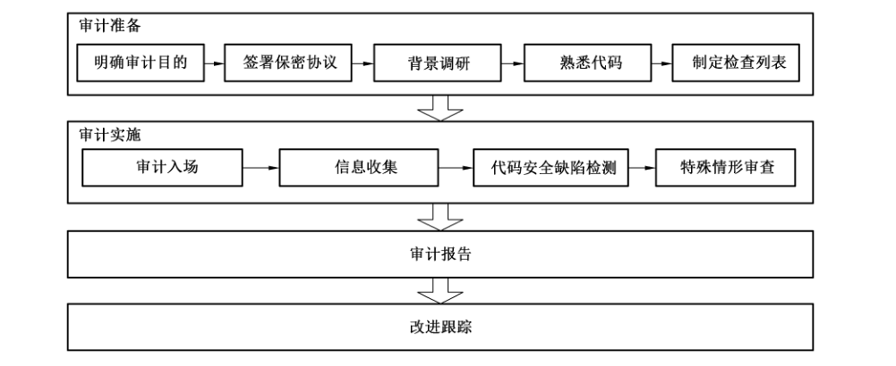

# GB/T 39412-2020 信息安全技术 代码安全审计规范

> 来源：[GB/T 39412-2020 国家标准详情](https://openstd.samr.gov.cn/bzgk/std/newGbInfo?hcno=29AD7403B273C5B82911B7F26D484B9C)；封面发布日期：2020-11-19；实施日期：2021-06-01。
> 官方 PDF SHA-256：ad16207b16bb834ff194374c1be5844ac6511464ebee9c8eafea09c59d6e2100。
> 依据官方 PDF 全部 41 页的页面图像转写与校核；省略封面、目录、页眉、页脚和分页，合并印刷折行。
> 原文差异：B.2.5 示例中 `calloc` 只印一个实参，`printf` 的格式串与 `foo` 之间未印逗号；B.2.11 的示例 2 虽标作规范用法，但 `if (0 == y)` 后为空分支，随后仍执行除法。本稿按原页保留。

## 前言

本标准按照 GB/T 1.1—2009 给出的规则起草。

请注意本文件的某些内容可能涉及专利。本文件的发布机构不承担识别这些专利的责任。

本标准由全国信息安全标准化技术委员会（SAC/TC 260）提出并归口。

本标准起草单位：信息安全共性技术国家工程研究中心、中国科学院信息工程研究所、国家保密科技测评中心、北京信息安全测评中心、中国信息安全测评中心、中国电子技术标准化研究院、公安部第三研究所、国家计算机网络应急技术处理协调中心。

本标准主要起草人：王彦杰、胡建勋、徐根炜、高振鹏、伊鹏达、肖树根、康蕊、霍玮、朴爱花、李丰、何建波、刘国乐、刘海峰、赵章界、李晨旸、王嘉捷、辛伟、孙彦、孙永清、郭运尧、王博、吴倩。

## 1 范围

本标准规定了代码安全的审计过程以及安全功能缺陷、代码实现安全缺陷、资源使用安全缺陷、环境安全缺陷等典型审计指标及对应的证实方法。

本标准适用于指导代码安全审计相关工作。

## 2 规范性引用文件

下列文件对于本文件的应用是必不可少的。凡是注日期的引用文件，仅注日期的版本适用于本文件。凡是不注日期的引用文件，其最新版本（包括所有的修改单）适用于本文件。

- GB/T 15272—1994 程序设计语言 C
- GB/T 25069 信息安全技术 术语
- GB/T 35273—2020 信息安全技术 个人信息安全规范

## 3 术语、定义和缩略语

### 3.1 术语和定义

GB/T 15272—1994、GB/T 25069 和 GB/T 35273—2020 界定的以及下列术语和定义适用于本文件。

#### 3.1.1 代码安全审计 code security audit

对代码进行安全分析，以发现代码安全缺陷或违反代码安全规范的动作。

#### 3.1.2 安全缺陷 security defect

代码中存在的某种破坏软件安全能力的问题、错误。

#### 3.1.3 跨站脚本攻击 cross site script

攻击者向 Web 页面里面插入恶意 HTML 代码，当用户浏览该页面时，嵌入到 Web 里面的 HTML 代码会被执行，从而达到攻击者的特殊目的。

#### 3.1.4 缓冲区溢出 buffer overflow

向程序的缓冲区写入超出其长度的内容，从而破坏程序堆栈，使程序转而执行其他指令，以获取程序或系统的控制权。

#### 3.1.5 死锁 deadlock

两个或两个以上的进程在执行过程中，因竞争资源或彼此通信而造成的一种阻塞现象。

#### 3.1.6 错误 error

系统运行中出现的可能导致系统崩溃或者暂停运行的非预期问题。

#### 3.1.7 特殊元素 special elements

用于特定表达式或语言中分隔数据不同部分的字节、字符或字的序列。

#### 3.1.8 异常 exception

导致程序中断运行的一种指令流。

> 注：如果不对异常进行正确的处理，则可能导致程序的中断执行。

#### 3.1.9 SQL 注入 SQL injection

将恶意 SQL 命令插入数据库请求参数，并提交给数据库执行的攻击行为。

### 3.2 缩略语

下列缩略语适用于本文件。

- API：应用程序编程接口（Application Programming Interface）
- CSPRNG：伪随机数产生器（Cryptographically Secure Pseudo-Random Number Generator）
- DNS：域名系统（Domain Name System）
- HTML：超文本标记语言（Hyper Text Markup Language）
- HTTP：超文本传输协议（HyperText Transfer Protocol）
- SQL：结构化查询语言（Structured Query Language）
- URL：统一资源定位符（Uniform Resource Locator）

## 4 审计概述

### 4.1 审计说明

针对软件系统的代码制定出安全缺陷审计条款，审计时可根据被审计的具体对象及应用场景对相关条款进行调整。考虑到语言的多样性，以典型的结构化语言（C）和面向对象语言（Java）为目标进行描述。代码安全审计应包括但不限于下述 4 个方面的具体条款。其中：安全措施 37 条审计条款；代码实现 25 条审计条款；资源使用 32 条审计条款；环境安全 3 条审计条款；总计 97 条审计条款。

### 4.2 审计目的

代码安全审计通过审计发现代码的安全缺陷，以提高软件系统安全性，降低安全风险。鉴于安全漏洞形成的综合性和复杂性，代码安全审计主要针对代码层面的安全风险、代码质量，以及形成漏洞的各种脆弱性因素。

通过代码审计形成审计报告，列出代码中针对审计列表的符合性/违规性条目，提出对代码修订的措施和建议。

### 4.3 审计时机

代码安全审计包括内部审计和外部审计。内部审计由单位内部的软件质量保证人员开展，审计的意义是发现和预防安全问题的发生。外部审计由第三方开展。外部审计需要较多的准备工作，不宜频繁安排。审计工作可安排在代码编写完成之后系统集成测试之前开展。由于资质认证、政策要求等因素，开展外部审计应提前通知开发团队，并预留足够时间。

内部审计通过代码安全审计，保证软件代码安全质量。内部审计可安排在软件开发生命周期内的不同阶段。

历史审计结果可以作为审计考虑的因素。若审计出的安全问题较多，则应根据实际修复情况适当增加审计次数。在代码开发过程中，如果有频繁改变代码开发计划或调整里程碑等异常情况时，也应增加审计次数。

### 4.4 审计人员

审计人员的主要工作职能是收集信息和代码缺陷分析等，应具备代码审计的专业知识；应能够客观地呈现代码的问题，不应隐瞒；应对代码等相关内容保守秘密，不得泄露相关信息。

### 4.5 审计方法

代码安全审计常用的方法是将代码安全缺陷形成审计检查列表，对照代码逐一检查。检查列表应根据被审计的对象和应用场景进行调整。

考虑到审计内容的复杂性，审计方法建议采用工具审计和人工审计相结合，多种手段综合运用的方式。

采用专业代码审计工具对代码进行审计，形成审计报告，并对审计出的问题与标准相关审计项逐一人工核对。对于使用外部开源代码较多的系统，在审计时可先检测开源代码的使用率，开源代码的安全缺陷可从已知漏洞角度检查。由于审计工具的局限性，不可避免存在误报和漏报。对于误报问题，应采用人工对比审计核查的方式开展。对于漏报问题应采用多个工具交叉审计的方式开展。人工审计是工具审计的必要补充，人工审计主要解决工具审计的误报和漏报问题。在人工审计实施中，可借助工具对代码模块、数据流、控制流等逻辑结构进行分析提取，并逐条比对分析。

审计实施过程中，可根据审计工作需要划分工作阶段。如按进度或里程碑划分；按周、月、季度划分；按功能模块实施单元划分；按人员分工交叉审计划分等。

对于审计出的缺陷，可根据缺陷的可利用性、影响程度、弥补代价等因素进行分级排序。

## 5 审计过程

### 5.1 总体流程

审计过程包括四个阶段：审计准备、审计实施、审计报告、改进跟踪。审计准备阶段，主要开展基本情况调研、签署保密协议、准备检查清单等工作；审计实施阶段，主要开展资料检查、代码审查、结果分析等工作；报告阶段包括审计结果的总结、陈述等工作，如有必要进行相关问题的澄清和相关资料说明；改进跟踪工作由代码开发团队进行，主要对审计出的问题进行修复。对于安全缺陷代码修改后，再次进行审计。代码安全审计流程见图 1。



### 5.2 审计准备

#### 5.2.1 明确审计目的

代码安全审计的目的包括软件采购/外包测试、软件产品的认证测试、公司软件代码安全性自查等。

#### 5.2.2 签署保密协议

为避免被审计单位的代码被审计方用于非代码审计用途，双方应签署代码审计保密协议，明确双方的权利和义务。

#### 5.2.3 背景调研

了解代码的应用场景、目标客户、开发内容、开发者遵循的标准和流程等。

#### 5.2.4 熟悉代码

通过阅读代码，了解程序代码结构、主要功能模块，以及采用的编程语言。

#### 5.2.5 制定检查列表

通过明确审计目的、背景调研、熟悉代码等工作，形成代码安全审计要点，制定代码安全的检查列表。检查列表包括检查项和问题列表。

### 5.3 审计实施

#### 5.3.1 审计入场

入场实施环节中，审计人员和项目成员（关键代码开发人员等）均应参与。审计人员介绍审计的主要目标、访谈对象和检查的资料等。项目人员介绍项目进展、项目关键成员、项目背景、实现功能以及项目的当前状态等。

#### 5.3.2 信息收集

信息收集环节通过访谈等方式获得代码以及相应需求分析文档、设计文档、测试文档等资料。通过文档资料了解代码的业务逻辑等信息。在了解代码基本信息的基础上，通过深入分析设计文档、访谈关键开发人员等方式，区分核心代码和一般性代码，其中核心代码一般为涉及核心业务功能和核心软件功能的代码，一般性代码为非核心业务功能和非核心软件功能的代码。

#### 5.3.3 代码安全缺陷检测

代码安全缺陷检测环节是根据制定的代码安全的检查项，采用工具审计、人工审计、人工结合工具审计方式检查是否存在安全缺陷，检测完成后进行安全性分析形成安全审计结果。

#### 5.3.4 特殊情形审查

在有软件外包/采用开源软件/合作开发情形下，应对开源软件或外包部分进行代码安全审计。对于核心代码和一般性代码在审计时，采取重点审计和一般性审计措施，其中重点审计主要针对核心代码进行审计，一般性审计主要针对一般性代码进行审计。

### 5.4 审计报告

审计实施完成后，组织召开评审会，将初始审计结果提供给被审计项目成员，并提供澄清误解机会，允许项目成员提供其他需要补充的信息。

评审会结束后，根据评审意见，调整审计结果，形成审计报告。审计报告包括审计的总体描述、审计结论等内容，并对可能产生的安全风险进行高、中、低分类描述。审计结论给出每条审计条款的符合/不符合的描述。审计报告的内容示例参见附录 A。

### 5.5 改进跟踪

对审计中发现的问题进行修改，对未修改的应提供理由；对代码的有效变更进行记录存档。对于修复安全缺陷后的代码，可通过再次审计来确认问题是否解决。

## 6 安全功能缺陷审计

### 6.1 数据清洗

#### 6.1.1 输入验证

##### 6.1.1.1 关键状态数据外部可控

审计指标：应避免关键状态数据被外部控制。

审计人员应检查代码中是否将与用户信息或软件自身安全密切相关的状态信息，存储在非授权实体都可以访问的地方，如结果为肯定，则系统可能有关键状态数据能被外部访问或篡改的安全风险。不规范代码示例参见 B.2.1。

##### 6.1.1.2 数据真实性验证

审计指标：宜验证数据真实性，避免接收无效数据。

审计人员宜检查代码是否对数据的真实性进行验证，包括但不限于：

a) 宜检查是否有数据源或通信源验证；

b) 宜检查是否存在未验证或不正确验证数据的数字签名；

c) 宜检查是否缺失或进行不恰当完整性检查；

d) 宜检查安全相关的输入是否仅依赖于加密技术而未进行完整性检查；

e) 宜检查是否验证文件内容而非文件名或扩展名；

f) 宜检查是否验证未经校验和完整性检查的 Cookie。不规范代码示例参见 B.2.2。

如上检查项的任一结果为肯定，则提示存在安全风险。

##### 6.1.1.3 绕过数据净化和验证

审计指标：宜防止以大小写混合的方式绕过数据净化和验证。

审计人员宜检查字符串在查找、替换、比较等操作时，是否存在因大小写问题而被绕过的情况。不规范代码示例参见 B.2.3。

##### 6.1.1.4 在字符串验证前未进行过滤

审计指标：不宜在过滤字符串之前对字符串进行验证。

审计人员宜检查对字符串进行验证之前是否存在对该字符串进行过滤，来防止注入类攻击的发生。

##### 6.1.1.5 对 HTTP 头 Web 脚本特殊元素处理

审计指标：应对 HTTP 头的 Web 脚本语法中的特殊元素进行过滤和验证。

审计人员应检查代码是否对 HTTP 头中的 Web 脚本特殊元素进行过滤处理。因 HTTP 头中的 Web 脚本含有特殊元素，可能会导致浏览器执行恶意脚本。不规范代码示例参见 B.2.4。

##### 6.1.1.6 命令行注入

审计指标：应正确处理命令中的特殊元素。

审计人员应检查代码对利用外部输入来构造命令或部分命令时，是否对其中的特殊元素进行了处理，命令注入通常发生在以下但不限于：

a) 数据从非可信源进入到应用程序中；

b) 数据是字符串的一部分，该字符串被应用系统当作命令来执行的；

c) 通过执行这个命令，应用程序为攻击者提供了攻击者不应拥有的权限或能力。

##### 6.1.1.7 数据结构控制域安全

审计指标：宜避免对数据结构控制域的删除或意外增加。

审计人员检查代码关于数据结构控制域的操作：

a) 宜检查代码是否存在对数据结构控制域的删除而导致系统安全风险。不规范代码示例参见 B.2.5。

b) 宜检查代码是否存在对数据结构控制域的意外增加而导致系统安全风险。不规范代码示例参见 B.2.6。

##### 6.1.1.8 忽略字符串结尾符

审计指标：应保证字符串的存储具有足够的空间容纳字符数据和结尾符。

审计人员应检查代码字符串的存储空间是否能容纳下结尾符，字符串不以结尾符结束会造成字符串越界访问。规范/不规范代码示例参见 B.2.7。

##### 6.1.1.9 对环境变量长度做出假设

审计指标：不应对环境变量的长度做出假设。

审计人员应检查代码在使用环境变量时是否对环境变量的长度做出特定值的假设，因环境变量可由用户进行设置修改，故对环境变量的长度做出假设可能会发生错误。规范/不规范代码示例参见 B.2.8。

##### 6.1.1.10 条件比较不充分

审计指标：执行比较时不应部分比较或不充分的比较。

审计人员应检查比较条件是否充分，防止不充分比较造成逻辑绕过风险。

##### 6.1.1.11 结构体长度

审计指标：不应将结构体的长度等同于其各个成员长度之和。

审计人员应检查代码是否将结构体的长度等同于其各成员长度之和，不应将结构体长度等同于各成员长度之和。结构对象可能存在无名的填充字符从而造成结构体长度与各个成员长度之和并不相等。不规范代码示例参见 B.2.9。

##### 6.1.1.12 数值赋值越界

审计指标：应避免数值赋值越界。

审计人员应检查代码是否存在数值赋值超出数值类型范围，应避免赋值越界。不规范代码示例参见 B.2.10。

##### 6.1.1.13 除零错误

审计指标：应避免除零错误。

审计人员应检查代码是否存在除零操作，应避免除零错误。规范/不规范代码示例参见 B.2.11。

##### 6.1.1.14 边界值检查缺失

审计指标：数值范围比较时，不宜遗漏边界值检查。

审计人员宜检查代码在进行数值范围比较时，是否遗漏了最小值、最大值边界值检查。规范/不规范代码示例参见 B.2.12。

##### 6.1.1.15 数据信任边界的违背

审计指标：代码宜避免将可信和不可信数据组合在同一结构体中，违背信任边界。

审计人员宜检查代码是否将来自可信源和非可信源的数据混合在同一数据结构体或同一结构化的消息体中，模糊了二者的边界。

##### 6.1.1.16 条件语句缺失默认情况

审计指标：条件语句中不宜缺失默认情况。

审计人员宜检查代码中条件语句是否存在缺失默认情况的情形。

##### 6.1.1.17 无法执行的死代码

审计指标：不宜包含无法执行的死代码。

审计人员宜检查代码是否存在无法执行的死代码。

##### 6.1.1.18 表达式永真或永假

审计指标：不应出现表达式永真或永假代码。

审计人员应检查代码是否存在表达式逻辑永真或永假代码的情况。

#### 6.1.2 输出编码

##### 6.1.2.1 跨站脚本

审计指标：应避免跨站脚本攻击。

审计人员应检查代码中用户提交的数据放到页面中，被送到浏览器进行显示前，是否进行了验证或过滤。

##### 6.1.2.2 Web 应用重定向后执行额外代码

审计指标：Web 应用不宜在重定向后执行额外代码。

审计人员宜检查 Web 应用是否存在重定向后执行额外代码的情况，如果结果为肯定，则提示存在安全风险。

##### 6.1.2.3 URL 重定向

审计指标：不应开放不可信站点的 URL 重定向。

审计人员应检查代码是否存在 URL 重定向到不可信站点的情况，因重定向到不可信站点，可能会发生访问安全风险。

### 6.2 数据加密与保护

#### 6.2.1 数据加密

##### 6.2.1.1 密码安全

审计指标：密码相关实现技术应符合国家密码相关管理规定。

审计人员应检查代码中使用的密码相关实现技术是否符合国家密码管理部门相关管理规定，若不符合，则提示存在安全风险。

##### 6.2.1.2 随机数安全

审计指标：应确保产生安全的随机数。

审计人员应检查代码是否产生安全的随机数，具体审计要求包括但不限于：

a) 应检查是否采用能产生充分信息熵的算法或方案。代码的不规范示例参见 B.2.13；
b) 应检查是否避免随机数的空间太小；
c) 应检查是否避免 CSPRNG 每次都使用相同的种子、可预测的种子（如进程 ID 或系统时间的当前值）或空间太小的种子；
d) 应检查是否避免使用具有密码学缺陷的 CSPRNG 用于加密场景。

如上检查项的任一结果为否定，则提示存在安全风险。

##### 6.2.1.3 使用安全相关的硬编码

审计指标：不应使用安全相关的硬编码。

审计人员应检查代码中是否存在跟安全相关的硬编码，如果代码泄漏或被非法获取，这些硬编码的值可能会被攻击者利用。

#### 6.2.2 数据保护

##### 6.2.2.1 敏感信息暴露

审计指标：应避免敏感信息暴露。

审计人员应检查代码中是否有敏感信息暴露，重点检查暴露的途径包含但不限于：

a) 通过发送数据导致的信息暴露；
b) 通过数据查询导致的信息暴露；
c) 通过差异性（响应差异性、行为差异性、时间差异性）导致的信息暴露；
d) 通过错误消息导致的信息暴露；
e) 敏感信息的不恰当跨边界移除导致信息暴露；
f) 通过进程信息导致的信息暴露；
g) 通过调试信息导致的信息暴露；
h) 信息在释放前未清除导致信息暴露；
i) 通过输出流或日志将系统数据暴露到未授权控制的范围；
j) 通过缓存导致的信息暴露；
k) 通过日志文件导致的信息暴露；
l) 通过源代码导致的信息暴露，如测试代码、源代码、注释等；
m) 敏感信息使用 HTTP 请求传递导致信息暴露；
n) 备份文件导致信息暴露；
o) 在 Web 登录表单中，宜禁止浏览器的口令自动填充功能。

不规范代码示例参见 B.2.14。

##### 6.2.2.2 个人信息保护

审计指标：应确保个人信息保护。

审计人员应检查代码中对个人信息保护是否符合国家相关法律法规的要求。若存在个人信息保护不当，可能造成个人信息泄漏。

### 6.3 访问控制

#### 6.3.1 身份鉴别

##### 6.3.1.1 身份鉴别过程中暴露多余信息

审计指标：应避免在处理身份鉴别的过程中暴露多余信息。

审计人员应检查账号在注册或认证过程中，是否存在暴露多余信息的情况。攻击者可能会利用获取到的多余信息，进行认证暴力破解。

##### 6.3.1.2 身份鉴别被绕过

审计指标：应避免身份鉴别被绕过。

审计人员应检查代码中身份鉴别机制是否存在被绕过的路径或通道，鉴别算法的关键步骤是否被省略或跳过。

##### 6.3.1.3 身份鉴别尝试频率限制

审计指标：应对身份鉴别连续多次登录失败频率进行限制。

审计人员应检查代码是否实现对身份鉴别多次登录失败的频率进行限制。如结果为否定，则系统存在身份认证被暴力破解的安全风险。

##### 6.3.1.4 多因素认证

审计指标：宜使用多因素认证机制。

审计人员宜检查是否采用多因素认证，如果结果为否定，则提示存在安全风险。

#### 6.3.2 口令安全

##### 6.3.2.1 登录口令

审计指标：应确保登录过程中口令不可明文显示。

审计人员应检查代码中是否实现在登录过程中口令是否明文显示。

##### 6.3.2.2 明文存储口令

审计指标：应避免明文存储口令。

审计人员应检查代码中是否存在明文存储口令的情况。

##### 6.3.2.3 明文传递口令

审计指标：应避免明文传递口令。

审计人员应检查代码中是否存在明文传递口令的情况。

#### 6.3.3 权限管理

##### 6.3.3.1 权限访问控制

审计指标：应确保权限管理安全以及其他访问控制措施的安全。

审计人员应检查代码中的权限与访问控制功能相关部分，包括但不限于：

a) 应检查是否缺失认证机制，如果结果为肯定，则提示存在安全风险；
b) 应检查是否缺失授权机制，如果结果为肯定，则提示存在安全风险；
c) 应检查是否违背最小特权原则，以高于功能所需的特权级别在执行一些操作，如果结果为肯定，则提示存在安全风险；
d) 应检查放弃特权后，是否检查其放弃是否成功，如果结果为否定，则提示存在安全风险；
e) 应检查是否创建具有正确访问权限的文件，如果结果为否定，则提示存在安全风险；
f) 应检查是否避免关键资源的不正确权限授予，如果结果为否定，则提示存在安全风险；
g) 应检查是否存在攻击者使用欺骗或捕获重放攻击等手段绕过身份认证的情况，如果结果为肯定，则提示存在安全风险；
h) 应检查是否避免不恰当地信任反向 DNS，如果结果为否定，则提示存在安全风险。代码的不规范/规范用法示例参见 B.2.15；
i) 对于客户端/服务器架构的产品，应检查是否存在仅在客户端而非服务器端执行认证，如果结果为肯定，则提示存在安全风险；
j) 应检查是否避免过于严格的账户锁定机制（账户锁定保护机制过于严格且容易被触发，就允许攻击者通过锁定合法用户的账户来拒绝服务合法的系统用户），如果结果为否定，则提示存在安全风险；
k) 应检查是否未对信道两端的操作者进行充分的身份认证，或未充分保证信道的完整性，从而允许中间人攻击发生，如果结果为肯定，则提示存在安全风险；
l) 应检查是否避免通信通道源的验证不当，确保请求来自预期源，如果结果为否定，则提示存在安全风险；
m) 应检查通信信道是否正确指定目的地来预防如下风险：攻击者在目的地伪装成受信任的服务器来窃取数据或引起拒绝服务。如果结果为否定，则提示存在安全风险。

##### 6.3.3.2 未加限制的外部可访问锁

审计指标：宜对外部可访问锁加以限制，不允许被预期范围之外的实体影响。

审计人员宜检查代码中的锁是否可被预期范围之外的实体控制或影响，如结果为肯定，则系统存在易受到拒绝服务攻击的安全风险。

### 6.4 日志安全

#### 6.4.1 对输出日志中特殊元素处理

审计指标：应对输出日志中的特殊元素进行过滤和验证。

审计人员应检查代码是否对输出日志中的特殊元素做过滤和验证。因对特殊元素未做过滤，可能会造成信息泄露。

#### 6.4.2 信息丢失或遗漏

审计指标：宜避免安全相关信息丢失或遗漏。

审计人员宜检查代码是否未记录或不恰当记录安全相关信息，安全相关信息丢失或遗漏可能会给追溯攻击行为带来影响。信息丢失或遗漏形式包含但不限于：

a) 截断与安全有关信息的显示、记录或处理，掩盖攻击的来源或属性；
b) 不记录或不显示信息（如日志），而该信息对确定攻击来源、攻击性质、攻击行动是否安全具有重要意义。

## 7 代码实现安全缺陷审计

### 7.1 面向对象程序安全

#### 7.1.1 泛型和非泛型数据类型

审计指标：不宜混用具有泛型和非泛型的数据类型。

审计人员宜检查代码是否存在泛型和非泛型之间数据类型的混用现象，应避免泛型和非泛型数据类型的混用。规范/不规范代码示例参见 B.3.1。

#### 7.1.2 包含敏感信息类的安全

审计指标：包含敏感信息的类不应可复制和可序列化。

审计人员应检查代码中包含敏感信息类的相关行为是否安全，包括但不限于：

a) 应检查代码中包含敏感信息的类是否可复制，如 Java 语言中实现了 Clonenable 接口，使类可复制。包含敏感信息的类不应被复制。
b) 应检查代码中包含敏感信息的类是否可实现了序列化接口，使类可序列化。包含敏感信息的类不应可序列化。

#### 7.1.3 类比较

审计指标：在类进行比较时，不宜只使用名称比较。

审计人员宜检查代码中当判定一个对象是否属于特定的类或两个对象的类是否相同时，宜比较类对象，不能仅基于类名称进行判定。

#### 7.1.4 类私有可变成员的引用

审计指标：应禁止返回类的私有可变成员的引用。

审计人员应检查代码中是否存在返回类私有可变成员的引用的情况。如果结果为肯定，则可能存在内部状态被非预期修改的风险。

#### 7.1.5 存储不可序列化的对象到磁盘

审计指标：不应将不可序列化的对象存储到磁盘。

审计人员应检查代码是否试图将不可序列化的对象写到磁盘中，将不可序列化的对象存储到磁盘上，会导致对象反序列化失败，可能引起任意代码执行风险。代码的不规范/规范用法示例参见 B.3.2。

### 7.2 并发程序安全

#### 7.2.1 不同会话间信息泄露

审计指标：代码应避免不同会话之间发生信息泄露。

审计人员应检查代码在应用的不同会话之间是否会发生信息泄露，尤其是在多线程环境下。

#### 7.2.2 发布未完成初始化的对象

审计指标：不宜发布未完成初始化的对象。

审计人员宜检查代码在多线程环境中，是否存在在对象初始化尚未完成前，就可被其他线程引用的情况。

#### 7.2.3 共享资源的并发安全

审计指标：共享资源宜使用正确的并发处理机制。

审计人员宜检查代码中共享资源的使用及并发处理的过程，包括但不限于：

a) 宜检查代码在多线程环境中对共享数据的访问是否为同步访问，如果结果为否定，则提示存在安全风险；
b) 宜检查代码中线程间的共享对象是否声明正确的存储持续期，如果结果为否定，则提示存在安全风险；
c) 宜检查代码中是否在并发上下文中使用不可重入的函数，如果结果为肯定，则提示存在安全风险；
d) 宜检查代码中是否避免了检查时间与使用时间资源冲突；
e) 宜检查代码中多个线程中等待彼此释放锁的可执行片段是否避免了死锁情况发生，如果结果为否定，则提示存在安全风险；
f) 宜检查代码对共享资源执行敏感操作时是否检查加锁状态，如果结果为否定，则提示存在安全风险。规范/不规范代码示例参见 B.3.3；
g) 宜检查代码是否将敏感信息存储在没有被锁定或被错误锁定的内存中（将敏感信息存储于加锁不恰当的内存区域，可能会导致该内存通过虚拟内存管理器被写入到在磁盘上的交换文件中，从而使得数据更容易被外部获取），如果结果为肯定，则提示存在安全风险；
h) 宜检查代码中是否存在关键资源多重加锁，如果结果为肯定，则提示存在安全风险；
i) 宜检查代码中是否存在关键资源多重解锁，如果结果为肯定，则提示存在安全风险；
j) 宜检查代码中是否存在对未加锁的资源进行解锁，如果结果为肯定，则提示存在安全风险；
k) 宜检查代码中在异常发生时是否释放已经持有的锁，如果结果为否定，则提示存在安全风险。

#### 7.2.4 子进程访问父进程敏感资源

审计指标：在调用子进程之前应关闭敏感文件描述符，避免子进程使用这些描述符来执行未经授权的 I/O 操作。

审计人员宜检查代码是否存在调用子进程之前有未关闭敏感文件描述符的情形。当一个新进程被创建或执行时，子进程继承任何打开的文件描述符，如不关闭则可能会造成未经授权的访问。规范/不规范代码示例参见 B.3.4。

#### 7.2.5 释放线程专有对象

审计指标：应及时释放线程专有对象。

审计人员应检查代码是否及时释放线程专有对象，防止内存泄漏造成拒绝服务攻击。

### 7.3 函数调用安全

#### 7.3.1 格式化字符串

审计指标：应避免外部控制的格式化字符串。

审计人员应检查代码中是否存在函数接受格式化字符串作为参数的情况，格式化字符串是否来自外部，如果是，则可能引起注入类安全风险。规范/不规范代码示例参见 B.3.5。

#### 7.3.2 对方法或函数参数验证

审计指标：宜对方法或函数的参数进行验证。

审计人员宜检查代码是否存在对方法或函数的参数进行合法性或安全性校验。规范/不规范代码示例参见 B.3.6。

#### 7.3.3 参数指定错误

审计指标：函数功能调用宜正确指定参数。

审计人员宜检查函数/方法调用时参数指定是否正确，是否存在如下情况：

a) 不正确数量的参数；
b) 参数顺序不正确；
c) 参数类型不正确；
d) 错误的值。

以上检查项的任一结果为肯定，则提示存在安全风险。

#### 7.3.4 返回栈变量地址

审计指标：不宜返回栈变量地址。

审计人员宜检查代码中是否存在在函数中返回栈变量地址的情况。因栈变量在函数调用结束后就会被释放，再使用该变量地址时可能会出现意想不到的结果。不规范代码示例参见 B.3.7。

#### 7.3.5 实现不一致函数

审计指标：不宜使用具有不一致性实现的函数或方法。

审计人员宜检查代码是否存在使用了在不同版本具有不一致实现的函数或方法。因使用在不同操作系统或不同版本实现不一致的函数或方法，可能导致代码被移植到不同环境时改变行为。

#### 7.3.6 暴露危险的方法或函数

审计指标：不应暴露危险的方法或函数。

审计人员应检查代码中的 API 或其他与外部交互的接口是否暴露了危险方法或函数，暴露危险的方法或函数可能会带来非授权访问攻击。危险方法或函数暴露的形式主要包括方法/函数原本设计为非外部用户使用、原本设计为部分用户访问等。代码的不规范/规范用法示例参见 B.3.8。

### 7.4 异常处理安全

审计指标：宜恰当进行异常处理。

审计人员宜检查代码中异常处理是否安全，包括但不限于：

a) 宜检查是否对异常进行检查并处理；
b) 宜检查是否采用标准化的、一致的异常处理机制来处理代码中的异常；
c) 宜检查错误发生时，是否提供正确的状态代码或返回值来表示发生的错误；
d) 宜检查是否对执行文件 I/O 的返回值进行检查；
e) 宜检查是否对函数或方法返回值是否为预期值进行了检查；
f) 宜检查是否返回定制的错误页面给用户来预防敏感信息的泄露。

如上检查项的任一结果为否定，则提示存在安全风险。

### 7.5 指针安全

#### 7.5.1 不兼容的指针类型

审计指标：不宜使用不兼容类型的指针来访问变量。

审计人员宜检查代码是否使用不兼容类型的指针来访问变量。通过不兼容类型的指针修改变量可能会导致不可预测的结果。代码的不规范用法示例参见 B.3.9。

#### 7.5.2 利用指针减法确定内存大小

审计指标：宜避免使用指针的减法来确定内存大小。

审计人员宜检查代码是否采用一个指针减去另一个指针的方式来确定内存大小。如果两个指针不是同一类型，那么使用指针的减法来确定内存大小的计算可能会不正确，导致不可预测的结果。代码的不规范/规范用法示例参见 B.3.10。

#### 7.5.3 将固定地址赋值给指针

审计指标：不宜把固定地址赋值给指针。

审计人员宜检查代码是否将一个 NULL 或 0 以外的固定地址赋值给指针。将固定地址赋值给指针会降低代码的可移植性，并为攻击者进行注入代码攻击提供便利。

#### 7.5.4 试图访问非结构体类型指针的数据域

审计指标：不应把指向非结构体类型指针强制转换为指向结构类型的指针并访问其字段。

审计人员应检查代码是否将指向非结构体类型的指针，强制转换为指向结构类型的指针并访问其字段，如果结果为肯定，则可能存在内存访问错误或数据损坏的风险。

#### 7.5.5 指针偏移越界

审计指标：不应使用偏移越界的指针。

审计人员应检查代码在使用指针时是否存在偏移越界的情况，因指针偏移越界可能会造成访问缓冲区溢出风险。

#### 7.5.6 无效指针使用

审计指标：应避免无效指针的使用。

审计人员应检查代码是否存在使用无效指针的情况，因使用无效指针，可能会产生非预期行为。

### 7.6 代码生成安全

#### 7.6.1 编译环境安全

审计指标：应构建安全的编译环境。

审计人员应检查编译环境安全，包括但不限于：

a) 应检查编译器是否从官方或其他可靠渠道获取，并确保其安全可靠；
b) 应检查编译器是否存在不必要的编译功能。

#### 7.6.2 链接环境安全

审计指标：应构建安全的链接环境。

审计人员应检查链接环境安全，包括但不限于：

a) 应检查编译后的目标文件是否安全，确保链接后生成的可执行文件的安全；
b) 应检查链接依赖库是否安全，避免引入不安全的依赖库。

## 8 资源使用安全缺陷审计

### 8.1 资源管理

#### 8.1.1 重复释放资源

审计指标：应避免重复释放资源。

审计人员应检查代码是否存在重复释放资源的情况。重复释放资源可能会造成系统崩溃。

#### 8.1.2 资源或变量不安全初始化

审计指标：宜避免不安全的资源或变量初始化。

审计人员宜检查代码是否对资源或变量进行了安全的初始化，包括但不限于：

a) 宜检查代码是否对关键变量进行初始化，未初始化关键变量易导致系统按非预期值执行，如结果为否定，则提示存在安全风险；
b) 宜检查代码是否采用了不安全或安全性较差的缺省值来初始化内部变量。缺省值通常和产品一起发布，容易被熟悉产品的潜在攻击者获取而带来系统安全风险，如结果为肯定，则提示存在安全风险；
c) 宜检查代码中关键的内部变量或资源是否采用了可信边界外的外部输入值进行初始化，如结果为肯定，则提示存在安全风险。

#### 8.1.3 初始化失败后未安全退出

审计指标：初始化失败后应安全退出程序。

审计人员应检查代码在初始化失败后能否安全退出。

#### 8.1.4 引用计数的更新不正确

审计指标：应避免引用计数的更新不正确。

审计人员应检查代码中管理资源的引用计数是否正确更新，引用计数更新不正确，可能会导致资源在使用阶段就被过早释放，或虽已使用完毕但得不到释放的安全风险。

#### 8.1.5 资源不安全清理

审计指标：宜避免不安全的资源清理。

审计人员宜检查代码中资源清理部分的相关功能，检查代码在使用资源后是否恰当地执行临时文件或辅助资源的清理，避免清理环节不完整。

#### 8.1.6 将资源暴露给非授权范围

审计指标：不应将资源暴露给非授权的范围。

审计人员应检查代码是否将文件和目录等资源暴露给非授权的范围，如果存在，则提示代码存在信息暴露的风险。

#### 8.1.7 未经控制的递归

审计指标：应避免未经控制的递归。

审计人员应检查代码是否避免未经控制的递归，未控制递归可造成资源消耗过多的安全风险。

#### 8.1.8 无限循环

审计指标：执行迭代或循环应恰当地限制循环执行的次数，以避免无限循环。

审计人员应检查代码中软件执行迭代或循环，是否充分限制循环执行的次数，以避免无限循环的发生导致攻击者占用过多的资源。

#### 8.1.9 算法复杂度攻击

审计指标：宜避免算法复杂度攻击。

审计人员宜检查代码中算法是否存在最坏情况下非常低效，复杂度高，会严重降低系统性能。如果是，则攻击者就可以利用精心编制的操作来触发最坏情况的发生，从而引发算法复杂度攻击。

#### 8.1.10 早期放大攻击

审计指标：宜遵守正确的行为次序避免早期放大攻击数据。

审计人员宜检查代码是否存在实体在授权或认证前执行代价高的操作的情况，不合理执行代价高的操作可能会造成早期放大攻击。规范/不规范代码示例参见 B.4.1。

### 8.2 内存管理

#### 8.2.1 内存分配释放函数成对调用

审计指标：应成对调用内存分配和释放函数。

审计人员应检查代码中分配内存和释放内存函数是否成对调用，如 malloc/free 来分配或释放资源。当内存分配和释放函数不成对调用时，可能会引起程序崩溃的风险。

#### 8.2.2 堆内存释放

审计指标：应避免在释放堆内存前清理不恰当而导致敏感信息暴露。

审计人员应检查代码在释放堆内存前是否采用合适的方式进行信息清理。

示例：如 C 语言中是否使用 realloc() 函数调整存储敏感信息的缓冲区大小，如存在该操作，将存在可能暴露敏感信息的风险。realloc() 函数不是从内存中删除，而通常是将旧内存块的内容复制到一个新的、更大的内存块，这可能暴露给攻击者使用“memorydump”或其他方法来进行读取敏感信息的“堆检查”攻击。

#### 8.2.3 内存未释放

审计指标：宜及时释放动态分配的内存。

审计人员宜检查代码是否有动态分配的内存使用完毕后未释放导致内存泄漏的情况。内存泄漏可能会导致资源耗尽从而带来拒绝服务的安全风险。规范/不规范代码示例参见 B.4.2。

#### 8.2.4 访问已释放内存

审计指标：不应引用或访问已被释放后的内存。

审计人员应检查代码是否存在内存被释放再次被访问的情况。内存被释放后再次访问会出现非预期行为。

#### 8.2.5 数据/内存布局

审计指标：不宜依赖数据/内存布局。

审计人员宜检查代码逻辑是否依赖于对协议数据或内存在底层组织形式的无效假设。当平台或协议版本变动时，数据组织形式可能会发生变化从而带来非预期行为。

#### 8.2.6 内存缓冲区边界操作

审计指标：应避免内存缓冲区边界操作发生越界。

审计人员应检查代码在内存缓冲区边界操作时是否存在越界现象，因内存缓冲区访问越界可能会造成缓冲区溢出漏洞。规范/不规范代码示例参见 B.4.3。

#### 8.2.7 缓冲区复制造成溢出

审计指标：应避免未检查输入数据大小就进行缓冲区复制。

审计人员应检查代码在进行缓冲区复制时，是否存在未对输入数据大小进行检查的现象，因未检查输入数据大小，可能会造成缓冲区溢出。不规范代码示例参见 B.4.4。

#### 8.2.8 使用错误长度访问缓冲区

审计指标：应避免使用错误的长度值访问缓冲区。

审计人员应检查代码在访问缓冲区时使用长度值是否正确，因使用错误的长度值来访问缓冲区可能会造成缓冲区溢出风险。规范/不规范代码示例参见 B.4.5。

#### 8.2.9 堆空间耗尽

审计指标：应限制堆空间的消耗，防止堆空间耗尽。

审计人员应检查代码是否有导致堆空间耗尽的情况，具体检查包括但不限于：

a) 是否存在内存泄漏；
b) 是否存在死循环；
c) 不受限制的反序列化；
d) 创建大量的线程；
e) 解压一个较大压缩文件。

### 8.3 数据库使用

#### 8.3.1 及时释放数据库资源

审计指标：宜及时释放数据库资源。

审计人员宜检查代码中使用数据库后是否及时释放数据库连接或采用数据库连接池，未及时释放数据库连接可能会造成数据库拒绝服务风险。

#### 8.3.2 SQL 注入

审计指标：应正确处理 SQL 命令中的特殊元素。

审计人员应检查代码利用用户可控的输入数据构造 SQL 命令时，是否对外部输入数据中的特殊元素进行处理，如果未处理，那么这些数据有可能被解释为 SQL 命令而非普通用户的输入数据。攻击者可对此加以利用来修改查询逻辑，从而绕过安全检查或插入可以修改后端数据库的额外语句。

### 8.4 文件管理

#### 8.4.1 过期的文件描述符

审计指标：不应使用过期的文件描述符。

审计人员应检查代码是否在文件描述符关闭后再次使用。特定文件或设备的文件描述符被释放后被重用，可能会造成引用了其他的文件或设备。

#### 8.4.2 不安全的临时文件

审计指标：应安全使用临时文件。

审计人员应检查代码中使用临时文件是否安全，因不安全使用临时文件造成敏感信息泄露，包括但不限于：

a) 应检查代码中是否创建或使用不安全的临时文件，如果结果为肯定，则提示存在安全风险；
b) 应检查代码中临时文件是否在程序终止前移除，如果结果为否定，则提示存在安全风险；
c) 应检查代码中是否在具有不安全权限的目录中创建临时文件，如果结果为肯定，则提示存在安全风险。

#### 8.4.3 文件描述符穷尽

审计指标：不宜导致文件描述符穷尽。

审计人员宜检查代码是否存在导致文件描述符穷尽情形，包括但不限于：

a) 是否对打开文件描述符未做关闭处理；
b) 是否到达关闭阶段之前，失去对文件描述符的所有引用；
c) 进程完成后是否未关闭文件描述符。

#### 8.4.4 路径遍历

审计指标：应避免路径遍历。

审计人员应检查代码是否存在由外部输入构造的标识文件或目录的路径名，路径遍历会造成非授权访问资源的风险。

注：路径遍历指未将路径名限制在受限目录。

#### 8.4.5 及时释放文件系统资源

审计指标：应及时释放文件系统资源。

审计人员应检查代码是否及时释放不再使用的文件句柄，不及时释放文件句柄可能会引起文件资源占用过多，造成拒绝服务风险。

### 8.5 网络传输

#### 8.5.1 端口多重绑定

审计指标：不应对同一端口进行多重绑定。

审计人员应检查代码是否有多个套接字绑定到相同端口，从而导致该端口上的服务有被滥用或被欺骗的风险。

#### 8.5.2 对网络消息容量的控制

审计指标：宜避免对网络消息容量的控制不充分。

审计人员宜检查代码是否控制网络传输流量不超过被允许的值。如果代码没有机制来跟踪流量传输，系统或应用程序会很容易被滥用于传输大流量（超过了请求值或客户端被允许的值），从而带来拒绝服务的安全风险。

#### 8.5.3 字节序使用

审计指标：应避免字节序使用不一致性。

审计人员应检查代码在跨平台或网络通信处理输入时是否考虑到字节顺序，避免字节序使用不一致。

不能正确处理字节顺序问题，可能会导致不可预期的程序行为。

#### 8.5.4 通信安全

审计指标：应采用加密传输方式保护敏感数据。

审计人员应检查代码是否实现了对网络通信中敏感数据进行加密传输，特别是身份鉴别信息、重要信息等。

#### 8.5.5 会话过期机制缺失

审计指标：宜制定会话过期机制。

审计人员宜检查代码中会话过程是否存在会话过期机制，如结果为否定，则提示代码存在保护机制被绕过的风险。规范/不规范代码示例参见 B.4.6。

#### 8.5.6 会话标识符

审计指标：宜确保会话标识符的随机性。

审计人员宜检查代码中会话标识符是否具有随机性，防止会话标识符被穷举造成安全风险。

## 9 环境安全缺陷审计

### 9.1 遗留调试代码

审计指标：代码中不应遗留调试代码。

审计人员应检查部署到应用环境的代码是否含有调试或测试功能的代码，该部分代码是否会造成意外的后门入口。

### 9.2 第三方软件安全可靠

审计指标：应对第三方代码来源情况进行审计，确保引入的第三方软件安全可靠。

审计人员应检查引入的第三方代码来源是否安全可靠，避免不安全的第三方软件引入安全风险。

### 9.3 保护重要配置信息

审计指标：宜对重要的配置信息进行安全保护。

审计人员宜检查代码中使用的重要配置信息是否进行了安全保护，因对重要配置信息保护不当，可能带来信息泄漏安全风险。

## 附录 A（资料性附录）代码安全审计报告

### A.1 概述

本附录给出了第 5 章代码安全审计过程中的审计报告的示例。

### A.2 报告内容

#### A.2.1 审计总体信息

审计总体信息应包括但不限于以下信息：

a) 审计日期；
b) 审计团队成员信息；
c) 审计依据；
d) 审计原则；
e) 代码的信息，包括但不限于：代码功能描述、被审计代码的版本号、代码语言类型、代码总行数等。

#### A.2.2 审计流程与内容

审计流程与内容应包括但不限于：

a) 审计流程；
b) 审计方法；
c) 审计内容。

#### A.2.3 发现的安全缺陷汇总

发现的安全缺陷汇总应包括但不限于以下信息：

a) 该版本代码发现的异常情况汇总；
b) 可能造成的严重后果。

#### A.2.4 发现的安全缺陷分析

发现的安全缺陷分析应包括但不限于以下信息：

a) 高风险安全缺陷分析；
b) 中风险安全缺陷分析；
c) 低风险安全缺陷分析。

#### A.2.5 审计总结

审计总结应包括但不限于以下信息：

a) 审计结果汇总，例如，审计条款符合数量、审计条款不符合数量、审计条款不适用数量、不符合的审计条款原因等；
b) 残余缺陷分析；
c) 安全缺陷改进建议。

## 附录 B（资料性附录）代码示例

### B.1 概述

本附录给出了第 6 章、第 7 章、第 8 章、第 9 章代码安全审计要求中各审计条款代码不规范用法示例和规范用法示例。

### B.2 安全功能

#### B.2.1 关键状态数据被外部控制代码示例

避免关键状态数据被外部控制，以下给出了不规范用法（C 语言）示例。

示例：

```c
# define DIR "/restricted/directory"
char cmd[500];
sprintf(cmd, "ls -l %480s", DIR);
RaisePrivileges(...);
system(cmd);
DropPrivileges(...);
```

上述代码本意是执行一个命令，显示一个受限目录的内容，然后执行其他操作。假定它是通过运行 setuid 权限来绕过操作系统的权限检查。攻击者只能查看 DIR 目录下的内容，程序并没有修改“PATH”环境变量，通过设置 PATH 为用户可控制的目录（如“my/dir”），创建恶意程序“ls”并放在“/my/dir”，通过运行上面的代码，当 system() 被执行，shell 查询“PATH”找到“ls”程序，找到了恶意程序“/my/dir/ls”，而找不到“/bin/ls”。最终将代码提升权限，执行了恶意程序。

#### B.2.2 验证未经校验和完整性检查的 Cookie 代码示例

是否验证未经校验和完整性检查的 Cookie，以下给出了不规范用法（java 语言）示例。

示例：

```java
Cookie[] cookies = request.getCookies();
for (int i = 0; i < cookies.length; i++) {
    Cookie c = cookies[i];
    if (c.getName().equals("role")) {
        userRole = c.getValue();
    }
}
```

上述代码示例从浏览器 cookie 读取一个值确定用户的角色，攻击者容易修改本地存储 cookie 中的“role”值，可能造成特权升级。

#### B.2.3 以大小写混合的方式绕过净化和验证代码示例

对于防止以大小写混合的方式绕过净化和验证的情况，以下给出了不规范用法（java 语言）示例。

示例：

```java
public String preventXSS(String input, String mask) {
    return input.replaceAll("script", mask);
}
```

上述代码示例只有当输入为“script”时，代码才会执行，而当输入为“SCRIPT”或者“ScRiPt”时并不会通过该方法进行过滤，将造成 XSS 攻击。

#### B.2.4 对 HTTP 头的 Web 脚本语法中的特殊字符进行过滤和验证代码示例

对 HTTP 头的 Web 脚本语法中的特殊字符进行过滤和验证，以下给出了不规范用法（java 语言）示例。

示例：

```java
response.addHeader(HEADER_NAME, untrustedRawInputData);
```

上述代码示例中，用户控制的数据被添加到 HTTP header 并返回到客户端。由于数据没有经过净化，用户将能够执行危险脚本标签。

#### B.2.5 对数据结构控制域的删除代码示例

避免对数据结构控制域的删除，以下给出了不规范用法（C 语言）示例。

示例：

```c
char * foo;
int counter;
foo = calloc( sizeof(char) * 10 );
for ( counter = 0; counter != 10; counter++ )
{
    foo[counter] = 'a';
}
printf( "%s\n" foo );
```

上述代码示例创建一个 null 结尾字符串并打印内容，字符串 foo 为 9 个字符和一个 null 终结符提供空间，但是 10 个字符被写入 foo 结果，字符 foo 没有 null 终止，调用 printf() 时，将可能产生不可预知的结果。

#### B.2.6 对数据结构控制域的意外增加代码示例

避免对数据结构控制域的意外增加，以下给出了不规范用法（C 语言）示例。

示例：

```c
char * foo;
foo = malloc( sizeof(char) * 5 );
foo[0] = 'a';
foo[1] = 'a';
foo[2] = atoi( getc( stdin ) );
foo[3] = 'c';
foo[4] = '\0';
printf( "%c %c %c %c %c\n", foo[0], foo[1], foo[2], foo[3], foo[4] );
printf( "%s\n", foo );
```

上述代码第一个 printf 语句将打印每个字符，由空格分隔。若非整形数据通过 getc 从 stdin 中读取，则 atoi 将不进行转换，并返回 0。当 foo 作为字符串时，字符 foo[2] 中的 0 将作为 NULL 终止符，foo[3] 将永远不会被打印。

#### B.2.7 字符串的存储具有足够的空间容纳字符数据和结尾符代码示例

保证字符串的存储具有足够的空间容纳字符数据和结尾符，示例 1 给出了不规范用法（C 语言）示例，示例 2 给出了规范用法（C 语言）示例。

示例 1：

```c
void copy( size_t n, char src[n], char dest[n] )
{
    size_t i;
    for ( i = 0; src[i] && (i < n); ++i )
    {
        dest[i] = src[i];
    }
    dest[i] = '\0';
}
```

上述代码中的循环把数据从 src 复制到 dest，但终止符可能被不正确地写到 dest 尾部之后的字节中。

示例 2：

```c
void copy( size_t n, char src[n], char dest[n] )
{
    size_t i;
    for ( i = 0; src[i] && (i < n - 1); ++i )
    {
        dest[i] = src[i];
    }
    dest[i] = '\0';
}
```

该方案对循环终止条件进行修改，在 dest 的尾部添加终止符。

#### B.2.8 对环境变量的长度做出假设代码示例

不对环境变量的长度作出假设，示例 1 给出了不规范用法（C 语言）示例，示例 2 给出了规范用法（C 语言）示例。

示例 1：

```c
void f()
{
    char path[PATH_MAX];
    strcpy( path, getenv( "PATH" ) );
}
```

上述代码把 getenv() 返回的字符串复制到一个固定长度的缓冲区。假设 \$PATH 是已经定义了的，定义 PATH_MAX 并确保 paths 并没有超过 PATH_MAX 的特性。环境变量 \$PATH 并不需要比 PATH_MAX 字符少，如果它超过了 PATH_MAX 字符，可能会导致缓冲区溢出。

示例 2：

```c
void f()
{
    char * path = NULL;
    const char * temp = getenv( "PATH" );
    if ( temp != NULL )
    {
        path = (char *) malloc( strlen( temp ) + 1 );
        if ( path == NULL )
        {
        } else {
            strcpy( path, temp );
        }
    }
}
```

该方案采用 strlen() 函数计算字符串的长度，并动态分配所需要的空间，避免造成缓冲区溢出。

#### B.2.9 将结构体的长度等同于其各个成员长度之和代码示例

不将结构体的长度等同于其各个成员长度之和，示例给出了不规范用法（C 语言）示例。

示例：

```c
enum{ buffer_size = 50 };
struct buffer {
    size_t size;
    char bufferC[buffer_size];
} buff;
void func( const struct buffer * buf )
{
    struct buffer * buf_cpy = (struct buffer *) malloc(
        sizeof(size_t) + sizeof(buff.bufferC)
    );
    if ( buf_cpy == NULL )
    {
    }
    memcpy(buf_cpy, buf, sizeof(struct buffer) );
    free(buf_cpy );
}
```

上述代码假设 buffer 结构的长度等于其各个成员的长度之和，但由于结构填充的原因，buffer 结构的实际长度可能增大。

#### B.2.10 数值赋值越界代码示例

避免数值赋值越界，以下给出了不规范用法（C 语言）示例。

示例：

```c
# include <stdio.h>
# include <stdbool.h>
main( void )
{
    int i;
    i = -2147483648;
    i = i - 1;
    return(0);
}
```

上述代码存在整数下溢的问题，i 的值已是最低负值，所以减去 1 后，新的 i 值是 2 147 483 647。

#### B.2.11 除零错误代码示例

避免除零错误，示例 1 给出了不规范用法（C 语言）示例，示例 2 给出了规范用法（C 语言）示例。

示例 1：

```c
double divide( double x, double y )
{
    return(x / y);
}
```

上述代码的函数把两个数值进行相除而没有验证输入作为分母的值是否为零，将导致可能被零除的错误。

示例 2：

```c
double divide( double x, double y )
{
    if ( 0 == y )
    {
    }
    return(x / y);
}
```

该方案通过验证分母的输入值，确保除零错误不会发生。

#### B.2.12 数值范围比较时遗漏边界值检查代码示例

数值范围比较时，不遗漏边界值检查，示例 1 给出了不规范用法（C 语言）示例，示例 2 给出了规范用法（C 语言）示例。

示例 1：

```c
int getValueFromArray( int * array, int len, int index )
{
    int value;
    if ( index < len )
    {
    } else {
        printf( "Error: index is: %d\n", index );
        value = -1;
    }
    return(value);
}
```

上述代码仅验证给定的数组索引小于数组的最大长度，未检查最小值。将可能发生负值被作为输入的数组索引，导致越界读取，可能造成访问敏感内存的风险。

示例 2：

```c
if ( index >= 0 && index < len )
{
}
...
```

该方案检查输入的数组索引以验证数组在所需的最大值和最小范围内，if 语句修改为包括最小范围检查。

#### B.2.13 采用能产生充分信息熵的算法或方案代码示例

采用能产生充分信息熵的算法或方案，示例给出了不规范用法（C 语言）示例。

示例：

```c
long generateSessionID( int usrID )
{
    srandom(usrID );
    return random();
}
```

上述代码的功能是给用户 session 产生唯一的随机 ID。因为伪随机数生成器的种子永远是用户 ID，所以产生的 session ID 将会永远相同，攻击者可以预测用户 session ID 并劫持该 session。

#### B.2.14 信息泄露代码示例

对于避免信息泄露的情况，示例 1、示例 2 给出了不规范用法（C 语言）示例。

示例 1：

```c
void func( char * username, char * password )
{
    if ( strcmp( username, check_username ) == 0 )
    {
        if ( strcmp( password, check_password ) == 0 )
        {
            printf( "Login Successful\n" );
        } else {
            printf( "Login Failed - incorrect password\n" );
        }
    } else {
        printf( "Login Failed - unknown username\n" );
    }
}
```

上述代码示例是检查登录用户名密码是否正确的提示信息。当用户输入错误的用户名但密码正确和当输入用户名是正确的，但密码是错误的情况时，反馈不同的信息。这种差异使攻击者了解到登录功能状态，攻击者可以通过尝试不同的值，尝试获取正确的用户名。

示例 2：

```c
char * path = getenv("PATH");
...
sprintf(stderr, "cannot find exe on path %s\n", path);
```

上述代码将打印 path 环境变量到标准错误流中。

#### B.2.15 不恰当地信任反向 DNS 代码示例

避免不恰当地信任反向 DNS，示例 1 给出了不规范用法（C 语言）示例，示例 2 给出了规范用法（C 语言）示例。

示例 1：

```c
struct hostent * hp; struct in_addr myaddr;
char * tHost = "trustme.example.com";
myaddr.s_addr = inet_addr(ip_addr_string );
hp = gethostbyaddr( (char *) &myaddr, sizeof(struct in_addr), AF_INET );
if ( hp && ! strncmp( hp->h_name, tHost, sizeof(tHost) ) )
{
    trusted = true;
} else {
    trusted = false;
}
```

上述代码使用 DNS 查找以决定入站请求是否来自受信宿主，若攻击者损害 DNS 缓存，则可获得受信任的状态。

示例 2：

```c
struct hostent * hp;
struct in_addr myaddr;
char * tHost = "trustme.example.com";
myaddr.s_addr = inet_addr(ip_addr_string );
hp = gethostbyaddr( (char *) &myaddr, sizeof(struct in_addr), AF_INET );
if ( hp && ! strncmp( hp->h_name, tHost, sizeof(tHost) ) )
{
    /* DNS 正向解析 */
    if ( strcmp( myaddr.s_addr, nslookup( hp->h_name ) ) == 0 )
    {
        /* DNS 反向解析 */
        if ( strcmp( tHost, reverse_nslookup( myaddr.s_addr ) ) == 0 )
        {
            trusted = true;
        }
    }
} else {
    trusted = false;
}
/* DNS 正向解析 */
char * nslookup( char * hostname )
{
    ...
    /* 执行 shell 指令 nslookup hostname 返回 ip */
    ...
}
/* DNS 反向解析 */
char * reverse_nslookup( char * ip )
{
    ...
    /* 执行 shell 指令 nslookup -qt=ptrip 返回域名 */
    ...
}
```

该方案执行适当的正向和反向 DNS 查找，以检测 DNS 欺骗。

### B.3 代码实现

#### B.3.1 混用具有泛型和非泛型的原始数据类型代码示例

不混用具有泛型和非泛型的原始数据类型，示例 1 给出了不规范用法（java 语言）示例，示例 2 给出了规范用法（java 语言）示例。

示例 1：

```java
class ListUtility {
    private static void addToList(List list, Object obj) {
        list.add(obj);
    }
    public static void main(String[] args) {
        List<String> list = new ArrayList<String>();
        addToList(list, 1);
        System.out.println(list.get(0));
    }
}
```

上述代码可以编译，但会产生未经检查的警告，因为 List.add() 方法使用的是原始数据类型而不是参数类型（addToList() 方法中的 list 参数）。由 list.get(0) 返回的值不是一个正确的类型（是一个 Integer 而不是 String 类型），导致代码执行时抛出异常。

示例 2：

```java
class ListUtility {
    private static void addToList(List<String> list, String str) {
        list.add(str);
    }
    public static void main(String[] args) {
        List<String> list = new ArrayList<String>();
        addToList(list, "1");
        System.out.println(list.get(0));
    }
}
```

该方案通过改变 addToList() 方法的签名加强正确的类型检查来强化类型安全性。

#### B.3.2 将不可序列化的对象存储到磁盘上代码示例

不将不可序列化的对象存储到磁盘上，示例 1 给出了不规范用法（java 语言）示例，示例 2 给出了规范用法（java 语言）示例。

示例 1：

```java
@Entity
public class Customer {
    private String id;
    private String firstName;
    private String lastName;
    private Address address;
    public Customer() {
    }
    public Customer(String id, String firstName, String lastName) {...}
}
```

上述代码示例中 Customer Entity JavaBean 为业务应用程序提供到客户信息的访问。Customer Entity JavaBean 作为会话作用域对象用于将客户信息返回给会话 EJB。Customer Entity JavaBean 是不可序列化对象，当 J2EE 容器试图将对象写入系统的时候，这可能导致序列化失败和应用程序崩溃。

示例 2：

```java
public class Customer implements Serializable {...}
```

该方案会话作用域的对象实现 Serializable 接口，以确保对象被正确序列化。

#### B.3.3 加锁检查缺失代码示例

避免加锁检查缺失，示例 1 给出了不规范用法（C 语言）示例，示例 2 给出了规范用法（C 语言）示例。

示例 1：

```c
void f( pthread_mutex_t * mutex )
{
    pthread_mutex_lock(mutex );
    /* 访问共享资源 */
    pthread_mutex_unlock(mutex );
}
```

上述代码的函数将尝试获取锁在共享资源上执行操作。代码不检查 pthread_mutex_lock() 返回值是否正确，将可能导致不可预测的结果。

示例 2：

```c
int f( pthread_mutex_t * mutex )
{
    int result;
    result = pthread_mutex_lock( mutex );
    if ( 0 != result )
        return(result);
    /* 访问共享资源 */
    return(pthread_mutex_unlock( mutex ) );
}
```

#### B.3.4 避免子进程使用敏感文件描述符来执行未经授权的 I/O 操作代码示例

调用子进程之前应关闭敏感文件描述符，避免子进程使用这些描述符来执行未经授权的 I/O 操作，示例 1 给出了不规范用法（C 语言）示例，示例 2 给出了规范用法（C 语言）示例。

示例 1：

```c
int func( const char * filename )
{
    FILE * f = fopen( filename, "r" );
    if ( NULL == f )
    {
        return(-1);
    }
    /* ... */
    return(0);
}
```

上述代码没有遵循规则，因为 fopen() 调用打开的文件在 func() 函数返回之前没有关闭。

示例 2：

```c
int func( const char * filename )
{
    FILE * f = fopen( filename, "r" );
    if ( NULL == f )
    {
        return(-1);
    }
    if ( fclose( f ) == EOF )
    {
        return(-1);
    }
    return(0);
}
```

该方案 f 指针指向的文件在返回到调用者之前关闭。

#### B.3.5 外部控制的格式化字符串代码示例

避免外部控制的格式化字符串，以下给出了不规范用法（C 语言）示例。

示例：

```c
int main( int argc, char ** argv )
{
    char buf[128];
    snprintf(buf, 128, argv[1] );
}
```

上述代码使用 snprintf() 将命令行参数复制到缓冲区，使攻击者将能够查看到堆栈的内容并使用包含格式化指令序列的命令行参数修改堆栈内容。

#### B.3.6 对方法或函数参数进行验证代码示例

对方法或函数参数进行验证，示例 1 给出了不规范用法（java 语言）示例，示例 2 给出了规范用法（java 语言）示例。

示例 1：

```java
private Object myState = null;
void setState(Object state) {
    myState = state;
}
void useState() {
    ...
}
```

上述代码示例中 setState() 和 useState() 没有验证它们的参数。恶意的调用程序可能会传递给一个非法的 state 参数，并将导致出现安全风险。

示例 2：

```java
private Object myState = null;
void setState(Object state) {
    if (state == null) {
    }
    if (isInvalidState(state)) {
        ...
    }
    myState = state;
}
void useState() {
    if (myState == null) {
        ...
    }
    ...
}
```

该方案对参数进行了验证，同时在使用内部的状态前也进行了检查，减少了潜在的安全风险。

#### B.3.7 返回栈变量地址代码示例

不返回栈上的变量地址，以下给出了不规范用法（C 语言）示例。

示例：

```c
char * getName() {
    char name[STR_MAX];
    fillInName(name);
    return name;
}
```

上述代码返回一个栈地址，对于调用该函数将可能造成预想不到的结果。

#### B.3.8 暴露危险的方法或函数代码示例

不暴露危险的方法或函数，示例 1 给出了不规范用法（java 语言）示例，示例 2 给出了规范用法（java 语言）示例。

示例 1：

```java
public void removeDatabase(String databaseName) {
    try {
        Statement stmt = conn.createStatement();
        stmt.execute("DROP DATABASE " + databaseName);
    } catch (SQLException ex) {...}
}
```

上面代码示例中，方法 removeDatabase() 将删除输入参数中指定名称的数据库。示例中的方法是被声明为 public，因此会被暴露给应用程序中的任何类。在应用程序内删除一个数据库被视为一个危险的操作，应限制访问危险的方法。

示例 2：

```java
private void removeDatabase(String databaseName) {...}
```

该方案通过声明方法为 private 来完成，只将它暴露给封闭的类。

#### B.3.9 使用不兼容类型的指针来访问变量代码示例

不使用不兼容类型的指针来访问变量，以下给出了不规范用法（C 语言）示例。

示例：

```c
# include <stdio.h>
void f( void )
{
    if ( sizeof(int) == sizeof(float) )
    {
        float f = 0.0f;
        int * ip = (int *) &f;
        (*ip)++;
        printf( "float is %f\n", f );
    }
}
```

#### B.3.10 使用指针的减法来确定内存大小代码示例

避免使用指针的减法来确定内存大小，示例 1 给出了不规范用法（C 语言）示例，示例 2 给出了规范用法（C 语言）示例。

示例 1：

```c
struct node {
    int data;
    struct node * next;
};
int size( struct node * head )
{
    struct node * current = head;
    struct node * tail;
    while ( current != NULL )
    {
        tail = current;
        current = current->next;
    }
    return(tail - head);
}
```

上述代码包含用于确定一个链表中的节点数大小的方法，该方法被传递一个指针指向链表的头。该方法创建一个指针，指向列表的末尾，并通过尾指针减去头指针，确定列表中的节点数目。由于不能保证指针存在于相同的内存区域中，因此使用指针减法这种方式可能返回不正确的结果。

示例 2：

```c
int size( struct node * head )
{
    struct node * current = head;
    int count = 0;
    while ( current != NULL )
    {
        count++;
        current = current->next;
    }
    return(count);
}
```

该方案使用计数器确定列表中的节点数。

### B.4 资源使用

#### B.4.1 遵守正确的行为次序避免早期放大攻击数据代码示例

遵守正确的行为次序避免早期放大攻击数据，示例 1 给出了不规范用法（C 语言）示例，示例 2 给出了规范用法（C 语言）示例。

示例 1：

```c
bool printFile( char * username, char * filename )
{
    char * file = NULL;
    /* 读取文件 */
    file = file_get_content( filename );
    /* 检查是否有权限 */
    if ( access( filename, R_OK ) == 0 )
    {
        printf( "%s", file );
        return(true);
    } else {
        printf( "You are not authorized to view this file\n" );
    }
    return(false);
}
```

上述代码首先读取指定文件到内存中，然后查看用户是否有访问权限。如果用户不被允许访问该文件，则文件读取到内存中非常浪费资源，可能会造成早期放大攻击。

示例 2：

```c
bool printFile( char * username, char * filename )
{
    char * file = NULL;
    /* 检查是否有权限 */
    if ( access( filename, R_OK ) == 0 )
    {
        /* 读取文件 */
        file = file_get_content( filename );
        printf( "%s", file );
        return(true);
    } else {
        printf( "You are not authorized to view this file\n" );
    }
    return(false);
}
```

#### B.4.2 及时释放动态分配的内存代码示例

及时释放动态分配的内存，示例 1 给出了不规范用法（C 语言）示例，示例 2 给出了规范用法（C 语言）示例。

示例 1：

```c
char * getBlock( int fd )
{
    char * buf = (char *) malloc( BLOCK_SIZE );
    if ( ! buf )
    {
        return NULL;
    }
    if ( read( fd, buf, BLOCK_SIZE ) != BLOCK_SIZE )
    {
        return NULL;
    }
    return buf;
}
```

上述代码中 read() 调用可能造成内存泄漏。

示例 2：

```c
char * getBlock( int fd )
{
    char * buf = (char *) malloc( BLOCK_SIZE );
    if ( ! buf )
    {
        return NULL;
    }
    if ( read( fd, buf, BLOCK_SIZE ) != BLOCK_SIZE )
    {
        free(buf );
        return NULL;
    }
    return buf;
}
```

#### B.4.3 内存缓冲区边界操作发生越界代码示例

避免内存缓冲区边界操作发生越界，示例 1 给出了不规范用法（C 语言）示例，示例 2 给出了规范用法（C 语言）示例。

示例 1：

```c
int getValueFromArray( int * array, int len, int index )
{
    int value;
    if ( index < len )
    {
        value = array[index];
    }
    else {
        printf( "Value is: %d\n", array[index] );
        value = -1;
    }
    return(value);
}
```

上述代码只验证给定的数组索引是否小于数组的最大长度但不检查最小值，将允许接受一个负值作为输入数组索引，从而导致越界读取敏感内存。

示例 2：

```c
if ( index >= 0 && index < len )
{
    /* ... */
}
```

该方案检查输入数组索引来验证数组所需的最大和最小范围。

#### B.4.4 未检查输入数据大小就进行缓冲区复制造成代码示例

避免未检查输入数据大小就进行缓冲区复制，示例 1 给出了不规范用法（C 语言）示例，示例 2 给出了规范用法（C 语言）示例。

示例 1：

```c
void manipulate_string( char * string )
{
    char buf[24];
    strcpy(buf, string );
}
```

上述代码没有确认字符串所指向的数据大小是否适合本地缓冲区，就使用危险的 strcpy() 函数对数据进行复制。如果攻击者可以改变字符串参数的内容，将可能导致缓冲区溢出。

示例 2：

```c
void manipulate_string( char * string )
{
    char buf[24];
    if ( strlen( string ) >= 24 || strlen( string ) <= 0 )
    {
        /* 错误处理 */
    } else {
        strcpy(buf, string );
    }
    /* ... */
}
```

该方案对输入缓冲进行长度验证。

#### B.4.5 使用错误的长度值访问缓冲区代码示例

避免使用错误的长度值访问缓冲区，示例 1 给出了不规范用法（C 语言）示例，示例 2 给出了规范用法（C 语言）示例。

示例 1：

```c
char source[21] = "the character string";
char dest[12];
strncpy(dest, source, sizeof(source)-1);
```

上述代码使用方法 strncpy，将源字符串复制到 dest 字符串中。strncpy 函数中源字符串用 sizeof 确定字符数，因源字符串的长度大于目的缓冲区的大小，将会导致缓冲区溢出。

示例 2：

```c
char source[21] = "the character string";
char dest[12];
strncpy(dest, source, sizeof(dest)-1);
```

该方案根据目的缓冲区的大小决定字符串的复制长度。

#### B.4.6 有 session 过期机制代码示例

session 过期机制，示例 1 给出了不规范用法（java 语言）示例，示例 2 给出了规范用法（java 语言）示例。

示例 1：

```java
HttpSession session = request.getSession(true);
session.setMaxInactiveInterval(-1);
```

上述代码示例设置 setMaxInactiveInterval 为负值，使会话保持无限期的活动状态，会话持续时间越长，攻击者危害用户账户的机会就越大。如果创建大量的会话，较长的会话超时时间还会阻止系统释放内存，可能导致拒绝服务。

示例 2：

```java
HttpSession session = request.getSession(true);
session.setMaxInactiveInterval(1800);
```

该方案设置 session 的有效期在一个安全的时间内。

## 参考文献

[1] GB/T 17901.1—1999 信息技术 安全技术 密钥管理 第 1 部分：框架
[2] GB/T 17901.2—1999 信息技术 安全技术 密钥管理 第 2 部分：采用对称技术的机制
[3] GB/T 17901.3—1999 信息技术 安全技术 密钥管理 第 3 部分：采用非对称技术的机制
[4] GB/T 17964—2008 信息安全技术 分组密码算法的工作模式
[5] GB/T 20983—2007 信息安全技术 网上银行系统信息安全保障评估准则
[6] GB/T 25056—2010 信息安全技术 证书认证系统密码及其相关安全技术规范
[7] GB/T 28169—2011 嵌入式软件 C 语言编码规范
[8] HS/T 28—2010 海关信息系统信息安全风险评估规范
[9] HS/T 33—2011 NET 安全编码规范
[10] QJ 3128—2001 航天型号软件开发规范
[11] ISO/IEC 9899:2018 Information technology—Programming languages—C
[12] ISO/IEC TS 17961:2013 Information technology—Programming languages, their environments and system software interfaces—C secure coding rules
[13] NASA-GB-A301 Software quality assurance audits guidebook
[14] NASA-GB-8719.13 NASA software safety guidebook
[15] Common Weakness Enumeration, A community-developed dictionary of software weakness types
[16] OWASP secure coding practices—Quick reference guide
