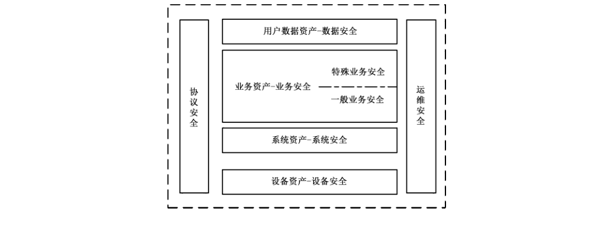

# GB/T 35281-2017 信息安全技术 移动互联网应用服务器安全技术要求

> 来源：[GB/T 35281-2017 国家标准详情](https://openstd.samr.gov.cn/bzgk/std/newGbInfo?hcno=68CD3FAA679555B9651B324431CCB6E3)。
> PDF SHA-256：92292aef9444ca3f3ac8f50975b90aa6915bd77647c801f810dff94dfefd78ec。
> 发布日期：2017-12-29；实施日期：2018-07-01。依据官方公开 PDF 的 14 页图像逐页核对，已去除封面、分页和页眉页脚；正式引用请核对原 PDF。

## 前言

本标准按照 GB/T 1.1—2009 给出的规则起草。

请注意本文件的某些内容可能涉及专利。本文件的发布机构不承担识别这些专利的责任。

本标准由全国信息安全标准化技术委员会（SAC/TC 260）提出并归口。

本标准起草单位：中国信息通信研究院、浙江蚂蚁小微金融服务集团股份有限公司、中国移动通信集团公司、中国电信股份有限公司广东研究院、北京邮电大学。

本标准主要起草人：潘娟、宁华、陈泓汲、刘陶、翟世俊、落红卫、张滨、金华敏、徐国爱、邱勤。

## 引言

移动互联网应用服务器承载着各类移动应用业务，涉及众多有价值的敏感信息资源，因此易成为被攻击的目标。随着移动互联网应用对在线服务的依赖程度逐渐加深，应用服务器的重要程度也与日俱增，如果其中存在安全问题，轻则致使大量用户无法正常使用移动互联网应用提供的各类业务，重则可能导致用户信息遭到大规模泄露等安全风险。

本标准主要针对移动互联网应用服务器提出安全技术要求，通过规范应用服务器安全实现和运维，强化服务器端技术和管理安全水平，完善整个移动互联网的安全架构，确保用户权益不受损害，维护产业有序健康发展。

## 1 范围

本标准规定了移动互联网应用服务器的安全技术要求，包括数据安全、业务安全、系统安全、设备安全、协议安全和运维安全等。

本标准适用于支持承载各类移动互联网应用业务的计算机系统，可用于指导移动互联网应用服务器开发、部署、管理运维和测试评估，也适用于相关产品的测试和服务等。

## 2 规范性引用文件

下列文件对于本文件的应用是必不可少的。凡是注日期的引用文件，仅注日期的版本适用于本文件。凡是不注日期的引用文件，其最新版本（包括所有的修改单）适用于本文件。

- GB/T 20271—2006 信息安全技术 信息系统通用安全技术要求

- GB/T 20272—2006 信息安全技术 操作系统安全技术要求

- GB/T 21028—2007 信息安全技术 服务器安全技术要求

- GB/T 25069—2010 信息安全技术 术语

- GB/T 31168—2014 信息安全技术 云计算服务安全能力要求

- JR/T 0095—2012 中国金融移动支付 应用安全规范

## 3 术语和定义、缩略语

### 3.1 术语和定义

GB/T 25069—2010 界定的以及下列术语和定义适用于本文件。

#### 3.1.1 移动互联网 mobile internet

用户使用移动终端（包括手机、上网本、平板电脑、智能本等）通过移动网络获取移动通信网络服务和互联网服务的开放式基础电信网络。

#### 3.1.2 移动互联网应用服务器 mobile internet application servers

为移动终端提供移动互联网服务的计算机系统，由支撑系统（如硬件、操作系统、中间件、数据库管理系统、WEB服务等）和业务应用系统组成。

#### 3.1.3 移动智能终端 mobile smart terminal

能够接入移动通信网，具有能够提供应用程序开发接口的开放操作系统，并能够安装和运行应用软件的移动终端。

### 3.2 缩略语

下列缩略语适用于本文件。

- CPU：中央处理单元（Central Processing Unit）
- CVV：卡片验证码（Card Verification Value）
- HTTPS：安全超文本传输协议（Hypertext Transfer Protocol Secure）
- I/O：输入/输出（Input/Output）
- ID：身份（Identification）
- IMEI：国际移动设备识别码（International Mobile Equipment Identity）
- IMSI：国际移动用户识别码（International Mobile Subscriber Identity）
- IP：网际协议（Internet Protocol）
- MAC：媒体访问控制（Media Access Control）
- SNMP：简单网络管理协议（Simple Network Management Protocol）
- SQL：结构化查询语言（Structured Query Language）
- SSH：安全外壳协议（Secure Shell）
- TLS：传输层安全（Transport Layer Security）
- VPN：虚拟专用网（Virtual Private Network）
- WLAN：无线局域网（Wireless Local Area Network）
- XSS：跨站脚本攻击（Cross-site Scripting）

## 4 资产分类

### 4.1 设备资产

主要指构成服务器实体的物理硬件设备，包括但不限于CPU、内存、硬盘等。

### 4.2 系统资产

主要指支撑服务器业务正常运行的软件资源，包括但不限于：

a） 操作系统：应用服务器上运行的、用于实现对系统软硬件资源的管理、并且向上层应用提供系统调用接口的软件程序，如内核、驱动程序、软件库、系统工具等。

b） 中间件：为在线应用支持软件提供数据存取、运行时环境和外部网络界面等服务的支撑性软件，通常使用成品软件直接搭建，并且与在线应用支持软件紧密集成。

c） 数据库：应用服务器上运行的用于执行数据处理任务的系统，是数据存储介质、处理对象和管理系统的集合体。

### 4.3 业务资产

主要指用于提供服务器各项业务功能的软件资源，包括但不限于：业务支持软件：为移动应用业务提供联网服务支撑、实现应用服务器业务逻辑的软件系统，通常由应用服务器的运营者根据业务功能的要求而定制开发。

### 4.4 用户数据资产

主要指服务器上存储的、由移动应用用户提供或与用户相关的数据资源，包括但不限于：

a） 账户信息：与特定的用户账户相关联、仅限于该用户访问或适用于该用户的信息，如登录账户的用户名和口令、账户内的选项设置等。

b） 通信信息：用户用于发起通信以及在通信过程中产生的信息，如通信录、通话记录、电子邮件、即时通信消息等。

c） 位置信息：反映用户当前位置或活动轨迹的信息，如卫星定位信息、小区基站位置信息、WLAN 接入点位置信息、IP 归属地信息等。

d） 支付信息：与用户的支付活动有关的信息，如借记卡和信用卡账号、信用卡CVV码、有效期等。

e） 设备信息：可区分和识别移动终端设备的标识信息，如IMEI 号、IMSI 号、无线网卡 MAC地址等。

## 5 安全框架

为达到保护移动互联网应用服务器安全目标，结合资产分类和安全风险分析（参见附录A），移动应用服务器的安全框架应包括数据安全、业务安全、系统安全、设备安全、协议安全、运维安全，如图1所示。

## 6 数据安全

### 6.1 数据自身安全

移动互联网应用服务器的数据自身安全要求包括但不限于：

a） 应对存储的用户数据进行完整性保护。应根据对用户数据完整性保护要求进行完整性检测和完整性恢复。

b） 应对存储的用户数据进行保密性保护。应根据不同数据类型的不同保密性要求，进行不同程度的保密性保护，确保除具有访问权限的合法用户外，其余任何用户不能访问该数据。

c） 应在使用完毕后及时删除或匿名化处理用户相关个人信息数据，对留存期限有明确规定的，按相关规定执行。

### 6.2 数据防护安全

移动互联网应用服务器的数据防护安全要求包括但不限于：

a） 应支持数据访问鉴别，只有鉴别成功的用户或者系统可以访问相应数据。

b） 应支持通过包括但不限于数据备份、异地容灾等手段保证数据的安全。

c） 应定期地或按某种条件实施数据备份，备份方式包括并不限于如下方式：人工数据备份、增量数据备份、局部数据备份和全系统备份。备份要求应符合 GB/T 20271—2006 中 4.2.6 的要求。

d） 应依据不同备份方式支持相应恢复能力。

## 7 业务安全

### 7.1 业务安全构成

移动互联网应用服务器业务安全要求包括两个部分：一般业务安全要求和特定业务安全要求。前者适用于所有业务类型的应用服务器，而后者则对提供某些特定业务的应用服务器提出附加要求。

### 7.2 一般业务安全

移动互联网应用服务器的一般业务安全要求包括但不限于：

a） 在处理用户登录请求时，若短时间内连续出现多次登录失败的情况，则应要求用户输入验证码，并且限制一定时间内重试登录的次数。

b） 在存储用户登录凭证时，不应直接存储口令原文，而应保存口令添加盐值后的散列值，其中散列算法应选用尚未发现存在安全缺陷的成熟算法，并且盐值的取值空间应足够大。

c） 后台管理入口以及管理账户口令应加密后保存在客户端代码中。

d）不得向客户端推送未加说明或未经客户允许的代码。

e） 在处理移动应用客户端发来的数据时，应对数据的有效性进行验证，过滤其中可能导致安全问题的内容，以防范诸如 SQL 注入及 XSS 等形式的网络攻击。

f） 应保障与应用软件之间的会话不可被窃听、篡改、伪造、重放等。

### 7.3 特定业务安全

#### 7.3.1 支付业务

移动互联网应用服务器的支付业务安全要求包括但不限于：

a） 应符合 JR/T 0095—2012中第6章的要求。

b） 在提供支付业务时，应符合JR/T 0095—2012中第7章中对加密算法和密钥的相关规定，确保支付信息在网络传输过程中的安全。

c） 在处理支付业务时，除支付网关外，不应向任何其他服务器传输用户提交的支付信息。

d） 在处理支付业务时，不应以任何持久性的方式存储用户提交的支付信息，包括但不限于数据库、数据文件和调试记录。

e） 在完成支付业务、不再需要使用用户提交的支付信息时，应使用“0”字节、“1”字节或随机字节对内存中保存相关信息的数据结构进行填充处理。

#### 7.3.2 推送业务

移动互联网应用服务器的推送业务安全要求包括但不限于：在提供推送业务时，应对推送内容的安全性进行审核，避免推送可将用户定向到包括但不限于恶意应用安装包下载地址、含有攻击代码的网站以及钓鱼网站的内容。

#### 7.3.3 广告业务

移动互联网应用服务器的广告业务安全要求包括但不限于：

a） 在提供广告业务时，应对其投放内容直接指向的网络链接的安全性进行审核，避免投放可将用户定向到恶意应用安装包下载地址、含有攻击代码的网站以及钓鱼网站的广告内容。

b） 在提供广告业务时，在未向用户明确提示并获授权的情况下，不应从用户设备中收集个人信息，包括但不限于通信信息、位置信息和设备信息。

c） 在提供广告业务时，只有当其移动应用客户端在前台运行时，方可向移动智能终端投放更新的广告内容。

#### 7.3.4 即时通信业务

移动互联网应用服务器的即时通信业务安全要求包括但不限于：

a） 在提供即时通信业务时，应确保即时消息在网络传输过程中的安全。

b）在提供即时通信业务时，应对文字消息中包含的网络链接的安全性进行审核。若发现其指向恶意应用安装包下载地址、含有攻击代码的网站以及钓鱼网站，则应提醒信息接收者潜在的安全风险。

c） 在提供即时通信业务时，应对用户传输的文件进行安全扫描。若发现文件中可能存在恶意代码，则应在文件接收时提供安全警示。

## 8 系统安全

### 8.1 操作系统安全

移动互联网应用服务器的操作系统安全要求包括但不限于：

a） 应符合 GB/T 20272—2006中 4.1.1.1 的要求。

b） 应加强对操作系统用户账户的管理，禁用或删除所有对于业务应用正常运行所非必须的账户，并且启用的账户应防止使用空口令或弱口令。

c） 运行的操作系统应关闭所有对于业务应用正常运行所非必须的、外部可访问的端口、共享和服务。

d） 应配置操作系统的访问控制策略，如文件系统权限、进程沙箱等，将中间件可访问的系统资源限制在最少够用的范围内，并且在不同的中间件进程之间实现隔离。

e） 应使用正版软件，通过升级操作系统版本或安装安全更新等方式及时修复操作系统中存在的安全漏洞。对于因软件版本依赖等特殊原因无法升级系统或安装更新的情况，应采取特定措施避免相关安全漏洞被恶意利用。

### 8.2 中间件安全

移动互联网应用服务器的中间件安全要求包括但不限于：

a） 应加强对中间件用户账户的管理，禁用或删除所有对于业务应用正常运行所非必须的账户，并且启用的账户应防止使用空口令或弱口令。

b） 运行的中间件应关闭所有对于业务应用正常运行所非必须的、外部可访问的端口和服务。

c） 应配置中间件的访问控制策略，将在线应用支持软件可访问的系统资源限制在最少够用的范围内，并且在不同的在线应用支持软件（如果存在多个）之间实现隔离。

d） 应通过升级软件版本或安装安全更新等方式及时修复中间件中存在的安全漏洞。对于因软件版本依赖等特殊原因无法升级系统或安装更新的情况，应采取适当措施避免相关安全漏洞被恶意利用。

e） 应删除中间件软件默认安装的、对于业务应用正常运行所非必须的组件和数据，包括但不限于工具软件、用户文档、测试文件和示例数据。

f） 应修改中间件的默认配置，从中间件向网络返回的信息（如 banner 信息和错误信息）中移除有关中间件软件版本、配置选项和运行状态的内容。

### 8.3 数据库安全

移动互联网应用服务器的数据库管理系统安全应符合 GB/T 21028—2007中 5.1.1.3的要求。

## 9 设备安全

移动互联网应用服务器的设备安全要求包括但不限于：

a） 硬件设备，如CPU、内存、硬盘等，应提供可靠的运行支持，并通过容错和故障恢复等措施，支持信息系统实现不间断运行。

b）硬件设备，如CPU、内存、硬盘等，应采用冗余备份的方式确保服务器设备的可靠性。

c） 虚拟机设备，如 CPU 资源、内存资源、I/O 资源等，应符合 GB/T 31168—2014 相关要求。

## 10 协议安全

### 10.1 标准协议安全

移动互联网应用服务器的标准协议安全要求包括但不限于：

a） 应使用业界标准的网络安全协议（如 TLS）与移动应用客户端进行通信，以实现客户端对服务器的身份认证和通信数据的加密传输。

b） 使用标准协议与移动应用客户端进行通信时，应使用相应协议最新的修订版本，禁用存在已知安全缺陷的协议版本。

### 10.2 私有协议安全

移动互联网应用服务器的私有协议安全要求包括但不限于：

a） 使用私有协议与移动应用客户端进行通信时，应支持客户端对本服务器的身份进行鉴别。

b） 使用私有协议与移动应用客户端进行通信时，应使用加密方式保护本服务器与客户端之间传输的、用于实现用户身份认证的数据，推荐在用户会话的整个过程中采用加密方式传输数据。

## 11 运维安全

### 11.1 安全配置

移动互联网应用服务器的安全配置要求包括但不限于：

a） 应配备足够强的访问控制机制对服务器的管理端口进行保护。建议将服务器配置为仅允许通过控制台进行管理，或仅允许通过内网进行管理。对于提供互联网管理端口的服务器，建议使用安全的网络协议，如 SSH、HTTPS或 SNMP 等进行远程管理。

b） 应定期对服务器进行安全漏洞扫描和渗透测试，对于在检测中发现的安全问题应及时修复。

c） 未明确提示用户或未经用户许可，不得远程控制用户移动智能终端。

d） 应对网络资源的使用进行限制，如设置网络带宽、服务器主机资源的最大使用限度。

e） 移动互联网服务器不得存放、处理、推送非法的文本、图片、视频、音频等信息。

### 11.2 安全监控

移动互联网应用服务器的安全监控要求包括但不限于：

a） 主机安全监控：

- 应提供服务器硬件、软件运行状态的远程监控功能。

- 应对命令执行、进程调用、文件使用等进行实时监控，在必要时应提供监控数据分析功能。

b） 网络安全监控：

- 应在其网络接口处对进出的数据流进行实时监控。

- 应对进出服务器的网络数据流，按既定的安全策略和规则进行检测。

- 应支持用户自定义网络安全监控的安全策略和规则。

- 应不依赖于服务器操作系统，且不因服务器出现非断电异常情况而不可用。

- 应具有对网络应用行为分类监控的能力，并根据安全策略提供报警和阻断的能力。

- 应提供集中管理接口，以便接受网络安全监控集中管理平台下发的安全策略和规则，以及向网络安全监控集中管理平台提供审计数据源。

### 11.3 安全审计

移动互联网应用服务器的安全审计要求包括但不限于：

a） 应为移动互联网应用服务器运行及维护状况留存日志，必要时可使用专用的日志服务器保存日志信息，以防止服务器遭受攻击后日志被篡改。服务器的运营者应定期对日志进行安全审计，及时发现并调查日志中的异常事件。

b） 至少应留存三种类型的日志信息：

- 操作日志：操作日志用于记录服务器管理员对服务器进行管理维护时执行的相关操作，其中至少应包括时间、登录方式、发起登录的地址和操作类型。

- 系统日志：系统日志用于记录服务器操作系统及中间件运行过程中所发生的事件，其中至少应包括产生日志的程序模块名称、严重性、时间、主机名/IP、进程名称、进程 ID 和正文。

- 应用日志：应用日志用于记录应用支持软件运行过程中所发生的事件，其中至少应包括时间、在线应用支持软件名称、事件等级和正文。

### 11.4 恶意代码防护

移动互联网应用服务器的恶意代码防护要求包括但不限于：

a） 应对进入服务器的恶意代码采取相应的防范措施，包括但不限于部署防病毒软件、防火墙、入侵检测系统和入侵防御系统。恶意代码防护应符合 GB/T 20271—2006 中 4.2.7 的要求。

b） 主机防护应和安全监控集中管理平台协调一致，及时发现和清除进入服务器内部的恶意代码。

### 11.5 备份与故障恢复

移动互联网应用服务器的备份与故障恢复要求包括但不限于：

a） 应定期地或者按要求进行备份，并在发生故障时具有相应恢复功能。

b） 应提供操作系统、数据库系统和应用系统中重要数据的备份和恢复功能。

c） 应对运行关键业务的服务器采用集群结构，实现业务系统不间断运行。

## 附录 A（资料性附录）安全风险分析

### A.1 风险概述

移动互联网应用服务器主要面临的安全风险包括：系统风险、用户风险和管理风险。

### A.2 系统风险

移动互联网应用服务器的系统风险是指系统软硬件无法提供正常服务而引发的安全风险，具体包括：

- 自身安全：在服务器托管的机房管理不善的情况下，服务器硬件容易遭受物理损坏或篡改；另外，由于应用服务器通常可通过互联网连接，因此也容易遭受来自外部网络的攻击，导致系统破坏。

- 应用瘫痪：当用户数量较大、在线应用支持软件和服务器软件难以处理大量并发连接时，会发生无法正常提供应用支撑的情况，产生拒绝服务的风险。

### A.3 用户风险

移动互联网应用服务器的用户风险是指由于服务器的安全性遭破坏而给移动应用的用户所带来的连带风险，具体包括：

- 用户依赖：在服务器遭受攻击而瘫痪的情况下，大量用户将无法正常使用移动互联网应用提供的各类业务，从而带来用户依赖的风险。此类风险的大小与具体业务类型紧密相关，通常来说，即时通信和移动金融类业务往往具有较高的用户依赖风险。

- 隐私窃取：在提供移动互联网业务的过程中，应用服务器可以获得用户账户数据、位置数据、金融数据、环境数据、传感数据等隐私信息。对于攻击者来说，通过服务器来获取大量用户的隐私信息是一种更加快捷和方便的途径，这就使服务器面临严重的隐私窃取风险。

- 资费消耗：用户往往通过移动蜂窝网络来访问移动互联网服务，而服务提供商也常使用短信通道收取增值服务费用。在这种情况下，应用服务器就有可能通过流量消耗或恶意扣费而导致用户资费损失。

- 远程控制：移动智能终端通过使用移动互联网服务而与应用服务器之间建立了紧密的绑定关系，这就使服务器有可能通过网络向移动智能终端发送恶意指令，导致移动智能终端操作系统和应用软件被远程控制。

### A.4 管理风险

移动互联网应用服务器的管理风险是指由于移动互联网业务的多样性和灵活性而给安全管理带来的风险，具体包括：

- 私有协议：出于保障通信安全、提高数据传输效率等因素的考虑，应用服务器与移动应用通信时往往采用内部协议，并使用私有加密和压缩算法，难以进行识别和监管。

- 管理复杂：不同于位置固定的 PC 终端，移动智能终端可随时随地接入网络与应用服务器建立通信，不易管理。

- 溯源困难：移动智能终端总处于移动状态，位置信息和地址信息频繁改变，不利于确定位置。

## 参考文献

- ［1］ GB/T 18336.1—2015 信息技术 安全技术 信息技术安全性评估准则 第1部分：简介和一般模型

- ［2］ GB/T 18336.2—2015 信息技术 安全技术 信息技术安全性评估准则 第2部分：安全功能组件

- ［3］ GB/T 18336.3—2015 信息技术 安全技术 信息技术安全性评估准则 第3部分：安全保障组件

- ［4］ GB/T 20270—2006 信息安全技术 网络基础安全技术要求

- ［5］ GB/T 20273—2006 信息安全技术 数据库管理系统安全技术要求

- ［6］ GB/T 20988—2007 信息安全技术 信息系统灾难恢复规范

- ［7］ GB/T 22239—2008 信息安全技术 信息系统安全等级保护基本要求

- ［8］ GB/T 25058—2010 信息安全技术 信息系统安全等级保护实施指南

- ［9］ GB/T 25070—2010 信息安全技术 信息系统等级保护安全设计技术要求

- ［10］ GB/T 28448—2012 信息安全技术 信息系统安全等级保护测评要求

- ［11］ GB/T 28452—2012 信息安全技术 应用软件系统通用安全技术要求
