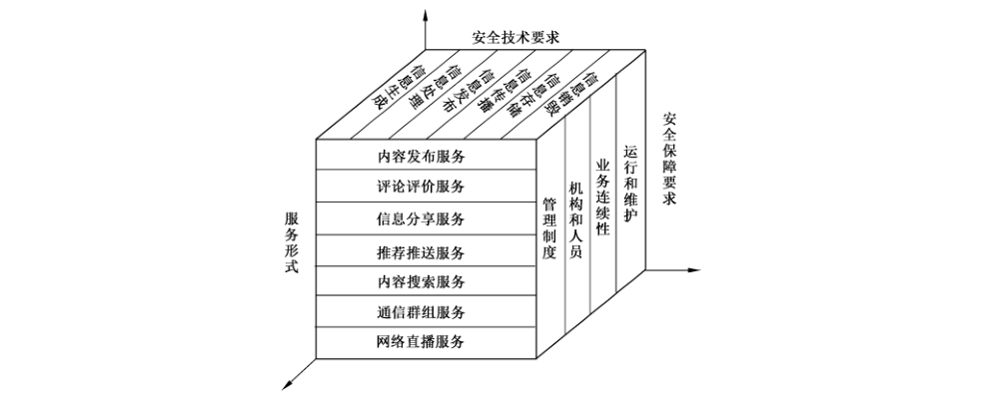

# GB/T 40645-2021 信息安全技术 互联网信息服务安全通用要求

> 来源：[GB/T 40645-2021 国家标准详情](https://openstd.samr.gov.cn/bzgk/std/newGbInfo?hcno=46DA79D705FCF4D59B128BBBA246C687)；发布日期：2021-10-11；实施日期：2022-05-01。
> PDF SHA-256：50376cd794f1f4fedde7b4d01ccd3f9d483fa6b0c581755ebb8aac471ab7e3fa。
> 转写说明：依据官方 PDF 全部 22 页的页面图像核对；省略封面、目录、页眉、页脚和页码，合并跨页内容。正式引用请核对原 PDF。

## 前言

本文件按照 GB/T 1.1—2020《标准化工作导则 第1部分：标准化文件的结构和起草规则》的规定起草。

请注意本文件的某些内容可能涉及专利。本文件的发布机构不承担识别专利的责任。

本文件由全国信息安全标准化技术委员会（SAC/TC 260）提出并归口。

本文件起草单位：中国科学院信息工程研究所、公安部第三研究所、中国电子技术标准化研究院、中国信息通信研究院、中国电子科技集团公司第十五研究所、北京理工大学、中国信息安全测评中心、国家计算机网络应急技术处理协调中心、中国互联网络信息中心、国家信息技术安全研究中心、浙江大学、工业和信息化部计算机与微电子发展研究中心（中国软件测评中心）、陕西省网络与信息安全测评中心、四川省信息安全测评中心、云南省信息安全测评中心、湖北大学、北京百度网讯科技有限公司、阿里巴巴（北京）软件服务有限公司、深圳市腾讯计算机系统有限公司、杭州网易易盾科技有限公司、北京小米移动软件有限公司、杭州趣链科技有限公司、网神信息技术（北京）股份有限公司、北京北信源软件股份有限公司、OPPO广东移动通信有限公司、杭州梵为科技有限公司、贝壳找房（北京）科技有限公司、奇安信科技集团股份有限公司。

本文件主要起草人：孟丹、郭涛、张潇丹、顾健、周熙、胡静远、韩冀中、赵云霞、贺滢睿、姚相振、郭晓雷、魏薇、霍珊珊、锁延锋、张媛媛、马庆栋、周薇、王宇航、邸丽清、任泽君、吕红蕾、史洪彬、刘总真、张华平、王红兵、陈妍、张海阔、贺明、弭伟、陈家玓、汤学海、戴娇、林俊宇、张朝、王丹琛、张艳、蔡亮、李伟、陈晓丰、祝卓、邓婷、薛君立、陈洪波、高瑞、姜一、李明菊、白晓媛、李民、王少杰、王婷。

## 1 范围

本文件规定了互联网信息服务的安全通用要求，包括安全技术要求和安全保障要求。

本文件适用于互联网信息服务提供者开展互联网信息服务安全建设和安全评估，包括安全管理制度和技术保障措施等。

## 2 规范性引用文件

下列文件中的内容通过文中的规范性引用而构成本文件必不可少的条款。其中，注日期的引用文件，仅该日期对应的版本适用于本文件；不注日期的引用文件，其最新版本（包括所有的修改单）适用于本文件。

- GB/T 22239—2019 信息安全技术 网络安全等级保护基本要求

- GB/T 25069 信息安全技术 术语

- GB/T 35273—2020 信息安全技术 个人信息安全规范

## 3 术语和定义

GB/T 25069 和 GB/T 35273—2020界定的以及下列术语和定义适用于本文件。

### 3.1 互联网信息服务 internet information service

基于信息发布、交互、传播等相关技术和功能属性，通过互联网面向社会公众提供的公开场景信息服务。

> 注：互联网信息服务常见形式包括内容发布、评论评价、信息分享、推荐推送、内容搜索、通信群组、网络直播等。

### 3.2 信息生成 information generation

以提供互联网信息服务为目的，对信息进行采集、编辑等操作的活动。

### 3.3 信息处理 information processing

按照既定规则对信息进行识别过滤、分级分类等操作的活动。

### 3.4 信息发布 information release

在公开场景下利用互联网为个人或组织提供信息的活动。

### 3.5 信息传播 information dissemination

通过互联网传递扩散信息的活动。

### 3.6 信息存储 information storage

将个人信息、业务信息、日志信息等保存在特定载体中，并保证所存储信息安全性的活动。

### 3.7 信息销毁 information destruction

对信息进行技术处理，实现信息不可恢复性清除的活动。

### 3.8 信息源 information source

互联网信息服务中信息的提供者及信息内容。

### 3.9 信息生成主体 information generation subject

互联网信息服务中生成信息的个人或组织。

### 3.10 互联网信息服务用户 internet information service user

使用互联网信息服务的个人或组织。

> 注：互联网信息服务用户包括注册用户和非注册用户。

### 3.11 互联网信息服务提供者 internet information service provider

为用户提供互联网信息服务的组织或机构。

### 3.12 信息溯源 information tracing

互联网信息服务提供者根据自身服务内相关数据，查找用户注册信息及其他相关信息的活动。

## 4 概述

本文件基于互联网信息服务形式，从安全技术要求和安全保障要求两个方面，系统地阐述了互联网信息服务安全通用要求，见图1。

服务形式方面，归纳了内容发布、评论评价、信息分享、推荐推送、内容搜索、通信群组、网络直播等多种服务形式。

安全技术要求方面，定义了信息生命周期，包括信息生成、信息处理、信息发布、信息传播、信息存储、信息销毁六个阶段，针对各阶段提出了面向开放性、交互性、影响力等特征的互联网信息服务的安全技术要求，涵盖了信息生命周期中的主要安全要素。

安全保障要求方面，从管理制度、机构和人员、业务连续性、运行和维护等四个维度，提出了互联网信息服务的安全保障要求。

本文件采用类、族、组件的层次化结构定义方法，提出互联网信息服务的安全技术要求和安全保障要求。

安全技术要求各类、族、组件对应关系见表1，安全保障要求各类、族、组件对应关系见表2。

**表1 安全技术要求的类、族、组件**

| 类 | 族 | 组件 |
| --- | --- | --- |
| 信息生成 | 信息源安全要求 | 信息源要求 |
| 信息生成 | 信息源安全要求 | 信息采集要求 |
| 信息生成 | 信息源安全要求 | 信息源追溯 |
| 信息生成 | 信息生成主体 | 信息服务用户注册 |
| 信息生成 | 信息生成主体 | 信息生成主体保护 |
| 信息生成 | 信息生成主体 | 信息生成主体溯源 |
| 信息处理 | 信息内容检测 | 信息内容检测规则 |
| 信息处理 | 信息内容检测 | 信息内容识别过滤 |
| 信息处理 | 信息服务分级分类 | 信息内容分级分类 |
| 信息处理 | 信息服务分级分类 | 信息服务用户分类 |
| 信息发布 | 信息内容审核 | 审核制度管理 |
| 信息发布 | 信息内容审核 | 审核程序管理 |
| 信息发布 | 信息发布流程管理 | 信息发布流程 |
| 信息发布 | 信息发布流程管理 | 信息发布权限管理 |
| 信息传播 | 信息安全监测预警 | 信息安全监测 |
| 信息传播 | 信息安全监测预警 | 信息安全预警 |
| 信息传播 | 安全事件应急处置 | 安全事件应急预案 |
| 信息传播 | 安全事件应急处置 | 安全事件响应处置 |
| 信息存储 | 服务信息存储 | 用户个人信息存储 |
| 信息存储 | 服务信息存储 | 业务信息存储 |
| 信息存储 | 日志存储管理 | 日志存储 |
| 信息存储 | 日志存储管理 | 日志管理 |
| 信息销毁 | 用户注销管理 | 用户信息注销 |
| 信息销毁 | 用户注销管理 | 用户信息销毁 |
| 信息销毁 | 业务与日志信息销毁 | 信息销毁策略 |
| 信息销毁 | 业务与日志信息销毁 | 信息销毁记录 |

**表2 安全保障要求的类、族、组件**

| 类 | 族 | 组件 |
| --- | --- | --- |
| 管理制度 | 安全制度 | 信息源制度 |
| 管理制度 | 安全制度 | 信息审核发布制度 |
| 管理制度 | 安全机制 | 监测预警机制 |
| 管理制度 | 安全机制 | 应急处置机制 |
| 管理制度 | 安全机制 | 投诉举报机制 |
| 机构和人员 | 组织机构 | 安全管理机构 |
| 机构和人员 | 组织机构 | 安全管理人员 |
| 机构和人员 | 从业人员管理 | 人员配备 |
| 机构和人员 | 从业人员管理 | 人员管理 |
| 机构和人员 | 从业人员管理 | 人员培训 |
| 业务连续性 | 数据管理 | 数据保护 |
| 业务连续性 | 数据管理 | 数据存储 |
| 业务连续性 | 数据管理 | 数据销毁 |
| 业务连续性 | 应急处理 | 信息溯源 |
| 业务连续性 | 应急处理 | 应急响应处置 |
| 运行和维护 | 服务运营 | 运营策略 |
| 运行和维护 | 服务运营 | 投诉举报处理 |
| 运行和维护 | 保障措施 | 设施设备保障 |
| 运行和维护 | 保障措施 | 网络安全保障 |
| 运行和维护 | 外包服务管理 | 使用第三方服务 |
| 运行和维护 | 外包服务管理 | 提供第三方服务 |

为满足不同开放程度、交互能力、影响力的互联网信息服务的差异化安全要求，本文件在组件中定义了基本要求和增强要求。互联网信息服务提供者应对拟提供的互联网信息服务所属产品形态、业务范围和用户规模等属性进行分析，选择相应的安全要求开展安全建设和评估活动。

本文件在每个安全要求族中设置了“自定义组件”，作为已有安全要求组件的扩展。互联网信息服务提供者可在实际安全建设和安全评估工作中自行定义安全组件及其应满足的安全要求。

互联网信息服务所属的产品形态、业务范围和用户规模等属性与安全等级之间的对应关系应按照附录A要求。本文件提出了互联网信息服务安全通用要求组件包定制示例（见附录B）和互联网信息服务安全评估流程（见附录C）。互联网信息服务提供者根据附录A确定产品和信息服务应满足的安全要求级别，可参考附录B分析产品涵盖的互联网信息服务形式，如内容发布、评论评价等，并通过组合组件的方式，定制相应的安全要求组件包，确定产品安全要求，开展安全建设和安全评估。

在本文件中，加黑部分表示互联网信息服务应满足的增强要求。

## 5 安全技术要求

### 5.1 信息生成

#### 5.1.1 信息源安全要求

##### 5.1.1.1 信息源要求

互联网信息服务提供者应通过信息标识、检索、筛选等措施，保障符合信息源管理相关规范的要求。

##### 5.1.1.2 信息采集要求

互联网信息服务提供者应：

a） 按照 GB/T 35273—2020 中 5.1、5.2、5.3 和 5.4 规定的要求采集个人信息；

b） 规范第三方开放接口获取或提供信息等行为；

c） 通过数字签名、信息备份等措施，保障采集信息完整性。

##### 5.1.1.3 信息源追溯

互联网信息服务提供者应：

a） 记录并留存信息源的相关信息，如信息的采集时间、采集渠道、采集用途、信息编辑历史等；

b） 通过日志追溯等措施实现对信息的追溯。

#### 5.1.2 信息生成主体

##### 5.1.2.1 信息服务用户注册

互联网信息服务提供者应：

a） 明确用户注册信息字段，并与用户签订服务使用协议；

b） 审核用户昵称、头像、简介等注册信息，具备先审后发等安全机制；

c） 建立对注册信息中违法信息、不良信息的处理措施，如警示整改、限制功能、暂停更新、关闭账号等；

d） **对新增和存量注册用户采取身份证号码、手机号码、统一社会信用代码、生物特征识别等方式中的一种或多种进行真实身份信息认证。**

##### 5.1.2.2 信息生成主体保护

互联网信息服务提供者应：

a） 按照GB/T 35273—2020中5.5规定的要求，建立用户个人信息保护措施，防止用户个人信息泄露、毁损、丢失；

b） 通过如加密、去标识化等措施，对用户个人信息进行保护；

c） 在信息生成主体敏感信息发生或者可能发生泄露、毁损、丢失的情况时，立即采取数据追溯、查验、处置等补救技术措施，并向相关部门报告。

##### 5.1.2.3 信息生成主体溯源

互联网信息服务提供者应：

a） 核验注册用户的真实身份信息，包括身份证号码、手机号码、统一社会信用代码、生物特征识别信息等；

b） 关联用户注册账号与其登录后的行为，追溯用户对互联网信息服务的使用行为；

c） **具备实现抗抵赖性的相关技术措施。**

### 5.2 信息处理

#### 5.2.1 信息内容检测

##### 5.2.1.1 信息内容检测规则

互联网信息服务提供者应制定信息内容检测规则，具备实施和更新检测规则的技术措施。

##### 5.2.1.2 信息内容识别过滤

互联网信息服务提供者应：

a） 建设并维护与业务规模相适应的违法信息、不良信息样本数据库，包括但不限于文本、图片、音视频等形式的违法信息、不良信息；

b） 实现对文本、图片、音视频等形式的违法信息、不良信息准确识别和过滤，保障信息识别效果。

#### 5.2.2 信息服务分级分类

##### 5.2.2.1 信息内容分级分类

互联网信息服务提供者应从安全风险、业务特征、内容质量等方面对信息内容实行分级分类。

##### 5.2.2.2 信息服务用户分类

互联网信息服务提供者应：

a） 明确互联网信息服务用户分类方法，从发文量、关注量、活跃度等方面对信息服务用户进行分类；

b） 从诚信度、真实性、原创性等方面的对注册用户进行评价；

c） **对不同类别的互联网信息服务用户，从获取、使用、传播信息等方面进行权限设置。**

### 5.3 信息发布

#### 5.3.1 信息内容审核

##### 5.3.1.1 审核制度管理

互联网信息服务提供者应具备与审核制度相适应的技术措施。

##### 5.3.1.2 审核程序管理

互联网信息服务提供者应：

a） 对法律法规规定的信息内容实施先审后发；

b） **通过配置不同的审核策略和措施，对信息源信息内容进行分级审核；**

c） **及时对重大事件等关键信息发布进行安全审核。**

#### 5.3.2 信息发布流程管理

##### 5.3.2.1 信息发布流程

互联网信息服务提供者应：

a） 对信息发布相关日志信息进行安全存储和保护，包括但不限于账号信息、发布时间、发布内容等；

b） **及时对重大事件等关键信息进行安全发布。**

##### 5.3.2.2 信息发布权限管理

互联网信息服务提供者应从信息类型、信息内容等方面建立信息发布权限管理。

### 5.4 信息传播

#### 5.4.1 信息安全监测预警

##### 5.4.1.1 信息安全监测

互联网信息服务提供者应：

a） 针对信息内容在传播过程中可能存在的安全风险，通过主动巡查等措施，对信息内容的传播范围、影响力等信息进行监测；

b） 提供投诉举报渠道，包括有效的电话、电子邮箱、网页反馈入口等。

##### 5.4.1.2 信息安全预警

互联网信息服务应对监测到的存在安全风险的信息内容进行预警，并对信息安全预警情况进行及时处置。

#### 5.4.2 安全事件应急处置

##### 5.4.2.1 安全事件应急预案

互联网信息服务提供者应建立安全事件应急预案，明确不同安全事件的分类分级和事件处置流程等，并通过技术手段进行实施。

##### 5.4.2.2 安全事件响应处置

互联网信息服务提供者应：

a） 对安全事件及时响应，并进行应急处置，采取关闭账号、删除信息等措施处置违规用户、违法信息、不良信息等；

b） 存储安全事件、处置情况等信息，包括处置人员、时间、对象、方式等；

c） 能够对服务或平台快速关停；

d） 通过加强审核等措施对互联网信息服务安全事件进行分级响应处置。

### 5.5 信息存储

#### 5.5.1 服务信息存储

##### 5.5.1.1 用户个人信息存储

互联网信息服务提供者应：

a） 按照 GB/T 35273—2020中第6章规定的要求，对用户个人信息进行存储；

b） 留存互联网信息服务注册用户信息；

c） **通过对个人敏感信息采用加密等安全措施，保障个人敏感信息的完整性和保密性。**

##### 5.5.1.2 业务信息存储

互联网信息服务提供者应：

a） 存储互联网信息服务中涉及发布、传播、共享等信息，保障业务信息完整性和保密性；

b） 采用密码技术进行业务信息完整性验证和授权使用；

c） **通过分布式存储等措施，对存储的业务信息进行备份。**

#### 5.5.2 日志存储管理

##### 5.5.2.1 日志存储

互联网信息服务提供者应：

a） 存储包括用户账号、操作时间、操作类型、网络源地址和目标地址、网络源端口等日志信息；

b） **保障日志信息完整性、保密性和可用性；**

c） **通过采用密码等技术措施，对日志进行完整性验证和授权查阅。**

##### 5.5.2.2 日志管理

互联网信息服务提供者应设置日志访问权限，并进行日志审计。

### 5.6 信息销毁

#### 5.6.1 用户注销管理

##### 5.6.1.1 用户信息注销

互联网信息服务提供者应按照 GB/T 35273—2020中8.5规定的要求，对用户账户进行注销。

##### 5.6.1.2 用户信息销毁

互联网信息服务提供者应：

a） 按照 GB/T 35273—2020中8.3规定的要求，对确认注销的用户个人信息及时删除；

b） 对用户信息销毁过程存证。

#### 5.6.2 业务和日志信息销毁

##### 5.6.2.1 信息销毁策略

互联网信息服务提供者应通过逻辑删除等措施对信息进行销毁。

##### 5.6.2.2 信息销毁记录

互联网信息服务提供者应记录信息销毁活动，包括销毁人员、销毁时间、销毁内容、销毁方式等关键信息。

## 6 安全保障要求

### 6.1 管理制度

#### 6.1.1 安全制度

##### 6.1.1.1 信息源制度

互联网信息服务提供者应制定信息源和信息采集制度，包括但不限于信息采集来源、采集范围、采集方法、采集流程、信息类别、信息形式等关键信息要素。

##### 6.1.1.2 信息审核发布制度

互联网信息服务提供者应：

a） 对发布的文本、图片、音视频等信息内容，制定审核规则和审核程序，包括信息是否合法合规等，明确审核轮次、审核策略、审核技术等关键要素；

b） 建立与信息内容审核制度和程序相适应的信息发布流程，明确一般事件、重大事件等信息的发布流程；

c） **建立信息审核制度和审核程序的修订机制，并对审核制度和审核程序进行修订更新和版本控制；**

d） **针对各类信息建立分级审核程序，对普通信息采用初审、复审两级审核，对重大事件等关键信息采取如初审、复审、交叉审核、盲审、抽审等多级审核方式；**

e） 建立与信息审核程序相适应的信息安全发布流程。

#### 6.1.2 安全机制

##### 6.1.2.1 监测预警机制

互联网信息服务提供者应具备对存在安全风险的信息内容及时预警的规范和机制保障。

##### 6.1.2.2 应急处置机制

互联网信息服务提供者应：

a） 制定安全事件分级预案和响应处置预案，明确安全事件分级制度、分级响应处置人员配备、处置流程、处置方式、处置时效等；

b） 建立违法信息、不良信息快速处置工作机制。

##### 6.1.2.3 投诉举报机制

互联网信息服务提供者应建立面向公众的投诉举报机制，明确处理时限、处理方式等关键要素。

### 6.2 机构和人员

#### 6.2.1 组织机构

##### 6.2.1.1 安全管理机构

互联网信息服务提供者应设立专职安全管理机构，指导互联网信息服务管理工作，组织开展互联网信息服务监督工作。

##### 6.2.1.2 安全管理人员

互联网信息服务提供者应：

a） 指定至少1名主管，负责领导相关工作，包括互联网信息服务安全工作提供资源保障等；

b） 配备与业务规模相适应的专职工作人员；

c） 配备处置互联网信息服务安全事件的人员。

#### 6.2.2 从业人员管理

##### 6.2.2.1 人员配备

互联网信息服务提供者应在服务中提供与业务规模相适应的从事信息安全相关人员。

##### 6.2.2.2 人员管理

互联网信息服务提供者应加强互联网信息服务人员管理，制定从业人员管理制度，如关键岗位人员签订保密协议、相关离职要求等。

##### 6.2.2.3 人员培训

互联网信息服务提供者应：

a） 对参与互联网信息服务活动的相关人员建立培训制度，制定年度培训计划，组织实施培训与考核，教育培训内容应包括信息安全相关法律法规、政策措施、技术标准等；

b） 保障互联网信息服务内容管理的从业人员每年参加至少1次信息安全教育培训；

c） **对从业人员进行资质审查、定期培训与定期考核。**

### 6.3 业务连续性

#### 6.3.1 数据管理

##### 6.3.1.1 数据保护

互联网信息服务提供者应：

a） 建立用户个人信息安全管理机制，制定并定期更新隐私保护协议，定期组织开展用户数据保护自查工作，应遵循 GB/T 35273—2020中第4章规定的个人信息安全基本原则；

b） **采用密码等技术对互联网信息服务中涉及用户个人敏感信息和商业秘密等信息进行保护。**

##### 6.3.1.2 数据存储

互联网信息服务提供者应：

a） 制定个人信息、业务信息、日志信息等信息的存储策略，明确存储策略中信息存储方式、存储流程、存储时效等关键要素；

b） **备份存储的日志信息，日志留存时间不少于6个月。**

##### 6.3.1.3 数据销毁

互联网信息服务提供者应：

a） 按照GB/T 35273—2020中8.5规定的要求，制定用户注销相关规范，明确注销用户信息策略；

b） 制定信息销毁策略，明确信息销毁方式、销毁流程等关键策略要素；

c） 按照 GB/T35273—2020中8.3规定的要求，制定用户个人信息销毁措施。

#### 6.3.2 应急处理

##### 6.3.2.1 信息溯源

互联网信息服务提供者应：

a） 制定信息溯源的相关流程与机制；

b） 为满足信息源追溯，特别是事后溯源的需要，信息源相关日志保存时间应不少于6个月；

c） 按照GB/T 35273—2020中的相关要求对用户相关信息的记录与留存。

##### 6.3.2.2 安全响应处置

互联网信息服务提供者应：

a） 制定用户个人信息应急处置措施；

b） 根据安全事件响应处置情况，对安全事件分级预案和响应处置预案进行修订更新和版本控制；

c） 对安全事件多级响应处置预案定期进行演练。

### 6.4 运行和维护

#### 6.4.1 服务运营

##### 6.4.1.1 运营策略

互联网信息服务提供者应：

a） 建立信息内容分级分类规范，从信息的呈现形式、内容类别、传播属性等方面明确信息内容分级分类规则；

b） 制定互联网信息服务用户分类规范，并明确分类依据；

c） 对违法信息、不良信息进行过滤、发现、溯源，及时处置并进行存证。

##### 6.4.1.2 投诉举报处理

互联网信息服务提供者应：

a） 接受投诉举报起，受理时间不超过3天，并记录相关处理情况；

b） **建立 7×24 h 投诉举报受理机制。**

#### 6.4.2 保障措施

##### 6.4.2.1 设施设备保障

互联网信息服务提供者应提供与业务规模相适应的设施设备资源保障，包括场地、设施、存储和网络资源等，允许互联网信息服务提供者使用第三方提供的设施设备。

##### 6.4.2.2 网络安全保障

互联网信息服务提供者应按照 GB/T 22239—2019的相关要求，建立与其服务相适应的网络环境、通信、建设和运维等安全机制，并定期进行安全评估，及时采取措施保障安全防护强度。

#### 6.4.3 外包服务管理

##### 6.4.3.1 使用第三方服务

互联网信息服务提供者应：

a） 制定使用第三方安全接口时遵循的安全管理规范，应通过协议、合同等形式明确合作方式和权责划分；

b） 作为责任方，确保使用的第三方服务和接口满足信息服务安全要求。

##### 6.4.3.2 提供第三方服务

互联网信息服务提供者应对于提供的服务制定相应的安全规范，保障服务和接口的安全。

## 附录 A（规范性）互联网信息服务安全等级划分

互联网信息服务安全通用要求定义了两个安全级别，分别是基本级和增强级。通过互联网信息服务所属企业规模、业务范围、用户规模等要素确定其应满足的安全级别。不同产品形态的互联网信息服务在满足以下条件中的任何一种时，均需按照增强级开展安全建设和安全评估，见表 A.1。

- 互联网信息服务企业规模达到中、大型企业规模要求。

- 互联网信息服务业务范围涉及音视频服务。

- 互联网信息服务用户规模达到 100 万以上。

**表 A.1 互联网信息服务安全等级划分规则**

| 分级要素 | 情况 | 基本级 | 增强级 |
| --- | --- | --- | --- |
| 企业规模 | 小、微型企业 | ✓ |  |
| 企业规模 | 中型企业 |  | ✓ |
| 企业规模 | 大型企业 |  | ✓ |
| 业务范围 | 文字 | ✓ |  |
| 业务范围 | 图片 | ✓ |  |
| 业务范围 | 音视频 |  | ✓ |
| 用户规模 | 100 万及以下 | ✓ |  |
| 用户规模 | 100 万以上 |  | ✓ |

基本级应满足所定制组件中所有的基本要求。增强级应满足所定制组件中的基本要求和增强要求，若某组件中未定义增强要求，则应满足基本要求。互联网信息服务安全技术要求和安全保障要求等级划分见表 A.2 和表 A.3。

**表 A.2 互联网信息服务安全技术要求等级划分**

| 类 | 族 | 组件 | 基本级 | 增强级 |
| --- | --- | --- | --- | --- |
| 信息生成 | 信息源安全要求 | 信息源要求 | 5.1.1.1 | 5.1.1.1 |
| 信息生成 | 信息源安全要求 | 信息采集要求 | 5.1.1.2 | 5.1.1.2 |
| 信息生成 | 信息源安全要求 | 信息源追溯 | 5.1.1.3 | 5.1.1.3 |
| 信息生成 | 信息生成主体 | 信息服务用户注册 | 5.1.2.1a）～c） | 5.1.2.1 |
| 信息生成 | 信息生成主体 | 信息生成主体保护 | 5.1.2.2 | 5.1.2.2 |
| 信息生成 | 信息生成主体 | 信息生成主体溯源 | 5.1.2.3a）、b） | 5.1.2.3 |
| 信息处理 | 信息内容检测 | 信息内容检测规则 | 5.2.1.1 | 5.2.1.1 |
| 信息处理 | 信息内容检测 | 信息内容识别过滤 | 5.2.1.2 | 5.2.1.2 |
| 信息处理 | 信息服务分级分类 | 信息内容分级分类 | 5.2.2.1 | 5.2.2.1 |
| 信息处理 | 信息服务分级分类 | 信息服务用户分类 | 5.2.2.2a）、b） | 5.2.2.2 |
| 信息发布 | 信息内容审核 | 审核制度管理 | 5.3.1.1 | 5.3.1.1 |
| 信息发布 | 信息内容审核 | 审核程序管理 | 5.3.1.2a） | 5.3.1.2 |
| 信息发布 | 信息发布流程管理 | 信息发布流程 | 5.3.2.1a） | 5.3.2.1 |
| 信息发布 | 信息发布流程管理 | 信息发布权限管理 | 5.3.2.2 | 5.3.2.2 |
| 信息传播 | 信息安全监测预警 | 信息安全监测 | 5.4.1.1 | 5.4.1.1 |
| 信息传播 | 信息安全监测预警 | 信息安全预警 | 5.4.1.2 | 5.4.1.2 |
| 信息传播 | 安全事件应急处置 | 安全事件应急预案 | 5.4.2.1 | 5.4.2.1 |
| 信息传播 | 安全事件应急处置 | 安全事件响应处置 | 5.4.2.2 | 5.4.2.2 |
| 信息存储 | 服务信息存储 | 用户个人信息存储 | 5.5.1.1a）、b） | 5.5.1.1 |
| 信息存储 | 服务信息存储 | 业务信息存储 | 5.5.1.2a）、b） | 5.5.1.2 |
| 信息存储 | 日志存储管理 | 日志存储 | 5.5.2.1a） | 5.5.2.1 |
| 信息存储 | 日志存储管理 | 日志管理 | 5.5.2.2 | 5.5.2.2 |
| 信息销毁 | 用户注销管理 | 用户信息注销 | 5.6.1.1 | 5.6.1.1 |
| 信息销毁 | 用户注销管理 | 用户信息销毁 | 5.6.1.2 | 5.6.1.2 |
| 信息销毁 | 业务和日志信息销毁 | 信息销毁策略 | 5.6.2.1 | 5.6.2.1 |
| 信息销毁 | 业务和日志信息销毁 | 信息销毁记录 | 5.6.2.2 | 5.6.2.2 |

**表 A.3 互联网信息服务安全保障要求等级划分**

| 类 | 族 | 组件 | 基本级 | 增强级 |
| --- | --- | --- | --- | --- |
| 管理制度 | 安全制度 | 信息源制度 | 6.1.1.1 | 6.1.1.1 |
| 管理制度 | 安全制度 | 信息审核发布制度 | 6.1.1.2a）、b） | 6.1.1.2 |
| 管理制度 | 安全机制 | 监测预警机制 | 6.1.2.1 | 6.1.2.1 |
| 管理制度 | 安全机制 | 应急处置机制 | 6.1.2.2 | 6.1.2.2 |
| 管理制度 | 安全机制 | 投诉举报机制 | 6.1.2.3 | 6.1.2.3 |
| 机构和人员 | 组织机构 | 安全管理机构 | 6.2.1.1 | 6.2.1.1 |
| 机构和人员 | 组织机构 | 安全管理人员 | 6.2.1.2 | 6.2.1.2 |
| 机构和人员 | 从业人员管理 | 人员配备 | 6.2.2.1 | 6.2.2.1 |
| 机构和人员 | 从业人员管理 | 人员管理 | 6.2.2.2 | 6.2.2.2 |
| 机构和人员 | 从业人员管理 | 人员培训 | 6.2.2.3a）、b） | 6.2.2.3 |
| 业务连续性 | 数据管理 | 数据保护 | 6.3.1.1a） | 6.3.1.1 |
| 业务连续性 | 数据管理 | 数据存储 | 6.3.1.2a） | 6.3.1.2 |
| 业务连续性 | 数据管理 | 数据销毁 | 6.3.1.3 | 6.3.1.3 |
| 业务连续性 | 应急处理 | 信息溯源 | 6.3.2.1 | 6.3.2.1 |
| 业务连续性 | 应急处理 | 安全响应处置 | 6.3.2.2 | 6.3.2.2 |
| 运行和维护 | 服务运营 | 运营策略 | 6.4.1.1 | 6.4.1.1 |
| 运行和维护 | 服务运营 | 投诉举报处理 | 6.4.1.2a） | 6.4.1.2 |
| 运行和维护 | 保障措施 | 设施设备保障 | 6.4.2.1 | 6.4.2.1 |
| 运行和维护 | 保障措施 | 网络安全保障 | 6.4.2.2 | 6.4.2.2 |
| 运行和维护 | 外包服务管理 | 使用第三方服务 | 6.4.3.1 | 6.4.3.1 |
| 运行和维护 | 外包服务管理 | 提供第三方服务 | 6.4.3.2 | 6.4.3.2 |

## 附录 B（资料性）互联网信息服务安全通用要求组件包定制示例

互联网信息服务安全通用要求以组件的方式定义了具有开放性、交互性、影响力等特征的互联网信息生命周期六个阶段的安全通用要求。互联网信息服务提供者可参考表 B.1 分析产品涵盖的互联网信息服务形式，如内容发布、评论评价、信息分享、推荐推送、内容搜索、通信群组、网络直播等，并结合服务实际情况，参考表 B.1，对产品提供的各个服务，通过组合组件的方式，定制相应的安全技术要求组件包，进而通过组合产品所包含的各个服务的组件包，确定产品的安全技术要求。几类常见互联网信息服务形式的安全技术要求组件包示例见表 B.1。

**表 B.1 常见互联网信息服务形式的安全技术要求组件包**

| 组件 | 内容发布 | 评论评价 | 信息分享 | 推荐推送 | 内容搜索 | 通信群组 | 网络直播 |
| --- | --- | --- | --- | --- | --- | --- | --- |
| 信息源要求 | ✓ | ✓ |  | ✓ |  | ✓ | ✓ |
| 信息采集要求 | ✓ | ✓ |  | ✓ |  | ✓ | ✓ |
| 信息源追溯 | ✓ | ✓ | ✓ | ✓ |  | ✓ | ✓ |
| 信息服务用户注册 | ✓ | ✓ | ✓ |  |  | ✓ | ✓ |
| 信息生成主体保护 | ✓ | ✓ | ✓ |  |  | ✓ | ✓ |
| 信息生成主体溯源 | ✓ | ✓ | ✓ |  |  | ✓ | ✓ |
| 信息内容检测规则 | ✓ | ✓ | ✓ | ✓ | ✓ | ✓ | ✓ |
| 信息内容识别过滤 | ✓ | ✓ | ✓ | ✓ | ✓ | ✓ | ✓ |
| 信息内容分级分类 | ✓ | ✓ | ✓ | ✓ |  |  | ✓ |
| 信息服务用户分类 | ✓ | ✓ | ✓ | ✓ |  |  | ✓ |
| 审核制度管理 | ✓ | ✓ | ✓ | ✓ |  | ✓ | ✓ |
| 审核程序管理 | ✓ | ✓ | ✓ | ✓ |  | ✓ | ✓ |
| 信息发布流程 | ✓ | ✓ | ✓ | ✓ |  | ✓ | ✓ |
| 信息发布权限管理 | ✓ | ✓ | ✓ | ✓ |  | ✓ | ✓ |
| 信息安全监测 | ✓ | ✓ | ✓ | ✓ | ✓ | ✓ | ✓ |
| 信息安全预警 | ✓ | ✓ | ✓ | ✓ | ✓ | ✓ | ✓ |
| 安全事件应急预案 | ✓ | ✓ | ✓ | ✓ | ✓ | ✓ | ✓ |
| 安全事件响应处置 | ✓ | ✓ | ✓ | ✓ | ✓ | ✓ | ✓ |
| 用户个人信息存储 | ✓ | ✓ | ✓ | ✓ |  | ✓ | ✓ |
| 业务信息存储 | ✓ | ✓ | ✓ | ✓ | ✓ | ✓ | ✓ |
| 日志存储 | ✓ | ✓ | ✓ | ✓ | ✓ | ✓ | ✓ |
| 日志管理 | ✓ | ✓ | ✓ | ✓ | ✓ | ✓ | ✓ |
| 用户信息注销 | ✓ | ✓ | ✓ | ✓ |  | ✓ | ✓ |
| 用户信息销毁 | ✓ | ✓ | ✓ | ✓ |  | ✓ | ✓ |
| 信息销毁策略 | ✓ | ✓ | ✓ | ✓ |  | ✓ | ✓ |
| 信息销毁记录 | ✓ | ✓ | ✓ | ✓ |  | ✓ | ✓ |

针对表B.1定制出的各项安全技术要求，应从管理制度、机构和人员、业务连续性、运行和维护四个维度，配套相应的基本级或增强级安全保障要求。

互联网信息服务提供者可根据附录A 和附录B定制具体产品的安全要求，以微博客产品为例，其互联网信息服务安全要求的具体定制方法如下：根据表A.1，该产品属于微博客产品形态，应满足增强级要求，其提供的服务包括以下5类：内容发布、评论评价、信息分享、推荐推送、内容搜索。根据表B.1，可对5类服务分别定制安全技术要求组件包，最后集成多个组件包形成针对该产品的安全技术要求组件包集合。针对各项安全技术要求，按照第6章内容，从管理制度、机构和人员、业务连续性、运行和维护四个维度配套相应的增强级安全保障要求，共同组合形成微博客产品的安全要求。

## 附录 C（资料性）互联网信息服务安全评估流程

### C.1 确定评估对象

确定评估对象所属的产品形态和提供的服务形式。

产品形态包括但不限于互联网站、应用程序、聊天室、公众账号、即时通信工具（不包括私密通信）、论坛、博客、微博客、短视频、小程序等。

服务形式包括但不限于内容发布、评论评价、信息分享、推荐推送、内容搜索、通信群组、网络直播等。

某一种产品可能包括一种或多种服务形式。

### C.2 确定评估对象安全级

根据附录 A，通过互联网信息服务所属企业规模、业务范围、用户规模等要素判断该互联网信息服务的影响力和发生安全事件后的危害程度，从而确定其应满足的安全级别（基本级或增强级）。

当互联网信息服务企业规模达到软件和信息技术服务业的大型、中型企业要求，即从业人员数量100人及以上且营业收入1000万元及以上，或互联网信息服务业务范围涉及音视频服务，或互联网信息服务用户规模达到100万以上，则该互联网信息服务应按照增强级要求开展相关评估工作，其余情况则根据基本级进行评估。

### C.3 定制通用要求

根据评估对象和安全级定制安全功能和安全保障组件集合（组件包）。明确某产品包括的互联网信息服务形式后，可参考表 B.1 所示，通过组合组件的方式对各个服务分别定制安全要求。

根据评估对象和安全级定制安全功能和安全保障组件包集合。针对各服务分别定制安全要求（通过组合组件形成组件包）后，可将该产品包括的所有服务的定制安全要求集合起来（组合组件包），作为该产品的定制安全要求。

### C.4 制定测评表

根据定制的评估对象通用要求，自行制定实施安全评估所需的测评表，可包括测评项、通用要求、测评方法、评分等项内容。

明确测评项检查要求，明确评分规则等。

### C.5 实施评估

根据制定的安全评估测评表，可依据如下流程实施评估：

a） 组建包括管理人员、技术人员等在内的评估队伍；

b） 做好评估准备，做好评估前文档、工具的准备以及工作人员的培训工作；

c） 拟定评估方案，面向评估对象，制定评估实施总体计划，指导后续工作开展；

d） 启动评估，按照评估方案，组织评估队伍开展安全评估，做好评估过程和结果记录；

e） 编制评估报告，整理评估过程和结果，编制完成评估报告。

### C.6 认定结果

信息生成主体要求、信息内容审核和安全事件分级响应处置为终止项。有一项终止项未通过评估即为评估不通过。

终止项通过评估，通过测评表的综合得分判断是否通过基本级评估。

终止项通过评估，通过测评表的综合得分判断是否通过增强级评估。

## 参考文献

- ［1］ GB/T 18336.1—2015 信息技术 安全技术 信息技术安全评估准则 第1部分：简介和一般模型

- ［2］ GB/T 18336.2—2015 信息技术 安全技术 信息技术安全评估准则 第2部分：安全功能组件

- ［3］ GB/T 18336.3—2015 信息技术 安全技术 信息技术安全评估准则 第3部分：安全保障组件

- ［4］ GB/T 20984—2007 信息安全技术 信息安全风险评估规范

- ［5］ GB/T 22240—2020 信息安全技术 网络安全等级保护定级指南

- ［6］ GB/T 25066—2020 信息安全技术 信息安全产品类别与代码

- ［7］ GB/T 28448—2019 信息安全技术 网络安全等级保护测评要求

- ［8］ GB/T 28449—2018 信息安全技术 网络安全等级保护测评过程指南

- ［9］ GB/T 30271—2013 信息安全技术 信息安全服务能力评估准则

- ［10］ GB/T 30283—2013 信息安全技术 信息安全服务 分类

- ［11］ GB/T 39276—2020 信息安全技术 网络产品和服务安全通用要求

- ［12］ GA 1277—2020（所有部分）互联网交互式服务安全管理要求

- ［13］ GA 1278—2015 信息安全技术 互联网服务安全评估基本程序及要求
