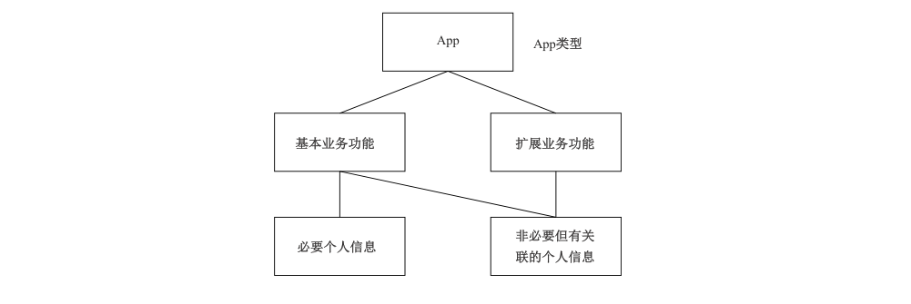

# GB/T 41391-2022 信息安全技术 移动互联网应用程序（App）收集个人信息基本要求

> 来源：[GB/T 41391-2022 国家标准详情](https://openstd.samr.gov.cn/bzgk/std/newGbInfo?hcno=977D9EBB32ABF0A7DD6A1215969FE57A)；封面发布日期：2022-04-15；实施日期：2022-11-01。
> PDF SHA-256：3d9c5d508a7d272a51e4a4c8883d18028f13616f89f34899f0c95cc1e019acb9。
> 转写说明：按官方 PDF 全部 49 页的页面图像核对正文、表 A.1～A.26、表 D.1～D.2、表 E.1～E.4、表 F.1 及图 B.1～B.2；省略封面、目录、页眉、页脚和页码，合并跨页内容。正式引用请核对原 PDF。

## 前言

本文件按照 GB/T 1.1—2020《标准化工作导则 第1部分：标准化文件的结构和起草规则》的规定起草。

请注意本文件的某些内容可能涉及专利。本文件的发布机构不承担识别专利的责任。

本文件由全国信息安全标准化技术委员会（SAC/TC 260）提出并归口。

本文件起草单位：中国电子技术标准化研究院、北京理工大学、中国网络安全审查技术与认证中心、公安部第一研究所、北京信息安全测评中心、国家计算机网络应急技术处理协调中心、中国信息通信研究院、华为技术有限公司、阿里巴巴（北京）软件服务有限公司、北京百度网讯科技有限公司、蚂蚁科技集团股份有限公司、北京小桔科技有限公司、高德软件有限公司、北京字节跳动科技有限公司、北京三快科技有限公司、北京京东尚科信息技术有限公司、三六零科技集团有限公司、顺丰速运有限公司、京东科技控股股份有限公司、北京小米移动软件有限公司、北京快手科技有限公司、中国移动通信集团有限公司、贝壳找房（北京）科技有限公司、北京智者天下科技有限公司、百合佳缘网络集团股份有限公司、浙江菜鸟供应链管理有限公司、北京爱奇艺科技有限公司、中国铁道科学研究院集团有限公司铁路12306科创中心、天翼电子商务有限公司、财付通支付科技有限公司、汉庭星空（上海）酒店管理有限公司、招商银行股份有限公司、中信银行股份有限公司、中国银行股份有限公司。

本文件主要起草人：杨建军、刘贤刚、上官晓丽、胡影、周晨炜、洪延青、何延哲、刘行、陈舒、许静慧、樊华、韩煜、宋杰、李海东、刘海峰、李媛、窦禹、易立、陈湉、葛鑫、衣强、白晓媛、贾雪飞、邓婷、彭晋、张娜、徐彩曦、田申、刘笑岑、严少敏、马可、黎琳、潘景燕、张向拓、李昳婧、宜静、邱勤、张朝、门一帆、赵净、洪小崇、奚海生、杨立鹏、焦伟、史广龙、刘欣欣、王彬、封莎、陈力、何斌。

## 引言

近年来，移动互联网应用程序（App）得到广泛应用，App 超范围收集、强制授权、过度索权、私自调用权限上传个人信息、敏感权限滥用等现象普遍存在，违法违规收集使用个人信息的问题突出。

本文件根据《中华人民共和国网络安全法》《中华人民共和国数据安全法》《中华人民共和国个人信息保护法》等法律、法规要求，重点围绕个人信息处理的最小必要原则，针对 App 违法、违规收集使用个人信息的突出问题，结合当前移动互联网技术及应用现状，在 GB/T 35273—2020《信息安全技术 个人信息安全规范》要求的基础上，给出了 App 收集个人信息应满足的基本要求，同时给出了常见服务类型 App 必要个人信息的使用要求，旨在落实《关于印发〈常见类型移动互联网应用程序必要个人信息范围规定〉的通知》（国信办秘字〔2021〕14号）、《关于印发〈App违法违规收集使用个人信息行为认定方法〉的通知》（国信办秘字〔2019〕191号）等文件要求，规范 App 个人信息收集行为，最大程度地保障个人信息权益。

本文件附录A中常见服务类型App 的基本业务功能、必要个人信息范围，均与《常见类型移动互联网应用程序必要个人信息范围规定》保持一致。

## 1 范围

本文件规定了 App 收集个人信息的基本要求，给出了常见服务类型 App 必要个人信息范围和使用要求。

本文件适用于 App 运营者规范其个人信息收集活动，也适用于监管部门、第三方评估机构等对App 个人信息收集活动进行监督、管理和评估。

## 2 规范性引用文件

下列文件中的内容通过文中的规范性引用而构成本文件必不可少的条款。其中，注日期的引用文件，仅该日期对应的版本适用于本文件；不注日期的引用文件，其最新版本（包括所有的修改单）适用于本文件。

- GB/T 25069 信息安全技术 术语

- GB/T 35273—2020 信息安全技术 个人信息安全规范

## 3 术语和定义

GB/T 25069、GB/T 35273—2020 界定的以及下列术语和定义适用于本文件。

### 3.1 移动互联网应用程序 mobile internet application

运行在移动智能终端上的应用程序。

> 注：包括移动智能终端预置、下载安装的应用程序和小程序，简称App。

### 3.2 移动互联网应用程序运营者 mobile internet application operator

移动互联网应用程序的所有者、管理者或提供者。

> 注：简称 App 运营者。

### 3.3 小程序 mini program

基于应用程序开放接口实现的，用户无需安装即可使用的移动互联网应用程序。

> 注：应用程序通过公开其应用程序编程接口（API）或函数，使外部的程序可以增加该应用程序的功能或使用该应用程序的资源，而不需要更改该应用程序的源代码。

### 3.4 业务功能 business function

满足用户具体使用目的的功能。

> 注：App 的业务功能，可分为基本业务功能和扩展业务功能。

［来源：GB/T 35273—2020，3.17，有修改］

### 3.5 服务类型 service type

移动互联网应用程序提供的业务功能分类。

> 注：常见服务类型如地图导航、网络约车、即时通信、网上购物、网络支付等，见附录A。

### 3.6 基本业务功能 basic business function

移动互联网应用程序实现用户主要使用目的的业务功能。

### 3.7 扩展业务功能 extended business function

移动互联网应用程序所提供的基本业务功能之外的其他业务功能。

### 3.8 必要个人信息 necessary personal information

保障移动互联网应用程序基本业务功能正常运行所必需的个人信息，缺少该信息移动互联网应用程序即无法实现基本业务功能。

注1：App、基本业务功能、必要个人信息之间的关系，见附录B中B.1。

注2：App 可收集的个人信息范围，分为必要个人信息、非必要但有关联个人信息。非必要但有关联个人信息是指与 App 所提供服务相关但可选收集的个人信息，见B.2。

### 3.9 用户 user

使用移动互联网应用程序的个人信息主体。

> 注：用户通常包括消费侧用户和服务供给侧用户，消费侧用户是使用 App 服务的个人消费者，服务供给侧用户是通过App 提供服务的用户，例如网络约车类 App 的消费侧用户是乘客，服务供给侧用户是驾驶员。

### 3.10 可收集个人信息权限 system permission to access personal information

移动智能终端操作系统向移动互联网应用程序开放的，具有收集个人信息功能的系统权限。

> 注：简称系统权限或权限。

### 3.11 唯一设备识别码 unique device identifier

可唯一标识移动智能终端的编码。

注1：也称设备唯一标识符，可分为可变更的唯一设备识别码和不可变更的唯一设备识别码。

注2：可变更的唯一设备识别码，是指用户可重置、变更或关闭追踪的唯一设备识别码。不可变更的唯一设备识别码，是指不因设备恢复出厂设置、应用安全卸载或用户操作而改变的硬件标识符。

> 转写注：3.11 注2原版作“应用安全卸载”，附录 F 首段作“应用安装卸载”，此处分别保留原文。

### 3.12 定向推送 targeted push

基于某一个人信息主体的网络浏览历史、兴趣爱好、消费记录和习惯等个人信息，利用算法向该个人信息主体展示信息内容、提供商品或服务的搜索结果、推荐产品或服务、推送新闻信息、广告营销等活动。

> 注：也称为个性化展示或个性化推荐。

［来源：GB/T 35273—2020,3.16，有修改］

### 3.13 用户画像 user profiling

通过收集、汇聚、分析个人信息，对某一自然人个人特征，如职业、经济、健康、教育、个人喜好、信用、行为等方面进行分析或预测，形成其个人特征模型的过程。

［来源：GB/T 35273—2020，3.8，有修改］

### 3.14 软件开发工具包 software development kit

协助软件开发的软件库。

> 注：软件开发工具包通常包括相关二进制文件、文档、范例和工具的集合。

### 3.15 第三方软件开发工具包 third-party software development kit

由移动互联网应用程序运营者之外的其他法人实体提供的软件开发工具包。

### 3.16 权限申请 system permission request

移动互联网应用程序向移动智能终端操作系统声明，并向用户请求授权，以获得访问数据或功能的许可的过程。

### 3.17 第三方应用 third-party application

由移动互联网应用程序运营者之外的其他法人实体提供，通过移动互联网应用程序面向用户提供服务的应用程序。

注1：第三方应用提供的形式，通常包括SDK、小程序、Web 页面等。如果 SDK 没有直接向用户提供服务，则不属于本文件所称的第三方应用。

注2：虽与 App运营者属于不同法人实体，但与 App 运营者属于同一企业集团，且遵守同一套管理制度、统一进行安全和运维管理的，不属于 App 运营者的第三方。关联公司通常属于 App 运营者的第三方。

## 4 缩略语

下列缩略语适用于本文件。

- API：应用程序编程接口（Application Programming Interface）
- GPS：全球定位系统（Global Positioning System）
- ICCID：集成电路卡识别码（Integrate Circuit Card Identity）
- IMEI：国际移动设备识别码（International Mobile Equipment Identity）
- IMSI：国际移动用户识别码（International Mobile Subscriber Identity）
- MAC：媒体访问控制（Media Access Control）
- MEID：移动设备识别码（Mobile Equipment Identifier）
- SDK：软件开发工具包（Software Development Kit）
- SN：设备序列号（Serial Number）
- WAP：无线应用协议（Wireless Application Protocol）
- Web：全球广域网（World Wide Web）

> 转写注：缩略语 ICCID 的英文原版作“Integrate Circuit Card Identity”，此处保留原文。

## 5 App 功能划分

App 收集个人信息要求与其功能密切相关，应首先按照以下要求明确划分 App 的基本业务功能和扩展业务功能：

a） 应明确实现用户主要使用目的的业务功能所属的服务类型为该 App 的类型；

b）当App类型属于附录A 给出的常见服务类型时，应按照附录A 中所对应的服务类型划分App 的基本业务功能；

注1：附录A按照《常见类型移动互联网应用程序必要个人信息范围规定》，给出了常见服务类型 App 的基本业务功能和必要个人信息范围，以及必要个人信息的使用要求。其中，常见服务类型 App 的基本业务功能、必要个人信息范围，均与《常见类型移动互联网应用程序必要个人信息范围规定》保持一致。

c） 当App 类型不属于附录A给出的常见服务类型时，应将实现用户主要使用目的的业务功能划分为App 的基本业务功能，将App 提供的基本业务功能之外的业务功能划分为扩展业务功能；

注2：如 App 提供多种类型服务，App 类型之外的服务类型称为“其他服务类型”，其他服务类型的业务功能属于扩展业务功能。例如地图导航类 App 还提供网上购物、网络约车类服务，则网上购物、网络约车服务的业务功能均属于扩展业务功能。

d） 仅为实现改善服务质量、提升使用体验、定向推送信息、研发新产品等目的的业务功能，应划分扩展业务功能；

e） 外部第三方或关联公司提供的业务功能应划分扩展业务功能，附录A给出的常见服务类型App 的基本业务功能除外；

f） 如基本业务功能有多种可选的实现方式，对用户个人权益影响更大的实现方式应划分为扩展业务功能。

注3：基本业务功能因技术发展而出现的新实现方式，如果新方式相较传统方式收集更为敏感的个人信息、对个人权益影响更大的，可视为扩展业务功能，通常作为基本业务功能的可选替代、补充使用。例如因生物特征识别技术发展出现的身份鉴别新方式（例如人脸识别、声纹识别、指纹识别等），收集生物识别信息替代口令，对个人权益影响更大。

## 6 App 收集个人信息基本要求

### 6.1 最小必要收集

App 收集个人信息应在满足 GB/T 35273—2020中 5.1、5.2 要求的基础上，遵守以下要求：

a） 收集的个人信息应具有明确、合理、具体的个人信息处理目的；

b） 收集的个人信息应限于实现处理目的所必要的最小范围；

注1：范围通常涉及收集个人信息的类型、频率、数量、精度等。

c） 应采取对个人权益影响最小的方式收集个人信息；

注2：个人权益影响通常与个人信息的敏感程度相关，个人信息越敏感其处理活动对个人权益影响越大，权益影响评价见 GB/T 39335—2020。

注3：当收集一般个人信息或敏感个人信息均能满足App 服务目的时，收集一般个人信息属于对个人权益影响较小的方式。

d） 收集的个人信息应与处理目的直接相关；

e） 应仅在用户使用业务功能期间，收集该业务功能所需的个人信息。

注4：用户使用业务功能期间，通常是从用户点击触发该业务功能或切换到业务功能页面开始，用户在前台操作业务功能或业务功能在后台提供必要服务，到业务功能目的完成或用户主动关闭、退出该业务功能时结束。

### 6.2 必要个人信息

App 应确定必要个人信息范围，满足以下要求：

a）当App 类型属于附录A给出的常见服务类型时，应按照附录A 中所对应的服务类型确定App的必要个人信息范围，必要个人信息的使用应符合附录A要求；

> 注：附录A的必要个人信息范围，主要指消费侧用户个人信息，不包括服务供给侧用户个人信息。

b）当App 类型不属于附录 A 给出的常见服务类型时，应先按照第5章划分基本业务功能和扩展业务功能，再将保障 App 基本业务功能正常运行所必需的个人信息确定为必要个人信息；

c） 要求用户必须提供的个人信息不应超出必要个人信息范围；

d） 当无须收集用户个人信息即可提供App 基本业务功能时，应确保用户在不提供个人信息的情况下可正常使用 App 基本业务功能。

### 6.3 特定类型个人信息

App 收集特定类型个人信息，应满足附录C的要求。

### 6.4 告知同意

#### 6.4.1 通用要求

App 收集个人信息应在满足 GB/T 35273—2020中5.3、5.4、5.5要求的基础上，还应满足以下告知同意要求：

a） 应采用显著方式（如弹窗、图文、动画等）向用户告知个人信息保护政策的核心内容（如所提供的基本业务功能、必要个人信息等），提示用户阅读个人信息保护政策，并取得用户明示同意；

b）应向用户明示 App 基本业务功能、扩展业务功能和必要个人信息范围，并显著区分必要和非必要个人信息；

注1：本文件所称“非必要个人信息”是指“非必要但有关联个人信息”，见附录B。

c） 应拆分 App 的必要个人信息和非必要个人信息的同意；

d） 当用户同意收集 App 必要个人信息时，应保障用户可拒绝或撤回同意收集非必要个人信息，且不应因用户拒绝或撤回同意提供非必要个人信息，而拒绝用户使用该 App 的基本业务功能；

注2：例如提供“退出”“上一步”“关闭”“取消”的按钮等方式供用户拒绝个人信息收集。

e） 扩展业务功能应由用户自主选择开启，如用户拒绝使用、关闭或退出扩展业务功能，不应影响用户使用基本业务功能；

注3：用户自主作出的开启动作属于自主选择开启，如主动点击、勾选、填写等。

f）不应通过捆绑不同类型服务、捆绑基本业务功能和扩展业务功能、批量申请授权等方式，诱导、强迫用户一次性同意个人信息收集请求；

g） 因法律法规规定收集个人信息，应明示依据的法律法规具体规定，并仅用于法律法规所规定的用途；

h） 应向用户提供已收集其个人信息类型的查询方法，查询宜通过 App 独立界面等方式展示；

i） 对于以间接获取方式收集的个人信息，宜向用户提供个人信息获取来源的查询方法。

#### 6.4.2 敏感个人信息告知同意

App 收集敏感个人信息，应满足以下告知同意要求。

<ol type="a">
  <li>
    
收集生物识别、宗教信仰、特定身份、医疗健康、金融账户、行踪轨迹等敏感个人信息时，应同步告知用户收集使用目的，目的描述应明确具体、通俗易懂，并取得用户单独同意。

  </li>
  <li>
    
收集不满14周岁未成年人个人信息，应制定专门的个人信息处理规则，内容应包括但不限于：

    <ol>
      <li>App 运营者的名称或者姓名和联系方式；</li>
      <li>未成年人个人信息的处理目的、处理方式；</li>
      <li>处理的未成年人个人信息种类、保存期限；</li>
      <li>用户行使个人信息权利的方式和程序；</li>
      <li>处理未成年人个人信息的必要性；</li>
      <li>对未成年人个人权益的影响。</li>
    </ol>

  </li>
  <li>
    
收集不满14周岁未成年人个人信息，应取得未成年人的父母或者其他监护人的单独同意。

  </li>
</ol>

#### 6.4.3 多种服务类型告知同意

当 App 提供多种类型服务时，App 收集个人信息应满足以下告知同意要求。

a） 应按照服务类型制定个人信息保护政策，明示各类服务处理个人信息的目的、方式、范围等。

注1：各类服务的个人信息保护政策，可以是各类服务制定单独的个人信息保护政策，也可以是按照服务类型汇总的个人信息收集使用规则。

b） 应按照服务类型分别向用户申请处理个人信息的同意。

c） App 类型之外的其他服务类型，宜由用户自主选择启用。当用户首次使用时，宜采用增强式告知方式明示该服务类型的个人信息处理规则，并取得用户明示同意。

注2：增强式告知通常用于帮助用户理解特定个人信息处理规则，采用专门页面或单独步骤等用户不易绕过的方式向用户告知，具体可参照个人信息告知同意相关标准。

d） 如 App 提供的其他服务类型属于附录A给出的常见服务类型，其他服务类型应按照附录A确定相应类型的基本业务功能和必要个人信息范围，同时满足 6.4.1 d）和e）的要求。

#### 6.4.4 用户拒绝或撤回同意

当用户拒绝或撤回 App 个人信息收集、权限申请或业务功能使用的同意时，App 应满足以下要求。

<ol type="a">
  <li>
    
不应强制退出或者关闭 App。

  </li>
  <li>
    
不应拒绝提供 App 基本业务功能或影响其他无关的业务功能使用，除非用户拒绝同意 App 必要个人信息或基本业务功能。

  </li>
  <li>
    
不应频繁申请授权干扰用户正常使用，除非由用户主动触发业务功能，且没有该个人信息或权限参与此业务功能无法实现。“频繁”的形式包括但不限于：

    <ol>
      <li>单个场景在用户拒绝授权后，48 h 内弹窗提示用户打开权限的次数超过 1 次；</li>
      <li>每当用户重新打开 App 或使用无关的业务功能时，都会再次向用户索要授权或提示用户缺少相关授权。</li>
    </ol>

  </li>
</ol>

### 6.5 系统权限

#### 6.5.1 权限申请

App 申请可收集个人信息权限，应满足以下要求：

a） 应仅声明和申请实现App 服务目的最小范围的系统权限，不应申请与App 业务功能无关的系统权限；

注1：声明，是指在应用程序清单文件（如安卓的 AndroidManifest.xml 文件、iOS 的Info.plist 等）中向操作系统说明所需的系统权限。

注2：可收集个人信息权限范围见附录D，表D.1及表D.2的“可访问的个人信息”给出了通过权限可能访问的个人信息范围，表D.1 的“业务功能示例”给出了需要申请权限的业务功能示例。

注3：附录E给出了与常见服务类型相关程度较低的安卓系统权限。

b） 在用户未使用相关业务功能时，不应提前申请与当前业务功能无关的权限；

c） 申请权限时应同步告知用户权限申请目的，目的应明确具体且易于理解，不包含任何欺诈、诱骗、误导用户授权的描述；

d） 不应以捆绑方式要求用户一次性同意打开多个系统权限；

注4：安卓 App 的目标 API 等级低于 23（targetSdkVersion<23）属于捆绑授权的常见情形。

e） 如操作系统支持，申请相机、位置、麦克风等可收集个人信息权限应向用户提供单次授权的选项；

f） 如用户拒绝或撤回同意系统权限授权，宜为用户提供无需系统权限亦可实现业务功能的替代解决方案。

注5：替代解决方案，例如当用户拒绝位置权限，仍可以通过自主输入地址的方式使用相关服务。

#### 6.5.2 权限使用

App 使用可收集个人信息权限，应满足以下要求。

<ol type="a">
  <li>
    
未经用户同意，不应更改用户的系统权限和业务功能设置。

    
注1：私自更改情形，例如在 App 更新升级后，未经用户同意将用户设置的可收集个人信息权限恢复到默认状态，或打开用户已关闭的可收集个人信息的业务功能。

  </li>
  <li>
    
权限申请授权后收集个人信息的频率应在实现App 业务功能所必需的最低合理频度范围内。

  </li>
  <li>
    
权限申请授权后应仅访问满足业务功能需要的最少个人信息，且当实现相关功能不需要回传个人信息则不应回传至后台服务器。

    
注2：例如读取通讯录时，若实现相关业务功能仅需读取特定联系人则不应读取所有联系人。

  </li>
  <li>
    
如权限的使用目的、使用场景发生变化，应重新告知用户并取得同意。

  </li>
  <li>
    
App 通过权限获得的个人信息和能力，不应在未经用户同意的情况下提供给 App 接入的第三方应用或嵌入的第三方 SDK 使用。

  </li>
  <li>
    
以下操作应由用户主动触发，且应在用户知情的情况下执行：

    <ol>
      <li>执行拨打电话、发送短信等操作；</li>
      <li>打开或关闭蓝牙、定位、无线局域网，以及获取无线局域网内其他设备的信息等；</li>
      <li>拍摄、录音、截屏、录屏等；</li>
      <li>读写用户短信、联系人、相册等个人信息。</li>
    </ol>

  </li>
  <li>
    
申请使用设备管理器、辅助功能、监听通知栏、悬浮窗权限等权限，应具有明确的业务功能需求，向用户详细说明申请目的，并取得用户单独同意。

    
注3：设备管理器、辅助功能、监听通知栏、悬浮窗权限等权限，涉及设备、系统、其他 App 的安全和用户体验，一旦被恶意 App 获取可能侵犯用户隐私或设备安全，通常只有少数App 在特定场景下申请，申请此类权限通常需要提供单独管理界面详细说明申请目的，并适当增加障碍设计避免用户误操作。

  </li>
</ol>

### 6.6 第三方收集管理

#### 6.6.1 App 接入第三方应用

App 接入可收集个人信息的第三方应用，应对第三方应用收集个人信息进行安全管理，满足以下要求。

<ol type="a">
  <li>
    
第三方应用接入管理应符合GB/T 35273—2020中9.7 的要求。

  </li>
  <li>
    
应与第三方应用明确双方的个人信息处理规则和保护责任，包括：

    <ol>
      <li>第三方应用收集个人信息的目的、方式、范围；</li>
      <li>第三方应用申请的系统权限和申请目的；</li>
      <li>App 提供给第三方应用的个人信息种类、保存期限、停止接入后的个人信息处理方式；</li>
      <li>双方的个人信息安全责任和保护措施；</li>
      <li>第三方应用协助 App 响应用户个人信息权利请求的措施。</li>
    </ol>

  </li>
  <li>
    
应为用户提供第三方应用授权管理的功能或渠道，确保用户可便捷地关闭或撤回对第三方应用可收集个人信息权限的授权，以及向第三方应用提供个人信息的授权，第三方应用提供该App 基本业务功能的除外。

  </li>
  <li>
    
应提醒用户关注第三方应用的个人信息处理规则，未经用户同意不应私自截留用户仅同意向第三方应用提供的个人信息。

    
注：例如信息查询类 App，在用户仅同意向第三方应用提供相关个人信息时，App 未经用户同意截留用户个人信息并上传至其后台服务器的行为属于私自截留个人信息。

  </li>
</ol>

#### 6.6.2 App 嵌入第三方 SDK

App 嵌入可收集个人信息的第三方 SDK，应对第三方 SDK 收集个人信息进行安全管理，满足以下要求。

<ol type="a">
  <li>
    
应仅嵌入满足 App 业务功能需要的最少数量的 SDK，App 向第三方 SDK 提供的个人信息应限于实现处理目的所必要的最小范围。

  </li>
  <li>
    
应在嵌入第三方 SDK 前，对 SDK 是否存在违法违规收集使用个人信息行为、个人信息出境行为进行评估。

  </li>
  <li>
    
应与第三方 SDK 明确双方的个人信息处理规则和保护责任，包括：

    <ol>
      <li>SDK 收集个人信息的目的、方式、范围；</li>
      <li>SDK 申请的系统权限和申请目的；</li>
      <li>SDK 收集个人信息的保存期限、停止嵌入后的个人信息处理方式；</li>
      <li>个人信息安全责任和保护措施；</li>
      <li>SDK 是否存在热更新机制；</li>
      <li>SDK 是否存在自启动、关联启动；</li>
      <li>SDK 收集个人信息是否涉及向境外提供；</li>
      <li>SDK 协助 App 响应用户个人信息权利请求的措施。</li>
    </ol>

  </li>
  <li>
    
应向用户告知嵌入的第三方 SDK 名称、SDK 收集的个人信息种类、使用目的及申请的系统权限、申请目的等，并取得用户同意。

  </li>
  <li>
    
应对SDK 申请使用权限进行审核，确保其申请的权限具有明确、合理的使用目的，并监督SDK 的个人信息收集行为是否超出约定或用户同意的范围。

  </li>
  <li>
    
如第三方 SDK 存在热更新机制，App 应要求 SDK：

    <ol>
      <li>在热更新推送前向 App运营者告知本次热更新的具体内容及可能造成的影响；</li>
      <li>如热更新内容涉及个人信息处理目的、方式和范围的变更，应通过邮件、电话等逐一送达方式告知 App运营者。</li>
    </ol>

  </li>
  <li>
    
停止使用某 SDK 时，应及时从代码中移除该 SDK 的相关代码。

  </li>
</ol>

### 6.7 其他要求

App 收集个人信息还应满足以下要求：

a） 定向推送信息和用户画像场景采用唯一设备识别码标识用户时，应使用可变更的唯一设备识别码，且不应将其与用户身份信息或不可变更的唯一设备识别码关联；

注1：常见不可变更的唯一设备识别码，如 IMEI、IMSI、MEID、MAC地址等，见附录F。经随机化处理后的 MAC地址不属于不可变更的唯一设备识别码。

b） 如存在读取剪切板或公共存储区的行为，应告知用户读取的信息范围和使用目的，不应在未取得用户同意的情况下，收集剪切板中包含的个人信息和公共存储区中的个人信息；

c） 当App 在静默状态或在后台运行，且未向用户提供服务时，不应收集用户个人信息；

d） 在非服务所必需或者无合理场景下，不应自启动或者关联启动其他 App；

注2：关联启动是指其他程序唤醒的启动。

e） 不应通过积分、奖励、优惠、红包等方式，欺骗误导用户提供与 App 业务功能无关的个人信息或权限；

f） 当拍摄、录音、录屏、定位时，应采用显著方式提示用户；

g） 应参考有关国家标准在 App 设计、开发阶段考虑最小必要等个人信息保护原则，同步规划和建设 App 个人信息保护措施。

## 附录 A（规范性）常见服务类型 App 必要个人信息范围及其使用要求

### A.1 地图导航类

地图导航类 App 的基本业务功能为定位和导航，如提供地图搜索、展示和导航功能。

地图导航类 App 的必要个人信息范围包括：位置信息、出发地、到达地。

地图导航类 App 的必要个人信息使用应符合表A.1 的要求。

**表 A.1 地图导航类 App 必要个人信息范围和使用要求**

| 服务类型 | 必要个人信息 | 使用要求 |
| --- | --- | --- |
| 地图导航 | 位置信息 | 用于确定用户位置，提供地图搜索展示和导航服务 导航场景下因持续定位获得的行踪轨迹，应仅用于本次路线导航，完成导航后应及时删除或匿名化处理 |
| 地图导航 | 出发地、到达地 | 用于用户自主输入出发地、到达地进行路线规划和导航 |

### A.2 网络约车类

网络约车类 App 的基本业务功能为网络预约出租汽车服务、巡游出租汽车电召服务。

网络约车类 App 的必要个人信息范围包括：注册用户移动电话号码；乘车人出发地、到达地、位置信息、行踪轨迹；支付时间、支付金额、支付渠道等支付信息（网络预约出租汽车服务）。

网络约车类 App 的必要个人信息使用应符合表 A.2 的要求。

**表A.2 网络约车类 App 必要个人信息范围和使用要求**

| 服务类型 | 必要个人信息 | 使用要求 |
| --- | --- | --- |
| 网络约车 | 注册用户移动电话号码 | 用于网络约车用户注册，满足对 App 注册用户进行真实身份信息认证的要求，同时也可用于司机与乘客联系 |
| 网络约车 | 乘车人出发地、到达地、位置信息、行踪轨迹 | 乘车人出发地、到达地用于确定行程起终点 位置信息用于确定用户当前位置，推荐周围上车点，搜索显示附近车辆信息 行踪轨迹用于保障行程安全及处理用户纠纷，完成处理目的的行踪轨迹信息应及时删除或匿名化处理 |
| 网络约车 | 仅对使用网络预约出租汽车服务的用户收集：支付时间、支付金额、支付渠道等支付信息 | 用于用户对网络预约出租汽车服务订单付款 |

### A.3 即时通信类

即时通信类 App 的基本业务功能为提供文字、图片、语音、视频等网络即时通信服务，如即时通信聊天服务。

即时通信类 App 的必要个人信息范围包括：注册用户移动电话号码；账号信息（账号、即时通信联系人账号列表）。

即时通信类 App 的必要个人信息使用应符合表A.3的要求。

**表A.3 即时通信类 App 必要个人信息范围和使用要求**

| 服务类型 | 必要个人信息 | 使用要求 |
| --- | --- | --- |
| 即时通信 | 注册用户移动电话号码 | 用于即时通信用户注册，满足对 App 注册用户进行真实身份信息认证的要求 |
| 即时通信 | 账号信息（账号、即时通信联系人账号列表） | 账号用于标识即时通信用户 即时通信联系人列表用于建立和管理用户在即时通信应用的联系人关系 应允许用户在即时通信应用中自主添加好友，而不应强制或频繁申请读取用户的通讯录 |

### A.4 网络社区类

网络社区类 App 的基本业务功能为博客、论坛、社区等话题讨论、信息分享和关注互动。

网络社区类 App 的必要个人信息范围包括：注册用户移动电话号码。

网络社区类 App 的必要个人信息使用应符合表A.4的要求。

**表 A.4 网络社区类 App 必要个人信息范围和使用要求**

| 服务类型 | 必要个人信息 | 使用要求 |
| --- | --- | --- |
| 网络社区 | 注册用户移动电话号码 | 用于网络社区用户注册，满足对 App 注册用户进行真实身份信息认证的要求 |

### A.5 网络支付类

网络支付类 App 的基本业务功能为网络支付、提现、转账等功能，如非银支付和网银支付的收付款支付交易、充值提现、转账、账单功能。

网络支付类 App 的必要个人信息范围包括：注册用户移动电话号码；注册用户姓名、证件类型和号码、证件有效期限、银行卡号码。

网络支付类 App 的必要个人信息使用应符合表A.5的要求。

**表 A.5 网络支付类 App 必要个人信息范围和使用要求**

| 服务类型 | 必要个人信息 | 使用要求 |
| --- | --- | --- |
| 网络支付 | 注册用户移动电话号码 | 用于网络支付用户注册，满足对 App 注册用户进行真实身份信息认证的要求 |
| 网络支付 | 注册用户姓名、证件类型和号码、证件有效期限 | 用于对网络支付用户进行实名制管理，满足相关法律法规要求 |
| 网络支付 | 银行卡号码 | 用于实现银行卡和支付账号绑卡、银行卡身份认证、充值、提现、转账功能 |

### A.6 网上购物类

网上购物类 App 的基本业务功能为购买商品，如商品展示、搜索、下单、交付、客服售后等功能。

网上购物类 App 的必要个人信息范围包括：注册用户移动电话号码；收货人姓名（名称）、地址、联系电话；支付时间、支付金额、支付渠道等支付信息。

网上购物类 App 的必要个人信息使用应符合表 A.6 的要求。

**表 A.6 网上购物类 App 必要个人信息范围和使用要求**

| 服务类型 | 必要个人信息 | 使用要求 |
| --- | --- | --- |
| 网上购物 | 注册用户移动电话号码 | 用于网上购物用户注册，满足对 App 注册用户进行真实身份信息认证的要求 |
| 网上购物 | 收货人姓名（名称）、地址、联系电话 | 用于商品货物配送时识别收货人、送达货物和联系收货人，以及完成客服与售后 |
| 网上购物 | 支付时间、支付金额、支付渠道等支付信息 | 用于用户对网上购物订单付款 |

### A.7 餐饮外卖类

餐饮外卖类 App 的基本业务功能为餐饮购买及外送，如餐饮配送、到店自取等功能。

餐饮外卖类 App 的必要个人信息范围包括：注册用户移动电话号码；收货人姓名（名称）、地址、联系电话；支付时间、支付金额、支付渠道等支付信息。

餐饮外卖类 App 的必要个人信息使用应符合表 A.7的要求。

**表A.7 餐饮外卖类 App 必要个人信息范围和使用要求**

| 服务类型 | 必要个人信息 | 使用要求 |
| --- | --- | --- |
| 餐饮外卖 | 注册用户移动电话号码 | 用于餐饮外卖用户注册，满足对 App 注册用户进行真实身份信息认证的要求 |
| 餐饮外卖 | 收货人姓名（名称）、地址、联系电话 | 用于商家和配送员与用户取得联系和配送员送餐 |
| 餐饮外卖 | 支付时间、支付金额、支付渠道等支付信息 | 用于用户对餐饮外卖订单付款 |

### A.8 邮件快件寄递类

邮件快件寄递类 App 的基本业务功能为件、包裹、印刷品等物品寄递服务，包括寄件、收件等功能。

> 转写注：A.8 原版作“基本业务功能为件、包裹、印刷品等物品寄递服务”，此处保留原文。

邮件快件寄递类 App 的必要个人信息范围包括：寄件人姓名、证件类型和号码等身份信息；寄件人地址、联系电话；收件人姓名（名称）、地址、联系电话；寄递物品的名称、性质、数量。

邮件快件寄递类 App 的必要个人信息使用应符合表 A.8的要求。

**表A.8 邮件快件寄递类App 必要个人信息范围和使用要求**

| 服务类型 | 必要个人信息 | 使用要求 |
| --- | --- | --- |
| 邮件快件寄递 | 寄件人姓名、证件类型和号码等身份信息 | 用于实现快递寄件和收件功能，同时满足快递行业相关要求 |
| 邮件快件寄递 | 寄件人地址、联系电话 | 用于实现快递寄件和收件功能，同时满足快递行业相关要求 |
| 邮件快件寄递 | 收件人姓名（名称）、地址、联系电话 | 用于实现快递寄件和收件功能，同时满足快递行业相关要求 |
| 邮件快件寄递 | 寄递物品的名称、性质、数量 | 用于实现快递寄件和收件功能，同时满足快递行业相关要求 |

### A.9 交通票务类

交通票务类 App 的基本业务功能为交通相关的票务服务及行程管理（如票务购买、改签、退票、行程管理等）。

交通票务类 App 的必要个人信息范围包括：注册用户移动电话号码；旅客姓名、证件类型和号码、旅客类型；旅客出发地、目的地、出发时间、车次/船次/航班号、席别/舱位等级、座位号（如有）、车牌号及车牌颜色（ETC 服务）；支付时间、支付金额、支付渠道等支付信息。

> 注：旅客类型通常包括儿童、成人、学生等。

交通票务类 App 的必要个人信息使用应符合表A.9的要求。

**表A.9 交通票务类App 必要个人信息范围和使用要求**

| 服务类型 | 必要个人信息 | 使用要求 |
| --- | --- | --- |
| 交通票务 | 注册用户移动电话号码 | 用于交通票务用户注册，满足对 App 注册用户进行真实身份信息认证的要求 |
| 交通票务 | 旅客姓名、证件类型和号码、旅客类型 | 用于实现交通票务和行程管理服务，包括购票、改签、退票、乘机、行程管理功能 |
| 交通票务 | 旅客出发地、目的地、出发时间、车次/船次/航班号、席别/舱位等级、座位号（如有） | 用于实现交通票务和行程管理服务，包括购票、改签、退票、乘机、行程管理功能 |
| 交通票务 | 仅对使用 ETC 服务的用户收集：车牌号及车牌颜色 | 用于实现交通票务和行程管理服务，包括购票、改签、退票、乘机、行程管理功能 |
| 交通票务 | 支付时间、支付金额、支付渠道等支付信息 | 用于用户对交通票务订单付款 |

### A.10 婚恋相亲类

婚恋相亲类 App 的基本业务功能为婚恋相亲，包括相亲牵线等功能。

婚恋相亲类 App 的必要个人信息范围包括：注册用户移动电话号码；婚恋相亲人的性别、年龄、婚姻状况。

婚恋相亲类 App 的必要个人信息使用应符合表 A.10 的要求。

**表 A.10 婚恋相亲类 App 必要个人信息范围和使用要求**

| 服务类型 | 必要个人信息 | 使用要求 |
| --- | --- | --- |
| 婚恋相亲 | 注册用户移动电话号码 | 用于婚恋相亲用户注册，满足对 App 注册用户进行真实身份信息认证的要求 |
| 婚恋相亲 | 婚恋相亲人的性别、年龄、婚姻状况 | 用于展示用户形象、相亲牵线等婚恋相亲服务 |

### A.11 求职招聘类

求职招聘类 App 的基本业务功能为求职招聘信息交换，如职位发布、职位展示、职位搜索、投递简历等功能。

求职招聘类 App 的必要个人信息范围包括：注册用户移动电话号码；求职者提供的简历。

求职招聘类App 的必要个人信息使用应符合表A.11 的要求。

**表 A.11 求职招聘类 App 必要个人信息范围和使用要求**

| 服务类型 | 必要个人信息 | 使用要求 |
| --- | --- | --- |
| 求职招聘 | 注册用户移动电话号码 | 用于求职招聘用户注册，满足对 App 注册用户进行真实身份信息认证的要求 |
| 求职招聘 | 求职者提供的简历 | 用于招聘单位识别求职者、岗位需求匹配、招聘单位与求职者联系 未经求职者同意不应将简历公开或对外提供 |

### A.12 网络借贷类

网络借贷类 App 的基本业务功能为通过互联网平台实现的用于消费、日常生产经营周转等的个人申贷服务，如线上申请、风险评估、贷款审批、放款支付等。

> 注：本文件所称网络借贷服务的提供者是指有相应贷款资质的银行、消费金融公司、小贷公司等。

网络借贷类App 的必要个人信息范围包括：注册用户移动电话号码；借款人姓名、证件类型和号码、证件有效期限、银行卡号码。

网络借贷类 App 的必要个人信息使用应符合表 A.12 的要求。

**表A.12 网络借贷类 App 必要个人信息范围和使用要求**

| 服务类型 | 必要个人信息 | 使用要求 |
| --- | --- | --- |
| 网络借贷 | 注册用户移动电话号码 | 用于网络借贷用户注册，满足对 App 注册用户进行真实身份信息认证的要求 |
| 网络借贷 | 借款人姓名、证件类型和号码、证件有效期限 | 用于对网络借贷用户进行身份识别和认证，满足相关法律法规要求 |
| 网络借贷 | 银行卡号码 | 用于实现银行卡和网络借贷账号绑定、银行卡身份认证、借款、还款功能 |

### A.13 房屋租售类

房屋租售类 App 的基本业务功能为个人房源信息发布、房屋出租或买卖。

房屋租售类 App的必要个人信息范围包括：注册用户移动电话号码；房源基本信息（房屋地址、面积/户型、期望售价或租金）。

房屋租售类 App 的必要个人信息使用应符合表 A.13的要求。

**表A.13 房屋租售类 App 必要个人信息范围和使用要求**

| 服务类型 | 必要个人信息 | 使用要求 |
| --- | --- | --- |
| 房屋租售 | 注册用户移动电话号码 | 用于房屋租售用户注册，满足对 App 注册用户进行真实身份信息认证的要求 |
| 房屋租售 | 仅对业主用户收集：房源基本信息（房屋地址、面积/户型、期望售价或租金） | 用于房源信息发布、房源信息搜索和房屋租售 |

### A.14 二手车交易类

二手车交易类 App 的基本业务功能为二手车买卖信息交换，如二手车源信息搜索和展示、车辆审核、二手车买卖等功能。

二手车交易类 App 的必要个人信息范围包括：注册用户移动电话号码；购买方姓名、证件类型和号码；出售方姓名、证件类型和号码、车辆行驶证号、车辆识别号码。

二手车交易类 App 的必要个人信息使用应符合表A.14 的要求。

**表A.14 二手车交易类 App 必要个人信息范围和使用要求**

| 服务类型 | 必要个人信息 | 使用要求 |
| --- | --- | --- |
| 二手车交易 | 注册用户移动电话号码 | 用于二手车交易用户注册，满足对 App 注册用户进行真实身份信息认证的要求 |
| 二手车交易 | 购买方姓名、证件类型和号码 | 用于二手车购买方的实名制登记、身份验证和完成车辆上户登记、电子签约合同签订等购车流程 |
| 二手车交易 | 出售方姓名、证件类型和号码 | 用于二手车购买方的实名制登记、身份验证和完成车辆上户登记、电子签约合同签订等购车流程 |
| 二手车交易 | 出售方车辆行驶证号、车辆识别号码 | 用于网络发布车源前进行现场审核 |

> 转写注：表 A.14 原版将“购买方姓名、证件类型和号码”与“出售方姓名、证件类型和号码”的使用要求合并为同一单元格，内容作“用于二手车购买方的实名制登记、身份验证和完成车辆上户登记、电子签约合同签订等购车流程”；此处展开合并单元格并保留原文。

### A.15 问诊挂号类

问诊挂号类 App 的基本业务功能为在线咨询问诊、预约挂号。

问诊挂号类 App 的必要个人信息范围包括：注册用户移动电话号码；挂号时需提供患者姓名、证件类型和号码、预约挂号的医院和科室；问诊时需提供病情描述。

问诊挂号类 App 的必要个人信息使用应符合表A.15的要求。

**表 A.15 问诊挂号类 App 必要个人信息范围和使用要求**

| 服务类型 | 必要个人信息 | 使用要求 |
| --- | --- | --- |
| 问诊挂号 | 注册用户移动电话号码 | 用于问诊挂号用户注册，满足对 App 注册用户进行真实身份信息认证的要求 |
| 问诊挂号 | 仅对使用预约挂号的用户收集：患者姓名、证件类型和号码 | 用于在预约挂号时对用户身份进行认证 |
| 问诊挂号 | 仅对使用预约挂号的用户收集：预约挂号的医院、科室 | 用于帮助患者完成预约挂号流程 |
| 问诊挂号 | 仅对使用在线咨询问诊的用户收集：病情描述 | 用于在线咨询问诊时，供当前医生判断患者病情 |

### A.16 旅游服务类

旅游服务类 App 的基本业务功能为旅游服务产品信息的发布与订购。

旅游服务类 App的必要个人信息范围包括：注册用户移动电话号码；出行人旅游目的地、旅游时间；出行人姓名、证件类型和号码、联系方式。

旅游服务类 App 的必要个人信息使用应符合表 A.16 的要求。

**表A.16 旅游服务类 App 必要个人信息范围和使用要求**

| 服务类型 | 必要个人信息 | 使用要求 |
| --- | --- | --- |
| 旅游服务 | 注册用户移动电话号码 | 用于旅游服务用户注册，满足对 App 注册用户进行真实身份信息认证的要求 |
| 旅游服务 | 出行人旅游目的地、旅游时间 | 用于实现用户出游行程预订等服务 |
| 旅游服务 | 出行人姓名、证件类型和号码、联系方式 | 用于实现用户出游行程预订等服务 |

### A.17 酒店服务类

酒店服务类 App 的基本业务功能为酒店预订。

酒店服务类 App 的必要个人信息范围包括：注册用户移动电话号码；住宿人姓名和联系方式、入住和退房时间、入住酒店名称。

酒店服务类App 的必要个人信息使用应符合表 A.17的要求。

**表A.17 酒店服务类 App 必要个人信息范围和使用要求**

| 服务类型 | 必要个人信息 | 使用要求 |
| --- | --- | --- |
| 酒店服务 | 注册用户移动电话号码 | 用于酒店服务用户注册，满足对 App 注册用户进行真实身份信息认证的要求 |
| 酒店服务 | 住宿人姓名和联系方式、入住和退房时间、入住酒店名称 | 用于实现用户预订和入住酒店服务 |

### A.18 网络游戏类

网络游戏类 App 的基本业务功能为提供网络游戏产品和服务。

网络游戏类 App 的必要个人信息范围包括：注册用户移动电话号码。

网络游戏类 App 的必要个人信息使用应符合表A.18的要求。

**表A.18 网络游戏类 App 必要个人信息范围和使用要求**

| 服务类型 | 必要个人信息 | 使用要求 |
| --- | --- | --- |
| 网络游戏 | 注册用户移动电话号码 | 用于网络游戏用户注册，满足对 App 注册用户进行真实身份信息认证的要求 |

### A.19 学习教育类

学习教育类 App 的基本业务功能为在线辅导、网络课堂等。

学习教育类 App 的必要个人信息范围包括：注册用户移动电话号码。

学习教育类 App 的必要个人信息使用应符合表 A.19的要求。

**表 A.19 学习教育类App 必要个人信息范围和使用要求**

| 服务类型 | 必要个人信息 | 使用要求 |
| --- | --- | --- |
| 学习教育 | 注册用户移动电话号码 | 用于学习教育用户注册，满足对 App 注册用户进行真实身份信息认证的要求 |

### A.20 本地生活类

本地生活类 App 的基本业务功能为家政维修、家居装修、二手闲置物品交易等日常生活服务。

本地生活类 App 的必要个人信息范围包括：注册用户移动电话号码。

本地生活类 App 的必要个人信息使用应符合表 A.20的要求。

**表A.20 本地生活类 App 必要个人信息范围和使用要求**

| 服务类型 | 必要个人信息 | 使用要求 |
| --- | --- | --- |
| 本地生活 | 注册用户移动电话号码 | 用于本地生活用户注册，满足对 App 注册用户进行真实身份信息认证的要求 |

### A.21 女性健康类

女性健康类 App 的基本业务功能为女性经期管理、备孕育儿、美容美体等健康管理服务。

女性健康类 App 的必要个人信息范围为无。

### A.22 用车服务类

用车服务类 App 的基本业务功能为共享单车、共享汽车、租赁汽车等服务。

用车服务类 App 的必要个人信息范围包括：注册用户移动电话号码；使用共享汽车、租赁汽车服务用户的证件类型和号码，驾驶证件信息；支付时间、支付金额、支付渠道等支付信息；使用共享单车、分时租赁汽车服务用户的位置信息。

用车服务类 App 的必要个人信息使用应符合表A.21 的要求。

**表A.21 用车服务类 App 必要个人信息范围和使用要求**

| 服务类型 | 必要个人信息 | 使用要求 |
| --- | --- | --- |
| 用车服务 | 注册用户移动电话号码 | 用于用车服务用户注册，满足对 App 注册用户进行真实身份信息认证的要求 |
| 用车服务 | 仅对使用共享汽车、租赁汽车服务的用户收集：证件类型和号码、驾驶证件信息 | 用于对共享汽车、租赁汽车用户身份及驾驶资格进行认证 |
| 用车服务 | 仅对使用共享单车、分时租赁汽车服务的用户收集：位置信息 | 位置信息用于确定用户当前位置，显示用户所在位置周围的可用车辆、运营区范围或地理围栏规则 |
| 用车服务 | 支付时间、支付金额、支付渠道等支付信息 | 用于用户对用车服务订单付款 |

### A.23 投资理财类

投资理财类 App 的基本业务功能为股票、期货、基金、债券等相关投资理财服务。

投资理财类App 的必要个人信息范围包括：注册用户移动电话号码；投资理财用户姓名、证件类型和号码、证件有效期限、证件影印件；投资理财用户资金账户、银行卡号码或支付账号。

投资理财类 App 的必要个人信息使用应符合表 A.22 的要求。

**表A.22 投资理财类 App 必要个人信息范围和使用要求**

| 服务类型 | 必要个人信息 | 使用要求 |
| --- | --- | --- |
| 投资理财 | 注册用户移动电话号码 | 用于投资理财用户注册，满足对 App 注册用户进行真实身份信息认证的要求 |
| 投资理财 | 投资理财用户姓名、证件类型和号码、证件有效期限、证件影印件 | 用于对投资理财用户进行身份识别和认证，满足相关法律法规要求 |
| 投资理财 | 投资理财用户资金账户、银行卡号码或支付账号 | 用于投资理财用户进行银行卡或支付账号绑定 |

### A.24 手机银行类

手机银行类 App 的基本业务功能为通过手机等移动智能终端设备进行银行账户管理、信息查询、转账汇款等服务。

手机银行类 App的必要个人信息范围包括：注册用户移动电话号码；用户姓名、证件类型和号码、证件有效期限、证件影印件、银行卡号码、银行预留移动电话号码；转账时需提供收款人姓名、银行卡号码、开户银行信息。

手机银行类 App 的必要个人信息使用应符合表 A.23 的要求。

**表A.23 手机银行类 App 必要个人信息范围和使用要求**

| 服务类型 | 必要个人信息 | 使用要求 |
| --- | --- | --- |
| 手机银行 | 注册用户移动电话号码 | 用于手机银行用户注册，满足对 App 注册用户进行真实身份信息认证的要求 |
| 手机银行 | 用户姓名、证件类型和号码、证件有效期限、证件影印件 | 用于对手机银行用户进行身份识别和认证，满足相关法律法规要求 |
| 手机银行 | 银行卡号码、银行预留移动电话号码 | 用于用户注册、添加银行卡或找回账号口令服务 |
| 手机银行 | 仅对使用转账功能的用户收集：收款人姓名、银行卡号码、开户银行信息 | 用于境内转账汇款服务 |

### A.25 邮箱云盘类

邮箱云盘类 App 的基本业务功能为邮箱、云盘等。

邮箱云盘类 App 的必要个人信息范围包括：注册用户移动电话号码。

邮箱云盘类 App 的必要个人信息使用应符合表A.24的要求。

**表A.24 邮箱云盘类 App 必要个人信息范围和使用要求**

| 服务类型 | 必要个人信息 | 使用要求 |
| --- | --- | --- |
| 邮箱云盘 | 注册用户移动电话号码 | 用于邮箱云盘用户注册，满足对 App 注册用户进行真实身份信息认证的要求 |

### A.26 远程会议类

远程会议类 App 的基本业务功能为通过网络提供音频或视频会议。

远程会议类 App 的必要个人信息范围包括：注册用户移动电话号码。

远程会议类App 的必要个人信息使用应符合表A.25 的要求。

**表 A.25 远程会议类 App 必要个人信息范围和使用要求**

| 服务类型 | 必要个人信息 | 使用要求 |
| --- | --- | --- |
| 远程会议 | 注册用户移动电话号码 | 用于远程会议用户注册，满足对 App 注册用户进行真实身份信息认证的要求 |

### A.27 网络直播类

网络直播类 App 的基本业务功能为向公众持续提供实时视频、音频、图文等形式信息浏览服务。

网络直播类 App 的必要个人信息范围为无。

### A.28 在线影音类

在线影音类 App 的基本业务功能为影视、音乐搜索和播放。

在线影音类 App 的必要个人信息范围为无。

### A.29 短视频类

短视频类 App 的基本业务功能为不超过一定时长的视频搜索、播放。

短视频类 App 的必要个人信息范围为无。

### A.30 新闻资讯类

新闻资讯类 App 的基本业务功能为新闻资讯的浏览、搜索。

新闻资讯类 App的必要个人信息范围为无。

### A.31 运动健身类

运动健身类 App 的基本业务功能为运动健身训练。

运动健身类 App 的必要个人信息范围为无。

### A.32 浏览器类

浏览器类 App 的基本业务功能为浏览互联网信息资源。

浏览器类 App 的必要个人信息范围为无。

### A.33 输入法类

输入法类 App 的基本业务功能为文字、符号等输入。

输入法类 App 的必要个人信息范围为无。

### A.34 安全管理类

安全管理类 App 的基本业务功能为查杀病毒、清理恶意插件、修复漏洞等。

安全管理类 App 的必要个人信息范围为无。

### A.35 电子图书类

电子图书类 App 的基本业务功能为电子图书搜索、阅读。

电子图书类 App 的必要个人信息范围为无。

### A.36 拍摄美化类

拍摄美化类 App 的基本业务功能为拍摄、美颜、滤镜等。

拍摄美化类 App 的必要个人信息范围为无。

### A.37 应用商店类

应用商店类 App 的基本业务功能为 App 搜索、下载。

应用商店类App 的必要个人信息范围为无。

### A.38 实用工具类

实用工具类 App 的基本业务功能为日历、天气、词典翻译、计算器、遥控器、手电筒、指南针、时钟闹钟、文件传输、文件管理、壁纸铃声、截图录屏、录音、文档处理、智能家居助手、星座性格测试等。

实用工具类 App 的必要个人信息范围为无。

### A.39 演出票务类

演出票务类 App 的基本业务功能为演出购票。

演出票务类 App 的必要个人信息范围包括：注册用户移动电话号码；观演场次、座位号（如有）；支付时间、支付金额、支付渠道等支付信息。

演出票务类 App 的必要个人信息使用应符合表 A.26的要求。

**表 A.26 演出票务类 App 必要个人信息范围和使用要求**

| 服务类型 | 必要个人信息 | 使用要求 |
| --- | --- | --- |
| 演出票务 | 注册用户移动电话号码 | 用于演出购票用户注册，满足对 App 注册用户进行真实身份信息认证的要求 |
| 演出票务 | 观演场次、座位号（如有） | 用于实现用户演出购票预订等服务 |
| 演出票务 | 支付时间、支付金额、支付渠道等支付信息 | 用于用户对演出票务订单付款 |

## 附录 B（资料性）关于 App、业务功能、必要个人信息等概念的说明

### B.1 App、业务功能与必要个人信息之间的关系

App、业务功能与必要个人信息之间的关系如图 B.1 所示。

a） App 可能提供多种类型服务，实现用户最主要使用目的的一种服务类型，称为 App 类型。

b） App 可能提供多项业务功能，按照 App 主要服务目的可分为基本业务功能和扩展业务功能。

其中，基本业务功能是 App 实现用户主要使用目的的业务功能；基本业务功能之外的其他业务功能属于扩展业务功能。

c） App 可收集的个人信息按照收集的必要性，可分为必要个人信息、非必要但有关联个人信息。

其中，“必要个人信息”特指保障 App 基本业务功能所必需的个人信息；App 基本业务功能可选收集的个人信息，以及扩展业务功能收集的个人信息，构成“非必要但有关联个人信息”。

**图 B.1 App、业务功能与必要个人信息之间的关系**

### B.2 必要个人信息、非必要但有关联个人信息、无关个人信息之间的关系

App 收集的个人信息，按照个人信息与 App 业务功能的关联性可能涉及必要个人信息、非必要但有关联个人信息、无关个人信息，三者之间的关系如图 B.2 所示。

a） 必要个人信息，特指保障App 基本业务功能正常运行所必需的个人信息，即当且仅当没有该等个人信息的参与，该App 的基本业务功能无法实现或无法正常运行。必要个人信息是取得用户同意后 App 收集个人信息的最小范围，如图 B.2 中所示的“必要个人信息”。

b） 无关个人信息，是与App 所提供服务目的无直接关联的个人信息，即没有该等个人信息的参与，对于该 App 提供的任何一项业务功能的正常实现和服务质量没有影响。无关个人信息属于 App 不应收集、也不应向用户征求同意的个人信息（即使用户可能同意），如图B.2 中所示的“无关个人信息”。

c） 非必要但有关联个人信息，是与App 所提供服务直接相关但可选收集的个人信息。该类信息可由用户拒绝或撤回同意收集，如图B.2 中所示的“非必要但有关联个人信息”。

d） 必要个人信息与非必要但有关联的个人信息，统称为“相关个人信息”，即与App 所提供服务目的直接关联的个人信息。

**图 B.2 必要个人信息、非必要但有关联个人信息、无关个人信息之间的关系**

## 附录 C（规范性）特定类型个人信息收集要求

### C.1 日历信息

App 通过申请日历权限，可能访问、使用系统日历中的内容，通常包括日程安排、备忘、行程等信息。App 收集日历信息，应满足以下要求：

a） 对日历信息的访问应由用户主动触发，不应在用户不可感知或超出预期的情况下访问日历信息；

b） 如实现相关功能仅需添加特定系统日历活动，则不应读取系统日历中的日程安排、备忘、行程等信息或申请读取日历权限；

c） 不应读取其他 App 写入系统日历的信息并回传。

### C.2 应用程序列表

App 通过读取应用程序列表 API，可能访问终端设备上正在运行或已安装的应用程序列表，获取应用程序名称、包名、文件路径、安装信息等。App 收集应用程序列表，应满足以下要求：

a） 应在个人信息保护政策中明确告知处理应用程序列表的目的和必要性；

b） 应默认不收集应用程序列表，且仅在用户使用到相关业务功能时同步告知用户目的，并取得用户同意；

c） 如仅为判断特定 App 是否安装，应在移动智能终端完成处理；

d） 利用应用程序列表开展用户画像、定向推送等活动，应采用增强式告知或即时提示等方式告知用户，并取得用户明示同意。

### C.3 设备信息

App 通过申请电话权限，可能访问 IMSI、IMEI 等唯一设备识别码，以及手机通话状态等信息。

App 收集设备信息，应满足以下要求：

a） 不应收集不可变更的唯一设备识别码；

b） 除用户主动将 App设置为默认电话应用或在紧急求救情况下，不应向用户申请拨打电话权限；

c） 宜采用其他不需要权限的替代方案，实现监听设备的通话状态、拨打电话等功能。

> 注：安卓 App 监听设备的通话状态，可以通过接口 PhoneStateListener 或请求 AudioFocus 实现，作为申请电话权限的替代方案。安卓 App 拨打电话，可以使用 Intent.ACTION_DIAL， 通过 startActivity 拉起系统拨号盘的方式进行拨号，作为申请电话权限的替代方案。

### C.4 短信信息

App 通过申请短信权限，可能访问短信或彩信接收通知、接收时间、发件人号码、收件人号码、短信或彩信内容等信息。App 收集短信信息，应满足以下要求：

a） 除用户主动将 App设置为默认短信应用外，不应读取短信内容；

b） 原则上应仅在移动智能终端处理短信信息，如确因业务功能需要将短信传输至后台服务器，应取得用户单独同意，并且仅传输用户同意的最小范围短信信息；

注1：垃圾短信骚扰拦截场景下，仅收集用户主动上报的、依据用户设定规则选定的或用户授权客户端自动识别的短信。

c） 宜采用其他不需要权限的替代方案来实现发送短信功能。

注2：例如，安卓 App 可以使用 Intent.ACTION_SENDTO 通过 startActivity 拉起系统短信界面由用户点击后发送，这种发送短信的方式无需申请任何权限。

### C.5 通话记录信息

App 通过申请通话记录权限，可能访问通话联系人名称、通话号码、通话日期、通话时长等通话记录信息。App 收集通话记录信息，应满足以下要求：

a） 除用户主动将 App 设置为默认电话应用，或为实现通话记录管理、备份恢复、骚扰拦截等功能外，不应访问通话记录信息；

b） 原则上应仅在移动智能终端处理通话记录信息，如确因业务功能需要将通话记录传输至后台服务器，应取得用户单独同意，并且仅传输用户同意的最小范围通话记录信息。

### C.6 通讯录信息

App 通过申请通讯录权限，可能访问通讯录的联系人姓名、手机号码、公司、邮箱地址等信息。

App 收集通讯录信息，应满足以下要求：

a） 当用户使用添加或输入特定联系人信息（非全量通讯录）等功能时，应仅读取用户选取的特定联系人信息，并允许用户自主输入联系人信息；

b）通过系统权限读写通讯录的行为应由用户主动触发，并仅在相应业务功能使用时申请；

> 注：除用户主动触发读写通讯录之外，还存在满足特定条件下自动读写通讯录的应用场景，例如经用户同意根据通讯录变化向用户自动推荐 App 好友，此场景通常需要经用户明示同意并严格在用户同意的使用范围内触发。

c） 如用户撤回同意通讯录权限，宜提供已收集用户通讯录信息的删除渠道；

d） 不应在未取得用户同意的情况下，在通讯录中增加、删除、修改联系人信息，或将收集的通讯录信息提供至第三方。

### C.7 位置信息

位置信息通常采用 GPS、基站、蓝牙、WiFi 等多种手段定位，App 通过申请位置权限，可能访问设备所在经纬度等位置信息。App 收集位置信息，应满足以下要求：

a） 所提供业务功能与用户所在位置无关的App 不应申请位置权限；

b） 如操作系统支持，应允许用户在使用应用时允许（仅限前台）、单次允许（临时单次授权）、禁止获取位置信息等授权方式中进行选择；

c） 除所提供业务功能确需后台持续获取位置外，不应申请后台访问用户位置信息；

> 注：例如，地图导航类、运动健身、网络约车类 App 在后台提供导航、记录运动轨迹时，可能需要后台访问用户位置信息。

d） 借助访问粗略位置信息即可实现相关业务功能的App，不应申请访问精准位置信息。

### C.8 生物识别信息

App 收集生物识别信息，应满足以下要求：

a） 符合相关网络安全国家标准中关于生物识别信息保护的要求；

b） 开展业务活动时不应限定使用生物特征识别技术作为身份鉴别的唯一方式，并且当用户拒绝生物特征识别方式时，不应频繁申请授权干扰用户正常使用；

c） 通过生物特征识别方式实现身份鉴别功能，应采用本地方式或通过操作系统提供的本地方式在移动智能终端内实现，经证明本地无法实现的除外；

> 注：本地方式是指在运行App 的移动智能终端内实现功能的方式，期间不将实现功能所需的数据传出移动智能终端，由远程设备或系统协同处理。

d） 完成身份鉴别后，应立即删除身份鉴别过程中收集、使用的各类生物特征相关数据，通过以单独操作注册预留的、且仅用于比对的生物特征模板除外。

### C.9 录音及拍摄录像信息

App 通过申请相机、麦克风权限，可能访问所拍摄录制的照片、视频、录音内容等信息。App 不应在用户不可感知的情况下进行录音、拍摄、录像，具体要求包括：

a） 访问相机时，应在前台为用户呈现拍摄、录像画面；

b） 访问麦克风期间，应在前台以显式的方式提醒用户；

c） 未经用户单独同意，不应分析提取录音及拍摄录像信息中的生物识别信息，或用于分析挖掘用户的特定身份、兴趣爱好、健康状况等；

d） 用户完成使用麦克风后，App 应立即停止访问麦克风。

### C.10 传感器信息

App 不应超出合理范围，对传感器使用规律、状态以及通过传感器收集的数据进行分析挖掘，如还原语音内容等。

### C.11 相册信息

App 通过申请存储、相册权限，可能访问相册的图片或视频，包括拍摄的照片信息、拍照时间、拍照参数等信息。当 App 获得位置权限后，可能在拍摄照片时记录拍摄位置信息。App 收集相册信息，应满足以下要求：

a） 收集照片中包含的拍摄位置信息前，应提示用户并取得其同意；

b） 当用户使用预览、上传、分享特定照片（非全量照片）等功能时，宜采用无需开启系统权限的方式实现用户自主选取照片，如确需通过系统权限实现相关功能，应仅读取用户选取的特定照片；

> 注：安卓 App 可以使用 MediaStore 或 SAF 框架实现业务功能，作为申请存储权限的替代方案。iOS App 可以使用进程外选取器或共享列表，作为申请照片（Photos）权限的替代方案。

c） 不应在用户授权仅访问所选照片后，频繁提示用户将授权方式更改为访问完整的照片图库；

d） 未经用户单独同意，不应分析提取相册照片视频中的生物识别信息，或用于分析挖掘用户的特定身份、兴趣爱好、健康状况等；

e） 如存在云端自动备份照片或云端识别照片功能，应向用户告知备份或识别的目的、方式、范围、频率等，并取得用户同意，同时提供停止自动备份的功能；

f） 应提供自动删除或手动删除缓存图片信息的功能。

### C.12 存储文件信息

App 通过申请存储相关权限，可能访问移动智能终端中存储的文件。App 收集存储文件信息，应满足以下要求：

a） 应仅访问 App 实现服务所必需的文件；

b） 如不存在下载、读取外部存储文件的实际业务功能，应在 App 自有的缺省目录下进行保存，而非申请存储权限。

## 附录 D（资料性）可收集个人信息权限范围

### D.1 安卓可收集个人信息权限

安卓可收集个人信息权限，通常是安卓操作系统预定义保护级别（Protection Level）为危险（dangerous）级别的权限。此类权限与用户隐私和设备安全密切相关，需要 App 在运行时动态向用户申请。

安卓 11 及以下版本的可收集个人信息权限见表 D.1。

**表 D.1 安卓可收集个人信息权限**

| 序号 | 权限分组 | 权限名 | 功能描述 | 可访问的个人信息 | 业务功能示例 |
| --- | --- | --- | --- | --- | --- |
| 1 | CALENDAR 日历 | READ_CALENDAR 读取日历 | 允许 App 读取用户日历数据 | 系统日历中的日程安排、备忘、行程等信息 | 例如，日程规划、事件提醒、票务预订等 |
| 2 | CALENDAR 日历 | WRITE_CALENDAR 编辑日历 | 允许 App 写入用户日历数据 | 系统日历中的日程安排、备忘、行程等信息 | 例如，日程规划、事件提醒、票务预订等 |
| 3 | CALL_LOG 通话记录 | READ_CALL_LOG 读取通话记录 | 允许 App 读取用户通话记录 | 通话联系人名称、通话号码、通话日期、通话时长等通话记录信息 | 例如，通话记录管理、备份与恢复、骚扰拦截、SOS 紧急求助等 |
| 4 | CALL_LOG 通话记录 | WRITE_CALL_LOG 编辑通话记录 | 允许 App 写入用户通话记录 | 通话联系人名称、通话号码、通话日期、通话时长等通话记录信息 | 例如，通话记录管理、备份与恢复、骚扰拦截、SOS 紧急求助等 |
| 5 | CALL_LOG 通话记录 | PROCESS_OUTGOING_CALLS 监控呼出电话 | 允许 App 查看正在拨打的号码，并将呼叫重定向到其他号码或终止呼出电话 | 用户呼出的电话号码、呼叫状态等信息 | 例如，呼出电话监控场景、儿童手表等 |
| 6 | CAMERA 相机 | CAMERA 拍摄 | 允许 App 使用摄像头 | 照片或视频信息 | 例如，拍摄照片视频、扫描二维码/条形码、人脸识别等 |
| 7 | CONTACTS 通讯录 | READ_CONTACTS 读取通讯录 | 允许 App 读取用户通讯录 | 联系人姓名、手机号码、公司、邮箱地址等信息 | 例如，通讯录管理与备份、添加联系人等 |
| 8 | CONTACTS 通讯录 | WRITE_CONTACTS 编辑通讯录 | 允许 App 写入用户通讯录 | 联系人姓名、手机号码、公司、邮箱地址等信息 | 例如，通讯录管理与备份、添加联系人等 |
| 9 | CONTACTS 通讯录 | GET_ACCOUNTS 获取 App 账户 | 允许 App 从账户服务中获取 App 账户列表 | 账户服务中的 App 账户列表 | 账号登录场景等 |
| 10 | LOCATION 位置 | ACCESS_FINE_LOCATION 访问精准定位 | 允许 App 获取基于 GPS 等的精准地理位置 | 精准地理位置信息 | 例如，定位当前用户位置、拍照记录照片拍摄位置、社交分享位置、线上到线下上门服务定位用户位置等需要用户精准位置的场景 |
| 11 | LOCATION 位置 | ACCESS_COARSE_LOCATION 访问粗略位置 | 允许 App 获取基于基站、IP 地址等的粗略地理位置 | 粗略地理位置信息 | 例如，外卖、本地生活服务等分区域信息推荐、基于城市或地域进行新闻推送等基于粗略用户地理位置的场景 |
| 12 | LOCATION 位置 | ACCESS_BACKGROUND_LOCATION 支持后台访问位置 | 允许 App 在后台运行时使用位置信息（需要 App 获得访问粗略位置或访问精准位置权限） | 实时地理位置信息、行踪轨迹 | 例如，地图导航、网络约车、运动健身等场景 |
| 13 | MICROPHONE 麦克风 | RECORD_AUDIO 录音 | 允许 App 使用麦克风进行录音 | 录音内容 | 例如，语音即时通信、语音识别、音视频录制、直播等语音输入场景 |
| 14 | PHONE 电话 | READ_PHONE_STATE 读取设备信息 | 允许 App 通过此权限获取设备 IMEI、IMSI 等唯一设备识别码，以及手机通话状态等 | 唯一设备识别码（如 IMEI、IMSI）等 | 进行用户常用设备的标识，用于监测 App 账户异常登录、关联用户行为 |
| 15 | PHONE 电话 | READ_PHONE_NUMBERS 读取本机电话号码 | 允许 App 读取用户的本机电话号码 | 手机号码 | 读取本机号码场景 |
| 16 | PHONE 电话 | CALL_PHONE 拨打电话 | 允许 App 直接拨打电话 | — | 例如，在 App 内直接拨打商家、快递员、客服电话等 |
| 17 | PHONE 电话 | ANSWER_PHONE_CALLS 接听电话 | 允许 App 接听拨入的电话 | — | 例如，在驾驶模式下直接接听来电等 |
| 18 | PHONE 电话 | ADD_VOICEMAIL 添加语音邮件 | 允许 App 向邮件中添加语音附件 | 语音邮件内容 | — |
| 19 | PHONE 电话 | USE_SIP 使用网络电话 | 允许 App 拨打/接听 SIP 网络电话 | — | 例如，接听、拨打网络电话等 |
| 20 | PHONE 电话 | ACCEPT_HANDOVER 继续进行来自其他 App 的通话 | 允许 App 继续进行在其他 App 中发起的通话 | — | — |
| 21 | SENSORS 传感器 | BODY_SENSORS 获取身体传感器信息 | 允许 App 访问身体内部状况相关的传感器数据，一般特指心率传感器数据 | 心率等身体传感器数据 | 例如，健康类 App 及可穿戴设备显示心率等状况 |
| 22 | SMS 短信 | SEND_SMS 发送短信 | 允许 App 发送短信 | 短信 | 例如，便捷短信查询与服务订阅、短信优化编辑与发送、SOS 紧急求助等 |
| 23 | SMS 短信 | RECEIVE_SMS 接收短信 | 允许 App 接收短信 | 短信 | 例如，便捷短信查询与服务订阅、短信优化编辑与发送、短信功能体验增强、骚扰拦截与上报垃圾短信、短信智能服务、SOS 紧急求助等 |
| 24 | SMS 短信 | READ_SMS 读取文字讯息（短信或彩信） | 允许 App 读取短信或彩信 | 短信、彩信内容 | 例如，短信管理、验证码便捷获取、骚扰拦截与上报垃圾短信等 |
| 25 | SMS 短信 | RECEIVE_WAP_PUSH 接收 WAP 推送 | 允许 App 接收 WAP 推送信息 | WAP 推送消息 | 例如，短信管理、WAP 消息推送场景等 |
| 26 | SMS 短信 | RECEIVE_MMS 接收彩信 | 允许 App 接收彩信 | 彩信 | 例如，验证码便捷获取、便捷短信查询与服务订阅、短信功能体验增强、骚扰拦截、短信管理等 |
| 27 | STORAGE 存储 | READ_EXTERNAL_STORAGE 读取外置存储器 | 允许 App 读取外置存储器 | 外置存储器存储的个人文件 | 例如，文件管理、阅读器等打开本地文件的场景等 |
| 28 | STORAGE 存储 | WRITE_EXTERNAL_STORAGE 写入外置存储器 | 允许 App 写入外置存储器 | 外置存储器存储的个人文件 | 例如，存储拍摄的照片和视频，及下载文件、需要下载大量资源的游戏场景等 |
| 29 | STORAGE 存储 | ACCESS_MEDIA_LOCATION 读取照片位置信息 | 允许 App 读取照片文件中包含的拍摄地点信息 | 照片拍摄地点信息 | 例如，展示照片拍摄地点的场景等 |
| 30 | ACTIVITY_RECOGNITION 身体活动 | ACTIVITY_RECOGNITION 识别身体活动 | 允许 App 获取身体活动相关信息，如未移动、步行、跑步、骑行、在车辆中等 | 特定身体活动变化信息（如未移动、步行、跑步、骑车、坐车等） | 例如，需要对用户的身体活动进行识别和分类的场景等 |

> 注：支持后台访问位置（ACCESS_BACKGROUND_LOCATION）、读取照片位置信息（ACCESS_MEDIA_LOCATION）、识别身体活动（ACTIVITY_RECOGNITION）为安卓 10 中新增权限；监控呼出电话（PROCESS_OUTGOING_CALLS）已在安卓 10 中废弃。

### D.2 iOS 可收集个人信息权限

iOS 14 及以下版本的可收集个人信息权限见表 D.2，iOS 权限的使用场景宜参考表 D.1 的“业务功能示例”。

**表 D.2 iOS 可收集个人信息权限**

| 序号 | 受保护的资源 | 权限名 | 功能描述 | 可访问的个人信息 |
| --- | --- | --- | --- | --- |
| 1 | Calendar and Reminders 日历与提醒事项 | Calendars 日历 | 访问用户的日历数据 | 日历数据 |
| 2 | Calendar and Reminders 日历与提醒事项 | Reminders 提醒事项 | 访问用户的提醒事项 | 提醒事项 |
| 3 | Camera and Microphone 相机与麦克风 | Camera 相机 | 访问设备的相机 | 拍摄的照片与视频 |
| 4 | Camera and Microphone 相机与麦克风 | Microphone 麦克风 | 访问设备的麦克风 | 语音数据 |
| 5 | Contacts 通讯录 | Contacts 通讯录 | 访问用户的联系人 | 联系人数据 |
| 6 | Health 健康 | Health Records 健康记录 | 读取临床健康记录 | 临床健康记录 |
| 7 | Health 健康 | Health Share 读取 HealthKit 健康数据 | 从 HealthKit 存储读取样本 | 健康数据 |
| 8 | Health 健康 | Health Update 更新 HealthKit 健康数据 | 将样本保存到 HealthKit 存储 | 健康数据 |
| 9 | Location 定位服务 | Location Always and When In Use 始终访问位置 | 始终访问用户的位置信息 | 位置信息 |
| 10 | Location 定位服务 | Location 访问位置 | 访问用户的位置信息 | 位置信息 |
| 11 | Location 定位服务 | Location When In Use 使用期间访问位置 | 使用 App 期间（前台运行时）访问用户的位置信息 | 位置信息 |
| 12 | MediaPlayer 媒体与 Apple Music | Media Library 媒体库 | 访问用户的媒体库 | Apple Music、音乐和视频活动以及媒体资料库 |
| 13 | Motion 运动与健身 | Motion 运动与健身 | 访问设备的加速度计 | 身体活动、步数统计、已爬楼层数等在内的传感器数据 |
| 14 | Photos 照片 | Photo Library Additions 只写照片库 | 只写访问用户照片库 | 照片库中的图片和视频 |
| 15 | Photos 照片 | Photo Library 读取和写入照片库 | 读取和写入用户照片库 | 照片库中的图片和视频 |

## 附录 E（资料性）与常见服务类型相关程度较低的安卓系统权限

附录 E 给出了与地图导航等 39 种常见服务类型相关程度较低的安卓系统权限，见表 E.1～表 E.4，其中“×”表示该系统权限与该服务类型的主要功能相关程度较低，未标注为“×”的，不表示该权限为该服务类型的必要权限，也不表示应当或建议申请。App 提供者宜识别 App 提供的服务类型，通过表 E.1～表 E.4 给出的服务类型与权限关系，综合判断 App 申请权限的相关性和合理性。

**表 E.1 与常见服务类型（1～10）相关程度较低的安卓系统权限**

| 序号 | 权限分组 | 权限名 | 地图导航 | 网络约车 | 即时通信 | 网络社区 | 网络支付 | 网上购物 | 餐饮外卖 | 邮件快件寄递 | 交通票务 | 婚恋相亲 |
| --- | --- | --- | --- | --- | --- | --- | --- | --- | --- | --- | --- | --- |
| 1 | CALENDAR 日历 | READ_CALENDAR 读取日历 | × | × | × | × | × | × | × | × | × | × |
| 2 | CALENDAR 日历 | WRITE_CALENDAR 编辑日历 | × | × | × |  | × |  | × | × |  | × |
| 3 | CALL_LOG 通话记录 | READ_CALL_LOG 读取通话记录 | × | × | × | × | × | × | × | × | × | × |
| 4 | CALL_LOG 通话记录 | WRITE_CALL_LOG 编辑通话记录 | × | × | × | × | × | × | × | × | × | × |
| 5 | CALL_LOG 通话记录 | PROCESS_OUTGOING_CALLS 监控呼出电话 | × | × | × | × | × | × | × | × | × | × |
| 6 | CAMERA 相机 | CAMERA 拍摄 |  |  |  |  |  |  |  |  |  |  |
| 7 | CONTACTS 通讯录 | READ_CONTACTS 读取通讯录 |  |  |  |  |  |  |  |  |  | × |
| 8 | CONTACTS 通讯录 | WRITE_CONTACTS 编辑通讯录 | × | × |  | × | × | × | × | × | × | × |
| 9 | CONTACTS 通讯录 | GET_ACCOUNTS 获取 App 账户 |  |  |  |  |  |  |  |  |  |  |
| 10 | LOCATION 位置 | ACCESS_FINE_LOCATION 访问精准定位 |  |  |  |  |  |  |  |  |  |  |
| 11 | LOCATION 位置 | ACCESS_COARSE_LOCATION 访问粗略位置 |  |  |  |  |  |  |  |  |  |  |
| 12 | LOCATION 位置 | ACCESS_BACKGROUND_LOCATION 支持后台访问位置 |  |  |  | × | × | × | × | × | × | × |
| 13 | MICROPHONE 麦克风 | RECORD_AUDIO 录音 |  |  |  |  |  |  |  |  |  |  |
| 14 | PHONE 电话 | READ_PHONE_STATE 读取电话状态 |  |  |  |  |  |  |  |  |  |  |
| 15 | PHONE 电话 | READ_PHONE_NUMBERS 读取本机电话号码 | × | × | × | × | × | × | × | × | × | × |
| 16 | PHONE 电话 | CALL_PHONE 拨打电话 |  | × | × | × | × | × | × | × | × | × |
| 17 | PHONE 电话 | ANSWER_PHONE_CALLS 接听电话 | × | × | × | × | × | × | × | × | × | × |
| 18 | PHONE 电话 | ADD_VOICEMAIL 添加语音邮件 | × | × | × | × | × | × | × | × | × | × |
| 19 | PHONE 电话 | USE_SIP 使用网络电话 | × | × | × | × | × | × | × | × | × | × |
| 20 | PHONE 电话 | ACCEPT_HANDOVER 继续进行来自其他 App 的通话 | × | × | × | × | × | × | × | × | × | × |
| 21 | SENSORS 传感器 | BODY_SENSORS 获取身体传感器信息 | × | × | × | × | × | × | × | × | × | × |
| 22 | SMS 短信 | SEND_SMS 发送短信 | × | × | × | × | × | × | × | × | × | × |
| 23 | SMS 短信 | RECEIVE_SMS 接收短信 | × | × | × | × | × | × | × | × | × | × |
| 24 | SMS 短信 | READ_SMS 读取短信 | × | × | × | × | × | × | × | × | × | × |
| 25 | SMS 短信 | RECEIVE_WAP_PUSH 接收 WAP 推送 | × | × | × | × | × | × | × | × | × | × |
| 26 | SMS 短信 | RECEIVE_MMS 接收彩信 | × | × | × | × | × | × | × | × | × | × |
| 27 | STORAGE 存储 | READ_EXTERNAL_STORAGE 读取外置存储器 |  |  |  |  |  |  |  |  |  |  |
| 28 | STORAGE 存储 | WRITE_EXTERNAL_STORAGE 写入外置存储器 |  |  |  |  |  |  |  |  |  |  |
| 29 | STORAGE 存储 | ACCESS_MEDIA_LOCATION 读取照片位置信息 | × | × | × | × | × | × | × | × | × | × |
| 30 | ACTIVITY_RECOGNITION 身体活动 | ACTIVITY_RECOGNITION 识别身体活动 |  | × | × | × | × | × | × | × | × | × |

**表 E.2 与常见服务类型（11～20）相关程度较低的安卓系统权限**

| 序号 | 权限分组 | 权限名 | 求职招聘 | 网络借贷 | 房屋租售 | 二手车交易 | 问诊挂号 | 旅游服务 | 酒店服务 | 网络游戏 | 学习教育 | 本地生活 |
| --- | --- | --- | --- | --- | --- | --- | --- | --- | --- | --- | --- | --- |
| 1 | CALENDAR 日历 | READ_CALENDAR 读取日历 | × | × | × | × | × | × | × | × | × | × |
| 2 | CALENDAR 日历 | WRITE_CALENDAR 编辑日历 |  | × | × | × | × |  | × | × |  |  |
| 3 | CALL_LOG 通话记录 | READ_CALL_LOG 读取通话记录 | × | × | × | × | × | × | × | × | × | × |
| 4 | CALL_LOG 通话记录 | WRITE_CALL_LOG 编辑通话记录 | × | × | × | × | × | × | × | × | × | × |
| 5 | CALL_LOG 通话记录 | PROCESS_OUTGOING_CALLS 监控呼出电话 | × | × | × | × | × | × | × | × | × | × |
| 6 | CAMERA 相机 | CAMERA 拍摄 |  |  |  |  |  |  |  |  |  |  |
| 7 | CONTACTS 通讯录 | READ_CONTACTS 读取通讯录 | × | × | × | × | × |  |  |  | × |  |
| 8 | CONTACTS 通讯录 | WRITE_CONTACTS 编辑通讯录 | × | × | × | × | × | × | × | × | × | × |
| 9 | CONTACTS 通讯录 | GET_ACCOUNTS 获取 App 账户 |  |  |  |  |  |  |  |  |  |  |
| 10 | LOCATION 位置 | ACCESS_FINE_LOCATION 访问精准定位 |  |  |  |  |  |  |  |  |  |  |
| 11 | LOCATION 位置 | ACCESS_COARSE_LOCATION 访问粗略位置 |  |  |  |  |  |  |  |  |  |  |
| 12 | LOCATION 位置 | ACCESS_BACKGROUND_LOCATION 支持后台访问位置 | × | × | × | × | × | × | × | × | × | × |
| 13 | MICROPHONE 麦克风 | RECORD_AUDIO 录音 |  |  |  |  |  |  |  |  |  |  |
| 14 | PHONE 电话 | READ_PHONE_STATE 读取电话状态 |  |  |  |  |  |  |  |  |  |  |
| 15 | PHONE 电话 | READ_PHONE_NUMBERS 读取本机电话号码 | × | × | × | × | × | × | × | × | × | × |
| 16 | PHONE 电话 | CALL_PHONE 拨打电话 | × | × | × | × | × | × | × | × | × | × |
| 17 | PHONE 电话 | ANSWER_PHONE_CALLS 接听电话 | × | × | × | × | × | × | × | × | × | × |
| 18 | PHONE 电话 | ADD_VOICEMAIL 添加语音邮件 | × | × | × | × | × | × | × | × | × | × |
| 19 | PHONE 电话 | USE_SIP 使用网络电话 | × | × | × | × | × | × | × | × | × | × |
| 20 | PHONE 电话 | ACCEPT_HANDOVER 继续进行来自其他 App 的通话 | × | × | × | × | × | × | × | × | × | × |
| 21 | SENSORS 传感器 | BODY_SENSORS 获取身体传感器信息 | × | × | × | × | × | × | × | × | × | × |
| 22 | SMS 短信 | SEND_SMS 发送短信 | × | × | × | × | × | × | × | × | × | × |
| 23 | SMS 短信 | RECEIVE_SMS 接收短信 | × | × | × | × | × | × | × | × | × | × |
| 24 | SMS 短信 | READ_SMS 读取短信 | × | × | × | × | × | × | × | × | × | × |
| 25 | SMS 短信 | RECEIVE_WAP_PUSH 接收 WAP 推送 | × | × | × | × | × | × | × | × | × | × |
| 26 | SMS 短信 | RECEIVE_MMS 接收彩信 | × | × | × | × | × | × | × | × | × | × |
| 27 | STORAGE 存储 | READ_EXTERNAL_STORAGE 读取外置存储器 |  |  |  |  |  |  |  |  |  |  |
| 28 | STORAGE 存储 | WRITE_EXTERNAL_STORAGE 写入外置存储器 |  |  |  |  |  |  |  |  |  |  |
| 29 | STORAGE 存储 | ACCESS_MEDIA_LOCATION 读取照片位置信息 | × | × | × | × | × | × | × | × | × | × |
| 30 | ACTIVITY_RECOGNITION 身体活动 | ACTIVITY_RECOGNITION 识别身体活动 | × | × | × | × | × | × | × | × | × | × |

**表 E.3 与常见服务类型（21～30）相关程度较低的安卓系统权限**

| 序号 | 权限分组 | 权限名 | 女性健康 | 用车服务 | 投资理财 | 手机银行 | 邮箱云盘 | 远程会议 | 网络直播 | 在线影音 | 短视频 | 新闻资讯 |
| --- | --- | --- | --- | --- | --- | --- | --- | --- | --- | --- | --- | --- |
| 1 | CALENDAR 日历 | READ_CALENDAR 读取日历 | × | × | × | × | × | × | × | × | × | × |
| 2 | CALENDAR 日历 | WRITE_CALENDAR 编辑日历 |  | × |  | × |  |  |  |  |  | × |
| 3 | CALL_LOG 通话记录 | READ_CALL_LOG 读取通话记录 | × | × | × | × | × | × | × | × | × | × |
| 4 | CALL_LOG 通话记录 | WRITE_CALL_LOG 编辑通话记录 | × | × | × | × | × | × | × | × | × | × |
| 5 | CALL_LOG 通话记录 | PROCESS_OUTGOING_CALLS 监控呼出电话 | × | × | × | × | × | × | × | × | × | × |
| 6 | CAMERA 相机 | CAMERA 拍摄 |  |  |  |  |  |  |  |  |  |  |
| 7 | CONTACTS 通讯录 | READ_CONTACTS 读取通讯录 | × | × | × |  |  |  | × |  |  | × |
| 8 | CONTACTS 通讯录 | WRITE_CONTACTS 编辑通讯录 | × | × | × | × |  | × | × | × | × | × |
| 9 | CONTACTS 通讯录 | GET_ACCOUNTS 获取 App 账户 |  |  |  |  |  |  |  |  |  |  |
| 10 | LOCATION 位置 | ACCESS_FINE_LOCATION 访问精准定位 |  |  |  |  | × | × |  |  |  |  |
| 11 | LOCATION 位置 | ACCESS_COARSE_LOCATION 访问粗略位置 |  |  |  |  | × | × |  |  |  |  |
| 12 | LOCATION 位置 | ACCESS_BACKGROUND_LOCATION 支持后台访问位置 | × |  | × | × | × | × | × | × | × | × |
| 13 | MICROPHONE 麦克风 | RECORD_AUDIO 录音 |  |  |  |  |  |  |  |  |  |  |
| 14 | PHONE 电话 | READ_PHONE_STATE 读取电话状态 |  |  |  |  |  |  |  |  |  |  |
| 15 | PHONE 电话 | READ_PHONE_NUMBERS 读取本机电话号码 | × | × | × | × | × | × | × | × | × | × |
| 16 | PHONE 电话 | CALL_PHONE 拨打电话 | × | × | × | × | × |  | × | × | × | × |
| 17 | PHONE 电话 | ANSWER_PHONE_CALLS 接听电话 | × | × | × | × | × | × | × | × | × | × |
| 18 | PHONE 电话 | ADD_VOICEMAIL 添加语音邮件 | × | × | × | × | × | × | × | × | × | × |
| 19 | PHONE 电话 | USE_SIP 使用网络电话 | × | × | × | × | × | × | × | × | × | × |
| 20 | PHONE 电话 | ACCEPT_HANDOVER 继续进行来自其他 App 的通话 | × | × | × | × | × | × | × | × | × | × |
| 21 | SENSORS 传感器 | BODY_SENSORS 获取身体传感器信息 | × | × | × | × | × | × | × | × | × | × |
| 22 | SMS 短信 | SEND_SMS 发送短信 | × | × | × | × | × | × | × | × | × | × |
| 23 | SMS 短信 | RECEIVE_SMS 接收短信 | × | × | × | × | × | × | × | × | × | × |
| 24 | SMS 短信 | READ_SMS 读取短信 | × | × | × | × | × | × | × | × | × | × |
| 25 | SMS 短信 | RECEIVE_WAP_PUSH 接收 WAP 推送 | × | × | × | × | × | × | × | × | × | × |
| 26 | SMS 短信 | RECEIVE_MMS 接收彩信 | × | × | × | × | × | × | × | × | × | × |
| 27 | STORAGE 存储 | READ_EXTERNAL_STORAGE 读取外置存储器 |  |  |  |  |  |  |  |  |  |  |
| 28 | STORAGE 存储 | WRITE_EXTERNAL_STORAGE 写入外置存储器 |  |  |  |  |  |  |  |  |  |  |
| 29 | STORAGE 存储 | ACCESS_MEDIA_LOCATION 读取照片位置信息 | × | × | × | × | × | × | × | × | × | × |
| 30 | ACTIVITY_RECOGNITION 身体活动 | ACTIVITY_RECOGNITION 识别身体活动 | × | × | × | × | × | × | × | × | × | × |

**表 E.4 与常见服务类型（31～39）相关程度较低的安卓系统权限**

| 序号 | 权限分组 | 权限名 | 运动健身 | 浏览器 | 输入法 | 安全管理 | 电子图书 | 拍摄美化 | 应用商店 | 实用工具 | 演出票务 |
| --- | --- | --- | --- | --- | --- | --- | --- | --- | --- | --- | --- |
| 1 | CALENDAR 日历 | READ_CALENDAR 读取日历 | × | × | × | × | × | × | × | × | × |
| 2 | CALENDAR 日历 | WRITE_CALENDAR 编辑日历 | × | × | × | × | × | × | × | × |  |
| 3 | CALL_LOG 通话记录 | READ_CALL_LOG 读取通话记录 | × | × | × |  | × | × | × | × | × |
| 4 | CALL_LOG 通话记录 | WRITE_CALL_LOG 编辑通话记录 | × | × | × |  | × | × | × | × | × |
| 5 | CALL_LOG 通话记录 | PROCESS_OUTGOING_CALLS 监控呼出电话 | × | × | × |  | × | × | × | × | × |
| 6 | CAMERA 相机 | CAMERA 拍摄 |  |  |  |  |  |  |  |  |  |
| 7 | CONTACTS 通讯录 | READ_CONTACTS 读取通讯录 |  | × |  |  | × | × | × | × | × |
| 8 | CONTACTS 通讯录 | WRITE_CONTACTS 编辑通讯录 | × | × | × |  | × | × | × | × | × |
| 9 | CONTACTS 通讯录 | GET_ACCOUNTS 获取 App 账户 |  |  |  |  |  |  |  |  | × |
| 10 | LOCATION 位置 | ACCESS_FINE_LOCATION 访问精准定位 |  |  | × | × | × |  | × |  |  |
| 11 | LOCATION 位置 | ACCESS_COARSE_LOCATION 访问粗略位置 |  |  | × | × | × |  | × |  |  |
| 12 | LOCATION 位置 | ACCESS_BACKGROUND_LOCATION 支持后台访问位置 |  | × | × | × | × | × | × | × | × |
| 13 | MICROPHONE 麦克风 | RECORD_AUDIO 录音 |  |  |  |  |  |  |  |  |  |
| 14 | PHONE 电话 | READ_PHONE_STATE 读取电话状态 |  |  |  |  |  |  |  |  |  |
| 15 | PHONE 电话 | READ_PHONE_NUMBERS 读取本机电话号码 | × | × | × | × | × | × | × | × | × |
| 16 | PHONE 电话 | CALL_PHONE 拨打电话 | × | × | × |  | × | × | × | × | × |
| 17 | PHONE 电话 | ANSWER_PHONE_CALLS 接听电话 | × | × | × |  | × | × | × | × | × |
| 18 | PHONE 电话 | ADD_VOICEMAIL 添加语音邮件 | × | × | × | × | × | × | × | × | × |
| 19 | PHONE 电话 | USE_SIP 使用网络电话 | × | × | × | × | × | × | × | × | × |
| 20 | PHONE 电话 | ACCEPT_HANDOVER 继续进行来自其他 App 的通话 | × | × | × | × | × | × | × | × | × |
| 21 | SENSORS 传感器 | BODY_SENSORS 获取身体传感器信息 | × | × | × | × | × | × | × | × | × |
| 22 | SMS 短信 | SEND_SMS 发送短信 | × | × | × |  | × | × | × | × | × |
| 23 | SMS 短信 | RECEIVE_SMS 接收短信 | × | × | × |  | × | × | × | × | × |
| 24 | SMS 短信 | READ_SMS 读取短信 | × | × | × |  | × | × | × | × | × |
| 25 | SMS 短信 | RECEIVE_WAP_PUSH 接收 WAP 推送 | × | × | × |  | × | × | × | × | × |
| 26 | SMS 短信 | RECEIVE_MMS 接收彩信 | × | × | × |  | × | × | × | × | × |
| 27 | STORAGE 存储 | READ_EXTERNAL_STORAGE 读取外置存储器 |  |  |  |  |  |  |  |  |  |
| 28 | STORAGE 存储 | WRITE_EXTERNAL_STORAGE 写入外置存储器 |  |  |  |  |  |  |  |  |  |
| 29 | STORAGE 存储 | ACCESS_MEDIA_LOCATION 读取照片位置信息 | × | × | × | × | × | × | × | × | × |
| 30 | ACTIVITY_RECOGNITION 身体活动 | ACTIVITY_RECOGNITION 识别身体活动 |  | × | × | × | × | × | × | × | × |

## 附录 F（资料性）常见不可变更的唯一设备识别码

不可变更的唯一设备识别码，是不因设备恢复出厂设置、应用安装卸载或用户操作而改变的硬件标识符，常见不可变更的唯一设备识别码见表 F.1。

**表 F.1 常见不可变更的唯一设备识别码**

| 序号 | 名称 | 说明 | 操作系统 |
| --- | --- | --- | --- |
| 1 | IMEI | 国际移动设备识别码。由 15 位数字组成，用于在移动网络中识别每一部独立的手机，与每台手机一一对应，且全球唯一 | 所有 |
| 2 | IMSI | 国际移动用户识别码。用于区分蜂窝网络中不同用户的、在所有蜂窝网络中不重复的识别码，储存在 SIM 卡中 | 所有 |
| 3 | MEID | 移动设备识别码。支持 CDMA 的手机等移动智能终端的全球唯一的设备识别码 | 所有 |
| 4 | SN | 设备序列号。通常用于验证产品的出厂生产的正规性和合法性，也称作机器码、认证码、注册码，通常可在系统信息中的序列号一栏查找到 | 所有 |
| 5 | MAC 地址 | 媒体访问控制地址。在移动设备上分为蓝牙 MAC 地址和 WLAN MAC 地址，分别是移动设备上蓝牙部件和网络部件的唯一的网络标识，由网络设备制造商生产时写在硬件内部。经随机化处理后的 MAC 地址不属于不可变更的唯一设备识别码 | 所有 |
| 6 | ICCID（SIM Serial Number） | 集成电路卡识别码，也称 SIM 卡序列号。唯一标识 SIM 卡的序列号，固化在 SIM 卡中 | 所有 |

## 参考文献

- ［1］GB/T 39335—2020 信息安全技术 个人信息安全影响评估指南
- ［2］常见类型移动互联网应用程序必要个人信息范围规定（2021 年 3 月 22 日国家互联网信息办公室、工业和信息化部、公安部、国家市场监督管理总局发布）
- ［3］App 违法违规收集使用个人信息行为认定方法（2019 年 12 月 30 日国家互联网信息办公室、工业和信息化部、公安部、国家市场监督管理总局发布）
- ［4］工业和信息化部关于开展纵深推进 APP 侵害用户权益专项整治行动的通知（工信部信管函〔2020〕164 号）
