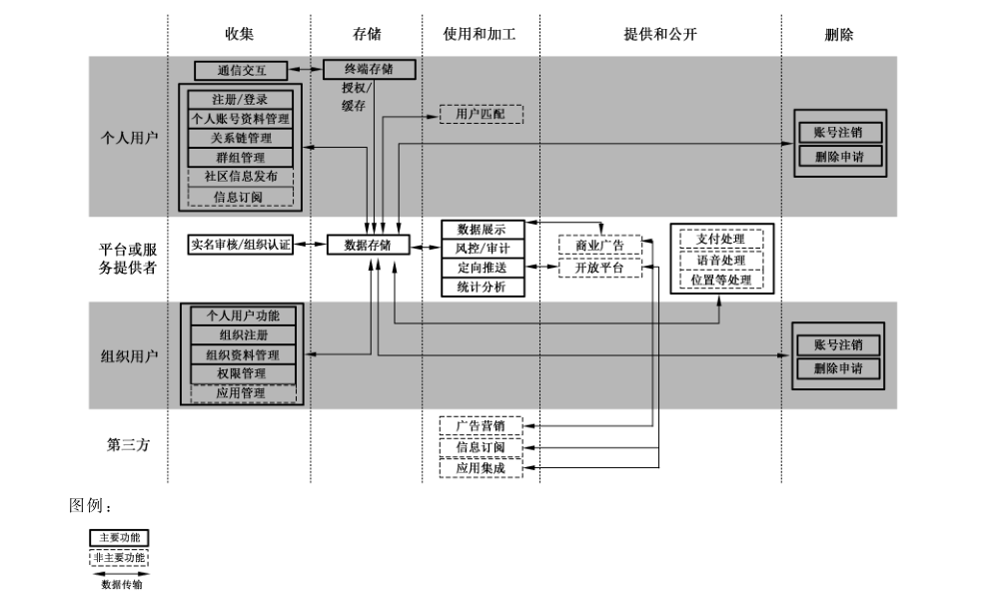

# GB/T 42012-2022 信息安全技术 即时通信服务数据安全要求

> 来源：[GB/T 42012-2022 国家标准详情](https://openstd.samr.gov.cn/bzgk/std/newGbInfo?hcno=136B8F06A548FAE8ABB375E4C65C1E38)；封面发布日期：2022-10-12；实施日期：2023-05-01。
> PDF SHA-256：fd7baf2a21f69be34ad4ebdbca5b7146a82c8bbb80fcc4b6370827b65f28723e。
> 转写说明：按页渲染官方 PDF 并对照全部原页校正文字、列表和表格；保留图 A.1，省略封面、目录、页眉、页脚和页码，合并跨页段落。正式引用请核对原 PDF。

## 前言

本文件按照 GB/T 1.1—2020《标准化工作导则 第1部分：标准化文件的结构和起草规则》的规定起草。

请注意本文件的某些内容可能涉及专利。本文件的发布机构不承担识别专利的责任。

本文件由全国信息安全标准化技术委员会（SAC/TC 260）提出并归口。

本文件起草单位：深圳市腾讯计算机系统有限公司、中国电子技术标准化研究院、国家信息技术安全研究中心、浙江翼信科技有限公司、蓝信移动（北京）科技有限公司、中国信息通信研究院、国家计算机网络应急技术处理协调中心、中国移动通信集团有限公司、阿里云计算有限公司、北京奇虎科技有限公司、华为技术有限公司、郑州信大捷安信息技术股份有限公司、北京天融信网络安全技术有限公司、OPPO广东移动通信有限公司、上海观安信息技术股份有限公司、北京陌陌科技有限公司、成都卫士通信息产业股份有限公司、国家工业信息安全发展研究中心、格尔软件股份有限公司。

本文件主要起草人：武杨、杨建军、陈舒、上官晓丽、倪平、徐永太、胡影、周晨炜、潘慧炜、杨韬、赵芸伟、李海东、赵新强、王秉政、朱雪峰、吴华强、纪帅、裴利杰、楼喆、吴冬宇、郑磊、张屹、周蓬、刘为华、王璞、陈湉、江为强、王小璞、谢江、代威、莫若、黄超、刘洋、杨广普、孙岩。

## 1 范围

本文件规定了即时通信服务收集、存储、传输、使用、加工、提供、公开、删除、出境等数据处理活动的安全要求。

本文件适用于即时通信服务提供者规范数据处理活动，也可为监管部门、第三方评估机构对即时通信服务数据处理活动进行监督、管理、评估提供参考。

## 2 规范性引用文件

下列文件中的内容通过文中的规范性引用而构成本文件必不可少的条款。其中，注日期的引用文件，仅该日期对应的版本适用于本文件；不注日期的引用文件，其最新版本（包括所有的修改单）适用于本文件。

- GB/T 25069 信息安全技术 术语

- GB/T 35273—2020 信息安全技术 个人信息安全规范

- GB/T 37964 信息安全技术 个人信息去标识化指南

- GB/T 37988 信息安全技术 数据安全能力成熟度模型

- GB/T 39335 信息安全技术 个人信息安全影响评估指南

- GB/T 41391—2022 信息安全技术 移动互联网应用程序（App）收集个人信息基本要求

- GB/T 41479 信息安全技术 网络数据处理安全要求

## 3 术语和定义

GB/T 25069 和 GB/T 35273—2020界定的以及下列术语和定义适用于本文件。

### 3.1 即时通信服务 instant messaging service

通过计算机、智能终端等客户端软件、浏览器等，向用户提供发送和接收信息（文本、图片、文件、音视频、链接等）的在线实时交互服务。

> 注1：本文件所称的即时通信服务，主要针对相关商业服务，组织内部自建或自用服务不包含在内。

> 注2：本文件所称的即时通信服务，典型应用场景包括单聊（两个用户之间、用户和管理员之间直接交互）、群聊（在群组内收发即时消息）、聊天室（一种多人在线实时交谈的网络空间），基于即时通信的社交、社区、在线客服、组织通信等。

### 3.2 个人即时通信服务 consumer instant messaging service

面向个人用户的即时通信服务。

### 3.3 组织即时通信服务 organization instant messaging service

面向组织（例如企业、政务机关等）办公场景的即时通信服务。

### 3.4 即时通信服务平台 instant messaging service platform

以互联网技术为依托，为用户提供个人即时通信或组织即时通信服务的信息系统。

### 3.5 即时通信服务提供者 instant messaging service provider

利用即时通信服务平台，提供即时通信服务的企业法人。

> 注：本文件的即时通信服务提供者，主要是指即时通信服务平台运营者。

### 3.6 用户 user

即时通信服务（3.1）的使用者。

> 注：用户包括个人用户和组织用户。

### 3.7 即时通信信息 instant messaging information

由个人用户或组织用户在通信过程中形成的信息，包括社交标识、通信记录、通信内容等。

### 3.8 关系链 social chain

以用户为中心连接其他更多用户形成的关联结构。

### 3.9 即时通信服务数据 instant messaging service data

即时通信服务提供者在提供即时通信服务的过程中收集和产生的数据。

> 注：主要包括用户数据和业务数据，不包括即时通信服务提供者内部管理经营数据。

## 4 缩略语

以下缩略语适用于本文件：

SDK：软件开发工具包（Software Development Kit）。

## 5 概述

### 5.1 即时通信服务业务组成

即时通信服务包括个人即时通信服务和组织即时通信服务，具体如下。

a） 个人即时通信服务：个人即时通信服务的参与相关方包括个人用户、即时通信服务提供者。个人即时通信服务的主要功能包括通信交互（单聊、群聊、实时聊天）、关系链管理、群组管理、账号管理。个人即时通信服务根据业务需要，可扩展社区信息发布、信息订阅、广告订阅等功能。上述业务的参与相关第三方包括资讯信息、广告相关的商业机构。

> 注：实时聊天是指以聊天室、会议等形式进行的即时通信。

b） 组织即时通信服务：组织即时通信服务的参与相关方包括个人用户、组织用户、即时通信服务平台运营者。组织即时通信服务主要功能，除个人即时通信服务的主要功能外，还包括组织资料管理、组织权限管理、组织应用管理等。组织即时通信服务可以拓展个人即时通信服务的非主要功能，也可以根据业务需要拓展应用集成功能。应用集成的第三方包括软件开发相关商业机构。

即时通信服务数据处理活动及安全风险见附录A。

### 5.2 即时通信服务数据范围

本文件中即时通信服务数据范围包括以下内容。

a） 用户数据：即时通信服务提供者在提供即时通信服务过程中收集和产生的个人和组织用户数据，如个人基本资料、个人身份信息、组织基本资料、组织办公通讯录等。

b） 业务数据：即时通信服务提供者在提供即时通信服务过程中处理的除用户数据外的其他数据，如业务统计数据、业务经营数据、业务技术数据等。

## 6 基本要求

即时通信服务提供者数据安全的基本要求如下：

a） 数据处理活动应遵守GB/T 41479中的要求；

b） 个人信息处理活动应遵守 GB/T 35273—2020中的要求，即时通信App 的个人信息收集活动应遵守 GB/T 41391—2022 中的要求；

c） 应按照有关要求和标准进行数据分类分级保护，识别即时通信服务涉及的核心数据、重要数据、一般数据，对不同级别的数据采取不同的保护措施；

> 注1：国家建立数据分类分级保护制度，按照数据对国家安全、公共利益或者个人、组织合法权益的影响和重要程度，将数据分为核心数据、重要数据、一般数据。

> 注2：附录B给出了即时通信服务重要数据识别参考规则及数据分类示例。

d） 应识别即时通信服务涉及的一般个人信息、敏感个人信息，对个人信息进行分类管理；

e） 应履行互联网平台运营者义务，如个人信息保护独立监督、制定公平公正的平台规则、隐私政策披露、平台内经营者管理、发布个人信息保护社会责任报告等；

f） 即时通信服务提供者的数据安全能力应至少符合 GB/T 37988 二级能力要求；

g） 应结合数据处理活动的实际情况，按照有关国家标准定期开展数据安全风险评估；

h） 应在开展对个人权益有重大影响的个人信息处理活动前，按照 GB/T 39335 进行个人信息保护影响评估；

> 注3：对个人权益有重大影响的个人信息处理活动，包括但不限于处理敏感个人信息、利用个人信息进行自动化决策、委托处理个人信息、向其他个人信息处理者提供个人信息、公开个人信息、向境外提供个人信息等。

i） 应按照有关国家标准，在即时通信服务平台规划建设时开展个人信息安全工程实践，同步规划、同步建设、同步使用个人信息保护措施；

j） 即时通信服务平台应符合国家网络安全等级保护相关标准要求。

## 7 数据收集

### 7.1 收集用户信息

即时通信服务提供者应在遵守 GB/T 35273—2020中 5.1、5.2、5.3的要求基础上，遵守以下要求：

a） 通过即时通信 App 收集用户必要个人信息应符合GB/T 41391—2022中 A.3 的规定；

b）通过即时通信 App 社区功能要求用户必须提供的个人信息，不应超出 GB/T 41391—2022中A.4 规定的必要个人信息范围；

c） 扩展业务功能收集的个人信息均应由用户可选提供或者用户公开信息，且应限于实现处理目的的最小范围；

> 注：个人即时通信服务常见扩展业务功能收集个人信息范围见附录C。

d） 组织即时通信服务提供者在实体认证和办公环节收集的信息包括：

<ol class="standard-subclauses">
<li>1） 针对组织用户在实体认证环节，收集的信息应限于组织全称、组织地址、官方网址、证件类型、营业执照复印件、统一社会信用代码、组织名称、地址、法人代表姓名、法人代表身份证号、认证公函；</li>
<li>2） 针对组织用户在配置组织办公通讯录环节，收集组织成员的个人信息应限于姓名、所属部门、职位、英文名、性别、手机号、邮箱、座机号、工号等人力资源相关信息。</li>
</ol>

### 7.2 申请系统权限

即时通信 App 不应申请与App 业务功能无关的系统权限，系统权限申请范围及使用要求见附录D。

### 7.3 告知同意

即时通信服务提供者收集个人信息的告知同意应在遵守 GB/T 35273—2020中5.4、5.5、5.6的要求基础上，遵守以下要求：

a） 组织即时通信服务提供者宜提示组织用户通过组织文件等方式告知组织员工个人信息收集情况；

b） 通过可穿戴设备提供个人即时通信服务时，个人即时通信服务提供者应通过二维码、说明书连接官方网站公告等方式告知个人信息收集情况。

## 8 数据存储和传输

### 8.1 数据存储

#### 8.1.1 个人即时通信服务数据存储

个人即时通信服务提供者开展数据存储活动时，应在遵守 GB/T 35273—2020 中第 6 章的要求基础上，遵守以下要求：

a） 即时通信服务个人信息存储期限应为实现个人信息处理目的所必需的最短时间，超出存储期限后，应对个人信息进行删除或匿名化处理，法律法规另有规定的除外；

b） 如超出个人信息存储期限，但法律、行政法规规定的保存期限未届满，或者删除个人信息从技术上难以实现的，应停止除存储和采取必要的安全保护措施之外的处理；

c） 应将即时通信信息（包括单聊、群聊）保存在个人用户的终端，并采取安全措施进行保护；

d） 应默认关闭为用户提供聊天记录云端存储、不同终端消息同步（不同设备登录时，将服务器记录的消息进行同步）功能，征得用户同意后才可开启；

e） 为用户发送图片、文件等信息提供缓存功能，应设置缓存周期（如单聊7天，群聊100天），并在缓存周期期满或用户激活推送后删除。

#### 8.1.2 组织即时通信服务数据存储

组织即时通信服务提供者开展数据存储活动时，遵守以下要求：

a） 应对敏感个人信息提供安全加密存储和保护；

b） 宜根据组织安全需要将即时通信信息存储于服务端或云端，并采取安全措施进行保护；

c） 宜依据组织归档处理管理制度销毁或者存储归档组织即时通信信息。

### 8.2 数据传输

即时通信服务提供者开展数据传输活动时，应在遵守GB/T 35273—2020中6.3的要求基础上，应确保通信内容仅在用户通信必要的对象间可见。

## 9 数据使用和加工

### 9.1 数据展示

#### 9.1.1 个人即时通信服务数据展示

个人即时通信服务提供者对个人信息的展示，应在遵守 GB/T 35273—2020中7.2的要求基础上，遵守以下要求：

a） 应对如登录口令等涉及账号安全的敏感个人信息采取GB/T 37964 中的方法进行脱敏展示，并采取身份验证措施确保仅个人用户能够查看其个人资料；

b） 应在个人用户前端页面，提供使用个人昵称、头像等属性对个人用户进行标识的功能；

c） 在个人用户添加好友时，展示范围应为昵称、头像等公开信息；

d） 个人即时通信服务在社区场景下，宜向个人用户提供非定向展示和展示期限设置功能。

#### 9.1.2 组织即时通信服务数据展示

组织即时通信服务提供者数据展示遵守以下要求：

a） 宜向组织用户提供自定义设置组织相关的对外展示字段（如名片、姓名、职位等）的功能；

b）宜向组织用户提供组织架构隐藏、搜索脱敏、通讯录查阅限制、成员手机号隐藏等功能，以满足组织自身安全需求；

c） 宜向组织用户提供设置水印等保护组织数据的功能。

### 9.2 数据加工

即时通信服务提供者开展数据加工，在好友匹配、广告推荐和资讯订阅中的内容推荐时应允许用户自主选择，并在遵守GB/T 35273—2020中7.4、7.5、7.7 的要求基础上，遵守以下要求：

a） 使用位置信息进行好友匹配时，应征得用户明示同意；

b） 进行陌生人好友匹配时，如使用用户画像应征得用户明示同意；

c） 提供内容推荐时，宜通过不同的栏目、版块、页面分别展示；

d） 通过自动化决策方式向个人进行广告推送、商业营销，应当同时提供不针对其个人特征的选项，或者向个人提供便捷的拒绝方式；

e） 当个人用户浏览的资讯信息，向其好友推荐时，应由个人用户主动发起。

## 10 数据提供和公开

即时通信服务提供者向第三方提供数据，应在遵守GB/T 35273—2020中9.1 至9.5的要求基础上，遵守以下要求。

a） 在支持用户通过授权服务开通第三方应用账号时：

<ol class="standard-subclauses">
<li>1） 应提供途径供用户取消向第三方共享或转让个人信息的授权；</li>
<li>2） 共享个人信息应以用户账号（User Identity，UserID）、头像、昵称等个人基本信息为主，并征得用户单独同意；</li>
<li>3） 应要求第三方在获取、共享关系链时，征得用户和即时通信服务提供者的同意；</li>
<li>4） 向第三方共享个人基本信息时，宜为用户提供修改头像、昵称途径。</li>
</ol>

b） 在使用第三方SDK，将收集的数据委托给外部机构处理时：

<ol class="standard-subclauses">
<li>1） 在隐私条款中列出相关第三方 SDK；</li>
<li>2） 集成第三方 SDK 前，验证第三方 SDK 的安全性，评估数据委托处理的风险；</li>
<li>3）宜与第三方 SDK 运营者签订协议，明确其责任、义务和安全能力。</li>
</ol>

c） 向第三方应用共享数据时，应与第三方运营者签订协议，明确其责任、义务和安全能力。

d） 因兼并、重组、破产等原因需要转移数据的，应明确数据转移方案，数据接收方应继续履行相关数据安全保护义务。

## 11 数据删除

即时通信服务提供者开展数据删除活动时，应在遵守 GB/T 35273—2020中8.3的要求基础上，遵守以下要求：

a） 当个人用户或组织用户注销账户时，应遵守 GB/T 35273—2020中8.5 的要求，删除信息或匿名化处理；

b） 对于即时通信服务组织用户，在组织成员退出组织后可删除该成员在组织中的数据，包括但不限于组织架构内的群、权限、工作信息等。

## 12 数据出境

即时通信服务提供者如因业务需要向境外提供数据，应遵守国家相关法律法规和标准的要求。根据业务发展和运营情况，宜每年自行或委托第三方机构对数据出境至少进行一次数据出境风险评估。

## 13 个人信息主体权利

### 13.1 个人信息查阅和更正

即时通信服务提供者向用户提供个人信息查阅和更正，应在遵守 GB/T 35273—2020中 8.1、8.2的要求基础上，遵守以下要求：

a） 个人即时通信服务，应提供查阅、更正的个人信息包括头像、昵称、生日、地区、个性签名等；

b） 个人即时通信服务，应提供查阅、更正的敏感个人信息包括口令、通讯录等；

c） 组织即时通信服务，应提供查阅、更正的组织成员个人信息包括工作签名、所属企业、手机号码、座机号码、电子邮件地址、职位、职级、职务、隶属部门、传真号码、座位等。

> 注：组织即时通信服务涉及组织策略、组织和其他组织成员的信息，可由组织授权的管理员根据规定进行更正。

### 13.2 个人和组织信息删除

即时通信服务提供者向用户提供个人信息删除，应在遵守 GB/T 35273—2020中8.3的要求基础上，遵守以下要求：

a） 个人即时通信服务提供删除一对一部分或全部聊天记录、群组中的聊天记录、社区展示信息以及头像、昵称、性别、地区等基本信息的功能；

b） 组织即时通信服务提供删除工作签名、所属企业、手机号码、座机号码、电子邮件地址、职位、职级、职务、隶属部门、传真号码、座位等信息的功能。

### 13.3 个人撤回同意

即时通信服务提供者向用户提供个人信息撤回同意，应在遵守 GB/T 35273—2020 中 8.4 的要求基础上，遵守以下要求：

a） 提供关闭推荐通讯录朋友的功能；

b） 提供关闭基于位置的好友推荐的功能；

c） 提供撤回向其他应用的授权的功能；

d） 提供撤回全部或部分向其他应用的关系链授权的功能。

## 14 即时通信服务特殊场景

### 14.1 未成年人保护

即时通信服务提供者应在遵守 GB/T 35273—2020中5.4d）要求的基础上，遵守以下要求：

a） 收集不满14周岁未成年人个人信息，应制定专门的个人信息处理规则，并取得未成年人的父母或者其他监护人的单独同意；

b）应提供必要的未成年人限制措施，如“青少年模式”，且在“青少年模式”下，所收集的个人信息应按照敏感个人信息处理；

c） 青少年模式应在通过口令等方式验证后才可退出；

d） 开启未成年人可穿戴设备的监听监视、自动接听功能，应征得监护人同意，未经同意的不得自动开启或默认开启；

e） 不应为未成年人提供注册、使用两性情感类开放式社交服务；

f） 宜在用户注册时提示未满14周岁的用户填写个人生日信息；

g） 宜收集监护人的联系方式，设置监护人账号与未成年人账号关联。

### 14.2 防范网络诈骗的保护措施

即时通信服务提供者采取保护措施防范网络诈骗，遵守以下要求。

a） 应采取技术措施保护用户账号安全，如多因子鉴别、访问控制、口令加密传输及存储等。

b） 应建立风险识别和控制能力：

<ol class="standard-subclauses">
<li>1） 对异常环境使用帐号，提供多层验证，对用户身份进行二次鉴别；</li>
<li>2） 出现异常登录或好友发起异常转账等非常规行为时进行安全提示；</li>
<li>3） 如用户在异常操作后注销账号，应进一步确认用户身份信息。</li>
</ol>

c） 即时通信服务的用户账号被泄露后，应提供冻结账号的功能，以避免隐私信息泄露、冒用身份诈骗以及盗刷资金等风险。

d） 应提供用户账号找回、解冻功能，如可通过验证手机号、昵称、好友等不同方式找回账号。

## 附录 A（资料性）即时通信服务数据处理活动及安全风险

### A.1 即时通信服务数据处理活动

即时通信服务数据处理活动示意图如图 A.1 所示。

图 A.1 即时通信服务数据处理活动及相关角色和服务功能示意图

### A.2 即时通信服务数据安全风险

即时通信服务提供者主要面临如下数据安全风险：

a） 在数据收集活动中，过度收集个人信息或者过度索取移动智能终端权限的风险；

b） 收集数据时，未能有效识别未成年人或未能征得未成年人监护人的有效同意，导致无法有效提供未成年人保护措施；

c） 在数据传输、存储活动中，未采取充分安全保护措施，因链路监听、攻击拖库和权限不当等带来数据泄露、损坏和滥用风险，尤其是关系链信息泄露造成的网络诈骗等风险；

d） 办公场景下，即时通信服务数据除了用户个人信息外，还包含组织数据，同时还面临组织数据泄露、丢失等安全风险；

e） 在数据使用活动中，数据展示和加工处理环节可能存在对用户个人信息的滥用风险，尤其是在好友匹配、广告推荐、资讯推荐等个性化场景中，以及对未成年人的过度追踪；

f） 在数据提供活动中，如在支持用户通过授权服务开通第三方应用账号、使用第三方完善服务、第三方办公应用接入，第三方广告和内容创作等场景中，可能存在对用户信息的过度共享，以及第三方滥用和泄露用户个人信息的风险。

## 附录 B（资料性）即时通信服务重要数据识别参考规则及数据分类示例

### B.1 即时通信服务重要数据识别参考规则

即时通信服务重要数据识别参考规则如下：

a） 按照国家和即时通信服务行业的重要数据目录，识别涉及的重要数据；

b） 相关目录不明确时，按照重要数据识别相关规定、国家或行业标准识别重要数据；

c） 相关目录、规定和标准均不明确时，将一旦被泄露或篡改、损毁，可能直接危害国家安全、经济运行、社会稳定、公共健康和安全的数据识别为重要数据。

### B.2 即时通信服务数据分类示例

即时通信服务数据分类示例见表 B.1。

**表B.1 即时通信服务数据分类示例**

| 数据类别 | 范围 |
| --- | --- |
| 个人用户数据 | 1）个人基本资料，包括姓名、生日、性别、头像、账户/会员等级、所在地区、手机号码、电子邮件地址、昵称、头像、兴趣爱好等； 2）个人身份信息，包括身份证、护照、驾驶证等； 3）个人生物识别信息，包括面部识别特征、声纹等； 4）网络身份标识信息，包括会员账号或会员名、昵称、互联网协议（Internet Protocol，IP）地址等； 5）个人即时通信信息，包括发送、接收、转发、离线推送消息等； 6）联系人信息，包括好友、昵称、备注、头像、联系方式、关联群组、分组等； 7）个人群组管理信息，包括群成员信息、公告信息、群昵称、群设置等； 8）个人常用设备信息，包括硬件序列号、设备媒体访问控制（Media Access Control，MAC）地址、软件列表、唯一设备识别码（如国际移动设备识别码）等个人常用设备基本情况的信息； 9）个人位置信息，包括粗略定位信息、精准定位信息、设备登录位置等； 10）其他信息，包括用户偏好、订阅浏览记录、用户网络行为等 |
| 组织用户数据 | 1）组织基本资料，包括组织全称、组织地址、官方网址、证件类型、营业执照复印件、统一社会信用代码、组织名称、地址、法人代表姓名、法人代表身份证号、认证公函等； 2）组织办公通讯录，包括组织架构、员工手机号、邮箱、座机号、工号等 |
| 业务数据 | 1）业务统计数据，包括用户数、新增用户数、用户活跃度（日、周、月）、用户留存率等； 2）业务经营数据，包括广告点击量、点赞量、上架应用数量等； 3）业务技术数据，包括算法模型、技术指标参数、技术方案、风控数据等 |

## 附录 C（资料性）个人即时通信服务常见扩展业务功能收集个人信息范围

个人即时通信服务常见扩展业务功能收集个人信息范围见表 C.1。

**表C.1 个人即时通信服务常见扩展业务功能收集的个人信息范围**

| 业务功能 | 个人信息收集范围 |
| --- | --- |
| 用户个性展示 | 生日、性别、职业、爱好、家乡、公司、地域位置、个性签名 |
| 匹配好友 | 位置、性别、职业、爱好、年龄、家乡、公司、个性签名 |
| 应急联系 | 紧急联系人账号、姓名、电话号码 |
| 注册自媒体 | 姓名、手机号、身份证号、电子邮箱 |
| 客户服务、处理用户纠纷 | 用户与客服的沟通记录 |
> 注：表中仅列举了较为典型的个人即时通信服务常见扩展业务功能，各即时通信服务提供者提供的常见扩展业务功能可能会有所差别，本表未予明确的扩展业务功能服务，根据需要实现的服务目的，按照个人信息处理最小必要原则判断其收集的个人信息范围。

## 附录 D（资料性）即时通信服务 App 相关系统权限申请范围及使用要求

### D.1 即时通信服务 Android App 相关系统权限申请范围及使用要求

即时通信服务 Android App（Android 11 及以下版本）相关系统权限申请范围及使用要求见表 D.1。

**表D.1 即时通信服务 Android App 相关系统权限申请范围及使用要求**

| 权限名称 | 使用要求 |
| --- | --- |
| ACCESS_FINE_LOCATION 访问精准定位 | 仅用于用户给好友发送定位、社区展示、匹配好友 |
| ACCESS_COARSE_LOCATION 访问粗略位置 | 仅用于用户个性展示资料的地域自动获取 |
| ACCESS_BACKGROUND_LOCATION 支持后台访问位置 | 仅用于用户给好友实时共享位置信息 |
| READ_CONTACTS 读取通讯录 | 仅用于用户主动添加使用相同即时通信服务的好友 |
| CAMERA 拍摄 | 仅用于头像修改、发送图片或视频、视频通信、个性信息展示、二维码扫描或识别、身份认证 |
| READ_EXTERNAL_STORAGE 读取外置存储器 | 仅用于即时通信信息备份恢复、不同终端即时通信信息同步、用户主动使用云端存储、文件上传、头像修改、发送图片或视频、视频通信、个性信息展示、二维码扫描或识别。除用户主动使用云端存储外，读取后不应回传 |
| WRITE_EXTERNAL_STORAGE 写入外置存储器 | 仅用于即时通信信息、图片、视频、文件的存储和备份 |
| RECORD_AUDIO 录音 | 仅用于网络通话、发送语音 |
| READ_PHONE_STATE 读取设备信息 | 仅收集手机通话状态信息，用于即时通信语音通话和电话来电时方便用户来回切换并保障通信质量和安全。不应收集不可变更的唯一设备识别码 |

### D.2 即时通信服务 iOS App 相关系统权限申请范围及使用要求

即时通信服务 iOS App（iOS 14 及以下版本）相关系统权限申请范围及使用要求见表 D.2。

**表 D.2 即时通信服务 iOS App 相关系统权限申请范围及使用要求**

| 权限名称 | 使用要求 |
| --- | --- |
| Microphone 麦克风 | 仅用于网络通话、发送语音 |
| Contacts 通讯录 | 仅用于用户主动添加使用相同即时通信服务的好友 |
| Location When In Use 使用期间访问位置 | 仅用于用户给好友发送定位、社区展示、匹配好友 |
| Location Always and When In Use 始终访问位置 | 仅用于用户与好友共享实时位置信息 |
| Camera 相机 | 仅用于头像修改、发送图片或视频、视频通信、个性信息展示、二维码扫描或识别、身份认证 |
| Photo Library 读取和写入照片库 | 仅用于头像修改、发送图片或视频、视频通信、个性信息展示、二维码扫描或识别 |
| Reminders 提醒事项 | 仅用于即时通信消息推送、日历提醒 |

## 参考文献

[1] GB/T 35274—2017 信息安全技术 大数据服务安全能力要求

[2] GB/T 37973—2019 信息安全技术 大数据安全管理指南
