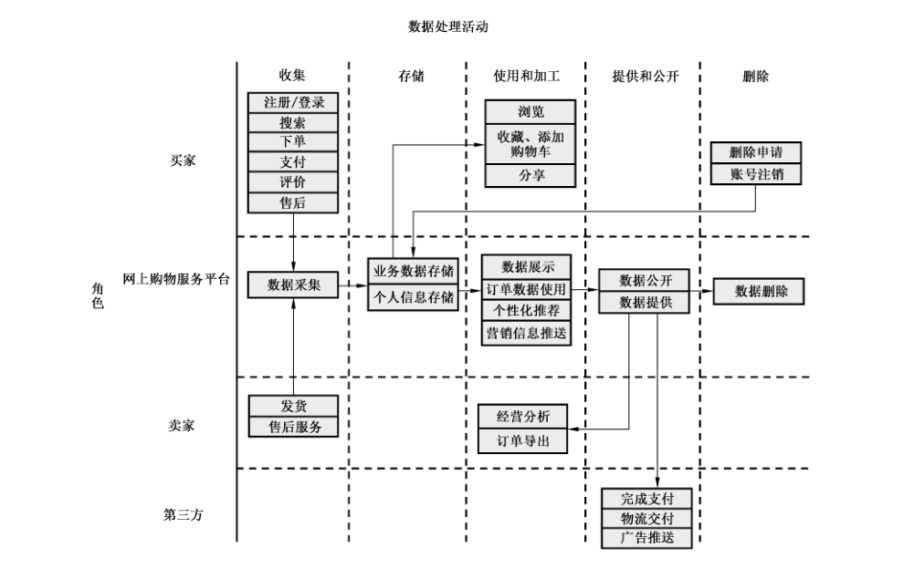

# GB/T 42014-2022 信息安全技术 网上购物服务数据安全要求

> 来源：[GB/T 42014-2022 国家标准详情](https://openstd.samr.gov.cn/bzgk/std/newGbInfo?hcno=9679A3BF5D736D7FC92FD8157AAAAC82)；封面发布日期：2022-10-12；实施日期：2023-05-01。
> PDF SHA-256：96ae989cc6cd743e26c8e5cf603661347eac648ccccbf2ba6a2de766a3c0f12d。
> 转写说明：按页渲染官方 PDF 并对照全部 19 页校正文字、列表和表格；保留图 A.1，省略封面、目录、页眉、页脚和页码，合并跨页段落。正式引用请核对原 PDF。

## 前言

本文件按照 GB/T 1.1—2020《标准化工作导则 第1部分：标准化文件的结构和起草规则》的规定起草。

请注意本文件的某些内容可能涉及专利。本文件的发布机构不承担识别专利的责任。

本文件由全国信息安全标准化技术委员会（SAC/TC 260）提出并归口。

本文件起草单位：阿里巴巴（北京）软件服务有限公司、中国电子技术标准化研究院、北京小米移动软件有限公司、北京京东尚科信息技术有限公司、苏宁易购集团股份有限公司、华为技术有限公司、上海寻梦信息技术有限公司、北京三快在线科技有限公司、联想（北京）有限公司、中电长城网际系统应用有限公司、国家计算机网络应急技术处理协调中心、北京字节跳动科技有限公司、中国科学院信息工程研究所、荣耀终端有限公司、中国信息通信研究院、上海观安信息技术股份有限公司、武汉安天信息技术有限责任公司。

本文件主要起草人：朱红儒、上官晓丽、白晓媛、黄天宁、徐羽佳、胡影、陈舒、顾伟、王云翔、李瑞卿、戚俊卿、严少敏、衣强、刘笑岑、闵京华、陈晓桦、李汝鑫、刘玉岭、姜政伟、舒敏、魏薇、陈湉、卢一宁、王莹、周晨炜、李海东、赵新强、黄馨蓓、赵晓娜、康琼、孙旭东、刘艾婧、张印泽、宋建、罗宇、陈勇、闫希敏、曹京、赵芸伟、谢江、叶串、高雨冰。

## 1 范围

本文件规定了网上购物服务的收集、存储、传输、使用、加工、提供、公开、删除、出境等数据处理活动的安全要求。

本文件适用于网上购物服务提供者规范数据处理活动，也可为监管部门、第三方评估机构对网上购物服务数据处理活动进行监督、管理、评估提供参考。

## 2 规范性引用文件

下列文件中的内容通过文中的规范性引用而构成本文件必不可少的条款。其中，注日期的引用文件，仅该日期对应的版本适用于本文件；不注日期的引用文件，其最新版本（包括所有的修改单）适用于本文件。

- GB/T 25069 信息安全技术 术语

- GB/T 35273—2020 信息安全技术 个人信息安全规范

- GB/T 37988 信息安全技术 数据安全能力成熟度模型

- GB/T 39335 信息安全技术 个人信息安全影响评估指南

- GB/T 41391—2022 信息安全技术 移动互联网应用程序（App）收集个人信息基本要求

- GB/T 41479 信息安全技术 网络数据处理安全要求

## 3 术语和定义

GB/T 25069、GB/T 35273—2020 界定的以及下列术语和定义适用于本文件。

### 3.1 网上购物服务 online shopping service

通过互联网等信息网络销售商品或服务的经营活动。

注1：常见的网上购物服务形式除商城购物外，还包括直播购物、社交购物、线上线下融合购物等。

注2：根据网上购物服务所提供商品或服务的特性，网上购物服务还包括餐饮外卖、交通票务、酒店服务及演出票务等。

［来源：GB/T 38652—2020，2.1，有修改］

### 3.2 网上购物服务平台 online shopping service platform

为交易的双方或多方提供信息发布、信息递送、数据处理等一项或多项服务，实现交易撮合目的的信息系统。

［来源：GB/T 38652—2020,2.2，有修改］

### 3.3 网上购物服务数据 online shopping service data

网上购物服务过程中收集和产生的数据。

> 注：主要包括用户数据和业务数据，不包括网上购物服务提供者内部管理经营数据。

### 3.4 网上购物服务提供者 online shopping service provider

通过互联网等信息网络从事销售商品或者提供服务的经营活动的自然人、法人和非法人组织。

> 注：本文件所称的网上购物服务提供者指网上购物服务平台运营者。

［来源：GB/T 38652—2020,2.3，有修改］

### 3.5 卖家 seller

通过网上购物服务平台、自建网站、App、其他网络服务（如小程序）等信息网络从事销售商品或者提供服务的经营活动自然人、法人和非法人组织。

> 注：企业类型的卖家称为“商家”。

［来源：GB/T 38652—2020，4.5，有修改］

### 3.6 用户 user

网上购物服务平台各项服务的使用者。

［来源：GB/T 38652—2020，4.3，有修改］

### 3.7 买家 buyer

在网上购物服务平台上购买商品或接受服务的用户。

> 注：又称“顾客”。

［来源：GB/T 38652—2020，4.4，有修改］

## 4 缩略语

下列缩略语适用于本文件。

CRM：客户关系管理（Customer Relationship Management）

ERP：企业资源计划（Enterprise Resource Planning）

## 5 概述

### 5.1 网上购物服务业务组成

网上购物服务业务功能主要包括注册、登录、商品展示、浏览、搜索、下单、发货、售后服务等。

网上购物服务的相关方包括买家、卖家、网上购物服务提供者及第三方服务提供者。卖家发布商品或服务、根据订单需求发货、提供售后服务；买家在网上购物服务平台上进行浏览、搜索，选择商品或服务下单、支付，完成购买；第三方服务提供者包括支付服务提供者、物流服务提供者等。

网上购物服务数据处理活动及数据安全风险见附录 A。

### 5.2 网上购物服务数据范围

本文件中网上购物服务数据范围包括：

a） 用户数据：网上购物服务提供者在网上购物服务过程中收集和产生的个人及组织用户数据，如买家消费记录、收货人信息（姓名、地址、电话号码）、卖家账号信息等；

b） 业务数据：网上购物服务提供者在提供网上购物服务过程中处理的各类业务经营相关数据，如商品信息、商品类目数据、成交总额、用户访问量、库存、销售规则等。

## 6 基本要求

网上购物服务提供者数据安全的基本要求如下：

a） 数据处理活动应符合 GB/T 41479 规定的要求；

b） 个人信息处理活动应符合 GB/T 35273—2020规定的要求，网上购物服务 App 个人信息收集活动应符合 GB/T 41391—2022 规定的要求；

c） 应按照国家有关要求和标准进行数据分类分级保护，识别网上购物服务涉及的核心数据、重要数据、一般数据，对不同级别的数据采取不同的保护措施；

注1：国家建立数据分类分级保护制度，按照数据对国家安全、公共利益或者个人、组织合法权益的影响和重要程度，将数据分为核心数据、重要数据、一般数据。

注2：附录B给出了网上购物服务重要数据识别参考规则及数据分类示例。

d） 应识别网上购物服务涉及的一般个人信息、敏感个人信息，对个人信息进行标识和分类管理；

e） 应履行互联网平台运营者义务，如个人信息保护独立监督、制定公平公正的平台规则、隐私政策披露、平台内经营者管理、发布个人信息保护社会责任报告等；

f） 网上购物服务提供者的数据安全能力应至少符合 GB/T 37988 中的 2 级能力要求；

g） 网上购物服务平台应符合国家网络安全等级保护相关标准要求；

h） 提供网上购物服务的其他网络平台（如自建网站、App、小程序等）应符合本文件对网上购物服务提供者提出的要求；

i） 应结合数据处理活动的实际情况，按照有关国家标准定期开展数据安全风险评估；

j） 应在开展对个人权益有重大影响的个人信息处理活动前，按照 GB/T 39335 进行个人信息保护影响评估；

注3：对个人权益有重大影响的个人信息处理活动，包括但不限于处理敏感个人信息、利用个人信息进行自动化决策、委托处理个人信息、向其他个人信息处理者提供个人信息、公开个人信息、向境外提供个人信息等。

k）应按照有关国家标准，在网上购物服务平台及提供网上购物服务的其他平台规划建设时开展个人信息安全工程实践，同步规划、同步建设、同步使用个人信息保护措施。

## 7 数据收集

### 7.1 收集个人信息

网上购物服务提供者收集个人信息，应在满足 GB/T 35273—2020中 5.1、5.2、5.3要求的基础上，遵守以下要求。

a） 通过 App 收集必要个人信息应满足以下要求：

> 注：提供网上购物服务的 App 可能根据其基本业务功能的不同，属于不同类型的 App。GB/T 41391—2022附录 A 给出了常见类型 App 必要个人信息范围。

1） 通过网上购物类 App 收集必要个人信息应符合GB/T 41391—2022中 A.6 的规定；

2） 通过餐饮外卖类 App 收集必要个人信息应符合 GB/T 41391—2022中 A.7 的规定；

3） 通过交通票务类 App 收集必要个人信息应符合 GB/T 41391—2022中 A.9的规定；

4） 通过酒店服务类 App 收集必要个人信息应符合GB/T 41391—2022中 A.17 的规定；

5） 通过演出票务类 App 收集必要个人信息应符合 GB/T 41391—2022中 A.39的规定。

b） 扩展业务功能收集的个人信息均应由用户可选提供，且应限于实现处理目的的最小范围，常见扩展业务功能的个人信息收集范围及使用要求见附录C。

### 7.2 申请系统权限

网上购物 App 不应申请与 App 业务功能无关的系统权限，系统权限申请范围及使用要求见附录D。

### 7.3 告知同意

网上购物服务提供者收集个人信息时的告知同意，应在满足GB/T 35273—2020中 5.4、5.5、5.6要求的基础上，遵守以下要求：

a） 应在收集用户个人信息前告知用户服务提供者的名称或者姓名、联系方式，个人信息的处理目的、处理方式，处理的个人信息种类、保存期限，用户行使权利的方式和程序等，并应取得用户同意；

b） 向其他个人信息处理者（如卖家、第三方物流及支付服务提供者）提供个人信息前，应向用户告知接收方的名称或者姓名、联系方式、处理目的、处理方式和个人信息的种类，并取得用户的单独同意；

c） 处理敏感个人信息（如收集用户生物识别信息用于登录网上购物服务平台、收集用户身份证号码用于在购买境外商品时进行清关等）前，应取得用户的单独同意，并告知处理的必要性及对个人权益的影响。

## 8 数据存储和传输

网上购物服务提供者进行数据存储和传输活动时，应在满足 GB/T 35273—2020中第6章要求的基础上，遵守以下要求：

a） 网上购物服务个人信息存储期限应实现个人信息处理目的所必需的最短时间，超出存储期限应对个人信息进行删除或匿名化处理，法律法规另有规定的除外；

b） 如超出个人信息存储期限，但法律、行政法规规定的保存期限未届满，或者删除个人信息从技术上难以实现的，应停止除存储和采取必要的安全保护措施之外的处理；

c） 应将实名认证环节收集的个人身份信息与其他个人信息分开存储；

d） 应将用户个人身份信息、订单数据与用户生物识别信息分开隔离存储；

e） 应对敏感个人信息进行加密存储。

## 9 数据使用和加工

### 9.1 数据使用

网上购物服务提供者进行数据使用时，应在满足GB/T 35273—2020第7章要求的基础上，遵守以下要求。

a） 如提供根据用户个人基本资料、联系人信息、个人位置信息等个人信息进行商品/服务或联系人推荐的功能：

1） 相关功能的开启应经过用户的单独同意；

2） 应向用户提供关闭相关功能的渠道；

3） 为实现相关功能收集的个人信息，在用户关闭该功能后不应继续使用。

b）在网上购物服务平台前端展示个人信息（如用户订单界面、地址管理界面展示收货人姓名、收货地址、联系方式，用户资料页面展示用户个人信息）时，应采取脱敏操作。

c） 用户通过网上购物平台生成的分享信息（如商品链接、二维码等）中，不应包含或指向明文展示的用户名等个人信息。

d） 如基于网上购物服务数据提供用户个人主页展示功能：

> 注：展示的内容包括但不限于购买记录、评论内容、收藏列表等。

1） 该功能应由用户自主选择开启；

2） 应提供设置主页内容对其他用户可见范围的功能；

3） 应提供选择展示内容的功能。

e） 未经用户单独同意，不应使用用户因下单提供的个人信息进行营销活动。

f） 使用订单数据时：

1） 不应在发货的物流面单上显示订单的商品属性信息；

2） 进行财务对账时，不应使用与财务对账无关的个人信息（包括但不限于用户收货信息、身份信息等）；

3） 利用订单数据进行经营分析时，应使用去标识化后的订单数据。

g） 如网上购物服务提供者提供订单数据导出功能：

1） 订单数据导出应进行严格管控，如要求卖家绑定用于订单数据导出验证的电话号码或电子邮箱，在导出操作设置需经电话或电子邮箱验证的要求等；

2） 应对订单数据导出操作进行日志记录。

### 9.2 自动化决策

网上购物服务提供者利用个人信息进行自动化决策时，应允许用户自主选择，并在满足 GB/T 35273—2020 中 7.4、7.5、7.7 要求的基础上，遵守以下要求。

a） 不应根据用户的操作/行为（如收藏列表、关注列表、购物车信息、购买记录、搜索记录、点击记录、浏览记录等）或特征（如偏好、交易习惯和用户画像等）在交易价格等交易条件方面实行不合理的差别待遇。

b） 如提供根据用户的操作/行为或特征进行个性化推荐的功能（如广告推送，商品推荐、展示或排序等）：

1） 应同时提供不针对其个人特征的选项，如提供按销量、价格等方式对搜索结果进行排序的功能；

2） 应设置易于理解、便于访问和操作的一键关闭相关功能的方式；

3） 应向用户提供设置、修改、调整针对个人特征的个性化推送参数的功能；

4） 应向用户提供重置画像信息的功能，且在用户重置后不应再次基于重置前用于画像的个人信息进行个性化推荐。

c） 用户兴趣点或用户标签等对用户的特征描述不应包含违法和不良信息关键词，不应包含隐私商品或服务的相关信息。

> 注：隐私商品或服务指可能涉及用户隐私的商品或服务，如个人健康保健用品、计生用品等。

d） 在自动化决策中采用唯一设备识别码标识用户时，应使用可变更的唯一设备识别码，且不应将其与用户身份信息或不可变更的唯一设备识别码关联。

## 10 数据提供和公开

### 10.1 数据提供

网上购物服务提供者开展数据提供活动时，应在满足 GB/T 35273—2020中 9.1、9.2要求的基础上，遵守以下要求：

a） 用户购买商品或服务时，网上购物服务提供者提供给卖家的数据应限于如下范围：下单账号名、相关订单的收货信息（收货人姓名、收货地址、联系方式）、所购商品或服务信息（种类、数量、金额）、支付信息（支付金额）、订单其他基本信息（订单号、下单时间、订单状态、发票信息等）及用户主动提交给卖家的其他信息（如买家留言）；

b） 不应将用户使用网上购物服务的记录或状态（如收藏、关注、添加购物车、浏览、点击等）提供给卖家；

c） 为实现支付，向支付服务提供者提供的数据应限于如下范围：交易金额、商品或服务信息、卖家信息、交易双方的网络支付账号；

d） 为实现发货，向物流服务提供者提供的数据应限于如下范围：卖家寄件信息、买家收货信息、商品信息；

e） 为完成支付、发货等活动向支付、物流等第三方服务提供者提供的数据应仅限于涉及相关活动的订单范围；

f） 不应向广告主、广告分发及管理平台等第三方提供用户使用网上购物服务的记录或状态；

g） 因兼并、重组、破产等原因需要转移数据的，应明确数据转移方案，数据接收方应继续履行相关数据安全保护义务。

### 10.2 数据公开

网上购物服务提供者公开数据时，应在满足 GB/T 35273—2020中9.4要求的基础上，遵守以下要求。

a） 公开用户发布的信息时（如用户评论商品、发布买家秀、晒单、在公开场景下与其他用户进行互动时等），除用户提交的发布信息外，应仅展示用户头像及去标识化后的用户名。如需完整用户名，应由用户主动选择确认，并在展示前进行用户身份验证。

b）不应公开用户的购买、收藏、关注、添加购物车、浏览、点击记录或状态，经用户单独同意的除外。

c） 公示卖家营业执照信息、与其经营业务有关的行政许可信息等时，应采取技术手段使公示信息不能被复制、下载，宜在公示页面设置水印。

## 11 数据删除

网上购物服务提供者在数据删除活动中应在满足GB/T 35273—2020中 8.3要求的基础上，遵守以下要求：

a） 如遇到业务下线、机房裁撤、业务迁移等原因，应对相关存储设备进行不小于三次的数据擦除，对要报废的存储设备进行销毁处理；

b） 应保存数据删除的有关记录，记录内容包括但不限于删除的数据类型、方式、时间、责任人等。

## 12 数据出境

网上购物服务提供者如提供跨境购物服务，在开展跨境购物服务时，将订单数据提供给境外卖家，将收货信息提供给境外第三方物流服务提供者，将报关所需的数据提供给境外海关等机构，构成数据出境。网上购物服务提供者数据出境时应符合以下要求：

a） 出境数据仅限完成当次跨境购物所需的必要业务信息，如订单数据、收货信息、报关信息等；

b） 在提供跨境购物服务过程中，涉及委托第三方机构完成数据处理活动的（如委托第三方机构进行报关等），对第三方机构数据处理的合规性及安全风险进行评估；

c） 当数据接收方出现变更，数据出境目的、范围、数量、类型等发生较大变化，数据接收方或出境数据发生重大安全事件时，及时重新进行安全评估；

d） 建立个人信息出境记录，包括但不限于出境时间、数据类型、数量、目的地、境外接收方；

e） 根据业务发展和运营情况，每年自行或委托第三方机构对数据出境至少进行一次数据出境风险评估。

## 13 个人信息主体权利

### 13.1 个人信息查阅

网上购物服务提供者在向用户提供个人信息查阅服务时，应在满足 GB/T 35273—2020 中 8.1 要求的基础上，遵守以下要求。

a） 应向个人信息主体提供查阅功能的个人信息内容包括但不限于：

1） 用户通过填写等方式主动提交给网上购物服务提供者的个人信息（如个人基本资料、个人身份信息、收货信息、发票信息等）；

2） 用户对商品或服务主动填写发布的评论信息；

3） 订单数据，用户主动删除的订单数据除外。

b） 如提供收藏、关注、添加购物车、搜索、浏览或点击记录展示等功能，应向用户提供相关记录的查阅功能。

### 13.2 个人信息更正

网上购物服务提供者在向用户提供个人信息更正服务时，应在满足 GB/T 35273—2020 中 8.2 要求的基础上，遵守以下要求：

a） 应向个人信息主体提供更正的个人信息包括但不限于用户通过填写等方式主动提交给网上购物服务提供者的个人信息；

b） 宜提供对商品或服务的评价进行更正的功能，如通过追加评论功能，实现个人信息主体对其评价信息的更正或补充。

### 13.3 个人信息删除

网上购物服务提供者向用户提供个人信息删除服务时，应在满足 GB/T 35273—2020 中 8.3 要求的基础上，遵守以下要求：

a） 如提供收藏、关注、添加购物车、搜索、浏览或点击记录展示等功能，应向用户提供相关记录的删除功能；

b） 应向个人信息主体提供删除的个人信息包括但不限于用户通过主动填写的方式提供给网上购物服务提供者的相关个人信息，如收货信息、发票信息、订单数据等；

c） 未经用户同意，不应删除个人信息主体的评价信息，如评价会产生恶劣影响，可采取屏蔽措施，法律法规另有规定的除外。

### 13.4 注销账号

网上购物服务提供者在向用户提供注销账号服务时，应在满足 GB/T 35273—2020中8.5 要求的基础上，遵守以下要求。

a） 应以显著方式提示用户注销账号后，其权益和资产可能受到的影响。

> 注：如账号信息、会员权益、虚拟资产无法恢复或无法享受相关售后服务。

b） 如有以下情形，应提示用户无法注销的原因：

1） 在最近一个月内，账号进行更改口令、更改绑定信息等敏感操作；

2） 不同意放弃账号在系统中的资产和虚拟权益；

3） 账号内有未完成的订单和服务；

4） 账号存在未解决的纠纷，包括投诉举报或被投诉举报；

5） 未对绑定的支付账号等关联账号解除绑定；

6） 账号未解除与其他网站、其他 App 的授权登录或绑定关系。

c） 如果账号同时是网上购物平台上卖家的绑定账号，宜先解除相关绑定。

### 13.5 未成年人个人信息保护

收集不满14周岁未成年人个人信息，应制定专门的个人信息处理规则，并取得未成年人的父母或者其他监护人的单独同意。

## 14 网上购物服务典型场景数据安全要求

### 14.1 社交购物

社交购物指在即时通信平台中通过嵌入的网上购物服务平台等形式提供网上购物服务。在此类场景下，对网上购物服务提供者的要求如下：

a） 应对购买隐私商品或服务的用户昵称进行去标识化处理后进行展示；

b） 如使用即时通信平台账号登录网上购物服务平台，不应要求用户授权即时通信平台提供除用户名称及头像外的其他个人信息；

c） 用户主动分享包含其个人信息的页面（如用户本人的订单页面），不应允许其他用户转发；

d） 未经用户单独同意，不应公开用户的浏览状态、购买的商品信息。

### 14.2 直播购物

直播购物指通过网络直播形式向用户提供商品或服务介绍和展示，并引导用户下单的网上购物服务。在此类场景下，对网上购物服务提供者的要求如下：

a） 如用户未下单，不应将用户的姓名、地址、联系方式等个人信息提供给主播或卖家；

b） 如用户仅进行关注操作或在直播时进行互动，向主播或卖家展示的数据应仅限于用户公开的用户名称、用户头像等数据；

c） 不应在用户未授权的情况下，以任何形式给用户发送直播相关信息（包括开播提醒、直播商品信息等）。

### 14.3 线上线下融合购物

线上线下融合购物指通过线上及线下渠道共同完成的网上购物服务（如在网上购物服务平台提供商品或服务的展示、浏览、搜索或下单等功能的基础上，通过线下渠道完成消费、提货、接受导购或代下单服务等活动）。在此类场景下，对网上购物服务提供者的要求如下。

a） 在线上下单、线下消费场景下：

示例1：用户在线上购买到店套餐后，在线下商户消费。

1） 提供给卖家/线下商户的数据应仅限于用户在该卖家/线下商户处下单的订单范围；

2） 提供给卖家/线下商户的数据内容应仅限于相关订单中购买的商品或服务信息，买家账号，为完成当次消费目的所必须、买家主动填写并提交的信息；

3） 为完成当次消费目的，需向卖家/线下商户提供用户敏感个人信息的，宜在买家到线下商户消费时提供。

b） 在使用同一或相互关联的 ERP 系统或 CRM 系统将网上购物服务平台和卖家、线下商户、商品和服务等进行整合，向用户销售商品或提供服务的场景下：

示例2：用户在网上购物服务平台上联系卖家/线下商户（包括导购人员）、在线下门店接受导购服务、由门店代为下单等。

1） 向卖家/线下商户提供用户数据前，应向用户告知并取得用户同意；

2） 出于营销目的向卖家/线下商户提供的用户数据应仅限于如下范围：用户主动提出咨询/请求导购服务的商品或服务、用户下单但未支付的商品或服务品类、用户账号、经去标识化处理的用户姓名及联系方式；

3） 为卖家/线下商户和用户提供电话沟通渠道时，应使用虚拟电话号码；

4） 在用户拒绝接收营销信息后，不应将用户数据继续提供给卖家/线下商户用于营销；

5） 不应将用户的网上购物服务平台使用记录（包括但不限于购买、收藏、关注、添加购物车、浏览、点击记录）提供给卖家/线下商户；

6） 向用户提供代下单服务时，导购人员代提交订单信息后，宜对订单信息中的个人信息进行隐藏或去标识化处理，并对后续查看和修改订单的行为进行日志记录；

7） 向用户提供线下自提商品服务时，提供给线下门店的信息应限于如下范围：商品信息、提货人姓名、手机号码、提货码；

8） 相关人员通过 ERP、CRM 等系统访问用户数据时，允许其访问的数据类型和数量应限于最小范围。

c） 应对卖家/线下商户对用户数据的查询操作行为进行严格管控，仅在有买家提货、向买家提供售后服务等情况下允许其查询，并留存操作日志，与相关记录进行定期比对。

## 附录 A（资料性）网上购物服务数据处理活动及数据安全风险

### A.1 网上购物服务数据处理活动

网上购物服务的数据处理活动围绕网上购物服务相关角色的活动开展，主要包括注册、登录、商品展示、浏览、搜索、下单、发货、客服售后等，具体如下。

a） 注册/登录：用户在网上购物服务平台进行注册，创建网上购物平台账号；在网上购物服务平台完成身份核验，以进行下单等操作。

b） 商品展示：卖家在网上购物服务平台上公开发布所提供商品或服务详细信息供买家浏览。

c） 浏览：用户在网上购物服务平台上查看待售商品/服务或店铺等的详细信息。

d） 搜索：用户在网上购物服务平台上输入关键字进行商品/服务及店铺等的搜索。

e） 下单：用户在网上购物服务平台上选定商品或服务并完成支付。

f） 发货：卖家根据用户下单的商品将商品运输给用户或为用户提供所选购的服务。

g） 售后：卖家在销售商品或提供服务后，为满足买家需求提供的保障活动和措施，如商品退货、换货、维修等。

网上购物服务数据处理活动示意图如图 A.1所示。

### A.2 网上购物服务数据安全风险

网上购物服务数据主要面临如下安全风险。

a） 在数据收集活动中，网上购物服务提供者在注册、浏览、下单等环节中过度收集用户个人信息或过度索取终端权限的风险。

b） 在数据传输、存储活动中，网上购物服务提供者未采取有效安全措施导致数据遭受未经授权的访问、泄露、篡改、丢失的风险。

c） 在数据使用及加工活动中：

1） 网上购物服务提供者未采取脱敏等安全措施导致数据泄露或超出用户同意范围展示用户个人信息的风险；

2） 网上购物服务提供者在自动化决策中滥用用户个人信息（如在交易价格等交易条件方面设置不合理差别待遇）的风险。

d） 网上购物服务提供者为完成购买、支付、发货等活动与第三方开展合作，或委托第三方开展数据分析等服务时，未经用户授权向第三方提供或超范围提供用户数据，以及接收方无法提供充足安全保障措施、滥用用户数据等风险。

e） 网上购物服务提供者未经用户授权或超范围展示用户个人信息的风险。

f） 网上购物服务提供者未对设备进行有效的数据删除措施，导致数据被恶意恢复、滥用的风险。

g） 网上购物服务提供者永久留存、过度使用用户数据，未向用户提供有效的删除功能或途径，对用户隐私安全产生潜在威胁的风险，以及其他未能有效响应用户请求导致用户未能有效行使个人信息权利的风险。

## 附录 B（资料性）网上购物服务重要数据识别参考规则及数据分类示例

### B.1 网上购物服务重要数据识别参考规则

网上购物服务重要数据识别参考规则如下：

a） 按照国家和网上购物服务行业的重要数据目录，识别涉及的重要数据；

b） 相关目录不明确时，按照重要数据识别相关规定、国家或行业标准识别重要数据；

c） 相关目录、规定和标准均不明确时，将一旦被泄露或篡改、损毁，可能直接危害国家安全、经济运行、社会稳定、公共健康和安全的数据识别为重要数据。

### B.2 网上购物服务数据分类示例

网上购物服务数据分类示例见表 B.1。

**表B.1 网上购物服务数据分类示例**

| 一级类别 | 子类 | 示例 |
| --- | --- | --- |
| 用户数据 | 基本资料 | 姓名、生日、性别、所在地区、电话号码、电子邮件地址、收货信息（收货人姓名、收货地址、联系方式）等 |
| 用户数据 | 卖家信息（包括个人卖家和商家） | 卖家名称（商户/店铺名称）、联系方式（如网上购物平台账号、电话号码、电子邮件地址、即时通信账号）、联系人姓名、合作协议、营业执照（适用于组织卖家）、经营许可证（适用于组织卖家） |
| 用户数据 | 身份信息 | 身份证、护照、驾驶证等 |
| 用户数据 | 生物识别信息 | 面部识别特征、指纹、声纹等 |
| 用户数据 | 网络身份识别信息 | 账号、用户名称、用户头像、IP 地址、鉴别信息（账号口令、动态口令、短信验证码、邮箱验证链接、密码提示或找回密码的问题答案）等 |
| 用户数据 | 生理信息 | 身高、体重、鞋码等 |
| 用户数据 | 财产信息 | 订单数据、支付信息、交易日志、虚拟财产（如优惠券、积分）、银行账户、网络支付账户等 |
| 用户数据 | 通信信息 | 买家与卖家的沟通记录等 |
| 用户数据 | 上网记录 | 收藏列表、关注列表、购物车信息、购买记录、搜索记录、点击记录、浏览记录等 |
| 用户数据 | 标签信息 | 广告标签、商品偏好等个人标签信息 |
| 用户数据 | 常用设备信息 | 匿名设备标识符、通讯录信息等 |
| 用户数据 | 其他信息 | 评价信息、用户维权记录、位置信息等 |
| 业务数据 | 业务统计数据 | 页面浏览量、用户访问量、各类目的交易明细/排名、类目的交易成交总额等 |
| 业务数据 | 业务经营数据 | 商品信息、物流信息、销售规则、优惠方案、商品类目数据、库存数据、运营数据、价格浮动区间等 |
| 业务数据 | 业务技术数据 | 算法模型、技术指标参数、技术方案、风控数据等 |

## 附录 C（资料性）网上购物服务常见扩展业务功能的个人信息收集范围及使用要求

网上购物服务常见扩展业务功能的个人信息收集范围及使用要求见表 C.1。

**表C.1 网上购物服务常见扩展业务功能的个人信息收集范围及使用要求**

| 业务功能 | 个人信息收集范围 | 使用要求 |
| --- | --- | --- |
| 收藏、关注 | 收藏列表、关注列表 | 用于对商品或店铺进行收藏、关注等操作 |
| 添加购物车 | 购物车信息 | 用于将商品添加到购物车，以进行后续的批量支付等操作 |
| 选择联系人添加好友或作为收货人 | 通讯录 | 用于从通讯录中选择联系人添加好友或添加收货信息 |
| 定位当前地址作为收货地址 | 位置信息 | 用于自动定位当前位置信息作为收货地址 |
| 商品推荐 | 收藏列表、搜索记录、点击记录、浏览记录等 | 用于向用户推荐商品 |
| 订单评价 | 用户发布的评价信息 | 用于用户对订单及相关服务（如物流、卖家服务）进行评价 |

## 附录 D（资料性）网上购物服务 App 相关系统权限申请范围及使用要求

D.1 网上购物服务 Android App（Android 11 及以下版本）相关系统权限申请范围及使用要求见表 D.1。

**表 D.1 Android App 相关系统权限申请范围及使用要求**

| 权限名称 | 使用要求 |
| --- | --- |
| ACCESS_COARSE_LOCATION 访问粗略位置 | 仅用于区域信息推荐等服务 |
| ACCESS_FINE_LOCATION 访问精准定位 | 仅用于选择当前位置为收货或接受服务地址 |
| READ_CONTACTS 读取通讯录 | 仅用于添加联系人、选择联系人作为收货人等 |
| READ_EXTERNAL_STORAGE 读取外置存储器 | 仅用于上传用户选择的图片和视频，实现以图片搜索商品或发布评论等功能 |
| WRITE_EXTERNAL_STORAGE 写入外置存储器 | 仅用于存储拍摄的照片和视频 |
| CAMERA 拍摄 | 仅用于扫描二维码或条形码、实名认证、以图片搜索商品、评论等服务 |
| RECORD_AUDIO 录音 | 仅用于语音识别、音视频录制、语音搜索商品、与客服语音交流等服务 |
| WRITE_CALENDAR 编辑日历 | 仅用于网上购物服务预约及提醒等场景（餐饮外卖类 App 及酒店服务类 App 与该权限相关性较低，不宜申请该权限） |

D.2 网上购物服务 iOS App（iOS 14 及以下版本）相关系统权限申请范围及使用要求见表 D.2。

**表 D.2 iOS App 相关系统权限申请范围及使用要求**

| 权限名称 | 使用要求 |
| --- | --- |
| Microphone 麦克风 | 仅用于语音识别、音视频录制、直播、语音搜索商品或购物、与客服语音交流等服务 |
| Contacts 通讯录 | 仅用于添加联系人、选择联系人作为收货人等 |
| Location When In Use 使用期间访问位置 | 仅用于区域信息推荐等服务、选择当前位置为收货或接受服务地址等服务 |
| Camera 相机 | 仅用于扫描二维码或条形码、实名认证、以图片搜索商品、评论等服务 |
| Photo Library Additions 只写照片库 | 仅用于将图片和视频保存在本地 |
| Photo Library 读取和写入照片库 | 仅用于上传用户选择的图片和视频（实现以图片搜索商品或发布评论等功能），及将图片和视频保存在本地 |
| Calendars 日历 | 仅用于网上购物服务预约及提醒等场景（餐饮外卖类 App 及酒店服务类 App 与该权限相关性较低，不宜申请该权限） |

## 参考文献

- ［1］ GB/T 38652—2020 电子商务业务术语

- ［2］ 中华人民共和国电子商务法

- ［3］ 中华人民共和国网络安全法

- ［4］ 中华人民共和国个人信息保护法

- ［5］ 网络交易管理办法（国家工商行政管理总局令第60号）

- ［6］ 互联网直播服务管理规定（国家互联网信息办公室）

- ［7］ 网络信息内容生态治理规定（国家互联网信息办公室令第5号）
