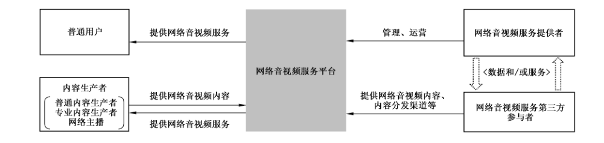
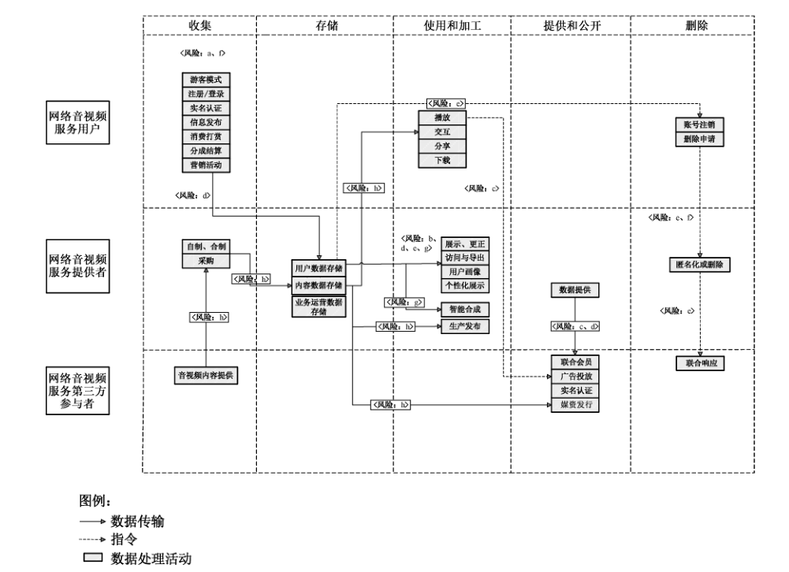

# GB/T 42016-2022 信息安全技术 网络音视频服务数据安全要求

> 来源：[GB/T 42016-2022 国家标准详情](https://openstd.samr.gov.cn/bzgk/std/newGbInfo?hcno=20615352AC128FC97F8005161976B921)；封面发布日期：2022-10-12；实施日期：2023-05-01。
> PDF SHA-256：5b9f549bb49e76ddc69710a940ffaef69cb1a6ab12b7ca10e729fa0c7c7417ba。
> 转写说明：按页渲染官方 PDF 并对照全部 18 页校正文字、列表和表格；保留图 1、图 A.1，省略封面、目录、页眉、页脚和页码，合并跨页段落。正式引用请核对原 PDF。

## 前言

本文件按照 GB/T 1.1—2020《标准化工作导则 第1部分：标准化文件的结构和起草规则》的规定起草。

请注意本文件的某些内容可能涉及专利。本文件的发布机构不承担识别专利的责任。

本文件由全国信息安全标准化技术委员会（SAC/TC 260）提出并归口。

本文件起草单位：中国电子技术标准化研究院、北京爱奇艺科技有限公司、中国网络安全审查技术与认证中心、上海哔哩哔哩科技有限公司、北京快手科技有限公司、北京微播视界科技有限公司、广州虎牙信息科技有限公司、湖南快乐阳光互动娱乐传媒有限公司、上海麦克风文化传媒有限公司、阿里巴巴（北京）软件服务有限公司、北京小米移动软件有限公司、上海喜马拉雅科技有限公司、深圳市腾讯计算机系统有限公司、北京百度网讯科技有限公司、重庆邮电大学、华为技术有限公司、海信集团控股股份有限公司、OPPO广东移动通信有限公司、国家计算机网络应急技术处理协调中心、陕西省信息化工程研究院、国家工业信息安全发展研究中心、北京数安行科技有限公司、上海兆言网络科技有限公司、中国信息通信研究院、北京搜狐新媒体信息技术有限公司、北京市竞天公诚律师事务所上海分所。

本文件主要起草人：姚相振、上官晓丽、周晨炜、奚海生、杨建军、胡影、樊华、张颖、童永祥、樊庆君、朱垒、刘晓静、赵新强、林阳芸晨、刘楠、陈陆敏、宜静、邵华、田申、高斯平、王平、林芷晴、冯帆、陈琪曼、马方超、费蓓洁、刘小敏、李涛、李紫璇、刘震宇、唐佳伟、徐雨晴、徐光侠、衣强、高雪松、王小璞、赵芸伟、张勇、柳彩云、刘玉红、朱璐、戚琳、庞小妹、袁立志。

## 1 范围

本文件规定了网络音视频服务收集、存储、使用、加工、传输、提供、公开、删除等数据处理活动的安全要求。

本文件适用于网络音视频服务提供者规范数据处理活动，也可为监管部门、第三方评估机构对网络音视频服务数据处理活动进行监督、管理、评估提供参考。

## 2 规范性引用文件

下列文件中的内容通过文中的规范性引用而构成本文件必不可少的条款。其中，注日期的引用文件，仅该日期对应的版本适用于本文件；不注日期的引用文件，其最新版本（包括所有的修改单）适用于本文件。

- GB/T 25069 信息安全技术 术语

- GB/T 35273—2020 信息安全技术 个人信息安全规范

- GB/T 37988 信息安全技术 数据安全能力成熟度模型

- GB/T 39335 信息安全技术 个人信息安全影响评估指南

- GB/T 41391—2022 信息安全技术 移动互联网应用程序（App）收集个人信息基本要求

- GB/T 41479 信息安全技术 网络数据处理安全要求

## 3 术语和定义

GB/T 25069、GB/T 35273—2020 界定的以及下列术语和定义适用于本文件。

### 3.1 网络音视频服务 online audio and video service

通过互联网站、应用程序等网络平台，向社会公众提供音视频信息制作、发布、传播的服务。

> 注 1：也称网络音视频信息服务。

> 注 2：不包括音视频编辑工具、本地播放器和具有即时通信属性的在线直播（如在线会议）服务。

### 3.2 网络音视频服务平台 online audio and video service platform

提供网络音视频服务（3.1）的信息系统。

### 3.3 网络音视频服务提供者 online audio and video service provider

向社会公众提供网络音视频服务（3.1）的组织或者个人。

> 注 1：本文件中主要指网络音视频服务平台的所有者、管理者。

> 注 2：本文件中简称“提供者”。

### 3.4 网络音视频服务使用者 online audio and video service user

使用网络音视频服务（3.1）的组织或者个人。

> 注：本文件中简称“用户”。

### 3.5 网络音视频内容生产者 online audio and video content producer

通过网络音视频服务平台（3.2）进行网络音视频内容生产、制作、发布、传播、在线实时直播的网络音视频服务使用者（3.4）。

> 注：本文件中简称“内容生产者”。

### 3.6 网络音视频服务第三方参与者 online audio and video service third-party participant

除网络音视频服务提供者（3.3）和网络音视频服务使用者（3.4）之外的网络音视频服务（3.1）的参与主体。

> 注：本文件中简称“第三方”。

### 3.7 网络音视频服务数据 online audio and video service data

网络音视频服务提供者（3.3）在提供网络音视频服务（3.1）过程中收集和产生的数据。

> 注：主要包括用户数据和业务数据，不包括提供者内部管理经营数据。

### 3.8 网络音视频内容数据 online audio and video content data

网络音视频服务提供者（3.3）所拥有和管理的图文、音频、视频等信息内容，以及描述上述信息内容属性的元数据。

> 注：本文件中简称“内容数据”。

## 4 缩略语

下列缩略语适用于本文件。

IoT：物联网（Internet of Things）

IP：互联网协议（Internet Protocol）

## 5 概述

### 5.1 网络音视频服务业务组成

网络音视频服务主要包括网络音频服务、网络视频服务以及网络直播服务。网络音频服务向用户提供音乐、广播、曲艺、有声读物、广播剧、节目赛事音频、新闻资讯音频等音频内容制作、发布、传播服务。网络视频服务向用户提供短视频、电影、电视剧、综艺娱乐、节目赛事视频、新闻资讯视频等视频信息制作、发布、传播服务。网络直播服务向用户提供实时音频信息、视频信息、图文信息等内容的发布、传播服务。

网络音视频服务业务功能主要包括网络音视频内容的制作、发布、浏览、搜索、播放、下载、收藏、预约、分享、实时传播，以及互动交流（发布弹幕、评论等）、内容推荐、会员付费、内容付费、直播打赏、收益分成结算等。

网络音视频服务涉及的相关方主要包括网络音视频服务提供者、网络音视频服务使用者，以及网络音视频服务第三方参与者。其中，网络音视频服务使用者包括普通用户及网络音视频内容生产者。普通用户是指未通过网络音视频服务平台制作、发布、传播网络音视频内容，仅使用网络音视频内容浏览、搜索、播放等功能的用户。网络音视频内容生产者通常包括普通内容生产者、专业内容生产者和网络主播。普通内容生产者通常是指不以营利为目的，通过网络音视频服务平台制作、发布、传播个人生活、经历等内容的用户；专业内容生产者通常是指以营利为目的，以签约或认证等方式与网络音视频服务提供者建立合作关系并通过网络音视频服务平台制作、发布、传播音视频内容的用户；网络主播通常是指通过网络音视频服务平台进行在线实时直播的用户。网络音视频服务第三方参与者通常包括第三方技术支持商、内容分发渠道商等。网络音视频服务参与主体交互示意图见图1。

图 1 网络音视频服务参与主体交互示意图

网络音视频服务数据处理活动及安全风险见附录 A。

### 5.2 网络音视频服务数据范围

本文件中网络音视频服务数据范围包括：

a） 用户数据：网络音视频服务提供者在提供网络音视频服务过程中收集和产生的用户的个人信息，如用户的基本资料、身份信息、浏览、搜索、播放记录等。

b） 业务数据：网络音视频服务提供者在提供网络音视频服务过程中处理的除用户数据外的其他数据，包括内容数据和业务运营数据。

## 6 基本要求

网络音视频服务提供者数据安全的基本要求如下：

a） 数据处理活动应遵守GB/T 41479中规定的要求；

b） 个人信息处理活动应遵守 GB/T 35273—2020中规定的要求，网络音视频 App 个人信息收集活动应遵守 GB/T 41391—2022中规定的要求；

c） 应按照有关要求和标准进行数据分类分级保护，识别网络音视频服务涉及的核心数据、重要数据、一般数据，对不同级别的数据采取不同的保护措施；

> 注 1：国家建立数据分类分级保护制度，按照数据对国家安全、公共利益或者个人、组织合法权益的影响和重要程度，将数据分为核心数据、重要数据、一般数据。

> 注 2：附录 B 给出了网络音视频服务重要数据识别参考规则及数据分类示例。

d） 应识别网络音视频服务涉及的一般个人信息、敏感个人信息，对个人信息进行标识和分类管理；

e） 应履行互联网平台运营者义务，如个人信息保护独立监督、制定公平公正的平台规则、隐私政策披露、平台内经营者管理、发布个人信息保护社会责任报告等；

f） 网络音视频服务提供者的数据安全能力应至少符合 GB/T 37988二级能力要求；

g） 应结合数据处理活动的实际情况，按照有关国家标准定期开展数据安全风险评估；

h） 应在开展对个人权益有重大影响的个人信息处理活动前，按照 GB/T 39335 进行个人信息保护影响评估；

> 注 3：对个人权益有重大影响的个人信息处理活动，包括但不限于处理敏感个人信息、利用个人信息进行自动化决策、委托处理个人信息、向其他个人信息处理者提供个人信息、公开个人信息、向境外提供个人信息等。

i） 应按照有关国家标准，在网络音视频服务平台规划建设时开展个人信息安全工程实践，同步规划、同步建设，同步使用个人信息保护措施；

j） 网络音视频服务平台应符合国家网络安全等级保护相关标准要求。

## 7 数据收集

### 7.1 收集个人信息

网络音视频服务提供者收集个人信息应在满足 GB/T 35273—2020中 5.1、5.2、5.3的要求基础上，遵守以下要求。

a） 通过App 收集普通用户必要个人信息应符合 GB/T 41391—2022中 A.27、A.28、A.29规定。

> 注：GB/T 41391—2022 附录 A 给出了常见类型 App 必要个人信息范围，网络音频类及网络视频类 App 的必要个人信息范围对应“A.28 在线影音类”，其中短视频类 App 的必要个人信息范围对应“A.29 短视频类”，网络直播类 App 的必要个人信息范围对应“A.27 网络直播类”。

b） 扩展业务功能收集个人信息应由用户可选提供，且应限于实现处理目的的最小范围，常见扩展业务功能收集的个人信息范围及使用要求见附录C。

c） 针对内容生产者实名认证环节收集个人信息的要求包括：

<ol class="standard-subclauses">
<li>1） 针对普通内容生产者，实名认证环节收集的个人信息应仅限于移动电话号码，不应收集公民身份号码；</li>
<li>2） 针对专业内容生产者，实名认证环节收集的个人信息应仅限于姓名、公民身份号码、资质证书，不应收集个人生物识别信息、手持身份证件照片；</li>
<li>3） 针对网络主播，实名认证环节收集的个人信息应仅限于姓名、公民身份号码、身份证件照片、资质证书，不应收集个人生物识别信息、手持身份证件照片。</li>
</ol>

d） 针对内容生产者收益结算环节收集的个人信息应仅限于银行卡号码或支付账号。

e） 应提供不收集个人信息的基本功能模式，基本功能模式至少包括用户浏览、搜索和播放音视频内容的功能，且不应频繁提示用户退出基本功能模式。

f） 未经用户单独同意，不应分析提取用户上传的网络音视频内容，以及网络直播画面中的个人生物识别信息，或用于分析挖掘用户的特定身份、兴趣爱好、健康状况等。

### 7.2 申请系统权限

网络音视频 App 不应申请与App 业务功能无关的系统权限，系统权限申请范围及使用要求见附录D。

### 7.3 告知同意

网络音视频服务提供者收集个人信息告知同意应在满足 GB/T 35273—2020中 5.4、5.5、5.6的要求基础上，遵守以下要求：

a） 以互联网站、App 等形式提供网络音视频服务的，应通过显著方式（例如弹窗、语音提示、网页页面等）向用户告知提供者的名称或者姓名、联系方式，个人信息的处理目的、处理方式，处理的个人信息种类、保存期限，用户行使权利的方式和程序等；

b） 以向第三方 App 接入SDK 等形式提供网络音视频服务的，应向该第三方告知提供者的名称或者姓名、联系方式，个人信息的处理目的、处理方式，处理的个人信息种类、保存期限，用户行使权利的方式和程序等，或提供包含上述内容个人信息处理规则及其链接，并要求第三方在其个人信息处理规则中披露上述内容；

c） 依托智能电视、智能音箱、车载娱乐系统等IoT 智能终端提供网络音视频服务的，针对有屏式IoT 智能终端，应自行或要求智能终端厂商在用户首次使用音视频服务时向用户展示个人信息处理规则，并征得用户同意；针对无屏式IoT 智能终端，应自行或要求智能终端厂商在用户首次使用音视频服务时通过语音交互、提示用户扫码查看或阅读文件等方式向用户告知个人信息处理规则的核心内容（至少包括必要个人信息的处理规则），并取得用户明示同意。

> 注：提供者仅作为内容提供商且不处理个人信息的，不适用于b）与c）。

## 8 数据存储和传输

网络音视频服务提供者传输、存储数据，应在遵守 GB/T 35273—2020中6.2、6.3、6.4 要求的基础上，遵守以下要求：

a） 向第三方通过互联网传输用户敏感个人信息、内容数据前，应采用安全口令、数字签名证书等两种及以上方式进行接收方身份鉴别与认证；

b） 应将实名认证环节收集的个人身份信息与其他个人信息分开存储；

c） 个人信息存储期限应为实现个人信息处理目的所必需的最短时间，超出存储期限应对个人信息进行删除或匿名化处理，法律法规另有规定的除外；

d） 如超出个人信息存储期限，但法律、行政法规规定的保存期限未届满，或者删除个人信息从技术上难以实现的，应停止除存储和采取必要的安全保护措施之外的处理。

## 9 数据使用和加工

### 9.1 数据展示

网络音视频服务提供者进行数据展示，应遵守以下要求：

a） 用户在未登录状态下产生的浏览、播放、搜索等使用记录，应仅限当前设备能够查阅；

b） 在用户登录账号后将未登录状态下产生的使用记录与该账号进行关联时，应取得用户同意；

c） 用户查阅其个人身份信息、个人财产信息时，除使用账号口令验证外，还应采用多因素认证等安全验证措施，如短信/邮件验证等。

### 9.2 用户画像与内容个性化展示

在网络音视频内容个性化展示场景下，对网络音视频服务提供者的要求包括：

a） 应允许用户自主选择是否使用内容个性化展示相关功能；

b） 应向用户提供自主设置、调整或校正用户画像维度、标签的功能；

c） 应向用户提供完全重置画像信息的功能，用户重置画像信息后，提供者不应再次基于重置前用于用户画像的个人信息，对用户进行网络音视频内容方面的用户画像及个性化展示；

d） 不应将违法和不良信息关键词记入用户兴趣点，不应设置歧视性、偏见性用户标签推送信息内容；

e） 宜使用内容去重、打散干预等策略，优化定向推送和个性化展示规则，避免形成信息茧房。

### 9.3 个人信息保护功能

网络音视频服务提供者宜根据其所收集的个人信息与产品类型，在产品或服务中为用户提供以下功能：

a） 如提供用户个人主页展示功能，宜提供设置主页内容对其他用户可见范围的功能；

b） 如提供关注、评论和私信等功能，宜提供设置定向选择互动对象及方式的功能；

> 注 1：设置选项通常包括“谁可关注我”“谁可评论我”“谁可私信我”等。

c） 如提供网络音视频发布功能，宜提供设置音视频内容展示范围功能；

> 注 2：设置选项通常包括“仅自己可见”“部分公开”“完全公开”“仅对好友公开”等。

d） 如提供在线社交服务（如添加好友功能），宜提供设置社交意向管理功能；

> 注 3：设置选项通常包括“不把我推荐给通讯录好友”“不允许通过手机号找到我”等。

e） 如提供展示发布信息时所在位置功能，宜默认不展示用户位置信息；

f） 如提供用户行为动态展示功能，宜设置展示范围控制功能。

> 注 4：设置选项通常包括“谁可以看我的动态”“展示/关闭在线状态”“不展示我打赏过的内容生产者”等。

## 10 数据提供和公开

网络音视频服务提供者公开个人信息、向第三方提供个人信息，应在遵守GB/T 35273—2020中9.2~9.4 要求的基础上，遵守以下要求。

a） 针对联合会员营销服务场景下向第三方提供个人信息的要求包括：

<ol class="standard-subclauses">
<li>1） 向联名会员方等合作方提供的个人信息应仅限于用户的移动电话号码、订单信息；</li>
<li>2） 应在提供前对所提供的个人信息进行去标识化处理。</li>
</ol>

b） 针对个性化广告场景下向第三方提供个人信息的要求包括：

<ol class="standard-subclauses">
<li>1） 不应向广告主、广告分发及管理平台等第三方提供用户浏览、搜索、播放等使用记录；</li>
<li>2） 涉及提供唯一设备识别码时，应在提供前对唯一设备识别码进行加密。</li>
</ol>

c） 针对第三方实名认证服务场景下向第三方实名认证服务供应商提供个人信息的要求包括：

<ol class="standard-subclauses">
<li>1） 应对第三方实名认证服务供应商进行数据安全及个人信息保护能力评估，评估内容应包括采取的数据安全及个人信息保护措施，通过的数据安全及个人信息保护相关评估认证等；</li>
<li>2） 应在提供个人信息前，告知用户第三方实名认证服务供应商的名称或者姓名、联系方式、个人信息的种类、处理目的、处理方式，并取得用户的单独同意。</li>
</ol>

d） 因兼并、重组、破产等原因需要转移数据的，应明确数据转移方案，数据接收方应继续履行相应数据安全保护义务。

## 11 数据出境

网络音视频服务提供者如因业务需要向境外提供数据，应根据业务发展和运营情况，每年自行或委托第三方机构对数据出境至少进行一次数据出境风险评估。

## 12 个人信息主体权利

网络音视频服务提供者在保障个人信息主体权利方面，应在遵守 GB/T 35273—2020第8章要求的基础上，遵守以下要求。

a） 应为用户提供便捷的查阅、复制、转移、更正、删除个人信息，以及撤回同意的功能。

b） 应向用户提供查阅和删除浏览、播放、搜索等使用记录的功能，用户删除相关使用记录后，不应再次使用相关个人信息。

c） 应为用户提供自动删除浏览、播放、搜索等使用记录的选项，宜为用户提供不保存浏览、播放、搜索等使用记录的功能模式。

d） 应为用户提供便捷的账号注销功能，不应设置不合理的注销条件，并遵守以下要求：

<ol class="standard-subclauses">
<li>1） 除用户账号存在未处理完毕的交易与纠纷、其账号下拥有财产权益（包括零钱、平台虚拟货币、虚拟物品、会员权益等）、其与提供者签署的合同仍在有效期内的情形外，不应设置其他注销条件；</li>
<li>2） 因 1）中所述情形影响或拒绝用户注销的，应向用户说明注销账号的影响或拒绝的理由。如用户已妥善处理（包括自行提现、结清或自愿放弃等方式）相关财产权益或上述其他限制情形消除后，应为用户注销账号；</li>
<li>3） 除 1）中所述情形，可从保障用户权益和履行平台职责角度出发，对账号设置合理的注销限制条件，如待注销账号不存在违法违规或被盗风险。针对此类限制条件，应为用户提供专门的申诉渠道。</li>
</ol>

## 13 未成年人保护

网络音视频服务提供者处理未成年人个人信息，应在遵守 GB/T 35273—2020中5.4 d）要求的基础上，遵守以下要求：

a） 应取得未成年人的父母或者其他监护人的单独同意；

b） 应制定专门的未成年人个人信息处理规则；

c） 应向用户提供监护人控制功能，例如在用户登录账号、充值消费、发布音视频内容、提供/更正/删除个人信息时，通过短信/邮件验证等方式由监护人对操作进行确认；

d） 应在App 中设立“青少年模式”，在该模式下所收集的个人信息应按照敏感个人信息处理；

e） 针对专门或主要面向未成年人提供的网络音视频服务，应在用户注册时识别未成年人身份；

> 注：识别方式包括弹窗询问、用户主动填写年龄区间信息、出生年月等。

f） 受理未成年人充值/打赏退费申请或查明申请事实时，处理未成年人及其监护人个人信息应遵守最小必要原则，个人信息收集范围应仅限于账号信息、未成年人及其监护人身份证明文件、监护关系证明（如户口页）、充值渠道、充值记录、充值/打赏记录及申请人联系方式。退费事宜处理完毕后，提供者应将上述信息删除；

g） 不应向未成年人推送可能影响未成年人身心健康的信息，不应利用个性化推荐诱导未成年人沉迷网络。

## 14 音视频服务相关场景数据安全要求

### 14.1 智能合成音视频场景

智能合成音视频服务场景下，提供者应在遵守第6章至第13章要求的基础上，遵守以下要求。

a） 应在网络音视频服务平台内区分智能合成音视频与其他音视频，采取的措施包括：

<ol class="standard-subclauses">
<li>1） 应采取技术措施或人工手段对智能合成音视频进行鉴别；</li>
<li>2） 应在智能合成音视频中添加不可被屏蔽、修改、删除的显著区分标识；</li>
<li>3） 宜通过单独的栏目、板块、页面展示智能合成音视频；</li>
<li>4） 发现未添加显著区分标识的智能合成音视频时，应及时采取补充添加显著区分标识、拒绝发布、停止传输、删除等措施。</li>
</ol>

b） 应在用户发布和下载智能合成音视频时，提示用户不得利用音视频的智能合成技术从事违法犯罪活动或侵权活动。

c） 应记录网络音视频服务平台中的智能合成音视频的首次发布者账号、发布时间及IP地址。

d） 不应将用户的个人生物识别信息作为在线素材，用于向他人提供智能音视频合成服务，经过用户单独同意的除外。

### 14.2 网络音视频内容数据安全保护场景

针对网络音视频服务提供者的内容数据安全保护要求如下。

a）应建立内容数据分类分级规范，对内容数据进行分类分级安全管理。

> 注：内容数据分类示例见附录B。

b） 应制定内容数据安全管理规范，通过员工安全意识培训、业务部门重要岗位人员技能培训等方式，提升组织内部人员的内容数据安全防护意识和技术能力。

c） 应明确内容数据存储的安全保障措施，建立内容数据备份机制，包括备份方式、备份频度、存储介质、保存期限等内容，定期进行容灾备份应急演练；宜采用云备份、离线备份等多种备份方式，保障业务可用性。

d） 针对具备内容数据编辑、制作、发布等功能的后台应用系统，采取技术措施保障系统的安全性，具体包括：

<ol class="standard-subclauses">
<li>1） 应通过代码安全扫描、渗透测试等方式识别应用系统安全漏洞，并对发现的安全漏洞及时进行修复；</li>
<li>2） 涉及内容数据审核的功能模块，宜实施网络隔离、界面添加可显水印、限制下载等安全策略；</li>
<li>3） 应记录并分析后台应用系统的操作日志信息，针对授权账户的异常操作（例如敏感内容数据批量下载、浏览、播放等）进行安全监控和告警。</li>
</ol>

e） 宜采用数字版权管理、码流加密、数字水印、限制客户端录制和下载等相关技术，对内容数据进行保护。

f） 向第三方提供内容数据时，如通过移动存储介质传输，宜选用具有身份鉴别、全盘加密、密钥管理功能的产品；如通过互联网传输，应采取传输加密、多因素认证、访问控制等措施确保内容数据安全。

g） 应建立内容数据泄露事件应急响应机制，明确内容数据安全事件定级标准、事件报告和处置流程，明确相应业务部门、安全部门及组织其他相关部门的角色及职责，持续更新内容数据安全防护策略，定期进行安全审计和策略更新。

h） 应建立识别违法和不良信息的特征库，完善入库标准、规则和程序，发现违法和不良信息，应及时采取拒绝发布、停止传输、删除等措施。

i） 应建立与监管机构的数据传输接口，及时上报违规违法内容，保障网络音视频服务数据可管可控。

## 附录 A（资料性）网络音视频服务数据处理活动及安全风险

### A.1 网络音视频服务数据处理活动

网络音视频服务数据处理活动示意图见图 A.1。

图 A.1 网络音视频服务数据处理活动示意图

### A.2 网络音视频服务数据安全风险

网络音视频服务主要面临以下数据安全风险：

a） 在个人信息收集活动中，提供者过度收集个人信息，或过度索取 App 系统权限的风险，包括但不限于内容生产者实名认证场景下，过度收集用户身份证件信息、个人生物识别信息等敏感个人信息的风险；

b） 在个人信息使用活动中，提供者未采取脱敏、身份鉴别或访问控制等安全措施导致数据遭到未经授权的访问、泄露、篡改、丢失的风险，以及音视频内容个性化展示等场景中个人信息被滥用的风险；

c） 在联名会员、个性化广告等场景下，未经用户授权向第三方提供或超范围提供个人信息，以及接收方无法提供充足安全保障措施、滥用个人信息等风险；

d） 在个人信息传输、存储活动中，提供者及第三方未采取有效安全措施导致个人信息遭受未经授权的访问、泄露、篡改、丢失的风险；

e） 提供者永久留存、过度使用用户浏览、搜索、播放等使用记录，未向用户提供有效的删除相关使用记录的功能或途径，对用户隐私安全产生潜在威胁的风险，以及其他未能有效响应用户请求（如个人信息删除、账号注销申请），导致用户未能有效行使个人信息权利的风险；

f） 提供者未能有效识别未成年人用户、或未能获得监护人的有效同意，导致未成年人个人信息处理不当、未成年人保护措施失效等风险，处理未成年人打赏退费时过度收集未成年人及监护人个人信息，退费处理完毕后未及时删除相关个人信息的风险，以及推送可能影响未成年人身心健康的信息的风险；

g） 智能合成音视频场景下，提供者未采取有效处置措施，导致用户个人生物识别信息（如面部识别特征）遭到滥用等风险；

h） 内容数据在生产（包括自制、合制、采购）、收集、存储、传输、发布、发行等活动中，遭到泄露、未授权访问、非法缓存或爬取、盗链等的安全风险；

i） 采用个性化推荐算法，按照用户偏好频繁推荐其感兴趣的内容，形成用户意见极化的“信息茧房”，或者将违法不良信息关键词记入用户兴趣点，设置歧视性、偏见性用户标签推送信息内容。

## 附录 B（资料性）网络音视频服务重要数据识别参考规则及数据分类示例

### B.1 网络音视频服务重要数据识别参考规则

网络音视频服务重要数据识别参考规则如下：

a） 按照国家和网络音视频服务行业的重要数据目录，识别涉及的重要数据；

b） 相关目录不明确时，按照重要数据识别相关规定、国家或行业标准识别重要数据；

c） 相关目录、规定和标准均不明确时，将一旦被泄露或篡改、损毁，可能直接危害国家安全、经济运行、社会稳定、公共健康和安全的数据识别为重要数据。

### B.2 网络音视频服务数据分类示例

网络音视频服务数据分类示例见表 B.1。

**表 B.1 网络音视频服务数据分类示例**

<table>
<thead><tr><th>一级类别</th><th>子类</th><th>示例</th></tr></thead>
<tbody>
<tr><td rowspan="17">用户数据</td><td rowspan="3">基本资料</td><td>用户自主公开上传的昵称、头像等</td></tr>
<tr><td>性别、年龄、国籍、民族、职业等</td></tr>
<tr><td>真实姓名、移动电话号码、电子邮件地址等</td></tr>
<tr><td rowspan="1">身份信息</td><td>公民身份号码、护照、残疾人证书、户籍证明等非公开证件类信息</td></tr>
<tr><td rowspan="1">个人生物识别信息</td><td>用于鉴别用户身份的指纹、声纹、面部识别特征等原始生物特征数据</td></tr>
<tr><td rowspan="2">网络身份识别信息</td><td>注册账号 ID、第三方账号 ID、账号创建时间和 IP 地址等</td></tr>
<tr><td>鉴别信息（账号口令、动态口令、短信验证码、邮箱验证链接、密码提示或找回密码的问题答案）</td></tr>
<tr><td rowspan="3">财产信息</td><td>支付方式、支付笔数、交易类型等</td></tr>
<tr><td>提现记录、流水记录、交易金额、交易日志，以及未公开的虚拟货币、虚拟交易记录等</td></tr>
<tr><td>银行卡号/信用卡号、兑换码/优惠码等虚拟财产信息</td></tr>
<tr><td rowspan="3">上网记录</td><td>用户自主公开的上网记录（如主动公开上传的照片、音视频、歌单、观影历程报告等）</td></tr>
<tr><td>基于用户行为统计分析形成的用户间接画像</td></tr>
<tr><td>用户未公开的浏览记录、搜索记录、播放记录、收藏记录、下载/缓存记录、预约记录等使用记录</td></tr>
<tr><td rowspan="3">组织用户（公司、团体组织类）信息</td><td>组织名称、统一社会信用代码、法定代表人等公开信息</td></tr>
<tr><td>营业执照、经营许可证等证件类信息</td></tr>
<tr><td>组织联系人信息（联系人姓名、联系电话、联系邮箱等）、合作协议（纸质版、电子版）、版权、授权合同（纸质版、电子版）、付款方式等</td></tr>
<tr><td rowspan="1">其他信息</td><td>唯一设备识别码、通讯录信息等</td></tr>
<tr><td rowspan="6">业务数据</td><td rowspan="3">内容数据</td><td>网络音视频提供者发布的及内容生产者上传的公开发布的音视频/图文内容、内容生产者公开的直播内容</td></tr>
<tr><td>内容生产者上传的尚未公开发布的音视频/图文内容</td></tr>
<tr><td>网络音视频提供者制作或采购的尚未公开的音视频内容、字幕翻译等信息</td></tr>
<tr><td rowspan="3">业务运营数据</td><td>公开的业务运营数据，例如平台提供者公开发布的用户量、业务收益等数据</td></tr>
<tr><td>后台统计数据（包括但不限于弹幕/打赏/流量信息、标签内容、热度值、播放情况、产品运营报表分析等）</td></tr>
<tr><td>专业内容生产者的资质证明材料、会员收益数据（包含虚拟货币收益）</td></tr>
</tbody>
</table>

> 注：不同提供者根据其实际业务情形与场景，对用户数据、内容数据、业务运营数据的范围定义及具体分类可能存在差异。

## 附录 C（资料性）网络音视频服务常见扩展业务功能的个人信息收集范围及使用要求

网络音视频服务常见扩展功能的个人信息收集范围及使用要求见表 C.1。

**表 C.1 网络音视频服务常见扩展业务功能的个人信息收集范围及使用要求**

| 业务功能 | 个人信息收集范围 | 使用要求 |
| --- | --- | --- |
| 账号注册登录 | 注册用户移动电话号码 | 用于用户注册，满足对 App 注册用户进行真实身份信息认证的要求 |
| 专业内容生产者认证 | 专业内容生产者姓名、公民身份号码、资质证书 | 用于专业内容生产者身份认证 |
| 网络主播认证 | 网络主播姓名、公民身份号码、身份证件照片、资质证书 | 用于网络主播身份认证 |
| 用户音视频内容发布 | 用户发布的音视频内容 | 用于为用户提供音视频发布功能 |
| 购买网络音视频付费内容或其他服务 | 用户支付时间、支付金额、支付渠道等支付信息 | 用于提供网络音视频付费内容或其他服务的购买与交付 |
| 内容生产者收益结算提现 | 内容生产者银行卡号码或支付账号 | 用于内容生产者收益结算提现服务 |
| 基于城市或地域进行网络音视频内容推送 | 用户所在或所选城市或地域 | 用于向用户推送所在或所选城市或地域的网络音视频内容 |
| 客户服务、处理用户纠纷 | 用户与客服的沟通记录 | 用于为用户提供客户服务、处理与用户间争议纠纷 |

## 附录 D（资料性）网络音视频服务 App 相关系统权限申请范围及使用要求

### D.1 Android App

网络音视频服务 Android App（Android 11 及以下版本）相关系统权限申请范围及使用要求见表 D.1。

**表 D.1 Android App 相关系统权限申请范围及使用要求**

| 权限名称 | 使用要求 |
| --- | --- |
| CAMERA 相机 | 仅用于拍摄照片/视频、直播、扫码、实名认证、头像上传/修改功能等使用摄像头场景 |
| RECORD_AUDIO 录音 | 仅用于语音搜索、语音聊天、音视频录制、直播等语音输入场景 |
| WRITE_CALENDAR 编辑日历 | 仅用于网络音视频服务预约、提醒等场景 |
| ACCESS_COARSE_LOCATION 访问粗略位置 | 仅用于基于城市或地域进行网络音视频内容推荐，或用户选择展示内容发布、直播时所在位置 |
| READ_EXTERNAL_STORAGE 读取外置存储器 | 仅用于上传用户选择的设备中的照片、音频、视频等 |
| WRITE_EXTERNAL_STORAGE 写入外置存储器 | 仅用于将网络音视频内容、图片等缓存/下载到设备中 |
| READ_CONTACTS 读取通讯录 | 仅用于根据用户通讯录进行关注推荐等（网络直播服务与该权限相关程度较低，不宜申请该权限） |

### D.2 iOS App

网络音视频服务 iOS App（iOS 14 及以下版本）相关系统权限申请范围及使用要求见表 D.2。

**表 D.2 iOS App 相关系统权限申请范围及使用要求**

| 权限名称 | 使用要求 |
| --- | --- |
| Camera 相机 | 仅用于拍摄照片/视频、直播、扫码、实名认证、头像上传/修改功能等使用摄像头场景 |
| Photo Library 读取和写入照片库 | 仅用于将网络音视频内容、图片等缓存/下载到设备中，以及上传用户选择的设备中的照片、视频等 |
| Photo Library Additions 只写照片库 | 仅用于将网络音视频内容、图片等缓存/下载到设备中 |
| Microphone 麦克风 | 仅用于语音搜索、语音聊天、音视频录制、直播等语音输入场景 |
| Contacts 通讯录 | 仅用于根据用户通讯录进行关注推荐等（网络直播服务与该权限相关程度较低，不宜申请该权限） |
| Calendars 日历 | 仅用于网络音视频服务预约、提醒等场景 |
| Location When In Use 使用期间访问位置 | 仅用于基于城市或地域进行网络音视频内容推荐，或用户选择展示内容发布、直播时所在位置 |

## 参考文献

- ［1］ GB/T 35274—2017 信息安全技术 大数据服务安全能力要求

- ［2］ GB/T 37973—2019 信息安全技术 大数据安全管理指南
