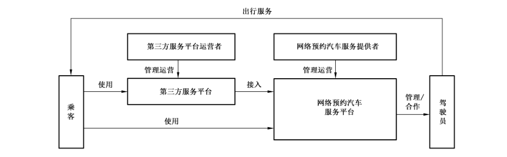
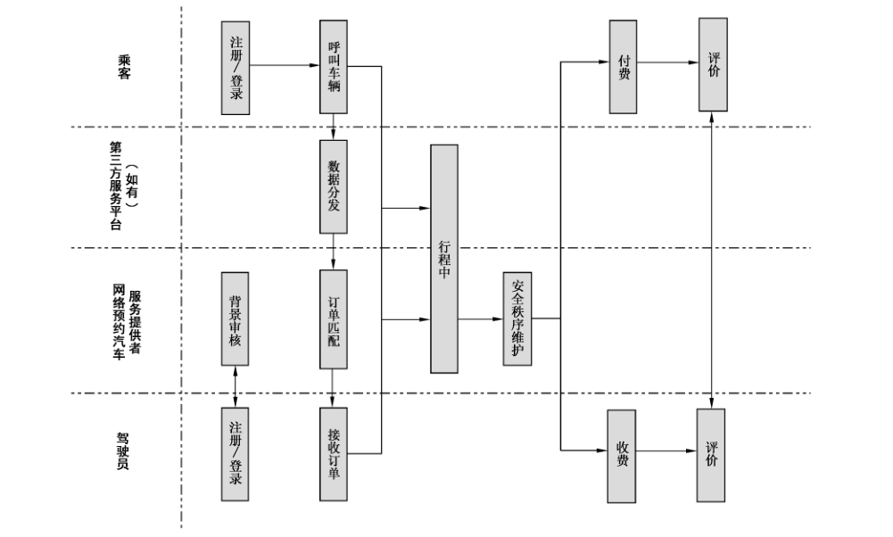
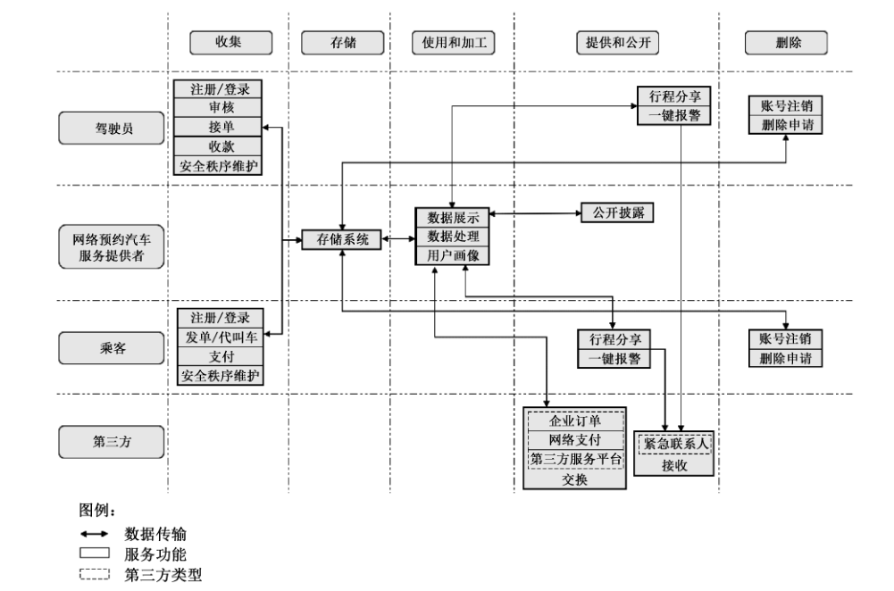

# GB/T 42017-2022 信息安全技术 网络预约汽车服务数据安全要求

> 来源：[GB/T 42017-2022 国家标准详情](https://openstd.samr.gov.cn/bzgk/std/newGbInfo?hcno=182AA2DDF9F1EB9A69193B9CA528BBC4)；封面发布日期：2022-10-12；实施日期：2023-05-01。
> PDF SHA-256：b603d72258f257b0ffe009f061dd44557f8a1b34e9b6f6a61fa225a95c306969。
> 转写说明：将官方 PDF 按页渲染为图像，逐页对照原图校正文字、列表、表格和三幅图示；省略封面、目录、页眉、页脚和页码，合并跨页内容。表 H.1 按原有条目展开。正式引用请核对原 PDF。

## 前言

本文件按照 GB/T 1.1—2020《标准化工作导则 第1部分：标准化文件的结构和起草规则》的规定起草。

请注意本文件的某些内容可能涉及专利。本文件的发布机构不承担识别专利的责任。

本文件由全国信息安全标准化技术委员会（SAC/TC 260）提出并归口。

本文件起草单位：中国电子技术标准化研究院、北京小桔科技有限公司、中电长城网际系统应用有限公司、中国网络安全审查技术与认证中心、北京信息安全测评中心、北京三快在线科技有限公司、北京百度网讯科技有限公司、北京易行出行旅游有限公司、北京假日阳光环球旅行社有限公司、广州祺宸科技有限公司、上海赛可出行科技服务有限公司、同程网络科技股份有限公司、国家计算机网络应急技术处理协调中心、公安部第三研究所、中国信息通信研究院、中国科学院信息工程研究所、重庆邮电大学、北京市竞天公诚律师事务所上海分所、闪捷信息科技有限公司、杭州优行科技有限公司、南京领行科技股份有限公司。

本文件主要起草人：上官晓丽、胡影、陈舒、孙铁、张娜、房子成、许锐、闵京华、杨建军、李海东、赵新强、朱雪峰、王姣、李媛、许静慧、宋子奕、郭建领、吴清华、刘沁华、叶串、李阳、叶俊、倪春娟、刘欢、常博厚、蒋忠志、唐迪、王文磊、戚琳、袁立志、蒋昕妍、韩冬旭、徐光侠、徐雨晴、陈广辉、张智明、张婧玲、李京峰、张中维。

## 1 范围

本文件规定了网络预约汽车服务的收集、存储、使用、加工、提供、公开、出境等数据处理活动的安全要求。

本文件适用于网络预约汽车服务提供者规范数据处理活动，也可为监管部门、第三方评估机构对网络预约汽车服务数据处理活动进行监督、管理、评估提供参考。

## 2 规范性引用文件

下列文件中的内容通过文中的规范性引用而构成本文件必不可少的条款。其中，注日期的引用文件，仅该日期对应的版本适用于本文件；不注日期的引用文件，其最新版本（包括所有的修改单）适用于本文件。

- GB/T 25069 信息安全技术 术语

- GB/T 35273—2020 信息安全技术 个人信息安全规范

- GB/T 37988 信息安全技术 数据安全能力成熟度模型

- GB/T 39335 信息安全技术 个人信息安全影响评估指南

- GB/T 41391—2022 信息安全技术 移动互联网应用程序（App）收集个人信息基本要求

- GB/T 41479 信息安全技术 网络数据处理安全要求

## 3 术语和定义

GB/T 25069 和 GB/T 35273—2020界定的以及下列术语和定义适用于本文件。

### 3.1 网络预约汽车服务 online ride-hailing service

以互联网技术为依托构建服务平台，整合供需信息，为用户提供网络预约汽车出行服务的经营活动。

> 注：本文件的网络预约汽车服务，主要指网络预约出租汽车（简称“网约车”）服务，不包括私人小客车合乘（俗称“顺风车”）、网约货运和网约巴士。

### 3.2 网络预约汽车服务平台 online ride-hailing service platform

通过网络信息技术整合出行供需信息，使用符合条件的车辆和驾驶员，提供网络预约汽车服务的信息系统。

### 3.3 网络预约汽车服务提供者 online ride-hailing service provider

利用网络预约汽车服务平台，提供网络预约汽车服务的组织。

> 注：本文件的网络预约汽车服务提供者，主要指网络预约汽车服务平台运营者。

### 3.4 网络预约汽车第三方服务平台 third-party online ride-hailing service platform

接入一家或者多家网络预约汽车服务平台，为用户提供网络预约汽车订单呼叫服务的第三方网络服务平台。

> 注：常见的网络预约汽车第三方服务平台形式为在同一平台内聚合多家网络预约汽车服务，此类平台通常称为聚合平台，在本文件中简称“第三方服务平台”。

### 3.5 网络预约汽车服务数据 online ride-hailing service data

网络预约汽车服务提供者在提供网络预约汽车服务过程中收集和产生的数据。

> 注：主要包括用户数据和业务数据，不包括网络预约汽车服务提供者内部管理数据。

### 3.6 企业订单 enterprise order

企业组织与网络预约汽车服务提供者依据合作协议产生的服务订单。

### 3.7 行程录音录像 itinerary audio and video

在网络预约汽车服务中，通过车载设备或者移动互联网应用程序收集的行程录音录像数据。

> 注：对行程录音录像加工产生的衍生数据（如从视频中抽取的音频和图像等）也属于行程录音录像数据。

### 3.8 用户 user

使用网络预约汽车服务的个人。

> 注：用户通常包括乘客和驾驶员，其中乘客包括叫车人、乘车人。

### 3.9 叫车人 online ride-hailing caller

通过网络预约汽车服务平台为本人或他人发起订单的个人。

## 4 缩略语

下列缩略语适用于本文件。

GPS：全球定位系统（Global Positioning System）

## 5 概述

### 5.1 网络预约汽车服务业务组成

网络预约汽车服务主要功能包括用户注册/登录、网络预约汽车服务提供者对驾驶员背景审核、乘客发起订单、订单匹配、驾驶员接单、行程服务、网络预约汽车服务提供者安全秩序维护、支付收款、用户评价等。常见网络预约汽车服务流程如附录A中的图 A.1所示。

网络预约汽车服务相关方包括网络预约汽车服务提供者、第三方服务平台运营者、乘客和驾驶员。

乘客使用网络预约汽车服务平台或第三方服务平台发起订单，第三方服务平台接入多家网络预约汽车服务平台，网络预约汽车服务提供者与驾驶员为管理或合作关系，驾驶员为乘客提供出行服务。网络预约汽车服务组成关系如图1所示。

### 5.2 网络预约汽车服务数据范围

本文件中网络预约汽车服务数据主要包括：

a） 用户数据：网络预约汽车服务提供者在网络预约汽车服务过程中收集和产生的乘客和驾驶员个人信息，如手机号码、位置信息、支付信息、行踪轨迹和行程录音录像等；

b） 业务数据：网络预约汽车服务提供者在网络预约汽车服务过程中收集和产生的服务运营数据，如驾驶员数量、乘客数量、行程订单量和里程总数等；

c） 其他数据：网络预约汽车服务提供者在网络预约汽车服务过程中收集和产生的其他数据，如第三方网页内容和合作方提供数据等。

网络预约汽车服务数据处理主要涉及收集、存储、使用、加工、提供、公开、删除等活动，见附录A中的 A.2。在全流程数据处理过程中面临的主要数据安全风险见 A.3。

## 6 基本要求

网络预约汽车服务提供者数据安全的基本要求如下：

a） 数据处理活动应符合 GB/T 41479规定的要求；

b）个人信息处理活动应符合 GB/T 35273—2020规定的要求，乘客 App 个人信息收集活动应符合GB/T 41391—2022 规定的要求；

c） 应按照有关要求和标准进行数据分类分级保护，识别网络预约汽车服务涉及的核心数据、重要数据、一般数据，对不同级别的数据采取不同的保护措施；

> 注1：国家建立数据分类分级保护制度，按照数据对国家安全、公共利益或者个人、组织合法权益的影响和重要程度，将数据分为核心数据、重要数据、一般数据。

> 注2：附录B给出了网络预约汽车服务重要数据识别参考规则及数据分类示例。

d） 应识别网络预约汽车服务涉及的一般个人信息、敏感个人信息，对个人信息进行标识和分类管理；

e） 应履行互联网平台运营者义务，如个人信息保护独立监督、制定公平公正的平台规则、隐私政策披露、平台内经营者管理、发布个人信息保护社会责任报告等；

f） 网络预约汽车服务提供者的数据安全能力应至少符合GB/T 37988中的2级能力要求；

g） 应结合数据处理活动的实际情况，按照有关国家标准定期开展数据安全风险评估；

h） 应在开展对个人权益有重大影响的个人信息处理活动前，按照 GB/T 39335 进行个人信息保护影响评估；

注3：对个人权益有重大影响的个人信息处理活动，包括但不限于处理敏感个人信息、利用个人信息进行自动化决策、委托处理个人信息、向其他个人信息处理者提供个人信息、公开个人信息、向境外提供个人信息等。

i） 应按照有关国家标准，在网络预约汽车服务平台规划建设时开展个人信息安全工程实践，同步规划、同步建设、同步使用个人信息保护措施；

j） 网络预约汽车服务平台应符合国家网络安全等级保护相关标准要求。

## 7 数据收集

### 7.1 收集个人信息

网络预约汽车服务提供者收集个人信息，应在遵守 GB/T 35273—2020中 5.1、5.2、5.3 要求的基础上，按照最小必要原则明确收集的必要个人信息范围，遵守以下要求：

a） 通过 App 收集乘客必要个人信息应符合GB/T 41391—2022 中 A.2 的规定；

注1:GB/T 41391—2022 附录 A给出了常见类型App 必要个人信息范围。

b） 通过 App 收集驾驶员个人信息应限于提供服务或履行法律法规规定的义务所必需；

> 注2：网络预约汽车服务通过App 收集的驾驶员个人信息范围及使用要求见附录C中的C.1。

c） 扩展业务功能收集的个人信息均应由用户可选提供，且应限于实现处理目的的最小范围。

注3：网络预约汽车服务常见扩展业务功能收集的个人信息范围及使用要求见C.2。

### 7.2 申请系统权限

**7.2.1** 乘客 App、驾驶员 App 不应申请与 App 业务功能无关的系统权限，系统权限申请范围及使用要求见附录D。

**7.2.2** 收集行踪轨迹时，通过系统位置权限收集位置信息不应超过1次/s。

> 注：单位时间内同时收集GPS、Wi-Fi、基站信息用于定位校验，视为一次位置信息收集。

### 7.3 告知同意

网络预约汽车服务提供者收集个人信息时的告知同意，应在遵守 GB/T 35273—2020 中 5.4、5.5、5.6 要求的基础上，遵守以下要求：

a） 使用代叫车功能为他人发起服务订单的，应提示收集乘车人个人信息的情况，并取得叫车人征得乘车人同意的确认；

b）收集行程录音录像，应制定单独行程录音录像收集协议，向用户告知行程录音录像收集方式、收集时间、使用目的、存储和删除规则、收集必要性及对用户个人权益的影响等内容，行程录音录像收集协议应征得用户单独同意，行程录音收集协议范式模板示例见附录 E；

c） 收集行程录音录像时，应通过短信、车内语音播报等方式告知乘客行程录音录像收集情况；

d） 多人乘车的，应提醒叫车人告知同乘人个人信息收集情况；

e） App 系统权限申请应同步告知权限使用目的。

## 8 数据存储

网络预约汽车服务提供者开展数据存储活动时，应在遵守 GB/T 35273—2020中第6章要求的基础上，遵守以下要求：

a） 网络预约汽车服务个人信息存储期限应为实现个人信息处理目的所必需的最短时间，超出存储期限后，应对个人信息进行删除或匿名化处理，法律法规另有规定的除外；

b） 如超出个人信息存储期限，但法律法规规定的保存期限未届满，或者删除个人信息从技术上难以实现的，应停止除存储和采取必要的安全保护措施之外的处理；

c） 应将行踪轨迹、人脸识别数据、行程录音录像与其他类型的个人信息分开存储；

> 注：人脸识别数据属于生物识别信息，通常包括人脸图像、面部识别特征。

d） 应采取加密措施存储敏感个人信息，包括但不限于身份证、驾驶证、行驶证、人脸识别数据、行程录音录像、银行卡号和行踪轨迹；

e） 采集的行踪轨迹和行程录音录像数据应存储在有安全保护措施的服务器端；

f） 应采取数据容灾备份措施，关键数据应采取异地容灾；

g） 应制定灾难恢复预案并定期演练，一旦灾难发生，能在短时间内恢复数据，保障信息系统的业务连续性。

## 9 数据使用和加工

### 9.1 数据访问控制

网络预约汽车服务提供者对数据的访问控制，应在遵守GB/T 35273—2020中7.1要求的基础上，遵守以下要求：

a） 应遵循最少够用、职责分离的原则，按照数据分级建立相应的数据访问控制措施和访问权限申请审批流程，将数据分级与数据访问权限进行关联标识，访问权限应明确数据查阅、更正、删除、下载等操作；

b） 应对人脸识别数据、行踪轨迹、行程录音录像等高级别数据访问权限进行严格限制；

c） 应对访问乘客和驾驶员个人信息的行为采取访问控制措施，投诉处理场景数据安全保护要求见附录F，其他业务场景下的账号安全管理、数据访问控制等安全保护措施应遵照投诉处理场景要求执行。

### 9.2 个人信息展示

网络预约汽车服务提供者对个人信息的展示，应在遵守 GB/T 35273—2020中7.2要求的基础上，遵守以下要求：

a） 订单匹配后，向乘客和驾驶员展示对方个人信息用于身份核验时，所展示的个人信息应以满足核验需求为限，向乘客展示的驾驶员信息宜包括驾驶员姓氏、驾驶员头像、手机号码后四位、实时位置、车辆品牌、车身颜色、车辆号牌和服务评价结果，向驾驶员展示的乘客信息宜包括乘客手机号码后四位和服务评价结果；

b） 为乘客和驾驶员提供电话沟通渠道时，应使用虚拟电话号码；

c） 乘客和驾驶员使用行程分享功能将其行程分享给亲友时，向亲友分享的信息应包括驾驶员姓氏、驾驶员头像、出发地、目的地、实时位置和车辆信息；

d） 向乘客、驾驶员展示评价内容时，应延时、匿名提供；

e） 应对内部业务系统需展示的用户个人信息采取去标识化处理，对查看个人信息行为留存审计日志，数据脱敏规则示例见附录G。

### 9.3 用户画像使用

网络预约汽车服务提供者对用户画像的使用，应在遵守 GB/T 35273—2020中7.4、7.5、7.7 要求的基础上，遵守以下要求：

a） 不应利用大数据分析等技术手段，基于用户消费记录、消费偏好等对个人在交易价格等交易条件方面实行不合理的差别待遇；

b） 根据用户个人信息进行用户画像、制定派单策略时，应遵循公平、公正原则，保护乘客和驾驶员人身和财产安全，尊重乘客消费者权益和驾驶员劳动者权益；

c） 基于用户出行习惯为用户提供上下车地点、常用路线推荐的，应为用户提供关闭选项；

d） 通过自动化决策方式进行信息推送、商业营销，应同时提供不针对其个人特征的选项，或者向个人提供便捷的拒绝方式；

e）基于用户画像的推荐功能应允许用户自主选择。

### 9.4 驾驶员信用记录使用

网络预约汽车服务提供者对驾驶员信用记录的使用，遵守以下要求：

a） 建立驾驶员信用记录用于驾驶员管理时，驾驶员注销账号后，应留存驾驶员服务过程中产生的违反法律法规和违反平台规则的信用记录；

b）驾驶员注销账号后重新注册/登录的，对于驾驶员在服务过程中产生的违反法律法规、违反平台规则的信用记录，网络预约汽车服务提供者宜予以恢复。

## 10 数据提供和公开

### 10.1 数据提供

#### 10.1.1 数据提供基本要求

网络预约汽车服务提供者向第三方提供数据，应在遵守 GB/T 35273—2020 中 9.2、9.3、9.5 要求的基础上，遵守以下要求：

a） 应按照最小必要原则确定数据提供的类型、方式、用途和数量，建立不同级别数据提供保护措施和审批流程；

b） 行程录音录像、人脸识别数据、行踪轨迹等敏感个人信息和重要数据传输，应采取加密、完整性保护等安全措施；

c） 向他人提供用户个人信息，应向用户告知接收方的名称或者姓名、联系方式、处理目的、处理方式和个人信息的种类，并取得个人的单独同意；

d） 不向无业务需要的第三方提供网络预约汽车服务用户个人信息；

e） 因兼并、重组、破产等原因需要转移数据的，应明确数据转移方案，数据接收方应继续履行相关数据安全保护义务。

#### 10.1.2 紧急情况下数据提供

网络预约汽车服务提供者在紧急情况下向第三方提供数据，遵守以下要求：

a） 用户设置的紧急联系人或者其他亲友以用户人身安全存在重大风险为由，要求查阅用户的行程信息和位置信息的，网络预约汽车服务提供者的工作人员应先尝试拨打用户联系电话，在无法联系到用户的紧急情况下，应提供相应的行程信息和位置信息，如联系到用户，则应依照用户要求进行处理；

b） 宜为用户提供紧急联系人查阅用户个人信息授权选项，用户已开启紧急联系人查阅用户个人信息授权的，紧急联系人要求获取用户个人信息时，网络预约汽车服务提供者应予以提供；

c） 在用户使用一键报警或者其他紧急情况下，应向用户设置的紧急联系人提供其行程信息、位置信息和报警情况。

#### 10.1.3 企业订单数据提供

网络预约汽车服务提供者提供企业订单数据，遵守以下要求：

a） 应要求企业在提供员工个人信息前，获得员工单独同意；

b） 应与企业约定企业订单中乘客个人信息的提供规则，在征得乘客单独同意后，向乘客所属企业提供的订单信息包括出发地、目的地、支付信息、订单时间和里程；

c） 乘客在企业订单过程中发生安全事件，人身和财产安全受到损害或者威胁的，乘客所属企业向网络预约汽车服务提供者索要乘客行程中安全事件信息的，应予以提供。

#### 10.1.4 地图服务方数据提供

网络预约汽车服务接入地图服务，为乘客和驾驶员提供路径规划、导航服务时，不应提供乘客和驾驶员的手机号码及身份信息。

#### 10.1.5 第三方服务平台数据提供

网络预约汽车服务接入到第三方服务平台，乘客通过第三方服务平台发起订单的，网络预约汽车服务提供者应遵循必要原则，与第三方服务平台约定提供的个人信息范围，并限于网络预约汽车服务所必需。

### 10.2 违法违规信息公开披露

网络预约汽车服务提供者对用户违法违规信息公开披露时，应在遵守 GB/T 35273—2020中 9.4、9.5要求的基础上，对乘客或驾驶员的个人信息进行去标识化处理。

## 11 数据出境

网络预约汽车服务提供者数据出境应在满足 GB/T 35273—2020中9.8要求的基础上，符合以下要求：

a） 网络预约汽车服务在境内运营所收集和产生的个人信息，重要数据和业务数据应在境内存储，法律法规另有规定的除外；

b） 应对网络预约汽车服务运营中数据出境行为进行监测，及时发现并阻止违规数据出境，如对租用的网络链路进行出境流量分析、对服务 App 与境外网络通信行为进行检测分析等；

c） 根据业务发展和运营情况，每年应自行或委托第三方机构对数据出境至少进行一次数据出境风险评估。

## 12 乘客和驾驶员个人信息权利

### 12.1 个人信息查阅和复制

网络预约汽车服务提供者向用户提供个人信息查阅和复制，应在遵守 GB/T 35273—2020 中 8.1、8.6 要求的基础上，遵守以下要求：

a） 应为乘客和驾驶员提供在线个人信息查阅服务，个人信息查阅服务应简单方便、易于操作；

b）乘客查阅的个人信息应包括但不限于账号信息、手机号码、实名信息、紧急联系人、常用地址、账户余额、行程订单；

c） 驾驶员查阅的个人信息应包括但不限于手机号码、实名信息、个人头像、车辆信息、紧急联系人、账户余额、行程订单、流水明细、服务评价；

d） 为用户提供在线个人信息复制功能时，应提供口令保护以防范个人信息副本泄露或被窃取。

### 12.2 个人信息更正或补充

网络预约汽车服务提供者提供个人信息更正或补充，应在遵守GB/T 35273—2020中8.2要求的基础上，遵守以下要求：

a） 应为乘客和驾驶员提供在线个人信息更正或补充服务，个人信息更正或补充服务应简单方便、易于操作；

b）乘客更正或补充的个人信息应包括但不限于账号信息、手机号码、常用地址、紧急联系人；

c） 驾驶员更正或补充的个人信息应包括但不限于账号信息、手机号码、个人头像、车辆信息、紧急联系人。

### 12.3 个人信息投诉

网络预约汽车服务提供者向用户提供个人信息投诉，应在遵守 GB/T 35273—2020中8.8要求的基础上，遵守以下要求：

a） 应建立涉及乘客和驾驶员的个人信息安全的投诉咨询渠道，如客服、电子邮箱等；

b）应对手机号码、身份证、车辆信息、行程订单和行程录音录像等个人信息的滥用、泄露的投诉进行核实处理，并向投诉者及时反馈处理结果；

c） 应对乘客、驾驶员的投诉受理及处理进行记录、归档，对投诉处理满意度和实效性进行跟踪检查，改进投诉管理机制，提高个人信息申诉服务水平；

d） 应对投诉者提供的信息严格保密，保护投诉者权益。

### 12.4 个人撤回同意

网络预约汽车服务提供者向用户提供个人信息撤回同意，应在遵守 GB/T 35273—2020中8.4要求的基础上，遵守以下要求：

a） 应为用户提供在线面部识别特征授权撤回同意功能，收集面部识别特征为履行合同所必需的除外；

b） 应为乘客和驾驶员提供便捷的系统权限撤回同意管理入口。

### 12.5 个人信息删除

网络预约汽车服务提供者向用户提供个人信息删除，应在遵守 GB/T 35273—2020 中 8.3 要求的基础上，遵守以下要求：

a） 应为乘客和驾驶员提供个人信息在线删除服务或通过客服提供删除服务；

b） 应为乘客和驾驶员提供在线账号、紧急联系人、常用地址和订单删除服务；

c） 应为乘客和驾驶员提供行程录音录像删除服务。

### 12.6 乘客和驾驶员注销账户

网络预约汽车服务提供者向用户提供账号注销，应在遵守 GB/T 35273—2020中 8.5要求的基础上，遵守以下要求：

a） 应为乘客和驾驶员提供在线账号注销服务；

b） 账号注销应简单方便，可立即实现，有未完成订单、未处理完毕纠纷的除外；

c） 账户注销后，对于法律法规规定或者双方约定的期限届满的，应立即删除或者匿名化处理；

d） 账户注销功能不应增加收集个人信息。

## 13 行程录音录像数据安全要求

### 13.1 行程录音录像数据安全基本要求

行程录音录像数据是网络预约汽车服务中的敏感个人信息。网络预约汽车服务提供者应制定行程录音录像数据安全管理规范，在行程录音录像数据收集、使用、存储、删除等环节采取安全控制措施进行重点保护。行程录音录像数据安全管理范式模板示例见附录H。

### 13.2 行程录音录像的收集

网络预约汽车服务提供者对行程录音录像的收集，符合以下要求：

a） 收集行程录音录像应取得驾驶员和乘客单独同意，并在每次行程录音前单独提示，行程录音宜通过驾驶员 App 或车载设备收集，行程录像宜通过车载设备收集；

b） 收集的行程录像数据如需保存，应保存在车内，经用户单独同意才可上传，紧急情况下为保护自然人的生命健康安全所必需的除外；

c） 应对车载设备采取必要的安全防护，包括但不限于授权访问、数据加密、禁用或屏蔽调试接口。

### 13.3 行程录音录像的使用

网络预约汽车服务提供者对行程录音录像的使用，符合以下要求：

a） 应与用户明确约定行程录音录像的使用用途，并严格按照约定用途使用行程录音录像，不应超出约定用途使用行程录音录像；

b） 应对行程录音录像采取水印技术防范录音转录和录像截取等泄露风险；

c） 宜对行程录音采取技术措施，使录音可识别录音内容但无法识别用户身份，如对音频信息的基频进行改变等；

> 注：音频基频指每一个人声音的声纹特征，通过该特征能将不同人的声音进行有效的区分识别。

d） 应对行程录像采取技术措施，对车外人员面部识别特征、车外车辆号牌、车内乘客面部识别特征模糊化处理，如采取检测技术在视频中定位人员面部位置、对面部识别特征遮挡处理等。

### 13.4 行程录音录像的存储与删除

网络预约汽车服务提供者对行程录音录像的存储与删除，符合以下要求：

a） 应为乘客和驾驶员提供已完成订单的行程录音录像删除渠道，在一次行程服务完成后，如乘客和驾驶员对行程安全确认无误，应能向网络预约汽车服务提供者提出删除本次行程录音录像数据请求，网络预约汽车服务提供者应在 3 天内删除行程录音录像；

b） 收集的行程录音数据存储时间不应超过7天，当乘客或驾驶员有未处理完毕纠纷时，对应的行程录音数据适当延长保存期限，纠纷处理完毕且超过约定存储时限的应删除。

## 附录 A（资料性）网络预约汽车服务数据处理活动及数据安全风险

### A.1 网络预约汽车服务流程

常见网络预约汽车服务流程，主要涉及用户注册/登录、驾驶员背景审核、乘客发起订单、订单匹配、驾驶员接单、行程服务、网络预约汽车服务提供者安全秩序维护、付费收费、用户评价等步骤，如图 A.1 所示。如果存在第三方服务平台，乘客通过第三方服务平台发布约车订单，第三方服务平台将订单请求发送给接入的网络预约汽车服务提供者，后者进行订单匹配并将订单发送给驾驶员。

网络预约汽车服务涉及的业务功能主要包括：

a） 用户注册登录：乘客在网络预约汽车服务的乘客 App 注册/登录，驾驶员在网络预约汽车服务的驾驶员 App 注册/登录；

b） 驾驶员背景审核：网络预约汽车服务提供者按照国家有关规定对网约车驾驶员资格进行审核，经审核通过的驾驶员可以通过驾驶员 App 接收订单；

c） 乘客发起订单：乘客输入起点、终点，通过网络预约汽车服务平台或第三方服务平台呼叫车辆；

d） 订单匹配：网络预约汽车服务提供者对乘客、驾驶员的供需信息进行匹配后，将订单信息发送给驾驶员；

e） 驾驶员接单：驾驶员接收或自主选择网络预约汽车服务提供者匹配的订单；

f） 行程服务：乘客乘坐车辆，驾驶员运送乘客至目的地；

g） 安全秩序维护：网络预约汽车服务提供者制定平台规则，根据平台规则处理用户纠纷，维护平台安全秩序，预防或者减少危害用户人身和财产安全的行为；

h） 付费收费：乘客支付呼叫及乘坐车辆所产生的费用，驾驶员收取运送乘客产生的服务费用；

i） 用户评价：乘客、驾驶员对结束后的订单进行评价。

### A.2 网络预约汽车服务数据处理活动

网络预约汽车服务数据处理活动涉及数据收集、存储、使用、加工、提供、公开、删除等环节，主要包括驾驶员、乘客、网络预约汽车服务提供者、第三方服务平台、紧急联系人等相关角色。网络预约汽车服务提供者为驾驶员提供注册/登录、审核、接单、收款、安全秩序维护等功能，为乘客提供注册/登录、发起订单、支付、安全秩序维护等功能。网络预约汽车服务过程中的数据处理活动及相关角色和服务功能示意图如图 A.2 所示。

### A.3 网络预约汽车服务数据安全风险

网络预约汽车服务主要面临以下数据安全风险：

a） 在数据收集活动中，网络预约汽车服务提供者过度或未经授权收集叫车人、乘车人和驾驶员的个人信息或者过度索取移动智能终端操作系统权限的风险；

b） 收集使用和存储用户的行程录音录像、行踪轨迹和面部识别特征等敏感个人信息，可能造成数据泄露和滥用的风险；

c） 使用大数据分析技术不当，侵害用户合法权益的风险；

d） 在数据使用时，因权限设置不当、利用职权私自查阅等而带来无意或有意泄露用户行踪轨迹等信息的风险；

e） 数据提供时，在行程分享、一键报警、紧急联系人和企业订单等场景下，网络预约汽车服务提供者未经用户同意或超出必要限度向第三方提供数据、对外公开披露数据的风险；

f） 在公开披露违法违规信息时，未采取充分去标识化措施，造成个人信息泄露的风险。

## 附录 B（资料性）网络预约汽车服务重要数据识别参考规则及数据分类示例

### B.1 网络预约汽车服务重要数据识别参考规则

网络预约汽车服务重要数据指一旦被泄露或篡改、损毁，可能直接危害国家安全、经济运行、社会稳定、公共健康和安全的网络预约汽车服务数据。网络预约汽车服务提供者按照国家和行业重要数据目录或识别规则，识别网络预约汽车服务涉及的重要数据。

本文件按照《汽车数据安全管理若干规定（试行）》给出了网络预约汽车服务重要数据识别参考规则，符合下述任一规则的数据可识别为重要数据：

a） 军事管理区、国防科工单位以及县级以上党政机关等重要敏感区域的地理信息、人员流量、车辆流量等数据；

b） 车辆流量、物流等反映经济运行情况的数据；

c） 汽车充电网的运行数据；

d） 包含人脸信息、车牌信息等的车外视频、图像数据；

e） 涉及车主、驾驶员、乘客、车外人员超过10万人的个人信息；

f） 未公开的国家网络安全审查、执法司法数据；

g） 出口管制数据，出口管制物项涉及的核心技术、设计方案、生产工艺等相关数据，对国家安全、经济竞争实力有直接影响的科学技术成果数据；

h）国家网信部门和国务院发展改革、工业和信息化、公安、交通运输等有关部门确定的其他可能危害国家安全、公共利益的数据。

如网络预约汽车服务行业出台了重要数据相关目录，按照相关目录执行。

### B.2 网络预约汽车服务数据分类示例

网络预约汽车服务数据分类示例见表 B.1。

**表 B.1 网络预约汽车服务数据分类示例**

<table>
<thead><tr><th>类别</th><th>二级子类</th><th>三级子类</th></tr></thead>
<tbody>
<tr><td rowspan="17">（1）用户数据</td><td rowspan="5">（1-1）用户个人身份信息</td><td>（1-1-1）用户基本资料：个人姓名、生日、性别、民族、国籍、头像、账户/会员等级、住址、手机号码、电子邮件地址等。</td></tr>
<tr><td>（1-1-2）自然人身份标识：证件类型及号码，例如身份证、护照、驾驶证等。</td></tr>
<tr><td>（1-1-3）网络身份标识：账号或会员名、昵称、网络地址、个人数字证书等。</td></tr>
<tr><td>（1-1-4）生物识别信息：面部识别特征、声纹等生物识别信息等。</td></tr>
<tr><td>（1-1-5）用户网络身份鉴权信息：用户网络身份口令及关联信息，如登录口令以及关联的口令保护答案等。</td></tr>
<tr><td rowspan="1">（1-2）用户车辆数据</td><td>（1-2-1）车辆基本信息：车辆号牌、车辆类型、品牌型号、车辆识别代号等。</td></tr>
<tr><td rowspan="4">（1-3）用户服务内容数据</td><td>（1-3-1）行程记录数据：行程中的地理位置信息、轨迹数据、行程录音录像数据等。</td></tr>
<tr><td>（1-3-2）订单数据：订单类型、出发地、目的地、订单时间、订单里程、订单金额等。</td></tr>
<tr><td>（1-3-3）支付数据：支付金额、支付方式、银行卡相关信息等。</td></tr>
<tr><td>（1-3-4）评论数据：用户的评价与服务评价结果等。</td></tr>
<tr><td rowspan="3">（1-4）用户服务衍生数据</td><td>（1-4-1）用户服务使用数据：产品或服务的使用情况、付款记录、与客服的通信记录、用户纠纷记录等。</td></tr>
<tr><td>（1-4-2）位置信息：网络地址、GPS 以及能够提供地理位置相关信息的其他传感器所产生的数据，例如无线接入点、基站等信息。</td></tr>
<tr><td>（1-4-3）用户违规记录数据：发布违规信息、驾驶员的违章记录、用户的作弊记录等。</td></tr>
<tr><td rowspan="1">（1-5）用户统计分析数据</td><td>（1-5-1）用户出行和服务统计分析数据：乘客出行次数、乘客出行里程数、驾驶员接单数量和服务天数等。</td></tr>
<tr><td rowspan="3">（1-6）用户设备信息</td><td>（1-6-1）设备属性信息：硬件型号、操作系统版本、设备配置、唯一设备识别码、广告标识符等。</td></tr>
<tr><td>（1-6-2）设备连接信息：浏览器的类型、电信运营商、使用的语言等。</td></tr>
<tr><td>（1-6-3）设备状态信息：设备传感器数据、设备应用安装列表等。</td></tr>
<tr><td rowspan="8">（2）业务数据</td><td rowspan="1">（2-1）运营统计数据</td><td>（2-1-1）运营相关统计数据：乘客数量、驾驶员数量、订单量、里程总数。</td></tr>
<tr><td rowspan="2">（2-2）市场运营数据</td><td>（2-2-1）管理相关数据：业务规划、分析报告、财务报告、法律文件等。</td></tr>
<tr><td>（2-2-2）市场相关数据：市场调查报告、市场发展策略、商业机会、定价策略、销售策略等。</td></tr>
<tr><td rowspan="5">（2-3）技术运维数据</td><td>（2-3-1）IT 基础资源数据：支撑业务平台等资源的基本信息，例如设备标识、设备资料、平台基础数据等。</td></tr>
<tr><td>（2-3-2）系统运维数据：网络建设和规划数据、网络设备及 IT 系统数据、设备和系统的口令及关联信息等。</td></tr>
<tr><td>（2-3-3）网络服务记录和日志数据：Cookie 内容、平台访问日志、运维日志等。</td></tr>
<tr><td>（2-3-4）安全风险数据：设备、应用、平台等数据安全和网络安全风险数据、安全分析结果。</td></tr>
<tr><td>（2-3-5）技术开发数据：源代码、算法模型、标注数据、内部业务字典、技术指标参数、技术方案等。</td></tr>
</tbody>
</table>

## 附录 C（资料性）驾驶员个人信息和常见扩展业务功能收集个人信息范围及使用要求

### C.1 网络预约汽车服务通过 App 收集的驾驶员个人信息范围及使用要求

网络预约汽车服务通过 App 收集的驾驶员个人信息范围及使用要求见表 C.1。

**表 C.1 网络预约汽车服务通过 App 收集的驾驶员个人信息范围及使用要求**

<table>
<thead><tr><th>业务功能</th><th>个人信息</th><th>使用要求</th></tr></thead>
<tbody>
<tr><td rowspan="2">用户注册/登录</td><td>手机号码</td><td rowspan="2">用于标识驾驶员用户和保障账号信息安全</td></tr>
<tr><td>账号信息：账号、口令</td></tr>
<tr><td rowspan="9">背景审核</td><td>身份证或者其他身份证明</td><td rowspan="9">用于审核驾驶员资格是否符合法律法规规定</td></tr>
<tr><td>车辆信息：车辆号牌、车身颜色、品牌型号、车辆识别代号</td></tr>
<tr><td>驾驶证</td></tr>
<tr><td>行驶证</td></tr>
<tr><td>车辆保险</td></tr>
<tr><td>是否有相关犯罪记录</td></tr>
<tr><td>网络预约汽车驾驶员证</td></tr>
<tr><td>网络预约汽车运输证</td></tr>
<tr><td>车辆监督卡（仅巡游出租车收集）</td></tr>
<tr><td rowspan="3">接单并运送乘客</td><td>位置信息</td><td rowspan="1">用于确定驾驶员当前位置，匹配订单</td></tr>
<tr><td>订单信息：出发地、目的地、订单时间、订单里程、订单金额</td><td rowspan="1">记录驾驶员服务行为，用于核实服务过程、解决司乘纠纷</td></tr>
<tr><td>日志信息</td><td rowspan="1">日志信息指订单日志、上网日志、网上交易日志、行驶轨迹日志</td></tr>
<tr><td rowspan="2">安全秩序维护</td><td>违反法律规定的驾驶行为信息，例如超速、路线变更、载客状态下长时间停驶等</td><td rowspan="1">用于对驾驶员的驾驶行为监督，提升出行安全</td></tr>
<tr><td>录音录像</td><td rowspan="1">仅用于保护自然人的生命健康和财产安全，应经用户单独同意后才可收集</td></tr>
<tr><td rowspan="2">收款</td><td>支付方式</td><td rowspan="1">用于驾驶员使用第三方支付方式对约车订单收款</td></tr>
<tr><td>银行卡号</td><td rowspan="1">用于驾驶员提现</td></tr>
</tbody>
</table>

### C.2 网络预约汽车服务常见扩展业务功能收集个人信息范围及使用要求

网络预约汽车服务常见扩展业务功能收集的个人信息范围及使用要求见表 C.2。

**表 C.2 网络预约汽车服务常见扩展业务功能收集的个人信息范围及使用要求**

| 典型的扩展功能 | 个人信息 | 使用要求 |
| --- | --- | --- |
| 代叫车 | 乘车人姓名、电话号码 | 用于代叫车场景下驾驶员联系实际乘车人，接实际乘车人上车 |
| 紧急联系人 | 紧急联系人姓名、电话号码 | 用于当乘客或驾驶员使用一键报警功能或者遇到其他紧急情况时，网络预约汽车服务提供者将相应情况通知紧急联系人 |
| 乘客和驾驶员订单中拨打电话和在线沟通 | 虚拟电话号码通话录音、在线沟通内容记录 | 用于核实事实，处理用户纠纷 |
| 评价 | 评价内容 | 用于解决纠纷，建立用户信用评价机制 |
| 客服 | 电话客服收集电话号码、通话内容录音，在线客服收集聊天消息 | 用于记录纠纷处理情况 |
| 开具发票 | 发票信息、电子邮箱（如电子发票） | 用于乘客开具发票 |
> 注：表中仅列举了较为典型的网络预约汽车服务乘客及驾驶员扩展功能服务，各网络预约汽车服务提供者为乘客及驾驶员提供的业务功能可能会有所差别。表中未予明确的扩展功能服务，根据需要实现的服务目的，按照个人信息处理最小必要原则判断其收集的个人信息范围。

## 附录 D（资料性）网络预约汽车服务 App 相关系统权限申请范围及使用要求

### D.1 网络预约汽车服务乘客 Android App

网络预约汽车服务乘客 Android App（Android 11 及以下版本）系统权限申请范围及使用要求见表 D.1。

**表 D.1 网络预约汽车服务乘客 Android App 相关系统权限申请范围及使用要求**

| 权限名称 | 使用要求 |
| --- | --- |
| ACCESS_FINE_LOCATION（访问精准定位） | 仅用于获取当前位置、订单匹配、推荐上车点、行程路径规划导航 |
| READ_CONTACTS（读取通讯录） | 仅用于用户添加紧急联系人及代叫车场景添加实际乘车人 |
| CAMERA（拍摄） | 仅用于头像、身份鉴别和取证的拍摄上传 |
| RECORD_AUDIO（录音） | 仅用于语音叫车和语音聊天 |

### D.2 网络预约汽车服务驾驶员 Android App

网络预约汽车服务驾驶员 Android App（Android 11 及以下版本）系统权限申请范围及使用要求见表 D.2。

**表D.2 网络预约汽车服务驾驶员 Android App 相关系统权限申请范围及使用要求**

| 权限名称 | 使用要求 |
| --- | --- |
| ACCESS_FINE_LOCATION（访问精准定位） | 仅用于获取当前位置、订单匹配、推荐接车点、行程路径规划导航 |
| READ_CONTACTS（读取通讯录） | 仅用于用户添加紧急联系人及代叫车场景添加实际乘车人 |
| READ_EXTERNAL_STORAGE（读取外置存储器） | 仅用于驾驶员主动上传行驶证、驾驶证；在疫情期间主动上传核酸检测报告或新冠疫苗接种证明 |
| CAMERA（拍摄） | 仅用于头像、身份鉴别、车辆和取证的拍摄上传 |
| RECORD_AUDIO（录音） | 仅用于语音聊天和行程录音 |

### D.3 网络预约汽车服务乘客 iOS App

网络预约汽车服务乘客 iOS App（iOS 14 及以下版本）系统权限申请范围及使用要求见表 D.3。

**表 D.3 网络预约汽车服务乘客 iOS App 相关系统权限申请范围及使用要求**

| 权限名称 | 使用要求 |
| --- | --- |
| Microphone（麦克风） | 仅用于语音叫车和语音聊天 |
| Contacts（通讯录） | 仅用于用户添加紧急联系人及代叫车场景添加实际乘车人 |
| Camera（相机） | 仅用于头像、身份鉴别和取证的拍摄上传 |
| Location When In Use（使用期间访问位置） | 仅用于获取当前位置、订单匹配、推荐上车点、行程路径规划导航 |

### D.4 网络预约汽车服务驾驶员 iOS App

网络预约汽车服务驾驶员 iOS App（iOS 14 及以下版本）系统权限申请范围及使用要求见表 D.4。

**表D.4 网络预约汽车服务驾驶员 iOS App 相关系统权限申请范围及使用要求**

| 权限名称 | 使用要求 |
| --- | --- |
| Microphone（麦克风） | 仅用于语音聊天和行程录音 |
| Contacts（通讯录） | 仅用于用户添加紧急联系人及代叫车场景添加实际乘车人 |
| Camera（相机） | 仅用于头像、身份鉴别、车辆和取证的拍摄上传 |
| Location When In Use（使用期间访问位置） | 仅用于获取当前位置、订单匹配、推荐接车点、行程路径规划导航 |
| Photo Library（读取和写入照片库） | 仅用于驾驶员主动上传行驶证、驾驶证；在疫情期间主动上传核酸检测报告或新冠疫苗接种证明 |

## 附录 E（资料性）行程录音收集协议范式模板示例

为提升××××服务产品安全能力，更好地处理××××服务的司乘纠纷，××××服务上线录音功能。本协议将向您说明××××服务收集使用录音信息的情况，请您务必认真阅读本协议，在确认充分了解后慎重决定是否同意本协议。您点击同意后，本协议生效，对您及××××均具有法律约束力。

<ol class="standard-subclauses">
<li>1. 您同意本协议后，使用××××服务时，××××将通过软件或硬件设备录取您后续全部行程中的车内环境声音信息（包括您及车上人员交谈或肢体动作产生的声音），且在开始录音前会单独提示。

受技术条件影响，××××各项服务在不同城市上线录音功能的时间不同，具体以××××显示的录音状态为准。

</li>
<li>2. 录音将通过××××驾驶员 App 或其他具备录音功能的软件或硬件进行。录音仅在驾驶员、乘客均同意的情况下开启。如乘客使用的 App 版本未及时更新，无法对录音进行授权，则录音不开启。
</li>
<li>3. 录音起始时间：
<ol class="standard-subclauses">
<li>a） 录音自订单行程开始时起（预约订单自驾驶员到达乘客出发地时起），至行程结束后适当时间停止（具体以驾驶员 App 显示的录音状态为准）。乘客自进入车辆后至离开车辆时，将同时被采集录音信息。</li>
<li>b） 其他上线录音功能的服务的录音起始时间以×××× App 另行告知为准。</li>
</ol>
</li>
<li>4. 如您是代他人叫车，在代叫车前请务必告知被代叫车人行程内录音信息收集情况，并征得被代叫车人同意后，才可为其叫车。
</li>
<li>5. 录音数据将用于以下明确列明的使用场景：
<ol class="standard-subclauses">
<li>a） 作为服务提供者处理用户纠纷的依据；</li>
<li>b） 为维护用户人身安全等重大合法利益，或情况紧急又很难获得用户同意时。</li>
</ol>
</li>
<li>6. 录音数据存储时间不超过7天，当乘客或驾驶员有未处理完毕的纠纷时，对应的行程录音数据适当延长保存期限，在纠纷处理完毕且超过约定存储时限时将被删除。
</li>
<li>7. 用户使用的手机等硬件设备故障、网络状态不稳定、App 版本过旧以及不可抗力等因素均可能导致录音失败，您对此表示理解，如遇此类问题，××××不需承担责任。
</li>
<li>8. ××××将严格按照本协议约定收集使用用户录音数据。本协议对相关内容未作明确约定的，以××××《个人信息保护及隐私政策》约定为准。
</li>
</ol>

## 附录 F（资料性）投诉处理场景数据安全保护要求

### F.1 账号安全管理

对网络预约汽车服务提供者投诉处理人员账户安全管理要求包括：

a） 定义并维护投诉处理系统人员账号信息，对投诉处理人员岗位职责、角色和业务类型进行定义说明，对不同岗位、角色、业务类型投诉处理人员数据访问范围进行限定；

b）采取多因素身份验证措施，防止身份冒用和账号共享，对单一账户多终端同时登录进行限制，对投诉处理人员登录投诉处理系统网络地址进行限定。

### F.2 访问控制安全管理

对网络预约汽车服务提供者投诉处理访问控制安全管理要求包括：

a） 按照业务流程的需求触发为投诉处理人员进行授权，不为投诉处理人员配置非需求触发条件下访问乘客和驾驶员数据的权限，当接到乘客或驾驶员投诉后才可访问相应行程订单的行踪轨迹等数据；

b）根据业务需要限定已处理完成的投诉工单有效期，及时关闭投诉处理人员已处理完成订单数据的访问权限。

## 附录 G（资料性）网络预约汽车服务数据脱敏规则示例

网络预约汽车服务数据脱敏规则示例见表 G.1。

**表 G.1 网络预约汽车服务数据脱敏规则示例**

| 序号 | 数据类型 | 数据脱敏规则 |
| --- | --- | --- |
| 1 | 姓名 | 姓名包含 3 个汉字以内的展示第一个字，姓名包含 4 个及以上汉字的展示前两个字，后面隐藏，如：`张*`。 |
| 2 | 手机号码 | 显示前 3 位和后 4 位，中间隐藏，如：`188****8888`。 |
| 3 | 固定电话号码 | 显示前 3 位和后 4 位，中间隐藏，如：`010****8888`。 |
| 4 | 地址信息 | 显示省市县区信息，街道地址隐藏，如：`山东省青岛市市南区**街道**`。 |
| 5 | 坐标信息 | 显示前 3 位，后 3 位隐藏，如：`经度 113.***、纬度 22.4***`。 |
| 6 | 身份证号 | 显示前 3 位和后 2 位，中间隐藏，如：`110*************33`。 |

## 附录 H（资料性）行程录音录像数据安全管理范式模板示例

行程录音录像数据安全管理范式模板包括行程录音录像保护的目的、范围、依据、术语定义、安全要求、处罚措施和维护更新等内容。行程录音录像数据安全管理范式模板示例见表 H.1。

**表 H.1 行程录音录像数据安全管理范式模板示例（按条目展开）**

### 1. 目的

- 行程录音录像数据为敏感个人信息，应采用安全管理和技术措施进行重点保护。
- 为了保护行程录音录像数据，降低信息资产被泄露或破坏的风险，特制定本规范，保证用户个人信息不受侵害。
- ……

> 编写要求：说明本规范的制定目的。

### 2. 适用范围

- 本规范适用于任何与行程录音录像数据有关的行为，包括行程录音录像数据生命周期中的收集、传输、存储、使用、删除等环节的安全控制。
- ……

> 编写要求：说明本规范的适用范围或适用场景。

### 3. 规范依据

- 《中华人民共和国网络安全法》
- GB/T 35273—2020《信息安全技术 个人信息安全规范》
- ……

> 编写要求：列举本规范制定时依据的法律法规、国家标准。

### 4. 术语定义

- 网络预约汽车服务过程中，通过车载录像设备收集的行程录音录像数据或者通过 App 收集的行程录音数据，及其衍生数据。
- 安全区域：为满足查阅行程录音录像数据安全要求设立的物理封闭区域（例如某层楼或某房间）称为安全区域。
- ……

> 编写要求：对本规范中出现的名词术语进行定义说明。

### 5. 行程录音录像数据安全要求

本要求围绕行程录音录像数据的生命周期各环节提出，根据本要求执行行程录音录像数据安全工作。在不违反以下原则的情况下，根据业务场景进行安全要求的细化。

（1）行程录音录像数据收集：

a） 收集行程录音录像数据必须获得驾驶员和乘客单独同意。

b） 行程录音录像数据自产生之时起需全程加密。加密要求如下：密码算法……；秘钥长度……。

c） 不应留存未加密行程录音录像数据。

……

（2）行程录音录像数据传输。在传输行程录音录像数据时，应满足以下安全要求：

a） 在进行行程录音录像传输时，链路应加密；

b） 不应使用第三方网盘、即时聊天工具等方式传输行程录音录像数据；

……

（3）行程录音录像数据存储。线上存储应符合以下要求：

a） 行程中录音录像文件应加密存储在独立的存储集群；

b） 严格控制存储集群访问权限，必须获得相应的授权后才可以访问；

……

线下存储应符合以下要求：

a） 保存行程录音录像数据的介质（如光盘等）应保存在有锁的柜子中或独立的封闭区域（如档案室等），并留存使用记录；

……

（4）行程录音录像数据使用：

a） 使用行程录音录像数据必须经过审批；

b） 行程录音录像应接入水印标识；

c） 必须在安全区域内访问行程录音录像数据；

d） 不应利用右键、下载工具等方法下载行程录音录像数据；

e） 访问行程录音录像数据的人员必须签署保密协议，并向访问人员提供回执确认；

……

（5）行程录音录像数据删除销毁：

a） 行程录音保存的期限：×天（不超过 7 天）；

b） 当乘客或驾驶员有未处理完毕纠纷时，对应的行程录音数据适当延长保存期限，纠纷处理完毕且超过约定存储时限的应删除；

……

> 编写要求：详细说明行程录音录像数据在收集、传输、存储、使用、删除销毁环节应采取的安全措施。

### 6. 安全区域及终端安全要求

（1）安全区域物理安全要求。行程录音录像的查阅使用在封闭的安全区域内完成，安全区域应至少采取以下安全保护措施：

a） 安全区域出入口安排专人值守并配置电子门禁系统，控制、鉴别和记录出入的人员；

b） 安全区域与外部连接的通风口、窗户等通道部署防盗报警装置；

c） 电子门禁系统与警报系统联动或具备警报功能，并采取指纹或人脸识别等技术进行身份核实，防范身份冒用；

d） 配置视频监控系统，对人员活动行为进行全方位监控；

e） 对进入物理区域的人员随身携带的物品进行限制，不应携带手机、相机、录音笔、优盘等电子设备；

f） 配备专门的安全运营人员，对物理区域的运行进行安全审计，采取措施包括但不限于：

<ol class="standard-subclauses">
<li>1） 根据物理区域安全管理要求监督进入员工行为，如身份核验、携带物品限制的监督提醒；</li>
<li>2） 采取定时和不定时巡查，对发现的异常、告警和故障等及时记录并上报，采取必要的纠正措施；</li>
<li>3） 抽检视频监控和门禁记录，排查违规行为和安全隐患；</li>
</ol>

……

（2）安全区域内终端设备安全要求。用于行程录音录像查阅使用的终端设备采取必要的技术防护措施，包括但不限于：

a） 网络准入控制：对终端设备进行身份鉴别、安全检查，非授权设备不应访问行程录音和行程录像数据；

b） 网络行为监控：对终端设备文件操作访问、上网行为、网络协议等进行管控和审计，禁用具备即时通信、公有云存储等与录音录像无关的互联网应用，防止外发、泄露行程录音和行程录像数据；

c） 网络防病毒：及时更新系统补丁并采取恶意代码防护措施，防范病毒、木马、蠕虫、间谍软件等恶意程序传播感染；

d） 端口管控：对终端设备的通用串行总线和蓝牙等外部连接进行管控，防范非法外联，设置专用听音设备，不应随意插拔更换；

……

> 编写要求：详细说明安全区域及终端设备应采取的安全措施。

### 7. 处罚措施

- 对违反本规范要求的行为，具体的处罚措施包括：

a） 通报批评：……

b） 警告：……

c） 解除劳动关系：……

d） 移交司法机关：……

- 鼓励对违反本规范要求使用行程录音录像数据的行为进行检举。

……

> 编写要求：详细说明对违反本规范要求的相关人员的处罚措施，列举说明各类处罚条款。

### 8. 维护更新

- 本规范由……制定和解释。
- 本规范自公布之日起施行，员工有义务及时阅读，了解行程录音录像数据安全要求，并遵照执行。
- ……

> 编写要求：—。

## 参考文献

- ［1］ GB/T 39725—2020 信息安全技术 健康医疗数据安全指南

- ［2］ 中华人民共和国网络安全法

- ［3］ 汽车数据安全管理若干规定（试行）（国家互联网信息办公室、国家发展和改革委员会、工业和信息化部、公安部、交通运输部令第 7 号）

- ［4］ 电信和互联网用户个人信息保护规定（工业和信息化部令第24号）

- ［5］ 移动互联网应用程序信息服务管理规定（国家互联网信息办公室）

- ［6］ 网络交易监督管理办法（国家市场监督管理总局令第37号）

- ［7］ 网络预约出租汽车经营服务管理暂行办法（交通运输部、工业和信息化部、公安部、商务部、工商总局、质检总局、国家网信办）
