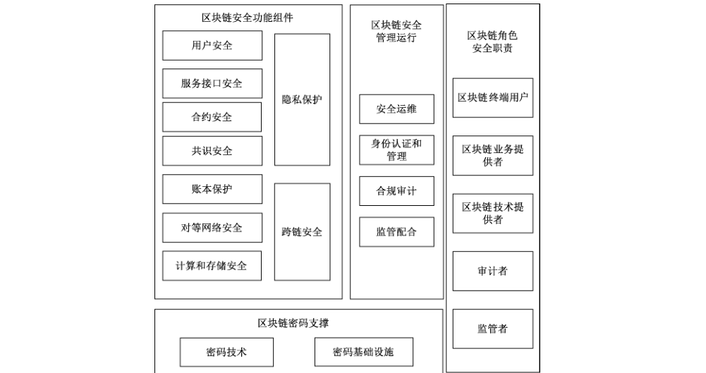
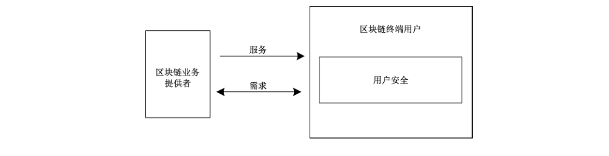
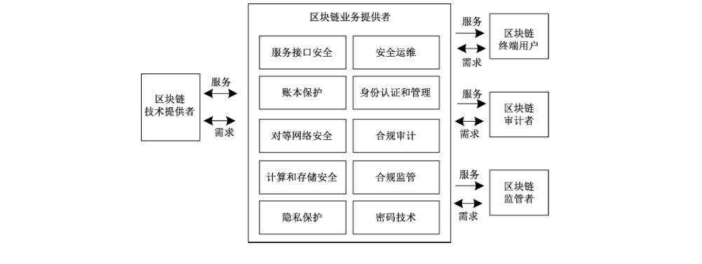
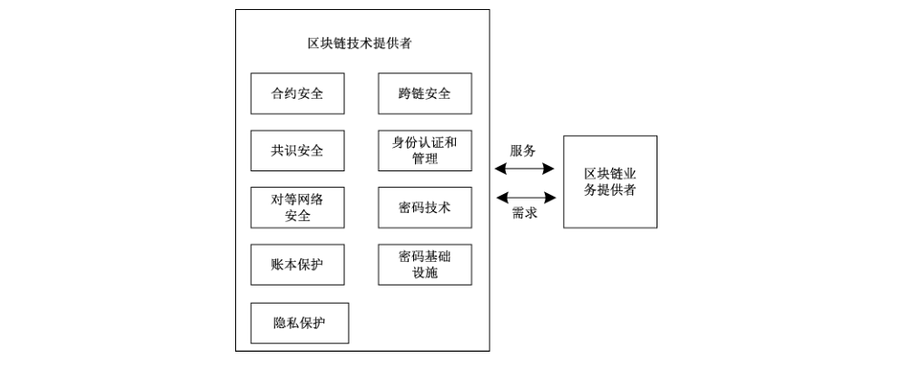

# GB/T 42570-2023 信息安全技术 区块链技术安全框架

> 来源：[GB/T 42570-2023 国家标准详情](https://openstd.samr.gov.cn/bzgk/std/newGbInfo?hcno=BD85ADB71436AED8DA33FA2B5F274526)；封面发布日期：2023-05-23；实施日期：2023-12-01。
> PDF SHA-256：1edd956736624c3df5a6c73fe5adcbe7486a37488dc60ab8c8495bdbff36e1ac。
> 转写说明：逐页对照官方 PDF 的 25 页图像校核文字，保留 7 幅原图，合并跨页段落，省略封面、目录、页眉和页码。正式引用请核对原 PDF。

## 前言

本文件按照 GB/T 1.1—2020《标准化工作导则 第1部分：标准化文件的结构和起草规则》的规定起草。

请注意本文件的某些内容可能涉及专利。本文件的发布机构不承担识别专利的责任。

本文件由全国信息安全标准化技术委员会（SAC/TC 260）提出并归口。

本文件起草单位：清华大学、中国人民银行数字货币研究所、中国电子技术标准化研究院、国家信息技术安全研究中心、蚂蚁科技集团股份有限公司、京东科技信息技术有限公司、北京百度网讯科技有限公司、杭州秘猿科技有限公司、深圳市纽创信安科技开发有限公司、山东大学、山东区块链研究院、阿里云计算有限公司、华为技术有限公司、鼎链数字科技（深圳）有限公司、矩阵元技术（深圳）有限公司、深圳市腾讯计算机系统有限公司、浙江大学、上海交通大学。

本文件主要起草人：王小云、穆长春、狄刚、贾珂婷、郭晓雷、王海军、张爽、王海棠、张韧、王宗岳、郁昱、魏普文、段斯斯、潘国振、王博、苏年乐、金涛、龚自洪、昌文婷、荆博、张海滨、何超、王海龙、邱鹏程、陈宇、王安宇、陈平、郭山清、张国艳、任奎、张宇光、孙晓丽、刘健、秦岭月、李克鹏。

## 1 范围

本文件给出了区块链技术安全框架，该框架包括区块链密码支撑、区块链安全功能组件、区块链安全管理运行和区块链角色安全职责等部分。

本文件适用于指导区块链业务提供者在区块链设计、开发、部署、管理和运维的过程中进行整体规划和安全框架设计，也可为开展区块链安全评估提供参考。

## 2 规范性引用文件

下列文件中的内容通过文中的规范性引用而构成本文件必不可少的条款。其中，注日期的引用文件，仅该日期对应的版本适用于本文件；不注日期的引用文件，其最新版本（包括所有的修改单）适用于本文件。

- GB/T 20518 信息安全技术 公钥基础设施 数字证书格式

- GB/T 21053 信息安全技术 公钥基础设施 PKI 系统安全等级保护技术要求

- GB/T 22239—2019 信息安全技术 网络安全等级保护基本要求

- GB/T 25069 信息安全技术 术语

- GB/T 30998 信息技术 软件安全保障规范

- GB/T 35273—2020 信息安全技术 个人信息安全规范

- GB/T 37092—2018 信息安全技术 密码模块安全要求

- GB/T 39786—2021 信息安全技术 信息系统密码应用基本要求

- GM/T 0005 随机性检测规范

## 3 术语和定义

GB/T 25069界定的以及下列术语和定义适用于本文件。

### 3.1 区块 block

一种由一系列信息单元组成的基本数据结构。

> ［来源：ISO 22739:2020,3.2，有修改］

### 3.2 区块链 blockchain

将区块顺序相连，并通过共识协议、数字签名、杂凑函数等密码学方式保证的抗篡改和不可伪造的分布式账本。

> ［来源：ISO 22739:2020,3.6，有修改］

### 3.3 节点 node

具有特定功能的可独立运行的区块链组件。

> ［来源：ISO 22739:2020,3.27，有修改］

### 3.4 地址 address

节点在区块链中的标识。

> ［来源：ISO 22739:2020,3.25，有修改］

### 3.5 交易 transaction

工作流程中的最小操作单元。

### 3.6 用户 user

参与产生区块链交易数据的个人、组织或进程。

> ［来源：ISO 22739:2020,3.3，有修改］

### 3.7 共识 consensus

在多个节点间达成区块数据一致性的认可。

> ［来源：ISO 22739:2020,3.11，有修改］

### 3.8 共识节点 consensus node

负责产生区块，并维护区块链数据，保存全部或者部分账本，并达成共识的节点。

### 3.9 共识协议 consensus protocol

区块链中通过数学算法实现不同节点之间对交易达成一致的方法。

> ［来源：ISO 22739:2020,3.12，有修改］

### 3.10 拜占庭容错性 Byzantine Fault Tolerance

部分共识节点产生任意软件错误、硬件错误、被网络敌手攻击时，共识协议仍然具有可证明安全性。

### 3.11 联盟链 consortium blockchain

针对特定组织团体开放，节点通过管理员或管理机构授权后方可加入，所有共识节点的地址互相知晓并可互相通信的区块链。

### 3.12 智能合约 smart contract

由用户部署在区块链中，且执行结果记录于区块链的计算机程序。

> ［来源：ISO 22739:2020,3.72］

### 3.13 世界状态 world state

根据交易和智能合约的执行情况而变更的区块链用户及合约状态数据。

### 3.14 执行环境 execution environment

智能合约的执行容器。

### 3.15 虚拟机 virtual machine

合法智能合约可获得确定性的一致结果和一致的资源消耗的执行环境。

### 3.16 链上 on-chain

在区块链内定位、执行或运行。

> ［来源：ISO 22739:2020,3.54，有修改］

### 3.17 源链 source chain

在跨链协议中，主动发起跨链请求的一方。

### 3.18 目标链 destination chain

在跨链协议中，被动接收跨链请求的一方。

### 3.19 原子性 atomicity

事务的不可分割性，一个事务中的操作要么不间断地全部被执行，要么一个也没有执行。

### 3.20 跨链事务 cross-chain transaction

源链发起的以变更源链和目标链双方状态为目的的请求。

### 3.21 匿名性 anonymity

第三方或未被授权的区块链使用者不能从可获取的区块链信息推断出其他人身份和行为信息。

### 3.22 群签名 group signature

允许群体中的任意成员匿名地代表整个群体对消息进行签名的数字签名方案。

### 3.23 可链接环签名 linkable ring signature

允许环中的用户代表整个环匿名地对消息进行签名，且第三方可有效判定多个签名是否由同一匿名用户签署的数字签名方案。

### 3.24 零知识证明 zero knowledge proof

证明者向验证者证明某个论断的正确性、却不泄露除正确性以外其他信息的密码协议。

### 3.25 同态加密 homomorphic encryption

支持在不解密情况下直接对密文进行有效操作，且其输出对应于明文间运算结果密文的加密方案。

## 4 缩略语

下列缩略语适用于本文件。

DNS：域名系统（domain name system）

PKI：公钥基础设施（public key infrastructure）

## 5 概述

### 5.1 区块链技术

#### 5.1.1 区块链技术功能层次框架

区块链技术是分布式数据存储、密码技术、点对点传输、共识机制、智能合约等计算机技术在互联网时代的融合创新。区块链技术用于支撑和实现区块链功能，区块链的功能组件通过层次框架进行组织，区块链功能层次框架见图1，包括：

a） 用户层，用于区块链的各参与方执行与用户相关的管理功能，访问、使用和维护区块链；

b） 服务接口层，通过调用核心功能层功能组件，为应用提供可靠接入服务支撑；

c） 核心功能层，基于基础设施层实现相应功能，并为服务接口层提供相关功能支持服务，主要包括智能合约、共识机制、账本记录和密码支撑等；

d） 基础设施层，提供区块链正常运行所需要的硬件设备之上的运行环境和基础组件，包括对等网络、计算和存储；

e） 跨层功能，提供跨越多个层次的功能组件，包括开发、运营、安全、监管和审计。

#### 5.1.2 区块链技术功能

区块链技术为区块链功能提供支撑，具体如下：

a） 智能合约，运行在区块链平台上，提供区块链业务功能；

b） 共识机制，保证所有共识节点维护的区块链的一致性和可用性；

c） 账本记录，用于存储和维护区块链中的分布式数据；

d） 对等网络，为区块链节点提供点对点的链接和数据转发、路由服务；

e） 计算和存储，用于提供区块链运行的计算能力，供各种类型数据的写入及查询；

f） 跨链，用于实现不同区块链之间的数据交互；

g） 密码支撑，在共识机制、账本记录、对等网络安全、安全保障、监管和审计等方面提供理论和技术支撑，保障区块链的参与者身份真实性、重要数据的机密性和完整性、操作行为的不可否认性。

### 5.2 区块链技术安全风险

基于区块链技术的信息系统，在用户层、服务接口层和基础设施层面临着与其他信息系统相似的安全风险，而区块链的多方参与和分布式特点也面临新的安全风险，详细的区块链技术安全风险见附录 A。区块链技术在智能合约、共识机制、密码应用、隐私保护和跨链等安全风险包括但不限于：

a） 智能合约风险主要指合约设计缺陷、逻辑错误、代码漏洞、恶意调用等，导致区块链业务逻辑异常、未授权访问，以及系统资源耗尽等问题；

b）共识机制风险主要指共识协议设计、实现或使用不当，可能导致系统停摆、共识节点间状态不一致、被对手恶意控制、数据不可信、已确认交易被撤回、恶意交易被确认和双重支付（简称双花）等问题；

c） 密码应用风险主要指密码算法缺陷或密码技术使用不当，导致交易不可信、系统停摆等问题；

d） 隐私风险主要指区块链节点之间数据共享存在隐私泄露风险，区块链中用户身份和事务处理等敏感信息存在被泄露或非法获取的风险；

e） 跨链风险主要指不同的区块链进行交互，面临着交易的不一致性和双花等风险。

## 6 区块链技术安全框架

针对区块链技术面临的安全风险，通过拓展区块链的安全功能，提出区块链技术安全框架，为区块链技术提供安全保障支撑。区块链技术安全框架以密码技术为支撑，用于保障区块链功能的安全性，以及对区块链管理运行提供支撑。区块链技术安全框架主要分为四部分，见图 2，包括区块链密码支撑、区块链安全功能组件、区块链安全管理运行和区块链角色安全职责：区块链功能层次框架中用户层、服务接口层、核心功能层和基础设施层应具备的安全功能组成区块链安全功能组件；跨层功能中运营、安全、监管和审计用于保障区块链运行的安全性和合规性，作为区块链安全管理运行的功能组件；密码是区块链的核心技术和基础支撑，为各安全功能组件和安全管理运行提供安全支撑；此外，明确区块链中各个参与角色在设计、开发、部署、管理和运维区块链时的安全职责。

在区块链技术安全框架中，区块链终端用户、区块链业务提供者、区块链技术提供者、审计者和监管者等五个角色相互协作，通过区块链密码支撑、区块链安全功能组件和区块链安全管理运行，保障区块链中相关数据的真实性、机密性、完整性和可用性，以及实现区块链的可追溯性、鲁棒性和可扩展性。

## 7 区块链密码支撑

### 7.1 概述

区块链密码支撑为区块链安全功能组件以及安全管理运行的相关功能组件提供机密性、完整性、真实性和不可否认性保护，根据国家法律法规采用相关的密码技术和密码基础设施。区块链系统中使用国家密码管理部门核准的密码技术 GB/T 37092—2018 的附录 C，密码应用要求是 GB/T 39786—2021。区块链密码支撑包括：

a） 密码技术，包括密码算法、密码协议和密码模块；

b） 密码基础设施，包括密钥管理基础设施和公钥基础设施。

> 转写注：7.1 中“核准的密码技术 GB/T 37092—2018 的附录 C，密码应用要求是 GB/T 39786—2021”按原版保留。

### 7.2 密码技术

#### 7.2.1 密码算法

区块链中采用相关密码算法用于用户安全、共识安全、账本保护、对等网络安全、计算和存储安全、隐私保护、跨链安全、身份认证和管理等，遵循密码相关国家标准和行业标准，或参考相关国际标准。区块链技术中涉及的密码算法包括但不限于：

a） 采用对称加密算法提供机密性保护，对称加密算法不低于 128 bit 安全强度¹；

b） 采用消息鉴别码提供完整性保护和真实性，消息鉴别码不低于 128 bit 安全强度；

c） 采用非对称加密算法提供机密性保护，非对称加密算法不低于128 bit 安全强度；

d） 采用杂凑算法提供完整性保护，摘要长度不小于 256 bit，杂凑算法不低于 128 bit 安全强度²；

> 脚注 1：$k$ bit 安全强度指密码算法被破解需要 $2^k$ 次单位运算。

> 脚注 2：杂凑算法摘要长度为 $n$，由于碰撞攻击理想复杂度为 $2^{n/2}$，因此摘要长度为 $n$ 的杂凑算法至多可达 $n/2$ bit 安全强度。

e） 采用鉴别加密算法提供机密性、完整性和真实性保护，鉴别加密算法不低于 128 bit 安全强度；

f） 采用数字签名算法提供真实性和不可否认性保护，数字签名算法不低于 128 bit 安全强度；

g） 若采用标识密码算法作为非对称加密算法提供机密性保护，或者作为签名算法提供真实性和不可否认性保护，标识密码算法不低于 128 bit 安全强度；

h）采用随机数生成密钥或者防止重放等攻击，随机数符合 GM/T 0005对随机性的要求；

i） 可采用同态加密算法保证数据隐私性；

j） 可采用群签名算法进行身份匿名性保护，有效监管滥用匿名性的用户行为；

k）可采用可链接环签名保障签名者的匿名性，进行签名者恶意行为追踪。

#### 7.2.2 密码协议

区块链中采用相关密码协议用于用户安全、共识安全、账本保护、对等网络安全、计算和存储安全、隐私保护、跨链安全、身份认证和管理等，参考相关标准，如GB/T 22239—2019的8.1.10.9。区块链技术中涉及的密码协议包括但不限于下列内容。

a） 密码协议的各个参与方在协议交互之前进行身份合法性鉴别，鉴别模型参考 GB/T 15843.1—2017 的第 5 章，采用数字签名技术的鉴别机制参考 GB/T 15843.3—2016，采用对称加密算法的鉴别机制参考 GB/T 15843.2—2017。

b） 采用的密码协议具有可证明安全性，安全性证明有明确的安全模型、严格的安全定义、准确的安全假设和严谨的证明过程。对于不同应用，根据安全证明得到不同参数配置下的安全强度，并以量化形式呈现，如 128 bit、256 bit 安全强度等。

c） 区块链技术中，若采用零知识证明保障密码协议参与方的零知识性，提供完备性和可靠性证明参考 GB/T 15843.5—2005。

d） 可采用秘密共享协议作为密钥存储安全保护机制。

#### 7.2.3 密码模块

区块链业务提供者和技术提供者使用符合GB/T 37092—2018中安全二级及以上的密码模块，或密码产品进行密码算法运算和密钥存储。

### 7.3 密码基础设施

#### 7.3.1 密钥管理基础设施

区块链业务提供者对密钥进行严格管理，以防密钥丢失或被非授权的访问、使用、泄露、修改和替换，密钥管理技术包括但不限于：

a） 密钥管理包括密钥的生成、存储、分发、更新、导入与导出、使用、备份与恢复、归档、销毁等环节，符合 GB/T 39786—2021 的附录 B 要求；

b） 对称密钥、非对称密钥、群密钥等密钥安全的管理使用和保护，以及密钥派生等密钥管理技术参考 GB/T 17901.1—2020；

c） 区块链中的通信密钥与交易认证密钥相互独立。

#### 7.3.2 公钥基础设施

在区块链系统中，若采用公钥密码进行身份认证与管理，相关技术包括但不限于：

a） PKI 系统符合GB/T 21053二级及以上要求；

b） 数字证书以及证书吊销列表（CRL,certificate revocation list）格式符合 GB/T 20518 的规定；

c） 可采用第三方数字证书服务。

## 8 区块链安全功能组件

### 8.1 概述

区块链安全功能组件及其安全特征如下。

a） 用户安全。用于保护终端用户对区块链的使用安全，包括账户安全、用户数据安全和操作安全。

b） 服务接口安全。用于给区块链各参与者提供安全可靠的接入服务支撑，包括接口安全和访问安全。

c） 合约安全。用于保障区块链上的智能合约业务的安全可靠，包括智能合约和智能合约执行环境。

d） 共识安全。用于确保共识节点就一系列有序的交易序列达成一致，且交易一经确认则无法更改。

e） 账本保护。用于保障账本数据，状态数据等安全。

f） 对等网络安全。用于确保对等网络节点接入安全和传输安全，安全通信网络满足GB/T 22239—2019中8.1.2的要求。

g） 计算和存储安全。用于提供区块链安全可靠的运行环境，包括硬件安全、可信执行环境安全和存储安全。

h）隐私保护。用于实现区块链中用户身份、交易内容等敏感信息的保护，采用密码技术支撑，隐私保护功能涉及用户安全、服务接口安全、合约安全、共识安全、账本保护等组件。

i） 跨链安全。用于保障不同的区块链间管理功能和业务功能的安全操作，与多个安全功能组件相关联。

一个区块链不必要包含所有的安全功能组件，如区块链系统没有使用合约，则可以不包括合约安全；如果没有跨链需求，则可以不包括跨链安全。若不包含某些功能组件，区块链需要具有相应的措施，保证区块链安全可靠运行。

### 8.2 用户安全

终端用户使用区块链时，涉及的与安全相关的功能，包括但不限于下列内容。

a） 账户安全，包括但不限于：

<ol class="standard-subclauses">
<li>1） 保证用户账户信息的安全，如私钥等；</li>
<li>2） 保证交易数据来源的可信性。</li>
</ol>

b） 用户数据安全，区块链采用必要的密码技术，保证用户数据安全。

### 8.3 服务接口安全

区块链业务提供者需要提供可靠的区块链业务服务支撑，提供服务接口安全保障包括但不限于下列内容。

a） 接口安全针对区块链业务对外开放应用程序接口（API,application programming interface），确保终端用户与区块链业务之间的安全通信，实现接口安全包括但不限于：

<ol class="standard-subclauses">
<li>1） 保证接口交互数据的完整性；</li>
<li>2） 对重要数据提供加密传输和完整性保护；</li>
<li>3） 防止中间人攻击，通信过程进行证书真实性、有效性检验。</li>
</ol>

b） 访问安全是指区块链业务提供者制定权限管理机制，不同的用户只能访问、操作应用层不同的资源。账户对应用层的读写权限做好分级，例如普通账户、管理员账户。

### 8.4 合约安全

#### 8.4.1 智能合约

智能合约作为区块链上的计算机程序，是实现业务逻辑的载体。区块链业务提供者对智能合约的部署和运行具备审计能力，智能合约安全包括但不限于下列内容。

a） 安全审计。利用包括但不限于规则验证、静态分析、动态扫描、模糊测试、形式化验证等技术，在智能合约需求分析、设计、实现、测试、使用过程中进行安全审计，以保证业务逻辑安全，源代码安全，二进制代码安全以及执行环境的安全，并保留审计记录，过程符合GB/T 30998。

b） 合规性。对智能合约进行合规性审计，包括但不限于对智能合约代码的完整性保护，验证智能合约的授权，并保留审计记录。只有授权的合约才能被部署，并对特定的合约限制特定的用户调用。

c） 原子性。智能合约执行发生错误时回滚全部的操作，保证执行结果具有原子性。

d） 版本控制。智能合约具有版本控制功能，在智能合约升级到新版本后，支持向前兼容旧版本合约，调用和访问旧版本的历史数据。

e） 生命周期管理。保障智能合约设计开发、测试验证、编译部署、触发执行、维护治理等生命周期管理中的安全性。如在授权情况下支持对智能合约的升级、冻结、解冻和废止等操作，尤其是在智能合约受到攻击时，支持对智能合约的冻结、修复和升级等操作。

f） 隔离性。智能合约通过相互调用的方式修改彼此的状态，不影响其他没调用智能合约的状态。智能合约与外部数据交互时，外部数据只影响本智能合约的状态。

g） 可结束性。智能合约需要在有限时间内结束执行，不出现无限循环等可能引起分布式拒绝服务（DDoS,distributed denial of service）攻击的行为，防止长时间占用资源。

#### 8.4.2 智能合约执行环境

智能合约执行环境对系统资源限制访问，在其上运行智能合约，智能合约执行环境安全包括但不限于下列内容。

a） 智能合约执行环境需要保证在相同的输入和相同的历史状态下，不同的节点执行相同的交易可获得一致的结果。

b） 智能合约执行环境对智能合约的运行进行隔离。

c） 智能合约执行环境负责执行智能合约代码得到执行结果，保证智能合约执行的正确性。

d） 智能合约执行环境的可信性主要体现在：

<ol class="standard-subclauses">
<li>1） 智能合约执行环境保证不泄露信息，具备可信追溯的特性；</li>
<li>2） 智能合约执行环境为合约提供的系统参数是可信的。</li>
</ol>

e） 智能合约执行环境安全处理异常调用。如发生异常时对事件进行回滚。

### 8.5 共识安全

共识机制确保所有共识节点就一系列有序的交易序列达成一致，且交易一经确认则无法更改，共识安全包括下列内容。

a） 容错性。共识协议具有拜占庭容错性，即当恶意节点³数小于阈值，协议仍可以正常运行。

> 脚注 3：恶意节点包括发生物理或网络故障的共识节点、遭受非法控制产生恶意错误的共识节点，以及产生不确定行为导致不可控错误的共识节点。

b）一致性。所有正确共识节点对区块链中从第一个区块到已确认的最后一个区块保持一致且不被更改。

c） 活性。合法用户提交的交易，最终被所有正确共识节点确认。

d） 可用性。所有合法用户或节点均能读取区块链中被授权访问的相关数据。

e） 可证明安全。区块链技术提供者采用可证明安全的共识协议。安全证明中明确系统采用同步、异步还是部分同步的时间模型和安全假设，在这些假设下证明协议具有拜占庭容错能力，满足一致性、活性、可用性。

f） 共识协议切换安全。对于支持多种共识协议，或支持运行中切换共识或修改共识参数的系统，共识协议算法切换后，仍满足一致性、活性、可用性，保障系统服务的完整性和连续性。

g） 异常修复。区块链系统具备抗攻击的能力，共识节点从异常场景恢复后保证数据正常恢复、数据不丢失，及正常参与共识流程。

h） 对于联盟链，授权的节点允许参与共识，满足：

<ol class="standard-subclauses">
<li>1） 所有共识节点明确共识节点的总数量和其余共识节点的公钥、共识类型和共识参数；</li>
<li>2） 认证所有共识节点身份，明确其持有人/团体/组织，确保其违反协议时可追溯责任；</li>
<li>3） 新增共识节点附带授权信息，并将其信息及时同步到全网所有共识节点。</li>
</ol>

### 8.6 账本保护

使用密码学技术保障区块、账本、状态等数据的正确性、一致性、完整性和可用性，以及敏感数据的隐私保护和机密性，具体如下：

a） 正确性，对账本数据和世界状态数据的有效性进行校验；

b） 一致性，账本数据和世界状态数据保持一致，对账本数据的写入和修改，需要经各节点通过共识协议达成一致；

c） 完整性，保证账本数据和世界状态数据的生成、传输、存储、调用等操作不可被非授权方式更改或破坏；

d） 机密性，账本数据和世界状态数据中的敏感信息中采用密码技术进行加密保护；

e） 访问控制，针对账本数据和世界状态数据的查询和操作采用认证授权等访问控制技术进行限制，确保数据不被未授权的第三方获取或破坏；

f） 重要的链外数据，采用密码技术保证其完整性，保证与账本的绑定关联性，并对链外数据的访问和更改进行认证授权；

g） 在可能涉及法律责任认定的区块链应用中，采用密码技术提供数据原发证据和数据接收证据，实现数据原发行为的不可否认性和数据接收行为的不可否认性。

### 8.7 对等网络安全

为了保障区块链中共识节点和网络节点接入安全和传输安全，防御针对区块链的网络层面的攻击，对等网络安全包括但不限于：

a） 同一个主机或机房不能创建超过特定数量的节点，避免单点风险。同时，提供白名单或者 PKI 证书机制进行节点准入限制；

b） 通过节点身份认证、分层网络路由以及限制来源IP 数量，应对常见网络攻击；

c） 节点离线后重新加入系统的节点，需要进行状态同步，保障账本一致性；

d） 具备动态配置节点通信的组网方式，单一节点故障不应影响节点的整网通信；

e） 对于支持共识节点动态加入或者删除的区块链，在节点加入或删除后共识协议仍保持一致性、活性和可用性，退出的节点个数不应超出阈值；

f） 节点通信采用密码技术保障敏感信息传输的机密性和完整性；

g） 在节点加入过程中，如果用到 DNS协议，通过使用域名系统安全扩展（DNSSEC，domain name system security extensions）等措施抵御针对 DNS 的中间人攻击，防止攻击者通过注入无效或恶意的种子节点列表来攻击区块链，具体防御措施参考 GB/T 33562—2017，或相关国际标准。

### 8.8 计算和存储安全

#### 8.8.1 硬件安全

在区块链技术中，若采用现场可编程门阵列（FPGA,field-programmable gate array）/专用集成电路（ASIC,application specific integrated circuits） 等专用硬件提高系统性能或进行安全保障，功能包括但不限于密码算法、智能合约或隐私计算，硬件安全包括但不限于：

a） 专用硬件与主机或其他节点通信时，建立安全的通信信道，如密钥协商、数字信封等。敏感数据传输时以密文形式传输；

b） 专用硬件若使用外部存储器件存储敏感数据，要对数据进行加密保护和完整性校验，以防止数据被恶意篡改或信息泄露；

c） 处理敏感信息的专用硬件具有缓解物理侧信道（如电磁辐射侧信道，电流侧信道等）攻击的能力，防止攻击者偷取保密信息，从而打破数据的机密性。

#### 8.8.2 可信执行环境安全

在区块链技术中，计算环境满足 GB/T 22239—2019中相应安全保护等级的要求，若采用可信执行环境保障系统安全性，可信执行环境安全包括但不限于：

a） 同一平台的可信环境之间相互验证彼此运行在同一平台之上，自证自身代码和数据的完整性，验证对方的平台环境和自身的完全一致；

b） 可信环境向自身之外（包括其他可信环境和非可信环境）的第三方提供环境真实性证明，用于第三方验证可信环境的代码和数据未被恶意篡改，且运行在预期的硬件平台上，只有验证通过后，第三方才向可信环境提供敏感数据；

c） 可信环境提供保护用户数据的加密机制，其信任根（通常表现为密钥的形式）的生成与可信环境和支持可信环境的硬件强相关，只有完全一样的可信环境和硬件组合才能基于相同的信任根还原明文，任何攻击者（例如，病毒）篡改过的可信环境都不能解密密文窃取敏感数据。

#### 8.8.3 存储安全

区块链数据存储设施满足 GB/T 22239—2019三级及以上要求，为抵御常见的针对区块链账本的攻击，还需要满足：

a） 数据存储服务保证账本数据的冗余性，防止因单个节点失效而造成总账本数据的丢失；

b） 数据存储服务保证存储空间可扩展和高可用性，防止耗尽存储空间攻击，保证数据查询和更新等操作的响应时间满足上层协议和应用的要求；

c） 数据存储服务对账本数据、世界状态数据，以及其他重要的链外数据进行定期备份；

d） 宜采用密码技术保障敏感数据的存储安全。

### 8.9 隐私保护

#### 8.9.1 个人信息的隐私保护

区块链系统中处理个人信息行为符合 GB/T 35273—2020 的第 4 章个人信息安全基本原则，即遵循合法、正当、必要的原则且不违反相关监管要求。

> 转写注：以下 d）“拥有着”为原版用字，按原文保留。

#### 8.9.2 账本交易信息的隐私保护

采用以密码技术为支撑的隐私保护技术实现区块链中敏感信息的保护，包括交易的数据内容和交易参与方的身份信息等。隐私保护技术具备下列特性。

a） 正确性。确保在实施隐私保护技术后，区块链业务应用具备与原应用达到一致的效果。

b） 匿名性。确保在实施隐私保护技术后，第三方不能获知交易参与方的真实身份和地址信息，可参考 GB/T 34953.2—2018规范的匿名实体鉴别机制。

c） 机密性。确保在实施隐私保护技术后，第三方不能获知任意节点的敏感状态信息和交易的敏感数据。

d） 可认证性。确保在实施隐私保护技术后，区块链业务应用具备与原应用相同的可认证性，即交易的发起方只能是私钥的拥有着。

e） 合理性。确保在实施隐私保护技术后，区块链应用具备与原应用相同的合理性，即不符合既定规则的交易不能通过验证节点的验证算法。

f） 所采用的密码算法和协议具有可证明安全性。

g） 确保在实施隐私保护技术后，区块链性能损耗不影响业务要求，也具备功能扩充能力。

### 8.10 跨链安全

区块链技术中，若支持跨链技术连接不同的区块链业务，为了保障跨链业务安全执行，跨链安全包括但不限于下列内容。

a） 一个区块链接收和验证另一个区块链的数据：

<ol class="standard-subclauses">
<li>1） 发送的数据具有不可否认性，即区块链不能否认自己发送信息的行为和信息的内容；</li>
<li>2） 确保验证过程的正确执行，发送的数据不可被篡改。</li>
</ol>

b） 对于支持资产或信息跨链的系统，由一个区块链发起的以变更双方状态为目的且有状态一致性要求的跨链请求，满足原子性，即或者在源链和目标链都执行成功，或者在两个链都执行失败。

c） 对于区块链内部的隐私数据，其他区块链或者链外服务均不能获取，隐私数据作为跨链消息传输满足：

<ol class="standard-subclauses">
<li>1） 跨链消息中的隐私数据需要事先得到相应区块链的授权；</li>
<li>2） 敏感的跨链数据只被接收方获取，其他区块链或者链外服务不能获取。</li>
</ol>

d） 防止跨链交易被恶意重放，具有抵抗跨链重放攻击的能力。

e） 支持跨链事务处理功能，包括跨链事务的一致性、可追溯性、超时回滚机制、重试执行机制等。

## 9 区块链安全管理运行

### 9.1 概述

区块链安全管理运行用于管理和维护区块链安全、稳健、合规运行，包括下列内容。

a） 安全运维。区块链业务管理者采取相关功能措施保障区块链系统安全可靠运行，包括权限管理、巡检机制、网络监控与报警、应急事件响应和联盟治理。

b）身份认证和管理。区块链业务管理者对区块链各参与方进行身份鉴别和管理，包括身份服务接口、身份管理服务和身份认证服务。

c） 合规审计。区块链业务管理者协助审计者保障区块链业务的供应和使用规范，进行风险防范，包括功能审计和安全合规审计。

d） 监管配合。区块链业务管理者提供必要的技术支撑，配合监管者对区块链进行监管。

### 9.2 安全运维

#### 9.2.1 权限管理

权限管理授予用户访问或者使用某种资源的权限，包括但不限于：

a） 区块链业务提供者对部署、维护区块链系统的人员身份信息进行认证，并定期核检；

b）区块链业务提供者按权限最小化原则对相关人员的设备、网络访问权限进行分配，做好权限审批记录，并定期进行权限回收。

#### 9.2.2 巡检机制

区块链业务提供者对区块链进行日常巡检，并做好数据报表整理。若发现异常情况，及时处置。

#### 9.2.3 网络监控与报警

区块链业务提供者除常规的中央处理器（CPU, central processing unit）、内存、硬盘可用空间、磁盘 I/O（输入/输出，input/output）等资源监控外，还需要对网络状态进行全方位监控，监控指标包括但不限于在线节点个数、节点在线时长、区块同步时长、总交易数、总区块数、单个区块的交易数、平均出块时长、热点合约、合约个数、吞吐量（峰值）、交易延迟等。监控指标在满足预设报警条件时触发报警。

#### 9.2.4 应急事件响应

区块链业务提供者建立应急事件响应规程，制定可行的应急事件处理预案，应急事件包括但不限于节点停止服务、共识网络发生网络分区、硬盘可用空间不足、密码算法被攻破、密钥泄露、（软件、硬件）漏洞、节点升级失败和节点数据损坏等，并定期做好应急响应演练。

#### 9.2.5 联盟治理

联盟治理包含联盟链管理、节点管理、业务链管理、合约管理等。其中联盟链管理包含联盟链的创建、删除、加入、退出等；节点管理包含区块链节点的增加、删除等；业务链管理包含业务链的创建、删除、加入、退出等；合约管理包含合约的部署、升级、终止等。

### 9.3 身份认证和管理

#### 9.3.1 身份服务接口

身份服务接口主要为区块链终端用户提供认证接口，为区块链业务提供者提供管理接口。身份认证接口使用密码技术保证数据传输的完整性、机密性和不可否认性，同时对敏感数据设计额外的保护机制。

#### 9.3.2 身份管理服务

身份管理服务对区块链所有参与角色和区块链节点等的身份进行管理，确定对某种资源的访问和使用权限，至少包含注册、审批和注销等功能，并结合权限管理对不同的参与角色进行权限分配。

身份管理服务实现对节点的准入和退出机制的管理，即准许哪些节点记录账本、生成区块。通过对网络中节点进行安全性认证，从而实现过滤非法用户、过滤恶意节点、阻挡攻击者等功能，建立节点间互相信任的网络环境。

#### 9.3.3 身份认证服务

区块链系统提供多种类型的身份认证服务，包括链下或外部的身份认证服务、链上的身份认证服务等。身份认证服务需要通过密码技术保护用户隐私，采用双因素或多因素结合的身份认证技术，至少一种身份认证采用密码技术实现。对于强身份认证场景使用数字证书等密码技术保证用户身份真实性。

### 9.4 合规审计

#### 9.4.1 功能审计

根据审计需求，区块链业务提供者提供审计记录和审计接口支撑，具体如下。

a） 审计记录。审计记录覆盖所有用户，包含世界状态信息、日志数据等内容。保存审计记录，保证审计记录的完整性，满足对重要安全事件的审计要求。日志数据保存区块链的运行日志，日志内容满足安全审计要求。

b） 审计接口。区块链具备可备份所有相关信息（如世界状态信息、应用程序源代码、可执行文件等）的功能接口，通过密码技术保证审计者视图与真实视图一致，满足审计要求；提供零知识证明或可验证计算的接口，保证审计者可根据接口验证正确的信息与约束条件。

#### 9.4.2 安全合规审计

对区块链业务的供应和使用进行合规审计，包括但不限于下列内容。

a） 审计者从区块链交易信息中确定交易方的账户信息，且要求交易方证明交易满足合规性。审计操作保证审计者不能获得除审计结果之外的信息。

b） 区块链提供历史数据的真实性、机密性、完整性、合理性等安全属性，宜参考 JR/T 0184—2020 中 14.5 隐私保护监控与审计的内容。

### 9.5 监管配合

区块链业务提供者根据法律法规的要求为监管者提供必要的技术接口和支持。

## 10 区块链角色安全职责

### 10.1 区块链终端用户安全职责

区块链终端用户是指使用区块链的组织或者个人，满足区块链技术安全框架中的用户安全功能，其安全视图见图3。区块链终端用户的安全职责包括但不限于：

a） 在正式使用区块链业务前，与区块链业务提供者签署服务合同，明确满足的安全服务与安全需求；

b） 区块链终端用户按照区块链业务提供者的安全要求对系统进行合规业务操作；

c） 区块链终端用户不主动攻击或不协助恶意第三方攻击区块链业务提供者提供的服务。

### 10.2 区块链业务提供者安全职责

区块链业务提供者是指提供区块链业务的主体，负责区块链功能设计、业务程序开发、区块链部署、对等网络和节点的管理和运维，直接或间接地为区块链终端用户、审计者和监管者提供服务。区块链业务提供者实现区块链技术安全框架中的区块链密码支撑、安全功能组件和安全管理运行的相关业务需求，包括服务接口安全、账本保护、对等网络安全、计算和存储安全、隐私保护、安全运维、身份认证和管理、合规审计、监管配合和密码技术，其安全视图见图4。区块链业务提供者的安全职责包括但不限于：

a） 对区块链技术提供者提出安全需求，执行区块链服务安全要求，保障区块链正常运行；

b） 为终端用户提供满足约定的安全服务与安全需求的区块链业务；

c） 为区块链审计者和监管者提供审计和监管技术支撑；

d） 保护用户的隐私数据，在未经用户允许的情况下，不向外泄露用户的身份、业务数据、操作行为等信息。

### 10.3 区块链技术提供者安全职责

区块链技术提供者是指为区块链业务提供者提供相关技术支持和服务的机构或者组织，负责开发区块链及其应用程序，创建和维护代码以及专用设备等。区块链技术提供者实现区块链技术安全框架中的区块链密码支撑、安全功能组件和安全管理运行的相关技术需求，包括合约安全、共识安全、对等网络安全、账本保护、隐私保护、跨链安全、身份认证和管理、密码技术和密码基础设施，其安全视图见图 5。区块链技术提供者安全职责包括但不限于：

a） 为区块链业务提供者提供保障区块链安全的密码技术和网络安全等支撑技术；

b） 为保障区块链业务的稳定运行提供管理运行安全支撑技术。

### 10.4 区块链审计者安全职责

区块链审计者是指对区块链进行审计的第三方机构或者组织，负责在区块链业务的供应和使用过程中执行审计。区块链审计通常覆盖运营、性能和安全，主要是检查相关的审计准则是否得到满足。审计者需遵循独立性、客观性原则，运用系统化和规范化的方法，通过监督、评价和咨询等方式，促进业务和技术提供者建立并持续完善有效的风险管理、内控合规和治理架构，实现区块链业务目标。区块链审计者实现区块链技术安全框架中的合规审计，包括功能审计、安全合规审计，其安全视图见图6。区块链审计者的安全职责包括但不限于：

a） 与业务提供者明确需要满足的区块链审计服务和审计需求；

b） 发现安全问题时，及时通知区块链业务提供者进行整改；

c） 不合规信息出现时，及时通知区块链业务提供者进行阻断屏蔽。

### 10.5 区块链监管者安全职责

区块链监管者是指对区块链进行监管的第三方机构或者组织，负责依照相关政策和法规对区块链进行监督检查，维护区块链的合法、安全、稳健运行。区块链监管者实现区块链技术安全框架中的监管配合，其安全视图见图7。区块链监管者的安全职责包括但不限于：

a） 与业务提供者明确需要满足的区块链监管服务和监管需求；

b）对业务活动及其风险进行监管，分析、评价区块链风险状况。

## 附录 A（资料性）区块链技术安全风险

### A.1 概述

区块链技术是分布式数据存储、密码技术、点对点传输、共识机制、智能合约等计算机技术在互联网时代的创新融合，面临着与其他信息系统相似的安全风险，也因为区块链的多方参与和分布式特点带来了新风险。

### A.2 区块链密码应用风险

#### A.2.1 密码技术安全风险

区块链中采用的密码技术面临密码算法缺陷和密码技术使用不当导致的安全风险，包括但不限于：

a） 密码算法缺陷导致密钥被盗、随机数质量不佳、签名伪造攻击等引发交易不可信、系统停摆等风险；

b） 密码算法使用不当导致数据不可信、共识机制失效、信息不完整等多重问题；

c） 密码协议使用不当，可导致服务质量无法保障、身份认证机制存在漏洞，用户隐私信息泄露、数据不完整等问题。

#### A.2.2 密码基础设施安全风险

密钥的生成、密钥生命周期管理不当以及实现漏洞，可导致私钥泄露、私钥被盗、数据不完整、恶意交易被执行等众多问题。

### A.3 区块链安全功能组件面临的安全风险

#### A.3.1 区块链应用安全风险

区块链业务应用中，应用漏洞等会导致终端用户面临安全风险，包括但不限于：

a） 用户合法身份、口令和密钥等关键信息监管不当，会导致隐私信息被恶意利用、非授权访问、业务错误以及隐私泄露等问题；

b） 数字资产存储不当或防护措施不当，会导致数据泄露或丢失、密钥泄露、用户资产受威胁以及系统安全性下降等问题；

c） 用户权限设置不当或权限过大，会导致数据泄露、权限滥用等安全隐患。若审计信息缺失，会导致无法对交易及时间进行追溯的问题；

d） 钱包使用不当或私钥生成、存储或使用不当，会导致网络钓鱼、键盘记录器、cookie 劫持、云端拖库、撞库、木马以及暴力破解等问题，从而使用户口令、密钥、助记词等关键数据泄露，威胁用户资产安全。

> 转写注：上文 c）“对交易及时间进行追溯”为原版表述，按原文保留。

#### A.3.2 智能合约安全风险

区块链中的智能合约面临的安全风险，包括但不限于：

a） 智能合约存在设计缺陷或缺乏验证机制，会导致代码漏洞、整数溢出以及业务逻辑异常、未授权访问，以及程序无限循环，导致系统资源耗尽等问题；

b）智能合约的恶意调用会导致业务错误、合约控制流劫持，甚至拒绝服务、系统崩溃等威胁区块链安全问题；

c） 智能合约误操作或执行异常未被及时发现，会导致账本数据受损、业务错误等问题；

d） 合约虚拟机出现漏洞，会导致资源滥用、堆栈溢出漏洞、业务逻辑异常等问题。

#### A.3.3 共识机制安全风险

区块链中的共识协议面临的安全风险，包括但不限于：

a） 共识协议设计不当导致交易无法达成一致、系统停摆；

b） 共识协议实现或使用不当，会导致数据不可信、已确认交易被撤回、双花问题、交易拒绝、权力压迫以及节点信息不能同步等问题。

#### A.3.4 账本保护安全风险

区块链的账本数据保护面临的安全风险，包括但不限于：

a） 账本数据未得到严谨有效的防护，会导致存储数据泄露、丢失等问题；

b） 区块链数据增长，会导致系统安全性下降、性能降低等问题；

c） 区块链相关应用的数据处理过程中，未实施合理的分级安全处置，导致隐私数据泄露风险。

#### A.3.5 隐私风险

区块链技术在点对点网络中采用广播机制传输信息，为区块链中的信息带来了隐私风险，包括但不限于：

a） 交易方身份、交易内容等敏感信息可能被泄露；

b）共识节点的隐私信息、共识通信的数据内容等敏感信息可能被泄露。

#### A.3.6 跨链安全风险

跨链技术面临的安全风险包括但不限于：

a） 跨链协议设计不当、缺乏统一格式和通信协议导致系统停摆；

b） 权限授予不当或身份认证机制设计不当，导致交易欺诈、数据质量下降等安全问题；

c） 跨链交易中存在恶意节点开展攻击或节点间联合攻击等安全问题；

d） 跨链操作中对传输数据保护不足，安全机制不完善，造成的敏感数据被劫持。

#### A.3.7 基础设施安全风险

运行环境不安全、稳定节点减少或过于中心化，会导致系统多个节点出现关联错误、共识协议安全性下降、节点状态不一致，甚至会导致系统不可用、崩溃等问题。对等网络面临的安全风险包括但不限于：

a） 超过阈值的节点产生故障或被恶意控制导致服务不能响应；

b） 网络设备配置不当，会导致网络延时过高、系统性能降低以及不能有效防范网络攻击等问题；

c） 节点入网门槛过低或身份认证机制设计不当，会导致恶意节点接入、女巫攻击（Sybil attack）、数据不一致、数据不可信以及系统安全性下降、系统不可用等问题；

d） 网络攻击导致系统不可用，系统安全性降低以及敏感数据被劫持等问题。

### A.4 区块链安全管理运行风险

在区块链业务的运行管理方面，面临的安全风险，包括但不限于：

a） 用户身份和权限管理不当等，会导致系统安全性下降、安全防护能力下降、系统不可用以及数据完整性被破坏等问题；

b） 身份认证机制设计不当或者实现漏洞，会导致数据泄露或丢失、越权、身份信息伪造、以及服务质量无法保障、系统安全性下降等问题；

c） 区块链可能面临一些应急事件，如节点停止服务、硬盘可用空间不足、密码算法被攻破、密钥泄露、（软件、硬件）漏洞修复、节点升级失败、节点数据损坏等，导致区块链业务不可用；

d） 区块链资产缺乏合理的权属管理及监管，会导致数字资产被滥用及边界模糊、服务质量无法保障等问题；

e） 市场对系统的安全假设及运维理解不当，会导致业务目标无法保障以及数据隐私泄露等风险。

## 参考文献

- ［1］ GB/T 15843.1—2017 信息技术 安全技术 实体鉴别 第1部分：总则

- ［2］ GB/T 15843.2—2017 信息技术 安全技术 实体鉴别 第2部分：采用对称加密算法的机制

- ［3］ GB/T 15843.3—2016 信息技术 安全技术 实体鉴别 第3部分：采用数字签名技术的机制

- ［4］ GB/T 15843.5—2005 信息技术 安全技术 实体鉴别 第5部分：使用零知识技术的机制

- ［5］ GB/T 17901.1—2020 信息技术 安全技术 密钥管理 第1部分：框架

- ［6］ GB/T 33562—2017 信息安全技术 安全域名系统实施指南

- ［7］ GB/T 34953.2—2018 信息技术 安全技术 匿名实体鉴别 第2部分：基于群组公钥签名的机制

- ［8］ JR/T 0184—2020 金融分布式账本技术安全规范

- ［9］ ISO 22739:2020 Blockchain and distributed ledger technologies—Vocabulary

- ［10］ ISO 23257:2022 Blockchain and distributed ledger technologies—Reference architecture
