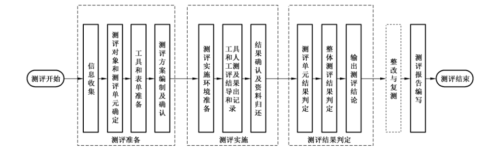

# GB/T 42582-2023 信息安全技术 移动互联网应用程序（App）个人信息安全测评规范

> 来源：[GB/T 42582-2023 国家标准详情](https://openstd.samr.gov.cn/bzgk/std/newGbInfo?hcno=B1B6FAA01F3FB7B428B8D28AACC46C6C)；发布日期：2023-05-23；实施日期：2023-12-01。
> PDF SHA-256：317c0a5eb9362f92d6fb848ac5bfd0eb4ee45f29022fa8fc4f778b9576efed1f。
> 转写说明：对照官方 PDF 全部 78 页图像逐页核对；省略封面、目录、页眉、页脚和页码，合并跨页内容。附录 A、C、D、E、F 的表格按原图重建，图 1 保留原图。正式引用请核对官方原文。

## 前言

本文件按照 GB/T 1.1—2020《标准化工作导则 第1部分：标准化文件的结构和起草规则》的规定起草。

请注意本文件的某些内容可能涉及专利。本文件的发布机构不承担识别专利的责任。

本文件由全国信息安全标准化技术委员会（SAC/TC 260）提出并归口。

本文件起草单位：中国电子技术标准化研究院、中国网络安全审查技术与认证中心、公安部第一研究所、北京信息安全测评中心、中国电子科技集团公司第十五研究所、国家计算机网络应急技术处理协调中心、北京百度网讯科技有限公司、北京梆梆安全科技有限公司、中国信息通信研究院、北京指掌易科技有限公司、中国人民银行数字货币研究所、中国移动通信集团有限公司、奇安信网神信息技术（北京）股份有限公司、北京汉华飞天信安科技有限公司、北京奇虎科技有限公司、陕西省网络与信息安全测评中心、中国科学院信息工程研究所、国家信息技术安全研究中心、北京银联金卡科技有限公司、北京交通大学、西安交通大学、中国汽车工程研究院股份有限公司、北京抖音信息服务有限公司、每日互动股份有限公司、启明星辰信息技术集团股份有限公司、OPPO广东移动通信有限公司、深圳市腾讯计算机系统有限公司、北京智游网安科技有限公司、全知科技（杭州）有限责任公司、江苏通付盾信息安全技术有限公司、中科锐眼（天津）科技有限公司。

本文件主要起草人：胡影、刘行、范博、姚相振、高超、严妍、辛建峰、韩煜、范红、李媛、刘健、董晶晶、林星辰、王一宇、李晓雪、王海棠、邓婷、方宁、王丹辉、李彪、宋玲娓、邱勤、赵帅、彭根、姚一楠、杨京、杜丹、吴冬宇、李宇、王伟、范铭、李光平、杨骁涵、董霖、史景、李腾、徐永太、韩云、王勰思、汪德嘉、赵洪宇。

## 1 范围

本文件规定了依据 GB/T 35273—2020开展移动互联网应用程序个人信息安全测评的测评流程以及对各项安全要求进行测评的方法。

本文件适用于指导第三方测评机构对移动互联网应用程序个人信息安全进行测评，以及主管监管部门对移动互联网应用程序个人信息安全进行监督管理，移动互联网应用程序运营者开展个人信息安全自评时参照执行。

## 2 规范性引用文件

下列文件中的内容通过文中的规范性引用而构成本文件必不可少的条款。其中，注日期的引用文件，仅该日期对应的版本适用于本文件；不注日期的引用文件，其最新版本（包括所有的修改单）适用于本文件。

- GB/T 25069—2022 信息安全技术 术语

- GB/T 35273—2020 信息安全技术 个人信息安全规范

- GB/T 41391—2022 信息安全技术 移动互联网应用程序（App）收集个人信息基本要求

## 3 术语和定义

GB/T 25069—2022、GB/T 35273—2020和GB/T 41391—2022 界定的以及下列术语和定义适用于本文件。

### 3.1 移动互联网应用程序 mobile internet application; App

运行在移动智能终端上的应用程序。

> 注：包括移动智能终端预置、下载安装的应用程序和小程序。

### 3.2 App运营者 mobile internet application operator

移动互联网应用程序所有者、管理者或提供者。

### 3.3 软件开发工具包 software development kit;SDK

协助软件开发的软件库。

> 注：软件开发工具包通常包括相关二进制文件、文档、范例和工具的集合。

### 3.4 个人信息保护政策 personal information protection policy

隐私政策 privacy policy

说明移动互联网应用程序处理个人信息规则的文本。

> 注：个人信息保护政策包含的内容见 GB/T 35273—2020中5.5。

### 3.5 测评对象 target of testing and evaluation

移动互联网应用程序个人信息安全测评流程中不同测评方式作用的对象。

> 注：主要涉及 App 运营者、App、App 服务端、相关文档资料等。

### 3.6 测评单元 testing and evaluation unit

对测评流程进行划分的最小独立单元。

> 注：每个测评单元包括指标要求、测评对象、测评方式、测评步骤、单元判定等5项内容，可独立验证符合性。

### 3.7 小程序 mini program

基于应用程序开放接口实现的，用户无需安装即可使用的移动互联网应用程序。

> 注：应用程序通过公开其应用程序编程接口（API）或函数，使外部的程序可以增加该应用程序的功能或使用该应用程序的资源，而不需要更改该应用程序的源代码。

### 3.8 用户 user

使用移动互联网应用程序的个人信息主体。

> 注：用户通常包括消费侧用户和服务供给侧用户，消费侧用户是使用移动互联网应用程序服务的个人消费者，服务供给侧用户是通过移动互联网应用程序提供服务的用户，例如网络约车类移动互联网应用程序的消费侧用户是乘客，服务供给侧用户是驾驶员。

### 3.9 第三方应用 third-party application

由移动互联网应用程序运营者之外的其他法人实体提供，通过移动互联网应用程序直接面向用户提供服务的应用程序。

注1：第三方应用的提供形式，通常包括 SDK、小程序、Web 页面等。如果 SDK 没有直接向用户提供服务，则不属于本文件所称的第三方应用。

注2：虽与 App 运营者属于不同法人实体，但与 App 运营者属于同一企业集团，且遵守同一套管理制度、统一进行安全和运维管理的，不属于 App 运营者的第三方。关联公司通常属于 App 运营者的第三方。

### 3.10 服务端 server

与运行在用户移动智能终端上的 App 相对应，支撑App 运营的整个后端系统。

### 3.11 可收集个人信息权限 system permission to access personal information

移动智能终端操作系统向移动互联网应用程序开放的，具有收集个人信息功能的系统权限。

> 注：简称系统权限或权限。

## 4 缩略语

下列缩略语适用于本文件。

API：应用程序编程接口（Application Programming Interface）

ICCID：集成电路卡识别码（Integrate Circuit Card IDentity）

IDFA：广告标识符（IDentifier For Advertising）

IMEI：国际移动设备识别码（International Mobile Equipment Identity）

IMSI：国际移动用户识别码（International Mobile Subscriber Identity）

MAC：媒体访问控制（Media Access Control）

SDK：软件开发工具包（Software Development Kit）

## 5 测评流程与方式

### 5.1 概述

App 个人信息安全测评主要针对 App 运营者、App 服务端、App 和相关文档资料等测评对象开展，测评流程包含测评准备、测评实施、测评结果判定和测评报告编写4个阶段，根据测评目标需要，也可以包含被测对象的整改与复测阶段，见图1。

### 5.2 测评流程

#### 5.2.1 测评准备

测评准备阶段的主要内容及要求如下。

<ol className="standard-subclauses">

<li>a） App 运营者基本信息的收集。测评人员应收集被测评 App 运营者提供的被测App 样本、App功能说明、App 收集使用个人信息情况说明等材料（提交材料内容见附录A）。为提高测评结果的准确性，对于有特殊登录需求的App，测评人员应要求被测App运营者提供对应登录账号。

</li>

<li>b） 测评对象和测评单元确定。测评人员应根据对App 运营者基本信息的分析，确定测评工作的具体测评对象和适用的测评单元，例如需验证的App 功能范围、查看的制度文档、核查的服务端系统、访谈的人员岗位等。

</li>

<li>c） 测评工具和测评表单准备。测评人员应根据确定的测评对象和测评单元，初步确定测评工作中所使用的测评工具和测评记录表。

</li>

<li>d） 测评方案编制与确认。测评人员应编制 App 个人信息安全测评方案，方案内容应涵盖测评对象、测评依据、测评内容、测评方法、测评工具、测评计划等。测评方案编制过程中，根据具体情况，测评人员还需要App 运营者提供额外的信息材料或进行现场调研。测评方案编制完成后，测评人员应针对方案内容与 App 运营者进行确认，避免测评对生产环境带来次生风险。

</li>

</ol>

#### 5.2.2 测评实施

测评实施阶段的主要工作包括如下内容。

<ol className="standard-subclauses">

<li>a） 测评实施环境准备。开始实施测评时，测评人员应进行技术检测工具的部署、调试和状态确认，保障技术检测工具输出结果的可靠性。

</li>

<li>b） 工具和人工测评及结果导出和记录。测评人员按照第6章规定的测评方法实施测评，并将测评流程中获取的证据进行详细、准确的导出、记录。

</li>

<li>c） 结果确认及资料归还。测评实施阶段完成时，测评人员应与被测 App 运营者确认测评实施阶段全部完成且形成了对应的测评记录，并确认测评实施阶段记录的证据的准确性。确认测评实施动作完成后，测评人员应归还被测评 App 的相关资料、移交相关权限和账号。

</li>

</ol>

#### 5.2.3 结果判定

测评结果判定阶段的主要工作包括如下内容。

<ol className="standard-subclauses">

<li>a） 测评单元结果判定。测评人员通过证据分析，给出每一个测评单元的判定结果。

</li>

<li>b） 整体测评结果判定。测评人员根据测评单元的判定结果确定 App 个人信息安全测评的整体结果。

</li>

<li>c） 输出测评结论。测评人员根据整体测评结果给出 App 个人信息安全测评的结论。

</li>

</ol>

#### 5.2.4 整改与复测

根据测评目标需要，App 个人信息安全测评可以添加整改与复测阶段。整改与复测阶段的主要工作包括如下内容。

<ol className="standard-subclauses">

<li>a）输出整改建议。测评人员根据测评记录和结果判定，针对单元判定结果为不符合的测评单元，给出 App 个人信息安全整改建议。

</li>

<li>b） 实施整改。被测 App运营者根据整改建议实施整改。

</li>

<li>c） 整改结果复测。App 运营者整改完成后，测评人员再次对初次测评时判定为不符合的测评单元进行测评，并给出复测的结果判定。如果整改措施对其他测评单元产生影响，则还需对被影响的其他测评单元进行复测。

</li>

</ol>

#### 5.2.5 报告编写

测评报告编写阶段，测评人员根据App 个人信息安全测评记录和结果判定，编制测评报告并加盖相关的印章。测评报告内容应准确、清晰、明确、客观，文字表达应简明、确切、符合逻辑，避免产生不易理解或不同理解的可能性，排版应规范。

### 5.3 测评方式

App 个人信息安全测评实施过程中，测评人员可采用的基本测评方式包括但不限于以下五种。

<ol className="standard-subclauses">

<li>a） 文档审查：指测评人员查看 App运营者的个人信息保护相关文档资料，分析 App 现有的或计划采取的个人信息保护措施。文档资料包括但不限于：

<ol className="standard-subclauses">

<li>1） 策略文档，例如政策法规、部门规章、规范性文件、组织管理制度等；

</li>

<li>2） 系统文档，例如用户手册、管理员手册、系统设计和需求文档、接口文档等；

</li>

<li>3） 个人信息安全相关文档，例如个人信息保护影响评估报告、个人信息保护合规审计报告、个人信息安全测试报告、个人信息安全应急预案、个人信息委托处理合同、个人信息对外提供合同、个人信息处理记录等。

</li>

</ol>

</li>

<li>b） 服务端核查：指测评人员核查App 服务端个人信息安全相关配置情况和个人信息处理活动情况，核实 App 运营者的个人信息保护制度和个人信息安全策略落实情况，核实 App 服务端是否在用户同意范围内处理个人信息。

</li>

<li>c） 功能验证：指测评人员以用户身份操作使用 App，依据与 App 的交互过程，验证 App 收集使用个人信息和保障用户个人权利的情况。

</li>

<li>d） 技术检测：指测评人员通过App 个人信息安全检测工具获得 App 未在交互界面显示的个人信息收集使用情况，并进行分析以帮助测评人员获取证据。

</li>

<li>e） 人员访谈：指测评人员与被测评 App 运营者的管理、技术人员进行沟通。根据对测评人员所提问题的回答，测评人员为测评获得相应信息，并验证收集到的证据。

</li>

</ol>

### 5.4 测评环境和工具

App 个人信息安全测评环境和工具应满足以下基本要求：

<ol className="standard-subclauses">

<li>a） 保障硬件平台、网络环境、操作系统、测评软件等自身安全性，不因测试环境降低 App 安全性；

</li>

<li>b）最小化对 App 运行状态的影响，能够运行 App 完整的业务功能并进行检测；

</li>

<li>c） 能够解析 App 基本属性信息，包括但不限于 App 名称、包名、版本号、大小、摘要值、签名信息、权限声明等；

</li>

<li>d） 能够识别和记录App 运行时收集个人信息的行为，包含收集个人信息行为的时间、频次、范围、类型、精度、使用的权限、调用的API等；

</li>

<li>e） 能够监测和记录 App 网络数据传输行为，包括传输时间、网络协议、传输内容、目标 IP、目标端口及目标IP 所在地区等；

</li>

<li>f） 宜提供多种方式（如截图、视频、调用栈等）支撑检测记录有效性；

</li>

<li>g） 宜采用真机测评环境对 App 进行检测，提高测评结果准确性；

</li>

<li>h）宜具备API 调用栈及输入参数、返回值的跟踪，本地文件访问记录，本地SSL代理，界面元素识别和自动点击等功能；

</li>

<li>i） 宜支持对采用加固（加壳）技术保护的 App 的识别和检测；

</li>

<li>j） 能够记录测评人员和测评过程，并限制未授权人员查看测评记录。

</li>

</ol>

## 6 测评实施内容

### 6.1 个人信息收集的测评

#### 6.1.1 收集个人信息合法性的测评

##### 6.1.1.1 测评单元（PIC-01）

本测评单元针对 GB/T 35273—2020中5.1 a），测评方法如下。

注1：测评单元的编号规则见附录B。

<ol className="standard-subclauses">

<li>a） 指标要求：App 中不应存在以欺诈、诱骗、误导的方式收集个人信息的情况。

</li>

<li>b）测评对象：文档资料、App。

</li>

<li>c） 测评方式：文档审查、功能验证、技术检测。

</li>

<li>d） 测评步骤：

<ol className="standard-subclauses">

<li>1） 查看App运营者的个人信息安全相关管理制度，是否明确要求 App 不应以欺诈、诱骗、误导的方式收集个人信息；

</li>

<li>2） 查看 App 个人信息保护政策，是否存在以欺诈、诱骗、误导的方式描述个人信息收集行为的情况；

</li>

<li>3） 通过功能验证、技术检测查看 App 是否存在以欺诈、诱骗、误导的方式收集个人信息的行为。

注2：欺诈、诱骗、误导的行为见附录C。

</li>

</ol>

</li>

<li>e） 单元判定：如果1）为肯定，2）、3）为否定，则符合本测评单元指标要求，否则不符合本测评单元指标要求。

</li>

</ol>

##### 6.1.1.2 测评单元（PIC-02）

本测评单元针对GB/T 35273—2020中5.1b），测评方法如下。

<ol className="standard-subclauses">

<li>a） 指标要求：App 不应隐瞒自身所具有的收集个人信息的业务功能。

</li>

<li>b） 测评对象：文档资料、App。

</li>

<li>c） 测评方式：文档审查、功能验证、技术检测。

</li>

<li>d） 测评步骤：

<ol className="standard-subclauses">

<li>1） 查看并记录App 个人信息保护政策等文件中告知的收集个人信息的业务功能及其对应个人信息收集情况；

</li>

<li>2） 通过功能验证、技术检测，查看App 实际收集个人信息的业务功能及其对应个人信息收集情况；

</li>

<li>3） 比较 App 告知的和实际存在的业务功能和收集个人信息情况，判断 App 是否存在隐瞒收集个人信息的业务功能。

</li>

</ol>

</li>

<li>e） 单元判定：如果3）为否定，则符合本测评单元指标要求，否则不符合本测评单元指标要求。

</li>

</ol>

##### 6.1.1.3 测评单元（PIC-03）

本测评单元针对GB/T 35273—2020中5.1c），测评方法如下。

<ol className="standard-subclauses">

<li>a） 指标要求：App 运营者不应从非法渠道获取个人信息。

</li>

<li>b） 测评对象：文档资料、App 服务端、App。

</li>

<li>c） 测评方式：文档审查、功能验证、技术检测、服务端核查、人员访谈。

</li>

<li>d） 测评步骤：

<ol className="standard-subclauses">

<li>1） 查看 App运营者的个人信息安全相关管理制度，是否明确要求不应从非法渠道获取个人信息；

</li>

<li>2） 访谈 App 运营相关人员，询问获取个人信息的渠道，判断 App 运营者获取个人信息的渠道是否合法；

</li>

<li>3） 随机选择几类个人信息，查看 App 运营者是否能证明这些个人信息来源的合法性；

</li>

<li>4） 通过功能验证、技术检测、服务端核查，查看是否存在被监管部门认定为存在违法违规收集个人信息行为且未进行整改的情况。

</li>

</ol>

</li>

<li>e） 单元判定：如果1）、2）、3）为肯定，4）为否定，则符合本测评单元指标要求，否则不符合本测评单元指标要求。

</li>

</ol>

#### 6.1.2 收集个人信息最小必要的测评

##### 6.1.2.1 测评单元（PIC-04）

本测评单元针对 GB/T 35273—2020中 5.2 a），测评方法如下。

<ol className="standard-subclauses">

<li>a） 指标要求：App 必须收集的个人信息应是保障其基本业务功能正常运行最少够用的个人信息。

</li>

<li>b） 测评对象：App。

</li>

<li>c） 测评方式：功能验证、技术检测。

</li>

<li>d） 测评步骤：

<ol className="standard-subclauses">

<li>1） 通过功能验证查看 App 提供的基本业务功能，结合功能验证、技术检测查看 App 是否强制收集必要个人信息范围外的其他个人信息；

注：服务类型正常运行最少够用的个人信息及相关要求见 GB/T 41391—2022中附录 A。

</li>

<li>2） 通过功能验证、技术检测查看 App 是否强制用户打开非必要权限。

</li>

</ol>

</li>

<li>e） 单元判定：如果1）、2）均为否定，则符合本测评单元指标要求，否则不符合本测评单元指标要求。

</li>

</ol>

##### 6.1.2.2 测评单元（PIC-05）

本测评单元针对 GB/T 35273—2020中 5.2 a），测评方法如下。

<ol className="standard-subclauses">

<li>a） 指标要求：App 收集的个人信息的类型应与实现其业务功能有直接关联。

</li>

<li>b） 测评对象：文档资料、App。

</li>

<li>c） 测评方式：文档审查、功能验证、技术检测。

</li>

<li>d） 测评步骤：

<ol className="standard-subclauses">

<li>1） 查看 App 个人信息保护政策中描述的App 收集的个人信息是否与业务功能有直接关联；

</li>

<li>2） 通过技术检测查看 App 是否在配置文件中声明与App 的所有业务功能均没有直接关联的权限；

</li>

<li>3） 通过功能验证、技术检测查看 App 申请的可收集个人信息的权限是否与业务功能有直接关联；

</li>

<li>4） 通过功能验证、技术检测查看 App 实际收集的个人信息是否与业务功能有直接关联。

注1：直接关联是指没有该个人信息的参与，与之相对应的服务功能无法实现。

注2：特定类型个人信息收集要求见 GB/T 41391—2022中附录C。

</li>

</ol>

</li>

<li>e） 单元判定：如果1）、3）、4）均为肯定且 2）为否定，则符合本测评单元指标要求，否则不符合本测评单元指标要求。

</li>

</ol>

##### 6.1.2.3 测评单元（PIC-06）

本测评单元针对 GB/T 35273—2020中5.2 a），测评方法如下。

<ol className="standard-subclauses">

<li>a） 指标要求：用户未使用App 特定功能时，不应提前要求用户授权该功能需要的权限或要求用户填写该功能需要的个人信息。

</li>

<li>b） 测评对象：App。

</li>

<li>c） 测评方式：功能验证。

</li>

<li>d） 测评步骤：

<ol className="standard-subclauses">

<li>1） 通过功能验证查看App 是否提前要求用户授权当前未使用的特定功能所需的权限或要求用户填写当前未使用的特定功能需要的个人信息。

注：用户未使用 App 特定功能时要求用户授权相应权限的行为，例如用户进入客服功能时，在未使用拍照和语音功能的情况下，要求用户授权摄像头和麦克风权限。

</li>

</ol>

</li>

<li>e） 单元判定：如果1）为否定，则符合本测评单元指标要求，否则不符合本测评单元指标要求。

</li>

</ol>

##### 6.1.2.4 测评单元（PIC-07）

本测评单元针对 GB/T 35273—2020中5.2b），测评方法如下。

<ol className="standard-subclauses">

<li>a） 指标要求：App 自动采集个人信息的频率应是实现 App 的业务功能所必需的最低频率。

</li>

<li>b） 测评对象：文档资料、App。

</li>

<li>c） 测评方式：文档审查、技术检测。

</li>

<li>d） 测评步骤：

<ol className="standard-subclauses">

<li>1） 通过技术检测查看 App 及其嵌入的第三方 SDK 和接入的第三方应用在前台、后台和静默运行时自动收集个人信息的频率，结合 App 运营者提供的证明材料，判断App 自动收集个人信息的频率是否是实现 App 的业务功能所必需的最低频率。

注1:App 自动收集个人信息的频率可参考其调用可读取个人信息的API 的频率或发送包含个人信息的网络数据包的频率。

注2：不同场景下 App 采集个人信息的合理频率和相应的检测环境参考附录D。

</li>

</ol>

</li>

<li>e） 单元判定：如果1）为肯定，则符合本测评单元指标要求，否则不符合本测评单元指标要求。

</li>

</ol>

##### 6.1.2.5 测评单元（PIC-08）

本测评单元针对GB/T 35273—2020中5.2c），测评方法如下。

<ol className="standard-subclauses">

<li>a） 指标要求：App 间接获取个人信息的数量应是实现 App 业务功能所必需的最少数量。

</li>

<li>b） 测评对象：文档资料、App服务端、App。

</li>

<li>c） 测评方式：文档审查、服务端核查、功能验证、技术检测、人员访谈。

</li>

<li>d） 测评步骤：

<ol className="standard-subclauses">

<li>1） 通过查看 App 的个人信息保护政策和功能验证查看App 是否存在间接获取个人信息的行为；

</li>

<li>2） 访谈 App 运营者，询问是否存在间接获取个人信息的行为；

</li>

<li>3） 查看 App运营者的个人信息安全相关管理制度，是否明确要求间接获取个人信息的数量应是实现App 业务功能所必需的最少数量；

</li>

<li>4） 通过功能验证、技术检测查看 App 间接获取的个人信息是否为实现App 业务功能所必需的最少数量；

</li>

<li>5） 查看在间接获取的场景下是否有获取个人信息的协议，协议中是否规定了获取个人信息的类型、数据量以及与业务功能的关联关系，判断 App 间接获取个人信息的数量是否是App 业务功能所必需的最少数量。

注：App 间接获取个人信息的行为包括第三方账号登录时获取用户的昵称、头像，内嵌第三方购物平台时聚合展示用户在不同第三方购物平台的订单信息，获取用户的第三方信用评分，获取用户的第三方用户画像等。

</li>

</ol>

</li>

<li>e） 单元判定：如果1）、2）为否定，则本测评单元为不适用；如果1）～5）为肯定，则符合本测评单元指标要求，否则不符合本测评单元指标要求。

</li>

</ol>

#### 6.1.3 多项业务功能自主选择的测评

##### 6.1.3.1 测评单元（PIC-09）

本测评单元针对 GB/T 35273—2020中5.3 a），测评方法如下。

<ol className="standard-subclauses">

<li>a） 指标要求：App 不应通过捆绑多项业务功能的方式，要求用户一次性授权同意其未使用的业务功能收集个人信息的请求。

</li>

<li>b） 测评对象：App。

</li>

<li>c） 测评方式：功能验证、技术检测。

</li>

<li>d） 测评步骤：

<ol className="standard-subclauses">

<li>1） 通过功能验证查看 App 是否在安装时要求用户一次性授权其申请的全部权限；

</li>

<li>2） 通过功能验证查看 App 是否在首次启动时一次性连续弹窗要求用户授权当前还未使用的业务功能所需的权限；

</li>

<li>3） 通过功能验证查看 App 是否在首次启动时要求用户填写当前未使用的业务功能所需的个人信息；

</li>

<li>4） 通过功能验证查看 App 是否在用户注册、登录账号时，强制要求用户授权该账号关联的其他 App 收集的个人信息；

</li>

<li>5） 通过功能验证查看 App 提供多项业务功能时，是否明确列出各项业务功能，并就每个业务功能收集个人信息的请求分别征求用户同意。

</li>

</ol>

</li>

<li>e） 单元判定：如果1）～4）为否定且5）为肯定，则符合本测评单元指标要求，否则不符合本测评单元指标要求。

</li>

</ol>

##### 6.1.3.2 测评单元（PIC-10）

本测评单元针对 GB/T 35273—2020中5.3b），测评方法如下。

<ol className="standard-subclauses">

<li>a） 指标要求：App 应把用户自主作出的肯定性动作，如主动点击、勾选、填写等，作为产品或服务的特定业务功能的开启条件。

</li>

<li>b）测评对象：App。

</li>

<li>c） 测评方式：功能验证。

</li>

<li>d） 测评步骤：

<ol className="standard-subclauses">

<li>1） 通过功能验证查看 App 提供的业务功能类型，如地图导航、网络约车、网络支付等。查看App 是否在首次启动时默认开启除基本业务功能外其他涉及收集个人信息的业务功能；

</li>

<li>2） 查看用户打开 App 后是否能通过自主选择的方式开启特定业务功能，如通过主动点击、勾选、填写等方式。

</li>

</ol>

</li>

<li>e） 单元判定：如果 1）为否定且 2）为肯定，则符合本测评单元指标要求，否则不符合本测评单元指标要求。

</li>

</ol>

##### 6.1.3.3 测评单元（PIC-11）

本测评单元针对 GB/T 35273—2020中 5.3b），测评方法如下。

<ol className="standard-subclauses">

<li>a） 指标要求：App 应仅在用户开启业务功能后，才开始收集该业务功能需要的个人信息。

</li>

<li>b）测评对象：App。

</li>

<li>c） 测评方式：功能验证、技术检测。

</li>

<li>d） 测评步骤：

<ol className="standard-subclauses">

<li>1） 通过功能验证、技术检测查看 App 是否在首次启动时默认开启 App 基本业务功能外的其他业务功能，并开始收集基本业务功能最小必要个人信息范围外的其他个人信息；

</li>

<li>2） 通过功能验证、技术检测查看 App 是否在用户开启特定业务功能后才开始收集对应业务功能需要的个人信息或申请打开业务功能需要的权限。

</li>

</ol>

</li>

<li>e） 单元判定：如果1）为否定且2）为肯定，则符合本测评单元指标要求，否则不符合本测评单元指标要求。

</li>

</ol>

##### 6.1.3.4 测评单元（PIC-12）

本测评单元针对 GB/T 35273—2020中 5.3b），测评方法如下。

<ol className="standard-subclauses">

<li>a） 指标要求：App 在未向用户告知或未经用户同意，或无合理的使用场景时，不应自启动或关联启动其他 App 并收集个人信息。

</li>

<li>b） 测评对象：文档资料、App。

</li>

<li>c） 测评方式：文档审查、功能验证、技术检测。

</li>

<li>d） 测评步骤：

<ol className="standard-subclauses">

<li>1） 通过技术检测查看 App 是否存在自启动并在自启动后收集个人信息的行为；

</li>

<li>2） 通过技术检测查看 App 在使用或静默状态是否存在关联启动其他App 并收集个人信息的行为；

</li>

<li>3） 查看 App 的个人信息保护政策中是否说明App 具有自启动或关联启动其他 App 并收集个人信息的行为；

</li>

<li>4） 通过功能验证查看 App 自启动或关联启动其他 App 后收集个人信息的行为是否征得用户同意；

</li>

<li>5） 结合 App 运营者提供的证明材料，判断 App 自启动或关联启动其他App 并收集个人信息的行为是否合理。

</li>

</ol>

</li>

<li>e） 单元判定：如果 1）、2）为否定，则本测评单元为不适用；如果1）或2）为肯定且3）、4）、5）均为肯定，则符合本测评单元指标要求；否则不符合本测评单元指标要求。

</li>

</ol>

##### 6.1.3.5 测评单元（PIC-13）

本测评单元针对 GB/T 35273—2020中5.3c），测评方法如下。

<ol className="standard-subclauses">

<li>a） 指标要求：App 关闭或退出业务功能的途径或方式应与用户选择使用业务功能的途径或方式同样方便。

</li>

<li>b） 测评对象：App。

</li>

<li>c） 测评方式：功能验证。

</li>

<li>d） 测评步骤：

<ol className="standard-subclauses">

<li>1） 通过功能验证查看 App 是否向用户提供自主选择关闭或退出特定业务功能的途径或方式；

</li>

<li>2） 通过功能验证查看 App 关闭或退出的途径或方式是否与用户使用或开启特定业务功能的途径或方式同样便捷，如一键关闭或退出特定业务功能的按钮或途径。

</li>

</ol>

</li>

<li>e） 单元判定：如果 1）、2）为肯定，则符合本测评单元指标要求，否则不符合本测评单元指标要求。

</li>

</ol>

##### 6.1.3.6 测评单元（PIC-14）

本测评单元针对 GB/T 35273—2020中5.3c），测评方法如下。

<ol className="standard-subclauses">

<li>a） 指标要求：用户选择关闭或退出特定业务功能后，App 应停止该业务功能的个人信息收集活动。

</li>

<li>b） 测评对象：App。

</li>

<li>c） 测评方式：功能验证、技术检测。

</li>

<li>d） 测评步骤：

<ol className="standard-subclauses">

<li>1） 进入App 某项业务功能，通过功能验证、技术检测查看 App 收集的个人信息；

</li>

<li>2） 关闭或退出该业务功能，通过功能验证、技术检测查看 App 收集的个人信息；

</li>

<li>3） 对比该业务功能关闭或退出前后 App 收集的个人信息，判断用户选择关闭或退出特定业务功能后，App 是否停止该业务功能的个人信息收集活动。

</li>

</ol>

</li>

<li>e） 单元判定：如果 3）为肯定，则符合本测评单元指标要求，否则不符合本测评单元指标要求。

</li>

</ol>

##### 6.1.3.7 测评单元（PIC-15）

本测评单元针对GB/T 35273—2020中5.3d），测评方法如下。

<ol className="standard-subclauses">

<li>a） 指标要求：用户不授权同意使用、关闭或退出特定业务功能的，App 不应频繁征求用户的授权同意。

</li>

<li>b） 测评对象：App。

</li>

<li>c） 测评方式：功能验证。

</li>

<li>d） 测评步骤：

<ol className="standard-subclauses">

<li>1） 通过功能验证查看用户不同意某一业务功能收集非必要个人信息后，App 是否再次询问用户同意收集该类个人信息；

</li>

<li>2） 通过功能验证查看用户不同意打开某项可收集个人信息的非必要权限后，App 是否再次询问用户是否同意打开该项可收集个人信息的权限；

</li>

<li>3） 通过功能验证查看用户关闭或退出特定业务功能后，在未使用该特定业务功能时，App是否再次询问用户打开特定业务功能。

注：再次询问的表现方式包括但不限于弹窗或持续性提示等中断或干扰用户正常操作的行为。持续性提示是指在 App 界面持续展示用户可见的提示文本、图片、滚动字幕、链接等，用户不主动点击关闭或同意收集个人信息则提示信息无法自行消除的行为。

</li>

</ol>

</li>

<li>e） 单元判定：如果 1）、2）、3）均为否定，则符合本测评单元指标要求，否则不符合本测评单元指标要求。

</li>

</ol>

##### 6.1.3.8 测评单元（PIC-16）

本测评单元针对 GB/T 35273—2020中5.3e），测评方法如下。

<ol className="standard-subclauses">

<li>a） 指标要求：用户不授权同意使用、关闭或退出特定业务功能，App 不应暂停用户自主选择使用其他的业务功能，或降低其他业务功能的服务质量。

</li>

<li>b） 测评对象：App。

</li>

<li>c） 测评方式：功能验证。

</li>

<li>d） 测评步骤：

<ol className="standard-subclauses">

<li>1） 通过功能验证查看用户关闭或退出特定业务功能，App 是否妨碍其他业务功能继续正常使用；

</li>

<li>2） 通过功能验证查看用户关闭或退出特定业务功能，App 是否故意设置障碍影响用户体验。

</li>

</ol>

</li>

<li>e） 单元判定：如果1）、2）为否定，则符合本测评单元指标要求，否则不符合本测评单元指标要求。

</li>

</ol>

##### 6.1.3.9 测评单元（PIC-17）

本测评单元针对 GB/T 35273—2020中 5.3e），测评方法如下。

<ol className="standard-subclauses">

<li>a） 指标要求：App 新增业务功能申请收集的个人信息超出用户原有同意范围，若用户不同意，不应拒绝提供原有业务功能。

</li>

<li>b） 测评对象：文档资料、App。

</li>

<li>c） 测评方式：文档审查、功能验证。

</li>

<li>d） 测评步骤：

<ol className="standard-subclauses">

<li>1） 查看 App 的个人信息保护政策，对比 App 新增业务功能申请收集的个人信息。进入App 新增业务功能界面，不同意新增业务功能申请收集的个人信息或不打开可收集个人信息权限，查看 App 是否妨碍其他业务功能继续正常使用。

注：新增业务功能取代原有业务功能的除外。

</li>

</ol>

</li>

<li>e） 单元判定：如果1）为否定，则符合本测评单元指标要求，否则不符合本测评单元指标要求。

</li>

</ol>

##### 6.1.3.10 测评单元（PIC-18）

本测评单元针对 GB/T 35273—2020中5.3 f），测评方法如下。

<ol className="standard-subclauses">

<li>a） 指标要求：App 不应仅以改善服务质量、提升使用体验、研发新产品、增强安全性等为由，强制要求用户同意收集个人信息。

</li>

<li>b） 测评对象：文档资料、App。

</li>

<li>c） 测评方式：文档审查、功能验证。

</li>

<li>d） 测评步骤：

<ol className="standard-subclauses">

<li>1） 查看 App 的个人信息保护政策，或通过功能验证，记录仅以改善服务质量、提升使用体验、研发新产品、增强安全性等为由，要求用户同意收集的个人信息；

</li>

<li>2） 通过功能验证，不提供仅以改善服务质量、提升使用体验、研发新产品、增强安全性为由收集的信息，查看 App 是否拒绝提供各项服务。

注：为保障App 基本的业务安全性，而非增强安全性而收集的个人信息，不在此项检测范围内。

</li>

</ol>

</li>

<li>e） 单元判定：如果2）为否定，则符合本测评单元指标要求，否则不符合本测评单元指标要求。

</li>

</ol>

#### 6.1.4 收集个人信息时授权同意的测评

##### 6.1.4.1 测评单元（PIC-19）

本测评单元针对 GB/T 35273—2020中 5.4 a），测评方法如下。

<ol className="standard-subclauses">

<li>a） 指标要求：App 收集个人信息，应向用户告知收集、使用个人信息的目的、方式和范围等规则，并获得用户的授权同意。

</li>

<li>b） 测评对象：App。

</li>

<li>c） 测评方式：功能验证、技术检测。

</li>

<li>d） 测评步骤：

<ol className="standard-subclauses">

<li>1） 查看 App 的个人信息保护政策，是否以结构化清单的方式逐一列出 App（包括接入的第三方应用、嵌入的第三方 SDK 等）收集、使用个人信息的目的、方式、范围、时机、频率、存储位置、存储期限等规则；

</li>

<li>2） 通过功能验证查看App 基本业务功能开启前（如用户初始安装、首次使用等），是否通过交互界面（如弹窗、文字说明、提示条、提示音等形式），向用户告知基本业务功能所必要收集的个人信息和处理情况，以及用户拒绝提供或拒绝同意收集将造成的影响，并通过用户对信息收集主动做出肯定性动作（如勾选、点击“同意”等）征得其明示同意；

</li>

<li>3） 通过技术检测查看 App 是否在征得用户同意前就开始收集个人信息或打开可收集个人信息的权限；

</li>

<li>4） 通过技术检测查看 App 是否在未征得用户同意的情况下收集个人信息；

</li>

<li>5） 通过技术检测查看 App 实际收集的个人信息或打开的可收集个人信息权限是否超出用户授权范围；

</li>

<li>6） 通过技术检测查看 App 是否未经用户同意更改其设置的可收集个人信息设置状态，如App 更新时自动将用户设置的隐私设置恢复到默认状态。

注1：技术检测时需关注不需要系统权限就可以自动收集的个人信息，包括但不限于设备信息（例如 Android id、设备型号等）、剪切板、应用程序列表、WiFi 列表、MAC 地址、IP 地址等。

注2：App 中可收集个人信息设置包括 App 的系统权限设置，也包括 App 中涉及个人信息处理的设置，例如个性化推送的开关、推荐好友的开关、用户画像的标签、对 App 中接入的第三方应用提供个人信息的授权等。

注3：App 实际收集个人信息超出用户授权范围的情况，如 App 以添加联系人为由申请通讯录权限，用户打开权限后 App 读取并上传整个通讯录；App 声明申请获取地理位置权限用于获得粗略地理位置，但用户授权后 App 实际获取了精确地理位置等。

</li>

</ol>

</li>

<li>e） 单元判定：如果1）、2）为肯定且3）～6）为否定，则符合本测评单元指标要求，否则不符合本测评单元指标要求。

</li>

</ol>

##### 6.1.4.2 测评单元（PIC-20）

本测评单元针对 GB/T 35273—2020中5.4 b），测评方法如下。

<ol className="standard-subclauses">

<li>a） 指标要求：App 收集敏感个人信息前，应征得用户的单独同意，并应确保用户的单独同意是其在完全知情的基础上自主给出的、具体的、清晰明确的意愿表示。

</li>

<li>b） 测评对象：App。

</li>

<li>c） 测评方式：功能验证、技术检测。

</li>

<li>d） 测评步骤：

<ol className="standard-subclauses">

<li>1） 查看 App 的个人信息保护政策，是否对需要收集的敏感个人信息进行了明确标识或突出显示，是否明确说明了涉及收集敏感个人信息的业务功能，各业务功能收集敏感个人信息的目的、必要性、方式、范围、字段、时机、频次、存储时间、存储位置、存储方式，敏感个人信息委托处理、共同处理和对外提供情况等；

</li>

<li>2） 通过功能验证查看 App 在收集用户敏感个人信息时，是否通过交互界面（如弹窗、文字说明、提示条、提示音等形式）向用户清晰明确告知收集使用该敏感个人信息的目的、必要性、方式、范围、时机、频次、存储时间、存储位置、存储方式、委托处理、共同处理、对外提供等规则，以便用户在作出具体的授权同意前，能充分考虑对其具体影响，并通过用户对每项敏感个人信息收集主动、单独作出肯定性动作（如逐项勾选、逐项点击“同意”等）征得其明示同意；

</li>

<li>3） 通过功能验证查看 App 在申请打开可收集敏感个人信息的权限时，是否同步告知用户收集使用规则，且告知内容清晰明确，并取得用户单独同意，告知内容是否包括权限申请的目的、访问字段、权限调用精度、权限调用场景、后台权限调用情况、信息上传情况、权限调用频次等；查看 App 申请特定类型系统权限或收集特定类型系统信息时，是否额外告知详细处理规则；

</li>

<li>4） 通过技术检测查看App 在读取剪切板、应用程序列表时，是否向用户告知并征得用户单独同意；

</li>

<li>5） 通过功能验证查看 App 是否将收集多项敏感个人信息的行为一次性征得用户同意，或者将收集同一项敏感个人信息但用于不同处理目的的行为一次性征得用户同意。

注1：收集用户实名信息时仅说明用于实名制认证、收集地理位置信息时仅说明用于基于地理位置的相关服务，申请存储权限时仅说明用于改进用户体验等未说明详细使用场景的可认为属于说明不清晰的情况。

注 2：敏感个人信息范围见 GB/T 35273—2020中附录B。

注3：App 申请特定类型系统权限或收集特定类型系统信息时的额外告知内容参考附录 E。

</li>

</ol>

</li>

<li>e） 单元判定：如果 1）～4）均为肯定且5）为否定，则符合本测评单元指标要求，否则不符合本测评单元指标要求。

</li>

</ol>

##### 6.1.4.3 测评单元（PIC-21）

本测评单元针对 GB/T 35273—2020中 5.4c），测评方法如下。

<ol className="standard-subclauses">

<li>a） 指标要求：App 收集个人生物识别信息前，应单独向用户告知收集、使用个人生物识别信息的目的、方式和范围，以及存储时间等规则，并征得用户的单独同意。

</li>

<li>b） 测评对象：App。

</li>

<li>c） 测评方式：功能验证。

</li>

<li>d） 测评步骤：

<ol className="standard-subclauses">

<li>1） 查看 App 的个人信息保护政策，是否对需要收集的个人生物识别信息进行了明确标识或突出显示，是否明确说明了涉及收集个人生物识别信息的业务功能，收集个人生物识别信息的目的、必要性、方式、时机、频次、存储时间、存储位置、存储方式，委托处理、共同处理和对外提供等情况；

</li>

<li>2） 通过功能验证查看 App 在收集用户个人生物识别信息时，是否通过交互界面（如弹窗、文字说明、提示条、提示音等形式）向用户清晰明确告知收集使用个人生物识别信息的目的、必要性、方式、时机、频次、存储时间、存储位置、存储方式、委托处理、共同处理、对外提供等规则，以便用户在作出具体的授权同意前，能充分考虑对其具体影响，并通过用户主动、单独作出肯定性动作（如单独勾选、单独点击“同意”等）征得其明示同意；

</li>

<li>3） 查看App 在申请打开可收集个人生物识别信息的权限时，是否同步告知用户其目的，且目的说明清晰明确。

</li>

</ol>

</li>

<li>e） 单元判定：如果1）、2）、3）为肯定，则符合本测评单元指标要求，否则不符合本测评单元指标要求。

</li>

</ol>

##### 6.1.4.4 测评单元（PIC-22）

本测评单元针对 GB/T 35273—2020中5.4d），测评方法如下。

<ol className="standard-subclauses">

<li>a） 指标要求：App 收集年满 14 周岁未成年人的个人信息前，应征得未成年人或其监护人的明示同意；不满 14 周岁的，应征得其监护人的单独同意。

</li>

<li>b） 测评对象：App。

</li>

<li>c） 测评方式：功能验证、人员访谈。

</li>

<li>d） 测评步骤：

<ol className="standard-subclauses">

<li>1） 查看 App 的个人信息保护政策中是否告知了征得未成年人监护人同意的机制；

</li>

<li>2） 如果 App 中存在设定生日、年龄等相关功能，设置年龄为14周岁以下，查看 App是否有相应机制征得监护人的单独同意；

</li>

<li>3） 访谈 App 运营者，在收集年满14周岁的未成年人的个人信息前，是否具备相应措施征得未成年人或其监护人的单独同意。

</li>

</ol>

</li>

<li>e） 单元判定：如果 1）、2）、3）为肯定，则符合本测评单元指标要求，否则不符合本测评单元指标要求。

</li>

</ol>

##### 6.1.4.5 测评单元（PIC-23）

本测评单元针对 GB/T 35273—2020中5.4 e），测评方法如下。

<ol className="standard-subclauses">

<li>a） 指标要求：App 运营者间接获取个人信息时，应要求个人信息提供方说明个人信息来源，并对其个人信息来源的合法性进行确认。

</li>

<li>b）测评对象：文档资料。

</li>

<li>c） 测评方式：文档审查、人员访谈。

</li>

<li>d） 测评步骤：

<ol className="standard-subclauses">

<li>1） 访谈 App 运营者相关人员，确认 App 运营者是否通过间接渠道获取个人信息；

</li>

<li>2） 查看 App运营者在间接获取个人信息时，是否通过相关合同或协议保障个人信息来源的合法性；

</li>

<li>3） 访谈 App运营者间接获取的个人信息的类型以及来源，是否对其来源的合法性进行确认。

</li>

</ol>

</li>

<li>e） 单元判定：如果1）为否定，则本测评单元为不适用；如果1）、2）、3）均为肯定，则符合本测评单元指标要求，否则不符合本测评单元指标要求。

</li>

</ol>

##### 6.1.4.6 测评单元（PIC-24）

本测评单元针对 GB/T 35273—2020中5.4 e），测评方法如下。

<ol className="standard-subclauses">

<li>a） 指标要求：App 运营者间接获取个人信息时，应了解个人信息提供方已获得的个人信息处理的授权同意范围，包括使用目的，用户是否授权同意转让、共享、公开披露、删除等。

</li>

<li>b） 测评对象：文档资料。

</li>

<li>c） 测评方式：文档审查、人员访谈。

</li>

<li>d） 测评步骤：

<ol className="standard-subclauses">

<li>1） 访谈 App运营者相关人员，确认 App 运营者是否通过间接渠道获取个人信息；

</li>

<li>2） 查看 App运营者在间接获取个人信息前，是否已通过相关合同或协议明确提供方已获得的个人信息处理的授权同意范围，包括使用目的，用户是否授权同意转让、共享、公开披露、删除等；

</li>

<li>3） 访谈 App 运营者是否了解已获得的个人信息处理的授权同意范围，包括使用目的，用户是否授权同意转让、共享、公开披露等。

</li>

</ol>

</li>

<li>e） 单元判定：如果1）为否定，则本测评单元为不适用；如果1）、2）、3）均为肯定，则符合本测评单元指标要求，否则不符合本测评单元指标要求。

</li>

</ol>

##### 6.1.4.7 测评单元（PIC-25）

本测评单元针对 GB/T 35273—2020中 5.4e），测评方法如下。

<ol className="standard-subclauses">

<li>a） 指标要求：App 间接获取个人信息时，如开展业务所需进行的个人信息处理活动超出已获得的授权同意范围的，应在获取个人信息后的合理期限内或处理个人信息前，征得用户的明示同意或通过个人信息提供方征得用户的明示同意。

</li>

<li>b） 测评对象：文档资料、App 服务端、App。

</li>

<li>c） 测评方式：文档审查、服务端核查、功能验证、人员访谈。

</li>

<li>d） 测评步骤：

<ol className="standard-subclauses">

<li>1） 查看 App 运营者在间接获取个人信息时，是否通过相关合同或协议明确提供方已获得的个人信息处理的授权同意范围，包括使用目的，用户是否授权同意转让、共享、公开披露、删除等；

</li>

<li>2） 访谈 App 运营者是否了解已获得的个人信息处理的授权同意范围，包括使用目的，用户是否授权同意转让、共享、公开披露等；

</li>

<li>3） 通过访谈 App 运营者或服务端核查，查看App 运营者开展业务需进行的个人信息处理活动是否超出该授权同意范围；

</li>

<li>4） 通过功能验证查看 App 是否对超出原授权同意范围部分征得用户的明示同意。

</li>

</ol>

</li>

<li>e） 单元判定：如果3）为否定，则本测评单元不适用。如果3）、4）为肯定，则符合本测评单元指标要求，否则不符合本测评单元指标要求。

</li>

</ol>

#### 6.1.5 个人信息保护政策的测评

##### 6.1.5.1 测评单元（PIC-26）

本测评单元针对 GB/T 35273—2020中5.5 a），测评方法如下。

<ol className="standard-subclauses">

<li>a） 指标要求：应制定个人信息保护政策，个人信息保护政策内容应至少满足 GB/T 35273—2020中 5.5 a）的要求。

</li>

<li>b） 测评对象：App。

</li>

<li>c） 测评方式：功能验证。

</li>

<li>d） 测评步骤：

<ol className="standard-subclauses">

<li>1） 查看 App 的个人信息保护政策是否包括了 GB/T 35273—2020中5.5 a）的要求；

</li>

<li>2） 查看 App 的个人信息保护政策是否明确标识了发布更新日期；

</li>

<li>3） 查看App 的个人信息保护政策是否以结构化清单形式逐一列出各项业务功能收集的个人信息类型、收集目的、方式、范围、时机、频次、存储期限、存储位置、存储方式等，是否明确说明哪些个人信息为必要的个人信息以及不提供个人信息对用户的影响；

</li>

<li>4） 查看 App 的个人信息保护政策是否以结构化清单形式逐一列出各项业务功能涉及的第三方个人信息处理者（包括以第三方应用形式接入 App、以第三方 SDK 形式嵌入 App 和向第三方提供个人信息的其他情形）名称，及其对应收集的个人信息类型、收集目的、方式、范围、时机、频次、存储期限等，是否说明拒绝第三方收集个人信息对用户的影响；

</li>

<li>5） 通过功能验证查看 App 是否提供摘要版个人信息保护政策。

</li>

</ol>

</li>

<li>e） 单元判定：如果1）～5）为肯定，则符合本测评单元指标要求，否则不符合本测评单元指标要求。

</li>

</ol>

##### 6.1.5.2 测评单元（PIC-27）

本测评单元针对GB/T 35273—2020中5.5b），测评方法如下。

<ol className="standard-subclauses">

<li>a） 指标要求：App 的个人信息保护政策所告知的信息应真实、准确、完整。

</li>

<li>b） 测评对象：App 服务端、App。

</li>

<li>c） 测评方式：服务端核查、功能验证、技术检测、人员访谈。

</li>

<li>d） 测评步骤：

<ol className="standard-subclauses">

<li>1） 查看App 的个人信息保护政策披露的App 运营者的基本情况，包括主体身份、联系方式，通过工商信息查询、拨打联系电话、向联系邮箱发送邮件等方式验证上述信息是否真实、准确、完整；

</li>

<li>2） 通过技术检测查看App 的各项业务功能及其对应收集的个人信息，验证 App 的业务功能以及各业务功能分别收集的个人信息类型是否与个人信息保护政策告知的信息相符；

</li>

<li>3） 通过技术检测查看 App 的个人信息收集方式，验证 App 的个人信息收集方式是否与个人信息保护政策披露的个人信息收集方式相符；

</li>

<li>4） 通过功能验证查看 App 的个人信息保护政策披露的用户个人权利和实现机制，如查询、更正、删除、注销账户、撤回授权同意、获取个人信息副本等的途径和方式，通过操作App相应功能、拨打联系电话、向联系邮箱发送邮件等方式验证上述信息是否真实、准确、完整；

</li>

<li>5） 通过功能验证查看 App 的个人信息保护政策披露的处理用户询问、投诉的渠道和机制，以及外部纠纷解决机构及联络方式，通过操作App 相应功能、拨打联系电话、向联系邮箱发送邮件等方式验证上述信息是否真实、准确、完整；

</li>

<li>6） 通过人员访谈和服务端核查验证个人信息保护政策对个人信息存储期限、存储位置、存储方式的告知是否真实、准确、完整；

</li>

<li>7） 通过人员访谈和服务端核查验证个人信息保护政策对个人信息的共享、转让、公开披露行为的告知是否真实、准确、完整；

</li>

<li>8） 通过人员访谈和服务端核查验证个人信息保护政策对个人信息安全防护措施的告知是否真实、准确、完整。

</li>

</ol>

</li>

<li>e） 单元判定：如果1）～8）均为肯定，则符合本测评单元指标要求，否则不符合本测评单元指标要求。

</li>

</ol>

##### 6.1.5.3 测评单元（PIC-28）

本测评单元针对 GB/T 35273—2020中5.5c），测评方法如下。

<ol className="standard-subclauses">

<li>a） 指标要求：App 的个人信息保护政策的内容应清晰易懂，符合通用的语言习惯，使用标准化的数字、图示等，避免使用有歧义的语言。

</li>

<li>b） 测评对象：App。

</li>

<li>c） 测评方式：功能验证。

</li>

<li>d） 测评步骤：

<ol className="standard-subclauses">

<li>1） 通过功能验证查看 App 是否提供简体中文版个人信息保护政策；

</li>

<li>2） 通过功能验证查看 App 个人信息保护政策的字体大小、颜色、排版是否易于阅读；

</li>

<li>3） 通过功能验证查看App 个人信息保护政策语言是否通顺且易于理解，不存在概念混淆、逻辑混乱、冗长繁琐等；

</li>

<li>4） 通过功能验证查看 App 个人信息保护政策是否存在错别字，错别字是否造成理解上的歧义。

</li>

</ol>

</li>

<li>e） 单元判定：如果1）、2）、3）为肯定且4）为否定，则符合本测评单元指标要求，否则不符合本测评单元指标要求。

</li>

</ol>

##### 6.1.5.4 测评单元（PIC-29）

本测评单元针对 GB/T 35273—2020中 5.5 d），测评方法如下。

<ol className="standard-subclauses">

<li>a） 指标要求：App 个人信息保护政策应公开发布且易于访问。

</li>

<li>b） 测评对象：App。

</li>

<li>c） 测评方式：功能验证。

</li>

<li>d） 测评步骤：

<ol className="standard-subclauses">

<li>1） 通过功能验证查看 App 首次启动时是否通过弹窗等明显方式提示用户阅读个人信息保护政策等收集使用规则；

</li>

<li>2） 通过功能验证查看 App 进入注册及登录页面（若有注册、登录功能），是否具有个人信息保护政策或个人信息保护政策有效链接；

</li>

<li>3） 通过功能验证查看 App 运行并进入主界面后，是否通过4次及以下点击等操作能访问到个人信息保护政策。

</li>

</ol>

</li>

<li>e） 单元判定：如果 1）、2）、3）均为肯定，则符合本测评单元指标要求，否则不符合本测评单元指标要求。

</li>

</ol>

##### 6.1.5.5 测评单元（PIC-30）

本测评单元针对 GB/T 35273—2020中 5.5e），测评方法如下。

<ol className="standard-subclauses">

<li>a） 指标要求：App 个人信息保护政策应逐一送达用户；当成本过高或有显著困难时，可以公告的形式发布。

</li>

<li>b） 测评对象：App。

</li>

<li>c） 测评方式：功能验证。

</li>

<li>d） 测评步骤：

<ol className="standard-subclauses">

<li>1） 通过功能验证查看 App 中是否可以找到被测 App 提供的个人信息保护政策；

</li>

<li>2） 若在 App 中未找到个人信息保护政策，则判断是否存在逐一送达个人信息保护政策时成本过高或有显著困难的情况。例如当 App 不存在用户交互界面时，此种情况下，查看App 运营者是否在其官方网站公开发布个人信息保护政策。

</li>

</ol>

</li>

<li>e） 单元判定：如果1）、2）为肯定，则符合本测评单元指标要求，否则不符合本测评单元指标要求。

</li>

</ol>

##### 6.1.5.6 测评单元（PIC-31）

本测评单元针对 GB/T 35273—2020中5.5f），测评方法如下。

<ol className="standard-subclauses">

<li>a） 指标要求：App 运营者在个人信息保护政策所载事项发生变化时，应及时更新个人信息保护政策并重新告知用户。

</li>

<li>b） 测评对象：App 服务端、App。

</li>

<li>c） 测评方式：服务端核查、功能验证、人员访谈。

</li>

<li>d） 测评步骤：

<ol className="standard-subclauses">

<li>1） 查看个人信息保护政策是否标注了更新日期；

</li>

<li>2） 根据测评单元 PIC-27 的符合情况，查看 App 是否存在个人信息保护政策所载事项发生变化时，未及时更新个人信息保护政策的情况；

</li>

<li>3） 若个人信息保护政策更新过，查看 App 是否向用户告知了更新后的个人信息保护政策并就更新的事项重新取得用户的同意；

</li>

<li>4） 通过服务端核查和访谈 App 运营者，查看 App 是否有在个人信息保护政策更新后，重新取得用户同意的机制。

</li>

</ol>

</li>

<li>e）单元判定：如果2）为否定且1）、3）、4）为肯定，则符合本测评单元指标要求，否则不符合本测评单元指标要求。

</li>

</ol>

#### 6.1.6 征得授权同意例外的测评

##### 测评单元（PIC-32）

本测评单元针对 GB/T 35273—2020 中 5.6，测评方法如下。

<ol className="standard-subclauses">

<li>a） 指标要求：App 运营者收集、使用个人信息不必征得用户的授权同意的情形，应满足 GB/T 35273—2020 中 5.6 的要求。

</li>

<li>b） 测评对象：App。

</li>

<li>c） 测评方式：功能验证。

</li>

<li>d） 测评步骤：

<ol className="standard-subclauses">

<li>1） 查看个人信息保护政策是否告知了“征得授权同意的例外”；

</li>

<li>2） 查看“征得授权同意的例外”中是否包含不合理的例外情形。

</li>

</ol>

</li>

<li>e） 单元判定：如果1）为肯定且2）为否定，则符合本测评单元指标要求，否则不符合本测评单元指标要求。

</li>

</ol>

### 6.2 个人信息存储的测评

#### 6.2.1 个人信息存储时间最小化的测评

##### 6.2.1.1 测评单元（PIS-01）

本测评单元针对 GB/T 35273—2020中6.1 a），测评方法如下。

<ol className="standard-subclauses">

<li>a） 指标要求：App 运营者保存个人信息的期限应为实现用户授权使用的目的所必需的最短时间，法律法规另有规定或者用户另行同意的除外。

</li>

<li>b） 测评对象：文档资料、App服务端。

</li>

<li>c） 测评方式：文档审查、服务端核查、人员访谈。

</li>

<li>d） 测评步骤：

<ol className="standard-subclauses">

<li>1） 查看 App 运营者是否设立针对个人信息保存期限的个人信息安全相关制度，是否明确要求保存个人信息的期限为实现用户授权使用目的所需最短时间，是否明确相关法律、行政法规要求保存个人信息的最短期限；

</li>

<li>2） 访谈 App 运营者针对各类个人信息的保存期限，包括制度中规定的、程序中设置的等，判断保存期限是否满足最短时间要求；

</li>

<li>3） 查看 App 服务端是否有针对超期数据的甄别方式，是否有针对超期数据进行处理的记录；

</li>

<li>4） 查看对于已经超出用户授权使用目的所必需的最短时间的个人信息，App 运营者能否提供法律法规的另行规定或者用户另外同意的证明材料；

</li>

<li>5） 查看对于已经超出用户授权使用目的所必需的最短时间的个人信息，但法律、行政法规规定的保存期限未届满的，App 运营者是否停止除存储和采取必要的安全保护措施之外的处理。

</li>

</ol>

</li>

<li>e） 单元判定：如果1）～5）为肯定，则符合本测评单元指标要求，否则不符合本测评单元指标要求。

</li>

</ol>

##### 6.2.1.2 测评单元（PIS-02）

本测评单元针对 GB/T 35273—2020中6.1 b），测评方法如下。

<ol className="standard-subclauses">

<li>a） 指标要求：超出个人信息保存期限后，应对个人信息进行删除或匿名化处理。

</li>

<li>b） 测评对象：文档资料、App 服务端。

</li>

<li>c） 测评方式：文档审查、服务端核查、人员访谈。

</li>

<li>d） 测评步骤：

<ol className="standard-subclauses">

<li>1） 查看 App运营者是否设立针对超期个人信息进行删除或匿名化处理的个人信息安全相关制度；

</li>

<li>2） 询问并查看 App 运营者是否有针对超期数据处理的技术手段；

</li>

<li>3） 查看 App 运营者针对超期数据进行处理的日志信息，是否对超期数据进行了处理；

</li>

<li>4） 查看删除或匿名化处理数据的结果是否达到彻底删除或匿名化后不可还原的要求；

</li>

<li>5） 查看保存敏感个人信息的存储介质在报废处理时，App 运营者是否采用物理销毁等方式销毁介质，以确保敏感个人信息无法被恢复。

</li>

</ol>

</li>

<li>e） 单元判定：如果1）～5）为肯定，则符合本测评单元指标要求，否则不符合本测评单元指标要求。

</li>

</ol>

#### 6.2.2 去标识化处理的测评

##### 测评单元（PIS-03）

本测评单元针对 GB/T 35273—2020 中 6.2，测评方法如下。

<ol className="standard-subclauses">

<li>a） 指标要求：收集个人信息后，App 运营者宜立即进行去标识化处理，并采取技术和管理方面的措施，将去标识化后的信息与可用于恢复识别个人的信息分开存储并加强访问与使用权限管理。

</li>

<li>b）测评对象：文档资料、App 服务端。

</li>

<li>c） 测评方式：文档审查、服务端核查。

</li>

<li>d） 测评步骤：

<ol className="standard-subclauses">

<li>1） 查看 App 服务端是否在收集个人信息后，立即进行去标识处理；

</li>

<li>2） 询问并查看 App运营者是否有相关的管理制度，规定了收集个人信息后将去标识化后的信息与可用于恢复识别个人的信息分开存储，可用于恢复识别个人的信息在访问权限、审批流程、日志记录、安全审计等方面是否有更严格的规定；

</li>

<li>3） 查看App 服务端，验证去标识化后的信息与可用于恢复识别个人的信息是否在数据库表级别及以上分开存储；

</li>

<li>4） 查看App 服务端，验证可用于恢复识别个人的信息的访问和使用权限相关的审批流程、日志记录、安全审计方面是否有效。

</li>

</ol>

</li>

<li>e） 单元判定：如果 1）～4）为肯定，则符合本测评单元指标要求，否则不符合本测评单元指标要求。

</li>

</ol>

#### 6.2.3 个人敏感信息传输和存储的测评

##### 6.2.3.1 测评单元（PIS-04）

本测评单元针对 GB/T 35273—2020中6.3 a），测评方法如下。

<ol className="standard-subclauses">

<li>a） 指标要求：传输和存储敏感个人信息时，应采用加密等安全措施。

</li>

<li>b） 测评对象：文档资料、App 服务端、App。

</li>

<li>c） 测评方式：文档审查、服务端核查、功能验证、技术检测。

</li>

<li>d） 测评步骤：

<ol className="standard-subclauses">

<li>1） 通过功能验证和文档审查查看App 是否存在收集用户敏感个人信息的行为；

</li>

<li>2） 查看App 设计文档，在传输和存储敏感个人信息时是否采用加密等安全措施；

</li>

<li>3） 通过技术检测查看 App 是否以明文形式通过网络传输用户敏感个人信息；

</li>

<li>4） 通过技术检测查看 App 是否以明文形式将敏感个人信息存储在用户终端中；

</li>

<li>5） 查看 App服务端是否以明文形式存储敏感个人信息。

</li>

</ol>

</li>

<li>e） 单元判定：如果1）为否定，则本测评单元为不适用；如果1）、2）为肯定，3）、4）、5）均为否定，则符合本测评单元指标要求，否则不符合本测评单元指标要求。

</li>

</ol>

##### 6.2.3.2 测评单元（PIS-05）

本测评单元针对 GB/T 35273—2020中6.3b），测评方法如下。

<ol className="standard-subclauses">

<li>a） 指标要求：App 收集个人生物识别信息的，应将其与收集的个人身份信息分开存储。

</li>

<li>b） 测评对象：文档资料、App 服务端、App。

</li>

<li>c） 测评方式：文档审查、服务端核查、功能验证、技术检测。

</li>

<li>d） 测评步骤：

<ol className="standard-subclauses">

<li>1） 通过功能验证和文档审查查看 App 是否存在收集个人生物识别信息的行为；

</li>

<li>2） 查看 App运营者的个人信息安全相关管理制度或App 设计文档是否明确将收集的个人生物识别信息与个人身份信息分开存储；

</li>

<li>3） 采用技术手段检测 App 本地是否将收集的个人生物识别信息与个人身份信息分开存储；

</li>

<li>4） 查看 App 服务端，是否将收集的个人生物识别信息与个人身份信息分开存储。

</li>

</ol>

</li>

<li>e） 单元判定：如果1）为否定，则本测评单元为不适用；如果1）～4）均为肯定，则符合本测评单元指标要求，否则不符合本测评单元指标要求。

</li>

</ol>

##### 6.2.3.3 测评单元（PIS-06）

本测评单元针对 GB/T 35273—2020中6.3c），测评方法如下。

<ol className="standard-subclauses">

<li>a） 指标要求：App 应采取恰当措施以避免存储原始个人生物识别信息。

</li>

<li>b）测评对象：文档资料、App 服务端、App。

</li>

<li>c） 测评方式：文档审查、服务端核查、技术检测。

</li>

<li>d） 测评步骤：

<ol className="standard-subclauses">

<li>1） 查看App 运营者的个人信息安全相关管理制度或App 设计文档是否明确不存储个人生物识别信息的原始信息；

</li>

<li>2） 通过技术检测查看 App 是否将个人生物识别信息的原始信息存储在用户终端中；

</li>

<li>3） 查看 App 服务端是否存储个人生物识别信息的原始信息。

</li>

</ol>

</li>

<li>e） 单元判定：如果1）为肯定且2）、3）、4）为否定，则符合本测评单元指标要求，否则不符合本测评单元指标要求。

</li>

</ol>

#### 6.2.4 App 运营者停止运营的测评

##### 6.2.4.1 测评单元（PIS-07）

本测评单元针对 GB/T 35273—2020中6.4 a），测评方法如下。

<ol className="standard-subclauses">

<li>a） 指标要求：App 运营者应确保停止运营后及时停止继续收集个人信息的活动，并有相应机制保障实施。

</li>

<li>b）测评对象：文档资料、App 服务端。

</li>

<li>c） 测评方式：文档审查、服务端核查、人员访谈。

</li>

<li>d） 测评步骤：

<ol className="standard-subclauses">

<li>1） 查看 App 运营者的个人信息安全相关管理制度，是否明确要求停止运营产品或服务后及时停止继续收集个人信息的活动；

</li>

<li>2） 询问 App运营者是否存在停止运营产品或服务的情况；

</li>

<li>3） 如果存在停止运营产品或服务的情况，询问是否及时停止继续收集个人信息，查看 App服务端是否有停止继续收集个人信息的机制和相关记录。

注：停止继续收集个人信息的活动，如停止某服务后，移除仅供该服务使用的收集个人信息的代码。

</li>

</ol>

</li>

<li>e） 单元判定：如果1）、2）、3）为肯定，则符合本测评单元指标要求，如果1）为肯定且2）为否定，也符合本测评单元指标要求，否则不符合本测评单元指标要求。

</li>

</ol>

##### 6.2.4.2 测评单元（PIS-08）

本测评单元针对 GB/T 35273—2020中6.4b），测评方法如下。

<ol className="standard-subclauses">

<li>a） 指标要求：App 运营者应明确要求在停止运营其产品或服务时，将停止运营的通知以逐一送达或公告的形式通知用户，并有相应机制保障实施。

</li>

<li>b） 测评对象：文档资料、App 服务端。

</li>

<li>c） 测评方式：文档审查、服务端核查、人员访谈。

</li>

<li>d） 测评步骤：

<ol className="standard-subclauses">

<li>1） 查看 App 运营者的个人信息安全相关管理制度，是否明确要求在停止运营其产品或服务时，将停止运营的通知以逐一送达或公告的形式通知用户；

</li>

<li>2） 询问 App 运营者是否存在停止运营产品或服务的情况；

</li>

<li>3） 如果存在停止运营产品或服务的情况，询问是否将停止运营的通知以逐一送达或公告的形式通知用户，查看 App 服务端发送通知的实现机制和相关记录。

</li>

</ol>

</li>

<li>e） 单元判定：如果 1）、2）、3）为肯定，则符合本测评单元指标要求，如果1）肯定且2）为否定，也符合本测评单元指标要求，否则不符合本测评单元指标要求。

</li>

</ol>

##### 6.2.4.3 测评单元（PIS-09）

本测评单元针对 GB/T 35273—2020中6.4c），测评方法如下。

<ol className="standard-subclauses">

<li>a） 指标要求：App 运营者应明确要求在停止运营其产品或服务时，对其所持有的个人信息进行删除或匿名化处理，并有相应机制保障实施。

</li>

<li>b） 测评对象：文档资料、App 服务端。

</li>

<li>c） 测评方式：文档审查、服务端核查、人员访谈。

</li>

<li>d） 测评步骤：

<ol className="standard-subclauses">

<li>1） 查看 App 运营者的个人信息安全相关管理制度，是否明确要求在停止运营其产品或服务时，对其所持有的个人信息进行删除或匿名化处理；

</li>

<li>2） 询问 App 运营者是否存在停止运营产品或服务的情况；

</li>

<li>3） 如果存在停止运营产品或服务的情况，询问是否对其所持有的仅与该产品或服务有关的个人信息进行删除或匿名化处理，查看 App 服务端相应的实现机制和相关记录；

</li>

<li>4） 查看删除或匿名化处理结果是否符合相关要求。

</li>

</ol>

</li>

<li>e） 单元判定：如果1）～4）为肯定，则符合本测评单元指标要求，如果1）为肯定且2）为否定，也符合本测评单元指标要求，否则不符合本测评单元指标要求。

</li>

</ol>

### 6.3 个人信息使用的测评

#### 6.3.1 个人信息访问控制措施的测评

##### 6.3.1.1 测评单元（UPI-01）

本测评单元针对GB/T 35273—2020中7.1 a），测评方法如下。

<ol className="standard-subclauses">

<li>a） 指标要求：App 运营者应对被授权访问个人信息的人员，建立最小授权的访问控制策略，使其只能访问职责所需的最小必要的个人信息，且仅具备完成职责所需的最少的数据操作权限。

</li>

<li>b） 测评对象：文档资料、App 服务端。

</li>

<li>c） 测评方式：文档审查、服务端核查。

</li>

<li>d） 测评步骤：

<ol className="standard-subclauses">

<li>1） 查看 App 运营者的个人信息安全相关管理制度，是否建立个人信息分类制度，是否依据个人信息分类建立访问控制策略，访问控制策略是否符合最少授权原则，如各类角色仅能访问职责所需的最少够用的个人信息，是否建立个人信息访问授权审批流程；

</li>

<li>2） 核查 App 服务端是否符合个人信息访问控制策略要求，例如不同权限的账号所能访问的个人信息类型、相关API 等是否满足最小授权机制，App 服务端的角色账号访问和操作个人信息是否经过授权审批；

</li>

<li>3） 核查是否存在相应的记录，如针对个人信息访问权限和时效进行审批的记录、App 服务端的角色定义和账号分配进行审批的记录。

</li>

</ol>

</li>

<li>e） 单元判定：如果 1）、2）、3）均为肯定，则符合本测评单元指标要求，否则不符合本测评单元指标要求。

</li>

</ol>

##### 6.3.1.2 测评单元（UPI-02）

本测评单元针对GB/T 35273—2020中7.1 b），测评方法如下。

<ol className="standard-subclauses">

<li>a） 指标要求：App 运营者应对个人信息的重要操作设置内部审批流程，如进行批量修改、拷贝、下载等重要操作。

</li>

<li>b） 测评对象：文档资料、App 服务端。

</li>

<li>c） 测评方式：文档审查、服务端核查。

</li>

<li>d） 测评步骤：

<ol className="standard-subclauses">

<li>1） 查看App运营者的个人信息安全相关管理制度是否明确了各类个人信息的重要操作范围，是否针对个人信息重要操作定义了内部审批流程，审批流程是否覆盖所有定义的个人信息重要操作范围；

</li>

<li>2） 核查 App 服务端的账号角色执行个人信息的重要操作时是否符合审批流程要求；

</li>

<li>3） 核查是否存在相应的个人信息重要操作审批记录，App 服务端的重要操作是否有日志留存。

</li>

</ol>

</li>

<li>e） 单元判定：如果 1）、2）、3）均为肯定，则符合本测评单元指标要求，否则不符合本测评单元指标要求。

</li>

</ol>

##### 6.3.1.3 测评单元（UPI-03）

本测评单元针对 GB/T 35273—2020中7.1c），测评方法如下。

<ol className="standard-subclauses">

<li>a） 指标要求：App 运营者应对安全管理人员、数据操作人员、审计人员的角色进行分离设置。

</li>

<li>b） 测评对象：文档资料、App 服务端。

</li>

<li>c） 测评方式：文档审查、服务端核查、人员访谈。

</li>

<li>d） 测评步骤：

<ol className="standard-subclauses">

<li>1） 查看 App 运营者的个人信息安全相关管理制度是否明确定义了安全管理人员、数据操作人员、审计人员各类角色的岗位职责，是否对各类角色的岗位分离有明确要求；

</li>

<li>2） 核查实际岗位人员职责是否与管理制度一致，是否进行了岗位分离；

</li>

<li>3） 核查 App 服务端账号角色是否覆盖安全管理人员、数据操作人员、审计人员，各类角色是否相互独立，是否不存在同一账号配置多个角色的情况。

</li>

</ol>

</li>

<li>e） 单元判定：如果1）、2）、3）均为肯定，则符合本测评单元指标要求，否则不符合本测评单元指标要求。

</li>

</ol>

##### 6.3.1.4 测评单元（UPI-04）

本测评单元针对 GB/T 35273—2020中7.1 d），测评方法如下。

<ol className="standard-subclauses">

<li>a） 指标要求：App运营者确因工作需要，需授权特定人员超权限处理个人信息的，应经个人信息保护责任人或个人信息保护工作机构进行审批，并记录在册。

</li>

<li>b） 测评对象：文档资料。

</li>

<li>c） 测评方式：文档审查。

</li>

<li>d） 测评步骤：

<ol className="standard-subclauses">

<li>1） 查看 App运营者的个人信息安全相关管理制度是否明确超权限处理个人信息的规定或流程设置，是否明确由个人信息保护责任人或个人信息保护工作机构对超权限处理个人信息进行审批；

</li>

<li>2） 核查 App运营者是否由个人信息保护责任人或个人信息保护工作机构对超权限处理个人信息进行审批；

</li>

<li>3） 核查 App 运营者针对超权限处理个人信息是否存在相应的记录。

</li>

</ol>

</li>

<li>e） 单元判定：如果1）、2）、3）均为肯定，则符合本测评单元指标要求，否则不符合本测评单元指标要求。如果 App 运营者的相关管理制度规定不允许出现超权限处理个人信息的情形，则本测评单元为不适用。

</li>

</ol>

##### 6.3.1.5 测评单元（UPI-05）

本测评单元针对 GB/T 35273—2020中7.1 e），测评方法如下。

<ol className="standard-subclauses">

<li>a） 指标要求：对于访问、修改敏感个人信息等操作行为，App运营者宜在对角色权限控制的基础上，按照业务流程的需求触发操作授权。

</li>

<li>b） 测评对象：App 服务端。

</li>

<li>c） 测评方式：服务端核查。

</li>

<li>d） 测评步骤：

<ol className="standard-subclauses">

<li>1） 核查 App 服务端是否具备相应机制实现按照业务流程的需求触发操作授权。

注：按照业务流程的需求触发权限授权，如当收到客户投诉时，投诉处理人员才能访问该用户的相关信息。

</li>

</ol>

</li>

<li>e） 单元判定：如果1）为肯定，则符合本测评单元指标要求，否则不符合本测评单元指标要求。

</li>

</ol>

#### 6.3.2 个人信息展示限制的测评

##### 测评单元（UPI-06）

本测评单元针对 GB/T 35273—2020 中 7.2，测评方法如下。

<ol className="standard-subclauses">

<li>a） 指标要求：涉及通过界面展示个人信息的，App 运营者宜对需展示的个人信息采取去标识化处理等措施，降低个人信息在展示环节的泄露风险。

</li>

<li>b） 测评对象：文档资料、App 服务端、App。

</li>

<li>c） 测评方式：文档审查、服务端核查、功能验证。

</li>

<li>d） 测评步骤：

<ol className="standard-subclauses">

<li>1） 查看App运营者的个人信息安全相关管理制度或设计文档中是否明确了存在个人信息展示的系统范围，以及各类各级个人信息在进行展示时的安全管理要求；

</li>

<li>2） 通过功能验证查看App 中涉及个人信息展示的界面在展示个人信息时是否按管理要求对个人信息进行了去标识化处理等措施；

</li>

<li>3） 通过核查查看 App 服务端中涉及个人信息展示的界面在展示个人信息时是否按管理要求对个人信息进行了去标识化处理等措施。

</li>

</ol>

</li>

<li>e） 单元判定：如果1）、2）、3）均为肯定，则符合本测评单元指标要求，否则不符合本测评单元指标要求。

</li>

</ol>

#### 6.3.3 个人信息使用目的限制的测评

##### 6.3.3.1 测评单元（UPI-07）

本测评单元针对 GB/T 35273—2020中7.3a），测评方法如下。

<ol className="standard-subclauses">

<li>a） 指标要求：App 运营者使用个人信息时，不应超出与收集个人信息时所声称的目的具有直接或合理关联的范围。因业务需要，确需超出上述范围使用个人信息的，应再次征得用户明示同意。

</li>

<li>b） 测评对象：文档资料、App 服务端、App。

</li>

<li>c） 测评方式：文档审查、服务端核查、功能验证。

</li>

<li>d） 测评步骤：

<ol className="standard-subclauses">

<li>1） 查看App 运营者的个人信息安全相关管理制度是否要求收集使用个人信息前，征求用户的明示同意；要求超出征求同意范围收集使用个人信息的，再次征得用户明示同意；

</li>

<li>2） 通过功能验证查看 App 的个人信息保护政策说明的个人信息收集使用目的，服务端核查App运营者使用个人信息时，是否超出与收集个人信息时所声称的目的具有直接或合理关联的范围；

</li>

<li>3） 服务端核查 App 运营者因业务需要，确需超出征求同意范围使用个人信息时，是否存在再次征得用户明示同意的机制；

</li>

<li>4） 核查 App 运营者是否存在超出征求同意范围使用个人信息的历史行为，是否为此再次征得用户的明示同意；

</li>

<li>5） 核查 App 接入的第三方应用和嵌入的第三方 SDK 收集个人信息的行为发生变化时，包括接入的第三方应用和嵌入的第三方 SDK 的数量、类型发生变化，或者第三方应用和嵌入的第三方 SDK 处理个人信息的目的发生变化时，是否再次征得用户明示同意。

</li>

</ol>

</li>

<li>e） 单元判定：如果 1）、3）、4）、5）为肯定且2）为否定，则符合本测评单元指标要求，否则不符合本测评单元指标要求。

</li>

</ol>

##### 6.3.3.2 测评单元（UPI-08）

本测评单元针对 GB/T 35273—2020中7.3b），测评方法如下。

<ol className="standard-subclauses">

<li>a） 指标要求：App 运营者对收集的个人信息进行加工处理而产生的信息，能够单独或与其他信息结合识别特定自然人身份或者反映特定自然人活动情况的，应将其认定为个人信息。对其处理应遵循收集个人信息时获得的授权同意范围。

</li>

<li>b） 测评对象：文档资料、App 服务端。

</li>

<li>c） 测评方式：文档审查、服务端核查、人员访谈。

</li>

<li>d） 测评步骤：

<ol className="standard-subclauses">

<li>1） 查看 App 运营者处理个人信息活动环节中是否对加工处理产生的，能够单独或与其他信息结合识别特定自然人身份或反映特定自然人活动情况的个人信息，规定了对应的管理制度、处理策略及相应技术措施；

</li>

<li>2） 服务端核查个人信息加工处理的情况，产生的信息是否能够单独或与其他信息结合识别特定自然人身份或反映自然人活动情况；

</li>

<li>3） 服务端核查针对加工处理后产生的个人信息的管理和使用等是否符合收集个人信息时获得的授权同意范围。

</li>

</ol>

</li>

<li>e） 单元判定：如果2）为否定，则本测评单元为不适用；如果1）、2）、3）均为肯定，则符合本测评单元指标要求，否则不符合本测评单元指标要求。

</li>

</ol>

#### 6.3.4 用户画像使用限制的测评

##### 6.3.4.1 测评单元（UPI-09）

本测评单元针对 GB/T 35273—2020中7.4a），测评方法如下。

<ol className="standard-subclauses">

<li>a） 指标要求：App 运营者不应对用户进行包含淫秽、色情、赌博、迷信、恐怖、暴力的内容以及对民族、种族、宗教、残疾、疾病歧视等内容的画像特征描述。

</li>

<li>b） 测评对象：文档资料、App 服务端、App。

</li>

<li>c） 测评方式：文档审查、服务端核查、功能验证、人员访谈。

</li>

<li>d） 测评步骤：

<ol className="standard-subclauses">

<li>1） 查看App运营者的个人信息安全管理制度中是否禁止对用户进行包含淫秽、色情、赌博、迷信、恐怖、暴力的内容以及对民族、种族、宗教、残疾、疾病歧视等内容的画像特征描述；

</li>

<li>2） 通过服务端核查和询问相关管理人员、技术人员、产品经理，了解用户画像的分析活动中，是否禁止对用户进行包含淫秽、色情、赌博、迷信、恐怖、暴力的内容以及对民族、种族、宗教、残疾、疾病歧视等内容的画像特征描述；

</li>

<li>3） 向用户提供用户标签管理功能的，通过功能验证查看 App 的用户标签管理页面中对用户标签的类型、列表与配置规则，是否包含淫秽、色情、赌博、迷信、恐怖、暴力的内容以及对民族、种族、宗教、残疾、疾病歧视等内容；

</li>

<li>4） App 服务端包含用户标签管理功能的，核查服务端对用户标签的类型、列表与配置规则，是否包含淫秽、色情、赌博、迷信、恐怖、暴力的内容以及对民族、种族、宗教、残疾、疾病歧视等内容。

</li>

</ol>

</li>

<li>e） 单元判定：如果1）、2）为肯定且3）、4）为否定，则符合本测评单元指标要求，否则不符合本测评单元指标要求。

</li>

</ol>

##### 6.3.4.2 测评单元（UPI-10）

本测评单元针对 GB/T 35273—2020 中 7.4b），测评方法如下。

<ol className="standard-subclauses">

<li>a） 指标要求：App 运营者在业务运行或对外业务合作中使用用户画像时，不应侵害公民、法人、和其他组织的合法权益，不能危害国家安全，宣扬恐怖主义，宣扬民族歧视，传播暴力、淫秽、色情信息，编造、传播虚假信息扰乱经济秩序和社会秩序。

</li>

<li>b） 测评对象：文档资料、App 服务端、App。

</li>

<li>c） 测评方式：文档审查、服务端核查、功能验证、人员访谈。

</li>

<li>d） 测评步骤：

<ol className="standard-subclauses">

<li>1） 查看 App运营者的个人信息安全相关管理制度中是否包含对用户画像的相关管理规定；

</li>

<li>2） 通过服务端核查、人员访谈查看用户画像的使用是否涉及侵害公民、法人和其他组织的合法权益；

</li>

<li>3） 通过服务端核查、人员访谈查看用户画像的使用是否危害国家安全，宣扬恐怖主义，宣扬民族歧视，传播暴力、淫秽、色情信息，编造、传播虚假信息扰乱经济秩序和社会秩序等内容。

注：侵害公民合法权益的行为包括 App运营者使用用户画像，对交易条件相同的个人实施差异化定价的行为（大数据杀熟）等。

</li>

</ol>

</li>

<li>e） 单元判定：如果1）为肯定且2）、3）为否定，则符合本测评单元指标要求，否则不符合本测评单元指标要求。

</li>

</ol>

##### 6.3.4.3 测评单元（UPI-11）

本测评单元针对 GB/T 35273—2020中7.4c），测评方法如下。

<ol className="standard-subclauses">

<li>a） 指标要求：App 运营者除实现用户授权同意的使用目的所必需外，使用个人信息时应消除明确身份指向性，避免精确定位到特定个人。

</li>

<li>b） 测评对象：文档资料、App 服务端。

</li>

<li>c） 测评方式：文档审查、服务端核查。

</li>

<li>d） 测评步骤：

<ol className="standard-subclauses">

<li>1） 查看管理制度中是否包含对用户画像使用的相关管理规定，是否明确除为实现用户授权同意的使用目的所必需外，使用个人信息时应消除明确身份指向性，避免精确定位到特定个人；

</li>

<li>2） 核查 App 服务端功能或日志，检查用户画像的使用情况，确认是否存在非必要场景中使用明确身份指向性信息进行精确画像的情况。例如生成用于推送广告的人物画像中不应使用可识别个人的信息。

</li>

</ol>

</li>

<li>e） 单元判定：如果1）为肯定且2）为否定，则符合本测评单元指标要求，否则不符合本测评单元指标要求。

</li>

</ol>

#### 6.3.5 个性化展示使用的测评

##### 6.3.5.1 测评单元（UPI-12）

本测评单元针对 GB/T 35273—2020中7.5a），测评方法如下。

<ol className="standard-subclauses">

<li>a） 指标要求：App运营者在向用户提供业务功能的过程中使用个性化展示的，应显著区分个性化展示的内容和非个性化展示的内容。

</li>

<li>b）测评对象：App。

</li>

<li>c） 测评方式：功能验证。

</li>

<li>d） 测评步骤：

<ol className="standard-subclauses">

<li>1） 通过功能验证查看 App 是否存在个性化推荐的业务功能；

</li>

<li>2） 通过功能验证查看 App 是否向用户同时提供包含个性化展示和非个性化展示的业务功能；

</li>

<li>3） 当App 提供的业务功能使用个性化展示时，查看App 是否通过标注“定推、推荐、关注、猜你喜欢”等字样显著区分个性化展示和非个性化展示的内容；

</li>

<li>4） 当App 提供的业务功能使用个性化展示时，查看 App 是否通过不同的栏目、板块、页面等或其他显著方式区分个性化展示和非个性化展示内容；

</li>

<li>5） 通过功能验证查看 App 利用用户个人信息和算法定向推送信息时，是否提供非定向推送信息的展示内容。

</li>

</ol>

</li>

<li>e） 单元判定：如果1）为否定，则本测评单元为不适用；如果1）～5）均为肯定，则符合本测评单元指标要求，否则不符合本测评单元指标要求。

</li>

</ol>

##### 6.3.5.2 测评单元（UPI-13）

本测评单元针对 GB/T 35273—2020中7.5b），测评方法如下。

<ol className="standard-subclauses">

<li>a） 指标要求：App 运营者向用户提供电子商务服务的过程中，根据用户的兴趣爱好，消费习惯等特征向用户提供商品或者服务搜索结果的个性化展示的，应当同时向该用户提供不针对其个人特征的选项。

</li>

<li>b） 测评对象：App。

</li>

<li>c） 测评方式：功能验证。

</li>

<li>d） 测评步骤：

<ol className="standard-subclauses">

<li>1） 通过功能验证查看 App 运营者是否向用户提供电子商务服务；

</li>

<li>2） 当 App运营者根据消费者的兴趣爱好、消费习惯等特征向其提供商品或者服务搜索结果的个性化展示时，查看是否同时对该消费者提供不针对其个人特征的选项。

注：基于用户所选择的特定地理位置进行展示、搜索结果排序，且不因用户身份不同展示不一样的内容和搜索结果排序，则属于不针对其个人特征的选项。

</li>

</ol>

</li>

<li>e） 单元判定：如果1）为否定，则本测评单元为不适用；如果1）、2）均为肯定，则符合本测评单元指标要求，否则不符合本测评单元指标要求。

</li>

</ol>

##### 6.3.5.3 测评单元（UPI-14）

本测评单元针对 GB/T 35273—2020中7.5c），测评方法如下。

<ol className="standard-subclauses">

<li>a） 指标要求：App运营者向用户推送新闻信息服务的过程中使用个性化展示的，应为用户提供简单直观的退出或关闭个性化展示模式的选项；当用户选择退出或关闭个性化展示模式时，应向用户提供删除或匿名化定向推送活动所基于的个人信息的选项。

</li>

<li>b） 测评对象：App 服务端、App。

</li>

<li>c） 测评方式：服务端核查、功能验证、人员访谈。

</li>

<li>d） 测评步骤：

<ol className="standard-subclauses">

<li>1） 通过功能验证查看 App 是否在向用户推送新闻信息服务过程中使用个性化展示；

</li>

<li>2） 通过功能验证查看 App 向用户推送新闻信息服务过程中使用个性化展示时，是否提供简单直观的退出或关闭个性化展示模式的选项，该选项能否真实地退出或关闭个性化展示；

</li>

<li>3） 通过核查 App 服务端、访谈相关技术人员，当用户选择退出或关闭个性化展示模式时，在 App 服务端是否向用户提供删除或匿名化定向推送活动所基于的个人信息的选项；当用户选择退出或关闭个性化展示模式时，如果定向推送活动所基于的个人信息还应用于其他处理目的，是否立即停止这些个人信息在定向推送方面的应用。

</li>

</ol>

</li>

<li>e） 单元判定：如果1）为否定，则本测评单元为不适用；如果1）、2）、3）均为肯定，则符合本测评单元指标要求，否则不符合本测评单元指标要求。

</li>

</ol>

##### 6.3.5.4 测评单元（UPI-15）

本测评单元针对 GB/T 35273—2020中7.5 d），测评方法如下。

<ol className="standard-subclauses">

<li>a） 指标要求：App 运营者在使用个性化展示时，宜建立用户对个性化展示所依赖的个人信息的自主控制机制，保障用户调控个性化展示相关性程度的能力。

</li>

<li>b） 测评对象：App。

</li>

<li>c） 测试方式：功能验证。

</li>

<li>d） 测评步骤：

<ol className="standard-subclauses">

<li>1） 通过功能验证查看 App 提供业务功能的过程中是否使用个性化展示；

</li>

<li>2） 通过功能验证查看 App 是否建立个性化展示所依赖的个人信息（如标签、画像维度等）的自主控制机制选项；

</li>

<li>3） 通过功能验证查看用户能否调控个性化展示模块的相关性程度。

</li>

</ol>

</li>

<li>e） 单元判定：如果 1）为否定，则本测评单元为不适用；如果 1）、2）、3）均为肯定，则符合本测评单元指标要求，否则不符合本测评单元指标要求。

</li>

</ol>

#### 6.3.6 基于不同业务目的所收集个人信息汇聚融合的测评

##### 6.3.6.1 测评单元（UPI-16）

本测评单元针对 GB/T 35273—2020中7.6 a），测评规范见 6.3.3。

##### 6.3.6.2 测评单元（UPI-17）

本测评单元针对 GB/T 35273—2020中7.6 b），测评方法如下。

<ol className="standard-subclauses">

<li>a） 指标要求：App 运营者应根据汇聚融合后个人信息所用于的目的，开展个人信息安全影响评估，采取有效的个人信息保护措施。

</li>

<li>b） 测评对象：文档资料、App服务端。

</li>

<li>c） 测评方式：文档审查、服务端核查。

</li>

<li>d） 测评步骤：

<ol className="standard-subclauses">

<li>1） 通过服务端核查查看 App运营者是否存在汇聚融合个人信息的业务；

</li>

<li>2） 通过服务端核查查看App 运营者是否根据汇聚融合后个人信息所用于的目的开展个人信息安全影响评估；

</li>

<li>3） 通过服务端核查查看 App 运营者是否根据个人信息安全影响评估结果采取有效的个人信息保护措施；

</li>

<li>4） 通过文档审查查看 App 运营者开展个人信息安全影响评估及相关个人信息保护措施是否存在相应的记录，是否留存个人信息安全影响评估报告，个人信息安全影响评估报告内容是否包含：个人信息的处理目的、处理方式等是否合法、正当、必要；对个人权益的影响及安全风险；所采取的保护措施是否合法、有效并与风险程度相适应。

</li>

</ol>

</li>

<li>e） 单元判定：如果1）为否定，则本测评单元为不适用；如果1）～4）均为肯定，则符合本测评单元指标要求，否则不符合本测评单元指标要求。

</li>

</ol>

#### 6.3.7 信息系统自动决策机制使用的测评

##### 6.3.7.1 测评单元（UPI-18）

本测评单元针对GB/T 35273—2020中7.7 a），测评方法如下。

<ol className="standard-subclauses">

<li>a） 指标要求：App运营者业务运营所使用的信息系统，具备自动决策机制且能对用户权益造成显著影响的（例如，自动决定个人征信及贷款额度，或用于面试人员的自动化筛选等），应在规划设计阶段或首次使用前开展个人信息安全影响评估，并依评估结果采取有效的保护用户的措施。

</li>

<li>b） 测评对象：文档资料、App 服务端、App。

</li>

<li>c） 测评方式：文档审查、服务端核查、功能验证。

</li>

<li>d） 测评步骤：

<ol className="standard-subclauses">

<li>1） 通过功能验证查看 App 是否具备自动决策机制且能对用户权益造成显著影响；

</li>

<li>2） 通过服务端核查查看 App 是否具备自动决策机制且能对用户权益造成显著影响；

</li>

<li>3） 通过服务端核查查看 App 运营者是否在规划设计阶段或首次使用前开展个人信息安全影响评估并留存个人信息安全影响评估报告，个人信息安全影响评估报告内容是否包含：个人信息的处理目的、处理方式等是否合法、正当、必要；对个人权益的影响及安全风险；所采取的保护措施是否合法、有效并与风险程度相适应；

</li>

<li>4） 核查评估报告中说明会采取有效的保护用户的措施是否落地实施。

</li>

</ol>

</li>

<li>e） 单元判定：如果1）、2）均为否定，则本测评单元为不适用；如果1）或2）为肯定且3）、4）为肯定，则符合本测评单元指标要求，否则不符合本测评单元指标要求。

</li>

</ol>

##### 6.3.7.2 测评单元（UPI-19）

本测评单元针对 GB/T 35273—2020中7.7b），测评方法如下。

<ol className="standard-subclauses">

<li>a） 指标要求：App运营者业务运营所使用的信息系统，具备自动决策机制且能对用户权益造成显著影响的（例如，自动决定个人征信及贷款额度，或用于面试人员的自动化筛选等），在使用过程中应定期（至少每年一次）开展个人信息安全影响评估，并依评估结果改进保护用户的措施。

</li>

<li>b） 测评对象：文档资料、App 服务端、App。

</li>

<li>c） 测评方式：文档审查、服务端核查、功能验证。

</li>

<li>d） 测评步骤：

<ol className="standard-subclauses">

<li>1） 通过功能验证查看 App 是否具备自动决策机制且能对用户权益造成显著影响；

</li>

<li>2） 通过服务端核查查看App 服务端是否具备自动决策机制且能对用户权益造成显著影响；

</li>

<li>3） 核查 App 运营者是否在制度文件中明确对于具备自动决策机制且能对用户权益造成显著影响的信息系统，使用过程中定期（至少每年一次）开展个人信息安全影响评估；

</li>

<li>4） 通过文档审查查看 App 运营者对于具备自动决策机制且能对用户权益造成显著影响的系统是否每年至少有一份个人信息安全影响评估报告，个人信息安全影响评估报告内容是否符合相关要求；

</li>

<li>5） 服务端核查评估报告中说明会采取有效地保护用户的措施是否落地实施。

</li>

</ol>

</li>

<li>e） 单元判定：如果1）、2）为否定，则本测评单元为不适用；如果1）或2）为肯定且3）、4）、5）均为肯定，则符合本测评单元指标要求，否则不符合本测评单元指标要求。

</li>

</ol>

##### 6.3.7.3 测评单元（UPI-20）

本测评单元针对 GB/T 35273—2020中7.7c），测评方法如下。

<ol className="standard-subclauses">

<li>a） 指标要求：App运营者业务运营所使用的信息系统，具备自动决策机制且能对用户权益造成显著影响的（例如，自动决定个人征信及贷款额度，或用于面试人员的自动化筛选等），应向用户提供针对自动决策结果的投诉渠道，并支持对自动决策结果的人工复核。

</li>

<li>b） 测评对象：文档资料、App 服务端、App。

</li>

<li>c） 测评方式：文档审查、服务端核查、功能验证。

</li>

<li>d） 测评步骤：

<ol className="standard-subclauses">

<li>1） 通过功能验证查看 App 是否具备自动决策机制且能对用户权益造成显著影响；

</li>

<li>2） 通过服务端核查查看 App 服务端是否具备自动决策机制且能对用户权益造成显著影响；

</li>

<li>3） 通过功能验证查看App 是否向用户提供针对自动决策结果的申诉渠道，并支持对自动决策结果的人工复核；

</li>

<li>4） 通过服务端核查查看申诉渠道是否有效。

</li>

</ol>

</li>

<li>e） 单元判定：如果1）、2）为否定，则本测评单元不适用；如果1）或2）为肯定且3）、4）均为肯定，则符合本测评单元指标要求，否则不符合本测评单元指标要求。

</li>

</ol>

### 6.4 个人信息主体权利的测评

#### 6.4.1 个人信息查询的测评

##### 6.4.1.1 测评单元（RPI-01）

本测评单元针对 GB/T 35273—2020中8.1a），测评方法如下。

<ol className="standard-subclauses">

<li>a） 指标要求：App 应对用户提供对其所持有的关于该用户的个人信息或个人信息类型的查询功能或方式。

</li>

<li>b） 测评对象：App。

</li>

<li>c） 测评方式：功能验证。

</li>

<li>d） 测评步骤：

<ol className="standard-subclauses">

<li>1） 通过功能验证查看 App 个人信息保护政策中是否向用户提供了查询其个人信息或个人信息类型的具体方式，例如客服电话、客服邮箱、个人信息保护机构或个人信息保护负责人的电话、邮箱等；

</li>

<li>2） 通过功能验证查看 App 个人信息保护政策中提供的查询个人信息的方式是否有效，能否在用户发起请求后24h 内响应，15个工作日内完成核查和处理；

</li>

<li>3） 通过功能验证查看 App 功能界面中是否提供对于该用户的个人信息或个人信息类型的查询功能，例如个人信息展示页面、在线客服等；

</li>

<li>4） 验证 App 功能界面中提供的个人信息查询方式是否有效，能否在用户发起请求后24h内响应，15个工作日内完成核查和处理。

注1:App 运营者所持有的关于用户的个人信息包括直接收集的个人信息（包括App 自动采集和用户填写），个人标签、画像、去标识化等衍生个人信息，App 运营者从第三方得到的个人信息以及从公开渠道获得的个人信息。

注2：仅在 App 个人信息保护政策中说明可能持有的个人信息而未提供人工响应用户查询请求的，视为不符合。

</li>

</ol>

</li>

<li>e）单元判定：如果 1）、2）为肯定，或3）、4）为肯定，则符合本测评单元指标要求，否则不符合本测评单元指标要求。

</li>

</ol>

##### 6.4.1.2 测评单元（RPI-02）

本测评单元针对 GB/T 35273—2020中8.1 b），测评方法如下。

<ol className="standard-subclauses">

<li>a） 指标要求：App 应对用户提供对其所持有的关于该用户的个人信息的来源及所用于目的的查询功能或方式。

</li>

<li>b） 测评对象：App。

</li>

<li>c） 测评方式：功能验证。

</li>

<li>d） 测评步骤：

<ol className="standard-subclauses">

<li>1） 通过功能验证查看 App 个人信息保护政策中是否向用户明示了个人信息的采集方式、对应的业务功能及使用目的；

</li>

<li>2） 通过功能验证查看App 功能界面中是否提供关于该用户的个人信息的来源及所用于目的的查询功能；

</li>

<li>3） 通过功能验证查看 App 提供的客服电话、邮箱、在线客服，个人信息保护机构或个人信息保护负责人的联系电话、邮箱等个人信息查询方式是否支持查询App 运营者所持有的用户个人信息的来源及所用于的目的；

</li>

<li>4） 通过功能验证查看 App运营者能否在用户发起请求后24h 内响应，15 个工作日内完成核查和处理。

</li>

</ol>

</li>

<li>e） 单元判定：如果1）～4）均为肯定，则符合本测评单元指标要求，否则不符合本测评单元指标要求。

</li>

</ol>

##### 6.4.1.3 测评单元（RPI-03）

本测评单元针对 GB/T 35273—2020 中 8.1c），测评方法如下。

<ol className="standard-subclauses">

<li>a） 指标要求：App 应对用户提供已经获得该用户个人信息的第三方身份或类型的查询功能或方式。

</li>

<li>b） 测评对象：App。

</li>

<li>c） 测评方式：功能验证。

</li>

<li>d） 测评步骤：

<ol className="standard-subclauses">

<li>1） 通过功能验证查看 App 个人信息保护政策中是否向用户明示了对外共享、转让和披露的规则，其中是否包含可能获得该用户个人信息的第三方身份或类型；

</li>

<li>2） 通过功能验证查看App 功能界面中是否提供了获取该用户个人信息的第三方身份或类型的查询功能；

</li>

<li>3） 通过功能验证查看 App 提供的客服电话、邮箱、在线客服，个人信息保护机构或个人信息保护负责人的联系电话、邮箱等个人信息查询方式是否支持查询已获得用户个人信息的第三方身份或类型；

</li>

<li>4） 通过功能验证查看App 运营者能否在用户发起请求后24h 内响应，15个工作日内完成核查和处理。

</li>

</ol>

</li>

<li>e） 单元判定：如果1）～4）为肯定，则符合本测评单元指标要求，否则不符合本测评单元指标要求。

</li>

</ol>

#### 6.4.2 个人信息更正的测评

##### 测评单元（RPI-04）

本测评单元针对 GB/T 35273—2020 中 8.2，测评方法如下。

<ol className="standard-subclauses">

<li>a） 指标要求：App 应为用户提供对其所持有的个人信息请求更正或补充信息的渠道或功能。

</li>

<li>b） 测评对象：App。

</li>

<li>c） 测评方式：功能验证。

</li>

<li>d） 测评步骤：

<ol className="standard-subclauses">

<li>1） 通过功能验证查看 App 个人信息保护政策或功能界面中是否向用户提供了更正或补充其个人信息的具体途径，包括 App 内个人信息修改界面、在线客服、联系电话、联系邮箱等；

</li>

<li>2） 通过功能验证查看所提供的个人信息更正或补充途径是否有效，App 运营者能否在用户发起请求后24h 内响应，15个工作日内完成核查和处理。

</li>

</ol>

</li>

<li>e）单元判定：如果1）、2）为肯定，则符合本测评单元指标要求，否则不符合本测评单元指标要求。

</li>

</ol>

#### 6.4.3 个人信息删除的测评

##### 6.4.3.1 测评单元（RPI-05）

本测评单元针对 GB/T 35273—2020中8.3 a），测评方法如下。

<ol className="standard-subclauses">

<li>a） 指标要求：App 违反法律法规规定，或违反与用户的约定，收集、使用个人信息的情形下，用户要求删除个人信息时，App应提供删除功能或方式并及时删除。

</li>

<li>b） 测评对象：文档资料、App 服务端、App。

</li>

<li>c） 测评方式：文档审查、服务端核查、功能验证。

</li>

<li>d） 测评步骤：

<ol className="standard-subclauses">

<li>1） 通过文档审查查看App 运营者的个人信息安全相关管理制度，是否明确要求在App违反法律法规规定，或违反与用户的约定，收集、使用个人信息的情形下，用户要求删除个人信息时，App应提供删除功能或方式并及时删除，并明确删除个人信息的流程设计、响应时间等内容；

</li>

<li>2） 通过功能验证查看App 个人信息保护政策中是否向用户提供了删除其个人信息的具体途径，并明确在 App 违反法律法规规定，收集、使用个人信息的情形下，及时响应用户要求删除个人信息；

</li>

<li>3） 通过功能验证查看 App 的功能界面、在线客服、联系电话或联系邮箱是否向用户提供个人信息删除功能，能否在用户发起请求后24h 内响应，15 个工作日内完成核查和处理；

</li>

<li>4） 通过服务端核查查看 App 服务端是否具备按照要求删除个人信息的相应机制；

</li>

<li>5） 通过服务端核查查看 App 声明删除个人信息后，是否仍留存相应的个人信息。

</li>

</ol>

</li>

<li>e） 单元判定：如果1）～4）为肯定，5）为否定，则符合本测评单元指标要求，否则不符合本测评单元指标要求。

</li>

</ol>

##### 6.4.3.2 测评单元（RPI-06）

本测评单元针对 GB/T 35273—2020中8.3 b），测评方法如下。

<ol className="standard-subclauses">

<li>a） 指标要求：App 违反法律法规规定或违反与用户的约定向第三方共享、转让个人信息，且用户要求删除时，App 应立即停止共享、转让的行为，并通知第三方及时删除。

</li>

<li>b） 测评对象：文档资料、App 服务端、App。

</li>

<li>c） 测评方式：文档审查、服务端核查、功能验证、人员访谈。

</li>

<li>d） 测评步骤：

<ol className="standard-subclauses">

<li>1） 通过文档审查查看App 运营者的个人信息安全相关管理制度，是否明确要求在 App违反法律法规规定或违反与用户的约定向第三方共享、转让个人信息的情形下，用户要求删除个人信息时，立即停止共享、转让的行为，并通知第三方及时删除；

</li>

<li>2） 通过文档审查查看 App 运营者在向第三方共享、转让个人信息时签订的合同，是否明确要求第三方在收到删除个人信息的通知时，应及时删除相应的个人信息；

</li>

<li>3） 查看 App 个人信息保护政策中是否向用户提供了删除其个人信息的有效途径；

</li>

<li>4） 询问 App 运营者并查看 App 服务端是否具备停止共享、转让行为，并通知、监督第三方及时删除的实现机制。

</li>

</ol>

</li>

<li>e） 单元判定：如果1）～4）为肯定，则符合本测评单元指标要求，否则不符合本测评单元指标要求。

</li>

</ol>

##### 6.4.3.3 测评单元（RPI-07）

本测评单元针对 GB/T 35273—2020中8.3c），测评方法如下。

<ol className="standard-subclauses">

<li>a） 指标要求：App 运营者违反法律法规规定或违反与用户的约定，公开披露个人信息，且用户要求删除时，App 运营者应立即停止公开披露的行为，并发布通知要求相关接收方删除相应信息。

</li>

<li>b） 测评对象：文档资料、App 服务端、App。

</li>

<li>c） 测评方式：文档审查、服务端核查、功能验证。

</li>

<li>d） 测评步骤：

<ol className="standard-subclauses">

<li>1） 通过文档审查查看 App 运营者的个人信息安全相关管理制度，是否明确要求在 App 违反法律法规规定或违反与用户的约定公开披露个人信息的情形下，用户要求删除个人信息时，立即停止公开披露的行为，并发布通知要求相关接收方及时删除；

</li>

<li>2） 通过功能验证查看 App 个人信息保护政策中是否向用户提供了删除其个人信息的具体途径；

</li>

<li>3） 询问 App 运营者并查看 App 服务端是否具备停止公开披露行为，并发布通知要求相关接收方删除相应信息的机制。

</li>

</ol>

</li>

<li>e） 单元判定：如果1）、2）、3）为肯定，则符合本测评单元指标要求，否则不符合本测评单元指标要求。

</li>

</ol>

#### 6.4.4 用户撤回授权同意的测评

##### 6.4.4.1 测评单元（RPI-08）

本测评单元针对 GB/T 35273—2020中8.4a），测评方法如下。

<ol className="standard-subclauses">

<li>a） 指标要求：App 应在个人信息保护政策或功能界面中告知用户撤回收集、使用个人信息的授权同意的有效途径和方式，且撤回授权同意后，App运营者后续不应再处理相应的个人信息。

</li>

<li>b） 测评对象：App 服务端、App。

</li>

<li>c） 测评方式：服务端核查、功能验证、技术检测。

</li>

<li>d） 测评步骤：

<ol className="standard-subclauses">

<li>1） 通过功能验证查看 App 个人信息保护政策或功能界面中是否告知用户撤回收集、使用其个人信息的授权同意的方法；

</li>

<li>2） 通过功能验证查看 App 个人信息保护政策或功能界面中撤回收集、使用其个人信息的授权同意的方法是否有效，能否在用户发起请求后24h 内响应，15个工作日内完成核查和处理；

</li>

<li>3） 通过技术检测查看用户撤回同意后，App 是否不再处理并删除相应的个人信息；

</li>

<li>4） 通过服务端核查查看在用户撤回同意后，App 服务端是否不再处理并删除相应的个人信息。

注：用户撤回收集、使用其个人信息的授权同意包括对特定功能服务的整体撤回同意、对与特定功能服务对应的具体类别个人信息的撤回同意、对特定类别个人信息的整体撤回同意。

</li>

</ol>

</li>

<li>e） 单元判定：如果 1）～4）为肯定，则符合本测评单元指标要求，否则不符合本测评单元指标要求。

</li>

</ol>

##### 6.4.4.2 测评单元（RPI-09）

本测评单元针对 GB/T 35273—2020中8.4b），测评方法如下。

<ol className="standard-subclauses">

<li>a） 指标要求：App 应在个人信息保护政策或功能界面中提供基于个人信息推送广告的拒绝途径或关闭选项。

</li>

<li>b） 测评对象：App。

</li>

<li>c） 测评方式：功能验证。

</li>

<li>d） 测评步骤：

<ol className="standard-subclauses">

<li>1） 通过功能验证查看 App 是否具有基于个人信息的商业广告推送行为；

</li>

<li>2） 若App 存在基于个人信息的商业广告推送行为，则通过功能验证查看个人信息保护政策或功能界面中是否提供基于个人信息推送广告的拒绝途径或关闭选项；

</li>

<li>3） 通过功能验证查看拒绝或关闭定向广告推送后，App 是否停止推送定向广告信息。

</li>

</ol>

</li>

<li>e） 单元判定：如果1）为否定，则本测评单元为不适用；如果1）、2）、3）均为肯定，则符合本测评单元指标要求，否则不符合本测评单元指标要求。

</li>

</ol>

##### 6.4.4.3 测评单元（RPI-10）

本测评单元针对GB/T 35273—2020中8.4b），测评方法如下。

<ol className="standard-subclauses">

<li>a） 指标要求：App 应在个人信息保护政策或功能界面中向用户提供针对对外共享、转让、公开披露个人信息撤回授权同意的途径和方式。

</li>

<li>b） 测评对象：App 服务端、App。

</li>

<li>c） 测评方式：服务端核查、功能验证、技术检测。

</li>

<li>d） 测评步骤：

<ol className="standard-subclauses">

<li>1） 通过功能验证、技术检测查看 App 是否存在对外共享、转让、公开披露个人信息的行为；

</li>

<li>2） 通过服务端核查查看 App 服务端是否存在对外共享、转让、公开披露个人信息的行为；

</li>

<li>3） 通过功能验证查看 App 的个人信息保护政策或功能界面中是否提供撤回授权同意的途径和方式；

</li>

<li>4） 通过功能验证、技术检测查看用户撤回授权同意后，App 是否存在继续对外共享、转让、公开披露个人信息的行为；

</li>

<li>5） 通过服务端核查查看 App 服务端在用户撤回授权同意后，是否停止对外共享、转让、公开披露其个人信息。

注：常见的撤回对外共享授权的场景包括对第三方获取账号信息的授权、对小程序获取地理位置等权限的授权、对免密支付和自动支付等的授权等。

</li>

</ol>

</li>

<li>e） 单元判定：如果 1）、2）为否定，则本测评单元为不适用；如果1）、3）、4）为肯定，或2）、3）、5）为肯定，则符合本测评单元指标要求，否则不符合本测评单元指标要求。

</li>

</ol>

#### 6.4.5 个人信息主体注销账户的测评

##### 6.4.5.1 测评单元（RPI-11）

本测评单元针对GB/T 35273—2020中8.5 a），测评方法如下。

<ol className="standard-subclauses">

<li>a） 指标要求：通过注册账户提供产品或服务的 App 运营者，应向用户提供注销账户的方法，且方法简便易操作。

</li>

<li>b） 测评对象：App 服务端、App。

</li>

<li>c） 测评方式：服务端核查、功能验证。

</li>

<li>d） 测评步骤：

<ol className="standard-subclauses">

<li>1） 通过功能验证查看App 个人信息保护政策和功能界面中是否向用户提供了注销账户的途径和方式；

</li>

<li>2） 通过功能验证查看 App 提供的账户注销途径和方式是否通畅，从 App 主界面是否可以通过不超过4次操作进入账号注销界面，注销账户是否可以正常执行。

</li>

</ol>

</li>

<li>e） 单元判定：如果1）、2）均为肯定，则符合本测评单元指标要求，否则不符合本测评单元指标要求。

</li>

</ol>

##### 6.4.5.2 测评单元（RPI-12）

本测评单元针对 GB/T 35273—2020 中 8.5b），测评方法如下。

<ol className="standard-subclauses">

<li>a） 指标要求：App 受理账户注销请求后，需人工处理的，应在15个工作日内完成核查和处理。

</li>

<li>b） 测评对象：文档资料、App 服务端、App。

</li>

<li>c） 测评方式：文档审查、服务端核查、功能验证。

</li>

<li>d） 测评步骤：

<ol className="standard-subclauses">

<li>1） 查看 App运营者的相关管理制度，是否明确人工处理账户注销的核查和处理流程，是否要求在用户发起请求后24h 内响应，15个工作日内完成核查和处理；

</li>

<li>2） 通过功能验证查看 App 人工受理账户注销后，能否在用户发起请求后24h 内响应，15个工作日内完成核查和处理；

</li>

<li>3） 通过功能验证查看绑定第三方账号提供产品或服务的 App 运营者是否在App 内向个人提供简便、易于访问和操作的账号解绑方式；

</li>

<li>4） 通过服务端核查查看 App 服务端对用户注销账号的处理机制，能否在用户发起请求后24h 内响应，15个工作日内完成核查和处理。

</li>

</ol>

</li>

<li>e） 单元判定：如果1）～4）为肯定，则符合本测评单元指标要求，否则不符合本测评单元指标要求。

</li>

</ol>

##### 6.4.5.3 测评单元（RPI-13）

本测评单元针对 GB/T 35273—2020中8.5c），测评方法如下。

<ol className="standard-subclauses">

<li>a） 指标要求：App 在账户注销时，如需进行身份核验，则所需提供的个人信息不应多于注册、使用等服务环节收集的个人信息类型。

</li>

<li>b） 测评对象：App。

</li>

<li>c） 测评方式：功能验证。

</li>

<li>d） 测评步骤：

<ol className="standard-subclauses">

<li>1） 通过功能验证查看 App 在注册和使用等服务环节收集的个人信息类型，通过功能验证查看 App 在注销账户验证身份过程中，所需提供的个人信息是否多于注册、使用等服务环节收集的个人信息类型。

</li>

</ol>

</li>

<li>e） 单元判定：如果1）为否定，则符合本测评单元指标要求，否则不符合本测评单元指标要求。

</li>

</ol>

##### 6.4.5.4 测评单元（RPI-14）

本测评单元针对 GB/T 35273—2020中8.5 d），测评方法如下。

<ol className="standard-subclauses">

<li>a） 指标要求：App 不应在注销账户功能中设置不合理或不必要的额外要求。

</li>

<li>b）测评对象：App。

</li>

<li>c） 测评方式：功能验证。

</li>

<li>d） 测评步骤：

<ol className="standard-subclauses">

<li>1） 通过功能验证查看 App 在用户注销账户的流程中是否设置不合理的条件或提出额外要求增加用户义务。

注：注销账户时的不合理条件：注销单个账户视同注销多个产品或服务，要求用户填写精确的历史操作记录作为注销的必要条件，将注销其他 App 账号作为账号注销的前提条件等。

</li>

</ol>

</li>

<li>e） 单元判定：如果1）为否定，则符合本测评单元指标要求，否则不符合本测评单元指标要求。

</li>

</ol>

##### 6.4.5.5 测评单元（RPI-15）

本测评单元针对 GB/T 35273—2020中8.5 e），测评方法如下。

<ol className="standard-subclauses">

<li>a） 指标要求：App 注销账户的过程中收集了敏感个人信息，应明确对收集敏感个人信息后的处理措施。

</li>

<li>b） 测评对象：App 服务端、App。

</li>

<li>c） 测评方式：服务端核查、功能验证。

</li>

<li>d） 测评步骤：

<ol className="standard-subclauses">

<li>1） 通过功能验证查看App 注销账户的过程中是否需要收集敏感个人信息核验身份；

</li>

<li>2） 通过功能验证查看App 个人信息保护政策或功能界面中是否明确注销账户过程中收集敏感个人信息的必要性，以及对收集的敏感个人信息使用后的处理措施，如达成目的后删除或匿名化处理等；

</li>

<li>3） 通过服务端核查查看 App 服务端是否在用户注销账户结束后，对所收集的敏感个人信息进行了删除或匿名化处理。

</li>

</ol>

</li>

<li>e） 单元判定：如果1）为否定，则本测评单元为不适用；如果1）、2）、3）为肯定，则符合本测评单元指标要求，否则不符合本测评单元指标要求。

</li>

</ol>

##### 6.4.5.6 测评单元（RPI-16）

本测评单元针对 GB/T 35273—2020中8.5f），测评方法如下。

<ol className="standard-subclauses">

<li>a） 指标要求：App 应在用户注销操作完成后，及时删除或匿名化个人信息。因法律法规规定需要留存的个人信息，不能再次将其用于日常业务活动中。

</li>

<li>b） 测评对象：文档资料、App 服务端、App。

</li>

<li>c） 测评方式：文档审查、服务端核查、功能验证。

</li>

<li>d） 测评步骤：

<ol className="standard-subclauses">

<li>1） 通过功能验证查看 App 个人信息保护政策中是否明确账户注销后如何处理个人信息；

</li>

<li>2） 通过服务端核查查看 App 服务端在用户完成账户注销后，是否对用户个人信息进行删除或匿名化处理；

</li>

<li>3） 对于因法律法规规定需要留存的个人信息，核查App 运营者提供的相关法律法规要求与实际留存的个人信息是否一致，核查是否有相应机制保障上述个人信息不再用于日常业务活动中。

</li>

</ol>

</li>

<li>e） 单元判定：如果1）、2）、3）为肯定，则符合本单元测评指标要求，否则不符合本测评单元指标要求。

</li>

</ol>

#### 6.4.6 个人信息主体获取个人信息副本的测评

##### 测评单元（RPI-17）

本测评单元针对 GB/T 35273—2020 中 8.6，测评方法如下。

<ol className="standard-subclauses">

<li>a） 指标要求：根据用户的请求，App 运营者宜为用户提供获取本人的基本资料、身份信息、健康生理信息、教育工作信息副本的方法，或在技术可行的前提下直接将以下类型个人信息的副本传输给用户指定的第三方。

</li>

<li>b）测评对象：App。

</li>

<li>c） 测评方式：功能验证。

</li>

<li>d） 测评步骤：

<ol className="standard-subclauses">

<li>1） 通过功能验证向 App 运营者提出获取本人基本资料、身份信息、健康生理信息、教育工作信息副本，核实其是否可按需求提供副本信息；

</li>

<li>2） 通过功能验证向 App 运营者提出将本人基本资料、身份信息、健康生理信息、教育工作信息副本直接传输给第三方，核实其在技术可行的前提下能否满足要求。

</li>

</ol>

</li>

<li>e） 单元判定：如果1）或2）为肯定，则符合本测评单元指标要求，否则不符合本测评单元指标要求。

</li>

</ol>

#### 6.4.7 响应个人信息主体请求的测评

##### 6.4.7.1 测评单元（RPI-18）

本测评单元针对 GB/T 35273—2020中8.7 a），测评方法如下。

<ol className="standard-subclauses">

<li>a） 指标要求：App 应在验证用户身份后，及时响应用户基于 GB/T 35273—2020中8.1～8.6提出的请求，应在30天内或法律法规规定的期限内作出答复及合理解释，并告知用户外部纠纷解决途径。

</li>

<li>b） 测评对象：文档资料、App。

</li>

<li>c） 测评方式：文档审查、功能验证。

</li>

<li>d） 测评步骤：

<ol className="standard-subclauses">

<li>1） 查看 App 运营者的个人信息安全相关管理制度，是否明确及时响应用户基于 GB/T 35273—2020 中 8.1～8.6 提出的请求，在 30 天内或法律法规规定的期限内作出答复及合理解释，并告知外部纠纷解决途径；

</li>

<li>2） 基于 GB/T 35273—2020 中 8.1～8.6向 App运营者提出相关请求，验证其是否可在30天内或法律法规规定的期限内作出答复及合理解释。

</li>

</ol>

</li>

<li>e） 单元判定：如果1）、2）为肯定，则符合本测评单元指标要求，否则不符合本测评单元指标要求。

</li>

</ol>

##### 6.4.7.2 测评单元（RPI-19）

本测评单元针对 GB/T 35273—2020中8.7b），测评方法如下。

<ol className="standard-subclauses">

<li>a） 指标要求：App 功能界面宜直接设置便捷的交互式页面提供功能或选项，便于用户在线行使其访问、更正、删除、撤回授权同意、注销账户等权利。

</li>

<li>b） 测评对象：App。

</li>

<li>c） 测评方式：功能验证。

</li>

<li>d） 测评步骤：

<ol className="standard-subclauses">

<li>1） 通过功能验证查看 App 功能界面是否提供有效的在线访问、更正、删除、撤回授权同意、注销账户等功能；

</li>

<li>2） 通过功能验证查看 App 运行并进入主界面后，是否通过4次及以下点击等操作访问到行使个人信息主体权利的交互式页面。

</li>

</ol>

</li>

<li>e） 单元判定：如果1）、2）为肯定，则符合本测评单元指标要求，否则不符合本测评单元指标要求。

</li>

</ol>

##### 6.4.7.3 测评单元（RPI-20）

本测评单元针对 GB/T 35273—2020中 8.7c），测评方法如下。

<ol className="standard-subclauses">

<li>a） 指标要求：App 对合理的请求不应收取费用，但对一定时期内多次重复的请求，可视情况收取一定成本费用，同时 App 的个人信息保护政策应特别针对请求收取费用事项进行说明。

</li>

<li>b）测评对象：文档资料、App。

</li>

<li>c） 测评方式：文档审查、功能验证。

</li>

<li>d） 测评步骤：

<ol className="standard-subclauses">

<li>1） 通过功能验证和文档审查查看App 响应用户请求是否涉及收费项目；

</li>

<li>2） 查看App运营者的个人信息安全相关管理制度中是否建立响应用户请求的收费机制，并对收费事项及成本费用进行说明；

</li>

<li>3） 查看 App 个人信息保护政策中是否针对收取费用事项进行说明；

</li>

<li>4） 验证 App 响应用户的请求收费功能是否合理以及收取的成本费用是否合理。

</li>

</ol>

</li>

<li>e）单元判定：如果1）为否定，则本测评单元为不适用；如果1）～4）均为肯定，则符合本测评单元指标要求，否则不符合本测评单元指标要求。

</li>

</ol>

##### 6.4.7.4 测评单元（RPI-21）

本测评单元针对GB/T 35273—2020中8.7d），测评方法如下。

<ol className="standard-subclauses">

<li>a） 指标要求：直接实现用户的请求需要付出高额成本或存在其他显著困难的，App 运营者应向用户提供替代方法，以保障用户的合法权益。

</li>

<li>b） 测评对象：文档资料。

</li>

<li>c） 测评方式：文档审查。

</li>

<li>d） 测评步骤：

<ol className="standard-subclauses">

<li>1） 查看App 运营者的个人信息安全相关管理制度中是否梳理直接实现用户的请求需要付出高额成本或存在其他显著困难的情形，提出替代方法，并在个人信息保护政策中做出相应说明。

</li>

</ol>

</li>

<li>e） 单元判定：如果1）为肯定，则符合本测评单元指标要求，否则不符合本测评单元指标要求。

</li>

</ol>

##### 6.4.7.5 测评单元（RPI-22）

本测评单元针对 GB/T 35273—2020中8.7 e），测评方法如下。

<ol className="standard-subclauses">

<li>a） 指标要求：App 运营者不响应用户基于 GB/T 35273—2020中8.1～8.6 提出的请求的情形应在GB/T 35273—2020中8.7 e）规定范围内。

</li>

<li>b） 测评对象：文档资料、App。

</li>

<li>c） 测评方式：文档审查、功能验证、人员访谈。

</li>

<li>d） 测评步骤：

<ol className="standard-subclauses">

<li>1） 询问并查看 App 运营者是否有不响应用户个人信息安全请求的记录；

</li>

<li>2） 查看 App 运营者的个人信息安全相关管理制度中是否规定可不响应用户基于 GB/T 35273—2020 中 8.1～8.6 提出的请求的情形；

</li>

<li>3） 查看规定的情形是否在 GB/T 35273—2020中8.7 e）规定范围内；

</li>

<li>4） 查看不响应的情形是否在GB/T 35273—2020中 8.7e）规定范围内。

</li>

</ol>

</li>

<li>e）单元判定：如果 1）、2）为否定，或者3）、4）均为肯定，则符合本测评单元指标要求，否则不符合本测评单元指标要求。

</li>

</ol>

##### 6.4.7.6 测评单元（RPI-23）

本测评单元针对 GB/T 35273—2020中8.7f），测评方法如下。

<ol className="standard-subclauses">

<li>a） 指标要求：App 运营者如决定不响应用户的请求，应向用户告知该决定的理由，并向用户提供投诉的途径。

</li>

<li>b） 测评对象：文档资料、App。

</li>

<li>c） 测评方式：文档审查、功能验证。

</li>

<li>d） 测评步骤：

<ol className="standard-subclauses">

<li>1） 通过功能验证查看 App 是否存在不响应用户的请求的情况；

</li>

<li>2） 查看App 运营者的个人信息安全相关管理制度中是否梳理不响应用户的请求的情形及理由，是否明确决定不响应请求时应向用户告知理由，并提供投诉的途径；

</li>

<li>3） 查看 App 个人信息保护政策中是否提供了投诉的途径；

</li>

<li>4） 验证投诉途径是否有效。

</li>

</ol>

</li>

<li>e） 单元判定：如果1）为否定，则本测评单元为不适用；如果1）～4）为肯定，则符合本测评单元指标要求，否则不符合本测评单元指标要求。

</li>

</ol>

#### 6.4.8 投诉管理的测评

##### 测评单元（RPI-24）

本测评单元针对 GB/T 35273—2020 中 8.8，测评方法如下。

<ol className="standard-subclauses">

<li>a） 指标要求：App 运营者应建立投诉管理机制和投诉跟踪流程，并在合理的时间内对投诉进行响应。

</li>

<li>b） 测评对象：文档资料、App 服务端、App。

</li>

<li>c） 测评方式：文档审查、服务端核查、功能验证。

</li>

<li>d） 测评步骤：

<ol className="standard-subclauses">

<li>1） 查看App运营者的个人信息安全相关管理制度是否建立投诉管理机制和投诉跟踪流程，是否明确了投诉响应时限；

</li>

<li>2） 核查 App 服务端是否建立投诉管理机制和投诉跟踪流程；

</li>

<li>3） 查看App 个人信息保护政策或功能界面中其是否向用户提供了投诉渠道或功能；

</li>

<li>4） 通过投诉渠道或功能就个人信息相关问题进行投诉，验证其能否在用户发起请求后24h内响应，15个工作日内完成核查和处理。

</li>

</ol>

</li>

<li>e） 单元判定：如果1）～4）为肯定，则符合本测评单元指标要求，否则不符合本测评单元指标要求。

</li>

</ol>

### 6.5 个人信息的委托处理、共享、转让、公开披露的测评

#### 6.5.1 委托处理的测评

##### 6.5.1.1 测评单元（EPI-01）

本测评单元针对 GB/T 35273—2020中9.1 a），测评方法如下。

<ol className="standard-subclauses">

<li>a） 指标要求：App 运营者作出委托行为，不应超出已征得用户授权同意的范围或应遵守GB/T 35273—2020 中5.6 所列情形。

</li>

<li>b） 测评对象：文档资料、App 服务端、App。

</li>

<li>c） 测评方式：文档审查、服务端核查、技术检测、人员访谈。

</li>

<li>d） 测评步骤：

<ol className="standard-subclauses">

<li>1） 通过技术检测 App、查看相关文档资料及询问 App 运营者等方式，查看App 运营者是否存在委托处理行为；

</li>

<li>2） 查看 App运营者的个人信息安全相关管理制度，是否明确规定委托行为不得超出已征得用户授权同意的范围或应遵守 GB/T 35273—2020中5.6 所列情形；

</li>

<li>3） 查看委托行为的相关记录，是否超出已征得用户授权同意的范围或未遵守 GB/T 35273—2020 中 5.6 所列情形。

注：App运营者独自决定个人信息的处理目的，第三方不决定个人信息的处理目的时，视为委托处理。

</li>

</ol>

</li>

<li>e） 单元判定：如果 1）为否定，则本测评单元为不适用。如果 1）、2）为肯定，3）为否定，则符合本测评单元指标要求，否则不符合本测评单元指标要求。

</li>

</ol>

##### 6.5.1.2 测评单元（EPI-02）

本测评单元针对 GB/T 35273—2020中9.1b），测评方法如下。

<ol className="standard-subclauses">

<li>a） 指标要求：App 运营者应对委托行为进行个人信息安全影响评估，确保受委托者达到 GB/T 35273—2020 中 11.5 的数据安全能力要求。

</li>

<li>b） 测评对象：文档资料、App 服务端、App。

</li>

<li>c） 测评方式：文档审查、服务端核查、技术检测、人员访谈。

</li>

<li>d） 测评步骤：

<ol className="standard-subclauses">

<li>1） 通过技术检测App、查看相关文档资料及询问 App 运营者等方式，查看App运营者是否存在委托处理行为；

</li>

<li>2） 查看 App 运营者的个人信息安全相关管理制度，是否明确规定对委托行为进行个人信息安全影响评估，确保受委托者达到 GB/T 35273—2020 中 11.5 的数据安全能力要求；

</li>

<li>3） 询问 App 运营者是否对委托行为进行个人信息安全影响评估，查看是否留存个人信息安全影响评估报告，个人信息安全影响评估报告内容是否符合相关要求；

</li>

<li>4） 查看个人信息安全影响评估报告，是否确保受委托者达到 GB/T 35273—2020 中 11.5 的数据安全能力要求。

</li>

</ol>

</li>

<li>e） 单元判定：如果1）为否定，则本测评单元为不适用；如果1）～4）均为肯定，则符合本测评单元指标要求，否则不符合本测评单元指标要求。

</li>

</ol>

##### 6.5.1.3 测评单元（EPI-03）

本测评单元针对GB/T 35273—2020中9.1c），测评方法如下。

<ol className="standard-subclauses">

<li>a） 指标要求：App 运营者应要求受委托者达到 GB/T 35273—2020中9.1c）1）～5）的要求。

</li>

<li>b） 测评对象：文档资料、App 服务端、App。

</li>

<li>c） 测评方式：文档审查、服务端核查、技术检测、人员访谈。

</li>

<li>d） 测评步骤：

<ol className="standard-subclauses">

<li>1） 通过技术检测 App、查看相关文档资料及询问 App 运营者等方式，查看 App 运营者是否存在委托处理行为；

</li>

<li>2） 询问并查看 App 运营者是否具有对受委托者做出安全要求的管理制度，且要求内容覆盖GB/T 35273—2020中 9.1c）1）～5）的安全要求；

</li>

<li>3） 询问并查看 App运营者是否对委托行为签署合同等文件；

</li>

<li>4） 查看委托合同等文件中是否规定 GB/T 35273—2020中9.1c）1）～5）的安全要求。

</li>

</ol>

</li>

<li>e） 单元判定：如果1）为否定，则本测评单元为不适用；如果1）～4）均为肯定，则符合本测评单元指标要求，否则不符合本测评单元指标要求。

</li>

</ol>

##### 6.5.1.4 测评单元（EPI-04）

本测评单元针对 GB/T 35273—2020中9.1d），测评方法如下。

<ol className="standard-subclauses">

<li>a） 指标要求：App运营者应对受委托者进行监督，通过合同等方式规定受委托者的责任和义务，并对受委托者进行审计。

</li>

<li>b） 测评对象：文档资料、App服务端、App。

</li>

<li>c） 测评方式：文档审查、服务端核查、技术检测、人员访谈。

</li>

<li>d） 测评步骤：

<ol className="standard-subclauses">

<li>1） 通过技术检测 App、查看相关文档资料及询问 App 运营者等方式，查看App 运营者是否存在委托处理行为；

</li>

<li>2） 查看委托合同等相关文档，是否规定了受委托者的责任和义务；

</li>

<li>3） 询问并查看 App 运营者是否对受委托者进行审计；

</li>

<li>4） 查看相关审计报告是否包含对受委托者处理个人信息行为的审计情况。

</li>

</ol>

</li>

<li>e） 单元判定：如果1）为否定，则本测评单元为不适用；如果 1）～4）均为肯定，则符合本测评单元指标要求，否则不符合本测评单元指标要求。

</li>

</ol>

##### 6.5.1.5 测评单元（EPI-05）

本测评单元针对 GB/T 35273—2020中9.1 e），测评方法如下。

<ol className="standard-subclauses">

<li>a） 指标要求：App 运营者应准确记录和保存委托处理个人信息的情况。

</li>

<li>b） 测评对象：文档资料、App 服务端、App。

</li>

<li>c） 测评方式：文档审查、服务端核查、技术检测、人员访谈。

</li>

<li>d） 测评步骤：

<ol className="standard-subclauses">

<li>1） 通过技术检测 App、查看相关文档资料及询问 App运营者等方式，查看App 运营者是否存在委托处理行为；

</li>

<li>2） 询问并查看 App 运营者是否制定相关制度，明确规定委托处理个人信息时准确记录和保存相关情况；

</li>

<li>3） 询问并查看 App 运营者是否记录并保存委托处理行为的相关文档；

</li>

<li>4） 查看相关文档是否包括受委托方及其联系方式、委托处理个人信息类型、委托处理个人信息数量、委托处理个人信息目的等内容。

</li>

</ol>

</li>

<li>e） 单元判定：如果1）为否定，则本测评单元为不适用；如果1）～4）均为肯定，则符合本测评单元指标要求，否则不符合本测评单元指标要求。

</li>

</ol>

##### 6.5.1.6 测评单元（EPI-06）

本测评单元针对 GB/T 35273—2020中9.1 f），测评方法如下。

<ol className="standard-subclauses">

<li>a） 指标要求：App 运营者得知或者发现受委托者未按照委托要求处理个人信息时，或未能有效履行个人信息安全保护责任时，应立即要求受托者停止相关行为，且采取或要求受委托者采取有效补救措施控制或消除个人信息面临的安全风险。必要时 App 运营者应终止与受委托者的业务关系，并要求受委托者及时删除从 App 运营者获得的个人信息。

</li>

<li>b）测评对象：文档资料、App 服务端、App。

</li>

<li>c） 测评方式：文档审查、服务端核查、技术检测、人员访谈。

</li>

<li>d） 测评步骤：

<ol className="standard-subclauses">

<li>1） 通过技术检测 App、查看相关文档资料及询问 App 运营者等方式，查看App 运营者是否存在委托处理行为；

</li>

<li>2） 查看 App 运营者的个人信息安全相关管理制度，是否要求在得知或发现受委托者未按照委托要求处理个人信息时，应采取行动控制或消除个人信息面临的安全风险；

</li>

<li>3） 若曾出现委托者未按照委托要求处理个人信息，或未能有效履行个人信息安全保护责任的情况，查看当时的处理记录，核查App 运营者是否立即要求受委托方停止相关行为，且采取或要求受委托方采取有效补救措施控制或消除个人信息面临的安全风险；

</li>

<li>4） 核查 App 服务端是否具备在上述情况下立即控制或消除个人信息安全风险的技术措施。

</li>

</ol>

</li>

<li>e） 单元判定：如果1）为否定，则本测评单元为不适用；如果1）～4）为肯定，则符合本测评单元指标要求，否则不符合本测评单元指标要求。

</li>

</ol>

#### 6.5.2 个人信息共享、转让的测评

##### 6.5.2.1 测评单元（EPI-07）

本测评单元针对 GB/T 35273—2020中9.2 a），测评方法如下。

<ol className="standard-subclauses">

<li>a） 指标要求：App 运营者共享、转让个人信息前，应事先开展个人信息安全影响评估，并依评估结果采取有效地保护用户的措施。

</li>

<li>b） 测评对象：文档资料、App 服务端、App。

</li>

<li>c） 测评方式：文档审查、服务端核查、人员访谈。

</li>

<li>d） 测评步骤：

<ol className="standard-subclauses">

<li>1） 通过App 功能验证、查看文档资料及询问 App 运营者等方式，查看 App运营者是否存在共享、转让个人信息的行为；

</li>

<li>2） 查看 App 运营者的个人信息安全相关管理制度，是否明确个人信息共享、转让前应开展个人信息安全影响评估；

</li>

<li>3） 查看是否留存个人信息安全影响评估报告，报告是否涵盖依据评估结果应采取的保护措施；

</li>

<li>4） 核查 App 服务端、询问 App运营者、查看相关的文档，判断保护措施是否有效实施。

</li>

</ol>

</li>

<li>e） 单元判定：如果1）为否定，则本测评单元为不适用；如果1）～4）均为肯定，则符合本测评单元指标要求，否则不符合本测评单元指标要求。

</li>

</ol>

##### 6.5.2.2 测评单元（EPI-08）

本测评单元针对 GB/T 35273—2020中9.2b），测评方法如下。

<ol className="standard-subclauses">

<li>a） 指标要求：App 运营者应向用户告知共享、转让个人信息的目的、数据接收方的类型以及可能产生的后果，并事先征得用户的授权同意。去标识化后且无法重新识别用户的信息除外。

</li>

<li>b） 测评对象：文档资料、App 服务端、App。

</li>

<li>c） 测评方式：文档审查、服务端核查、功能验证、技术检测、人员访谈。

</li>

<li>d） 测评步骤：

<ol className="standard-subclauses">

<li>1） 通过App 功能验证、查看文档资料及询问 App 运营者等方式，查看 App运营者是否存在共享、转让个人信息的行为；

</li>

<li>2） 查看 App 运营者的个人信息安全相关管理制度，是否明确规定了告知用户共享、转让个人信息的目的、数据接收方的类型，并事先征得用户的授权同意的相关内容；

</li>

<li>3） 查看 App 的个人信息保护政策，其中是否以结构化清单的方式向用户逐项告知共享、转让个人信息的目的、数据接收方的类型，并征得用户授权同意；

</li>

<li>4） 通过技术检测查看 App 中共享给第三方的个人信息和接收方类型，判断是否与 App 个人信息保护政策中说明的一致；

</li>

<li>5） 核查 App 服务端共享给第三方的个人信息和接收方类型，判断是否与App 个人信息保护政策中说明的一致；

</li>

<li>6） 询问 App 运营者是否存在向接入的第三方应用提供个人信息的行为，若存在则判断是否与 App 个人信息保护政策中说明的一致；

</li>

<li>7） 询问并查看未向用户告知的个人信息是否是经去标识化处理后且无法重新识别用户的个人信息。

</li>

</ol>

</li>

<li>e） 单元判定：如果1）为否定，则本测评单元为不适用；如果1）～7）为肯定，则符合本测评单元指标要求，否则不符合本测评单元指标要求。

</li>

</ol>

##### 6.5.2.3 测评单元（EPI-09）

本测评单元针对 GB/T 35273—2020中 9.2c），测评方法如下。

<ol className="standard-subclauses">

<li>a） 指标要求：App 运营者共享、转让敏感个人信息前，除GB/T 35273—2020中9.2b）告知的内容外，还应向用户告知涉及的敏感个人信息的类型、数据接收方的身份和数据安全能力，并事先征得用户的单独同意。

</li>

<li>b）测评对象：文档资料、App 服务端、App。

</li>

<li>c） 测评方式：文档审查、服务端核查、功能验证、技术检测。

</li>

<li>d） 测评步骤：

<ol className="standard-subclauses">

<li>1） 通过功能验证和技术检测 App，查看 App 是否收集敏感个人信息；

</li>

<li>2） 技术检测 App 是否直接向第三方共享敏感个人信息；

</li>

<li>3） 询问并核查 App 服务端是否向第三方共享、转让敏感个人信息；

</li>

<li>4） 查看 App 的个人信息保护政策是否向用户告知除GB/T 35273—2020中9.2b）告知的内容外，涉及的敏感个人信息的类型、数据接收方的身份和数据安全能力，并通过逐项勾选、逐项点击同意等明示方式征得用户单独同意；

</li>

<li>5） 查看 App运营者的个人信息安全相关管理制度，是否明确规定共享、转让敏感个人信息应额外告知涉及的敏感个人信息的类型、数据接收方身份和数据安全能力，并事先征得用户的单独同意。

</li>

</ol>

</li>

<li>e） 单元判定：如果1）为否定，则本测评单元为不适用；如果1）～5）为肯定，则符合本测评单元指标要求，否则不符合本测评单元指标要求。

</li>

</ol>

##### 6.5.2.4 测评单元（EPI-10）

本测评单元针对 GB/T 35273—2020中9.2d），测评方法如下。

<ol className="standard-subclauses">

<li>a） 指标要求：App 运营者在共享、转让个人信息时，应通过合同等方式规定数据接收方的责任和义务。

</li>

<li>b） 测评对象：文档资料、App。

</li>

<li>c） 测评方式：文档审查、功能验证。

</li>

<li>d） 测评步骤：

<ol className="standard-subclauses">

<li>1） 通过 App 功能验证、查看文档资料及询问 App 运营者等方式，查看 App 运营者是否存在共享、转让个人信息的行为；

</li>

<li>2） 查看App 运营者的数据共享、转让合同或协议，是否通过合同等方式规定数据接收方的责任和义务。

</li>

</ol>

</li>

<li>e） 单元判定：如果1）为否定，则本测评单元为不适用；如果1）、2）为肯定，则符合本测评单元指标要求，否则不符合本测评单元指标要求。

</li>

</ol>

##### 6.5.2.5 测评单元（EPI-11）

本测评单元针对 GB/T 35273—2020中9.2 e），测评方法如下。

<ol className="standard-subclauses">

<li>a） 指标要求：App运营者应准确记录和保存个人信息的共享、转让的情况，包括共享、转让的日期、规模、目的，以及数据接收方基本情况等；

</li>

<li>b） 测评对象：文档资料、App 服务端。

</li>

<li>c） 测评方式：文档审查、服务端核查、功能验证、人员访谈。

</li>

<li>d） 测评步骤：

<ol className="standard-subclauses">

<li>1） 通过 App 功能验证、查看文档资料及询问App运营者等方式，查看App 运营者是否存在共享、转让个人信息的行为；

</li>

<li>2） 查看 App 运营者的个人信息安全相关管理制度，是否明确规定应准确记录和保存个人信息的共享、转让的情况；

</li>

<li>3） 询问并查看个人信息的共享、转让的记录，是否包括共享、转让的日期、规模、目的，以及数据接收方基本情况等；

</li>

<li>4） 对于实时进行的共享行为，查看系统中是否有相应记录。

</li>

</ol>

</li>

<li>e） 单元判定：如果1）为否定，则本测评单元为不适用；如果1）～4）为肯定，则符合本测评单元指标要求，否则不符合本测评单元指标要求。

</li>

</ol>

##### 6.5.2.6 测评单元（EPI-12）

本测评单元针对GB/T 35273—2020中9.2f），测评方法如下。

<ol className="standard-subclauses">

<li>a） 指标要求：App 运营者发现数据接收方违反法律法规要求或双方约定处理个人信息的，应立即要求数据接收方停止相关行为，且采取或要求数据接收方采取有效补救措施控制或消除个人信息面临的安全风险；必要时App 运营者应解除与数据接收方的业务关系，并要求数据接收方及时删除从 App 运营者获得的个人信息。

</li>

<li>b） 测评对象：文档资料、App 服务端。

</li>

<li>c） 测评方式：文档审查、服务端核查、人员访谈。

</li>

<li>d） 测评步骤：

<ol className="standard-subclauses">

<li>1） 通过App 功能验证、查看文档资料及询问 App 运营者等方式，查看 App运营者是否存在共享、转让个人信息的行为；

</li>

<li>2） 查看App 运营者的个人信息安全相关管理制度，是否明确了发现数据接收方违反法律法规要求或双方约定处理个人信息的，立即采取行动控制或消除个人信息面临的安全风险的相关内容；

</li>

<li>3） 询问是否曾出现数据接收方违反法律法规要求或双方约定处理个人信息的情况；若曾出现上述情况，查阅当时的处理记录，验证被评估对象是否立即要求数据接收方停止相关行为，且采取或要求数据接收方采取有效补救措施控制或消除个人信息面临的安全风险；

</li>

<li>4） 服务端核查 App 运营者是否具备在上述情况下立即控制或消除个人信息安全风险的技术措施。

</li>

</ol>

</li>

<li>e） 单元判定：如果1）为否定，则本测评单元为不适用；如果1）～4）为肯定，则符合本测评单元指标要求，否则不符合本测评单元指标要求。

</li>

</ol>

##### 6.5.2.7 测评单元（EPI-13）

本测评单元针对 GB/T 35273—2020中9.2g），测评方法如下。

<ol className="standard-subclauses">

<li>a） 指标要求：App 运营者应承担因共享、转让个人信息对用户合法权益造成损害的相应责任。

</li>

<li>b） 测评对象：文档资料、App。

</li>

<li>c） 测评方式：文档审查、功能验证。

</li>

<li>d） 测评步骤：

<ol className="standard-subclauses">

<li>1） 通过 App 功能验证、查看文档资料及询问 App 运营者等方式，查看 App 运营者是否存在共享、转让个人信息的行为；

</li>

<li>2） 查阅 App 个人信息保护政策等相关文档是否有在对用户合法权益造成损害时承担相应责任的说明。

</li>

</ol>

</li>

<li>e） 单元判定：如果1）为否定，则本测评单元为不适用；如果1）、2）为肯定，则符合本测评单元指标要求，否则不符合本测评单元指标要求。

</li>

</ol>

##### 6.5.2.8 测评单元（EPI-14）

本测评单元针对 GB/T 35273—2020中 9.2h），测评方法如下。

<ol className="standard-subclauses">

<li>a） 指标要求：App 运营者应帮助用户了解数据接收方对个人信息的保存、使用等情况，以及用户的权利。

</li>

<li>b）测评对象：文档资料、App 服务端、App。

</li>

<li>c） 测评方式：文档审查、服务端核查、功能验证。

</li>

<li>d） 测评步骤：

<ol className="standard-subclauses">

<li>1） 通过 App 功能验证、查看文档资料及询问App运营者等方式，查看App 运营者是否存在共享、转让个人信息的行为；

</li>

<li>2） 查看 App 运营者的个人信息安全相关管理制度，是否明确了帮助用户了解数据接收方对个人信息的保存、使用等情况，以及用户的权利的相关内容；

</li>

<li>3） 通过功能验证查看 App 是否提供了用户了解数据接收方对个人信息的保存、使用等情况以及用户权利的途径；

</li>

<li>4） 验证用户了解数据接收方对个人信息的保存、使用等情况以及用户权利的途径是否有效。

</li>

</ol>

</li>

<li>e） 单元判定：如果1）为否定，则本测评单元为不适用；如果1）～4）为肯定，则符合本测评单元指标要求，否则不符合本测评单元指标要求。

</li>

</ol>

##### 6.5.2.9 测评单元（EPI-15）

本测评单元针对 GB/T 35273—2020中9.2i），测评方法如下。

<ol className="standard-subclauses">

<li>a） 指标要求：因业务需要，App 运营者确需共享、转让个人生物识别信息的，应单独向用户告知目的、涉及的个人生物识别信息类型、数据接收方的具体身份和数据安全能力等，并征得用户的单独同意。

</li>

<li>b） 测评对象：文档资料、App 服务端、App。

</li>

<li>c） 测评方式：文档审查、服务端核查、功能验证。

</li>

<li>d） 测评步骤：

<ol className="standard-subclauses">

<li>1） 通过功能验证查看 App 是否存在共享个人生物识别信息的行为；

</li>

<li>2） 询问并核查 App 服务端是否存在将收集的个人生物识别信息进行共享、转让的行为；

</li>

<li>3） 验证 App 是否通过弹窗告知、显著标识等方式单独向用户告知目的、涉及的个人生物识别信息类型、数据接收方的具体身份和数据安全能力等，并征得用户的单独同意。

</li>

</ol>

</li>

<li>e） 单元判定：如果1）、2）为否定，则本测评单元为不适用；如果1）或2）为肯定，且3）为肯定，则符合本测评单元指标要求，否则不符合本测评单元指标要求。

</li>

</ol>

#### 6.5.3 收购、兼并、重组、破产时个人信息转让的测评

##### 6.5.3.1 测评单元（EPI-16）

本测评单元针对 GB/T 35273—2020中9.3 a），测评方法如下。

<ol className="standard-subclauses">

<li>a） 指标要求：当App 运营者发生收购、兼并、重组、破产等变更时，应向用户告知有关情况。

</li>

<li>b） 测评对象：文档资料。

</li>

<li>c） 测评方式：文档审查、人员访谈。

</li>

<li>d） 测评步骤：

<ol className="standard-subclauses">

<li>1） 查看 App 运营者是否有收购、兼并、重组、破产时的个人信息转让的管理制度，制度中应明确向用户告知有关情况；

</li>

<li>2） 如果存在收购、兼并、重组的情况，查阅是否有告知的相关记录。

</li>

</ol>

</li>

<li>e） 单元判定：如果1）、2）为肯定，则符合本测评单元指标要求，否则不符合本测评单元指标要求。

</li>

</ol>

##### 6.5.3.2 测评单元（EPI-17）

本测评单元针对 GB/T 35273—2020中9.3b），测评方法如下。

<ol className="standard-subclauses">

<li>a） 指标要求：当 App 运营者发生收购、兼并、重组、破产等变更时，变更后的个人信息控制者应继续履行原个人信息控制者的责任和义务，如变更个人信息使用目的时，应重新取得用户的明示同意。

</li>

<li>b） 测评对象：文档资料、App。

</li>

<li>c） 测评方式：文档审查、功能验证、人员访谈。

</li>

<li>d） 测评步骤：

<ol className="standard-subclauses">

<li>1） 查看 App 运营者是否有收购、兼并、重组、破产时的个人信息转让的管理制度；

</li>

<li>2） 如果 App 运营者是变更后的App 运营者，询问并查看其是否继续履行原 App 运营者的责任和义务，如变更个人信息使用目的时，是否重新取得用户的明示同意。

</li>

</ol>

</li>

<li>e）单元判定：如果 1）、2）为肯定，则符合本测评单元指标要求，否则不符合本测评单元指标要求。

</li>

</ol>

##### 6.5.3.3 测评单元（EPI-18）

本测评单元针对 GB/T 35273—2020中9.3c），测评方法如下。

<ol className="standard-subclauses">

<li>a） 指标要求：App 运营者如破产且无承接方，应对数据做删除处理。

</li>

<li>b） 测评对象：文档资料。

</li>

<li>c） 测评方式：文档审查。

</li>

<li>d） 测评步骤：

<ol className="standard-subclauses">

<li>1） 查看 App 运营者的相关管理文档，是否明确在破产且无承接方时，对数据做删除处理的相关内容。

</li>

</ol>

</li>

<li>e） 单元判定：如果1）为肯定，则符合本测评单元指标要求，否则不符合本测评单元指标要求。

</li>

</ol>

#### 6.5.4 个人信息公开披露的测评

##### 6.5.4.1 测评单元（EPI-19）

本测评单元针对 GB/T 35273—2020中9.4a），测评方法如下。

<ol className="standard-subclauses">

<li>a） 指标要求：App 运营者公开披露个人信息前，应事先开展个人信息安全影响评估，并依评估结果采取有效地保护用户的措施。

</li>

<li>b） 测评对象：文档资料、App 服务端、App。

</li>

<li>c） 测评方式：文档审查、服务端核查、功能验证、人员访谈。

</li>

<li>d） 测评步骤：

<ol className="standard-subclauses">

<li>1） 通过 App 功能验证，询问 App 运营者，判断是否存在个人信息公开披露的行为；

</li>

<li>2） 查看App 运营者是否建立个人信息公开披露时的个人信息安全影响评估制度；

</li>

<li>3） 查看是否有个人信息安全影响评估报告以及依据评估结果应实施的保护措施内容；

</li>

<li>4） 通过App 功能验证、核查 App 服务端，查看保护措施是否有效实施。

</li>

</ol>

</li>

<li>e） 单元判定：如果1）为否定，则本测评单元为不适用；如果1）～4）均为肯定，则符合本测评单元指标要求，否则不符合本测评单元指标要求。

</li>

</ol>

##### 6.5.4.2 测评单元（EPI-20）

本测评单元针对GB/T 35273—2020中9.4b），测评方法如下。

<ol className="standard-subclauses">

<li>a） 指标要求：App 运营者应向用户告知公开披露个人信息的目的、类型，并事先征得用户的单独同意。

</li>

<li>b）测评对象：文档资料、App。

</li>

<li>c） 测评方式：文档审查、功能验证。

</li>

<li>d） 测评步骤：

<ol className="standard-subclauses">

<li>1） 通过App 功能验证，询问 App 运营者，判断是否存在个人信息公开披露的行为；

</li>

<li>2） 查看 App 运营者是否有个人信息公开披露的管理制度明确规定告知用户公开披露个人信息的目的、类型，并事先征得用户的单独同意；

</li>

<li>3） 通过App 功能验证，查看App 个人信息保护政策和涉及公开披露个人信息的功能界面中是否向用户告知公开披露个人信息的目的、类型，并征得用户单独同意。

</li>

</ol>

</li>

<li>e） 单元判定：如果1）为否定，则本测评单元为不适用；如果1）、2）、3）均为肯定，则符合本测评单元指标要求，否则不符合本测评单元指标要求。

</li>

</ol>

##### 6.5.4.3 测评单元（EPI-21）

本测评单元针对 GB/T 35273—2020中9.4c），测评方法如下。

<ol className="standard-subclauses">

<li>a） 指标要求：App 运营者公开披露敏感个人信息前，除GB/T 35273—2020中 9.4b）告知的内容外，还应向用户告知涉及的敏感个人信息的内容。

</li>

<li>b） 测评对象：文档资料、App。

</li>

<li>c） 测评方式：文档审查、功能验证。

</li>

<li>d） 测评步骤：

<ol className="standard-subclauses">

<li>1） 通过App 功能验证，询问 App 运营者，判断是否存在敏感个人信息公开披露的行为；

</li>

<li>2） 查看App 运营者是否有相应的管理制度，要求公开披露敏感个人信息前，应向用户告知涉及的敏感个人信息的内容；

</li>

<li>3） 如果 App 存在公开披露敏感个人信息的行为，查看是否在公开披露前，除 GB/T 35273—2020 中 9.4b）规定告知的内容外，还向用户告知涉及的敏感个人信息的内容。

</li>

</ol>

</li>

<li>e） 单元判定：如果1）为否定，则本测评单元为不适用；如果1）、2）、3）均为肯定，则符合本测评单元指标要求，否则不符合本测评单元指标要求。

</li>

</ol>

##### 6.5.4.4 测评单元（EPI-22）

本测评单元针对 GB/T 35273—2020中9.4d），测评方法如下。

<ol className="standard-subclauses">

<li>a） 指标要求：App 运营者应准确记录和保存个人信息的公开披露的情况，包括公开披露的日期、规模、目的、公开范围等。

</li>

<li>b） 测评对象：文档资料、App 服务端、App。

</li>

<li>c） 测评方式：文档审查、服务端核查、功能验证、人员访谈。

</li>

<li>d） 测评步骤：

<ol className="standard-subclauses">

<li>1） 通过 App 功能验证，询问 App 运营者，判断是否存在个人信息公开披露的行为；

</li>

<li>2） 查看 App 运营者是否有个人信息公开披露的管理制度明确规定应准确记录和保存个人信息的公开披露的情况；

</li>

<li>3） 查看个人信息的公开披露的记录，查看记录内容是否包括公开披露的日期、规模、目的、公开范围等；

</li>

<li>4） 对于App 中进行的公开披露行为，查看系统中是否有相应记录。

</li>

</ol>

</li>

<li>e） 单元判定：如果1）为否定，则本测评单元为不适用；如果1）～4）均为肯定，则符合本测评单元指标要求，否则不符合本测评单元指标要求。

</li>

</ol>

##### 6.5.4.5 测评单元（EPI-23）

本测评单元针对 GB/T 35273—2020中9.4e），测评方法如下。

<ol className="standard-subclauses">

<li>a） 指标要求：App 运营者应承担因公开披露个人信息对用户合法权益造成损害的相应责任。

</li>

<li>b） 测评对象：App。

</li>

<li>c） 测评方式：文档审查、功能验证。

</li>

<li>d） 测评步骤：

<ol className="standard-subclauses">

<li>1） 通过App 功能验证，询问App 运营者，判断是否存在个人信息公开披露的行为；

</li>

<li>2） 查阅 App 个人信息保护政策等相关文档是否有因公开披露个人信息对用户合法权益造成损害时承担相应责任的说明。

</li>

</ol>

</li>

<li>e）单元判定：如果1）为否定，则本测评单元为不适用；如果1）、2）为肯定，则符合本测评单元指标要求，否则不符合本测评单元指标要求。

</li>

</ol>

##### 6.5.4.6 测评单元（EPI-24）

本测评单元针对GB/T 35273—2020中9.4f），测评方法如下。

<ol className="standard-subclauses">

<li>a） 指标要求：App 运营者不得公开披露个人生物识别信息。

</li>

<li>b） 测评对象：文档资料、App 服务端、App。

</li>

<li>c） 测评方式：文档审查、服务端核查、功能验证。

</li>

<li>d） 测评步骤：

<ol className="standard-subclauses">

<li>1） 通过 App 功能验证，询问 App 运营者，判断是否存在个人信息公开披露的行为；

</li>

<li>2） 查看 App运营者是否有不得公开披露个人生物识别信息的管理制度；

</li>

<li>3） 通过服务端核查、功能验证，查看 App 运营者是否存在公开披露个人生物识别信息的情况。

</li>

</ol>

</li>

<li>e） 单元判定：如果1）为否定，则本测评单元为不适用；如果1）、2）为肯定且3）为否定，则符合本测评单元指标要求，否则不符合本测评单元指标要求。

</li>

</ol>

##### 6.5.4.7 测评单元（EPI-25）

本测评单元针对 GB/T 35273—2020中9.4g），测评方法如下。

<ol className="standard-subclauses">

<li>a） 指标要求：App运营者不应公开披露我国公民的种族、民族、政治观点、宗教信仰等个人敏感数据的分析结果。

</li>

<li>b） 测评对象：文档资料、App 服务端、App。

</li>

<li>c） 测评方式：文档审查、服务端核查、功能验证。

</li>

<li>d） 测评步骤：

<ol className="standard-subclauses">

<li>1） 通过App 功能验证，询问 App 运营者，判断是否存在个人信息公开披露的行为；

</li>

<li>2） 查看App 运营者是否有不得公开披露种族、民族、政治观点、宗教信仰等个人敏感数据的分析结果的管理制度；

</li>

<li>3） 通过服务端核查、功能验证，查看 App 是否存在公开披露种族、民族、政治观点、宗教信仰等个人敏感数据的分析结果的情况。

</li>

</ol>

</li>

<li>e） 单元判定：如果 1）为否定，则本测评单元为不适用；如果1）、2）为肯定且3）为否定，则符合本测评单元指标要求，否则不符合本测评单元指标要求。

</li>

</ol>

#### 6.5.5 共享、转让、公开披露个人信息时事先征得授权同意例外的测评

##### 测评单元（EPI-26）

本测评单元针对 GB/T 35273—2020 中的 9.5，测评方法如下。

<ol className="standard-subclauses">

<li>a） 指标要求：App 运营者共享、转让、公开披露个人信息时事先征得授权同意的例外的情形应在 GB/T 35273—2020 9.5 列举范围内。

</li>

<li>b） 测评对象：文档资料、App 服务端、App。

</li>

<li>c） 测评方式：文档审查、服务端核查、功能验证。

</li>

<li>d） 测评步骤：

<ol className="standard-subclauses">

<li>1） 查看 App 的个人信息保护政策，是否声明了不合理的共享、转让、公开披露个人信息时事先征得授权同意的例外；

</li>

<li>2） 通过App 功能验证、核查 App 服务端、询问App运营者等方式，判断是否存在未征得用户授权同意共享、转让、公开披露个人信息，且不在事先征得授权同意的例外范围的行为。

</li>

</ol>

</li>

<li>e） 单元判定：如果1）、2）为否定，则符合本测评单元指标要求，否则不符合本测评单元指标要求。

</li>

</ol>

#### 6.5.6 共同个人信息控制者的测评

##### 6.5.6.1 测评单元（EPI-27）

本测评单元针对 GB/T 35273—2020中 9.6 a），测评方法如下。

<ol className="standard-subclauses">

<li>a） 指标要求：当App 运营者与第三方为共同个人信息控制者时，应通过合同等形式与第三方共同确定应满足的个人信息安全要求，以及在个人信息安全方面自身和第三方应分别承担的责任和义务，并向用户明确告知。

</li>

<li>b） 测评对象：文档资料、App。

</li>

<li>c） 测评方式：文档审查、功能验证、技术检测、人员访谈。

</li>

<li>d） 测评步骤：

<ol className="standard-subclauses">

<li>1） 通过App 功能验证、技术检测，询问 App运营者，判断是否存在与第三方为共同个人信息控制者的情况；

</li>

<li>2） 查看 App运营者是否建立相关管理制度，要求通过合同等形式与第三方共同确定应满足的个人信息安全要求，以及在个人信息安全方面自身和第三方应分别承担的责任和义务，并向用户明确告知；

</li>

<li>3） 查看合同等与第三方签订的文件是否包含应满足个人信息安全方面的要求，以及在个人信息安全方面双方分别承担的责任和义务；

</li>

<li>4） 查看是否通过个人信息保护政策等方式向用户明确告知关于共同个人信息者应满足的个人信息安全要求以及双方分别承担的责任和义务等内容。

注：如App运营者在提供产品或服务的过程中接入了收集个人信息的第三方应用或嵌入了收集个人信息的第三方 SDK，且该第三方并未单独向用户征得收集个人信息的授权同意，则App运营者与该第三方在个人信息收集阶段为共同个人信息控制者。

</li>

</ol>

</li>

<li>e） 单元判定：如果1）为否定，则本测评单元为不适用；如果1）～4）均为肯定，则符合本测评单元指标要求，否则不符合本测评单元指标要求。

</li>

</ol>

##### 6.5.6.2 测评单元（EPI-28）

本测评单元针对 GB/T 35273—2020中9.6 b），测评方法如下。

<ol className="standard-subclauses">

<li>a） 指标要求：App 运营者如未向用户明确告知第三方身份，以及在个人信息安全方面自身和第三方应分别承担的责任和义务，应承担因第三方引起的个人信息安全责任。

</li>

<li>b） 测评对象：文档资料、App。

</li>

<li>c） 测评方式：文档审查、功能验证、技术检测、人员访谈。

</li>

<li>d） 测评步骤：

<ol className="standard-subclauses">

<li>1） 通过App 功能验证、技术检测，询问 App 运营者，判断是否存在与第三方为共同个人信息控制者的情况；

</li>

<li>2） 查看是否在个人信息保护政策或其他文档中向用户明确告知第三方身份以及在个人信息安全方面自身和第三方应分别承担的责任和义务；

</li>

<li>3） 如果未告知，检查是否有对第三方引起的个人信息安全责任的免责声明。

</li>

</ol>

</li>

<li>e） 单元判定：如果1）为否定，则本测评单元为不适用；如果1）、2）为肯定，或1）为肯定且2）、3）为否定，则符合本测评单元指标要求，否则不符合本测评单元指标要求。

</li>

</ol>

#### 6.5.7 第三方接入管理的测评

##### 6.5.7.1 测评单元（EPI-29）

本测评单元针对GB/T 35273—2020中9.7a），测评方法如下。

<ol className="standard-subclauses">

<li>a） 指标要求：App 运营者应建立第三方产品或服务接入管理机制和工作流程，必要时应建立安全评估等机制设置接入条件。

</li>

<li>b） 测评对象：文档资料、App 服务端。

</li>

<li>c） 测评方式：文档审查、服务端核查、人员访谈。

</li>

<li>d） 测评步骤：

<ol className="standard-subclauses">

<li>1） 查看 App 运营者的相关管理制度，是否明确第三方产品或服务接入管理机制、工作流程、安全评估制度等，是否覆盖 App 所有的第三方接入类型；

</li>

<li>2） 核查 App 服务端、询问 App 运营者的第三方产品或服务业务相关责任人，记录是否按照相关管理制度的要求进行了第三方接入管理，是否形成了相关的第三方接入管理记录、第三方接入安全评估记录等文档。

</li>

</ol>

</li>

<li>e） 单元判定：如果1）、2）均为肯定，则符合本测评单元指标要求，其他情况不符合本测评单元指标要求。

</li>

</ol>

##### 6.5.7.2 测评单元（EPI-30）

本测评单元针对GB/T 35273—2020中9.7b），测评方法如下。

<ol className="standard-subclauses">

<li>a） 指标要求：App 运营者应与第三方产品或服务提供者通过合同等形式明确双方的安全责任及应实施的个人信息安全措施。

</li>

<li>b） 测评对象：文档资料。

</li>

<li>c） 测评方式：文档审查。

</li>

<li>d） 测评步骤：

<ol className="standard-subclauses">

<li>1） 查看 App 运营者是否具备与第三方产品或服务提供者签订的接入有关合同等文件，明确双方应承担的责任、义务、个人信息保护方面采取的措施；

</li>

<li>2） 查看合同等相关文件是否明确第三方产品或服务收集的个人信息类型、申请的系统权限、个人信息收集目的、所收集的个人信息保存期限和个人信息处理方式。

</li>

</ol>

</li>

<li>e） 单元判定：如果以上 1）、2）为肯定，则符合本测评单元指标要求，否则不符合本测评单元指标要求。

</li>

</ol>

##### 6.5.7.3 测评单元（EPI-31）

本测评单元针对 GB/T 35273—2020中 9.7c），测评方法如下。

<ol className="standard-subclauses">

<li>a）指标要求：App 运营者应向用户明确标识产品或服务由第三方提供。

</li>

<li>b） 测评对象：App 服务端、App。

</li>

<li>c） 测评方式：服务端核查、功能验证、技术检测、人员访谈。

</li>

<li>d） 测评步骤：

<ol className="standard-subclauses">

<li>1） 通过 App 功能验证、技术检测，核查 App 服务端，以及询问 App 运营者等方式，判断 App是否存在由第三方提供的功能；

</li>

<li>2） 通过功能验证查看 App 功能界面中是否明确标识产品或服务由第三方提供。

</li>

</ol>

</li>

<li>e） 单元判定：如果1）为否定，则本测评单元为不适用；如果 1）、2）为肯定，则符合本测评单元指标要求，否则不符合本测评单元指标要求。

</li>

</ol>

##### 6.5.7.4 测评单元（EPI-32）

本测评单元针对 GB/T 35273—2020中9.7d），测评方法如下。

<ol className="standard-subclauses">

<li>a） 指标要求：App 运营者应妥善留存平台第三方接入有关合同和管理记录，确保可供相关方查阅。

</li>

<li>b） 测评对象：文档资料。

</li>

<li>c） 测评方式：文档审查、人员访谈。

</li>

<li>d） 测评步骤：

<ol className="standard-subclauses">

<li>1） 询问 App 运营者是否有第三方接入有关合同和管理记录；

</li>

<li>2） 查看第三方接入有关合同和管理记录的文件资料是否完整；

</li>

<li>3） 查看管理记录，是否涵盖了第三方产品或服务接入、评估、更改、停止、责任落实情况等记录。

</li>

</ol>

</li>

<li>e） 单元判定：如果1）、2）、3）为肯定，则符合本测评单元指标要求，否则不符合本测评单元指标要求。

</li>

</ol>

##### 6.5.7.5 测评单元（EPI-33）

本测评单元针对 GB/T 35273—2020中9.7 e），测评方法如下。

<ol className="standard-subclauses">

<li>a） 指标要求：App 运营者应要求第三方根据 GB/T 35273—2020相关要求向用户征得收集个人信息的授权同意，必要时核验其实现的方式。

</li>

<li>b） 测评对象：文档资料、App 服务端、App。

</li>

<li>c） 测评方式：文档审查、服务端核查、功能验证。

</li>

<li>d） 测评步骤：

<ol className="standard-subclauses">

<li>1） 通过功能验证查看App 中的第三方收集个人信息时是否按照 GB/T 35273—2020的要求征得用户同意；

</li>

<li>2） 查看 App 运营者与第三方签订的合同或合作协议，是否明确要求第三方根据 GB/T 35273—2020 相关要求向用户征得收集个人信息的授权同意；

</li>

<li>3） 核查 App 服务端是否具备必要时核验第三方向用户征得收集个人信息的授权同意的实现方式的机制。

</li>

</ol>

</li>

<li>e） 单元判定：如果1）、2）、3）为肯定，则符合本测评单元指标要求，否则不符合本测评单元指标要求。

</li>

</ol>

##### 6.5.7.6 测评单元（EPI-34）

本测评单元针对 GB/T 35273—2020中9.7f），测评方法如下。

<ol className="standard-subclauses">

<li>a） 指标要求：App 运营者应要求第三方产品或服务建立响应用户请求和投诉的机制，以供用户查询、使用。

</li>

<li>b） 测评对象：文档资料、App。

</li>

<li>c） 测试方式：文档审查、功能验证。

</li>

<li>d） 测评步骤：

<ol className="standard-subclauses">

<li>1） 查看App 运营者与第三方签订的合同或合作协议，是否明确要求第三方产品或服务建立响应用户请求和投诉的机制；

</li>

<li>2） 通过App 功能验证查看第三方产品或服务的个人信息保护政策或功能页面，查看第三方产品或服务的投诉链接或联系方式；验证第三方产品或服务的投诉链接或联系方式是否有效；

</li>

<li>3） 查看是否可以通过App 运营者的反馈渠道向第三方进行请求和投诉。

</li>

</ol>

</li>

<li>e） 单元判定：如果 1）、2）、3）为肯定，则符合本测评单元指标要求，否则不符合本测评单元指标要求。

</li>

</ol>

##### 6.5.7.7 测评单元（EPI-35）

本测评单元针对 GB/T 35273—2020中9.7g），测评方法如下。

<ol className="standard-subclauses">

<li>a） 指标要求：App 运营者应监督第三方产品或服务提供者加强个人信息安全管理，发现第三方产品或服务没有落实安全管理要求和责任的，应及时督促整改，必要时停止接入。

</li>

<li>b） 测评对象：文档资料、App服务端。

</li>

<li>c） 测评方式：文档审查、服务端核查、人员访谈。

</li>

<li>d） 测评步骤：

<ol className="standard-subclauses">

<li>1） 查看 App 运营者有关接入第三方产品或服务的管理机制、评估机制和工作流程资料，是否有对第三方产品或服务动态监测或定期进行个人信息安全审计的方式说明；查看管理机制中是否规定停止接入的情形；

</li>

<li>2） 查看接入第三方产品或服务管理记录，是否有第三方产品或服务未落实安全管理要求和责任的记录；对于未落实安全管理要求和责任的第三方产品或服务，是否有整改或停止接入记录；

</li>

<li>3） 核查 App 服务端是否具备停止接入第三方产品或服务的技术机制。

</li>

</ol>

</li>

<li>e） 单元判定：如果 1）、2）、3）为肯定，则符合本测评单元指标要求，否则不符合本测评单元指标要求。

</li>

</ol>

##### 6.5.7.8 测评单元（EPI-36）

本测评单元针对 GB/T 35273—2020中9.7h），测评方法如下。

<ol className="standard-subclauses">

<li>a） 指标要求：产品或服务嵌入或接入第三方自动化工具（如代码、脚本、接口、算法模型、软件开发工具包、小程序等）的，宜开展技术检测确保其个人信息收集、使用行为符合约定要求。对第三方嵌入或接入的自动化工具收集个人信息的行为进行审计，发现超出约定的行为，及时切断接入。

</li>

<li>b） 测评对象：文档资料、App 服务端。

</li>

<li>c） 测评方式：服务端核查、技术检测、人员访谈。

</li>

<li>d） 测评步骤：

<ol className="standard-subclauses">

<li>1） 查看 App 运营者的第三方产品或服务相关管理制度，是否规定对第三方自动化工具进行个人信息收集、使用行为进行技术检测，从而使其符合管理要求；是否规定对第三方嵌入或接入的自动化工具收集个人信息的行为进行审计，以及发现超出约定的行为的处理方式；

</li>

<li>2） 服务端核查并询问 App 运营者是否对接入的第三方自动化工具进行技术检测，或采购了相应的服务，查看检测报告内容是否覆盖个人信息收集、使用行为等方面；

</li>

<li>3） 询问并查看 App 运营者是否对接入的第三方自动化工具收集个人信息的行为进行审计，是否具备发现超出约定行为时及时切断接入的机制；查看对第三方工具收集个人信息行为的审计记录及超出约定行为的切断接入记录。

</li>

</ol>

</li>

<li>e） 单元判定：如果1）、2）、3）为肯定，则符合本测评单元指标要求，否则不符合本测评单元指标要求。

</li>

</ol>

#### 6.5.8 向境外提供个人信息的测评

##### 测评单元（EPI-37）

本测评单元针对 GB/T 35273—2020 中 9.8，测评方法如下。

<ol className="standard-subclauses">

<li>a） 指标要求：App 运营者向境外提供在中华人民共和国境内运营中收集和产生的个人信息时，应遵循国家相关规定和标准要求。

</li>

<li>b） 测评对象：文档资料、App 服务端、App。

</li>

<li>c） 测评方式：文档审查、服务端核查、技术检测、人员访谈。

</li>

<li>d） 测评步骤：

<ol className="standard-subclauses">

<li>1） 通过 App 技术检测、核查 App 服务端、询问 App 运营者等方式，查看App 是否存在向境外提供个人信息的业务场景；

</li>

<li>2） 查看 App运营者是否属于国家机关、关键信息基础设施运营者和处理个人信息达到国家网信部门规定数量的个人信息处理者，属于此类情况的，查看 App 运营者向境外提供个人信息的行为是否通过国家网信部门组织的安全评估；

</li>

<li>3） 查看 App 运营者涉及向境外提供个人信息的业务功能、向境外提供个人信息的类型、向境外提供个人信息的目的、向境外提供个人信息的方式、境外接收方等信息，核查 App 运营者是否在向境外提供个人信息前开展了个人信息保护影响评估并留存相应的评估报告；

</li>

<li>4） App 运营者向境外提供个人信息的行为未进行国家网信部门组织的安全评估的，查看是否按照国家网信部门的规定经专业机构进行个人信息保护认证或按照国家网信部门制定的标准合同与境外接收方订立合同，约定双方的权利和义务。

</li>

</ol>

</li>

<li>e） 单元判定：如果 1）为否定，则本测评单元为不适用；如果1）～4）均为肯定，则符合本测评单元指标要求，否则不符合本测评单元指标要求。

</li>

</ol>

### 6.6 个人信息安全事件处置的测评

#### 6.6.1 个人信息安全事件应急处置和报告的测评

##### 6.6.1.1 测评单元（HPI-01）

本测评单元针对 GB/T 35273—2020中 10.1 a），测评方法如下。

<ol className="standard-subclauses">

<li>a） 指标要求：App 运营者应制定个人信息安全事件应急预案。

</li>

<li>b） 测评对象：文档资料。

</li>

<li>c） 测评方式：文档审查。

</li>

<li>d） 测评步骤：

<ol className="standard-subclauses">

<li>1） 查看 App运营者是否制定个人信息安全事件应急预案的相关制度文件；

</li>

<li>2） 查看应急预案制度文件是否定义应急事件中各岗位职责，各内部和外部相关方及其联系方式；

</li>

<li>3） 查看应急预案制度文件是否包含各类应急预案启动条件、事件评估要求、事件处置流程要求、事件上报要求、事件告知要求、事件记录要求、预案更新要求等内容。

</li>

</ol>

</li>

<li>e） 单元判定：如果 1）、2）、3）为肯定，则符合本测评单元指标要求，否则不符合本测评单元指标要求。

</li>

</ol>

##### 6.6.1.2 测评单元（HPI-02）

本测评单元针对GB/T 35273—2020中 10.1b），测评方法如下。

<ol className="standard-subclauses">

<li>a） 指标要求：App 运营者应定期（至少每年一次）组织内部相关人员进行应急响应培训和应急演练，使其掌握岗位职责、应急处置策略和规程。

</li>

<li>b） 测评对象：文档资料。

</li>

<li>c） 测评方式：文档审查、人员访谈。

</li>

<li>d） 测评步骤：

<ol className="standard-subclauses">

<li>1） 查看 App运营者制定的个人信息安全事件应急响应相关制度文件是否明确应至少每年一次组织内部相关人员进行应急响应培训和应急演练；

</li>

<li>2） 检查 App 运营者是否具有应急演练相关记录，应急预案演练记录是否记录演练时间、操作内容、演练结果等；

</li>

<li>3） 检查 App 运营者是否具有应急响应培训记录，如：培训时间、培训计划、培训方案、培训效果等；

</li>

<li>4） 查看 App运营者是否组织相关人员定期（至少每年一次）参加应急响应培训和应急演练；

</li>

<li>5） 访谈事件处置人员是否掌握岗位职责以及应急处置策略和规程。

</li>

</ol>

</li>

<li>e） 单元判定：如果1）～5）为肯定，则符合本测评单元指标要求，否则不符合本测评单元指标要求。

</li>

</ol>

##### 6.6.1.3 测评单元（HPI-03）

本测评单元针对GB/T 35273—2020中 10.1c），测评方法如下。

<ol className="standard-subclauses">

<li>a） 指标要求：发生个人信息安全事件后，App 运营者应根据应急响应预案进行以下处置：

<ol className="standard-subclauses">

<li>1） 记录事件内容，包括但不限于：发现事件的人员、时间、地点，涉及的个人信息及人数，发生事件的系统名称，对其他互联系统的影响，是否已联系执法机关或有关部门；

</li>

<li>2） 评估事件可能造成的影响，并采取必要措施控制事态，消除隐患；

</li>

<li>3） 按照有关规定及时报告，报告内容包括但不限于：涉及用户的类型、数量、内容、性质等总体情况，事件可能造成的影响，已采取或将要采取的处置措施，事件处置相关人员的联系方式；

</li>

<li>4） 个人信息泄露事件可能会给用户的合法权益造成严重危害的，如敏感个人信息的泄露，按照 GB/T 35273—2020中 10.2的要求实施安全事件的告知。

</li>

</ol>

</li>

<li>b） 测评对象：文档资料。

</li>

<li>c） 测评方式：文档审查、人员访谈。

</li>

<li>d） 测评步骤：

<ol className="standard-subclauses">

<li>1） 访谈 App 运营者，是否发生过个人信息安全事件；

</li>

<li>2） 访谈 App 运营者个人信息安全事件的处置情况，核查 App 运营者在发生个人信息安全事件后是否对事件内容进行记录，记录事件内容包括但不限于：发现事件的人员、时间、地点，涉及的个人信息及人数，发生事件的系统名称，对其他互联系统的影响，是否已联系执法机关或有关部门；

</li>

<li>3） 核查个人信息安全事件评估报告，内容是否包括安全事件可能造成的影响、处置过程、补救措施等；

</li>

<li>4） 检查个人信息安全事件报告及相关记录，是否按照有关规定及时报告，报告内容包括但不限于：涉及用户的类型、数量、内容、性质等总体情况，事件可能造成的影响，已采取或将要采取的处置措施，事件处置相关人员的联系方式；

</li>

<li>5） 访谈 App 运营者，是否评估个人信息泄露事件对用户的合法权益造成的危害，如涉及敏感个人信息泄露的，是否按照GB/T 35273—2020中10.2安全事件告知要求进行告知。

</li>

</ol>

</li>

<li>e） 单元判定：如果 1）为否定，则本测评单元为不适用；如果1）～5）为肯定，则符合本测评单元指标要求，否则不符合本测评单元指标要求。

</li>

</ol>

##### 6.6.1.4 测评单元（HPI-04）

本测评单元针对 GB/T 35273—2020中 10.1 d），测评方法如下。

<ol className="standard-subclauses">

<li>a） 指标要求：App 运营者应根据相关法律法规变化情况，以及事件处置情况，及时更新应急预案。

</li>

<li>b） 测评对象：文档资料。

</li>

<li>c） 测评方式：文档审查。

</li>

<li>d） 测评步骤：

<ol className="standard-subclauses">

<li>1） 查看 App 运营者的管理制度或应急预案相关更新条款，是否包含应急预案更新要求；

</li>

<li>2） 查看应急预案修订记录是否根据相关法律法规变化情况，以及事件处置情况，修订完善应急预案。

</li>

</ol>

</li>

<li>e） 单元判定：如果1）、2）为肯定，则符合本测评单元指标要求，否则不符合本测评单元指标要求。

</li>

</ol>

#### 6.6.2 安全事件告知的测评

##### 6.6.2.1 测评单元（HPI-05）

本测评单元针对 GB/T 35273—2020中10.2a），测评方法如下。

<ol className="standard-subclauses">

<li>a） 指标要求：App 运营者应及时将事件相关情况以邮件、信函、电话、推送通知等方式告知受影响的用户。难以逐一告知用户时，应采取合理、有效的方式发布与公众有关的警示信息。

</li>

<li>b） 测评对象：文档资料。

</li>

<li>c） 测评方式：文档审查、人员访谈。

</li>

<li>d） 测评步骤：

<ol className="standard-subclauses">

<li>1） 访谈 App 运营者的个人信息安全事件处置相关人员，是否曾发生个人信息安全事件；

</li>

<li>2） 查看 App 运营者的个人信息安全事件处置相关的管理制度，是否包含个人信息安全事件告知要求；

</li>

<li>3） 查阅是否具备相关告知记录，检查是否及时将事件相关情况以邮件、信函、电话、推送通知等方式告知受影响的用户；难以逐一告知用户时，是否采取合理、有效的方式发布与公众有关的警示信息。

</li>

</ol>

</li>

<li>e） 单元判定：如果1）为否定，则本测评单元为不适用；如果1）、2）、3）为肯定，则符合本测评单元指标要求，否则不符合本测评单元指标要求。

</li>

</ol>

##### 6.6.2.2 测评单元（HPI-06）

本测评单元针对 GB/T 35273—2020中 10.2b），测评方法如下。

<ol className="standard-subclauses">

<li>a） 指标要求：个人信息安全事件告知内容应包括但不限于：

<ol className="standard-subclauses">

<li>1） 安全事件的内容和影响；

</li>

<li>2） 已采取或将要采取的处置措施；

</li>

<li>3） 用户自主防范和降低风险的建议；

</li>

<li>4） 针对用户提供的补救措施；

</li>

<li>5） 个人信息保护负责人和个人信息保护工作机构的联系方式。

</li>

</ol>

</li>

<li>b）测评对象：文档资料。

</li>

<li>c） 测评方式：文档审查、人员访谈。

</li>

<li>d） 测评步骤：

<ol className="standard-subclauses">

<li>1） 访谈个人信息安全事件处置相关人员，是否曾发生个人信息安全事件；

</li>

<li>2） 查看 App运营者的个人信息安全事件处置相关的管理制度，是否包含个人信息安全事件告知内容，内容是否完备；

</li>

<li>3） 查阅相关告知记录，检查安全事件告知是否包括安全事件的内容和影响、已采取或将要采取的处置措施、用户自主防范和降低风险的建议、针对用户提供的补救措施、个人信息保护负责人和个人信息保护工作机构的联系方式等方面内容。

</li>

</ol>

</li>

<li>e） 单元判定：如果1）为否定，则本测评单元为不适用；如果1）、2）、3）为肯定，则符合本测评单元指标要求，否则不符合本测评单元指标要求。

</li>

</ol>

### 6.7 组织个人信息安全管理要求的测评

#### 6.7.1 明确责任部门与人员的测评

##### 6.7.1.1 测评单元（PIO-01）

本测评单元针对 GB/T 35273—2020中 11.1 a），测评方法如下。

<ol className="standard-subclauses">

<li>a） 指标要求：App运营者应明确法定代表人或主要负责人对个人信息安全负全面领导责任，包括为个人信息安全工作提供人力、财力、物力保障等。

</li>

<li>b） 测评对象：文档资料。

</li>

<li>c） 测评方式：文档审查、人员访谈。

</li>

<li>d） 测评步骤：

<ol className="standard-subclauses">

<li>1） 查看App 运营者的个人信息安全相关管理制度，是否明确了法定代表人或主要负责人在个人信息安全方面的领导责任；

</li>

<li>2） 对信息安全负责人进行访谈，确认其是否了解相关的个人信息安全管理制度并按照管理制度的要求履行其个人信息安全领导义务；

</li>

<li>3） 对相关的管理记录进行查验并结合访谈，以确认是否有充分的人力、物力、财力保障个人信息安全管理制度得到有效运行。

</li>

</ol>

</li>

<li>e） 单元判定：如果 1）、2）、3）均为肯定，则符合本测评单元指标要求，否则不符合本测评单元指标要求。

</li>

</ol>

##### 6.7.1.2 测评单元（PIO-02）

本测评单元针对GB/T 35273—2020中 11.1b），测评方法如下。

<ol className="standard-subclauses">

<li>a） 指标要求：App 运营者应任命个人信息保护负责人和个人信息保护工作机构，个人信息保护负责人应由具有相关管理工作经历和个人信息保护专业知识的人员担任，参与有关个人信息处理活动的重要决策直接向组织主要负责人报告工作。

</li>

<li>b） 测评对象：文档资料。

</li>

<li>c） 测评方式：文档审查、人员访谈。

</li>

<li>d） 测评步骤：

<ol className="standard-subclauses">

<li>1） 查看 App运营者的个人信息安全相关管理制度，是否明确了个人信息保护负责人和个人信息保护机构及其在个人信息保护方面的职责；

</li>

<li>2） 对个人信息保护负责人的个人资料进行查验并对其进行访谈，确认其是否具有相关管理工作经历和个人信息保护专业知识；

</li>

<li>3） 对相关的活动记录进行查验并结合访谈，确认个人信息保护负责人是否能参与有关个人信息处理活动的重要决策并直接向组织主要负责人报告工作。

</li>

</ol>

</li>

<li>e） 单元判定：如果 1）、2）、3）均为肯定，则符合本测评单元指标要求，否则不符合本测评单元指标要求。

</li>

</ol>

##### 6.7.1.3 测评单元（PIO-03）

本测评单元针对 GB/T 35273—2020中 11.1c），测评方法如下。

<ol className="standard-subclauses">

<li>a） 指标要求：App 运营者应在满足 GB/T 35273—2020中 11.1c）1）～3）条件之一时，设立专职的个人信息保护负责人和个人信息保护工作机构，负责个人信息安全工作。

</li>

<li>b） 测评对象：文档资料、App 服务端。

</li>

<li>c） 测评方式：文档审查、服务端核查、人员访谈。

</li>

<li>d） 测评步骤：

<ol className="standard-subclauses">

<li>1） 通过审查相关文档并结合访谈确认该 App 从业人员规模是否大于200人；

</li>

<li>2） 核查 App 服务端，并结合文档审查及访谈确认该组织处理的个人信息规模是否超过100万人，或未来12个月内预计处理的个人信息规模超过100万人；

</li>

<li>3） 核查 App 服务端，并结合文档审查及访谈确认该组织处理的敏感个人信息规模是否超过10万人；

</li>

<li>4） 如果以上1）、2）、3）中任一项为肯定，则通过文档审查及人员访谈，确认组织是否设立了专职的个人信息保护负责人和个人信息保护工作机构以负责个人信息安全工作。

</li>

</ol>

</li>

<li>e） 单元判定：如果1）、2）、3）均为否定，则本测评单元为不适用；如果4）为肯定，则符合本测评单元指标要求，否则不符合本测评单元指标要求。

</li>

</ol>

##### 6.7.1.4 测评单元（PIO-04）

本测评单元针对 GB/T 35273—2020中 11.1c），测评方法如下。

<ol className="standard-subclauses">

<li>a） 指标要求：提供重要互联网平台服务、用户数量巨大、业务类型复杂的 App 运营者应成立主要由外部成员组成的独立机构对个人信息保护情况进行监督。

</li>

<li>b） 测评对象：文档资料、App 服务端、App。

</li>

<li>c） 测评方式：文档审查、服务端核查、人员访谈。

</li>

<li>d） 测评步骤：

<ol className="standard-subclauses">

<li>1） 通过 App 功能验证、App 服务端核查和询问 App 运营者，确认 App 运营者是否提供重要互联网平台服务、用户数量巨大、业务类型复杂；

</li>

<li>2） 通过文档审查及人员访谈，查看 App运营者是否设立了主要由外部成员组成的独立机构对个人信息保护情况进行监督；

</li>

<li>3） 通过文档审查查看独立机构的建设方法、主要职责和运行机制，查看独立机构的履职情况记录，判断独立机构是否能够对 App 运营者个人信息保护情况进行监督。

</li>

</ol>

</li>

<li>e） 单元判定：如果1）均为否定，则本测评单元为不适用；如果1）、2）、3）均为肯定，则符合本测评单元指标要求，否则不符合本测评单元指标要求。

</li>

</ol>

##### 6.7.1.5 测评单元（PIO-05）

本测评单元针对 GB/T 35273—2020中 11.1 d），测评方法如下。

<ol className="standard-subclauses">

<li>a） 指标要求：个人信息保护负责人和个人信息保护工作机构的职责应覆盖 GB/T 35273—2020中 11.1 d）1）～10）的内容。

</li>

<li>b）测评对象：文档资料。

</li>

<li>c） 测评方式：文档审查、人员访谈。

</li>

<li>d） 测评步骤：

<ol className="standard-subclauses">

<li>1） 查看App 运营者的个人信息安全相关管理制度，其个人信息保护负责人和个人信息保护机构的职责是否覆盖了 GB/T 35273—2020中 11.1 d）1）～10）的所有内容；

</li>

<li>2） 对个人信息保护负责人及个人信息保护机构中的人员进行访谈，确认其是否了解GB/T 35273—2020中 11.1 d）1）～10）的内容，并按照管理制度的要求履行其个人信息安全保护义务；

</li>

<li>3） 对相关的过程记录进行查验并结合访谈，确认个人信息保护负责人及个人信息保护机构的职责得到有效贯彻和运行。

</li>

</ol>

</li>

<li>e） 单元判定：如果 1）、2）、3）均为肯定，则符合本测评单元指标要求，否则不符合本测评单元指标要求。

</li>

</ol>

##### 6.7.1.6 测评单元（PIO-06）

本测评单元针对 GB/T 35273—2020中 11.1 e），测评方法如下。

<ol className="standard-subclauses">

<li>a） 指标要求：App 运营者应为个人信息保护负责人和个人信息保护工作机构提供必要的资源，保障其独立履行职责。

</li>

<li>b） 测评对象：文档资料。

</li>

<li>c） 测评方式：文档审查、人员访谈。

</li>

<li>d） 测评步骤：

<ol className="standard-subclauses">

<li>1） 查看 App 运营者的个人信息安全相关管理制度，是否明确了个人信息保护负责人和个人信息保护工作机构的资源配置（人力、物力、财力等）；

</li>

<li>2） 通过人员访谈及查验过程记录等方式，确认管理制度所规定的个人信息保护负责人和个人信息保护工作机构的资源配置得到有效落实；

</li>

<li>3） 通过人员访谈及查验过程记录等方式，确认个人信息保护负责人和个人信息保护工作机构是否能独立履行职责。

</li>

</ol>

</li>

<li>e） 单元判定：如果 1）、2）、3）均为肯定，则符合本测评单元指标要求，否则不符合本测评单元指标要求。

</li>

</ol>

#### 6.7.2 个人信息安全工程的测评

##### 测评单元（PIO-07）

本测评单元针对 GB/T 35273—2020中 11.2，测评方法如下。

<ol className="standard-subclauses">

<li>a） 指标要求：在开发 App 时，App 运营者宜根据国家有关标准在需求、设计、开发、测试、发布等系统工程阶段考虑个人信息保护要求，保证在系统建设时对个人信息保护措施同步规划、同步建设和同步使用。

</li>

<li>b）测评对象：文档资料、App 服务端。

</li>

<li>c） 测评方式：文档审查、服务端核查、人员访谈。

</li>

<li>d） 测评步骤：

<ol className="standard-subclauses">

<li>1） 查看 App 运营者的个人信息安全相关管理制度，是否明确了 App 开发过程在需求、设计、开发、测试、发布等阶段的个人信息保护要求；

</li>

<li>2） 通过核查 App 服务端、审查相应设计开发记录、人员访谈等方式进行核实，记录 App 运营者是否按照管理制度的要求在系统建设时将个人信息保护措施同步规划、同步建设和同步使用。

</li>

</ol>

</li>

<li>e） 单元判定：如果1）、2）均为肯定，则符合本测评单元指标要求，否则不符合本测评单元指标要求。

</li>

</ol>

#### 6.7.3 个人信息处理活动记录的测评

##### 6.7.3.1 测评单元（PIO-08）

本测评单元针对 GB/T 35273—2020中 11.3a），测评方法如下。

<ol className="standard-subclauses">

<li>a） 指标要求：App运营者宜建立、维护和更新所收集、使用的个人信息处理活动记录，记录的内容可包括：所涉及个人信息的类型、数量、来源（例如从用户直接收集或通过间接获取方式获得）。

</li>

<li>b） 测评对象：文档资料、App 服务端。

</li>

<li>c） 测评方式：文档审查、服务端核查、人员访谈。

</li>

<li>d） 测评步骤：

<ol className="standard-subclauses">

<li>1） 查看 App 运营者的个人信息安全相关管理制度，是否明确要求需建立、维护和更新所收集、使用的个人信息处理活动记录；

</li>

<li>2） 通过核查 App 服务端、审查相关文档、人员访谈等方式进行核实，确认 App运营者是否保存了个人信息处理活动记录，并按制度的规定进行维护和更新；

</li>

<li>3） 查看个人信息处理活动记录，是否包含所涉及个人信息类型、数量、来源。

</li>

</ol>

</li>

<li>e） 单元判定：如果 1）、2）、3）均为肯定，则符合本测评单元指标要求，否则不符合本测评单元指标要求。

</li>

</ol>

##### 6.7.3.2 测评单元（PIO-09）

本测评单元针对 GB/T 35273—2020中 11.3b），测评方法如下。

<ol className="standard-subclauses">

<li>a） 指标要求：App 运营者宜建立、维护和更新所收集、使用的个人信息处理活动记录，记录的内容可包括：根据业务功能和授权情况区分个人信息的处理目的、使用场景，以及委托处理、共享、转让、公开披露、是否涉及出境等情况。

</li>

<li>b） 测评对象：文档资料、App 服务端。

</li>

<li>c） 测评方式：文档审查、服务端核查、人员访谈。

</li>

<li>d） 测评步骤：

<ol className="standard-subclauses">

<li>1） 查看 App 运营者的个人信息安全相关管理制度，是否明确了对以下内容的记录，包括根据业务功能和授权情况区分个人信息的处理目的、使用场景，委托处理、共享、转让、公开披露、是否涉及出境等情况；

</li>

<li>2） 通过核查 App 服务端、审查相关文档、人员访谈等方式进行核实，App运营者是否保存了根据业务功能和授权情况区分个人信息的处理目的、使用场景，委托处理、共享、转让、公开披露、是否涉及出境等情况的记录。

</li>

</ol>

</li>

<li>e） 单元判定：如果1）、2）均为肯定，则符合本测评单元指标要求，否则不符合本测评单元指标要求。

</li>

</ol>

##### 6.7.3.3 测评单元（PIO-10）

本测评单元针对 GB/T 35273—2020中 11.3c），测评方法如下。

<ol className="standard-subclauses">

<li>a） 指标要求：App 运营者宜建立、维护和更新所收集、使用的个人信息处理活动记录，记录的内容可包括：与个人信息处理活动各环节相关的信息系统、组织或人员。

</li>

<li>b）测评对象：文档资料、App 服务端。

</li>

<li>c） 测评方式：文档审查、服务端核查、人员访谈。

</li>

<li>d） 测评步骤：

<ol className="standard-subclauses">

<li>1） 查看 App 运营者的个人信息安全相关管理制度，其中是否明确需记录与个人信息处理活动各环节相关的信息系统、组织或人员；

</li>

<li>2） 通过核查 App 服务端、审查相关文档、人员访谈等方式进行核实，App运营者是否保存了个人信息处理活动各环节相关的信息系统、组织或人员的记录。

</li>

</ol>

</li>

<li>e） 单元判定：如果1）、2）均为肯定，则符合本测评单元指标要求，否则不符合本测评单元指标要求。

</li>

</ol>

#### 6.7.4 开展个人信息安全影响评估的测评

##### 6.7.4.1 测评单元（PIO-11）

本测评单元针对 GB/T 35273—2020中 11.4 a），测评方法如下。

<ol className="standard-subclauses">

<li>a） 指标要求：应建立个人信息安全影响评估制度，评估并处置个人信息处理活动存在的安全风险。

</li>

<li>b） 测评对象：文档资料。

</li>

<li>c） 测评方式：文档审查、人员访谈。

</li>

<li>d） 测评步骤：

<ol className="standard-subclauses">

<li>1） 查看App 的个人信息安全影响评估相关制度，是否包含评估并处置个人信息处理活动存在的安全风险的内容；

</li>

<li>2） 查看 App 的个人信息安全影响评估相关制度，是否明确要求在处理敏感个人信息，利用个人信息进行自动化决策，委托处理个人信息、向其他个人信息处理者提供个人信息、公开个人信息，向境外提供个人信息等情况下需要进行个人信息安全影响评估；

</li>

<li>3） 查看App 的个人信息安全影响评估相关制度，是否明确要求个人信息安全影响评估应至少评估个人信息的处理目的、处理方式等是否合法、正当、必要，对个人权益的影响及安全风险，所采取的保护措施是否合法、有效并与风险程度相适应；

</li>

<li>4） 查看 App 的个人信息安全影响评估相关制度，是否明确要求个人信息安全影响评估报告和处理情况记录要至少保存3年；

</li>

<li>5） 通过访谈 App 运营者的相关人员，是否了解制度中评估并处置个人信息处理活动存在的安全风险等相关内容；

</li>

<li>6） 通过核查 App 服务端、审查相关文档、人员访谈等方式进行核实，App 运营者是否有评估并处置个人信息处理活动存在的安全风险的相关记录。

</li>

</ol>

</li>

<li>e） 单元判定：如果1）～6）均为肯定，则符合本测评单元指标要求，否则不符合本测评单元指标要求。

</li>

</ol>

##### 6.7.4.2 测评单元（PIO-12）

本测评单元针对 GB/T 35273—2020中 11.4b），测评方法如下。

<ol className="standard-subclauses">

<li>a） 指标要求：个人信息安全影响评估应主要评估处理活动遵循个人信息安全基本原则的情况，以及个人信息处理活动对用户合法权益的影响，内容包括但不限于 GB/T 35273—2020中 11.4 b）1）～6）的要求。

</li>

<li>b）测评对象：文档资料、App 服务端。

</li>

<li>c） 测评方式：文档审查、服务端核查、人员访谈。

</li>

<li>d） 测评步骤：

<ol className="standard-subclauses">

<li>1） 查看App 运营者的个人信息安全影响评估相关管理制度，是否明确个人信息安全影响评估的内容应包括 GB/T 35273—2020中 11.4b）1）～6）的要求；

</li>

<li>2） 查看 App运营者的个人信息安全影响评估记录，核查个人信息安全影响评估内容是否覆盖 GB/T 35273—2020中 11.4b）1）～6）的要求。

注：App 运营者针对不同的场景产生不同的个人信息安全影响评估报告，因此，个人信息安全影响评估报告可以是多个，总体上涵盖 GB/T 35273—2020中 11.4 b）1）～6）的要求即可。

</li>

</ol>

</li>

<li>e） 单元判定：如果1）、2）为肯定，则符合本测评单元指标要求，否则不符合本测评单元指标要求。

</li>

</ol>

##### 6.7.4.3 测评单元（PIO-13）

本测评单元针对GB/T 35273—2020中 11.4c），测评方法如下。

<ol className="standard-subclauses">

<li>a） 指标要求：App 运营者应在产品或服务发布前，或业务功能发生重大变化时，应进行个人信息安全影响评估。

</li>

<li>b） 测评对象：文档资料。

</li>

<li>c） 测评方式：文档审查、人员访谈。

</li>

<li>d） 测评步骤：

<ol className="standard-subclauses">

<li>1） 查看 App运营者的个人信息安全影响评估相关制度，是否包含在产品或服务发布前，或业务功能发生重大变化时，应进行个人信息安全影响评估的相关内容；

</li>

<li>2） 通过访谈 App运营者的相关人员，是否了解制度中产品或服务发布前，或业务功能发生重大变化时，进行个人信息安全影响评估的相关内容；

</li>

<li>3） 通过核查 App 服务端、审查相关文档等方式，核查 App 运营者是否有产品或服务发布前，或业务功能发生重大变化时，进行个人信息安全影响评估的相关记录。

</li>

</ol>

</li>

<li>e） 单元判定：如果 1）、2）、3）均为肯定，则符合本测评单元指标要求，否则不符合本测评单元指标要求。

</li>

</ol>

##### 6.7.4.4 测评单元（PIO-14）

本测评单元针对 GB/T 35273—2020中11.4 d），测评方法如下。

<ol className="standard-subclauses">

<li>a） 指标要求：在法律法规有新的要求时，或在业务模式、信息系统、运行环境发生重大变更时，或发生重大个人信息安全事件时，App 运营者应进行个人信息安全影响评估。

</li>

<li>b） 测评对象：文档资料。

</li>

<li>c） 测评方式：文档审查、人员访谈。

</li>

<li>d） 测评步骤：

<ol className="standard-subclauses">

<li>1） 查看 App 运营者的个人信息安全影响评估相关制度，在法律法规有新的要求时，或在业务模式、信息系统、运行环境发生重大变更时，或发生重大个人信息安全事件时，是否有个人信息安全影响评估的相关要求，是否详细界定了法律法规新要求、是否定义了业务模式、信息系统、运行环境发生重大变更的情形，是否定义了重大个人信息安全事件；

</li>

<li>2） 通过访谈 App 运营者的相关人员，核查其是否了解制度中的相关规定；

</li>

<li>3） 通过审查相关文档等方式，核查 App 运营者是否有相关的评估记录。

</li>

</ol>

</li>

<li>e） 单元判定：如果 1）、2）、3）均为肯定，则符合本测评单元指标要求，否则不符合本测评单元指标要求。

</li>

</ol>

##### 6.7.4.5 测评单元（PIO-15）

本测评单元针对 GB/T 35273—2020中 11.4e），测评方法如下。

<ol className="standard-subclauses">

<li>a） 指标要求：App 运营者应形成个人信息安全影响评估报告，并以此采取保护用户的措施，使风险降低到可接受的水平。

</li>

<li>b）测评对象：文档资料、App 服务端、App。

</li>

<li>c） 测评方式：文档审查、服务端核查、功能验证、技术检测。

</li>

<li>d） 测评步骤：

<ol className="standard-subclauses">

<li>1） 查看 App运营者的个人信息安全影响评估报告，其中是否明确了保护用户的措施；

</li>

<li>2） 通过App 功能验证、技术检测，核查 App 服务端，核查个人信息安全影响评估报告中明确的用户保护措施是否有效实施。

</li>

</ol>

</li>

<li>e） 单元判定：如果1）、2）均为肯定，则符合本测评单元指标要求，否则不符合本测评单元指标要求。

</li>

</ol>

##### 6.7.4.6 测评单元（PIO-16）

本测评单元针对 GB/T 35273—2020中 11.4f），测评方法如下。

<ol className="standard-subclauses">

<li>a） 指标要求：App 运营者应妥善留存个人信息安全影响评估报告，确保可供相关方查阅，并以适宜的形式对外公开。

</li>

<li>b） 测评对象：文档资料。

</li>

<li>c） 测评方式：文档审查、人员访谈。

</li>

<li>d） 测评步骤：

<ol className="standard-subclauses">

<li>1） 查看 App 的个人信息安全影响评估相关制度，是否明确妥善留存个人信息安全影响评估报告的具体方式，从而确保可供相关方查阅，并明确了对外公开的具体途径；

</li>

<li>2） 查看 App 运营者是否按照制度的规定留存了个人信息安全影响评估报告，制度所规定的对外公开个人信息安全影响评估报告的途径是否真实有效；

</li>

<li>3） 查看 App 的个人信息安全影响评估报告和处理情况记录是否至少保存3年。

</li>

</ol>

</li>

<li>e）单元判定：如果1）、2）均为肯定，则符合本测评单元指标要求，否则不符合本测评单元指标要求。

</li>

</ol>

#### 6.7.5 数据安全能力的测评

##### 测评单元（PIO-17）

本测评单元针对 GB/T 35273—2020中 11.5，测评方法如下。

<ol className="standard-subclauses">

<li>a） 指标要求：App 运营者应根据有关国家标准的要求，建立适当的数据安全能力，并落实必要的管理和技术措施，防止个人信息的泄漏、损毁、丢失、篡改。

</li>

<li>b） 测评对象：文档资料、App 服务端。

</li>

<li>c） 测评方式：文档审查、服务端核查、人员访谈。

</li>

<li>d） 测评步骤：

<ol className="standard-subclauses">

<li>1） 查看App 运营者的个人信息安全相关管理制度，是否明确了数据安全管理组织架构、数据安全管理人员及角色、数据安全管理策略、数据分类分级管理策略等制度；

</li>

<li>2） 查看 App运营者的个人信息安全相关管理制度是否明确数据安全生命周期各阶段的数据安全管理要求，是否设置数据安全管理相关岗位或角色，并规范数据安全管理相关人员的操作；

</li>

<li>3） 查看App运营者建立的数据安全能力是否符合 App 所属类型有关国家标准要求，是否存在缺失或遗漏；

</li>

<li>4） 通过核查 App 服务端、审查相关文档、人员访谈等方式，核查 App运营者是否按制度要求建立数据安全能力，落实在数据收集、存储、使用、加工、传输、提供、公开、删除等过程的安全管理和安全技术保障措施。

</li>

</ol>

</li>

<li>e） 单元判定：如果1）～4）均为肯定，则符合本测评单元指标要求，否则不符合本测评单元指标要求。

</li>

</ol>

#### 6.7.6 人员管理与培训的测评

##### 6.7.6.1 测评单元（PIO-18）

本测评单元针对 GB/T 35273—2020中 11.6 a），测评方法如下。

<ol className="standard-subclauses">

<li>a） 指标要求：App 运营者应与从事个人信息处理岗位上的相关人员签署保密协议，对大量接触敏感个人信息的人员进行背景审查，以了解其犯罪记录、诚信状况等。

</li>

<li>b） 测评对象：文档资料。

</li>

<li>c） 测评方式：文档审查、人员访谈。

</li>

<li>d） 测评步骤：

<ol className="standard-subclauses">

<li>1） 查看 App 运营者的个人信息安全相关管理制度，是否明确要求应与从事个人信息处理岗位上的相关人员签署保密协议，对大量接触敏感个人信息的人员进行背景审查，以了解其犯罪记录、诚信状况等；

</li>

<li>2） 通过访谈，确认是否明确个人信息处理岗位，以及大量接触敏感个人信息的岗位，形成相应岗位人员名单；

</li>

<li>3） 通过文档审查，查看是否与所有从事个人信息处理岗位上的相关人员签署保密协议；

</li>

<li>4） 通过文档审查，查看是否对接触敏感个人信息的人员进行背景审查、评审等形成相关记录，查看现有大量接触敏感个人信息的人员是否均通过背景审查。

</li>

</ol>

</li>

<li>e） 单元判定：如果1）～4）均为肯定，则符合本测评单元指标要求，否则不符合本测评单元指标要求。

</li>

</ol>

##### 6.7.6.2 测评单元（PIO-19）

本测评单元针对 GB/T 35273—2020中 11.6 b），测评方法如下。

<ol className="standard-subclauses">

<li>a） 指标要求：App 运营者应明确内部涉及个人信息处理不同岗位的安全职责，建立发生安全事件的处罚机制。

</li>

<li>b） 测评对象：文档资料。

</li>

<li>c） 测评方式：文档审查、人员访谈。

</li>

<li>d） 测评步骤：

<ol className="standard-subclauses">

<li>1） 查看 App 运营者的个人信息安全相关管理制度，是否明确内部涉及个人信息处理不同岗位的安全职责，是否建立发生安全事件的处罚机制；

</li>

<li>2） 查看 App运营者是否按照岗位要求对个人信息处理岗位人员进行培训和考核，查看相应的培训和考核记录；

</li>

<li>3） 访谈 App运营者内部涉及个人信息处理岗位的人员，验证岗位人员是否熟知自身职责并落实了职责要求；

</li>

<li>4） 查看如果发生安全事件是否按相关处罚机制进行处理。

</li>

</ol>

</li>

<li>e） 单元判定：如果1）～4）均为肯定，则符合本测评单元指标要求，否则不符合本测评单元指标要求。

</li>

</ol>

##### 6.7.6.3 测评单元（PIO-20）

本测评单元针对 GB/T 35273—2020中 11.6 c），测评方法如下。

<ol className="standard-subclauses">

<li>a） 指标要求：App 运营者应要求个人信息处理岗位上的相关人员在调离岗位或终止劳动合同时，继续履行保密义务。

</li>

<li>b） 测评对象：文档资料。

</li>

<li>c） 测评方式：文档审查、人员访谈。

</li>

<li>d） 测评步骤：

<ol className="standard-subclauses">

<li>1） 查看App 运营者的个人信息安全相关管理制度，是否要求个人信息处理岗位上的相关人员在调离岗位或终止劳动合同时，继续履行保密义务；

</li>

<li>2） 通过访谈和文档审查，验证相关管理制度要求是否有效落实，是否在劳动合同、入职协议、保密协议、离职保密协议等文件中要求个人信息处理岗位上的相关人员在调离岗位或终止劳动合同时，继续履行保密义务；

</li>

<li>3） 通过访谈相关人员及互联网信息搜集，查看 App 是否存在终止劳务合同的人员发生泄密事件。

</li>

</ol>

</li>

<li>e） 单元判定：如果 1）、2）均为肯定，3）为否定，则符合本测评单元指标要求，否则不符合本测评单元指标要求。

</li>

</ol>

##### 6.7.6.4 测评单元（PIO-21）

本测评单元针对 GB/T 35273—2020中 11.6 d），测评方法如下。

<ol className="standard-subclauses">

<li>a） 指标要求：App 运营者应明确可能访问个人信息的外部服务人员应遵守的个人信息安全要求，与其签署保密协议，并进行监督。

</li>

<li>b） 测评对象：文档资料。

</li>

<li>c） 测评方式：文档审查、人员访谈。

</li>

<li>d） 测评步骤：

<ol className="standard-subclauses">

<li>1） 查看 App 运营者的个人信息安全相关管理制度，是否明确可能访问个人信息的外部服务人员应遵守的个人信息安全要求，并要求与其签署保密协议，并进行监督的要求；

</li>

<li>2） 通过访谈和文档审查，核查 App 运营者是否形成可能访问个人信息的外部服务人员名单，是否与其签订保密协议，并进行有效监督。

</li>

</ol>

</li>

<li>e） 单元判定：如果 1）、2）均为肯定，则符合本测评单元指标要求，否则不符合本测评单元指标要求。

</li>

</ol>

##### 6.7.6.5 测评单元（PIO-22）

本测评单元针对 GB/T 35273—2020中 11.6 e），测评方法如下。

<ol className="standard-subclauses">

<li>a） 指标要求：App 运营者应建立相应的内部制度和政策对员工提出个人信息保护的指引和要求。

</li>

<li>b） 测评对象：文档资料。

</li>

<li>c） 测评方式：人员访谈、文档审查。

</li>

<li>d） 测评步骤：

<ol className="standard-subclauses">

<li>1） 查看 App运营者的个人信息安全相关管理制度，是否明确建立相应的内部制度和政策对员工提出个人信息保护的指引和要求；

</li>

<li>2） 通过访谈方式，以确认相关指引和要求是否有效传达，是否对员工的个人信息保护的指引和要求执行情况进行评估。

</li>

</ol>

</li>

<li>e） 单元判定：如果1）、2）均为肯定，则符合本测评单元指标要求，否则不符合本测评单元指标要求。

</li>

</ol>

##### 6.7.6.6 测评单元（PIO-23）

本测评单元针对 GB/T 35273—2020中11.6 f），测评方法如下。

<ol className="standard-subclauses">

<li>a） 指标要求：App 运营者应定期（至少每年一次）或在个人信息保护政策发生重大变化时，对个人信息处理岗位上的相关人员开展个人信息安全专业化培训和考核，确保相关人员熟练掌握个人信息保护政策和相关规程。

</li>

<li>b）测评对象：文档资料。

</li>

<li>c） 测评方式：文档审查、人员访谈。

</li>

<li>d） 测评步骤：

<ol className="standard-subclauses">

<li>1） 查看 App 运营者的个人信息安全相关管理制度，是否明确定期（至少每年一次）或在个人信息保护政策发生重大变化时，对个人信息处理岗位上的相关人员开展个人信息安全专业化培训和考核的要求；

</li>

<li>2） 通过查验培训、考核等相关记录资料，是否按照规定定期（至少每年一次）或在个人信息保护政策发生重大变化时，对个人信息处理岗位上的相关人员开展个人信息安全专业化培训和考核；

</li>

<li>3） 访谈个人信息处理岗位相关人员，确认是否掌握个人信息保护政策和相关规程。

</li>

</ol>

</li>

<li>e） 单元判定：如果1）、2）、3）均为肯定，则符合本测评单元指标要求，否则不符合本测评单元指标要求。

</li>

</ol>

#### 6.7.7 安全审计的测评

##### 6.7.7.1 测评单元（PIO-24）

本测评单元针对 GB/T 35273—2020中 11.7 a），测评方法如下。

<ol className="standard-subclauses">

<li>a） 指标要求：App 运营者应对个人信息保护政策、相关规程和安全措施的有效性进行定期审计。

</li>

<li>b） 测评对象：文档资料。

</li>

<li>c） 测评方式：文档审查、人员访谈。

</li>

<li>d） 测评步骤：

<ol className="standard-subclauses">

<li>1） 查看 App 运营者的个人信息安全相关管理制度，是否明确了对个人信息保护政策、相关规程和安全措施的有效性进行定期审计的要求，是否明确审计管理岗位职责及人员、审计流程、审计策略、审计范围、审计频率、审计报告、审计问题的预防措施等具体内容，审计频率是否至少为每年一次；

</li>

<li>2） 通过访谈审计相关人员、查验审计过程资料、服务端核查等方式，验证对个人信息保护政策、相关规程和安全措施的审计是否有效。

</li>

</ol>

</li>

<li>e） 单元判定：如果1）、2）均为肯定，则符合本测评单元指标要求，否则不符合本测评单元指标要求。

</li>

</ol>

##### 6.7.7.2 测评单元（PIO-25）

本测评单元针对GB/T 35273—2020中 11.7b），测评方法如下。

<ol className="standard-subclauses">

<li>a） 指标要求：App 运营者应建立自动化审计系统，监测记录个人信息处理活动。

</li>

<li>b）测评对象：文档资料、App服务端。

</li>

<li>c） 测评方式：文档审查、服务端核查、人员访谈。

</li>

<li>d） 测评步骤：

<ol className="standard-subclauses">

<li>1） 核查 App 服务端是否建立自动化审计系统，监测记录个人信息处理活动；

</li>

<li>2） 通过人员访谈、文档审查，查看 App 运营者是否对自动化审计系统监测情况有效性进行核查分析处理。

</li>

</ol>

</li>

<li>e） 单元判定：如果1）、2）均为肯定，则符合本测评单元指标要求，否则不符合本测评单元指标要求。

</li>

</ol>

##### 6.7.7.3 测评单元（PIO-26）

本测评单元针对 GB/T 35273—2020中 11.7c），测评方法如下。

<ol className="standard-subclauses">

<li>a） 指标要求：App 运营者对审计过程形成的记录应能对安全事件的处置、应急响应和事后调查提供支撑。

</li>

<li>b） 测评对象：文档资料。

</li>

<li>c） 测评方式：文档审查、人员访谈。

</li>

<li>d） 测评步骤：

<ol className="standard-subclauses">

<li>1） 查看 App运营者的个人信息安全相关管理制度，是否明确要求针对审计过程形成记录能对安全事件的处置、应急响应和事后调查提供支撑；

</li>

<li>2） 通过人员访谈、文档审查等方式，查验审计过程形成的记录是否包含审计问题、计划整改措施、计划整改结果、计划整改时间、计划整改责任人等内容以对安全事件的处置、应急响应和事后调查提供支撑。

</li>

</ol>

</li>

<li>e）单元判定：如果1）、2）均为肯定，则符合本测评单元指标要求，否则不符合本测评单元指标要求。

</li>

</ol>

##### 6.7.7.4 测评单元（PIO-27）

本测评单元针对 GB/T 35273—2020中 11.7 d），测评方法如下。

<ol className="standard-subclauses">

<li>a） 指标要求：App 运营者应防止非授权访问、篡改或删除审计记录。

</li>

<li>b） 测评对象：文档资料、App 服务端。

</li>

<li>c） 测评方式：文档审查、服务端核查、人员访谈。

</li>

<li>d） 测评步骤：

<ol className="standard-subclauses">

<li>1） 查看App 运营者的个人信息安全相关管理制度，是否明确应防止非授权访问、篡改或删除审计记录的要求；

</li>

<li>2） 通过核查 App 服务端审计系统访问控制情况、人员访谈及文档审查等方式，查看是否有防止非授权访问、篡改或删除审计记录的安全策略或预防措施，如设置访问审计记录权限、对删除修改操作审批等，确认安全策略或预防措施得到有效落实。

</li>

</ol>

</li>

<li>e） 单元判定：如果 1）、2）均为肯定，则符合本测评单元指标要求，否则不符合本测评单元指标要求。

</li>

</ol>

##### 6.7.7.5 测评单元（PIO-28）

本测评单元针对 GB/T 35273—2020中 11.7e），测评方法如下。

<ol className="standard-subclauses">

<li>a） 指标要求：App 运营者应及时处理审计过程中发现的个人信息违规使用、滥用等情况。

</li>

<li>b）测评对象：文档资料。

</li>

<li>c） 测评方式：文档审查、人员访谈。

</li>

<li>d） 测评步骤：

<ol className="standard-subclauses">

<li>1） 查看 App 运营者相关管理制度，是否明确针对审计过程中发现的个人信息违规使用、滥用等情况建立及时处理的机制和流程的要求；

</li>

<li>2） 通过人员访谈及文档审查等方式，查看 App 运营者是否按照相关机制和流程处理个人信息违规使用、滥用等情况。

</li>

</ol>

</li>

<li>e） 单元判定：如果1）、2）均为肯定，则符合本测评单元指标要求，否则不符合本测评单元指标要求。

</li>

</ol>

##### 6.7.7.6 测评单元（PIO-29）

本测评单元针对 GB/T 35273—2020中 11.7 f），测评方法如下。

<ol className="standard-subclauses">

<li>a） 指标要求：App运营者审计产生的审计记录和留存时间应符合法律法规的要求。

</li>

<li>b）测评对象：文档资料。

</li>

<li>c） 测评方式：文档审查、人员访谈。

</li>

<li>d） 测评步骤：

<ol className="standard-subclauses">

<li>1） 查看 App 运营者相关管理制度，是否明确审计记录和留存时间要求；

</li>

<li>2） 通过文档审查和人员访谈，确认审计记录和留存时间是否符合法律法规或内部管理制度的要求。

</li>

</ol>

</li>

<li>e） 单元判定：如果1）、2）均为肯定，则符合本测评单元指标要求，否则不符合本测评单元指标要求。

</li>

</ol>

## 7 结果判定

测评实施阶段结束后，测评人员根据以下要求进行 App 个人信息安全整体测评结果判定：

<ol className="standard-subclauses">

<li>a） GB/T 35273—2020中宜达到的要求，不作为必需符合的测评单元要求；

</li>

<li>b） 按照技术检测、功能验证、服务端核查、文档审查、人员访谈的顺序采信不同测评方式的测评结果，给出每一个测评单元的判定结果；

</li>

<li>c） 仅当所有测评单元的结果判定均未出现不符合时，App 个人信息安全测评的结论为符合。

</li>

</ol>

当测评对象仅为 App 时，适用的测评单元见附录F。

## 8 报告编制

结果判定完成后，测评人员应编制测评报告。测评报告应包括但不限于以下内容：

<ol className="standard-subclauses">

<li>a） 测评报告基本信息，包括报告唯一编号、报告总页数及页码、报告有效性声明等；

</li>

<li>b） 被测 App 基本信息，包括App 名称、版本号、来源、操作系统平台、运营机构信息等；

</li>

<li>c） 测评机构和测评人员信息，包括测评机构名称、地址、联系方式、测评人员、报告编制人员、审核人员、签发人员等；

</li>

<li>d） 测评环境信息，包括测评地点、测评时间、测评工具等；

</li>

<li>e） 测评总体结论，包括测评范围、测评单元总体符合情况、测评单元符合率、测评是否通过等，应适当辅以表格加以说明；

</li>

<li>f） 测评单元符合情况，包括每个测评单元的测评流程简述、符合情况判定（包括适用或不适用情况）等，应适当辅以简图加以说明。

</li>

</ol>

## 附录 A（资料性）App 运营者基本信息采集表

开始测评前，App 运营者宜参考表 A.1 提供 App 基本信息，参考表 A.2 提供 App 收集个人信息基本情况，参考表 A.3 提供 App 使用第三方服务基本情况，参考表 A.4 提供使用第三方 SDK 基本情况。

如果 App 在本地存储个人信息，则表 A.2 的保存方式、保存期限、超期处理方式应同时说明 App 本地存储和服务器端存储个人信息的相应情况。

**表A.1 App 基本信息表**

| App 名称 |  | 操作系统类型 |  |
| --- | --- | --- | --- |
| 版本号 |  | 运营者名称 |  |
| App 运营者联系人 |  | App 运营者联系方式 |  |
| App 个人信息保护负责人/机构 |  | App 个人信息保护负责人/机构联系方式 |  |
| 样本获取时间 |  | 基本业务功能 |  |
| 业务功能描述 |  |  |  |

**表 A.2 App 收集个人信息基本情况表**

| 服务类型 | 功能模块 | 功能 | 收集个人信息 | 收集方式 | 对应权限 | 收集目的 | 收集时机或频率 | 必要性 | 用户授权方式 | 保存方式 | 保存期限 | 超期处理方式 |
| --- | --- | --- | --- | --- | --- | --- | --- | --- | --- | --- | --- | --- |
|  |  |  |  | 自动采集/主动提供/间接获取 |  |  | 首次启动/触发功能/周期性收集 |  |  |  |  |  |
|  |  |  |  |  |  |  |  |  |  |  |  |  |

**表A.3 第三方服务基本情况表**

| 服务名称 | 收集个人信息 | 用户授权方式 | 服务提供者名称 | 第三方收集的个人信息 | App 共享给第三方的个人信息 | 第三方提供给 App 的个人信息 | 第三方服务访问方式 | 是否签署合同或数据保护协议 |
| --- | --- | --- | --- | --- | --- | --- | --- | --- |
|  |  |  |  |  |  |  |  |  |

**表A.4 第三方 SDK 基本情况表**

| SDK 名称 | SDK 包名 | SDK 版本 | SDK 提供者名称 | SDK 获取方式 | SDK 使用目的 | 是否签署合同或数据保护协议 | SDK 收集的个人信息 | SDK 收集个人信息频率 | 对应权限 | 收集个人信息目的 | 向第三方提供个人信息的方式（委托处理/共享/转让） |
| --- | --- | --- | --- | --- | --- | --- | --- | --- | --- | --- | --- |
|  |  |  |  |  |  |  |  |  |  |  |  |

## 附录 B（资料性）测评单元编号说明

测评单元编号为 2 组数据，格式为 xxx-xx，各组含义和编码规则如下：

第 1 组由字母组成，字母代表对个人信息安全要求的类别：个人信息的收集为 PIC（PI Collection），个人信息的存储为 PIS（PI Storage），个人信息的使用为 UPI（Use of PI），个人信息主体权利为 RPI（Rights of PI Subjects），个人信息的委托处理、共享、转让、公开披露为 EPI（Entrusted processing, sharing, transfer and public disclosure of PI），个人信息安全事件处置为 HPI（Handling of PI security incidents），组织的个人信息安全管理要求为 PIO（PI security management requirements for Organizations）。

第 2 组由 2 位数字组成，按类对测评单元进行顺序编号。

## 附录 C（资料性）App 欺诈、诱骗、误导方式收集个人信息行为举例

表 C.1 给出了 App 通过欺诈、诱骗、误导方式收集个人信息的典型行为。

**表C.1 App 通过欺诈、诱骗、误导方式收集个人信息行为举例**

| 序号 | 举例 |
| --- | --- |
| 1 | 以红包、积分、福利、抽奖等奖励为由收集与奖励内容不相关的个人信息 |
| 2 | 以红包、积分、福利、抽奖等奖励为由要求用户额外提供个人信息，用户提供个人信息后未给予说明的奖励，或将以此为由收集的个人信息用于说明以外的目的 |
| 3 | 以违背正常逻辑的方式（如文字陷阱）误导用户做出同意 App 收集使用个人信息的判断 |
| 4 | 申请权限时的说明与获得权限后的实际行为不符，如以添加联系人为由申请通讯录权限，用户打开权限后上传整个通讯录；如以提供短信验证码快捷填写功能为由获取用户短信权限，用户授权后并未提供相应功能 |
| 5 | 应用市场描述与 App 实际业务功能存在较大的不一致。例如，应用市场中描述 App 为阅读类应用，用户下载后，App 在服务端修改内嵌 H5 页面的内容，向用户提供网络借贷服务 |
| 6 | App 本身是欺诈 App。例如，App 是其他 App 的仿冒版 |
| 7 | App 个人信息保护政策或界面描述中误导用户多提供信息，例如将某项业务功能的非必要个人信息描述为该项业务功能的必要个人信息 |
| 8 | App 内欺诈、诱骗、误导用户下载其他 App，特别是具有分发功能的App 欺骗、误导用户下载非用户所自愿下载App的行为 |
| 9 | 采用伪造、欺骗下载或其他不正当方式操纵用户评论、误导用户行为，影响在应用商店中的排名，如刷量行为 |
| 10 | 在应用中展现钓鱼网站，欺骗用户访问，盗取用户重要的认证凭据或其他敏感信息 |
| 11 | 伪装成系统或其他应用发送通知，欺骗用户执行操作 |
| 12 | 直接展示虚假的系统或应用界面，滥用悬浮窗权限，在其他应用或系统界面之上展示虚假的界面，欺骗用户执行操作 |
| 13 | 通过图标或内容等方式，伪装成系统应用，在用户不知情的情况下实施恶意行为 |

## 附录 D（资料性）不同场景下 App 收集个人信息的频率参考

表 D.1 给出了 App 在不同场景下收集个人信息的频率参考。

**表 D.1 不同场景下 App 收集个人信息的频率参考**

| 个人信息 | 场景 | 合理频率 | 备注 |
| --- | --- | --- | --- |
| 地理位置 | 地图导航、位置追踪等实时定位场景 | 持续读取（每秒 1 次） | 例如地图导航、实时位置共享、运动路径记录等场景 |
| 地理位置 | 展示周边可用服务等场景 | 周期性读取（每 30 s 1 次） | 例如展示附近的酒店、餐厅等场景 |
| 地理位置 | 识别当前地址等场景 | 一次性读取（进入功能界面时读取 1 次或者用户主动刷新时读取 1 次） | 例如基于当前地理位置展示天气、金融类 App 安全风控等场景。GPS 信号弱等定位较困难的场景下，1 次定位行为可能导致 App 多次调用定位 API，进而导致检测工具或手机终端记录到 App 的多次定位行为 |
| 通讯录 | 添加特定通讯录好友、分享特定通讯录联系人、设置特定通讯录联系人为紧急联系人等场景 | 用户主动触发时读取特定条目 1 次 |  |
| 通讯录 | 通讯录备份、未知联系人骚扰拦截等场景 | 用户主动触发时读取或经用户明确授权后在通讯录出现变更时自动读取 |  |
| 生物识别信息 | 各类生物识别信息应用场景 | 用户主动触发时读取 |  |
| 应用程序列表 | 应用管理等场景 | 用户主动触发时读取 | 例如手机管家、应用商店等场景 |
| 短信 | 短信备份、短信骚扰拦截等场景 | 用户主动触发时读取或经用户明确授权后在接收到新短信时自动读取 |  |
| 通话记录 | 通话记录备份 | 用户主动触发时读取或经用户明确授权后在通话记录变更时自动读取 |  |

## 附录 E（资料性）App 申请特定类型系统权限或收集特定类型系统信息时的额外告知参考

表 E.1 给出了 App 申请特定类型系统权限或收集特定类型系统信息时的额外告知参考。

**表 E.1 App 申请特定类型系统权限或收集特定类型系统信息时的额外告知参考**

| 序号 | 系统权限或信息 | 额外告知用户的内容 |
| --- | --- | --- |
| 1 | 位置权限 | 是否会调用精确位置信息权限，是否会监测位置变化情况 |
| 2 | 通信录权限 | 具体访问的条数、字段（如手机号码、姓名、单位、邮箱等），是否会监测通信录变化情况，并区分申请的权限为读取、写入权限 |
| 3 | 相册权限 | 访问一张、多张还是全部相册内容，是否读取照片位置、拍摄时间等信息 |
| 4 | 短信权限 | 具体访问的短信条数、字段（联系人、短信全部文本内容或短信中的链接等部分内容、短信收发时间），并区分申请的为短信读取、写入权限 |
| 5 | 设备权限 | 是否收集 IMEI、IMSI、ICCID 等唯一设备识别码信息 |
| 6 | 通话记录权限 | 具体访问的通话记录条数、字段（联系人、拨打时间、拨打时长等） |
| 7 | 应用程序列表 | 访问的具体字段（包名、版本号等）、条数等 |
| 8 | 剪切板 | 访问和上传规则，明确区分说明获取读取、写入权限 |
| 9 | 日历权限 | 读取字段，访问和上传规则，明确区分说明获取读取、写入权限 |

## 附录 F（资料性）仅针对 App 进行测评时适用的测评单元

表 F.1 给出了仅针对 App 进行测评时适用的测评单元。

**表F.1 仅针对 App 进行测评时适用的测评单元**

| 序号 | GB/T 35273—2020章条号 | 测评单元 |
| --- | --- | --- |
| 1 | 5.1 收集个人信息的合法性 | PIC-01 |
| 2 | 5.1 收集个人信息的合法性 | PIC-02 |
| 3 | 5.2 收集个人信息的最小必要 | PIC-04 |
| 4 | 5.2 收集个人信息的最小必要 | PIC-05 |
| 5 | 5.2 收集个人信息的最小必要 | PIC-06 |
| 6 | 5.2 收集个人信息的最小必要 | PIC-07 |
| 7 | 5.3 多项业务功能的自主选择 | PIC-09 |
| 8 | 5.3 多项业务功能的自主选择 | PIC-10 |
| 9 | 5.3 多项业务功能的自主选择 | PIC-11 |
| 10 | 5.3 多项业务功能的自主选择 | PIC-12 |
| 11 | 5.3 多项业务功能的自主选择 | PIC-13 |
| 12 | 5.3 多项业务功能的自主选择 | PIC-14 |
| 13 | 5.3 多项业务功能的自主选择 | PIC-15 |
| 14 | 5.3 多项业务功能的自主选择 | PIC-16 |
| 15 | 5.3 多项业务功能的自主选择 | PIC-17 |
| 16 | 5.3 多项业务功能的自主选择 | PIC-18 |
| 17 | 5.4 收集个人信息时的授权同意 | PIC-19 |
| 18 | 5.4 收集个人信息时的授权同意 | PIC-20 |
| 19 | 5.4 收集个人信息时的授权同意 | PIC-21 |
| 20 | 5.4 收集个人信息时的授权同意 | PIC-22 |
| 21 | 5.5 个人信息保护政策 | PIC-26 |
| 22 | 5.5 个人信息保护政策 | PIC-27 |
| 23 | 5.5 个人信息保护政策 | PIC-28 |
| 24 | 5.5 个人信息保护政策 | PIC-29 |
| 25 | 5.5 个人信息保护政策 | PIC-30 |
| 26 | 5.5 个人信息保护政策 | PIC-31 |
| 27 | 5.6 征得授权同意的例外 | PIC-32 |
| 28 | 6.3 个人敏感信息的传输和存储 | PIS-04 |
| 29 | 7.2 个人信息的展示限制 | UPI-06 |
| 30 | 7.5 个性化展示的使用 | UPI-12 |
| 31 | 7.5 个性化展示的使用 | UPI-13 |
| 32 | 7.5 个性化展示的使用 | UPI-14 |
| 33 | 7.5 个性化展示的使用 | UPI-15 |
| 34 | 7.7 信息系统自动决策机制的使用 | UPI-20 |
| 35 | 8.1 个人信息查询 | RPI-01 |
| 36 | 8.1 个人信息查询 | RPI-02 |
| 37 | 8.1 个人信息查询 | RPI-03 |
| 38 | 8.2 个人信息更正 | RPI-04 |
| 39 | 8.4 个人信息主体撤回授权同意 | RPI-08 |
| 40 | 8.4 个人信息主体撤回授权同意 | RPI-09 |
| 41 | 8.4 个人信息主体撤回授权同意 | RPI-10 |
| 42 | 8.5 个人信息主体注销账户 | RPI-11 |
| 43 | 8.5 个人信息主体注销账户 | RPI-12 |
| 44 | 8.5 个人信息主体注销账户 | RPI-13 |
| 45 | 8.5 个人信息主体注销账户 | RPI-14 |
| 46 | 8.5 个人信息主体注销账户 | RPI-15 |
| 47 | 8.6 个人信息主体获取个人信息副本 | RPI-17 |
| 48 | 8.7 响应个人信息主体的请求 | RPI-18 |
| 49 | 8.7 响应个人信息主体的请求 | RPI-19 |
| 50 | 8.7 响应个人信息主体的请求 | RPI-20 |
| 51 | 8.7 响应个人信息主体的请求 | RPI-21 |
| 52 | 8.7 响应个人信息主体的请求 | RPI-22 |
| 53 | 8.7 响应个人信息主体的请求 | RPI-23 |
| 54 | 9.2 个人信息共享、转让 | EPI-08 |
| 55 | 9.2 个人信息共享、转让 | EPI-09 |
| 56 | 9.4 个人信息公开披露 | EPI-20 |
| 57 | 9.4 个人信息公开披露 | EPI-21 |
| 58 | 9.5 共享、转让、公开披露个人信息时事先征得授权同意的例外 | EPI-26 |
| 59 | 9.7 第三方接入管理 | EPI-31 |
| 合计 |  | 59 |

## 参考文献

- ［1］ GB/T 34975—2017 信息安全技术 移动智能终端应用软件安全技术要求和测试评价方法

- ［2］ 中华人民共和国个人信息保护法（中华人民共和国主席令第九十一号）

- ［3］ App 违法违规收集使用个人信息行为认定方法（国信办秘字〔2019〕191号）
