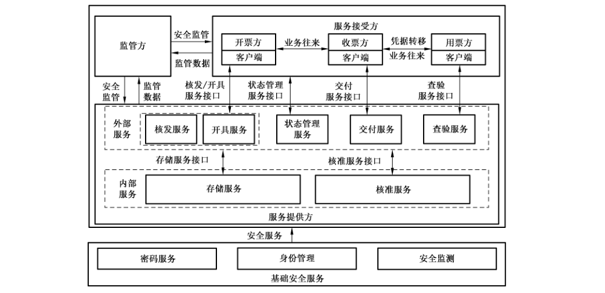
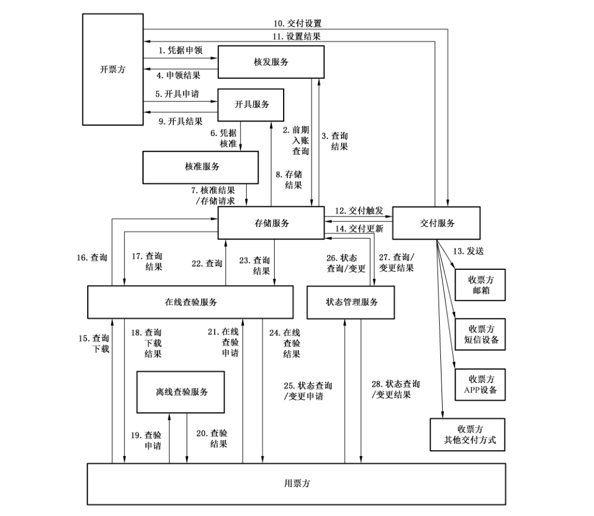
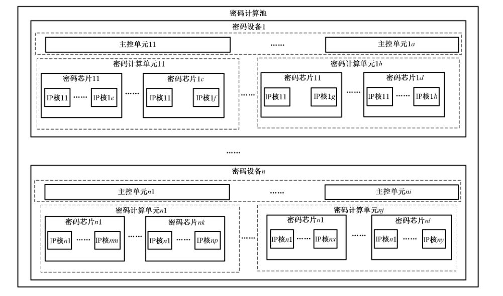
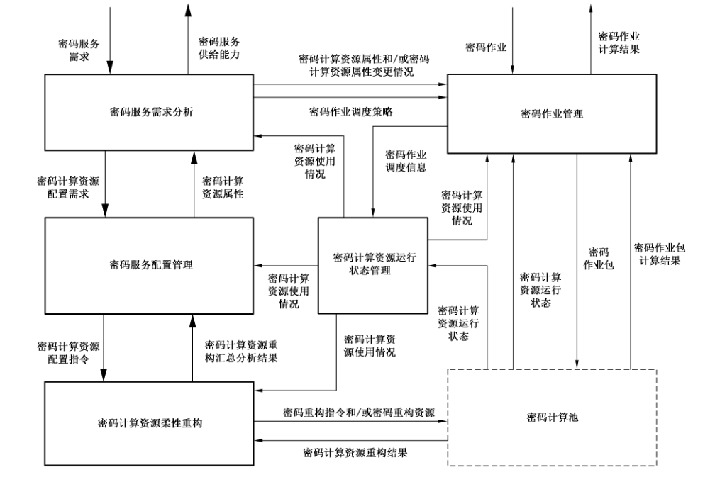
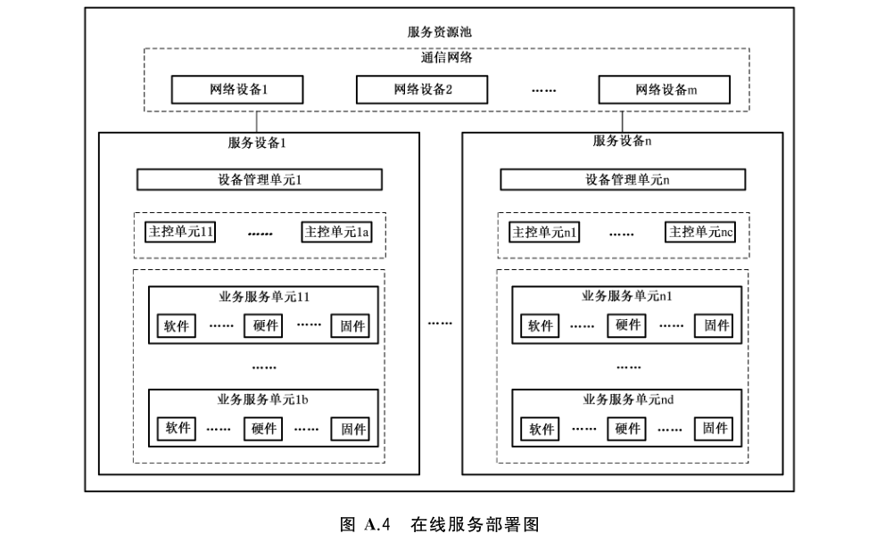
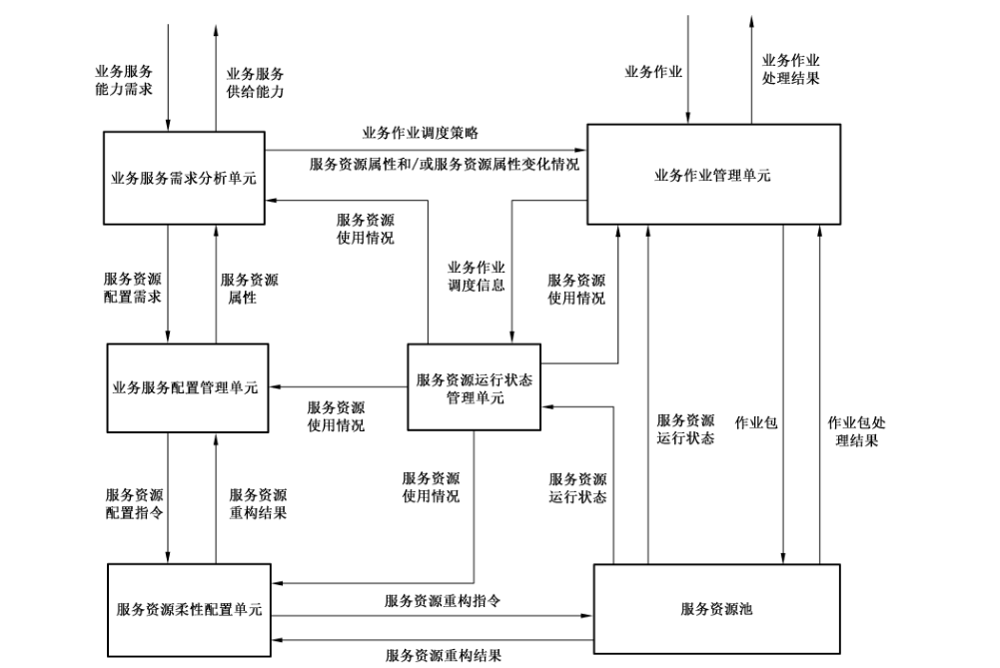

# GB/T 42589-2023 信息安全技术 电子凭据服务安全规范

> 来源：[GB/T 42589-2023 国家标准详情](https://openstd.samr.gov.cn/bzgk/std/newGbInfo?hcno=0636A3220D3D4D74AA99E2AA7BDBFE18)；发布日期：2023-05-23；实施日期：2023-12-01。
> PDF SHA-256：2924c9f41850931d5f931666ee59ef7a7f8ede2d269a01631876df9b37d9761f。
> 转写说明：依据官方 PDF 的 31 页图像核对正文，重建跨页表格和附录结构，保留原图中的 6 幅图，省略封面、目录和页眉页脚。正式引用请核对原 PDF。

## 前言

本文件按照 GB/T 1.1—2020《标准化工作导则 第1部分：标准化文件的结构和起草规则》的规定起草。

请注意本文件的某些内容可能涉及专利。本文件的发布机构不承担识别专利的责任。

本文件由全国信息安全标准化技术委员会（SAC/TC 260）提出并归口。

本文件起草单位：西安电子科技大学、中国科学院信息工程研究所、航天信息股份有限公司、北京立思辰新技术有限公司、中国电子技术标准化研究院、上海交通大学、大象慧云信息技术有限公司、国信电子票据平台信息服务有限公司、北京海泰方圆科技股份有限公司。

本文件主要起草人：李晖、李风华、赵兴文、王竹、李少维、侯海波、王惠莅、邱卫东、朱延超、岳强、耿魁、周曙光、朱辉、房梁、罗玛榕、贾宝刚、曹进、寇文龙、宋祁朋。

## 1 范围

本文件规定了电子凭据核发、开具、交付、存储、核准、查验、状态管理等服务的安全要求及测评方法。

本文件适用于电子凭据服务的设计、部署、提供和测评，也可为电子凭据服务监管提供参考。

## 2 规范性引用文件

下列文件中的内容通过文中的规范性引用而构成本文件必不可少的条款。其中，注日期的引用文件，仅该日期对应的版本适用于本文件；不注日期的引用文件，其最新版本（包括所有的修改单）适用于本文件。

GB/T 22239—2019 信息安全技术 网络安全等级保护基本要求

GB/T 25069—2022 信息安全技术 术语

GB/T 28449—2018 信息安全技术 网络安全等级保护测评过程指南

GB/T 32924—2016 信息安全技术 网络安全预警指南

GB/T 35273—2020 信息安全技术 个人信息安全规范

GB/T 36635—2018 信息安全技术 网络安全监测基本要求与实施指南

GB/T 37092—2018 信息安全技术 密码模块安全要求

GM/T 0031—2014 安全电子签章密码技术规范

## 3 术语和定义

GB/T 25069—2022界定的以及下列术语和定义适用于本文件。

### 3.1 电子凭据 electronic credential

记载经济往来等活动的电子数据记录。

示例：电子发票、客票、事业单位资金往来结算票据、行政收费收据、银行回单等。

### 3.2 电子凭据服务 electronic credential services

为服务接受方提供的电子凭据相关的业务流程。

> 注：电子凭据服务包括核发、开具、交付、查验、状态管理等。

### 3.3 实体 entity

存在或者可能存在的任何具体或抽象的事物，包括这些事物间的关联。

示例：人、对象、事件、理念、过程。

> 注：实体的存在和与之有关的数据是否可用无关。

［来源：GB/T 5271.17—2010,17.02.05］

### 3.4 身份 identity

与实体相关的一组属性。

### 3.5 开票方 credential issuing party

根据客户需求，自行或通过第三方软件为客户开具电子凭据的个人或单位。

### 3.6 收票方 credential receiving party

由于支付了购买产品或服务的费用或其他业务往来需要而收取电子凭据的个人或单位。

### 3.7 用票方 credential using party

出示和/或经手电子凭据进行查验、报销、作废等操作的个人或单位。

> 注：收票方与用票方可能是不同的实体，也可能是不同时间阶段的同一实体。用票方在某些场合可能是多个不同实体，例如道路客运场合在检票过程中的持票人和检票人/检票设备都属于用票方。

### 3.8 监管方 regulatory party

对服务动作和事件进行监控管理的可信第三方。

### 3.9 核发服务 approvement and issuance service

电子凭据发行机构核定凭据接受方领用资格并发放空白电子凭据的活动。

### 3.10 开具服务 credential issuing service

根据交易的产品或服务的项目和金额等信息形成完整可用的电子凭据的活动。

### 3.11 核准服务 credential approving service

检查确认开票方的开具操作是否符合电子凭据监管规则的活动。

### 3.12 交付服务 credential delivering service

按客户定义的要求和规则，将已开具的电子凭据发送给用户指定目标的活动。

### 3.13 存储服务 storage service

将收到的电子凭据数据、文件按照预设要求进行存取的活动。

### 3.14 查验服务 checking and verifying service

核实电子凭据数据信息真伪和/或一致性的活动。

### 3.15 在线查验 online checking and verifying service

通过网络向查验系统核实待验电子凭据数据信息真伪和/或一致性的操作。

### 3.16 离线查验 offline checking and verifying service

根据凭据生成依据核实电子凭据数据信息真伪的操作。

### 3.17 状态管理服务 status management service

记录当前电子凭据的状态，按照规则对其状态进行变更的活动。

### 3.18 交付方式 credential delivering method

将已有电子凭据发送给用户指定目标的方法。

### 3.19 服务项 service item

电子凭据各类服务中的某个独立的服务过程。

示例：电子凭据的文件查询下载、真假查验及状态查询均是查验服务中的一个服务项。

> 注：每类服务至少包含一个服务项。

### 3.20 多因子认证 multi-factor authentication

采用两种或两种以上的认证条件对实体进行认证的方法。

示例：口令和手机短信相结合的认证方法。

## 4 缩略语

下列缩略语适用于本文件。

APP：应用程序（application）

DDOS：分布式拒绝服务（distributed denial of service）

HTTP：超文本传输协议（hyper text transfer protocol）

HTTPS：超文本传输安全协议（hyper text transfer protocol secure）

IP：网间互连协议（internet protocol）

JSON：JavaScript 对象标记（JavaScript object notation）

TCP：传输控制协议（transmission control protocol）

Ukey：USB 认证密钥设备（universal serial bus key）

XML：可扩展标记语言（extensible markup language）

## 5 概述

### 5.1 服务框架

电子凭据服务及其安全框架如图1所示，包括服务提供方、服务接受方和监管方三种角色，其中服务接受方包括开票方、收票方和用票方三类实体。服务提供方为服务接受方提供核准、存储、核发、开具、交付、查验、状态管理等服务。服务接受方通过外部服务接口直接调用核发、开具、交付、查验、状态管理等五项外部服务，而存储服务及核准服务等两项内部服务仅由外部服务调用，间接为服务接受方提供服务。监管方通过服务提供方、服务接受方提供的监管数据对电子凭据服务进行统一监管。为保障各项业务安全稳定执行，电子凭据服务综合运用密码服务、身份管理、安全监测等三类基础安全服务技术，以维护包括服务可用性、数据保密性、数据完整性、数据不可抵赖性、操作行为异常监测预警响应等安全特性。密码服务是为其他各方提供用密码支持的活动。服务接受方通过电子凭据服务客户端请求使用权限内的服务功能并与其他服务接受方进行业务往来，电子凭据的生成和使用过程如下：

a） 开票方提交开票申请至开具服务，开具服务审核开票方权限及开票信息后，由开具服务生成电子凭据；

b） 交付服务根据交付规则及收票方权限将电子凭据安全交付至正确合法的收票方；

c） 收票方将凭据提交至用票方，在有些情况下用票方与收票方为不同时期的同一对象；

d） 用票方通过查验等服务合法使用该电子凭据。

### 5.2 基础安全服务

针对电子凭据内外部服务流程中数据泄漏、越权操作、冒名顶替、操作抵赖、虚假凭据、凭据重复使用、恶意操作等问题，需要密码服务、身份管理和安全监测等基础安全服务，以实现安全身份鉴别和权限管理、服务异常监测等功能，满足数据的机密性、完整性，服务的可用性、不可否认性，服务调用方的可控性、不可否认性等部分或全部需求。电子凭据的基础安全服务如表1所示。

**表1 电子凭据基础安全服务**

● 为必须，□ 为可选。

| 类型 | 服务 | 加/解密 | 签名/验签 | 身份鉴别 | 权限管理 | 异常上报 | 针对的安全问题 |
| --- | --- | --- | --- | --- | --- | --- | --- |
| 外部服务 | 核发 | ● | ● | ● | ● | ● | 防隐私数据泄漏、防篡改、核发服务确认用户凭据申领权限、提供可追溯性 |
| 外部服务 | 开具 | ● | ● | ● | ● | ● | 防隐私数据泄漏、防篡改、开具服务确认操作正常、确认用户开具权限、提供可追溯性 |
| 外部服务 | 交付 | ● | ● | ● | ● | ● | 防隐私数据泄漏、防篡改、确保交付对象正确及操作合规、提供可追溯性 |
| 外部服务 | 查验 | ● | ● | ● | ● | ● | 防隐私数据泄漏、防篡改、确保合法用户对权限内的信息进行查验、提供可追溯性 |
| 外部服务 | 状态管理 | ● | ● | ● | ● | ● | 防隐私数据泄漏、防篡改、确保合法用户对权限内的凭据状态进行查询/变更、提供可追溯性 |
| 内部服务 | 存储 | ● | □ | ● | ● | ● | 防隐私数据泄漏、防篡改、确保合法模块对权限内的数据进行读写、提供可追溯性 |
| 内部服务 | 核准 | □ | ● | ● | ● | ● | 防篡改、提供凭据信息合法性依据、确保合法模块在权限内调用服务、提供可追溯性 |

## 6 安全技术要求

### 6.1 通用要求

#### 6.1.1 密码服务要求

业务服务调用的密码服务要求如下：

a） 应能提供电子凭据业务中所需的加密/解密、签名/验签、杂凑算法、密码校验/产生、密钥加密/解密及密钥协商等密码算法；

b） 需要远程调用的密码算法接口，应符合 GB/T 37092—2018中7.3 规定的安全要求；

c） 非业务服务自带的密码算法模块，例如独立提供密码算法调用的软件、密码卡、密码设备，应符合GB/T 37092—2018中第7章安全要求，且应能自检以确保算法模块的完整性和可用性；

d） 加密/解密、签名/验签、杂凑算法、密码校验/产生、密钥加密/解密及密钥协商等密码算法的选用应符合国家密码管理机构的要求，密钥长度和算法的使用应符合国家相关密码标准要求；

e） 密钥生成、分发、存储、销毁等管理措施应符合国家密码管理机构和国家相关密码标准的要求；

f） 密码算法服务宜考虑密码按需服务的处理流程设计。

#### 6.1.2 身份管理要求

在业务服务中身份管理要求如下。

a） 应能对实体对象建立可识别的唯一标识信息；同一个实体对象可以拥有多重身份，每一个身份只能唯一属于某一个实体对象；同一个实体对象多次注册得到的多个身份，都应关联到同一个唯一标识信息，例如同一个身份证号的人员，其拥有的多个身份都关联到第一次注册的唯一标识信息，让这个唯一标识信息对应该人员的多元身份。

b） 应提供个人、单位和设备等实体对象的注册接口。

c） 应为服务接受方、服务提供方内部实体及监管方提供认证服务接口。

d）认证协议应安全有效，能够防止假冒、重放、篡改等攻击。

e） 实体认证信息应安全存储，禁止以明文形式存储，并设置数据库访问权限。

f） 应具备权限管控功能，对访问业务服务资源的权限进行标识与管理。

#### 6.1.3 安全监测要求

在业务服务设计中安全监测要求如下：

a） 应支持异常行为融合分析、安全态势分析、安全事件追踪溯源、异常行为信息存储等功能，符合GB/T 36635—2018中第6章网络安全监测基本要求；

b） 应具备异常行为分析功能，宜包括融合分析如安全事件智能研判、安全事件深度融合分析、风险度量、融合分析结果展示等能力；

c） 安全态势分析应具备安全事件展示和安全事件预警能力，应符合 GB/T 32924—2016 的第4章及第5章网络安全预警要求；

d） 安全事件追踪溯源应具备攻击路径定位、异常个体/区域判定能力；

e） 异常行为信息存储应具备多种业务异常数据存储、数据查询和数据备份功能；

f） 异常行为、安全态势、安全事件的监测和分析能力应支持向监管方按约定或其所要求的内容、形式、频率、机制等提交监管所需交付件，并确保交付件真实有效，以配合监管方的监管工作。

#### 6.1.4 系统技术要求

##### 6.1.4.1 系统部署安全要求

系统部署安全要求如下：

a） 电子凭据业务服务系统运行、数据存储和处理的场所应位于中国境内；

b） 电子凭据业务服务系统应部署防病毒系统并及时更新病毒防护，保护系统和数据库安全；

c） 电子凭据业务服务系统部署环境应符合 GB/T 22239—2019对应等级的安全物理环境要求。

##### 6.1.4.2 软件安全要求

软件安全要求如下：

a） 应具备服务调用的并发和服务处理的负载均衡能力，宜考虑在线按需服务的处理流程设计；

b） 服务监测模块应具备防止单点故障的能力、防止服务雪崩效应的能力；

c） 业务服务的接口应采用与操作系统无关的接口，例如 TCP 套接字端口，或更高层的 HTTP、HTTPS、WebService 接口；

d） 接口通信协议应采用便于各类移动设备软件填充组织的数据描述格式，例如 JSON 或XML；

e） 接口通信协议应采取抗重放攻击、防篡改、防抵赖等措施；

f） 离线查验服务程序应具备自我完整性校验的能力；

g） 软件发布或版本更新前，应进行安全检测。

##### 6.1.4.3 网络安全要求

网络安全要求如下：

a） 涉及数据库调用的业务服务，在设计和开发数据库存取调用功能时，应能防范数据库注入攻击，应按照实际需求符合 GB/T 22239—2019对应等级的漏洞和风险管理要求；

b） 应具备端口扫描、木马攻击、DDOS、缓存区溢出攻击、IP 碎片攻击和网络蠕虫攻击等网络攻击的安全防护。

##### 6.1.4.4 安全审计要求

安全审计要求如下：

a） 应对服务进行审计管理、安全管理、集中管控，提出部署方案，制定安全策略、管理制度，设定安全管理岗位、配备安全管理人员，对相关管理人员做到授权和审批；

b） 服务监测应支持记录电子凭据业务处理以及服务系统各类管理员每一次操作的审计日志，应采用技术手段保证审计日志的完整性和抗抵赖性；

c） 服务监测模块支持定义审计日志存储极限的阈值，当存储空间接近极限或被耗尽时，应告警并提示归档；当各服务项/程序在日志无法记录时，应提醒各服务项/程序停止服务。

##### 6.1.4.5 容灾备份和应急响应要求

容灾备份和应急响应要求如下：

a） 电子凭据业务服务系统应支持多服务器热备、按设定自动进行服务相关数据库备份；

b） 应实行灾难备份；

c） 应对容灾应急/恢复的系统服务器、存储、数据库进行实时监控，发现异常及时上报；

d） 应建立容灾数据备份和恢复的流程，并对该流程进行控制，定期进行检查和演练；

e） 应制定应急预案。

### 6.2 外部服务安全要求

#### 6.2.1 实体身份管理安全要求

在外部服务设计中实体身份管理安全要求如下：

a） 电子凭据业务服务在提供服务前，调用业务服务的各类实体对象（个人、单位、设备等）应完成身份注册和身份鉴权，身份注册信息和方式见表2，所列实体按表2规定的注册方式进行注册。

b）应提供安全的身份鉴别方式来保存和传递口令、UKey、指纹信息等安全资料。

c） 应支持包括但不限于口令、UKey 等多种身份鉴别方式。

d） 应支持多种认证方式的按需组合，以完成一个实体对象的多因子认证。

e） 在身份鉴别成功后，应对鉴别实体分发有时效的会话密钥或（和）Token，并且各类服务提供验证会话密钥和 Token 合法性的接口。

f） 应为应用程序在关键执行环节进行可信验证，对于非法用户使用、使用非法 Token 等行为进行及时提醒，应支持针对实体业务流转跟踪，应支持针对实体行为生成实体行为日志。

g） 应支持单点登录，同一实体对象使用任一身份只需登录认证一次，在实体对象主动退出前以及登录未超时的情况下，该实体对象访问服务资源无需再次登录，但该实体对象进行高权限（系统级）访问操作时需要进行二次认证。

h） 应支持注册的各类实体与身份管理模块之间的双向认证。

i） 应支持设置各类实体身份在业务服务上的权限。

j） 应支持对实体对象访问服务及数据等资源的访问权限控制，允许权限范围内的访问，阻断非授权范围内的访问，默认情况下除允许通信外受控端口拒绝所有通信。

k） 应支持同一实体对象的多重身份的快速切换、认证，在请求服务过程中支持自适应身份权限切换，自动切换到合适的身份以获得服务权限。

l） 电子凭据业务服务在收到各类实体对象（人员、单位和设备/平台/系统）的服务请求时，在下列情况下应拒绝提供服务：

1） 申请服务的实体对象未在统一身份管理系统中注册并完成身份鉴别；

2） 申请服务的实体对象完成身份鉴别但无相应权限；

3）收到的服务请求，在数据的完整性、有效性和时效性等方面有错误的。

m）电子凭据业务服务应能对非授权实体对象的访问或已授权的实体对象的越权访问进行及时阻断并告警与上报。

n） 电子凭据服务如果由多个子系统或功能组件组成，应对各子系统的功能组件逐个设置访问控制机制和内部认证机制，防止来自内部和外部的攻击者非法调用，应按照实际需求符合GB/T 22239—2019对应等级服务系统的安全边界防护要求。

**表2 电子凭据服务接受方注册信息及方式**

| 注册用户类型 | 注册方式 | 必要注册信息（不限于） |
| --- | --- | --- |
| 个人 | 个人用户通过个人客户端、网页端等方式提交注册申请及资料，由服务程序自动审核后完成注册 | 用户名、密码、身份种类、个人身份关联信息（如身份证号、手机号、真实姓名、邮箱网址、公务卡号等）、凭据交付方法（如电子邮件、短信、客户端推送等）、通知目标 |
| 单位 | 由单位工作人员通过单位客户端、网页端提交注册申请及资料，由服务管理员人工审核后完成注册 | 用户名、密码、单位身份关联信息（如单位法定代表人身份证号、身份证图片、营业执照图片、组织机构代码证书图片等）、凭据交付方法 |
| 设备（平台/系统） | 由该设备（平台/系统）所属单位工作人员，使用单位客户端通过单位账号提交注册申请及资料，由服务管理员审核后完成注册 | 所属单位用户用户名、设备出厂唯一标记、设备名称、设备模式、设备型号、设备类型、设备分区 |

#### 6.2.2 数据安全要求

在外部服务设计中数据安全要求如下：

a） 电子凭据数据应由多方签名，并确保可公开验证；

b） 各服务项/程序应对用户敏感信息，如口令、身份证号等采取必要的保护措施，以防止用户敏感信息泄露；

c） 各服务项/程序对用户个人信息的收集应符合 GB/T 35273—2020中第5章的收集规范；

d） 收到注册、身份变更、身份删除、开具、查询、查验等服务请求后，应检查必填数据的完整性、数据类型和长度等内容有效性及数据时效性，对于不完整、无效的、重放的服务请求，应丢弃以确保接口的可用性；

e） 在接收核准结果，下载电子凭据模板时，应校验核准结果和电子凭据模板的有效性和合法性；

f） 开具服务应能生成开票方及主管部门的电子签章，以保障电子凭据真伪可验证性，其使用的电子签章应符合 GM/T 0031—2014中6.2电子签章应用要求；

g） 各外部服务与服务接受方之间或与其他外部服务之间的数据通信，应通过安全通道或安全传输组件进行，以保障传输过程的数据机密性和完整性。

#### 6.2.3 异常监测安全要求

在外部服务设计中异常监测安全要求如下：

a） 身份管理应具备对假系统连接、同一用户多次尝试鉴别失败、同一系统多次尝试鉴别失败、多次证书鉴别失败等异常行为进行感知和研判的功能；

b）核发服务具备对同一企业短时间申领大量凭据、异常时间申领大量凭据进行感知和研判的功能；

c） 开具服务应具备对假系统连接、异常时间开具异常数量和异常金额的凭据、同一企业短时间开具大量凭据、同一企业短时间开具大量大额凭据、异常时间开具大量凭据、异常时间开具大额凭据、同一用户短时间跨企业开具大量大额凭据等异常行为进行感知和研判的功能；

d） 查验服务应具备对同一用户/企业短时间大量查询下载凭据等异常行为进行感知和研判的功能；

e） 查验服务应具备对假系统连接、同一用户/企业多次查验假凭据等异常行为进行感知和研判的功能；

f）状态管理服务应具备对假系统连接、同一凭据频繁变更状态、同一用户频繁变更电子凭据状态等异常行为进行感知和研判的功能；

g） 个人应用应具备对服务器假冒、多次尝试口令等异常行为进行感知和研判的功能；

h） 单位企业应用应具备对服务器仿冒、多次尝试口令、重复报销、作废/冲红电子凭据报销、假凭据报销等异常行为进行感知和研判的功能。

### 6.3 内部服务安全要求

#### 6.3.1 访问控制安全要求

在内部服务设计中访问控制安全要求如下：

a） 本地核准规则数据库应只接收本地核准服务程序的调用，拒绝远程的调用及其他调用，应按照实际需求符合 GB/T 22239—2019对应等级的安全边界防护要求；

b）电子凭据存储服务的内部多级存储系统，应采取隔离措施，拒绝其他设备访问，应按照实际需求符合 GB/T 22239—2019对应等级的安全边界防护要求。

#### 6.3.2 数据安全要求

在内部服务设计中数据安全要求如下：

a） 电子凭据数据应由核准服务及监管部门签名，并确保可公开验证；

b） 各服务项/程序应对用户敏感信息，如口令、身份证号等采取必要的保护措施，以防止用户敏感信息泄露；

c） 审计数据存留时间应满足国家与凭据主管部门的存储规定；

d） 各内部服务模块之间或与外部服务模块之间的通信，应通过安全通道或安全传输组件进行，以保障传输过程的数据机密性和完整性，应按照实际需求符合 GB/T 22239—2019对应等级的通信传输要求。

#### 6.3.3 异常监测安全要求

在内部服务设计中异常监测安全要求如下：

a） 核准服务应具备对假系统连接、同一用户用同一电子凭据多次尝试核准失败、同一用户用不同电子凭据多次尝试核准失败等异常行为进行感知和研判的功能；

b） 存储服务应具备对假系统连接等异常行为进行感知和研判的功能。

## 7 安全管理要求

### 7.1 管理控制要求

管理控制要求如下：

a） 应制定相应的运行维护管理控制制度，服务系统应按照实际需求符合GB/T 22239—2019对应保护等级的安全管理要求；

b） 管理控制制度应明确规定下列内容：

1） 电子凭据服务相关设备/平台/服务的运行、终止运行、升级等操作的处理人员；

2） 每次操作的操作计划，执行审批制度与应急预案；

3） 电子凭据服务定期安全检测方案；

4） 电子凭据服务的数据备份方案；

5） 电子凭据服务的数据清理方案与应急预案。

### 7.2 网络接入管理要求

电子凭据各类服务相关的网络接入要求如下：

a） 应制定相应的网络接入管理制度，应按照实际需求符合 GB/T 22239—2019对应等级的安全管理要求；

b） 网络接入管理制度应明确规定下列内容：

1） 各类设备接入、退网、拓扑变更、IP地址变更、网络路由变更等操作的负责人员；

2） 上述各类操作的申请和审批流程；

3） 上述各类操作的操作计划；

4） 发生影响业务的误操作后的应急预案。

### 7.3 人员登记和管理制度要求

电子凭据各类服务相关的人员登记和管理制度要求如下：

a） 应制定相应的人员登记和管理制度，应按照实际需求符合GB/T 22239—2019对应等级的安全管理制度要求；

b） 人员登记和管理制度应明确规定下列内容：

1） 负责各类人员的就职、岗位变更、退职等管理流程的部门及岗位人员；

2） 各类人员的职责、分工和安全生产操作流程；

3） 各类人员进入各类不同场所的申请、审批、门禁、登记、陪同等流程和要求。

### 7.4 灾难备份和应急预案制度要求

电子凭据各类服务相关的灾难备份和应急预案制度要求如下：

a） 应制定相应的灾难备份和应急预案制度，应按照实际需求符合 GB/T 22239—2019对应等级的安全管理要求；

b） 应明确规定电子凭据服务设备/平台/服务需要的灾难备份和应急预案；

c） 应明确规定运行环境、程序、配置、数据所需要制定的灾难备份和应急预案；

d） 应明确规定灾难备份和应急预案的具体措施和详细程度。

### 7.5 安全管理教育培训制度要求

电子凭据各类服务部署相关的安全管理教育培训制度要求如下：

a） 应制定安全管理教育培训制度和安全管理教育培训措施，制度和措施应按照实际需求符合GB/T 22239—2019对应等级的安全管理要求；

b） 应定期对相关人员进行电子凭据服务安全管理的教育培训。

## 8 安全测评

### 8.1 测评对象

电子凭据服务安全测评对象包括以下内容。

a） 电子凭据服务安全。对核发、开具、交付、查验、核准、状态管理、存储等电子凭据内外部服务的包括密码算法、服务监测等共性基础安全服务要求进行测评。

b） 实体身份管理与权限管控。对包括个人、单位、设备（平台/系统）等实体的身份管理、权限控制、访问控制等电子凭据服务调用和数据资源访问安全进行测评。

c） 电子凭据服务数据安全。对包括人员信息数据、单位信息数据、设备/平台信息数据、监管部门信息数据和算法信息数据等电子凭据服务数据的安全进行测评。

d） 异常监测安全。对电子凭据内外部服务的异常行为感知、监测、处理等安全操作进行测评。

e） 系统设计和管理。对电子凭据服务的基础设施、软件、网络、运行、容灾/备份等技术要求及管理/控制、网络接入管理、人员登记/管理、灾难备份/应急预案、安全管理教育培训制度等电子凭据服务系统制度进行测评。

### 8.2 测评方法

#### 8.2.1 通则

##### 8.2.1.1 基本测评方法

针对以上五类测评对象的服务可用性、数据保密性、数据完整性、数据不可抵赖性、操作行为异常监测等方面要求的实施情况，运用人工核验、模拟测试等测评方法进行测评，评估上述服务/内容的设计或部署是否符合安全要求。对于需要符合GB/T 22239—2019指定等级安全基本要求的电子凭据服务，其测评过程应按照 GB/T 28449—2018指定等级要求增加对应的测评方法。

##### 8.2.1.2 人工核验

测评人员针对测评对象，通过现场观测/访谈/咨询及检查运行各类实施材料（包括代码/日志/文档/证明材料）检查等方式输出测评结果。

现场观测/访谈/咨询可以采用但不限于采用的方法有：

a） 在现场自行查看硬件、软件、标签、连线等信息；

b） 在现场由其他人员介绍硬件、软件、标签、连线等信息；

c） 在现场不同时间段分别访谈/询问不同的人员等。

代码/日志/文档/证明材料检查可以采用但不限于采用的方法有：

d） 由其他人员介绍解说指定代码/日志/文档/规章制度/证明材料；

e） 其他人员指出代码/日志/文档/规章制度/证明材料范围后由测评人员自行检查；

f） 其他人员指出代码/日志/文档/规章制度/证明材料范围后由测评人员自行检查和咨询等；

g） 由测评人员对业务/应用代码进行功能、性能检测，对代码进行安装、运行和功能试用。

##### 8.2.1.3 模拟测试

测评人员通过模拟功能实现、安全攻击、灾难发生等场景，运行系统、平台功能或重现服务系统安全管理情况等方式对测评对象进行测试，确认是否存在代码安全漏洞或管理制度缺陷等。

模拟测试可以采用但不限于采用的方法如下。

a） 静态测试：对源代码进行安全扫描，根据程序中数据流、控制流、语义等信息与电子凭据软件安全规则库进行匹配，确认代码中是否存在潜在的安全漏洞。

b） 动态渗透测试：使用自动化仿真工具等模拟黑客的输入，对服务系统进行攻击性测试或协议分析，从中找出运行时刻所存在的安全漏洞。如：模拟虚假/不合法/越权身份进行注册/鉴权/服务请求或模拟合法/不合法身份进行业务操作产生触发异常预警的服务请求，观察其输出。

c） 程序数据扫描：如进行内存测试，以发现诸如缓冲区溢出之类的漏洞。

d） 基于特征码的方法：检测程序中是否包含已知的恶意软件特征代码，如提取应用程序的特征（字节或指令序列）与特征库进行相似性匹配。

e） 灾难/应急场景模拟测试：通过关闭电源、拔网线、关闭系统、关闭数据库等软硬件方式模拟灾难发生等，对物理设施进行有效性测试，观察系统响应及系统管理人员处理情况。

##### 8.2.1.4 测评对象及方法

各测评对象及其所对应的测评方式与测评内容如表3所示。

**表3 测评对象及方法**

| 测评对象 | 测评方式 | 测评内容 |
| --- | --- | --- |
| 电子凭据服务安全通用技术 | 人工核验/模拟测试 | 对文档、代码及日志进行检查；对 6.1 中的注册、认证、抗攻击等要求进行模拟测试 |
| 实体身份管理与权限管控 | 人工核验/模拟测试 | 对文档、代码及日志进行检查；对 6.2.1 及 6.3.1 中的要求进行模拟测试 |
| 电子凭据服务数据安全 | 人工核验/模拟测试 | 对文档、代码及日志进行检查；对 6.2.2 及 6.3.2 中的要求进行模拟测试 |
| 异常监测安全 | 人工核验/模拟测试 | 对文档、代码及日志进行检查；对 6.2.3 及 6.3.3 中的要求进行模拟测试 |
| 安全管理 | 人工核验 | 对文档、代码、日志、证明材料进行检查，可采用现场观测/访谈/咨询等方式 |

#### 8.2.2 通用要求测评方法

针对电子凭据服务的通用安全要求的测评方法：通过人工核验和模拟测试的方式，检查6.1中要求是否均符合。服务安全中各项通用要求的测评方法及达标参考结果如表4所示。

**表4 通用要求测评**

| 测评指标 | 测评项 | 测评方式/步骤 | 符合规范的预期结果 |
| --- | --- | --- | --- |
| 密码服务要求 | 算法功能 | 1）检查是否存在加密/解密、签名/验签、杂凑算法、密码校验/产生、密钥加密/解密及密钥协商等密码算法等功能代码段； 2）检查以上功能实现是否正常 | 1）存在电子凭据业务中所需的加密/解密、签名/验签、杂凑算法、密码校验/产生、密钥加密/解密及密钥协商等密码算法等功能的代码段； 2）以上代码段的功能可以正常运行 |
| 密码服务要求 | 密码接口及模块 | 1）检查需要远程调用的密码算法接口，是否符合 GB/T 37092—2018 中 7.3 规定的安全要求； 2）检查非业务服务自带的密码算法模块是否具有自检功能，是否符合 GB/T 37092—2018 中第7章安全要求 | 1）需要远程调用的密码算法接口，符合 GB/T 37092—2018 中 7.3 规定的安全要求； 2）非业务服务自带的密码算法模块，能自检以确保算法模块的完整性和可用性、符合 GB/T 37092—2018 中第7章安全要求 |
| 密码服务要求 | 算法选择 | 检查加密/解密、签名/验签、杂凑算法、密码校验/产生、密钥加密/解密及密钥协商等密码算法选用、算法使用的密钥长度算法使用是否符合国家相关标准 | 加密/解密、签名/验签、杂凑算法、密码校验/产生、密钥加密/解密及密钥协商等密码算法的选用符合国家密码管理机构的要求，密钥长度和算法的使用符合国家相关密码标准要求 |
| 密码服务要求 | 密钥管理 | 检查密钥生成、分发、存储、销毁等管理措施是否符合国家密码管理机构和国家相关标准的要求 | 密钥生成、分发、存储、销毁等管理措施符合国家密码管理机构和国家相关密码标准的要求 |
| 身份管理要求 | 实体注册 | 1）检查是否对实体对象建立可识别的唯一标识信息，若某一实体对象拥有多重身份或多次注册得到的多个身份时，是否关联到同一个唯一标识信息； 2）检查是否具有个人、单位和设备等实体对象的注册接口 | 1）对实体对象建立可识别的唯一标识信息，对同一个实体的多重身份关联到同一个唯一标识信息； 2）提供个人、单位和设备等实体对象的注册接口 |
| 身份管理要求 | 认证功能 | 1）检查是否为服务接受方、服务提供方内部实体及监管方提供认证服务接口； 2）检查认证协议是否安全有效，能否防止假冒、重放、篡改等攻击 3）检查实体认证信息是否进行安全存储，是否以明文形式存储，是否设置数据访问权限 | 1）为服务接受方、服务提供方内部实体及监管方提供认证服务接口； 2）认证协议安全有效，能够防止假冒、重放、篡改等攻击 3）对实体认证信息进行安全存储，未以明文形式存储，并设置数据库访问权限 |
| 身份管理要求 | 权限管控 | 检查是否具备权限管控功能，是否对访问业务服务资源进行标识与管理 | 具备权限管控功能，对访问业务服务资源的权限进行标识与管理 |
| 安全监测要求 | 异常行为监测与处理 | 1）检查是否支持异常行为分析、安全态势分析、安全事件追踪溯源、异常行为信息存储功能，是否符合 GB/T 36635—2018 中第6章网络安全监测基本要求； 2）检查是否具有异常行为分析功能，其中是否包括融合分析功能，如安全事件智能研判、安全事件深度融合分析、风险度量、融合分析结果展示等能力； 3）检查是否具有安全态势分析功能，包括安全事件展示和安全事件预警能力，符合 GB/T 32924—2016 的第4章网络安全预警分级和第5章网络安全预警流程； 4）检查是否具有安全事件追踪溯源功能，包括攻击路径定位、异常个体/区域判定等能力； 5）检查是否具有异常行为存储功能，包括多类业务异常数据的存储、查询及备份功能； 6）检查以上的异常行为、安全态势、安全事件的监测和分析能力是否支持向监管方按约定或其所要求的内容、形式、频率、机制等提交监管所需交付件 | 1）支持异常行为融合分析、安全态势分析、安全事件追踪溯源、异常行为信息存储等功能，符合 GB/T 36635—2018 中第6章网络安全监测基本要求； 2）具备异常行为分析功能，包括融合分析功能如安全事件智能研判、安全事件深度融合分析、风险度量、融合分析结果展示等能力，具备多安全因素/多类型行为综合分析能力； 3）安全态势分析应具备安全事件展示和安全事件预警能力，应符合 GB/T 32924—2016 中第4章网络安全预警分级和第5章网络安全预警流程； 4）安全事件追踪溯源应具备攻击路径定位、异常个体/区域判定等能力； 5）异常行为信息存储应具备多种业务异常数据存储、数据查询和数据备份功能； 6）异常行为、安全态势、安全事件的监测和分析能力应支持向监管方按约定或其所要求的内容、形式、频率、机制等提交监管所需的交付件 |
| 其他技术要求 | 系统部署 | 1）检查系统部署位置及承载网络，包括业务服务系统运行、数据存储和处理是否位于中国境内； 2）检查系统是否部署防病毒系统，是否及时更新病毒防护； 3）检查系统部署环境是否符合 GB/T 22239—2019 对应等级的安全物理环境要求 | 1）电子凭据业务服务系统运行、数据存储和处理的场所应位于中国境内； 2）部署了防病毒系统并及时更新病毒防护； 3）业务服务系统部署环境应符合 GB/T 22239—2019 对应等级的安全物理环境要求 |
| 其他技术要求 | 软件安全 | 1）检查服务调用是否具有并发处理和负载均衡机制； 2）检查服务监测模块是否能抵抗单点故障、防止雪崩效益； 3）检查各项业务服务是否采用与操作系统无关的接口 4）检查接口通信协议是否采用的便于各类移动设备软件填充组织的数据描述格式； 5）检查系统接口通信协议是否可抗重放攻击、防篡改、防抵赖； 6）检查离线查询服务程序是否具备完整性校验能力； 7）检查软件发布或版本更新发布前是否进行安全检测 | 1）考虑了服务调用的并发和服务处理的负载均衡； 2）服务监测模块能抵抗单点故障、防止雪崩效益； 3）开具、核准、交付等服务的接口采用与操作系统无关的接口； 4）接口通信协议采用便于各类移动设备软件填充组织的数据描述格式； 5）接口通信协议在遭受重放攻击、尝试篡改、尝试抵赖等攻击后，仍能正常执行； 6）离线查询服务程序具备完整性校验能力； 7）软件发布或版本更新前进行了安全检测 |
| 其他技术要求 | 网络安全 | 1）检查涉及数据库调用的业务，在设计和开发数据库存取调用功能时，是否能防范数据库注入攻击，是否按照实际需求符合 GB/T 22239—2019 对应等级的漏洞和风险管理要求； 2）检查是否能抵抗端口扫描、木马攻击、DDOS、缓存区溢出攻击、IP 碎片攻击和网络蠕虫攻击等网络攻击 | 1）服务系统能抵御注入攻击，具备符合 GB/T 22239—2019 对应等级的安全漏洞管理及风险管理措施； 2）具有安全防护，能抵抗端口扫描、木马攻击、DDOS、缓存区溢出攻击、IP 碎片攻击和网络蠕虫攻击等网络攻击 |
| 其他技术要求 | 安全审计 | 1）检查是否对服务进行审计管理、安全管理、集中管控，是否提出部署方案； 2）检查是否制定安全策略、管理制度，是否设定安全管理岗位、配备安全管理人员，对相关管理人员是否做到授权和审批； 3）检查服务监测模块是否具备记录业务处理、管理员的全部操作的审计日志； 4）检查是否采用技术手段保证审计日志的完整性和抗抵赖性 5）检查服务监测模块是否能定义审计日志存储极限的阈值，当存储空间接近极限或被耗尽时，是否能告警并提示归档；当各服务项/程序在日志无法记录时，是否能提醒各服务项/程序停止服务 | 1）对服务进行审计管理、安全管理、集中管控，提出部署方案； 2）制定安全策略、管理制度，设定安全管理岗位、配备安全管理人员，对相关人员做到授权和审批； 3）服务监测模块具备记录业务处理、管理员的全部操作的审计日志； 4）采用技术手段保证审计日志的完整性和抗抵赖性； 5）服务监测模块能定义审计日志存储极限的阈值，当存储空间接近极限或被耗尽时，能告警并提示归档；当各服务项/程序在日志无法记录时，能提醒各服务项/程序停止服务 |
| 其他技术要求 | 容灾备份和应急响应 | 1）检查是否进行多服务器热备、按设定自动进行服务相关数据库备份； 2）检查是否实行灾难备份； 3）检查系统是否能对容灾应急的系统服务器、存储、数据库进行实时监控及异常上报； 4）检查是否制定容灾数据备份和恢复的流程文档，是否定期进行检查和演练； 5）检查是否制定应急预案 | 1）进行了多服务器热备并自动进行服务相关的数据库备份； 2）系统实行了灾难备份； 3）对容灾应急/恢复的系统服务器、存储、数据库有实时监控，发现异常能及时上报； 4）建立了容灾数据备份和恢复的流程，并能对该流程进行控制，定期进行了检查和演练； 5）制定了应急预案 |

#### 8.2.3 外部服务安全测评方法

针对外部服务安全要求的测评方法：通过人工核验和模拟测试的方式，检查 6.2 中要求是否均符合。外部服务中各项要求的测评方法及达标参考结果如表5所示。

**表5 外部服务安全测评**

| 测评指标 | 测评项 | 测评方式/步骤 | 符合规范的预期结果 |
| --- | --- | --- | --- |
| 实体身份管理安全要求 | 身份注册管理 | 1）检查业务在提供服务之前是否要求身份注册和身份鉴权； 2）检查各类实体注册接口要求是否按表2方式进行注册 | 1）业务服务在提供服务之前要求身份注册和身份鉴权； 2）各类实体注册接口要求按表2方式进行注册 |
| 实体身份管理安全要求 | 身份鉴别与认证 | 1）检查是否提供安全的身份鉴别方式来保存和传递口令、UKey、指纹信息等安全资料； 2）检查是否支持包括但不限于口令、UKey等多种身份鉴别方式； 3）检查是否支持多种认证方式的按需组合多因子认证； 4）检查在身份鉴别成功后，系统是否对该实体分发有时效的会话密钥或（和）Token，是否提供验证会话密钥和Token合法性的接口； 5）检查服务是否在应用程序的关键执行环节进行可信验证，对Token流转进行跟踪并生成日志，对非法验证行为进行上报； 6）检查服务是否支持单点登录，访问更高权限的资源时是否进行二次认证； 7）检查是否支持注册的各类实体与身份管理模块双向认证 | 1）提供安全的身份鉴别方式来保存和传递口令、UKey、指纹信息等安全资料； 2）支持包括但不限于口令、UKey等多种身份鉴别方式； 3）支持多种认证方式的按需组合； 4）身份鉴别成功后，对该实体分发有时效的会话密钥或（和）Token，并且各类服务提供验证会话密钥和Token合法性的接口； 5）应用程序在关键执行环节进行可信验证，对于非法用户使用、使用非法Token等行为进行及时提醒，支持针对实体业务流转跟踪，支持针对实体行为生成实体行为日志； 6）支持单点登录，实体对象进行高权限访问操作时要求二次认证； 7）支持注册的各类实体与身份管理模块的双向认证 |
| 实体身份管理安全要求 | 权限管理 | 1）检查是否支持已注册的实体设置在业务服务所需的权限； 2）检查系统对实体对象访问服务及数据等资源的访问权限控制功能，服务是否允许权限范围内的访问，阻断非授权范围内的访问； 3）检查系统是否支持同一实体用户多重身份的快速切换、认证，是否支持切换后的权限切换； 4）检查系统是否拒绝未注册、未认证、无权限实体、数据无效/错误/过时的业务服务请求； 5）检查系统是否对非授权实体的访问、已授权的实体的越权访问等行为进行阻断、告警、上报； 6）当电子凭据服务由多个子系统或功能组件组成时，检查是否对各子系统的功能组件逐个设置访问控制机制和内部认证机制 | 1）支持设置各类实体身份在业务服务上的权限； 2）支持对实体对象访问服务及数据等资源的访问权限控制，允许权限范围内的访问，阻断非授权范围内的访问； 3）支持同一实体对象的多重身份的快速切换、认证，在请求服务过程中支持自适应身份权限切换，自动切换到合适的身份以获得服务权限； 4）拒绝未注册、未通过身份鉴别、身份鉴别通过但无权限实体的业务服务请求，拒绝数据错误、无效的、过时的业务服务请求； 5）对非授权实体对象的访问或已授权的实体对象的越权访问进行及时阻断并告警与上报； 6）当电子凭据服务由多个子系统或功能组件组成时，对各子系统的功能组件逐个设置访问控制机制和内部认证机制 |
| 数据安全要求 | 电子凭据可验证性 | 1）检查电子凭据数据是否由多方签名； 2）检查电子凭据是否可公开验证 | 电子凭据数据由多方签名并可公开验证 |
| 数据安全要求 | 敏感信息保护 | 1）检查服务对用户身份敏感信息是否采取必要保护措施； 2）检查各服务项/程序对用户个人信息的收集是否符合 GB/T 35273—2020 中第5章的收集规范 | 1）服务对用户身份敏感信息配置了保护机制； 2）各服务项/程序对用户个人信息的收集符合 GB/T 35273—2020 中第5章的收集规范 |
| 数据安全要求 | 服务数据的完整性、有效性和时效性 | 1）检查收到注册、身份变更、身份删除、开具、查验等服务不完整、无效的、重放的服务请求时，是否拒绝并丢弃请求； 2）检查在接收核准结果、下载电子凭据模板时，是否校验核准结果和电子凭据模板有效性和合法性 | 1）待测试服务检查必填数据的完整性、数据类型和长度等内容、有效性及时效性，拒绝并丢弃不完整、无效的、重放的服务请求； 2）在接收核准结果、下载电子凭据模板时，校验核准结果和电子凭据模板的有效性和合法性 |
| 数据安全要求 | 通信数据安全 | 1）检查开具服务是否生成开票方及主管部门的电子签章，其使用的电子签章是否符合 GM/T 0031—2014 中6.2电子签章应用要求； 2）检查各服务与各服务接受方之间以及与其他服务之间的通信是否通过安全传输通道或安全传输组件进行通信 | 1）开具服务能生成开票方及主管部门的电子签章，其使用的电子签章符合 GM/T 0031—2014 中6.2电子签章应用要求； 2）各服务与各服务接受方之间或与其他服务之间的通信，应通过安全通道或安全传输组件进行 |
| 异常监测安全要求 | 异常行为研判 | 1）检查身份管理是否能对假系统连接、同一用户多次尝试鉴别失败、同一系统多次尝试鉴别失败、多次证书鉴别失败等异常行为进行感知和研判； 2）检查核发服务是否能对同一企业短时间申领大量凭据、异常时间申领大量凭据的异常进行感知和研判； 3）检查开具服务是否能对假系统连接、异常时间开具异常数量和异常金额的凭据、同一企业短时间开具大量凭据、同一企业短时间开具大量大额凭据、异常时间开具大量凭据、异常时间开具大额凭据、同一用户短时间跨企业开具大量大额凭据等异常行为进行感知和研判； 4）检查查验服务是否能对同一用户/企业短时间大量查询下载凭据等异常行为进行感知研判； 5）检查查验服务是否能对假系统连接、同一用户/企业多次查验假凭据等异常行为进行感知和研判； 6）检查状态管理服务是否能对假系统连接、同一凭据频繁变更状态、同一用户频繁变更电子凭据状态等异常行为进行感知和研判； 7）检查个人应用是否能对服务器假冒、多次尝试口令等异常行为进行感知和研判； 8）检查单位应用是否能对服务器仿冒、多次尝试口令、重复报销、作废/冲红电子凭据报销、假凭据报销等异常行为进行感知和研判 | 1）身份管理具备对假系统连接、同一用户多次尝试鉴别失败、同一系统多次尝试鉴别失败、多次证书鉴别失败等异常行为进行感知和研判的功能； 2）核发服务具备对同一企业短时间申领大量凭据、异常时间申领大量凭据的异常进行感知和研判的功能； 3）开具服务具备对假系统连接、异常时间开具异常数量和异常金额的凭据、同一企业短时间开具大量凭据、同一企业短时间开具大量大额凭据、异常时间开具大量凭据、异常时间开具大额凭据、同一用户短时间跨企业开具大量大额凭据等异常行为进行感知和研判的功能； 4）查验服务具备对同一用户/企业短时间大量查询下载凭据等异常行为进行感知和研判的功能； 5）查验服务具备对假系统连接、同一用户/企业多次查验假凭据等异常行为进行感知和研判的功能； 6）状态管理服务具备对假系统连接、同一凭据频繁变更状态、同一用户频繁变更电子凭据状态等异常行为进行感知和研判的功能； 7）个人应用具备对服务器假冒、多次尝试口令等异常行为进行感知和研判的功能； 8）单位企业应用具备对服务器仿冒、多次尝试口令、重复报销、作废/冲红电子凭据报销、假凭据报销等异常行为进行感知和研判的功能 |

#### 8.2.4 内部服务安全测评方法

针对内部服务安全要求的测评方法：通过人工核验和模拟测试的方式，检查6.3中要求是否均符合。内部服务中各项要求的测评方法及达标参考结果如表6所示。

**表6 内部服务测评**

| 测评指标 | 测评项 | 测评方式 | 符合规范的预期结果 |
| --- | --- | --- | --- |
| 访问控制安全要求 | 数据库/存储安全 | 1）检查核准数据库是否仅接受本地核准服务程序的调用，是否能拒绝远程的调用及其他调用，是否按照实际需求符合 GB/T 22239—2019 对应等级的安全边界防护要求； 2）检查存储服务的内部多级存储系统是否采取隔离措施，能否拒绝其他设备访问，是否按照实际需求符合 GB/T 22239—2019 对应等级的安全边界防护要求。 | 1）核准数据库仅接受本地核准服务程序的调用，能拒绝远程的调用及其他调用，按照实际需求符合 GB/T 22239—2019 对应等级的安全边界防护要求； 2）存储服务的内部多级存储系统采取隔离措施，能拒绝其他设备访问，按照实际需求符合 GB/T 22239—2019 对应等级的安全边界防护要求。 |
| 数据安全要求 | 电子凭据可验证性 | 1）检查电子凭据数据是否由核准服务及主管部门签名； 2）检查核准服务及主管部门的签名是否可公开验证。 | 电子凭据数据由核准服务及主管部门签名并可公开验证。 |
| 数据安全要求 | 敏感信息保护 | 检查服务是否对用户身份敏感信息采取保护措施。 | 服务对用户身份敏感信息配置了保护机制。 |
| 数据安全要求 | 数据留存要求 | 检查审计数据存留时间设置是否满足国家与凭据主管部门的存储规定。 | 审计数据存留时间设置满足国家与凭据主管部门的存储规定。 |
| 数据安全要求 | 数据通信 | 检查内部服务与外部服务或其他内部之间的数据通信是否通过安全通道或安全传输组件保障数据机密性和完整性，是否按实际需求符合 GB/T 22239—2019 对应等级的通信传输要求。 | 内部服务与外部服务或其他内部之间的数据通信通过安全通道或安全传输组件进行，按实际需求符合 GB/T 22239—2019 对应等级的通信传输要求。 |
| 异常监测安全要求 | 异常行为研判 | 1）检查核准服务是否能对假系统连接、同一用户用同一电子凭据多次尝试核准失败、同一用户用不同电子凭据多次尝试核准失败等异常行为进行感知和研判； 2）检查存储服务是否能对假系统连接等异常行为进行感知研判。 | 1）核准服务具备对假系统连接、同一用户用同一电子凭据多次尝试核准失败、同一用户用不同电子凭据多次尝试核准失败等异常行为进行感知和研判的功能； 2）存储服务具备对假系统连接等异常行为进行感知和研判的功能。 |

#### 8.2.5 安全管理要求测评方法

针对安全管理要求的测评方法：通过人工核验及模拟测试的方式检查第7章中要求是否均符合。

各项安全管理要求的测评方法及达标参考结果如表7所示。

**表7 安全管理要求测评**

| 测评指标 | 测评项 | 测评方式 | 符合规范的预期结果 |
| --- | --- | --- | --- |
| 管理控制要求 | 管理控制制度 | 检查是否制定相应的运行维护管理控制制度，是否按照实际需求符合 GB/T 22239—2019 对应保护等级的安全管理要求，检查管理控制制度文档是否明确规定了： 1）电子凭据相关服务相关设备/平台/服务的运行、终止运行、升级等操作的处理人员； 2）操作计划、执行审批制度、应急预案； 3）服务定期安全检测方案； 4）服务数据备份方案； 5）服务数据清理与应急预案 | 1）制定了相应的运行维护管理控制制度，按照实际需求符合 GB/T 22239—2019 对应保护等级的安全管理要求； 2）明确规定了电子凭据服务相关设备/平台/服务的运行、终止运行、升级等操作的处理人员，操作计划、执行审批制度、应急预案；服务定期安全检测方案、数据备份方案、数据清理与应急预案 |
| 网络接入管理要求 | 网络接入管理制度 | 检查是否制定相应的网络接入管理制度，是否按照实际需求符合 GB/T 22239—2019 对应等级的安全管理要求，检查网络接入管理制度文档是否明确规定了： 1）各类设备接入、退网、拓扑变更、IP 地址变更、网络路由变更等操作的负责人员； 2）上述各类操作的申请和审批流程； 3）上述各类操作的操作计划； 4）发生影响业务的误操作后的应急预案 | 1）制定了相应的网络接入管理制度，按照实际需求符合 GB/T 22239—2019 对应等级的安全管理要求； 2）明确规定了各类设备接入操作的负责人员、接入操作的申请和审批流程、接入操作计划、误操作后的应急预案 |
| 人员登记和管理制度要求 | 人员登记和管理制度 | 检查是否制定相应的人员登记和管理制度，制定的制度是否按照实际需求符合 GB/T 22239—2019 对应等级的安全管理要求，检查人员登记和管理制度文档是否明确规定了： 1）负责各类服务人员管理流程的部门及岗位人员； 2）各类人员职责和安全生产的操作流程； 3）各类人员进入各类不同场所的申请、审批、门禁、登记、陪同等流程和要求 | 1）制定了相应的人员登记和管理制度，制定的制度按照实际需求符合 GB/T 22239—2019 对应等级的安全管理要求； 2）明确规定了负责各类服务人员管理流程的部门及岗位人员、各类人员职责和安全生产的操作流程，以及各类人员进入各类不同场所的流程和要求 |
| 灾难备份和应急预案制度要求 | 灾难备份和应急预案制度 | 访谈相关人员是否制定相应的灾难备份和应急预案制度，是否按照实际需求符合 GB/T 22239—2019 对应保护等级的安全管理要求，查看灾难备份和应急预案制度文档是否明确规定了： 1）电子凭据服务设备/平台/服务需要的灾难备份和应急预案； 2）运行环境、程序、配置、数据所需要制定的灾难备份和应急预案； 3）灾难备份和应急预案的具体措施和详细程度 | 1）制定了相应的灾难备份和应急预案制度，按照实际需求符合 GB/T 22239—2019 对应保护等级的安全管理要求； 2）明确规定了电子凭据服务设备/平台/服务、运行环境、程序、配置、数据所需要制定的灾难备份和应急预案，以及明确规定了灾难备份和应急预案及其具体措施和详细程度 |
| 安全管理教育培训制度要求 | 安全管理教育培训制度 | 1）检查是否制定相应的安全管理教育培训制度和安全管理教育培训措施，是否按照实际需求符合 GB/T 22239—2019 对应保护等级的安全管理制度； 2）检查是否定期对相关人员进行电子凭据服务安全管理的教育培训 | 1）制定相应的安全管理教育培训制度和安全管理教育培训措施，按照实际需求符合 GB/T 22239—2019 对应保护等级的安全管理制度； 2）定期对相关人员进行电子凭据服务安全管理的教育培训 |

### 8.3 测评过程

参照 GB/T 28449—2018中第5章至第8章，测评过程主要包括以下几个环节的活动。

a） 完成统计测评范围等测评前准备工作。根据表3确定测评方法及内容并制定测试大纲。

b） 完成测评方案设计和文档制定。根据测试大纲制定具体的测试文档：包括测试方案、测试等级评价方法及测试结论表。测试结论表示例见附录A 中A.5。将测试文档交予专家组通过评议/评审的方式进行审核，审核通过后综合专家意见修改并定稿。

c） 现场测评活动。根据测试文档及方案逐项执行测评内容。

d） 报告编制，输出文档。包括填写完成的测试结论表、测试结果报告及总结。若测试未通过，则对测评对象的管理人员提出整改意见。

### 8.4 测评结论

根据测评对象及方案输出以下测评结论：

a） 每一个测评对象需要满足此服务大类中的共性要求，以及针对该测评对象提出的所有专项要求；

b） 每一单项符合要求，那么单项测评结论为单项符合，如果单项不符合要求，那么该单项测评结论为单项不符合；

c） 当测评对象在测评范围内的所有测评项都符合要求时，则该测评对象的测评结论为整体符合，只要有一个单项结论为不符合，则该测评对象的测评结论为整体不符合。

## 附录 A（资料性）典型电子凭据业务流程、密码/在线按需服务流程及测评记录表示例

### A.1 概述

本附录介绍了包括发票、道路客运票据、事业单位资金往来收据、行政收费凭据、银行回单等典型电子凭据应用场合下通用的业务流程，介绍了密码按需服务的处理流程及在线按需服务的处理流程，描述了密码算法要求的测评记录表示例，为测评机构和服务厂商自我检测提供参考。

### A.2 典型电子凭据服务的业务流程示例

电子凭据业务系统为服务接受方提供核发、开具、交付、查验、核准、状态管理、存储等业务功能，其典型业务流程如图 A.1 所示，图 A.1 中各环节说明如下：

1. 开票方根据自己近期用票情况，申领一批空白凭据；

2. 核发服务根据开票方的身份信息，查询其前期事业性收费凭据开具和已收费用入账情况；

3. 核发服务得到查询结果；

4. 核发服务根据开票方前期事业性收费凭据开具和已收费用入账情况，发放一批空白凭据；

5. 开票方根据收费情况和开票客户需求提交电子凭据开具申请；

6. 开具服务验证开票方身份和权限，完成电子凭据的开具并建立对应的电子凭据版式文件，则发送至核准服务进行信息核准；如果出现开票方提供的身份与空白凭据不符、收费类型不一致、开票方无权限等情况，则开具失败；

7. 核准服务根据核准规则对电子凭据版式文件信息的正确性及规范性进行核准，若核准通过，则将相关资料存入存储服务；如果出现版式文件信息错误或生成不合规等情况，则开具失败；

8. 存储服务在收到存储申请后，将电子凭据元数据和版式文件存入合适的存储设备，并返回存储结果；如开具失败，无存储申请；

9. 开具服务将结果返回给开票方，若开具成功，返回结果为开票方申请的电子凭据；若开票失败，返回结果为开票失败通知及失败原因；

10. 开票方设置此次凭据的特殊交付措施；

11. 交付服务返回交付设置结果；

12. 交付服务检查存储服务中的未交付电子凭据，并从存储服务中导出准备交付；

13. 交付服务根据开票客户所设置的交付方式，将电子凭据或电子凭据的相关信息发送给收票方电子邮箱、短信接收设备、APP设备等目标接收地址，或按照收票方设置的其他交付方式交付；

14. 交付成功后，更新交付状态；

15. 用票方向查验服务发出查询下载请求；

16. 查验服务在存储服务中获取查询结果；

17. 存储服务返回结果给查验服务；

18. 查验服务返回结果给用票方；

19. 用票方可以根据需求申请离线查验服务，如离线查验行政收费凭据真伪；

20. 离线查验服务验证凭据后返回查验结果；

21. 用票方可以根据需求，申请在线查验服务；

22. 在线查验服务向存储服务申请查验电子凭据数据；

23. 存储服务返回申请查验的内容；

24. 在线查验服务根据返回内容输出查验结果；

25. 用票方可根据需要向状态管理服务申请查询或变更电子凭据状态；

26. 状态管理服务依照用票方的权限，通过存储服务完成状态查询或变更的处理；

27. 存储服务将状态查询或者变更结果返回至状态管理服务；

28. 状态管理服务将结果返回给用票方。

### A.3 密码按需服务的处理流程设计示例

密码服务为电子凭据服务所需的基础安全服务之一，该服务需要满足电子凭据开具和查验等环节的高并发需求，因此建议采用密码按需服务的设计思路。密码服务一般由多个密码设备组成的密码计算池对外提供服务，每个密码设备包含多个主控单元、多个密码计算单元，每个密码计算单元包含多个密码芯片，每个密码芯片包含多个 IP 核，每个 IP 核能独立完成一定的密码计算作业，如图 A.2 所示。

密码服务宜根据业务需求进行动态配置、管理和调度，实现提供密码按需服务的能力，以满足电子凭据服务的峰值差异大、高并发，需求各异的业务特点。宜将密码服务分为密码服务需求分析、密码服务配置管理、密码计算资源柔性重构、密码作业管理、密码计算资源运行状态管理等五个服务步骤。具体处理细节建议如下：密码服务需求分析模块根据密码服务需求生成密码计算资源配置需求或密码作业调度策略，将密码计算资源配置需求发送给密码服务配置管理模块，将密码作业调度策略发送给密码作业管理模块。

密码服务配置管理模块根据密码计算资源配置需求生成密码计算资源配置指令，发送给密码计算资源柔性重构模块。

密码计算资源柔性重构模块根据密码计算资源配置指令生成密码重构指令和/或密码重构资源发送给密码计算池模块，密码计算池模块根据密码重构指令和/或密码重构资源对密码计算资源进行重构，并将重构结果发送给密码计算资源柔性重构模块；密码计算资源柔性重构模块接收密码计算池模块的密码计算资源重构结果，对重构结果进行汇总分析，并将密码计算资源重构汇总分析结果发送给密码服务配置管理模块；密码计算资源柔性重构模块根据密码计算资源重构汇总结果生成新的密码计算资源属性；密码服务配置管理模块根据密码计算资源重构汇总分析结果更新密码计算资源属性，并将新的密码计算资源属性和/或密码计算资源属性变化情况发送给密码服务需求分析模块。

密码服务需求分析模块根据新的密码计算资源属性生成新的密码作业调度策略，并将新的密码计算资源属性和/或密码计算资源属性变化情况、新的密码作业调度策略发送给密码作业管理模块。

密码作业管理模块将密码作业拆分为多个密码作业包发送给密码计算池模块中的密码计算资源进行密码计算，并将密码作业包的计算结果组合为密码作业计算结果发送给上层密码应用。

处理流程示意图见图 A.3。

### A.4 在线按需服务的处理流程设计示例

在电子凭据服务应用中，宜对服务资源根据用户需求进行业务动态的配置、调度和安全迁移，实现按需服务，支撑服务的高并发及负载均衡。电子凭据在线服务部署如图 A.4 所示，服务资源池由多台服务设备共同处理，每台服务设备包含开具、核准、查验等多项业务服务单元，但具体的服务应用不需要知道所用到的具体的服务设备、设备内部单元，因此需要实现服务资源的动态配置与扩展，业务资源虚拟化和细粒度调度。针对在线按需服务的问题，宜采用基于虚拟服务资源池的层次化多级处理架构，如图 A.4 所示，包括但不限于：业务服务需求分析单元、业务服务配置管理单元、服务资源柔性配置单元、业务作业管理单元、服务资源运行状态管理单元，为服务接受方提供各类在线服务。

宜将在线按需服务按业务服务需求分析、业务服务配置管理、服务资源柔性配置、业务作业管理、服务资源运行状态管理等五个步骤进行，如图 A.5所示，具体细节流程宜如下。

——业务服务需求分析通过接收业务服务能力需求，生成业务作业调度策略或服务资源配置需求。

根据接收的新的服务资源属性，生成新的业务作业调度策略，并对新的业务作业调度策略、新的服务资源属性和/或服务资源属性变化情况进行发送，并根据新的服务资源属性和/或服务资源属性变化情况生成新的业务服务供给能力并进行发送。

——业务服务配置管理根据服务资源配置需求、服务资源属性、服务资源使用情况三者的任意组合生成服务资源配置指令，并根据服务资源重构结果，生成新的服务资源属性。

——服务资源柔性配置根据服务资源配置指令、服务资源属性、服务资源使用情况三者的任意组合生成服务资源重构指令和/或业务重构资源下发给服务资源池，并接收服务资源池的服务资源重构结果，对服务资源重构结果进行汇总分析，将汇总分析的结果进行发送，生成新的服务资源属性。服务资源池中的服务资源根据服务资源重构指令和/或业务重构资源对其功能、业务和性能进行重构。最后服务资源将业务作业调度过程中服务资源的运行状态进行发送。

——业务作业管理通过接收业务作业，根据调度策略、服务资源属性、服务资源使用情况、服务资源运行状态四者的任意组合将业务作业拆分为作业包，再将拆分的作业包发送给服务资源池中的服务资源进行业务处理，并将返回的作业包处理结果组合为业务作业处理结果发送给上层业务应用。或将业务作业直接发送给服务资源池中的服务资源进行业务处理，并将返回的业务作业处理结果发送给上层业务应用。将业务作业调度过程中业务作业调度信息进行发送，最后根据服务资源运行状态综合分析生成业务作业运行进度、作业包运行进度、业务作业运行状态数据、作业包运行状态数据。

——服务资源运行状态管理通过接收业务作业调度信息和返回的服务资源运行状态，生成服务资源使用情况，并进行发送。

### A.5 密码服务要求测评记录表的示例

以针对 6.1.1 密码服务要求的测评记录表示例为测评结论表示例，如表 A.1 所示。

**表A.1 密码服务要求的测评记录表示例**

| 序号 | 要求的测评内容 | 评测输出（符合，标记√；不符合，标记×） | 不符合的说明 |
| --- | --- | --- | --- |
| 1 | 能提供电子凭据业务中所需的加密/解密、签名/验签、杂凑算法、密码校验/产生、密钥加密/解密及密钥协商等密码算法 |  |  |
| 2 | 需要远程调用的密码算法接口，符合 GB/T 37092—2018中7.3所述安全要求 |  |  |
| 3 | 非业务服务自带的密码算法模块，符合 GB/T 37092—2018中第7章安全要求，能自检以确保算法模块的完整性和可用性 |  |  |
| 4 | 加密/解密、签名/验签、杂凑算法、密码校验/产生、密钥加密/解密及密钥协商等密码算法的选用应符合国家密码管理机构的要求，密钥长度和算法的使用应符合国家相关密码标准要求 |  |  |
| 5 | 密钥生成、分发、存储、销毁等管理措施应符合国家密码管理机构和国家相关密码标准的要求 |  |  |

## 参考文献

- ［1］ GB/T 5271.17—2010 信息技术 词汇 第17部分：数据库

- ［2］ GB/T 17901.1—2020 信息技术 安全技术 密钥管理 第1部分：框架

- ［3］ GB/T 18336.2—2015 信息技术 安全技术 信息技术安全评估准则 第2部分：安全功能组件

- ［4］ GB/T 18391.1—2009 信息技术 元数据注册系统（MDR） 第1部分：框架

- ［5］ GB/T 20269—2006 信息安全技术 信息系统安全管理要求

- ［6］ GB/T 20273—2019 信息安全技术 数据库管理系统安全技术要求

- ［7］ GB/Z 24294.3—2017 信息安全技术 基于互联网电子政务信息安全实施指南 第3部分：身份认证与授权管理

- ［8］ GB/T 25068.1—2020 信息技术 安全技术 网络安全 第1部分：综述和概念

- ［9］ GB/T 25068.4—2010 信息技术 安全技术 IT 网络安全 第4部分：远程接入的安全保护

- ［10］ GB/T 29245—2012 信息安全技术 政府部门信息安全管理基本要求

- ［11］ GB/T 32905—2016 信息安全技术 SM3 密码杂凑算法

- ［12］ GB/T 32907—2016 信息安全技术 SM4 分组密码算法

- ［13］ GB/T 35276—2017 信息安全技术 SM2密码算法使用规范

- ［14］ GB/T 36322—2018 信息安全技术 密码设备应用接口规范

- ［15］ GB/T 36609—2018 电子发票基础信息规范

- ［16］ GB/T 36626—2018 信息安全技术 信息系统安全运维管理指南

- ［17］ GB/T 37094—2018 信息安全技术 办公信息系统安全管理要求

- ［18］ GB/T 37972—2019 信息安全技术 云计算服务运行监管框架

- ［19］ GM/T 0062—2018 密码产品随机数检测要求
