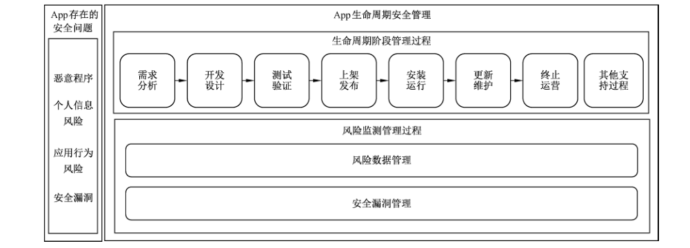

# GB/T 42884-2023 信息安全技术 移动互联网应用程序（App）生命周期安全管理指南

> 来源：[GB/T 42884-2023 国家标准详情](https://openstd.samr.gov.cn/bzgk/std/newGbInfo?hcno=B7DEC309A80EFF716052588358D7C041)；发布日期：2023-08-06；实施日期：2024-03-01。
> PDF SHA-256：5823f4f87b196e31dd30ac2051cd8f7b18d699965459065ffac350101dfc3cf1。
> 转写说明：依据官方 PDF 全部 24 页的页面图像核对；省略封面、目录、页眉、页脚和页码，合并跨页内容。正式引用请核对原 PDF。

## 前言

本文件按照 GB/T 1.1—2020《标准化工作导则 第1部分：标准化文件的结构和起草规则》的规定起草。

请注意本文件的某些内容可能涉及专利。本文件的发布机构不承担识别专利的责任。

本文件由全国信息安全标准化技术委员会（SAC/TC 260）提出并归口。

本文件起草单位：武汉安天信息技术有限责任公司、北京赛西科技发展有限责任公司、中国信息通信研究院、华为技术有限公司、维沃移动通信有限公司、三六零科技集团有限公司、OPPO 广东移动通信有限公司、北京小米移动软件有限公司、公安部第三研究所、国家计算机病毒应急处理中心、中国软件评测中心、国家计算机网络应急技术处理协调中心、中国科学院信息工程研究所、启明星辰信息技术集团股份有限公司、联想（北京）有限公司、美的集团股份有限公司、海信集团控股股份有限公司、蚂蚁科技集团股份有限公司、南方电网数字电网研究院有限公司、北京智游网安科技有限公司、杭州安恒信息技术股份有限公司、北京指掌易科技有限公司、北京百度网讯科技有限公司、北京版信通技术有限公司、北京快手科技有限公司、陕西省信息化工程研究院、北京梆梆安全科技有限公司。

本文件主要起草人：潘宣辰、许玉娜、陈诚、王淞鹤、袁中举、成明江、姚一楠、李腾、陆伟、陈家林、张艳、田原、刘彦、蔡一鸣、秦晓磊、何能强、卢志刚、余丽娜、孙海燕、史景、李汝鑫、杨坤、张淯易、王昕、白晓媛、母天石、韩云、李献振、李彪、唐佳伟、董宏、潘正泰、方宁、衣强、杜丹、贾科、落红卫、杨明慧、徐祥智、毕凯峰。

## 1 范围

本文件提供了移动互联网应用程序（App）生命周期阶段管理过程和风险监测管理过程的安全管理指南。

本文件适用于 App 提供者对App 的开发、运营等生命周期安全管理，App 分发平台管理者和移动智能终端厂商等参考使用。

## 2 规范性引用文件

下列文件中的内容通过文中的规范性引用而构成本文件必不可少的条款。其中，注日期的引用文件，仅该日期对应的版本适用于本文件；不注日期的引用文件，其最新版本（包括所有的修改单）适用于本文件。

- GB/T 25069—2022 信息安全技术 术语

- GB/T 28458—2020 信息安全技术 网络安全漏洞标识与描述规范

- GB/T 38674—2020 信息安全技术 应用软件安全编程指南

- GB/T 39720—2020 信息安全技术 移动智能终端安全技术要求及测试评价方法

- GB/T 41391—2022 信息安全技术 移动互联网应用程序（App）收集个人信息基本要求

## 3 术语和定义

GB/T 25069—2022、GB/T 38674—2020、GB/T 39720—2020 和 GB/T 41391—2022 界定的以及下列术语和定义适用于本文件。

### 3.1 移动智能终端 smart mobile terminal

具有能够提供应用程序开发接口的开放系统，并能够安装和运行第三方应用软件的移动终端。

> ［来源：GB/T 39720—2020,3.1］

### 3.2 移动互联网应用程序 mobile Internet application

运行在移动智能终端上向用户提供信息服务的应用软件。

> 注：包括下载安装、运行的应用程序和小程序，简称 App。

> ［来源：GB/T 41391—2022,3.1，有修改］

### 3.3 App 生命周期 mobile Internet application life cycle

App 从需求分析到终止运营随时间进化的过程。

### 3.4 App 提供者 mobile Internet application provider

设计、开发或运营App 的组织或个人。

> 注：包括法人、自然人或其他组织等。

### 3.5 App 分发平台管理者 mobile Internet application distribution platform manager

管理 App 下载、分发或升级的主体。

> 注：包括应用商店、App、网站、游戏中心和短视频等的管理者。

### 3.6 个人信息风险 personal information risk

App 开发或运营过程中可能存在的侵害个人信息权益的风险。

> 注：包括未公开收集使用、未明示收集使用、未同意收集使用、违反必要原则、未经同意向他人提供和未提供更正删除功能或未公布投诉举报方式等风险。

### 3.7 敏感数据 sensitive data

必须受保护的，其泄露、修改、破坏或丢失会对人或事产生可预知的损害的信息。

> 注：包括身份鉴别数据、会话标识符、口令、连接字符串等。

> ［来源：GB/T 38674—2020,3.1.9］

## 4 缩略语

下列缩略语适用于本文件。

| 缩略语 | 含义 |
| --- | --- |
| API | 应用程序编程接口（Application Programming Interface） |
| SDK | 软件开发工具包（Software Development Kit） |

## 5 概述

### 5.1 App 存在的安全问题

App 存在的安全问题包括恶意程序、个人信息风险、应用行为风险和安全漏洞四个类别。附录A给出了 App 存在的安全问题分类及描述：

a） 恶意程序的分类及描述见表 A.1；

b） 个人信息风险的分类及描述见表 A.2；

c） 应用行为风险的分类及描述见表 A.3；

d） 安全漏洞的分类及描述见表 A.4。

### 5.2 App 生命周期安全管理

App 生命周期安全管理包括App 的生命周期阶段管理过程和风险监测管理过程两个部分。生命周期阶段管理过程包括七个阶段（需求分析阶段、开发设计阶段、测试验证阶段、上架发布阶段、安装运行阶段、更新维护阶段和终止运营阶段）以及其他安全支持过程。为了应对App 存在的安全问题，App提供者在生命周期阶段管理过程中实施不同的安全管理活动（App 存在的安全问题与安全管理活动的应对关系见附录 B），此外还需要在风险监测管理过程中对个人信息风险、应用行为风险和安全漏洞进行监测、发现和处理；App 分发平台管理者在上架发布和终止运营等阶段审核 App 提供者提交的上架申请和下架申请相关材料，并在运行监测和安全更新等活动中发现安全问题提醒App 提供者处理；移动智能终端厂商在 App 安装检测和运行监测时发现安全问题，App 提供者对安全问题进行处理。App存在的安全问题和 App 生命周期安全管理示意图见图1。

## 6 生命周期阶段管理过程

### 6.1 需求分析阶段

#### 6.1.1 安全需求分析

App 提供者实施以下与安全需求分析相关的管理。

a） 根据法律法规要求、标准约束和客户安全需求等形成安全需求说明书。安全需求说明书的主要内容包括：

<ul class="standard-subclauses">
<li>• 安全威胁和业务场景分析；</li>
<li>• 安全需求与保护目标；</li>
<li>• App 内的权限控制要求；</li>
<li>• 关键操作的抗抵赖要求；</li>
<li>• 恶意程序、应用行为风险或安全漏洞等的测试要求；</li>
<li>• App 与其他 App 或操作系统之间数据交互的保密性、可用性和完整性保护要求；</li>
<li>• 若App 需要处理敏感个人信息、利用个人信息进行自动化决策，对个人信息保护及影响评估的要求；</li>
<li>• 若App 需要集成第三方 SDK，对第三方 SDK 进行安全需求分析（如第三方 SDK 提供者的安全能力要求、第三方 SDK 收集和使用个人信息的规范要求和第三方 SDK 使用终端权限的规范要求等）。</li>
</ul>

b） 基于操作系统环境和安全需求说明书开展前期的风险评估，形成风险评估报告。

c） 制定整体安全策略，编制安全措施文档，包括安全目标和总体安全措施等内容。

d） 组织风险管理相关部门与安全技术团队，对安全需求说明书、风险评估报告和安全措施文档进行评审，评审是否具备以下内容：

<ul class="standard-subclauses">
<li>• 身份鉴别及授权；</li>
<li>• 访问控制；</li>
<li>• 安全审计；</li>
<li>• 数据生命周期安全。</li>
</ul>

#### 6.1.2 安全质量分析

App 提供者实施以下与安全质量分析相关的管理：

a） 设置安全质量目标，确定每个安全质量度量项的目标水平，度量项包括完整性指标和可用性指标（如需要访问的业务相关权限的最小个数等）；

b） 制定安全质量管理计划，在App 生命周期内执行并维护该计划；

c） 编制安全质量文档，组织质量工程师和开发人员对安全质量文档进行评审；

d） 建立安全质量管理监控机制，当安全质量目标无法实现时，采取适当的调整措施。

### 6.2 开发设计阶段

#### 6.2.1 方案设计

App 提供者实施以下与方案设计相关的管理。

a） 根据安全需求说明书编制安全设计方案，进行威胁建模和风险分析：

<ul class="standard-subclauses">
<li>• 对 App 的默认攻击面和最大攻击面进行安全分析并优化，使攻击面最小化；</li>
<li>• 采用威胁建模等方式对 App 业务进行风险分析，并对分析出来的风险制定消减方案；</li>
<li>• 对个人信息的处理目的、处理方式、保护措施的有效性等进行影响评估；</li>
<li>• 对有可能采用的第三方开源代码进行风险评估（如是否包含已知安全漏洞、开源软件是否处于维护更新状态以及是否符合开源代码的开源协议要求等）。</li>
</ul>

b） 编制安全开发流程文档，归纳开发过程中涉及的安全技术：

<ul class="standard-subclauses">
<li>• 编码安全技术，尽可能减少代码缺陷；</li>
<li>• 通信安全技术，降低 App 被远程控制或通信数据被利用（如监听、篡改等）的危害；</li>
<li>• 访问控制技术（如身份鉴别、口令安全和权限管理等）；</li>
<li>• 日志记录与保护技术，确保用户操作日志和安全事件日志被安全地记录和访问；</li>
<li>• 数据保护与密码技术，确保敏感数据的保密性、可用性和完整性。</li>
</ul>

#### 6.2.2 方案评审

App 提供者实施以下与方案评审相关的管理：

a） 自定义安全评价准则（如安全需求的可追溯性、一致性和可测试性，安全设计方案的可行性和可维护性等）或使用成熟度评估模型作为评审方法；

b） 组织相关方对安全设计方案和安全开发流程文档进行评审，记录评审结果并形成方案评审记录。

#### 6.2.3 安全开发

App 提供者从程序安全和安全保障两方面开展开发相关的安全活动（见附录C）。

#### 6.2.4 代码管理

App 提供者实施以下与代码管理相关的管理。

a） 不在代码中嵌入存在风险的代码（如无关链接、逻辑炸弹、后门、恶意程序或应用行为风险等相关代码）。

b） 在编码完成后使用代码扫描工具或人工代码检查等方式对代码进行评审，识别并修复代码中的安全漏洞。

c） 对源代码或依赖库的操作（如修改、更新或发布等）进行访问控制管理。

d） 当代码由供应商提供时，实施以下管理：

<ul class="standard-subclauses">
<li>• 在编码完成后将源代码回收并防止泄露；</li>
<li>• 与供应商签订相关协议，明确代码安全相关内容和职责；</li>
<li>• 监督供应商解决代码中存在的安全问题，并更新代码。</li>
</ul>

e） 当 App 集成第三方开源代码时，实施以下管理：

<ul class="standard-subclauses">
<li>• 对第三方开源代码进行风险管理，识别和评估可能引入的风险，不引入不可接受的风险（如恶意程序、后门、应用行为风险或安全漏洞等）；</li>
<li>• 对第三方开源代码进行权限管理（如统一通过宿主 App 声明权限和不热更新代码等）。</li>
</ul>

#### 6.2.5 变更控制

App 提供者实施以下与变更控制相关的管理：

a） 明确变更需求，根据变更需求制定变更方案，在通过评审和审批后实施变更方案；

b） 对代码的变更进行访问控制管理，并在通过评审和审批后提交；

c） 记录变更操作，以便进行安全审计和回退操作；

d） 当开发环境变更时，对变更前的开发环境进行备份以便恢复。

### 6.3 测试验证阶段

#### 6.3.1 安全测试

App 提供者实施以下与安全测试相关的管理。

a） 建立安全测试机制，根据安全需求说明书编制安全测试方案，描述安全测试方式。

b） 编制安全测试用例文档，记录输入的实际值与预期的输出内容。

c） 在通过授权后，依据安全测试方案中的安全检查点，使用工具或人工等方式执行安全测试，形成安全测试总结报告并对其进行评审。

d） 将测试环境与开发环境或生产环境隔离，不使用开发环境或生产环境作为测试环境，不将测试环境转为生产环境。

e） 当App 由供应商开发时，对供应商开发交付的App 进行安全测试。

f） 若 App 集成了第三方 SDK，对第三方 SDK 进行安全测试，在测试通过，对集成第三方 SDK 的 App 进行签名存证：

<ul class="standard-subclauses">
<li>• 验证第三方 SDK 代码的完整性和签名的有效性；</li>
<li>• 对第三方 SDK 进行代码安全性检测，不引入恶意程序、应用行为风险或安全漏洞等；</li>
<li>• 对第三方 SDK 进行行为检测，不引入个人信息风险；</li>
<li>• 检查第三方 SDK 申请权限与声明权限的一致性，并符合C.1.3.3 的权限管理；</li>
<li>• 采用漏洞检测工具和软件分析工具等对第三方 SDK 定期进行安全检测，或提交给有资质的第三方安全检测机构进行检测认证。</li>
</ul>

#### 6.3.2 安全交付

App 提供者实施以下与安全交付相关的管理：

a） 建立 App 交付验收流程和制度，并在新建、升级和更新版本时进行交付验收；

b）编制安全维护文档，给出风险提示和应急响应措施，明确安全的部署环境；

c） 根据安全需求说明书和安全质量文档对安全功能进行验证；

d） 确认已经修复和处理了 App 安全测试过程中发现的漏洞或恶意程序等有害文件；

e） 确认 App 处理个人信息满足合规审计要求；

f） 通过可靠渠道交付，提供验证所交付 App 完整性的安全措施。

### 6.4 上架发布阶段

#### 6.4.1 资质信誉管理

App 提供者实施以下与资质信誉相关的管理：

a） 提交 App 提供者的真实身份（如名称、属地、联系方式和隐私文本等）给 App 分发平台管理者，以便在 App 上架后能追溯到真实的App 提供者；

b） 宜提交 App 的著作权或著作权人授权证明给 App 分发平台管理者；

c） 配合 App 分发平台管理者实施对 App 提供者的信誉评价体系管理；

d） 当 App 提供者与 App 分发平台管理者联合运营 App 时，信誉评价结果欠佳的 App 提供者不宜参与 App 安全相关的运营；

e） 当App 提供者经营异常或存在严重违法违规行为时，及时告知 App 分发平台管理者，并提交下架申请。

#### 6.4.2 上架审核

App 提供者有被公平公正审核的权利（如不被设置过多不合理的障碍等）。App 提供者提交以下材料，便于 App 分发平台管理者对 App 进行上架审核：

a） App安装包的完整性证明材料（如有效的签名等）；

b） App 来源的可靠性证明材料（如 App 没有私自破解、汉化、反编译、重新打包和换皮等问题的证明材料），若特定场景中的定制化需要重新打包上架，提供相关方的授权证明；

c） App 安全检测报告（如 App 分发平台管理者对App 的检测报告或第三方安全检测机构的检测认证等，包括对恶意程序、个人信息风险和安全漏洞等安全问题的检测）；

d） 若 App 集成第三方 SDK，验证集成第三方 SDK 后的 App 签名，并提交第三方 SDK 的安全性评估报告或安全能力说明；

e） App 向用户明示的信息（如获取数据类型、操作系统权限和用户的个人信息及用途等）；

f） App 提供服务的从业资格证明材料。

#### 6.4.3 在架管理

App 提供者实施以下管理，配合 App 分发平台管理者对App 进行在架管理：

a） 配合 App 分发平台管理者对在架App 的安全管理（如风险管理、安全事件管理和应急响应管理等）；

b） 配合 App 分发平台对在架 App 的安全状况进行监测（如被盗版和被仿冒等）；

c） 若App分发平台管理者发现在架 App 运行时存在恶意程序、应用行为风险或安全漏洞等问题，App 提供者及时对问题进行处理；

d） 接收 App 分发平台管理者反馈的用户投诉举报信息，并在合理时间内进行处理。

#### 6.4.4 整改处理

App 提供者实施以下与整改处理相关的管理，并由 App 分发平台管理者进行监督或下架：

a）当发现App 存在安全问题时，及时通知已安装该App 的用户，提醒其潜在危害，并升级处理后的 App；

b） 当App 被通报存在违法违规行为时，App 提供者立即进行违法违规行为分析和整改，并向App 分发平台管理者报告；

c） 当App 被通报存在安全漏洞时，App 提供者立即进行安全漏洞分析和修复，并向App分发平台管理者报告；

d） 当App 被通报存在个人信息风险问题时，App 提供者立即在规定期限内进行整改，对超过期限未整改的App，由App 分发平台管理者按规定下架；

e） 将整改处理后的 App 提交给 App 分发平台管理者再次审核，审核通过后按规定恢复上架。

### 6.5 安装运行阶段

#### 6.5.1 安装检测

当 App 在安装前被移动智能终端检测出安全问题，App 提供者实施以下管理：

a） 配合移动智能终端展示安全问题的详细说明和处理方式；

b） 及时对恶意程序等安全问题进行处理。

#### 6.5.2 运行监测

App 提供者实施以下与运行监测相关的管理：

a） 监测 App 在运行时是否存在恶意程序、安全漏洞，以及动态运行的应用行为风险；

b） 监测 App 在运行时是否发生或可能发生个人信息泄露、篡改、丢失等风险，是否采取补救措施并通知用户；

c） 若App 集成第三方 SDK，监测第三方 SDK 在运行时是否引入个人信息风险；

d） 监测 App 是否开放非必要的服务端口；

e） 宜监测 App 业务数据库的安全状况；

f） 当运行中的 App 被 App 分发平台或移动智能终端监测出安全问题时，App 提供者及时对安全问题进行处理。

### 6.6 更新维护阶段

#### 6.6.1 安全维护

App 提供者实施以下与安全维护相关的管理：

a） 采集 App运行产生的日志，便于对安全事件进行分析，并按照C.1.4对日志进行保护；

b） 不对其他 App 进行盗版或仿冒；

c） 经用户同意向他人提供个人信息时，采取必要措施保障所处理的个人信息的安全；

d） 不对用户使用的 App 调用恶意程序、触发应用行为风险或利用已知安全漏洞。

#### 6.6.2 安全更新

App 提供者实施以下与安全更新相关的管理。

a） 按照6.4.2向 App 分发平台管理者提交更新 App 的相关材料，并由 App 分发平台管理者审核通过后更新上架。

b） 更新前，对更新 App 进行安全检测：

<ul class="standard-subclauses">
<li>• 对更新安装包进行恶意程序、应用行为风险和安全漏洞的检测，并评估风险；</li>
<li>• 对待更新的功能进行可行性测试，并记录测试结果；</li>
<li>• 当检测发现更新 App 集成的第三方 SDK 引入个人信息风险时，督促第三方 SDK 处理或选择安全的其他第三方 SDK，并进行集成更新。</li>
</ul>

c） 更新中，对更新 App 进行安全性保护：

<ul class="standard-subclauses">
<li>• 校验客户端完整性；</li>
<li>• 采取安全措施保护更新过程中用户的个人信息；</li>
<li>• 不使用热更新或热补丁等方式更新，不在更新后引入新的风险；</li>
<li>• 告知用户更新的内容和版本变更情况等，并在用户授权后进行更新；</li>
<li>• 当App的个人信息处理规则发生变更时，明确告知用户，并在用户同意后进行变更。</li>
</ul>

### 6.7 终止运营阶段

App 提供者实施以下与终止运营相关的管理，并由 App 分发平台管理者协助管理或下架：

a） 明确告知用户 App 将终止运营及具体终止时间，为用户预留转移涉及个人财产等方面利益的时间；

b） 停止收集和使用个人信息，删除已经保存的个人信息或进行匿名化处理；

c） 若App 集成第三方 SDK，督促第三方 SDK 提供者停止收集和使用个人信息；

d） 进行风险评估，确保不引入新的风险；

e） 对终止运营的App 及其相关文档进行归档，并设置访问权限；

f） 当App终止运营时，在依据用户协议约定的基础上，App 提供者向 App 分发平台管理者提交下架申请，并由 App 分发平台管理者进行下架处理；

g） 当App 存在严重违法违规问题时，App 提供者向 App 分发平台提交下架申请，并由 App 分发平台管理者按规定下架。

### 6.8 其他安全支持过程

#### 6.8.1 组织制度管理

App 提供者实施以下与安全管理制度相关的管理：

a） 加强组织管理，成立信息安全相关委员会，制定内部安全规范策略；

b） 建立符合组织的安全管理制度；

c） 制定个人信息安全内部管理制度和操作规程，并组织实施个人信息安全事件应急预案；

d） 建立 App 风险管理机制，包括风险评估、风险处理和安全应急响应等；

e） 建立 App 安全审计管理机制，包括记录安全事件的日期和时间、用户、事件类型、事件是否成功以及其他与审计相关的信息等，并对发生的安全事件进行回溯和责任定位；

f） 建立并遵守源代码安全管理制度；

g） 若 App 集成第三方 SDK，对第三方 SDK 建立安全管理机制。

#### 6.8.2 人员管理

App 提供者实施以下与人员管理相关的管理：

a） 根据组织业务对App 的依赖性，对处理业务的保密性、可用性和完整性需求，设置适当的安全管理岗位，并定义角色分工；

b） 对技术人员进行安全基本概念和安全基础知识培训（如常见安全漏洞介绍、检测方式、漏洞原理以及危害、编码安全和代码安全性审计等）；

c） 合理确定个人信息处理的操作权限，并定期对个人信息处理人员进行安全教育和培训；

d） 对相关人员进行安全意识培训（如办公安全、物理环境安全、移动智能终端安全以及生活中的信息安全等）；

e） 对参加培训的人员进行安全技能评价；

f） 对安全管理活动的执行过程进行审计。

#### 6.8.3 文档管理

App 提供者实施以下与文档管理相关的管理：

a） 对生命周期各阶段生成的安全相关文档进行管理，包括安全需求说明书、风险评估报告、安全措施文档、安全质量管理计划、安全质量文档、安全设计方案、安全开发流程文档、安全评价准则、方案评审记录、安全编码规范、变更方案、安全测试方案、安全测试用例文档、安全测试总结报告和安全维护文档等，并通过授权人批准后发布；

b） 维护开发项目组的人员清单，设置不同人员对不同文档的访问权限，并详细记录；

c） 严格管理需求分析阶段收集到的业务、用户和系统等相关文档，设置专人管理；

d） 加密存储重要文档和包含个人信息的文档；

e） 对个人信息实行分类管理；

f） 不泄露纸质版或电子版的重要文档。

#### 6.8.4 内容管理

App 提供者实施以下与内容相关的管理：

a） 建立内容安全检查机制，对含有违法信息、不良信息等内容进行识别和删除；

b） 建立内容安全管理机制，对发布违法违规信息内容的账号进行记录和处理，并向有关主管部门报告；

c） 建立算法机制机理审核、信息发布审核和安全事件应急处理等相关的管理制度和技术措施；

d） 不在App 中通过文字、音频或视频等方式误导、欺骗或诱导用户。

#### 6.8.5 业务数据管理

App 提供者实施以下与业务数据管理相关的管理：

a） 根据业务场景构建数据安全能力，降低业务数据被篡改、泄露、损毁或丢失等风险；

b） 建立业务数据保护相关的管理制度和技术措施；

c） 针对 App 被破解、篡改、盗版、内存调试和核心数据被窃取等各类风险，提供防逆向、防调试或防篡改等安全防护技术。

## 7 风险监测管理过程

### 7.1 风险数据管理

#### 7.1.1 风险数据输入

> 转写注：7.1.1“个人风险数据”、6.3.1 f）“在测试通过”、表 A.4“后置链接”及 C.1.5.4“接受行为”为原版表述，按原文保留。

App 提供者将生命周期不同阶段的App 和集成的第三方 SDK 的个人风险数据和应用行为风险数据输入安全分析平台（包括自动化分析和人工分析等方法），以便监测 App 存在的风险：

a）当App 和集成的第三方 SDK 准备收集个人信息时，输入与收集相关的个人信息风险数据（如明示收集使用个人信息的目的、方式、范围的内容，实际收集个人信息的目的、方式、范围，用户是否同意收集使用的选项，用户是否单独同意收集使用个人敏感信息的选项和收集个人信息类型是否与现有业务功能相关等）；

b） 当App 和集成的第三方 SDK 向他人提供用户的个人信息时，输入与提供个人信息相关的个人信息风险数据（如个人信息接收方是否可信、提供个人信息的通道是否安全、提供个人信息的目的、范围、处理方式和用户是否单独同意的选项等）；

c） 当 App 和集成的第三方 SDK 获取操作系统权限（如通讯录、短信、通话记录和位置等）时，输入与权限相关的个人信息风险数据（如申请权限的类型、实际使用的权限类型、频次、业务功能和用户是否同意授予权限的选项等）；

d） 当App 收到注销用户账号申请时，输入与注销相关的个人信息风险数据（如是否向用户提供有效的注销用户账号功能和是否设置不必要不合理条件等）；

e） 当 App 展示下载页面时，输入与下载相关的应用行为风险数据（如是否正确展示被下载 App 的真实必要信息、是否欺骗误导用户下载等）；

f） 当App 和集成的第三方 SDK 执行重要业务（如平台推送、支付、资金理财、广告推送和直播等）操作时，输入与业务操作相关的应用行为风险数据（如是否有真实的支付牌照、是否存在资金诈骗的行为和是否存在勒索钱财的行为等）；

g） 对输入的风险数据进行分类和详细描述。

#### 7.1.2 风险特征运营

App 提供者开展以下与风险特征运营相关的活动：

a） 对风险数据进行特征提取和自动化分析；

b） 根据个人信息风险的分类及描述（见表 A.2），将风险数据划分为不同类型的个人信息风险特征，并进行分类管理；

c） 根据应用行为风险的分类及描述（见表 A.3），将风险数据划分为不同类型的应用行为风险特征，并进行分类管理；

d） 对不同类型的风险特征进行关联分析，形成并维护风险特征分析模型，为风险行为判定提供模型支撑。

#### 7.1.3 风险行为判定

App 提供者开展以下与风险行为判定相关的活动：

a） 在特定场景下根据多个风险特征数据的综合判定来识别风险行为；

b） 当判定结果在一个预置范围内而无法确定是否为风险行为时，借助其他因素来判定（如该行为被投诉的频次等）。

#### 7.1.4 风险行为处理

App 提供者开展以下与风险行为处理相关的活动，并对第三方 SDK 进行风险行为管理。

a） 立即制定问题处理方案，并在升级版本中解决风险行为相关问题。

b） 在发布升级版本前进行有效性和安全性测试，确保原有的风险行为问题已解决，且不引入新的风险行为。

c） 提供有效且便利的途径，让用户在安全的通道下获取已解决风险行为的升级版本。

d） 当发现第三方 SDK 存在风险行为时，实施以下管理：

<ul class="standard-subclauses">
<li>• 宜阻断第三方 SDK 的风险行为或断开第三方 SDK 接入；</li>
<li>• 立即告知并协商第三方 SDK 提供者对其风险行为进行处理；</li>
<li>• 完善第三方 SDK 管理制度。</li>
</ul>

### 7.2 安全漏洞管理

#### 7.2.1 漏洞发现和报告

App 提供者实施以下与漏洞发现和报告相关的管理：

a） 开展漏洞发现活动时，不影响用户正常使用 App，且不泄露用户的个人信息；

b） 当发现 App 自身存在安全漏洞时，评估漏洞被利用后可能存在的风险，客观描述漏洞，编写报告，报告内容包含漏洞详情、漏洞等级、影响范围和修复方案等；

c） 当发现 App 集成的第三方 SDK 存在安全漏洞时，评估漏洞被利用后可能存在的风险，客观描述漏洞，并向第三方 SDK 报告。

#### 7.2.2 漏洞接收

App 提供者实施以下与漏洞接收相关的管理：

a） 建立安全的漏洞接收渠道（如网站、邮箱或电话等）；

b） 对接收的安全漏洞信息进行保护，防止安全漏洞修补或公布前的信息泄露；

c） 留存 App 安全漏洞信息接收日志不少于6个月；

d） 宜对发现和报告安全漏洞的组织或个人给予奖励。

#### 7.2.3 漏洞验证

App 提供者实施以下与漏洞验证相关的管理：

a） 对安全漏洞进行验证，客观评估安全漏洞可能被利用的复杂程度和影响程度；

b）及时确认安全漏洞的存在性、类型、类别和等级等信息，依据 GB/T 28458—2020中5.3 的规定对漏洞进行描述；

c） 对验证发现的操作系统或集成的第三方 SDK 安全漏洞，立即通知相关产品提供者，并且不对该安全漏洞进行开发利用。

#### 7.2.4 漏洞报送

App 提供者验证安全漏洞后，在2日内向国家指定的漏洞管理平台（如工业和信息化部网络安全威胁和安全漏洞信息共享平台等）报送相关安全漏洞信息（如存在安全漏洞的 App 名称、版本号以及安全漏洞的技术特点、危害和影响范围等）。

#### 7.2.5 漏洞修补

App 提供者实施以下与漏洞修补相关的管理：

a） 及时分析 App 安全漏洞的严重程度、受影响用户的范围和被利用的潜在影响等因素，提出修补方案，设定修补时间；

b） 对修补方案进行有效性和安全性测试，若修补方案在测试期间失效或衍生新的安全漏洞，提供新的修补方案；

c） 对经过测试通过的修补方案进行安全升级；

d） 及时告知可能受影响的用户，并提供必要的技术支持帮助其修补安全漏洞，跟踪收集用户反馈信息，确保 App 稳定运行。

#### 7.2.6 漏洞发布

App 提供者实施以下与漏洞发布相关的管理：

a） 建立安全漏洞发布内部审核机制，防范安全漏洞信息泄露和内部人员违规发布安全漏洞信息；

b） 在安全渠道上向社会及用户发布 App 安全漏洞信息及防范措施；

c） 客观发布安全漏洞信息涉及的目标对象和风险情况描述等相关信息，不刻意夸大 App 安全漏洞的危害，不将安全漏洞的潜在危害作为网络攻击事件进行发布和引导。

#### 7.2.7 漏洞跟踪

App 提供者实施以下与漏洞跟踪相关的管理：

a） 分析及跟踪安全漏洞出现的原因，制定消减方案；

b） 关注 App 使用的框架和组件等的安全动态，及时升级修复框架和组件的安全漏洞；

c） 对安全漏洞修补后的 App 进行常规扫描或渗透分析，跟踪安全漏洞的修复情况。

## 附录 A（资料性）App 存在的安全问题分类及描述

### A.1 恶意程序的分类及描述

恶意程序的分类及描述见表 A.1。

**表 A.1 恶意程序的分类及描述**

| 恶意程序分类 | 描述 |
| --- | --- |
| 恶意扣费 | 在用户不知情或未授权的情况下，通过隐蔽执行和欺骗用户点击等手段，订购各类收费业务或使用移动智能终端支付，导致用户经济损失 |
| 信息窃取 | 在用户不知情或未授权的情况下，获取用户的个人信息、工作信息或其他非公开信息 |
| 远程控制 | 在用户不知情或未授权的情况下，接收远程控制端指令并进行相关操作 |
| 恶意传播 | 在用户不知情或未授权的情况下，自动通过复制、感染、投递、下载等方式扩散恶意程序自身、自身的衍生物或其他恶意程序 |
| 资费消耗 | 在用户不知情或未授权的情况下，自动通过拨打电话，发送短信、彩信、邮件和频繁连接网络等方式消耗用户资费 |
| 系统破坏 | 在用户不知情或未授权的情况下，通过感染、劫持、篡改、删除和终止进程等手段使移动智能终端或其他非恶意程序部分或全部功能、用户文件等无法正常使用，干扰、破坏、阻断移动通信网络、网络服务或其他合法业务的正常运行 |
| 诱骗欺诈 | 在用户不知情或未授权的情况下，通过伪造、篡改、劫持短信、彩信、邮件、通讯录、通话记录、收藏夹和桌面等方式诱骗用户，达到不正当目的 |
| 流氓行为 | 在用户不知情或未授权的情况下，执行对系统没有直接损害，也不对用户的个人信息或资费造成侵害的其他恶意行为 |

### A.2 个人信息风险的分类及描述

个人信息风险的分类及描述见表 A.2。

**表A.2 个人信息风险的分类及描述**

| 个人信息风险分类 | 描述 |
| --- | --- |
| 未公开收集使用 | App 中没有隐私政策，App 首次运行时未通过弹窗等明显方式提示用户阅读隐私政策，或App 隐私政策难访问、难阅读 |
| 未明示收集使用 | 未逐一列出 App 收集使用个人信息的目的、方式、范围等；收集使用规则变化时未更新规则、未重新提醒，收集个人敏感信息时未单独提醒；未集中公开展示、易于访问并置于醒目位置的个人信息处理规则 |
| 未同意收集使用 | 征得用户同意前就开始收集个人信息或打开可收集个人信息的权限；用户明确不同意后仍收集、打开收集权限或频繁征求用户同意；默认选择用户同意或更新时设置默认状态；未提供非定向推送信息的选项；以欺诈、诱骗等不正当方式误导用户同意收集或打开收集权限；未向用户提供撤回同意收集个人信息的途径、方式；收集个人敏感信息时未取得个人单独同意；处理不满十四周岁未成年人的个人信息，未取得其监护人同意；超出个人授权同意的范围处理个人信息；个人信息的处理目的、处理方式和处理的个人信息种类发生变更的，未重新取得用户同意，未同步修改个人信息处理规则 |
| 违反必要原则 | 收集的个人信息类型或打开的可收集个人信息权限与现有业务功能无关；因用户不同意收集非必要个人信息或打开非必要权限或要求用户一次性同意打开多个可收集个人信息的权限，拒绝提供业务功能；收集个人信息的频度等超出业务功能实际需要；仅以改善服务质量、提升用户体验、定向推送信息、研发新产品等为由，或通过捆绑方式，强制要求用户同意收集个人信息；将个人生物特征作为唯一的个人身份认证方式，强制个人同意收集其个人生物特征信息 |
| 未经同意向他人提供 | 未经用户单独同意，或未做匿名化处理，向他人或第三方应用提供其收集的个人信息；个人信息接收方超出合同等形式约定的目的、范围、处理方式处理个人信息 |
| 未提供更正删除功能或未公布投诉举报方式 | 未提供有效的更正、删除个人信息及注销用户账号功能，或设置不必要不合理条件；提供更正删除功能但未及时响应用户相应操作或 App 后台未更正删除；未建立并公布个人信息安全投诉、举报渠道，或未在承诺时限内受理并处理；在不满足存储个人信息条件时未删除个人信息或未进行匿名化处理 |

### A.3 应用行为风险的分类及描述

应用行为风险的分类及描述见表 A.3。

**表A.3 应用行为风险的分类及描述**

| 应用行为风险分类 | 描述 |
| --- | --- |
| 用户管理风险 | 未制定公开管理规则，未在用户服务协议中明确双方相关权利义务；未设置便捷的投诉举报入口；未以显著的方式公布有效联系方式；未对违反法律法规和服务协议的互联网直播服务使用者采取处置措施 |
| 算法使用不当 | 利用深度学习、虚拟现实等新技术新应用从事法律、行政法规禁止的活动；利用算法对普通用户和会员用户进行不合理的差别推送；利用算法实施恶意屏蔽信息、过度推荐等行为 |
| 频繁启动 | 在非服务所必需或者无合理场景下，App 频繁自启动或关联启动 |
| 诱导下载 | 通过虚假宣传、捆绑下载、机器或人工刷榜、刷量、控评等方式，以及违法不良信息诱导用户下载；或欺骗、误导、强迫用户下载、安装、运行、升级、卸载App |
| 其他行为 | 包括生成、复制或发布的内容中存在违法信息或不良信息的行为，使用无支付牌照的支付平台、支付渠道或参与非法洗钱过程的行为，使用诱导、欺诈、迷惑或操纵等方式对用户实施资金诈骗的行为，或通过加密数据方式向用户勒索钱财的行为等 |

### A.4 安全漏洞的分类及描述

安全漏洞的分类及描述见表 A.4。

**表 A.4 安全漏洞的分类及描述**

| 安全漏洞分类 | 描述 |
| --- | --- |
| 资源管理错误 | 因对系统资源（如内存、文件和CPU使用率等）的错误管理导致的漏洞 |
| 输入验证错误 | 因对输入的数据缺少正确的验证而产生的漏洞，包括缓冲区错误、注入、路径遍历、后置链接和跨站请求伪造等 |
| 处理逻辑错误 | 在设计实现过程中，因处理逻辑实现问题或分支覆盖不全面等原因造成 |
| 加密问题 | 未正确使用相关密码算法，导致的内容未正确加密、弱加密和明文存储个人信息等问题 |
| 密码应用问题 | 缺乏有效的密码应用管理机制，导致受影响SDK 存在能被攻击者利用的默认密码、硬编码密码或硬编码证书等问题 |
| 数据转换问题 | 程序处理上下文因对数据类型、编码、格式或含义等理解不一致导致的安全问题 |
| 配置错误 | App 或组件在使用过程中因配置文件、配置参数或默认不安全的配置状态而产生的漏洞 |
| 信息泄露 | 在运行过程中，因配置等错误导致的受影响组件信息被非授权获取的漏洞，包括日志信息泄露、调试信息泄露或侧信道信息泄露 |
| 故障注入 | 通过改变运行环境触发，可能导致代码、系统数据或执行过程发生错误的安全问题 |
| 其他 | 暂时无法将漏洞归入上述任何类别，或没有足够充分的信息对其进行分类，漏洞细节未指明 |

## 附录 B（资料性）App 存在的安全问题与安全管理活动的应对关系

App 存在的安全问题与安全管理活动的应对关系见表 B.1。

**表 B.1 App 存在的安全问题与安全管理活动的应对关系**

| App 存在的安全问题 | 安全管理活动 |
| --- | --- |
| 恶意程序（详见 A.1） | 安全需求分析、安全开发、代码管理、安全测试、安全交付、上架审核、在架管理、安装检测、运行监测、安全维护和安全更新 |
| 个人信息风险（详见 A.2） | 安全需求分析、方案设计、安全开发、安全测试、安全交付、上架审核、整改处理、运行监测、安全维护、安全更新、终止运营、组织制度管理、人员管理和文档管理 |
| 应用行为风险（详见 A.3） | 安全需求分析、代码管理、安全测试、在架管理、运行监测、安全维护和安全更新 |
| 安全漏洞（详见 A.4） | 安全需求分析、方案设计、安全开发、代码管理、安全测试、安全交付、上架审核、在架管理、整改处理、运行监测、安全维护和安全更新 |

## 附录 C（资料性）安全开发

### C.1 程序安全

#### C.1.1 编码安全

##### C.1.1.1 代码实现

代码实现时除了按照 GB/T 38674—2020 中 6.1、6.2、6.3 和 6.5，App 提供者还开展以下安全活动：

a） 随机生成代码中的初始化矢量参数；

b） 仅将可信指令解析为命令或查询语句；

c） 不将密钥或敏感数据直接编写在代码中；

d） 当使用安全传输协议进行通信时，执行验证策略校验服务端证书的合法性；

e） 当调用第三方 SDK 时，验证第三方 SDK 签名的有效性；

f） 对导出代码或数据的操作进行安全控制；

g） 在发布代码前，删除代码中出现的调试信息、测试数据和含有敏感数据的代码注释等。

##### C.1.1.2 输入输出

App 提供者开展输入输出相关的安全活动：

a） 过滤或标准化处理输入数据；

b） 验证输入数据的有效性（如数据类型、格式、长度、特殊字符和大小写等）；

c） 当进行重定向操作时，验证输入数据的安全性（如检查是否存在恶意程序、不可信站点或任意重定向等）；

d） 当进行重要业务操作时，验证输入数据的真实性和完整性（如采用数字签名等技术）；

e） 过滤或正确转化向页面输出的数据。

##### C.1.1.3 异常处理

App 提供者开展处理异常相关的安全活动：

a） 处理子线程的异常时不对主线程的运行产生影响；

b） 告知用户异常，并使用通用的错误消息或定制的错误页面，不展示详细错误提示或敏感数据；

c） 兼顾容错性，不因能预知的错误操作影响正常运行；

d） 当服务器收集异常信息时，安全地传输和存储异常信息。

#### C.1.2 通信安全

##### C.1.2.1 端口安全

App 提供者开展端口安全相关的安全活动：

a） 关闭不必要的服务器远程端口（如调试端口等）；

b） 当使用服务器远程端口时，认证端口连接对象的身份，并对操作进行鉴权；

c） 不将多个套接字绑定到同一端口。

##### C.1.2.2 会话安全

App 提供者开展会话安全相关的安全活动：

a） 设置唯一、随机和难以辨别的会话标识符；

b） 当进行重要业务操作时（如移动支付和身份鉴别等），在会话中使用随机令牌或参数；

c） 限制最大并发会话连接数；

d） 宜设置网络传输流量上限值；

e） 当重新登录时，关闭之前的会话，创建新会话。

##### C.1.2.3 传输安全

App 提供者开展传输安全相关的安全活动：

a） 使用时间戳和随机数等保护传输内容；

b） 宜采用数字证书技术，通过签名和验证来保证数据的可靠性和有效性；

c） 当采用安全传输协议进行通信时，使用有效的安全协议、安全配置和验证策略。

#### C.1.3 访问控制

##### C.1.3.1 身份鉴别

App 提供者开展身份鉴别相关的安全活动：

a） 对每个用户身份进行唯一标识，并分配相应的访问权限；

b） 根据场景（如交易和支付等）安全需求选择多因素鉴别方式，包括口令鉴别、基于令牌的动态口令鉴别、生物特征鉴别（如指纹和虹膜等）、数字证书鉴别或图形鉴别等的两种或两种以上组合的鉴别方式，确认实体真实性；

c） 当使用数字证书时，检查证书的状态和证书持有者的有效性；

d） 当身份鉴别失败时，启用身份鉴别次数限制或增加人机验证；

e） 当执行修改鉴别信息、转账或支付等敏感的操作时，再次对用户身份进行鉴别。

##### C.1.3.2 口令安全

App 提供者开展口令安全相关的安全活动：

a） 使用强口令，口令的复杂度（包括口令组成和口令长度等）需要满足安全策略要求，不使用弱口令、空口令或已泄露口令；

b） 不以明文的方式显示、存储或传输口令；

c） 不默认缓存或填充口令信息；

d） 当采用动态口令时，设置口令的最长有效期限和生成口令的最短时间间隔；

e） 当重置口令时，对用户身份再次进行鉴别，宜随机生成重置口令问题，并对接收重置口令链接的邮箱或电话号码等信息进行脱敏显示。

##### C.1.3.3 权限管理

App 提供者开展权限管理相关的安全活动：

a） 仅申请业务所需的最小权限（或最低的安全许可），不申请与业务功能无关的其他权限；

b） 使用易于理解的描述告知用户权限申请的目的，且不欺诈、诱骗或误导用户；

c） 动态申请业务所需权限，当权限申请目的或使用场景发生变化时，再次告知用户，并征得用户同意；

d） 不以默认、捆绑或停止安装使用等方式变相强迫用户授予权限；

e） 当用户拒绝授权或撤回授予的非必要权限时，不强制退出和关闭 App，不影响与该权限无关的其他业务功能使用；

f） 当使用权限时，仅使用与申请声明目的、方式和范围一致的权限；

g） 不采用非法技术绕过操作系统的权限管控（如绕过用户授权对用户行为的监听、录音、录像或使用套接字等）；

h） 当需要使用操作系统不开放的权限或能力时，提前向操作系统申请授权；

i） 验证所授予权限与敏感数据的访问或操作权限的一致性，并记录权限与操作过程，对访问或操作敏感数据的状态进行完整性保护。

#### C.1.4 日志记录与保护

App 提供者开展日志的记录与保护相关的安全活动：

a） 记录用户操作日志的信息（如操作的主体、客体、访问行为和时间戳等）；

b）记录安全事件日志的信息，包括安全事件发生的日期、时间、去标识化的主体信息、事件类型描述、结果（如成功或失败）和关联的进程信息等；

c） 若输出日志记录，对日志中的个人信息进行去标识化或加密等技术保护；

d） 保护日志记录，并设置日志保存时间；

e） 仅授权用户能访问日志文件。

#### C.1.5 数据保护与密码

##### C.1.5.1 数据真实性

App 提供者采用数字签名、消息鉴别码等技术确保数据真实性。

##### C.1.5.2 数据完整性

App 提供者开展数据完整性相关的安全活动：

a） 采用密码技术对存储的业务相关数据进行完整性保护（如鉴别数据、审计数据、配置数据、视频数据和个人信息等）；

b） 采用密码技术对传输的业务相关数据进行完整性保护，降低数据被篡改、删除或插入的风险；

c） 当回退操作序列时，对回退数据进行完整性保护。

##### C.1.5.3 数据保密性

App 提供者开展数据保密性相关的安全活动：

a） 采用密码技术对存储的业务相关数据进行保密性保护，包括有版权保护的音视频服务数据、移动支付数据、网上购物服务数据、鉴别数据和个人信息等；

b） 采用密码技术对传输的业务相关数据进行保密性保护，降低数据被窃取或泄露的风险；

c） 在存储空间被释放或重新分配前，清除内存中的个人信息和敏感数据。

##### C.1.5.4 不可否认性

App 提供者使用数字签名等技术保证敏感数据发送或接受行为、时间点的不可否认性。

##### C.1.5.5 密码支持

App 提供者开展密码支持相关的安全活动：

a） 仅使用符合法律法规和密码相关标准要求的密码算法、密码技术、密码产品和密码服务；

b） 建立与业务场景相适应的密钥管理机制，随机生成并下发密钥。

### C.2 安全保障

#### C.2.1 环境安全

##### C.2.1.1 开发测试环境

App 提供者开展开发测试环境安全相关的安全活动：

a） 通过官方渠道下载安全稳定的、已安装补丁的开发工具、编译器和框架等，使用安全的开发环境或仿真环境；

b） 使用编译器的安全编译选项，关闭编译器中不必要的编译功能；

c） 使用没有恶意程序或已知安全漏洞的依赖库；

d） 使用具有安全功能的、版本稳定的 API，不使用废弃的或未公开的 API, API 宜兼容最新移动智能终端操作系统；

e） 在独立的模拟环境中编写、调试和完成代码，仅授权的开发和测试团队能访问该模拟环境；

f） 保护开发环境中的配置数据；

g） 使用没有恶意程序或已知安全漏洞的测试工具。

##### C.2.1.2 运行环境

App 提供者开展运行环境安全相关的安全活动：

a） 不使用客户端的超级用户权限或 App 间的守护进程；

b） 宜使用混淆、签名和加壳等技术保护客户端的源代码；

c） 宜使用容器、虚拟化等系统级隔离的运行环境，保证应用的输入、输出和存储信息不被非法获取，保护客户端不被模拟运行；

d） 使用安全稳定的和已安装补丁的服务器系统组件，不使用存在已知漏洞的服务器系统组件；

e） 保护运行环境中的配置数据（如缓存和虚拟化的系统级隔离环境中的配置数据）。

#### C.2.2 第三方 SDK 调用安全

App 提供者开展第三方 SDK 调用安全相关的安全活动：

a） 使用代码混淆、加壳或加密等反编译技术保护第三方 SDK；

b） 对接口的调用进行鉴权，并隔离不同宿主App 调用接口的上下文环境；

c） 使用安全信道、数字证书双向校验或证书绑定等方式传输数据；

d） 当停用第三方 SDK 时，及时从宿主 App 中移除代码。

#### C.2.3 发布安全

App 提供者开展发布安全相关的安全活动：

a） 在安装包中写入不能被篡改的App 提供者信息，并控制源代码版本；

b） 对安装包进行真实性和完整性校验，确保发布的安装包来源于受控的版本；

c） 关闭调试接口，不以测试模式、任意备份模式或任意调试模式等状态发布；

d） 删除调试日志，不在安装包中保留代码注释；

e） 当没有用户授权同意时，不修改已有的安全配置数据。

## 参考文献

- ［1］ GB/T 8566—2022 系统与软件工程 软件生存周期过程

- ［2］ GB/T 15532—2008 计算机软件测试规范

- ［3］ GB/T 20269—2006 信息安全技术 信息系统安全管理要求

- ［4］ GB/T 20271—2006 信息安全技术 信息系统通用安全技术要求

- ［5］ GB/T 20984—2022 信息安全技术 信息安全风险评估方法

- ［6］ GB/T 22032—2021 系统与软件工程 系统生存周期过程

- ［7］ GB/T 22239—2019 信息安全技术 网络安全等级保护基本要求

- ［8］ GB/T 25070—2019 信息安全技术 网络安全等级保护安全设计技术要求

- ［9］ GB/T 28172—2011 嵌入式软件质量保证要求

- ［10］ GB/T 28452—2012 信息安全技术 应用软件系统通用安全技术要求

- ［11］ GB/T 30276—2020 信息安全技术 网络安全漏洞管理规范

- ［12］ GB/T 30279—2020 信息安全技术 网络安全漏洞分类分级指南

- ［13］ GB/T 32421—2015 软件工程 软件评审与审核

- ［14］ GB/T 33132—2016 信息安全技术 信息安全风险处理实施指南

- ［15］ GB/T 34975—2017 信息安全技术 移动智能终端应用软件 安全技术要求和测试评价方法

- ［16］ GB/T 35273—2020 信息安全技术 个人信息安全规范

- ［17］ GB/T 37964—2019 信息安全技术 个人信息去标识化指南

- ［18］ GB/T 39335—2020 信息安全技术 个人信息安全影响评估指南

- ［19］ GB/T 39412—2020 信息安全技术 代码安全审计规范

- ［20］ GB/T 39786—2021 信息安全技术 信息系统密码应用基本要求

- ［21］ YD/T 2439—2012 移动互联网恶意程序描述格式

- ［22］ TC260-PG—20191A 网络安全实践指南—移动互联网应用基本业务功能必要信息规范

- ［23］ App 违法违规收集使用个人信息行为认定方法（国信办秘字〔2019〕191 号），2019 年 11 月 28 日

- ［24］ 移动智能终端应用软件预置和分发管理暂行规定（工信部信管〔2016〕407 号），2016 年 12 月 16 日

- ［25］ 网络产品安全漏洞管理规定（工信部联网安〔2021〕66 号），2021 年 7 月 13 日

- ［26］ 关于开展纵深推进 App 侵害用户权益专项整治行动的通知（工信部信管函〔2020〕164 号），2020 年 7 月 22 日
