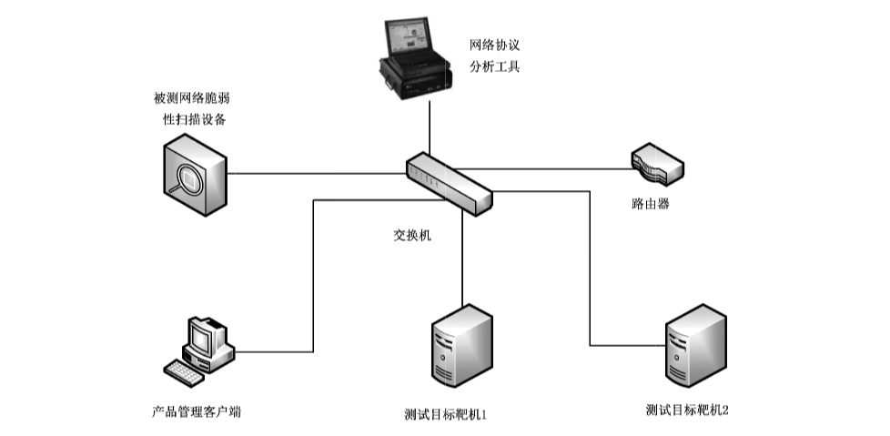

# GB/T 20278-2022 信息安全技术 网络脆弱性扫描产品安全技术要求和测试评价方法

> 来源：[GB/T 20278-2022 国家标准详情](https://openstd.samr.gov.cn/bzgk/std/newGbInfo?hcno=C588699EA54F77505704CEF5E1C31319)；封面发布日期：2022-03-09；实施日期：2022-10-01。
> 官方在线预览页面图像 SHA-256：5777433211553e1cf5409c936ea8b6ec506e2d55c7befdfe56041e199381ae25。
> 转写说明：依据官方在线预览全部 62 页的页面图像核对；省略封面、目录、页眉、页脚和页码，合并印刷折行与跨页表格，保留图示。正式引用请核对原页面。

## 前言

本文件按照 GB/T 1.1—2020《标准化工作导则 第1部分：标准化文件的结构和起草规则》的规定起草。

本文件代替GB/T 20278—2013《信息安全技术 网络脆弱性扫描产品安全技术要求》和GB/T 20280—2006《信息安全技术 网络脆弱性扫描产品测试评价方法》，与GB/T 20278—2013 相比，除结构调整和编辑性改动外，主要技术变化如下：

a） 增加了“网络脆弱性扫描产品描述”的内容（见第5章）；

b）增加了“扫描报文标识”的要求（见6.2.1.5.3 和 6.3.1.5.3）；

c） 增加了“并发扫描”的要求（见6.2.1.7 和6.3.1.7）；

d） 增加了“支撑系统安全”的要求（见6.2.2.4 和 6.3.2.5）；

e）增加了“通信保密性”的要求（见 6.3.2.4）；

f） 增加了“环境适应性要求（有则适用）”的内容，其中主要是明确了产品对IPv6 的支持能力，包括支持纯IPv6 网络环境的扫描能力、IPv6网络环境下的自身管理能力以及双协议栈的要求（见6.2.3 和 6.3.3）；

g） 增加了“测试评价方法”的内容（见第7章）；

h） 删除了“扫描IP 地址限制”的要求（见2013年版的 8.1.8）；

i） 删除了“易用性”的要求（见2013年版的8.2.2.2）；

j） 修改了“脆弱性扫描内容”，将原标准中要求的15项扫描要求重新整理分为5类扫描要求（见6.2.1.2 和 6.3.1.2，2013年版的7.1.2），在增强级中还提出了对云环境和工控设备目标对象的扫描要求（见6.3.1.2.6 和 6.3.1.2.7）；

k）修改了各级的“安全保证要求”为“安全保障要求”（见 6.2.4 和 6.3.4,2013年版的7.3 和8.3）。

请注意本文件的某些内容可能涉及专利。本文件的发布机构不承担识别专利的责任。

本文件由全国信息安全标准化技术委员会（SAC/TC 260）提出并归口。

本文件起草单位：公安部第三研究所、北京神州绿盟科技有限公司、网神信息技术（北京）股份有限公司、北京天融信网络安全技术有限公司、启明星辰信息技术集团股份有限公司、上海国际技贸联合有限公司、中国网络安全审查技术与认证中心、西安交大捷普网络科技有限公司、北京中科网威信息技术有限公司、上海市信息安全测评认证中心、工业和信息化部计算机与微电子发展研究中心（中国软件评测中心）、新华三技术有限公司、中国电子科技集团公司第十五研究所（信息产业信息安全测评中心）、国家工业信息安全发展研究中心、陕西省网络与信息安全测评中心、国网新疆电力有限公司电力科学研究院、中国科学院信息工程研究所、中国电力科学研究院有限公司信息通信研究所、中国信息通信研究院、远江盛邦（北京）网络安全科技股份有限公司、北京通和实益电信科学技术研究所有限公司、上海斗象信息科技有限公司、深圳市联软科技股份有限公司、北京知道创宇信息技术股份有限公司。

本文件主要起草人：顾建新、宋好好、陆臻、顾健、沈亮、尹航、陈听宇、熊毅、秦兰、曹宁、申永波、何建锋、宋伟、徐佟海、郭永振、杨洪起、刘健、刘志尧、巨腾飞、李明轩、陈佳、闫兆腾、严敏辉、许子先、于忠臣、闻蕾、谢忱、侯俊、崔兆。

本文件及其所替代文件的历次版本发布情况为：

- 2006 年首次发布为 GB/T 20278—2006，2013 年第一次修订；
- 本次为第二次修订，并入了 GB/T 20280—2006《信息安全技术 网络脆弱性扫描产品测试评价方法》的内容。

## 1 范围

本文件规定了网络脆弱性扫描产品的安全技术要求和测试评价方法。

本文件适用于脆弱性扫描产品的设计、开发与测试。

## 2 规范性引用文件

下列文件中的内容通过文中的规范化引用而构成本文件必不可少的条款。其中，注日期的引用文件，仅该日期对应的版本适用于本文件；不注日期的引用文件，其最新版本（包括所有的修改单）适用于本文件。

- GB/T 25069 信息安全技术 术语

## 3 术语和定义

GB/T 25069界定的以及下列术语和定义适用于本文件。

### 3.1 扫描 scan

使用技术工具对目标系统进行探测，查找目标系统中存在安全弱点的过程。

### 3.2 网络脆弱性扫描 network vulnerability scan

通过网络对目标系统安全弱点进行远程探测，检查和分析其安全脆弱性，从而发现可能被入侵者利用的安全弱点，并提出一定的防范和补救措施建议。

### 3.3 旗标 banner

应用程序发送的一段信息。

> 注：通常包括欢迎语、应用程序名称和版本等信息。

### 3.4 支撑系统 supporting system

支撑网络脆弱性扫描设备运行的操作系统。

## 4 缩略语

下列缩略语适用于本文件。

CNNVD：中国国家信息安全漏洞库（China National Vulnerability Database of Information Security）

CVE：通用漏洞披露（Common Vulnerabilities and Exposures）

FTP：文件传输协议（File Transfer Protocol）

RPC：远程过程调用（Remote Procedure Call）

TCP：传输控制协议（Transmission Control Protocol）

UDP：用户数据报协议（User Datagram Protocol）

## 5 网络脆弱性扫描产品描述

网络脆弱性扫描产品是指利用扫描手段检测目标网络系统中可能存在的安全弱点的软件或软硬件组合的产品。该产品可根据预先定义的策略或者其他要求，对目标网络中的指定设备进行端口扫描，检查其开放的服务，并进一步探测各个服务程序的配置信息以及存在的安全问题，从而实现对目标网络系统的脆弱性扫描。对于适用于下一代互联网网络环境的网络脆弱性扫描产品，还能够支持IPv6、IPv4/IPv6 过渡技术的网络环境，并具备较高的处理性能，可实现对多个目标的并发扫描。

网络脆弱性扫描产品在应用过程中与被扫描系统的各网络设备或者主机处于连通状态，网络路径中不存在其他安全防护或者检测设备的干扰。

## 6 安全技术要求

### 6.1 概述

#### 6.1.1 要求分类

本文件将网络脆弱性扫描产品的安全技术要求分为安全功能要求、自身安全保护要求、环境适应性要求和安全保障要求四方面。其中，安全功能要求是对产品应具备的安全功能提出的具体要求，包括信息获取、脆弱性扫描内容、扫描结果分析处理、扫描配置、扫描对象的安全性、扫描速度调节、并发扫描和升级能力等；自身安全保护要求包括身份鉴别、管理员管理、安全审计和支撑系统安全；环境适应性要求提出了产品支持IPv6 网络环境进行工作和管理的要求；安全保障要求针对产品的生命周期过程提出具体的要求，包括开发、指导性文档、生命周期支持和测试等。

#### 6.1.2 安全等级

本文件将网络脆弱性扫描产品的安全等级分为基本级和增强级，如表1、表2、表3和表4所示。安全功能与自身安全保护的强弱、以及安全保障要求的高低是等级划分的具体依据，安全等级突出安全特性。与基本级内容相比，增强级中要求有所增加或变更的内容在正文中通过“宋体加粗”表示。

**表1 安全功能要求等级划分表**

| 类别 | 要求 | 基本级 | 增强级 |
| --- | --- | --- | --- |
| 信息获取／端口扫描 | TCP 端口 | * | * |
| 信息获取／端口扫描 | UDP 端口 | * | * |
| 信息获取／端口扫描 | 端口协议分析 | * | ** |
| 信息获取 | 服务旗标 | * | * |
| 信息获取 | 存活判断 | * | * |
| 信息获取 | 其他信息 | — | * |
| 脆弱性扫描内容 | 操作系统脆弱性 | * | * |
| 脆弱性扫描内容 | 数据库脆弱性 | * | * |
| 脆弱性扫描内容 | 应用服务脆弱性 | * | * |
| 脆弱性扫描内容 | 网络设备脆弱性 | * | * |
| 脆弱性扫描内容 | 口令脆弱性 | * | * |
| 脆弱性扫描内容 | 云环境脆弱性 | — | * |
| 脆弱性扫描内容 | 工控设备脆弱性（有则适用） | — | * |
| 扫描结果分析处理 | 结果浏览 | * | * |
| 扫描结果分析处理 | 脆弱性修补建议 | * | * |
| 扫描结果分析处理 | 报告生成 | * | * |
| 扫描结果分析处理 | 报告输出 | * | * |
| 扫描结果分析处理 | 结果导入导出 | — | * |
| 扫描结果分析处理 | 报告定制 | — | * |
| 扫描结果分析处理 | 结果比对 | — | * |
| 扫描结果分析处理 | 报告发送 | — | * |
| 扫描配置 | 扫描策略 | * | * |
| 扫描配置 | 计划任务 | * | * |
| 扫描配置 | 任务管理 | * | * |
| 扫描配置 | 已知账号／口令扫描 | — | * |
| 扫描对象的安全性 | 对目标系统所在网络性能的影响 | * | * |
| 扫描对象的安全性 | 对目标系统的影响 | * | * |
| 扫描对象的安全性 | 扫描报文标识 | * | * |
| 扫描速度调节 | 扫描速度调节 | * | * |
| 并发扫描 | 并发扫描 | * | * |
| 升级能力 | 升级能力 | * | ** |
| 中断恢复 | 中断恢复 | — | * |
| 互动性要求 | 互动性要求 | — | * |

“*”表示具有该要求，“**”表示要求有所增强，“—”表示不适用。

**表2 自身安全保护要求等级划分表**

| 类别 | 要求 | 基本级 | 增强级 |
| --- | --- | --- | --- |
| 身份鉴别 | 管理员鉴别 | * | * |
| 身份鉴别 | 鉴别信息要求 | * | * |
| 身份鉴别 | 鉴别失败的处理 | * | * |
| 身份鉴别 | 鉴别数据保护 | * | * |
| 身份鉴别 | 超时设置 | * | * |
| 身份鉴别 | 管理地址限制 | — | * |
| 身份鉴别 | 会话锁定 | — | * |
| 管理员管理 | 标识唯一性 | * | * |
| 管理员管理 | 管理员属性定义 | * | * |
| 管理员管理 | 安全行为管理 | * | * |
| 管理员管理 | 管理员角色 | — | * |
| 安全审计 | 审计日志生成 | * | * |
| 安全审计 | 审计日志可理解性 | * | * |
| 安全审计 | 审计日志查阅 | * | * |
| 安全审计 | 受限的审计日志查阅 | * | * |
| 安全审计 | 可选审计查阅 | * | * |
| 安全审计 | 数据存储告警 | — | * |
| 通信保密性 | 通信保密性 | — | * |
| 支撑系统安全 | 支撑系统安全 | * | * |

“*”表示具有该要求，“**”表示要求有所增强，“—”表示不适用。

**表3 环境适应性要求等级划分表**

| 环境适应性要求 | 基本级 | 增强级 |
| --- | --- | --- |
| 支持纯 IPv6 网络环境 | * | * |
| IPv6 网络环境下自身管理 | * | * |
| 双协议栈 | * | * |

“*”表示具有该要求，“**”表示要求有所增强，“—”表示不适用。

**表4 安全保障要求等级划分表**

| 类别 | 要求 | 基本级 | 增强级 |
| --- | --- | --- | --- |
| 开发 | 安全架构 | * | * |
| 开发 | 功能规范 | * | ** |
| 开发 | 实现表示 | — | * |
| 开发 | 产品设计 | * | ** |
| 指导性文档 | 操作用户指南 | * | * |
| 指导性文档 | 准备程序 | * | * |
| 生命周期支持 | 配置管理能力 | * | ** |
| 生命周期支持 | 配置管理范围 | * | ** |
| 生命周期支持 | 交付程序 | * | * |
| 生命周期支持 | 开发安全 | — | * |
| 生命周期支持 | 生命周期定义 | — | * |
| 生命周期支持 | 工具和技术 | — | * |
| 测试 | 测试覆盖 | * | ** |
| 测试 | 测试深度 | — | * |
| 测试 | 功能测试 | * | * |
| 测试 | 独立测试 | * | * |
| 脆弱性评定 | 脆弱性评定 | * | ** |

“*”表示具有该要求，“**”表示要求有所增强，“—”表示不适用。

### 6.2 基本级安全要求

#### 6.2.1 安全功能要求

##### 6.2.1.1 信息获取

###### 6.2.1.1.1 端口扫描

###### 6.2.1.1.1.1 TCP 端口

产品应能扫描目标设备的所有TCP端口，检查其是否开启。

###### 6.2.1.1.1.2 UDP 端口

产品应能扫描目标设备的所有 UDP端口，检查其是否开启。

###### 6.2.1.1.1.3 端口协议分析

产品应能判断目标设备开启的 TCP/UDP端口所对应的通用服务或应用协议。

###### 6.2.1.1.2 服务旗标

产品应能获取目标设备已开启的各项通用服务的旗标。

###### 6.2.1.1.3 存活判断

产品应能对目标设备是否在线进行存活判断。

##### 6.2.1.2 脆弱性扫描内容

###### 6.2.1.2.1 操作系统脆弱性

产品应能探测目标主机操作系统的脆弱性，检查项目包括：

a） 操作系统名称、版本和补丁安装情况；

b） 系统安全设置；

c） 其他相关检查。

###### 6.2.1.2.2 数据库脆弱性

产品应能探测目标主机所安装数据库的脆弱性，检查项目包括：

a） 数据库名称、版本和补丁安装情况；

b） 数据库安全设置；

c） 其他相关检查。

###### 6.2.1.2.3 应用服务脆弱性

产品应能探测目标主机中所安装的各类应用服务的脆弱性，检查项目包括：

a） 各应用服务名称、版本；

b） 各应用服务的安全设置；

c） 其他相关检查。

###### 6.2.1.2.4 网络设备脆弱性

产品应能探测不同网络设备（包括但不限于交换机、路由器、防火墙等）的系统版本和特有的脆弱性。

###### 6.2.1.2.5 口令脆弱性

产品应能探测目标操作系统，以及不同应用服务用户口令的脆弱性，检查项目包括：

a） 系统是否使用了用户名称经过简单变换后的口令；

b） 系统是否使用了易猜测口令。

##### 6.2.1.3 扫描结果分析处理

###### 6.2.1.3.1 结果浏览

产品应提供扫描结果浏览功能。

###### 6.2.1.3.2 脆弱性修补建议

产品应能对发现的脆弱性提出修补建议，脆弱性修补建议满足下列要求：

a） 对不同的操作系统类型提出针对性的脆弱性修补方法；

b） 脆弱性描述应详细，提供的脆弱性修补方法应确保其合理性和可用性。

###### 6.2.1.3.3 报告生成

产品应能根据扫描结果生成相应的报告，报告要求包括如下内容：

a） 各脆弱点的CVE编号或者 CNNVD编号、详细信息、补救建议等；

b） 目标的风险等级评估，将扫描脆弱点按风险严重程度分级，并明确标出；

c） 多个目标扫描后的汇总结果；

d） 关键脆弱性扫描信息的摘要。

###### 6.2.1.3.4 报告输出

报告应能输出为通用的文档格式，包括但不限于 PDF、DOC、HTML、WPS、OFD 等。

##### 6.2.1.4 扫描配置

###### 6.2.1.4.1 扫描策略

产品应提供方便的定制策略的方法，可以指定扫描地址范围、端口范围、脆弱性类型等。

###### 6.2.1.4.2 计划任务

产品应能定制扫描计划，可以定时启动或者按周期执行扫描任务。

###### 6.2.1.4.3 任务管理

产品应具备易用的操作管理能力，扫描任务可执行启用、停用、中止、继续、删除等操作，可展示扫描任务的执行进度。

##### 6.2.1.5 扫描对象的安全性

###### 6.2.1.5.1 对目标系统所在网络性能的影响

扫描不应影响目标网络的正常工作，能调整对网络流量的占用大小或者占用较少网络流量（不超过带宽总量的10%）。

###### 6.2.1.5.2 对目标系统的影响

扫描不应影响目标系统的正常工作，避免使用攻击方法进行测试。

###### 6.2.1.5.3 扫描报文标识

产品在对目标设备进行扫描时，所发出的扫描报文中应有标识其产品名称或者产品生产单位的信息。

##### 6.2.1.6 扫描速度调节

产品应能对扫描速度进行调节。

##### 6.2.1.7 并发扫描

产品应能支持不少于60个目标设备IP 的并发扫描。

##### 6.2.1.8 升级能力

产品应能对系统版本和脆弱性特征库进行更新，并满足以下要求：

a） 产品体系结构的设计应有利于产品的升级，方便升级操作；

b） 支持手动或者自动升级操作。

#### 6.2.2 自身安全保护要求

##### 6.2.2.1 身份鉴别

###### 6.2.2.1.1 管理员鉴别

产品应在管理员执行任何与安全功能相关的操作之前对管理员身份进行鉴别。

###### 6.2.2.1.2 鉴别信息要求

在采用基于口令的鉴别信息时，产品应对管理员设置的口令进行复杂度检查，确保管理员口令满足一定的复杂度要求；当存在默认口令时，系统应提示管理员对默认口令进行修改，以減少用户身份被冒用的风险；产品应提供鉴别信息定期更换功能，当鉴别信息使用时间达到使用期限阈值前，应提示管理员进行修改。

###### 6.2.2.1.3 鉴别失败的处理

当管理员鉴别尝试失败连续达到指定次数后，产品应阻止管理员进一步的鉴别请求，并将有关信息生成审计事件。最多失败次数仅由授权管理员设定。

###### 6.2.2.1.4 鉴别数据保护

产品应保护鉴别数据不被未授权查阅和修改。

###### 6.2.2.1.5 超时设置

产品应具有管理员登录超时重新鉴别功能。在设定的时间段内没有任何操作的情况下，锁定或终止会话，需要再次进行身份鉴别才能够重新使用产品，最大超时时间仅由授权管理员设定。

##### 6.2.2.2 管理员管理

###### 6.2.2.2.1 标识唯一性

产品应保证所设置的管理员标识全局唯一。

###### 6.2.2.2.2 管理员属性定义

产品应为每一个管理员保存安全属性表，属性应包括：管理员标识、鉴别数据、授权信息或管理组信息、其他安全属性等。

###### 6.2.2.2.3 安全行为管理

产品应仅允许授权管理员对产品进行功能设置、参数修改、安全策略变更，以及启用/停用等操作。

##### 6.2.2.3 安全审计

###### 6.2.2.3.1 审计日志生成

产品应生成以下事件的审计日志：

a） 管理员的登录成功和失败；

b） 对扫描策略进行设置、修改、启用/停用等操作；

c） 对管理员或者角色进行增加、删除和属性修改的操作。

产品应在每一个审计日志记录中记录事件发生的日期、时间、用户标识、事件描述和结果。若采用远程登录方式还应记录管理主机的IP地址。

###### 6.2.2.3.2 审计日志可理解性

审计数据的记录方式应便于管理员理解，以便对审计日志进行分析。

###### 6.2.2.3.3 审计日志查阅

产品应为授权管理员提供审计日志查阅功能，方便管理员查看审计结果。

###### 6.2.2.3.4 受限的审计日志查阅

除了具有明确的访问权限的授权管理员之外，产品应禁止所有其他用户对审计日志的访问。

###### 6.2.2.3.5 可选审计查阅

应支持按照一定条件对审计日志进行检索或排序。

##### 6.2.2.4 支撑系统安全

产品的支撑系统应：

a） 进行必要的裁剪，不提供多余的组件或网络服务；

b） 重启过程中，扫描任务配置和日志信息不丢失；

c） 不含已知中、高、超危安全漏洞。

#### 6.2.3 环境适应性要求（有则适用）

##### 6.2.3.1 支持纯 IPv6 网络环境

产品应支持纯IPv6网络环境，能够在纯IPv6网络环境下正常工作，实现对目标设备的扫描。

##### 6.2.3.2 IPv6 网络环境下自身管理

产品应支持在IPv6网络环境下的自身管理，实现对产品的管理操作。

##### 6.2.3.3 双协议栈

产品应支持IPv4/IPv6双栈网络环境，能够在IPv4/IPv6双栈网络环境下正常工作，实现对目标设备的扫描。

#### 6.2.4 安全保障要求

##### 6.2.4.1 开发

###### 6.2.4.1.1 安全架构

开发者应提供产品安全功能和自身安全保护的安全架构描述，安全架构描述应满足以下要求：

a） 与产品设计文档中对安全功能和自身安全保护实施抽象描述的级别一致；

b） 描述与安全功能和自身安全保护要求一致的产品安全功能和自身安全保护的安全域；

c） 描述产品安全功能和自身安全保护初始化过程为何是安全的；

d） 证实产品安全功能和自身安全保护能够防止被破坏；

e） 证实产品安全功能和自身安全保护能够防止安全特性被旁路。

###### 6.2.4.1.2 功能规范

开发者应提供完备的功能规范说明，功能规范说明应满足以下要求：

a） 完全描述产品的安全功能和自身安全保护；

b） 描述所有安全功能和自身安全保护接口的目的与使用方法；

c） 标识和描述每个安全功能和自身安全保护接口相关的所有参数；

d） 描述安全功能和自身安全保护接口相关的安全功能和自身安全保护实施行为；

e）描述由安全功能和自身安全保护实施行为处理而引起的直接错误消息；

f） 证实安全功能和自身安全保护要求到安全功能和自身安全保护接口的追溯。

###### 6.2.4.1.3 产品设计

开发者应提供产品设计文档，产品设计文档应满足以下要求：

a） 根据子系统描述产品结构；

b）标识和描述产品安全功能和自身安全保护的所有子系统；

c） 描述安全功能和自身安全保护所有子系统间的相互作用；

d） 提供的映射关系能够证实设计中描述的所有行为能够映射到调用它的安全功能和自身安全保护接口。

##### 6.2.4.2 指导性文档

###### 6.2.4.2.1 操作用户指南

开发者应提供明确和合理的操作用户指南，操作用户指南与为评估而提供的其他所有文档保持一致，对每一种用户角色的描述应满足以下要求：

a） 描述在安全处理环境中被控制的用户可访问的功能和特权，包含适当的警示信息；

b） 描述如何以安全的方式使用产品提供的可用接口；

c） 描述可用功能和接口，尤其是受用户控制的所有安全参数；

d） 明确说明与需要执行的用户可访问功能有关的每一种安全相关事件，包括改变安全功能和自身安全保护所控制实体的安全特性；

e） 标识产品运行的所有可能状态（包括操作导致的失败或者操作性错误），以及它们与维持安全运行之间的因果关系和联系；

f） 充分实现安全目的所执行的安全策略。

###### 6.2.4.2.2 准备程序

开发者应提供产品及其准备程序，准备程序描述应满足以下要求：

a） 描述与开发者交付程序相一致的安全接收所交付产品必需的所有步骤；

b） 描述安全安装产品及其运行环境必需的所有步骤。

##### 6.2.4.3 生命周期支持

###### 6.2.4.3.1 配置管理能力

开发者的配置管理能力应满足以下要求：

a） 为产品的不同版本提供唯一的标识；

b） 使用配置管理系统对组成产品的所有配置项进行维护，并唯一标识配置项；

c） 提供配置管理文档，配置管理文档描述用于唯一标识配置项的方法。

###### 6.2.4.3.2 配置管理范围

开发者应提供产品配置项列表，并说明配置项的开发者。配置项列表至少包含产品、安全保障要求的评估证据和产品的组成部分。

###### 6.2.4.3.3 交付程序

开发者应使用一定的交付程序交付产品，并将交付过程文档化。在给用户方交付产品的各版本时，交付文档应描述为维护安全所必需的所有程序。

##### 6.2.4.4 测试

###### 6.2.4.4.1 测试覆盖

开发者应提供测试覆盖文档，测试覆盖描述应表明测试文档中所标识的测试与功能规范中所描述的产品的安全功能和自身安全保护间的对应性。

###### 6.2.4.4.2 功能测试

开发者应测试产品安全功能和自身安全保护，将结果文档化并提供测试文档。测试文档应包括以下内容：

a） 测试计划，标识要执行的测试，并描述执行每个测试的方案，这些方案包括对于其他测试结果的任何顺序依赖性；

b） 预期的测试结果，表明测试成功后的预期输出；

c） 实际测试结果和预期的测试结果的对比。

###### 6.2.4.4.3 独立测试

开发者应提供一组与其自测安全功能和自身安全保护时使用的同等资源，以用于安全功能和自身安全保护的抽样测试。

##### 6.2.4.5 脆弱性评定

基于已标识的潜在脆弱性，产品应能抵抗具有基本攻击潜力的攻击者的攻击。

### 6.3 增强级安全要求

#### 6.3.1 安全功能要求

##### 6.3.1.1 信息获取

###### 6.3.1.1.1 端口扫描

###### 6.3.1.1.1.1 TCP端口

产品应能扫描目标设备的所有TCP端口，检查其是否开启。

###### 6.3.1.1.1.2 UDP端口

产品应能扫描目标设备的所有 UDP端口，检查其是否开启。

###### 6.3.1.1.1.3 端口协议分析

产品应能判断目标设备开启的TCP/UDP端口所对应的通用服务或应用协议，并能探测在非标准端口上使用的通用服务或应用协议。

###### 6.3.1.1.2 服务旗标

产品应能获取目标设备已开启的各项通用服务的旗标。

###### 6.3.1.1.3 存活判断

产品应能对目标设备是否在线进行存活判断。

###### 6.3.1.1.4 其他信息

产品应能对目标设备的其他信息进行探测，包括但不限于网络设备类型识别、嵌入式设备类型识别、智能终端类型识别、虚拟化组件类型识别、安全防护设备识别等。

##### 6.3.1.2 脆弱性扫描内容

###### 6.3.1.2.1 操作系统脆弱性

产品应能探测目标主机操作系统的脆弱性，检查项目包括：

a） 操作系统名称、版本和补丁安装情况；

b） 系统安全设置；

c） 其他相关检查。

###### 6.3.1.2.2 数据库脆弱性

产品应能探测目标主机所安装数据库的脆弱性，检查项目包括：

a） 数据库名称、版本和补丁安装情况；

b） 数据库安全设置；

c） 其他相关检查。

###### 6.3.1.2.3 应用服务脆弱性

产品应能探测目标主机中所安装的各类应用服务的脆弱性，检查项目包括：

a） 各应用服务名称、版本；

b） 各应用服务的安全设置；

c） 其他相关检查。

###### 6.3.1.2.4 网络设备脆弱性

产品应能探测不同网络设备（包括但不限于交换机、路由器、防火墻等）的系统版本和特有的脆弱性。

###### 6.3.1.2.5 口令脆弱性

产品应能探测目标操作系统，以及不同应用服务用户口令的脆弱性，检查项目包括：

a） 系统是否使用了用户名称经过简单变换后的口令；

b） 系统是否使用了易猜测口令。

###### 6.3.1.2.6 云环境脆弱性

产品应能支持对云环境下的对象进行探测扫描，检查对象包括 OpenStack、KVM、VMWare 等，可发现其存在的脆弱性。

###### 6.3.1.2.7 工控设备脆弱性（有则适用）

产品应能支持对工控环境下的设备进行探测扫描，检查项目包括：

a） 对工业控制设备的识别和端口扫描；

b） 对工业控制设备通信协议的检测，如 Modbus/TCP、S7Comm、DNP3.0、Ethernet/IP 等；

c） 对工业控制设备的脆弱性检测。

##### 6.3.1.3 扫描结果分析处理

###### 6.3.1.3.1 结果浏览

产品应提供扫描结果浏览功能。

###### 6.3.1.3.2 脆弱性修补建议

产品能对发现的脆弱性提出修补建议，脆弱性修补建议满足下列要求：

a） 对不同的操作系统类型提出针对性的脆弱性修补方法；

b） 脆弱性描述应详细，提供的脆弱性修补方法应确保其合理性和可用性。

###### 6.3.1.3.3 报告生成

产品应能根据扫描结果生成相应的报告，报告要求包括如下内容：

a） 各脆弱点的CVE编号或者 CNNVD编号、详细信息、补救建议等；

b） 目标的风险等级评估，将扫描脆弱点按风险严重程度分级，并明确标出；

c） 多个目标扫描后的汇总结果；

d） 关键脆弱性扫描信息的摘要。

###### 6.3.1.3.4 报告输出

报告应能输出为通用的文档格式，包括但不限于 PDF、DOC、HTML、WPS、OFD 等。

###### 6.3.1.3.5 结果导入导出

可对扫描结果数据执行导入导出操作。

###### 6.3.1.3.6 报告定制

报告内容应能根据用户要求进行定制生成。

###### 6.3.1.3.7 结果比对

产品应提供对同一目标多次扫描结果或者不同主机间扫描结果的比对功能，并能根据比对结果生成比对报告。

###### 6.3.1.3.8 报告发送

产品能够设置定制化任务，在扫描完成后能够根据需要将扫描结果或者报告自动发送至指定位置，包括但不限于邮箱或ITP服务器等。

##### 6.3.1.4 扫描配置

###### 6.3.1.4.1 扫描策略

产品应提供方便的定制策略的方法，可以指定扫描地址范围、端口范围、脆弱性类型等。

###### 6.3.1.4.2 计划任务

产品应能定制扫描计划，可以定时启动或者按周期执行扫描任务。

###### 6.3.1.4.3 任务管理

产品应具备易用的操作管理能力，扫描任务可执行启用、停用、中止、继续、删除等操作，可展示扫描任务的执行进度。

###### 6.3.1.4.4 已知账号/口令扫描

产品应能使用目标系统的已知账号/口令对其进行更有效的扫描。

##### 6.3.1.5 扫描对象的安全性

###### 6.3.1.5.1 对目标系统所在网络性能的影响

扫描不应影响目标网络的正常工作，能调整对网络流量的占用大小或者占用较少网络流量（不超过带宽总量的10%）。

###### 6.3.1.5.2 对目标系统的影响

扫描不应影响目标系统的正常工作，避免使用攻击方法进行测试。

###### 6.3.1.5.3 扫描报文标识

产品在对目标设备进行扫描时，所发出的扫描报文中应有标识其产品名称或者产品生产单位的信息。

##### 6.3.1.6 扫描速度调节

产品应能对扫描速度进行调节。

##### 6.3.1.7 并发扫描

产品应能支持不少于60个目标设备的并发扫描。

##### 6.3.1.8 升级能力

产品应能对系统版本和脆弱性特征库进行更新，并满足以下要求。

a） 产品体系结构的设计应有利于产品的升级，方便升级操作。

b） 支持手动或者自动升级操作。

c） 具备升级安全措施，以防止得到错误的或伪造的产品升级包。包括但不限于采取身份验证、数字签名以及数据传输加密等手段。

##### 6.3.1.9 中断恢复

产品在执行扫描任务过程中，若遇到异常断电、断网等情况，在环境恢复正常后，可选择恢复继续执行扫描任务。

##### 6.3.1.10 互动性要求

产品应具备或至少采用一个标准的、开放的接口。遵循该接口规范，可为其他类型安全产品编写相应的程序模块，达到与网络脆弱性扫描产品进行互动的目的。

#### 6.3.2 自身安全保护要求

##### 6.3.2.1 身份鉴别

###### 6.3.2.1.1 管理员鉴别

产品应在管理员执行任何与安全功能相关的操作之前对管理员身份进行鉴别。

###### 6.3.2.1.2 鉴别信息要求

在采用基于口令的鉴别信息时，产品应对管理员设置的口令进行复杂度检查，确保管理员口令满足一定的复杂度要求；当存在默认口令时，系统应提示管理员对默认口令进行修改，以减少用户身份被冒用的风险；产品应提供鉴别信息定期更换功能，当鉴别信息使用时间达到使用期限阈值前，应提示管理员进行修改。

###### 6.3.2.1.3 鉴别失败的处理

当管理员鉴别尝试失败连续达到指定次数后，产品应阻止管理员进一步的鉴别请求，并将有关信息生成审计事件。最多失败次数仅由授权管理员设定。

###### 6.3.2.1.4 鉴别数据保护

产品应保护鉴别数据不被未授权查阅和修改。

###### 6.3.2.1.5 超时设置

产品应具有管理员登录超时重新鉴别功能。在设定的时间段内没有任何操作的情况下，锁定或终止会话，需要再次进行身份鉴别才能够重新使用产品，最大超时时间仅由授权管理员设定。

###### 6.3.2.1.6 管理地址限制

产品应对管理员登录的地址进行限制。

###### 6.3.2.1.7 会话锁定

产品应允许管理员锁定当前的交互会话，锁定后需要再次进行身份鉴别才能够重新管理产品。

##### 6.3.2.2 管理员管理

###### 6.3.2.2.1 标识唯一性

产品应保证所设置的管理员标识全局唯一。

###### 6.3.2.2.2 管理员属性定义

产品应为每一个管理员保存安全属性表，属性应包括：管理员标识、鉴别数据、授权信息或管理组信息、其他安全属性等。

###### 6.3.2.2.3 安全行为管理

产品应仅允许授权管理员对产品进行功能设置、参数修改、安全策略变更，以及启用/停用等操作。

###### 6.3.2.2.4 管理员角色

产品应能设置多个不同权限的角色，并应保证每一个角色标识是全局唯一的。

##### 6.3.2.3 安全审计

###### 6.3.2.3.1 审计日志生成

产品应生成以下事件的审计日志：

a）管理员的登录成功和失败；

b） 对扫描策略进行设置、修改、启用/停用等操作；

c） 对管理员或者角色进行增加、删除和属性修改的操作。

产品应在每一个审计日志记录中记录事件发生的日期、时间、用户标识、事件描述和结果。若采用远程登录方式还应记录管理主机的IP地址。

###### 6.3.2.3.2 审计日志可理解性

审计数据的记录方式应便于管理员理解，以便对审计日志进行分析。

###### 6.3.2.3.3 审计日志查阅

产品应为授权管理员提供审计日志查阅功能，方便管理员查看审计结果。

###### 6.3.2.3.4 受限的审计日志查阅

除了具有明确的访问权限的授权管理员之外，产品应禁止所有其他用户对审计日志的访问。

###### 6.3.2.3.5 可选审计查阅

应支持按照一定条件对审计日志进行检索或排序。

###### 6.3.2.3.6 数据存储告警

产品应在数据存储空间将耗尽等情况时，自动产生告警，产生告警的剩余存储空间大小应由管理员自主设定。

##### 6.3.2.4 通信保密性

产品若分为多个组件或者通过远程方式进行管理，应确保远程传输数据的保密性。

##### 6.3.2.5 支撑系统安全

产品的支撑系统应：

a） 进行必要的裁剪，不提供多余的组件或网络服务；

b） 重启过程中，扫描任务配置和日志信息不丢失；

c） 不含已知中、高、超危安全漏洞。

#### 6.3.3 环境适应性要求（有则适用）

##### 6.3.3.1 支持纯 IPv6网络环境

产品应支持纯 IPv6 网络环境，能够在纯 IPv6网络环境下正常工作，实现对目标设备的扫描。

##### 6.3.3.2 IPv6 网络环境下自身管理

产品应支持在IPv6 网络环境下的自身管理，实现对产品的管理操作。

##### 6.3.3.3 双协议栈

产品应支持IPv4/IPv6 双栈网络环境，能够在IPv4/IPv6双栈网络环境下正常工作，实现对目标设备的扫描。

#### 6.3.4 安全保障要求

##### 6.3.4.1 开发

###### 6.3.4.1.1 安全架构

开发者应提供产品安全功能和自身安全保护的安全架构描述，安全架构描述应满足以下要求：

a） 与产品设计文档中对安全功能和自身安全保护实施抽象描述的级别一致；

b） 描述与安全功能和自身安全保护要求一致的产品安全功能和自身安全保护的安全域；

c） 描述产品安全功能和自身安全保护初始化过程为何是安全的；

d） 证实产品安全功能和自身安全保护能够防止被破坏；

e） 证实产品安全功能和自身安全保护能够防止安全特性被旁路。

###### 6.3.4.1.2 功能规范

开发者应提供完备的功能规范说明，功能规范说明应满足以下要求：

a） 完全描述产品的安全功能和自身安全保护；

b） 描述所有安全功能和自身安全保护接口的目的与使用方法；

c） 标识和描述每个安全功能和自身安全保护接口相关的所有参数；

d） 描述安全功能和自身安全保护接口相关的安全功能和自身安全保护实施行为；

e） 描述由安全功能和自身安全保护实施行为处理而引起的直接错误消息；

f） 证实安全功能和自身安全保护要求到安全功能和自身安全保护接口的追溯；

g） 描述安全功能和自身安全保护实施过程中，与安全功能和自身安全保护接口相关的所有行为；

h）描述可能由安全功能和自身安全保护接口的调用而引起的所有直接错误消息。

###### 6.3.4.1.3 实现表示

开发者应提供全部安全功能和自身安全保护的实现表示，实现表示应满足以下要求：

a） 提供产品设计描述与实现表示实例之间的映射，并证明其一致性；

b） 按详细级别定义产品安全功能和自身安全保护，详细程度达到无须进一步设计就能生成安全功能和自身安全保护的程度；

c） 以开发人员使用的形式提供。

###### 6.3.4.1.4 产品设计

开发者应提供产品设计文档，产品设计文档应满足以下要求：

a） 根据子系统描述产品结构；

b） 标识和描述产品安全功能和自身安全保护的所有子系统；

c） 描述安全功能和自身安全保护所有子系统间的相互作用；

d） 提供的映射关系能够证实设计中描述的所有行为能够映射到调用它的安全功能和自身安全保护接口；

e） 根据模块描述安全功能和自身安全保护；

f） 提供安全功能和自身安全保护子系统到模块间的映射关系；

g） 描述所有安全功能和自身安全保护实现模块，包括其目的及与其他模块间的相互作用；

h）描述所有实现模块的安全功能和自身安全保护要求相关接口、其他接口的返回值、与其他模块间的相互作用及调用的接口；

i） 描述所有安全功能和自身安全保护的支撑或相关模块，包括其目的及与其他模块间的相互作用。

##### 6.3.4.2 指导性文档

###### 6.3.4.2.1 操作用户指南

开发者应提供明确和合理的操作用户指南，操作用户指南与为评估而提供的其他所有文档保持一致，对每一种用户角色的描述应满足以下要求：

a） 描述在安全处理环境中被控制的用户可访问的功能和特权，包含适当的警示信息；

b） 描述如何以安全的方式使用产品提供的可用接口；

c） 描述可用功能和接口，尤其是受用户控制的所有安全参数；

d） 明确说明与需要执行的用户可访问功能有关的每一种安全相关事件，包括改变安全功能和自身安全保护所控制实体的安全特性；

e） 标识产品运行的所有可能状态（包括操作导致的失败或者操作性错误），以及它们与维持安全运行之间的因果关系和联系；

f） 充分实现安全目的所执行的安全策略。

###### 6.3.4.2.2 准备程序

开发者应提供产品及其准备程序，准备程序描述应满足以下要求：

a） 描述与开发者交付程序相一致的安全接收所交付产品必需的所有步骤；

b） 描述安全安装产品及其运行环境必需的所有步骤。

##### 6.3.4.3 生命周期支持

###### 6.3.4.3.1 配置管理能力

开发者的配置管理能力应满足以下要求：

a） 为产品的不同版本提供唯一的标识；

b） 使用配置管理系统对组成产品的所有配置项进行维护，并唯一标识配置项；

c） 提供配置管理文档，配置管理文档描述用于唯一标识配置项的方法；

d） 配置管理系统提供一种自动方式来支持产品的生成，通过该方式确保只能对产品的实现表示进行已授权的改变；

e） 配置管理文档包括一个配置管理计划，配置管理计划描述如何使用配置管理系统开发产品。实施的配置管理与配置管理计划相一致；

f） 配置管理计划描述用来接受修改过的或新建的作为产品组成部分的配置项的程序。

###### 6.3.4.3.2 配置管理范围

开发者应提供产品配置项列表，并说明配置项的开发者。配置项列表应包含以下内容：

a） 产品、安全保障要求的评估证据和产品的组成部分；

b） 实现表示、安全缺陷报告及其解决状态。

###### 6.3.4.3.3 交付程序

开发者应使用一定的交付程序交付产品，并将交付过程文档化。在给用户方交付产品的各版本时，交付文档应描述为维护安全所必需的所有程序。

###### 6.3.4.3.4 开发安全

开发者应提供开发安全文档。开发安全文档应描述在产品的开发环境中，为保护产品设计和实现的保密性和完整性所必需的所有物理的、程序的、人员的和其他方面的安全措施。

###### 6.3.4.3.5 生命周期定义

开发者应建立一个生命周期模型对产品的开发和维护进行的必要控制，并提供生命周期定义文档描述用于开发和维护产品的模型。

###### 6.3.4.3.6 工具和技术

开发者应明确定义用于开发产品的工具，并提供开发工具文档无歧义地定义实现中每个语句的含义和所有依赖于实现的选项的含义。

##### 6.3.4.4 测试

###### 6.3.4.4.1 测试覆盖

开发者应提供测试覆盖文档，测试覆盖描述应满足以下要求：

a） 表明测试文档中所标识的测试与功能规范中所描述的产品的安全功能和自身安全保护间的对应性；

b）表明上述对应性是完备的，并证实功能规范中的所有安全功能和自身安全保护接口都进行了测试。

###### 6.3.4.4.2 测试深度

开发者应提供测试深度的分析。测试深度分析描述应满足以下要求：

a） 证实测试文档中的测试与产品设计中的安全功能和自身安全保护子系统和实现模块之间的一致性；

b）证实产品设计中的所有安全功能和自身安全保护子系统、实现模块都已经进行过测试。

###### 6.3.4.4.3 功能测试

开发者应测试产品安全功能和自身安全保护，将结果文档化并提供测试文档。测试文档应包括以下内容：

a） 测试计划，标识要执行的测试，并描述执行每个测试的方案，这些方案包括对于其他测试结果的任何顺序依赖性；

b） 预期的测试结果，表明测试成功后的预期输出；

c） 实际测试结果和预期的测试结果的对比。

###### 6.3.4.4.4 独立测试

开发者应提供一组与其自测安全功能和自身安全保护时使用的同等资源，以用于安全功能和自身安全保护的抽样测试。

##### 6.3.4.5 脆弱性评定

基于已标识的潜在脆弱性，产品应能抵抗具有中等攻击潜力的攻击者的攻击。

## 7 测试评价方法

### 7.1 测试环境

网络脆弱性扫描产品安全功能测试的典型网络拓扑结构如图1所示。

测试设备包括测试所需的交换机/路由器、模拟靶机、网络协议分析仪，以及网络脆弱性扫描产品控制台等。其中，模拟靶机可以多台安装不同操作系统和应用软件的实体机或者虚拟机。

### 7.2 测试工具

可用的测试工具包括但不限于：截取网络背景流量的专用网络协议分析仪，存在各类预置好脆弱性问题的靶机。

只要有利于科学、公正、可重复地得到脆弱性扫描产品的测试结果，可采取多种测试工具和测试方法对产品进行测试。

### 7.3 基本级测试评价方法

#### 7.3.1 安全功能要求测试

##### 7.3.1.1 信息获取

###### 7.3.1.1.1 端口扫描

###### 7.3.1.1.1.1 TCP端口

对 TCP端口的测试评价方法如下所示。

a） 测试方法：

1） 使用虚拟机模拟或者真实设备作为扫描对象，在目标系统上开放已知 TCP 端口；

2） 根据产品说明书设置扫描策略，使用产品对目标系统进行扫描；

3） 检查扫描所发现的 TCP端口是否与已知开放的端口一致。

b） 预期结果：产品能够识别开启的TCP端口。

c） 结果判定：上述预期结果均满足判定为符合，其他情况判定为不符合。

###### 7.3.1.1.1.2 UDP 端口

对UDP端口的测试评价方法如下所示。

a） 测试方法：

1） 使用虚拟机模拟或者真实设备作为扫描对象，在目标系统上开放已知 UDP端口；

2） 根据产品说明书设置扫描策略，使用产品对目标系统进行扫描；

3） 检查扫描所发现的 UDP端口是否与已知开放的端口一致。

b） 预期结果：产品能够识别开启的UDP端口。

c） 结果判定：上述预期结果均满足判定为符合，其他情况判定为不符合。

###### 7.3.1.1.1.3 端口协议分析

对端口协议分析的测试评价方法如下所示。

a） 测试方法：

1） 使用虚拟机模拟或者真实设备作为扫描对象，在目标系统上开放已知 TCP/UDP 端口；

2） 根据产品说明书设置扫描策略，使用产品对目标系统进行扫描；

3） 检查扫描所发现的 TCP/UDP 端口所对应的通用服务或者应用协议是否正确。

b） 预期结果：产品能够识别开启的 TCP/UDP 端口所对应的服务或者应用层协议。

c） 结果判定：上述预期结果均满足判定为符合，其他情况判定为不符合。

###### 7.3.1.1.2 服务旗标

对服务旗标的测试评价方法如下所示。

a） 测试方法：

1） 使用虚拟机模拟或者真实设备作为扫描对象；

2） 根据产品说明书设置扫描策略，使用产品对目标系统进行扫描；

3） 检查扫描是否可以获取目标系统中的各项服务旗标，并检查其是否正确。

b） 预期结果：产品能够通过扫描获取目标系统各项已开启常用服务的旗标。

c） 结果判定：上述预期结果均满足判定为符合，其他情况判定为不符合。

###### 7.3.1.1.3 存活判断

对存活判断的测试评价方法如下所示。

a） 测试方法：

1） 使用虚拟机模拟或者真实设备作为检查对象；

2） 根据产品说明书进行操作，检查目标对象是否存活；

3 检查是否可以根据实际情况判断目标主机属于存活或者离线。

b） 预期结果：产品能够通过探测判断目标主机属于存活或者离线状态。

c） 结果判定：上述预期结果均满足判定为符合，其他情况判定为不符合。

##### 7.3.1.2 脆弱性扫描内容

###### 7.3.1.2.1 操作系统脆弱性

对操作系统脆弱性的测试评价方法如下所示。

a） 测试方法：

1） 使用虚拟机或者真实主机作为扫描对象，操作系统中预置部分脆弱性；

2） 根据产品说明书设置扫描策略，使用产品对目标系统进行扫描；

3） 检查扫描结果中是否包括有关操作系统名称、版本和补丁安装情况，以及其他相关设置脆弱性信息。

b） 预期结果：产品能探测出目标操作系统特有的脆弱性，包括操作系统名称、版本和补丁安装情况，以及其他相关脆弱性信息。

c） 结果判定：上述预期结果均满足判定为符合，其他情况判定为不符合。

###### 7.3.1.2.2 数据库脆弱性

对数据库脆弱性的测试评价方法如下所示。

a） 测试方法：

1） 使用在虚拟机或者真实主机中安装的不同数据库作为扫描对象，目标数据库中预置部分脆弱性；

2） 根据产品说明书设置扫描策略，使用产品对目标数据库进行扫描；

3） 检查扫描结果中是否包括有关数据库名称、版本和补丁安装情况，以及其他方面的相关脆弱性信息。

b） 预期结果：产品能够探测出目标数据库的名称、版本和补丁安装情况，以及其他方面的相关脆弱性信息。

c） 结果判定：上述预期结果均满足判定为符合，其他情况判定为不符合。

###### 7.3.1.2.3 应用服务脆弱性

对应用服务脆弱性的测试评价方法如下所示。

a） 测试方法：

1） 在虚拟机或者真实主机上开启或者安装 FTP、邮件、RPC、Web 等应用服务，分别预置部分脆弱性，作为扫描对象进行扫描；

2） 根据产品说明书设置扫描策略，使用产品对目标系统进行扫描；

3） 检查扫描结果中是否包括有关不同应用服务程序的名称、版本号、服务程序本身的脆弱性、以及其他方面的安全脆弱性信息。

b） 预期结果：产品能够探测出目标主机中所开放的各类应用服务的名称、版本号、服务程序本身的脆弱性，以及其他方面的安全脆弱性信息。

c） 结果判定：上述预期结果均满足判定符合，其他情况判定为不符合。

###### 7.3.1.2.4 网络设备脆弱性

对网络设备脆弱性的测试评价方法如下所示。

a） 测试方法：

1） 使用路由器、交换机或者防火墙设备作为扫描对象；

2 根据产品说明书设置扫描策略，使用产品对目标设备进行扫描；

3） 检查扫描结果中是否包括有关路由器、交换机、防火墻的系统版本及其开启相关服务的脆弱性信息。

b） 预期结果：产品能够通过扫描检查路由器、交换机、防火墙的系统版本及其开启服务相关的脆弱性。

c） 结果判定：上述预期结果均满足判定为符合，其他情况判定为不符合。

###### 7.3.1.2.5 口令脆弱性

对口令脆弱性的测试评价方法如下所示。

a） 测试方法：

1） 使用虚拟机或者真实主机作扫描对象，在目标主机上的操作系统以及各种服务中预置部分脆弱性口令；

2） 根据产品说明书设置扫描策略，使用产品对目标系统进行扫描；

3） 检查扫描结果中是否包括目标操作系统以及不同服务用户的脆弱性口令。

b） 预期结果：产品能探测出目标操作系统以及不同服务用户口令的脆弱性，包括使用了用户名称经过简单变换后的口令、其他易猜测的口令等。

c） 结果判定：上述预期结果均满足判定为符合，其他情况判定为不符合。

##### 7.3.1.3 扫描结果分析处理

###### 7.3.1.3.1 结果浏览

对结果浏览的测试评价方法如下所示。

a） 测试方法：

1） 使用虚拟机模拟或者真实设备作为扫描对象；

2） 根据产品说明书设置扫描策略，使用产品对目标系统进行扫描；

3） 扫描完成后，检查产品是否提供对扫描结果的浏览功能。

b） 预期结果：产品提供扫描结果浏览功能。

c） 结果判定：上述预期结果均满足判定为符合，其他情况判定为不符合。

###### 7.3.1.3.2 脆弱性修补建议

对脆弱性修补建议的测试评价方法如下所示。

a） 测试方法：

1） 根据产品文档说明，检查产品是否对扫描发现的脆弱性提出修补建议；

2） 检查是否能够针对不同的操作系统提出有针对性的脆弱性修补方法，而且所提供的修补方法合理可用。

b） 预期结果：产品能对不同的操作系统类型提出有针对性的脆弱性修补方法，而且所提供的修补方法合理可行。

c） 结果判定：上述预期结果均满足判定为符合，其他情况判定为不符合。

###### 7.3.1.3.3 报告生成

对报告生成的测试评价方法如下所示。

a） 测试方法：

1） 根据产品文档说明，检测产品是否能够生成扫描结果报告；

2） 检查报告中是否包含有关漏洞的CVE编号或者 CNNVD编号、详细描述，以及针对所发现漏洞的补救建议等内容；

3） 报告中是否有将所发现的各个脆弱点按照风险严重程度进行分级；

4） 是否可实现对多个目标进行同时扫描，并生成结果的总体报告；

5） 是否可针对关键的扫描信息生成摘要报告。

b） 预期结果：产品能根据扫描结果生成相应的报告，报告包括以下内容：

1） 各脆弱点的CVE编号或者 CNNVD编号、详细信息、补救建议等；

2） 目标的风险等级评估，将扫描脆弱点按风险严重程度分级，并明确标出；

3） 多个目标扫描后的结果的总体报告；

4） 对关键的脆弱性扫描信息可生成摘要报告。

c） 结果判定：上述预期结果均满足判定为符合，其他情况判定为不符合。

###### 7.3.1.3.4 报告输出

对报告输出的测试评价方法如下所示。

a） 测试方法：

1） 根据文档说明，检查产品的报告导出方式；

2） 检查产品是否能够按照 PDF、DOC、HTML、WPS、OFD等多种通用文档格式中的一种或者多种导出报告。

b） 预期结果：报告可按照 PDF、DOC、HTML、WPS.OFD 等通用格式中的一种或者多种导出。

c） 结果判定：上述预期结果均满足判定为符合，其他情况判定为不符合。

##### 7.3.1.4 扫描配置

###### 7.3.1.4.1 扫描策略

对扫描策略的测试评价方法如下所示。

a） 测试方法：

1） 根据产品说明文档，检查其提供的策略定制方法；

2） 检查产品是否可以根据扫描地址范围、端口范围、脆弱性类型等参数制定扫描策略。

b） 预期结果：产品可以根据扫描地址范围、端口范围、脆弱性类型等制定扫描策略。

c） 结果判定：上述预期结果均满足判定为符合，其他情况判定为不符合。

###### 7.3.1.4.2 计划任务

对计划任务的测试评价方法如下所示。

a） 测试方法：

1） 根据产品说明手册，检查产品是否具备定制扫描计划的功能；

2） 检查产品是否可以定制扫描计划，可以定时启动扫描任务、按周期执行扫描任务等。

b） 预期结果：产品具备定制扫描计划的功能，可以设置定时启动或者按周期执行扫描任务。

c） 结果判定：上述预期结果均满足判定符合，其他情况判定为不符合。

###### 7.3.1.4.3 任务管理

对任务管理的测试评价方法如下所示。

a） 测试方法：

1） 根据产品说明手册，检查产品是否具备执行扫描任务启用、停用、中止、继续、删除等操作的功能；

2） 验证产品的各项任务管理操作功能是否都能生效；

3） 在产品管理界面上是否可以查看到某一个扫描任务的执行进度。

b）预期结果：

1） 产品具备任务管理功能，可以根据用户需要，针对扫描任务执行启用、停用、中止、继续、删除等操作；

2） 针对某一个扫描任务，可通过进度条或者百分比等方式直观地展示其执行进度。

c） 结果判定：上述预期结果均满足判定为符合，其他情况判定为不符合。

##### 7.3.1.5 扫描对象的安全性

###### 7.3.1.5.1 对目标系统所在网络性能的影响

对目标系统所在网络性能的影响的测试评价方法如下所示。

a） 测试评价方法：

1） 根据产品说明手册，检查产品是否具备使用网络流量大小的调节功能；

2） 在未执行扫描和执行扫描任务过程中，分别使用网络协议分析仪抓取网络流量，比对两种情况下的带宽变化情况，一般要求扫描所占用的带宽不能超过带宽总量的10%。

b） 预期结果：产品可调节网络流量占用大小，或者可根据目标网络的实际带宽情况，自动控制在带宽总量的10％以内。

c） 结果判定：上述预期结果均满足判定为符合，其他情况判定为不符合。

###### 7.3.1.5.2 对目标系统的影响

对目标系统的影响的测试评价方法如下所示。

a） 测试方法：根据产品说明手册，检查产品在进行扫描时，是否会影响目标系统的正常工作，是否使用了攻击方法进行测试。

b） 预期结果：产品扫描任务不影响目标系统的正常工作，不使用攻击方法进行测试。

c） 结果判定：上述预期结果均满足判定为符合，其他情况判定为不符合。

###### 7.3.1.5.3 扫描报文标识

对扫描报文标识的测试评价方法如下所示。

a） 测试方法：

1） 使用虚拟机模拟或者真实设备作为扫描对象；

2） 根据产品说明书设置扫描策略，使用产品对目标系统进行扫描；

3） 在扫描过程中，使用网络抓包工具截取扫描报文，检查报文中是否含有标识其产品名称或者产品生产单位的信息。

b） 预期结果：产品在对目标设备进行扫描时，所发出的扫描报文中含有标识其产品名称或者产品生产单位的信息。

c） 结果判定：上述预期结果均满足判定为符合，其他情况判定为不符合。

##### 7.3.1.6 扫描速度调节

对扫描速度调节的测试评价方法如下所示。

a） 测试方法：

1） 根据产品说明手册，检查产品是否具备扫描速度调节措施；

2） 检查产品是否可以通过设置或者调整一定的技术参数实现对扫描速度的调节，包括但不限于调整扫描线程或者进程的并发数等。

b） 预期结果：可通过设置或者调整一定的技术参数实现对扫描速度的调节。

c） 结果判定：上述预期结果均满足判定为符合，其他情况判定为不符合。

##### 7.3.1.7 并发扫描

对并发扫描的测试评价方法如下所示。

a） 测试方法：

1） 使用虚拟机模拟或者真实设备作为扫描对象；

2） 根据产品说明书设置扫描策略，检查产品是否可以同时对60个或者更多的目标系统进行并发扫描。

b） 预期结果：产品能支持不少于60个目标设备的并发扫描。

c） 结果判定：上述预期结果均满足判定为符合，其他情况判定为不符合。

##### 7.3.1.8 升级能力

对升级能力测试评价方法如下所示。

a） 测试方法：

1） 根据产品说明手册，检查产品是否提供对系统版本和脆弱性特征库的更新功能；

2） 检查产品的升级方式和途径，是否提供了比较方便的升级途径，例如直接连接升级服务器实现自动在线升级，或者可以手动导人升级文件实现本地升级。

b） 预期结果：

1） 产品的体系结构设计有利于产品的升级，操作方便；

2） 产品能够对系统版本和脆弱性特征库进行更新，支持手动或者自动升级操作。

c） 结果判定：上述预期结果均满足判定为符合，其他情况判定为不符合。

#### 7.3.2 自身安全功能测试

##### 7.3.2.1 身份鉴别

###### 7.3.2.1.1 管理员鉴别

对管理员鉴别的测试评价方法如下所示。

a） 测试方法：登录产品管理界面，检查是否在执行所有功能之前都要求首先进行身份认证。

b） 预期结果：

1） 在管理员执行任何与安全功能相关的操作之前都应对管理员进行鉴别；

2） 登录之前允许做的操作，应仅限于输入登录信息、查看登录帮助等操作；

3） 允许管理员在登录后执行与其安全功能相关的各类操作时，不再重复认证。

c） 结果判定：上述预期结果均满足判定为符合，其他情况判定为不符合。

###### 7.3.2.1.2 鉴别信息要求

对鉴别信息要求的测试评价方法如下所示。

a） 测试方法：

1） 对采用基于口令作为鉴别信息的产品，在设置或修改管理员口令时，检查产品是否对管理员设置的口令进行复杂度检查，是否满足口令复杂度要求；

2） 当产品初始化存在默认口令时，检查产品是否会提示管理员对默认口令进行修改；

3） 检查产品是否提供鉴别信息定期更换功能，当鉴别信息使用时间达到使用期限阈值前，是否提示管理员进行修改。

b）预期结果：

1） 对采用基于口令作为鉴别信息的产品，产品支持对管理员设置的口令进行复杂度检查，确保管理员口令满足一定的复杂度要求；

2） 当存在默认口令时，产品应提示管理员对默认口令进行修改；

3） 提供鉴别信息定期更换功能，当鉴别信息使用时间达到使用期限阈值前，提示管理员进行修改。

c） 结果判定：上述预期结果均满足判定符合，其他情况判定为不符合。

###### 7.3.2.1.3 鉴别失败的处理

对鉴别失败的处理的测试评价方法如下所示。

a） 测试方法：

1） 检查产品的安全功能是否可定义管理员鉴别尝试的最大允许失败次数；

2） 检查产品的安全功能是否可定义当管理员鉴别尝试失败连续达到指定次数后，采取相应的措施、阻止管理员进一步的鉴别请求；

3） 尝试多次失败的管理员鉴别行为，检查到达指定的鉴别失败次数后，产品是否采取了相应的措施，并生成了审计事件。

b） 预期结果：

1） 产品具备定义管理员鉴别尝试的最大允许失败次数的功能；

2） 产品可定义当管理员鉴别尝试失败连续达到指定次数后，采取相应的措施（如锁定该账号）；

3） 当管理员鉴别尝试失败连续达到指定次数后，系统应锁定该账号，并将有关信息生成审计事件；

4） 最多失败次数仅由授权管理员设定。

c） 结果判定：上述预期结果均满足判定为符合，其他情况判定为不符合。

###### 7.3.2.1.4 鉴别数据保护

对鉴别数据保护的测试评价方法如下所示。

a） 测试方法：

1） 检查产品是否仅允许指定权限的管理员可查阅或修改身份鉴别数据；

2） 以非授权管理员的身份尝试查阅或修改身份鉴别数据。

b） 预期结果：

1） 产品仅允许指定权限的管理员查阅或修改身份鉴别数据；

2） 非授权管理员无法查阅或修改身份鉴别数据。

c） 结果判定：上述预期结果均满足判定为符合，其他情况判定为不符合。

###### 7.3.2.1.5 超时设置

对超时设置的测试评价方法如下所示。

a） 测试方法：

1） 检查产品是否具有管理员登录超时重新鉴别功能；

2） 设定管理员登录超时重新鉴别的时间段，登录管理员后在设定的时间段内没有任何操作，检查产品是否锁定或终止了会话，管理员是否需要再次进行身份鉴别才能够重新管理和使用产品；

3） 检查最大超时时间是否仅由授权管理员设定。

b） 预期结果：

1） 产品具有登录超时重新鉴别功能；

2） 任何登录管理员在设定的时间段内没有任何操作的情况下，都被锁定或终止了会话，管理员需要再次进行身份鉴别才能够重新管理和使用产品；

3） 最大超时时间仅由授权管理员设定。

c） 结果判定：上述预期结果均满足判定为符合，其他情况判定为不符合。

##### 7.3.2.2 管理员管理

###### 7.3.2.2.1 标识唯一性

对标识唯一性的测试评价方法如下所示。

a） 测试方法：

1） 尝试定义多个管理员；

2） 尝试添加一个已有标识的管理员；

3） 检查产品是否提示该标识管理员已存在，拒绝具有相同标识管理员的添加。

b） 预期结果：

1） 产品应允许定义多个管理员；

2） 应保证每一个管理员标识是全局唯一的，不允许一个管理员标识用于多个管理员。

c） 结果判定：上述预期结果均满足判定符合，其他情况判定为不符合。

###### 7.3.2.2.2 管理员属性定义

对管理员属性定义的测试评价方法如下所示。

a） 测试方法：定义分属于不同角色的多个管理员，检查输人的管理员信息是否都能被保存。

b） 预期结果：产品应为每一个管理员保存其安全属性，包括：管理员标识、鉴别数据（如密码）、授权信息或管理员组信息、其他安全属性等，输人的管理员信息无丢失现象发生。

c） 结果判定：上述预期结果均满足判定为符合，其他情况判定为不符合。

###### 7.3.2.2.3 安全行为管理

对安全行为管理的测试评价方法如下所示。

a） 测试方法：

1） 检查产品的安全功能是否明确规定仅限于指定的授权管理员能对产品的功能进行设置、修改、启用/停用等操作；

2） 检查指定的授权管理员对产品进行功能设置、参数修改、安全策略变更，以及启用/停用等操作前，是否应先登录才能操作。

b） 预期结果：

1） 产品仅限于指定授权管理员才能对产品进行功能设置、参数修改、安全策略变更，以及启用/停用等操作；

2） 指定的授权管理员对产品进行功能设置、参数修改、安全策略变更，以及启用/停用等操作前，都应先通过身份鉴别。

c） 结果判定：上述预期结果均满足判定为符合，其他情况判定为不符合。

##### 7.3.2.3 安全审计

###### 7.3.2.3.1 审计日志生成

审计日志生成的测试评价方法如下所示。

a） 测试方法：

1） 尝试进行6.2.2.3.1要求的各项操作，触发审计事件；

2） 查看审计日志是否包括事件发生的日期、时间、用户标识、事件描述和结果；

3） 若产品支持远程管理，查看审计日志是否记录管理主机的IP地址。

b） 预期结果：

1） 产品能够针对上述事件生成审计日志，日志内容包括事件发生的日期、时间、用户标识、事件描述和结果；

2） 当产品支持远程管理时，审计日志能够记录管理主机的IP地址。

c） 结果判定：上述预期结果均满足判定为符合，其他情况判定为不符合。

###### 7.3.2.3.2 审计日志可理解性

对审计日志可理解性的测试评价方法如下所示。

a） 测试方法：检查产品审计日志中的所有审计记录内容是否便于理解（至少包括能便于理解的描述内容以及审计数据本身）。

b） 预期结果：产品提供为人理解的审计日志。

c） 结果判定：上述预期结果均满足判定为符合，其他情况判定为不符合。

###### 7.3.2.3.3 审计日志查阅

对审计日志查阅的测试评价方法如下所示。

a） 测试方法：

1） 以授权管理员身份尝试从审计日志中读取全部审计信息；

2） 检查产品是否为授权管理员提供从审计日志中读取全部审计信息的功能。

b） 预期结果：产品为授权管理员提供从审计日志中读取全部审计信息的功能。

c） 结果判定：上述预期结果均满足判定为符合，其他情况判定为不符合。

###### 7.3.2.3.4 受限的审计日志查阅

对受限的审计日志查阅的测试评价方法如下所示。

a） 测试方法：分别模拟授权与非授权管理员访问审计日志，检查产品安全功能是否仅允许授权管理员访问审计日志。

b） 预期结果：产品限制审计日志的访问。除了具有明确访问权限的授权管理员之外，禁止所有其他用户对审计日志的访问。

c） 结果判定：上述预期结果均满足判定为符合，其他情况判定为不符合。

###### 7.3.2.3.5 可选审计查阅

对可选审计查阅的测试评价方法如下所示。

a） 测试方法：检查产品是否能够支持按照一定条件，包括但不限于时间、主体、客体等对审计日志进行检索或排序。

b） 预期结果：产品支持按照一定条件对审计日志进行检索或排序。

c） 结果判定：上述预期结果均满足判定符合，其他情况判定为不符合。

##### 7.3.2.4 支撑系统安全

对支撑系统安全的测评方法如下所示。

a） 测评方法：

1） 查看开发者文档，并验证产品的支撑系统是否进行了必要的裁剪，是否不提供多余的组件或网络服务；

2） 重启系统，验证扫描任务的配置和日志信息是否不丢失；

3） 对系统进行安全性测试，验证是否不含已知的中、高、超危安全漏洞。

b） 预期结果：

1） 产品支撑系统进行了必要的裁剪，不提供多余的组件或网络服务；

2） 重启过程中，安全扫描任务的配置和日志信息不丢失；

3） 系统不含已知中、高、超危安全漏洞。

c） 结果判定：上述预期结果均满足判定为符合，其他情况判定为不符合。

#### 7.3.3 环境适应性要求

##### 7.3.3.1 支持纯 IPv6 网络环境

对支持纯IPv6 网络环境的测试评价方法如下所示。

a） 测试方法：搭建纯IPv6网络环境，检测产品是否能够在纯IPv6 网络环境下正常工作。

b）预期结果：产品能够在纯IPv6网络环境下正常工作，实现对目标设备的扫描。

c） 结果判定：上述预期结果均满足判定为符合，其他情况判定为不符合。

##### 7.3.3.2 IPv6 网络环境下自身管理

对IPv6 网络环境下自身管理的测试评价方法如下所示。

a） 测试方法：搭建 IPv6 网络环境，检测产品是否支持在 IPv6 网络环境下进行身份鉴别、安全审计、任务管理、策略配置等管理操作。

b） 预期结果：产品能够在 IPv6 网络环境下进行身份鉴别、安全审计、任务管理、策略配置等管理操作。

c） 结果判定：上述预期结果均满足判定为符合，其他情况判定为不符合。

##### 7.3.3.3 双协议栈

对双协议栈的测试评价方法如下所示。

a） 测试方法：搭建 IPv4/IPv6双栈网络环境，检测产品是否能够在IPv4/IPv6 双栈网络环境下正常工作。

b） 预期结果：产品能够在 IPv4/IPv6双栈网络环境下正常工作，实现对目标设备的扫描。

c） 结果判定：上述预期结果均满足判定为符合，其他情况判定为不符合。

#### 7.3.4 安全保障测试

##### 7.3.4.1 开发

###### 7.3.4.1.1 安全架构

安全架构的测试评价方法如下所示。

a） 测试方法：检查开发者是否提供以下安全架构的证据，并检查开发者提供的信息是否满足证据的内容和形式的所有要求：

1） 与产品设计文档中对安全功能和自身安全保护实施抽象描述的级别一致；

2） 描述与安全功能和自身安全保护要求一致的产品安全功能和自身安全保护的安全域；

3） 描述产品安全功能和自身安全保护初始化过程何是安全的；

4） 证实产品安全功能和自身安全保护能够防止被破坏；

5） 证实产品安全功能和自身安全保护能够防止安全特性被旁路。

b） 预期结果：开发者提供的信息应满足上述要求。

c） 结果判定：上述预期结果均满足判定为符合，其他情况判定为不符合。

###### 7.3.4.1.2 功能规范

功能规范的测试评价方法如下所示。

a） 测试方法：检查开发者是否提供以下功能规范的证据，并检查开发者提供的信息是否满足证据的内容和形式的所有要求：

1） 完全描述产品的安全功能和自身安全保护；

2） 描述所有安全功能和自身安全保护接口的目的与使用方法；

3） 标识和描述每个安全功能和自身安全保护接口相关的所有参数；

4） 描述安全功能和自身安全保护接口相关的安全功能和自身安全保护实施行为；

5） 描述由安全功能和自身安全保护实施行为处理而引起的直接错误消息；

6） 证实安全功能和自身安全保护要求到安全功能和自身安全保护接口的追溯。

b） 预期结果：开发者提供的信息应满足上述要求。

c） 结果判定：上述预期结果均满足判定为符合，其他情况判定为不符合。

###### 7.3.4.1.3 产品设计

产品设计的测试评价方法如下所示。

a） 测试方法：检查开发者是否提供以下产品设计的证据，并检查开发者提供的信息是否满足证据的内容和形式的所有要求：

1） 根据子系统描述产品结构；

2） 标识和描述产品安全功能和自身安全保护的所有子系统；

3） 描述安全功能和自身安全保护所有子系统间的相互作用；

4） 提供的映射关系能够证实设计中描述的所有行为能够映射到调用它的安全功能和自身安全保护接口。

b） 预期结果：开发者提供的信息应满足上述要求。

c） 结果判定：上述预期结果均满足判定为符合，其他情况判定为不符合。

##### 7.3.4.2 指导性文档

###### 7.3.4.2.1 操作用户指南

操作用户指南的测试评价方法如下所示。

a） 测试方法：检查开发者是否提供明确和合理的操作用户指南，并检查开发者提供的信息是否满足证据的内容和形式的所有要求：

1） 描述在安全处理环境中被控制的用户可访同的功能和特权，包含适当的警示信息；

2） 描述如何以安全的方式使用产品提供的可用接口；

3） 描述可用功能和接口，尤其是受用户控制的所有安全参数；

4） 明确说明与需要执行的用户可访问功能有关的每一种安全相关事件，包括改变安全功能和自身安全保护所控制实体的安全特性；

5） 标识产品运行的所有可能状态（包括操作导致的失败或者操作性错误），以及它们与维持安全运行之间的因果关系和联系；

6） 充分实现安全目的所执行的安全策略。

b） 预期结果：开发者提供的信息应满足上述要求。

c） 结果判定：上述预期结果均满足判定为符合，其他情况判定为不符合。

###### 7.3.4.2.2 准备程序

准备程序的测试评价方法如下所示。

a） 测试方法：检查开发者是否提供以下准备程序的证据，并检查开发者提供的信息是否满足证据的内容和形式的所有要求：

1） 描述与开发者交付程序相一致的安全接收所交付产品必需的所有步骤；

2） 描述安全安装产品及其运行环境必需的所有步骤。

b） 预期结果：开发者提供的信息应满足上述要求。

c） 结果判定：上述预期结果均满足判定为符合，其他情况判定为不符合。

##### 7.3.4.3 生命周期支持

###### 7.3.4.3.1 配置管理能力

配置管理能力的测试评价方法如下所示。

a） 测试方法：检查开发者是否提供以下配置管理能力的证据，并检查开发者提供的信息是否满足内容和形式的所有要求：

1） 检查开发者是否为不同版本的产品提供唯一的标识；

2） 现场检查配置管理系统是否对所有的配置项做出唯一的标识，且配置管理系统是否对配置项进行了维护；

3） 检查开发者提供的配置管理文档，是否描述了对配置项进行唯一标识的方法。

b） 预期结果：开发者提供的信息和现场活动证据内容应满足上述要求。

c） 结果判定：上述预期结果均满足判定为符合，其他情况判定为不符合。

###### 7.3.4.3.2 配置管理范围

配置管理范围的测试评价方法如下所示。

a） 测试方法：检查开发者是否提供以下配置管理范围的证据，并检查开发者提供的信息是否满足内容和形式的所有要求：

1） 检查开发者提供的配置项列表；

2） 配置项列表是否描述了组成产品的全部配置项及相应的开发者。

b） 预期结果：开发者提供的信息和现场活动证据内容应满足上述要求。

c） 结果判定：上述预期结果均满足判定为符合，其他情况判定为不符合。

###### 7.3.4.3.3 交付程序

交付程序的测试评价方法如下所示。

a） 测试方法：检查开发者是否提供以下交付程序的证据，并检查开发者提供的信息是否满足内容和形式的所有要求：

1） 现场检查开发者是否使用一定的交付程序交付产品；

2） 检查开发者是否使用文档描述交付过程，文档中是否包含以下内容：在给用户方交付系统的各版本时，为维护安全所必需的所有程序。

b） 预期结果：开发者提供的信息和现场活动证据内容应满足上述要求。

c） 结果判定：上述预期结果均满足判定符合，其他情况判定为不符合。

##### 7.3.4.4 测试

###### 7.3.4.4.1 测试覆盖

测试覆盖证的测试评价方法如下所示。

a） 测试方法：检查开发者提供的测试覆盖文档，在测试覆盖证据中，是否表明测试文档中所标识的测试与功能规范中所描述的产品的安全功能和自身安全保护是对应的，检查开发者提供的信息是否满足内容和形式的所有要求。

b） 预期结果：开发者提供的信息应满足上述要求。

c） 结果判定：上述预期结果均满足判定为符合，其他情况判定为不符合。

###### 7.3.4.4.2 功能测试

功能测试的测试评价方法如下所示。

a） 测试方法：检查开发者是否提供的以下功能测试的证据，并检查开发者提供的信息是否满足内容和形式的所有要求：

1） 检查开发者提供的测试文档，是否包括测试计划、预期的测试结果和实际测试结果；

2） 检查测试计划是否标识了要测试的安全功能和自身安全保护，是否描述了每个安全功能和自身安全保护的测试方案（包括对其他测试结果的顺序依赖性）；

3） 检查期望的测试结果是否表明测试成功后的预期输出；

4） 检查实际测试结果是否表明每个被测试的安全功能和自身安全保护能按照规定进行运作。

b） 预期结果：开发者提供的信息应满足上述要求。

c） 结果判定：上述预期结果均满足判定为符合，其他情况判定为不符合。

###### 7.3.4.4.3 独立测试

独立测试的测试评价方法如下所示。

a） 测试方法：检查开发者提供的测试集合是否与其自测系统功能时使用的测试集合相一致，以用于安全功能和自身安全保护的抽样测试，并检查开发者提供的资源是否满足内容和形式的所有要求。

预期结果：开发者提供的资源应满足上述要求。

c） 结果判定：上述预期结果均满足判定为符合，其他情况判定为不符合。

##### 7.3.4.5 脆弱性评定

脆弱性评定的测试评价方法如下所示。

a） 测试方法：

1） 从用户可能破坏安全策略的明显途径出发，按照安全机制定义的安全强度级别，对产品进行脆弱性分析；

2） 判断产品是否能够抵抗基本型攻击。

b） 预期结果：渗透性测试结果应表明产品能够抵抗基本型攻击。

c） 结果判定：上述预期结果均满足判定为符合，其他情况判定为不符合。

### 7.4 增强级测试评价方法

#### 7.4.1 安全功能要求

##### 7.4.1.1 信息获取

###### 7.4.1.1.1 端口扫描

###### 7.4.1.1.1.1 TCP 端口

对TCP端口的测试评价方法如下所示。

a） 测试方法：

1） 使用虚拟机模拟或者真实设备作扫描对象，在目标系统上开放已知 TCP 端口；

2） 根据产品说明书设置扫描策略，使用产品对目标系统进行扫描；

3） 检查扫描所发现的 TCP端口是否与已知开放的端口一致。

b） 预期结果：产品能够识别开启的TCP端口。

c） 结果判定：上述预期结果均满足判定为符合，其他情况判定为不符合。

###### 7.4.1.1.1.2 UDP 端口

对UDP端口的测试评价方法如下所示。

a） 测试方法：

1） 使用虚拟机模拟或者真实设备作扫描对象，在目标系统上开放已知 UDP端口；

2） 根据产品说明书设置扫描策略，使用产品对目标系统进行扫描；

3） 检查扫描所发现的 UDP端口是否与已知开放的端口一致。

b） 预期结果：产品能够识别开启的UDP端口。

c） 结果判定：上述预期结果均满足判定为符合，其他情况判定为不符合。

###### 7.4.1.1.1.3 端口协议分析

对端口协议分析的测试评价方法如下所示。

a） 测试方法：

1） 使用虚拟机模拟或者真实设备作为扫描对象，在目标系统上开放已知 TCP/UDP 端口，在非标准端口上使用的某些通用服务或者应用协议；

2） 根据产品说明书设置扫描策略，使用产品对目标系统进行扫描；

3） 检查扫描所发现的TCP/UDP端口所对应的通用服务或者应用协议是否正确，非标准端口所对应的通用服务或者应用协议是否正确。

b） 预期结果：产品能够识别开启的TCP/UDP端口所对应的服务或者应用层协议，能够识别非标准端口上使用的通用服务或应用协议。

c） 结果判定：上述预期结果均满足判定为符合，其他情况判定为不符合。

###### 7.4.1.1.2 服务旗标

对服务旗标的测试评价方法如下所示。

a） 测试方法：

1） 使用虚拟机模拟或者真实设备作为扫描对象；

2） 根据产品说明书设置扫描策略，使用产品对目标系统进行扫描；

3） 检查扫描是否可以获取目标系统中的各项服务旗标，并检查其是否正确。

b） 预期结果：产品能够通过扫描获取目标系统各项已开启常用服务的旗标。

c） 结果判定：上述预期结果均满足判定为符合，其他情况判定为不符合。

###### 7.4.1.1.3 存活判断

对存活判断的测试评价方法如下所示。

a） 测试方法：

1） 使用虚拟机模拟或者真实设备作为检查对象；

2） 根据产品说明书进行操作，检查目标对象是否存活；

3） 检查是否可以根据实际情况判断目标主机属于存活或者离线。

b） 预期结果：产品能够通过探测判断目标主机属于存活或者离线状态。

c） 结果判定：上述预期结果均满足判定为符合，其他情况判定为不符合。

###### 7.4.1.1.4 其他信息

对其他信息的测试评价方法如下所示。

a） 测试方法：

1） 使用虚拟机模拟或者真实设备作为扫描对象；

2） 根据产品说明书设置扫描策略，使用产品对目标系统进行扫描；

3） 检查是否可以获取目标系统中的其他信息，包括但不限于网络设备类型、嵌入式设备类型、智能终端类型、虚拟化组件类型、安全防护设备等，并检查其是否正确。

b） 预期结果：产品能够通过扫描正确探测目标系统的类型。

c） 结果判定：上述预期结果均满足判定为符合，其他情况判定为不符合。

##### 7.4.1.2 脆弱性扫描内容

###### 7.4.1.2.1 操作系统脆弱性

对操作系统脆弱性的测试评价方法如下所示。

a） 测试方法：

1） 使用虚拟机或者真实主机作为扫描对象，操作系统中预置部分脆弱性；

2） 根据产品说明书设置扫描策略，使用产品对目标系统进行扫描；

3） 检查扫描结果中是否包括有关操作系统名称、版本和补丁安装情况，以及其他相关设置脆弱性信息。

b） 预期结果：产品能探测出目标操作系统特有的脆弱性，包括操作系统名称、版本和补丁安装情况，以及其他相关脆弱性信息。

c） 结果判定：上述预期结果均满足判定为符合，其他情况判定为不符合。

###### 7.4.1.2.2 数据库脆弱性

对数据库脆弱性的测试评价方法如下所示。

a） 测试方法：

1） 使用在虚拟机或者真实主机中安装的不同数据库作为扫描对象，目标数据库中预置部分脆弱性；

2） 根据产品说明书设置扫描策略，使用产品对目标数据库进行扫描；

3） 检查扫描结果中是否包括有关数据库名称、版本和补丁安装情况，以及其他方面的相关脆弱性信息。

b） 预期结果：产品能够探测出目标数据库的名称、版本和补丁安装情况，以及其他方面的相关脆弱性信息。

c） 结果判定：上述预期结果均满足判定为符合，其他情况判定为不符合。

###### 7.4.1.2.3 应用服务脆弱性

对应用服务脆弱性的测试评价方法如下所示。

a） 测试方法：

1） 在虚拟机或者真实主机上开启或者安装 FTP、邮件、RPC、Web 等应用服务，分别预置部分脆弱性，作为扫描对象进行扫描；

2） 根据产品说明书设置扫描策略，使用产品对目标系统进行扫描；

3） 检查扫描结果中是否包括有关不同应用服务程序的名称、版本号、服务程序本身的脆弱性、以及其他方面的安全脆弱性信息。

b） 预期结果：产品能够探测出目标主机中所开放的各类应用服务的名称、版本号、服务程序本身的脆弱性，以及其他方面的安全脆弱性信息。

c） 结果判定：上述预期结果均满足判定为符合，其他情况判定为不符合。

###### 7.4.1.2.4 网络设备脆弱性

对网络设备脆弱性的测试评价方法如下所示。

a） 测试方法：

1） 使用路由器、交换机或者防火墙设备作为扫描对象；

2） 根据产品说明书设置扫描策略，使用产品对目标设备进行扫描；

3） 检查扫描结果中是否包括有关路由器、交换机、防火墙的系统版本及其开启相关服务的脆弱性信息。

b） 预期结果：产品能够通过扫描检查路由器、交换机、防火墙的系统版本及其开启服务相关的脆弱性。

c） 结果判定：上述预期结果均满足判定为符合，其他情况判定为不符合。

###### 7.4.1.2.5 口令脆弱性

对口令脆弱性的测试评价方法如下所示。

a） 测试方法：

1）使用虚拟机或者真实主机作为扫描对象，在目标主机上的操作系统以及各种服务中预置部分脆弱性口令；

2） 根据产品说明书设置扫描策略，使用产品对目标系统进行扫描；

3） 检查扫描结果中是否包括目标操作系统以及不同服务用户的脆弱性口令。

b） 预期结果：产品能探测出目标操作系统以及不同服务用户口令的脆弱性，包括使用了用户名称经过简单变换后的口令、其他易猜测的口令等。

c） 结果判定：上述预期结果均满足判定为符合，其他情况判定为不符合。

###### 7.4.1.2.6 云环境脆弱性

对云环境脆弱性的测试评价方法如下所示。

a） 测试方法：

1） 将云环境下的设备作为扫描对象，包括但不限于 OpenStack、 KVM、VMWare 等；

2） 根据产品说明书设置扫描策略，使用产品对目标进行扫描；

3） 检查扫描结果中是否包括 OpenStack、KVM、VMWare 等目标中存在的脆弱性信息。

b） 预期结果：产品能够通过扫描检查发现 OpenStack、KVM、VMWare 等目标中存在的脆弱性信息。

c） 结果判定：上述预期结果均满足判定为符合，其他情况判定为不符合。

###### 7.4.1.2.7 工控设备脆弱性（有则适用）

对工控设备脆弱性的测试评价方法如下所示。

a） 测试方法：

1） 使用工控设备或者工控通信设备等作为扫描对象；

2） 根据产品说明书设置扫描策略，使用产品对目标设备进行扫描；

3） 检查扫描结果中是否包括有关工控设备的类型、开放的端口和存在的脆弱性信息，以及所使用的工控通信协议。

b） 预期结果：产品能够通过扫描检查发现目标工控设备的类型、开放的端口和存在脆弱性信息；能够识别所使用的工控通信协议，包括但不限于 Modbus/TCP、S7Comm、DNP3.0、Ethernet/IP 等。

c） 结果判定：上述预期结果均满足判定为符合，其他情况判定为不符合。

##### 7.4.1.3 扫描结果分析处理

###### 7.4.1.3.1 结果浏览

对结果浏览的测试评价方法如下所示。

a） 测试方法：

1） 使用虚拟机模拟或者真实设备作为扫描对象；

2） 根据产品说明书设置扫描策略，使用产品对目标系统进行扫描；

3） 扫描完成后，检查产品是否提供对扫描结果的浏览功能。

b） 预期结果：产品提供扫描结果浏览功能。

c） 结果判定：上述预期结果均满足判定为符合，其他情况判定为不符合。

###### 7.4.1.3.2 脆弱性修补建议

对脆弱性修补建议的测试评价方法如下所示。

a） 测试方法：

1） 根据产品文档说明，检查产品是否对扫描发现的脆弱性提出修补建议；

2） 检查是否能够针对不同的操作系统提出有针对性的脆弱性修补方法，而且所提供的修补方法合理可用。

b） 预期结果：产品能对不同的操作系统类型提出有针对性的脆弱性修补方法，而且所提供的修补方法合理可行。

c） 结果判定：上述预期结果均满足判定为符合，其他情况判定为不符合。

###### 7.4.1.3.3 报告生成

对报告生成的测试评价方法如下所示。

a） 测试方法：

1） 根据产品文档说明，检测产品是否能够生成扫描结果报告；

2） 检查报告中是否包含有关漏洞的CVE编号或者 CNNVD编号、详细描述，以及针对所发现漏洞的补救建议等内容；

3） 报告中是否有将所发现的各个脆弱点按照风险严重程度进行分级；

4） 是否可实现对多个目标进行同时扫描，并生成结果的总体报告；

5） 是否可针对关键的扫描信息生成摘要报告。

b） 预期结果：产品能根据扫描结果生成相应的报告，报告包括以下内容：

1） 各脆弱点的CVE号或者CNNVD编号、详细信息、补救建议等；

2） 目标的风险等级评估，将扫描脆弱点按风险严重程度分级，并明确标出；

3） 多个目标扫描后的结果的总体报告；

4） 对关键的脆弱性扫描信息可生成摘要报告。

c） 结果判定：上述预期结果均满足判定为符合，其他情况判定为不符合。

###### 7.4.1.3.4 报告输出

对报告输出的测试评价方法如下所示。

a） 测试方法：

1） 根据文档说明，检查产品的报告导出方式；

2） 检查产品是否能够按照 PDF、DOC、HTMI.、WPS.OFD等多种通用文档格式中的一种或者多种导出报告。

b） 预期结果：报告可按照 PDF、DOC、HTML. WPS.OFD 等通用格式中的一种或者多种导出。

c） 结果判定：上述预期结果均满足判定为符合，其他情况判定为不符合。

###### 7.4.1.3.5 结果导入导出

对结果导入导出的测试评价方法如下所示。

a） 测试方法：

1） 根据产品文档说明，查看产品是否提供对扫描结果数据的导入导出功能；

2） 尝试导出扫描结果数据，检查导出数据是否有误；

3） 将所导出的数据尝试再次导入，检查导入数据是否有误。

b） 预期结果：产品具备对扫描结果数据的导入导出操作。

c） 结果判定：上述预期结果均满足判定为符合，其他情况判定为不符合。

###### 7.4.1.3.6 报告定制

对报告定制的测试评价方法如下所示。

a） 测试方法：

1） 根据产品说明手册，检查产品的报告生成方式；

2） 检查产品是否可以根据用户需要，定制报告中的格式或者需要的内容，并能按照所定制的内容生成对应的报告。

b） 预期结果：产品提供报告定制功能，能够根据用户需要生成报告内容。

c） 结果判定：上述预期结果均满足判定为符合，其他情况判定为不符合。

###### 7.4.1.3.7 结果比对

对结果比对的测试评价方法如下所示。

a） 测试方法：

1） 根据产品说明手册，检查产品所提供的结果比对功能；

2） 检查产品是否能够对同一目标多次扫描的结果，或者不同目标的扫描结果进行比对，并能生成比对报告。

b） 预期结果：产品能对同一目标的多次扫描结果或者不同主机间的扫描结果进行比对，并能根据比对结果生成比对报告。

c） 结果判定：上述预期结果均满足判定为符合，其他情况判定为不符合。

###### 7.4.1.3.8 报告发送

对发送报告的测试评价方法如下所示。

a） 测试方法：

1） 根据产品说明手册，检查产品是否具备发送报告功能；

2） 设置指定邮箱或者 FTP服务器地址；

3） 执行扫描任务，在扫描完成后，检查产品是否将扫描结果或者报告自动发送至所设置的邮箱或者FIP 服务器。

b） 预期结果：产品能够根据用户需要设置邮箱或者 FTP 服务器地址，在扫描任务执行完成后，可以将扫描结果或者报告自动发送至指定位置。

c） 结果判定：上述预期结果均满足判定为符合，其他情况判定为不符合。

##### 7.4.1.4 扫描配置

###### 7.4.1.4.1 扫描策略

对扫描策略的测试评价方法如下所示。

a） 测试方法：

1） 根据产品说明文档，检查其提供的策略定制方法；

2） 检查产品是否可以根据扫描地址范围、端口范围、脆弱性类型等参数制定扫描策略。

b） 预期结果：产品可以根据扫描地址范围、端口范围、脆弱性类型等制定扫描策略。

c） 结果判定：上述预期结果均满足判定为符合，其他情况判定为不符合。

###### 7.4.1.4.2 计划任务

对计划任务的测试评价方法如下所示。

a） 测试方法：

1） 根据产品说明手册，检查产品是否具备定制扫描计划的功能；

2） 检查产品是否可以定制扫描计划，包括但不限于可以定时启动扫描任务、按周期执行扫描任务等。

b） 预期结果：产品具备定制扫描计划的功能，可以设置定时启动或者按周期执行扫描任务。

c） 结果判定：上述预期结果均满足判定为符合，其他情况判定为不符合。

###### 7.4.1.4.3 任务管理

对任务管理的测试评价方法如下所示。

a） 测试方法：

1） 根据产品说明手册，检查产品是否具备执行扫描任务启用、停用、中止、继续、删除等操作的功能；

2） 验证产品的各项任务管理操作功能是否都能生效；

3） 在产品管理界面上是否可以查看到某一个扫描任务的执行进度。

b） 预期结果：

1） 产品具备任务管理功能，可以根据用户需要，针对扫描任务执行启用、停用、中止、继续、删除等操作；

2） 针对某一个扫描任务，可通过进度条或者百分比等方式直观地展示其执行进度。

c） 结果判定：上述预期结果均满足判定为符合，其他情况判定为不符合。

###### 7.4.1.4.4 已知账号/口令扫描

对已知账号/口令扫描的测试评价方法如下所示。

a） 测试方法：

1） 根据产品说明手册，检查产品是否提供根据目标系统的账号/口令实现进一步扫描的功能；

2） 如果产品提供此功能，尝试输入目标系统或者不同应用的账号/口令后，对系统进行扫描；

3） 与普通的无口令扫描的结果进行比对，在已知目标对象的账号/口令的情况下，检查扫描结果是否更加详细。

b） 预期结果：产品能使用目标系统的已知账号/口令对其进行更有效的扫描。

c） 结果判定：上述预期结果均满足判定为符合，其他情况判定为不符合。

##### 7.4.1.5 扫描对象的安全性

###### 7.4.1.5.1 对目标系统所在网络性能的影响

对目标系统所在网络性能的影响的测试评价方法如下所示。

a） 测试评价方法：

1） 根据产品说明手册，检查产品是否具备使用网络流量大小的调节功能；

2） 在未执行扫描和执行扫描任务过程中，分别使用网络协议分析仪抓取网络流量，比对两种情况下的带宽变化情况，一般要求扫描所占用的带宽不能超过带宽总量的10%。

b） 预期结果：产品可调节网络流量占用大小，或者可根据目标网络的实际带宽情况，自动控制在带宽总量的10%以内。

c） 结果判定：上述预期结果均满足判定符合，其他情况判定为不符合。

###### 7.4.1.5.2 对目标系统的影响

对目标系统的影响的测试评价方法如下所示。

a） 测试方法：根据产品说明手册，检查产品在进行扫描时，是否会影响目标系统的正常工作，是否使用了攻击方法进行测试。

b） 预期结果：产品扫描任务不影响目标系统的正常工作，不使用攻击方法进行测试。

c） 结果判定：上述预期结果均满足判定为符合，其他情况判定为不符合。

###### 7.4.1.5.3 扫描报文标识

对扫描报文标识的测试评价方法如下所示。

a） 测试方法：

1） 使用虚拟机模拟或者真实设备作扫描对象；

2） 根据产品说明书设置扫描策略，使用产品对目标系统进行扫描；

3） 在扫描过程中，使用网络抓包工具截取扫描报文，检查报文中是否含有标识其产品名称或者产品生产单位的信息。

b） 预期结果：产品在对目标设备进行扫描时，所发出的扫描报文中含有标识其产品名称或者产品生产单位的信息。

c） 结果判定：上述预期结果均满足判定为符合，其他情况判定为不符合。

##### 7.4.1.6 扫描速度调节

对扫描速度调节的测试评价方法如下所示。

a） 测试方法：

1） 根据产品说明手册，检查产品是否具备扫描速度调节措施；

2） 检查产品是否可以通过设置或者调整一定的技术参数实现对扫描速度的调节，包括但不限于可调整扫描线程或者进程的并发数等。

b） 预期结果：可通过设置或者调整一定的技术参数实现对扫描速度的调节。

c） 结果判定：上述预期结果均满足判定为符合，其他情况判定为不符合。

##### 7.4.1.7 并发扫描

对并发扫描的测试评价方法如下所示。

a） 测试方法：

1） 使用虚拟机模拟或者真实设备作为扫描对象；

2） 根据产品说明书设置扫描策略，检查产品是否可以同时对60个或者更多的目标系统进行并发扫描。

b） 预期结果：产品能支持不少于60个目标设备的并发扫描。

c） 结果判定：上述预期结果均满足判定为符合，其他情况判定为不符合。

##### 7.4.1.8 升级能力

对升级能力测试评价方法如下所示。

a） 测试方法：

1） 根据产品说明手册，检查产品是否提对系统版本和脆弱性特征库的更新功能；

2） 检查产品的升级方式和途径，是否提供了比较方便的升级途径，例如可以直接连接升级服务器实现自动在线升级，或者可以手动导人升级文件实现本地升级；

3） 检查产品升级过程中所采取的安全措施，例如是否采取了身份验证、数字签名或者数据传输加密等手段，防止升级文件被篡改。

b） 预期结果：

1） 产品的体系结构设计有利于产品的升级，操作方便；

2） 产品能够对系统版本和脆弱性特征库进行更新，支持手动或者自动升级操作；

3） 升级过程具备安全措施保证，例如采取身份验证、数字签名以及数据传输加密等手段，一旦升级文件被篡改或者不完整，升级过程将无法完成或者出现错误提示。

c） 结果判定：上述预期结果均满足判定为符合，其他情况判定为不符合。

##### 7.4.1.9 中断恢复

对中断恢复的测试评价方法如下所示。

a） 测试方法：

1） 设置扫描策略，启动执行扫描任务，在正常执行扫描任务的过程中，切断设备电源或者网线；

2） 恢复电源供电或者网线连接，检查产品是否可以自动恢复或者人工选择该扫描任务继续执行。

b） 预期结果：产品支持中断恢复功能，在设备恢复供电或者网络连接后，之前执行的扫描任务可继续执行。

c） 结果判定：上述预期结果均满足判定为符合，其他情况判定为不符合。

##### 7.4.1.10 互动性要求

对互动性要求的测试评价方法如下所示。

a） 测试方法：

1） 根据产品说明手册，检查产品的互动性功能；

2） 检查产品是否具备一个标准的、开放的接口，通过该接口，可实现与其他信息安全产品进行互动，包括但不限于入侵检测产品、入侵防御产品、防火墙等。

b） 预期结果：产品提供标准的、开放的接口，可实现与其他信息安全产品之间的互动。

c） 结果判定：上述预期结果均满足判定为符合，其他情况判定为不符合。

#### 7.4.2 自身安全功能测试

##### 7.4.2.1 身份鉴别

###### 7.4.2.1.1 管理员鉴别

对管理员鉴别的测试评价方法如下所示。

a） 测试方法：登录产品管理界面，检查是否在执行所有功能之前都要求首先进行身份认证。

b） 预期结果：

1） 在管理员执行任何与安全功能相关的操作之前都应对管理员进行鉴别；

2） 登录之前允许做的操作，应仅限于输入登录信息、查看登录帮助等操作；

3） 允许管理员在登录后执行与其安全功能相关的各类操作时，不再重复认证。

c） 结果判定：上述预期结果均满足判定为符合，其他情况判定为不符合。

###### 7.4.2.1.2 鉴别信息要求

对鉴别信息要求的测试评价方法如下所示。

a） 测试方法：

1） 对采用基于口令作为鉴别信息的产品，在设置或修改管理员口令时，检查产品是否对管理员设置的口令进行复杂度检查，是否满足口令复杂度要求；

2） 当产品初始化存在默认口令时，检查产品是否会提示管理员对默认口令进行修改；

3） 检查产品是否提供鉴别信息定期更换功能，当鉴别信息使用时间达到使用期限阈值前，是否提示管理员进行修改。

b） 预期结果：

1） 对采用基于口令作为鉴别信息的产品，产品支持对管理员设置的口令进行复杂度检查，确保管理员口令满足一定的复杂度要求；

2） 当存在默认口令时，产品应提示管理员对默认口令进行修改；

3） 提供鉴别信息定期更换功能，当鉴别信息使用时间达到使用期限阈值前，提示管理员进行修改。

c） 结果判定：上述预期结果均满足判定为符合，其他情况判定为不符合。

###### 7.4.2.1.3 鉴别失败的处理

对鉴别失败的处理的测试评价方法如下所示。

a） 测试方法：

1） 检查产品的安全功能是否可定义管理员鉴别尝试的最大允许失败次数；

2） 检查产品的安全功能是否可定义当管理员鉴别尝试失败连续达到指定次数后，采取相应的措施、阻止管理员进一步的鉴别请求；

3） 尝试多次失败的管理员鉴别行为，检查到达指定的鉴别失败次数后，产品是否采取了相应的措施，并生成了审计事件。

b） 预期结果：

1） 产品具备定义管理员鉴别尝试的最大允许失败次数的功能；

2） 产品可定义当管理员鉴别尝试失败连续达到指定次数后，采取相应的措施（如锁定该账号）；

3） 当管理员鉴别尝试失败连续达到指定次数后，系统应锁定该账号，并将有关信息生成审计事件；

4） 最多失败次数仅由授权管理员设定。

c） 结果判定：上述预期结果均满足判定为符合，其他情况判定为不符合。

###### 7.4.2.1.4 鉴别数据保护

对鉴别数据保护的测试评价方法如下所示。

a） 测试方法：

1） 检查产品是否仅允许指定权限的管理员可查阅或修改身份鉴别数据；

2） 以非授权管理员的身份尝试查或修改身份鉴别数据。

b） 预期结果：

1） 产品仅允许指定权限的管理员查阅或修改身份鉴别数据；

2）非授权管理员无法查阅或修改身份鉴别数据。

c） 结果判定：上述预期结果均满足判定为符合，其他情况判定为不符合。

###### 7.4.2.1.5 超时设置

对超时设置的测试评价方法如下所示。

a） 测试方法：

1） 检查产品是否具有管理员登录超时重新鉴别功能；

2） 设定管理员登录超时重新鉴别的时间段，登录管理员后在设定的时间段内没有任何操作，检查产品是否锁定或终止了会话，管理员是否需要再次进行身份鉴别才能够重新管理和使用产品；

3） 检查最大超时时间是否仅由授权管理员设定。

b） 预期结果：

1） 产品具有登录超时重新鉴别功能；

2） 任何登录管理员在设定的时间段内没有任何操作的情况下，都被锁定或终止了会话，管理员需要再次进行身份鉴别才能够重新管理和使用产品；

3） 最大超时时间仅由授权管理员设定。

c） 结果判定：上述预期结果均满足判定为符合，其他情况判定为不符合。

###### 7.4.2.1.6 管理地址限制

对管理地址限制的测试评价方法如下所示。

a） 测试方法：

1） 检查产品是否支持对管理地址进行限制，尝试以非授权范围内的地址主机登录产品管理界面；

2） 尝试以授权范围内地址的主机登录产品管理界面。

b） 预期结果：

1） 产品应对管理员登录的地址进行限制，不能够以非授权范围内的地址登录产品管理界面；

2） 支持以授权范围内地址的主机登录产品管理界面。

c） 结果判定：上述预期结果均满足判定为符合，其他情况判定为不符合。

###### 7.4.2.1.7 会话锁定

对会话锁定的测试评价方法如下所示。

a） 测试方法：登录产品，检查是否允许管理员锁定当前的交互会话，锁定后是否需要再次进行身份鉴别才能够重新管理产品。

b） 预期结果：

1） 产品应允许管理员锁定当前的交互会话；

2） 锁定后，管理员需要再次进行身份鉴别才能够重新管理产品。

c） 结果判定：上述预期结果均满足判定符合，其他情况判定为不符合。

##### 7.4.2.2 管理员管理

###### 7.4.2.2.1 标识唯一性

对标识唯一性的测试评价方法如下所示。

a） 测试方法：

1） 尝试定义多个管理员；

2） 尝试添加一个已有标识的管理员；

3） 检查产品是否提示该标识管理员已存在，拒绝具有相同标识管理员的添加。

b） 预期结果：

1） 产品应允许定义多个管理员；

2） 应保证每一个管理员标识是全局唯一的，不允许一个管理员标识用于多个管理员。

c） 结果判定：上述预期结果均满足判定为符合，其他情况判定为不符合。

###### 7.4.2.2.2 管理员属性定义

对管理员属性定义的测试评价方法如下所示。

a） 测试方法：定义分属于不同角色的多个管理员，检查输人的管理员信息是否都能被保存。

b） 预期结果：产品应为每一个管理员保存其安全属性，包括：管理员标识、鉴别数据（如密码）、授权信息或管理员组信息、其他安全属性等，输人的管理员信息无丢失现象发生。

c） 结果判定：上述预期结果均满足判定为符合，其他情况判定为不符合。

###### 7.4.2.2.3 安全行为管理

对安全行为管理的测试评价方法如下所示。

a） 测试方法：

1） 检查产品的安全功能是否明确规定仅限于指定的授权管理员能对产品的功能进行设置、修改、启用/停用等操作；

2） 检查指定的授权管理员对产品进行功能设置、参数修改、安全策略变更，以及启用/停用等操作前，是否应先登录才能操作。

b） 预期结果：

1） 产品仅限于已识别了的指定授权管理员才能对产品进行功能设置、参数修改、安全策略变更，以及启用/停用等操作；

2） 指定的授权管理员对产品进行功能设置、参数修改、安全策略变更，以及启用/停用等操作前，都应先通过身份鉴别。

c） 结果判定：上述预期结果均满足判定为符合，其他情况判定为不符合。

###### 7.4.2.2.4 管理员角色

对管理员角色的测试评价方法如下所示。

a） 测试方法：检查产品的安全功能是否允许定义多个不同权限的角色。

b） 预期结果：

1） 产品允许定义多个不同权限的角色；

2） 每个角色可以具有多个管理员，每个管理员只能属于一个角色；

3） 保证每一个角色标识是全局唯一的，不允许一个角色标识用于多个角色。

c） 结果判定：上述预期结果均满足判定为符合，其他情况判定为不符合。

##### 7.4.2.3 安全审计

###### 7.4.2.3.1 审计日志生成

审计日志生成的测试评价方法如下所示。

a） 测试方法：

1） 尝试进行6.2.2.3.1要求的各项操作，触发审计事件；

2） 查看审计日志是否包括事件发生的日期、时间、用户标识、事件描述和结果；

3） 若产品支持远程管理，查看审计日志是否记录管理主机的IP地址。

b）预期结果：

1） 产品能够针对上述事件生成审计日志，日志内容包括事件发生的日期、时间、用户标识、事件描述和结果；

2） 当产品支持远程管理时，审计日志能够记录管理主机的IP地址。

c） 结果判定：上述预期结果均满足判定为符合，其他情况判定为不符合。

###### 7.4.2.3.2 审计日志可理解性

对审计日志可理解性的测试评价方法如下所示。

a） 测试方法：检查产品审计日志中的所有审计记录内容是否便于理解（至少包括能便于理解的描述内容以及审计数据本身）。

b） 预期结果：产品提供为人理解的审计日志。

c） 结果判定：上述预期结果均满足判定符合，其他情况判定为不符合。

###### 7.4.2.3.3 审计日志查阅

对审计日志查阅的测试评价方法如下所示。

a） 测试方法：

1） 以授权管理员身份尝试从审计日志中读取全部审计信息；

2） 检查产品是否为授权管理员提供从审计日志中读取全部审计信息的功能。

b） 预期结果：产品为授权管理员提供从审计日志中读取全部审计信息的功能。

c） 结果判定：上述预期结果均满足判定为符合，其他情况判定为不符合。

###### 7.4.2.3.4 受限的审计日志查阅

对受限的审计日志查阅的测试评价方法如下所示。

a） 测试方法：分别模拟授权与非授权管理员访问审计日志，检查产品安全功能是否仅允许授权管理员访问审计日志。

b） 预期结果：产品限制审计日志的访问。除了具有明确访问权限的授权管理员之外，禁止所有其他用户对审计日志的访问。

c） 结果判定：上述预期结果均满足判定为符合，其他情况判定为不符合。

###### 7.4.2.3.5 可选审计查阅

对可选审计查阅的测试评价方法如下所示。

a） 测试方法：检查产品是否能够支持按照一定条件，包括但不限于时间、主体、客体等对审计日志进行检索或排序。

b） 预期结果：产品支持按照一定条件对审计日志进行检索或排序。

c） 结果判定：上述预期结果均满足判定为符合，其他情况判定为不符合。

###### 7.4.2.3.6 数据存储告警

对数据存储告警的测试评价方法如下所示。

a） 测试方法：

1） 检查产品安全功能是否具有存储剩余空间将耗尽的告警功能；

2） 检查产品安全功能是否允许管理员设定产生告警的剩余存储空间的大小；

3） 人为地将产品存储器空间耗至设定的告警值以下，检查产品是否告警。

b） 预期结果：

1） 产品在发生数据存器空间将耗尽的情况时，自动产生告警；

2） 允许管理员设定产生告警的剩余存储空间的大小。

c） 结果判定：上述预期结果均满足判定为符合，其他情况判定为不符合。

##### 7.4.2.4 通信保密性

对通信保密性的测试评价方法如下所示。

a） 测试方法：

1） 检查开发者文档中对保证产品各组件之间通信保密性的描述。

2） 使用网络协议分析工具抓取产品各组件中传输的配置和控制信息，检查是否具备保密措施；

b） 预期结果：

1） 开发者文档中提供了为保证产品各组件之间通信保密性所采取措施的详细描述，列举系统为保证通信保密性所采取的措施；

2） 分析抓包结果，系统在各组件之间传输数据时采取了一定的保密措施。

c） 结果判定：上述预期结果均满足判定为符合，其他情况判定为不符合。

##### 7.4.2.5 支撑系统安全

对支撑系统安全的测评方法如下所示。

a） 测评方法：

1） 查看开发者文档，并验证产品的支撑系统是否进行了必要的裁剪，是否不提供多余的组件或网络服务；

2） 重启系统，验证扫描任务的配置和日志信息是否不丢失；

3） 对系统进行安全性测试，验证是否不含已知的中、高、超危安全漏洞。

b） 预期结果：

1） 产品支撑系统进行了必要的裁剪，不提供多余的组件或网络服务；

2） 重启过程中，安全扫描任务的配置和日志信息不丢失；

3） 系统不含已知中、高、超危安全漏洞。

c） 结果判定：上述预期结果均满足判定为符合，其他情况判定为不符合。

#### 7.4.3 环境适应性要求

##### 7.4.3.1 支持纯IPv6 网络环境

对支持纯IPv6网络环境的测试评价方法如下所示。

a） 测试方法：搭建纯IPv6网络环境，检测产品是否能够在纯IPv6网络环境下正常工作。

b） 预期结果：产品能够在纯IPv6 网络环境下正常工作，实现对目标设备的扫描。

c） 结果判定：上述预期结果均满足判定为符合，其他情况判定为不符合。

##### 7.4.3.2 IPv6 网络环境下自身管理

对 IPv6 网络环境下自身管理的测试评价方法如下所示。

a） 测试方法：搭建 IPv6网络环境，检测产品是否支持在 IPv6 网络环境下进行身份鉴别、安全审计、任务管理、策略配置等管理操作。

b） 预期结果：产品能够在IPv6 网络环境下进行身份鉴别、安全审计、任务管理、策略配置等管理操作。

c） 结果判定：上述预期结果均满足判定为符合，其他情况判定为不符合。

##### 7.4.3.3 双协议栈

对双协议栈的测试评价方法如下所示。

a） 测试方法：搭建 IPv4/IPv6双栈网络环境，检测产品是否能够在IPv4/IPv6 双栈网络环境下正常工作。

b） 预期结果：产品能够在IPv4/IPv6双栈网络环境下正常工作，实现对目标设备的扫描。

c） 结果判定：上述预期结果均满足判定为符合，其他情况判定为不符合。

#### 7.4.4 安全保障测试

##### 7.4.4.1 开发

###### 7.4.4.1.1 安全架构

安全架构的测试评价方法如下所示。

a） 测试方法：检查开发者是否提供以下安全架构的证据，并检查开发者提供的信息是否满足证据的内容和形式的所有要求：

1） 与产品设计文档中对安全功能和自身安全保护实施抽象描述的级别一致；

2） 描述与安全功能和自身安全保护要求一致的产品安全功能和自身安全保护的安全域；

3） 描述产品安全功能和自身安全保护初始化过程为何是安全的；

4） 证实产品安全功能和自身安全保护能够防止被破坏；

5） 证实产品安全功能和自身安全保护能够防止安全特性被旁路。

b） 预期结果：开发者提供的信息满足上述要求。

c） 结果判定：上述预期结果均满足判定符合，其他情况判定为不符合。

###### 7.4.4.1.2 功能规范

功能规范的测试评价方法如下所示。

a） 测试方法：检查开发者是否提供以下功能规范的证据，并检查开发者提供的信息是否满足证据的内容和形式的所有要求：1 完全描述产品的安全功能和自身安全保护；

2） 描述所有安全功能和自身安全保护接口的目的与使用方法；

3） 标识和描述每个安全功能和自身安全保护接口相关的所有参数；

4） 描述安全功能和自身安全保护接口相关的安全功能和自身安全保护实施行为；

5） 描述由安全功能和自身安全保护实施行为处理而引起的直接错误消息；

6） 证实安全功能和自身安全保护要求到安全功能和自身安全保护接口的追溯；

7） 描述安全功能和自身安全保护实施过程中，与安全功能和自身安全保护接口相关的所有行为；

8） 描述可能由安全功能和自身安全保护接口的调用而引起的所有直接错误消息。

b） 预期结果：开发者提供的信息满足上述要求。

c） 结果判定：上述预期结果均满足判定为符合，其他情况判定为不符合。

###### 7.4.4.1.3 实现表示

实现表示的测试评价方法如下所示。

a） 测试方法：检查开发者是否提供以下实现表示的证据，并检查开发者提供的信息是否满足证据的内容和形式的所有要求：

1） 以开发人员使用的形式提供产品设计描述与实现表示实例之间的映射，并证明其一致性；

2） 按详细级别定义产品安全功能和自身安全保护，详细程度达到无须进一步设计就能生成安全功能和自身安全保护的程度。

b） 预期结果：开发者提供的信息满足上述要求。

c） 结果判定：上述预期结果均满足判定为符合，其他情况判定为不符合。

###### 7.4.4.1.4 产品设计

产品设计的测试评价方法如下所示。

a） 测试方法：检查开发者是否提供以下产品设计的证据，并检查开发者提供的信息是否满足证据的内容和形式的所有要求：

1） 根据子系统描述产品结构；

2） 标识和描述产品安全功能和自身安全保护的所有子系统；

3） 描述安全功能和自身安全保护所有子系统间的相互作用；

4） 提供的映射关系能够证实设计中描述的所有行为能够映射到调用它的安全功能和自身安全保护接口；

5） 根据模块描述安全功能和自身安全保护；

6） 提供安全功能和自身安全保护子系统到模块间的映射关系；

7） 描述所有安全功能和自身安全保护实现模块，包括其目的及与其他模块间的相互作用；

8 描述所有实现模块的安全功能和自身安全保护要求相关接口、其他接口的返回值、与其他模块间的相互作用及调用的接口；

9） 描述所有安全功能和自身安全保护的支撑或相关模块，包括其目的及与其他模块间的相互作用。

b） 预期结果：开发者提供的信息满足上述要求。

c） 结果判定：上述预期结果均满足判定为符合，其他情况判定为不符合。

##### 7.4.4.2 指导性文档

###### 7.4.4.2.1 操作用户指南

操作用户指南的测试评价方法如下所示。

a） 测试方法：检查开发者是否提供明确和合理的操作用户指南，并检查开发者提供的信息是否满足证据的内容和形式的所有要求：

1） 描述在安全处理环境中被控制的用户可访问的功能和特权，包含适当的警示信息；

2） 描述如何以安全的方式使用产品提供的可用接口；

3） 描述可用功能和接口，尤其是受用户控制的所有安全参数；

4） 明确说明与需要执行的用户可访问功能有关的每一种安全相关事件，包括改变安全功能和自身安全保护所控制实体的安全特性；

5） 标识产品运行的所有可能状态（包括操作导致的失败或者操作性错误），以及它们与维持安全运行之间的因果关系和联系；

6） 充分实现安全目的所执行的安全策略。

b） 预期结果：开发者提供的信息满足上述要求。

c） 结果判定：上述预期结果均满足判定为符合，其他情况判定为不符合。

###### 7.4.4.2.2 准备程序

用准备程序的测试评价方法如下所示。

a） 测试方法：检查开发者是否提供以下准备程序的证据，并检查开发者提供的信息是否满足证据的内容和形式的所有要求：

1） 描述与开发者交付程序相一致的安全接收所交付产品必需的所有步骤；

2） 描述安全安装产品及其运行环境必需的所有步骤。

b） 预期结果：开发者提供的信息满足上述要求。

c） 结果判定：上述预期结果均满足判定为符合，其他情况判定为不符合。

##### 7.4.4.3 生命周期支持

###### 7.4.4.3.1 配置管理能力

配置管理能力的测试评价方法如下所示。

a） 测试方法：检查开发者是否提供以下配置管理能力的证据，并检查开发者提供的信息是否满足内容和形式的所有要求：

1） 检查开发者是否为不同版本的产品提供唯一的标识；

2） 现场检查配置管理系统是否对所有的配置项做出唯一的标识，且配置管理系统是否对配置项进行了维护；

3） 检查开发者提供的配置管理文档，是否描述了对配置项进行唯一标识的方法；

4） 现场检查是否能够通过自动化配置管理系统支持产品的生成，确保只能对产品的实现表示进行已授权的改变；

5） 检查配置管理计划是否描述如何使用配置管理系统开发产品，现场核查活动是否与计划一致；

6） 检查配置管理计划是否描述了用来接受修改过的或新建的作为产品组成部分的配置项的程序。

b） 预期结果：开发者提供的信息和现场活动证据内容满足上述要求。

c） 结果判定：上述预期结果均满足判定为符合，其他情况判定为不符合。

###### 7.4.4.3.2 配置管理范围

配置管理范围的测试评价方法如下所示。

a） 测试方法：检查开发者是否提供以下配置管理范围的证据，并检查开发者提供的信息是否满足内容和形式的所有要求：

1） 检查开发者提供的配置项列表；

2） 配置项列表是否描述了组成产品的全部配置项及相应的开发者；

3） 检查开发者是否将实现表示、安全缺陷报告及其解决状态纳入配置管理范围，是否对安全缺陷进行跟踪。

b） 预期结果：开发者提供的文档信息和现场活动证据内容满足上述要求。

c） 结果判定：上述预期结果均满足判定为符合，其他情况判定为不符合。

###### 7.4.4.3.3 交付程序

交付程序的测试评价方法如下所示。

a） 测试方法：检查开发者是否提供以下交付程序的证据，并检查开发者提供的信息是否满足内容和形式的所有要求：

1） 现场检查开发者是否使用一定的交付程序交付产品；

2） 检查开发者是否使用文档描述交付过程，文档中是否包含以下内容：在给用户方交付系统的各版本时，为维护安全所必需的所有程序。

b） 预期结果：开发者提供的信息和现场活动证据内容满足上述要求。

c） 结果判定：上述预期结果均满足判定符合，其他情况判定为不符合。

###### 7.4.4.3.4 开发安全

开发安全的测试评价方法如下所示。

a） 测试方法：检查开发者是否提供以下开发安全的证据，并检查开发者提供的信息是否满足内容和形式的所有要求：

1） 检查开发者提供的开发安全文档，该文档是否描述了在系统的开发环境中，为保护系统设计和实现的保密性和完整性所必需的所有物理的、程序的、人员的和其他方面的安全措施；

2） 现场检查产品的开发环境，开发者是否使用了物理的、程序的、人员的和其他方面的安全措施保证产品设计和实现的保密性和完整性，这些安全措施是否得到了有效的执行。

b） 预期结果：开发者提供的信息和现场活动证据内容满足上述要求。

c） 结果判定：上述预期结果均满足判定为符合，其他情况判定为不符合。

###### 7.4.4.3.5 生命周期定义

生命周期定义的测试评价方法如下所示。

a） 测试方法：检查开发者是否提供以下生命周期定义的证据，并检查开发者提供的信息是否满足内容和形式的所有要求：

1） 开发者应提供证据证明使用生命周期模型对产品的开发和维护进行的必要控制，评价者应对证据的内容进行检查；

2） 评价者应检查开发者提供生命周期定义文档是否描述了用于开发和维护产品的模型。

b） 预期结果：开发者提供的信息和现场活动证据内容满足上述要求。

c） 结果判定：上述预期结果均满足判定为符合，其他情况判定为不符合。

###### 7.4.4.3.6 工具和技术

工具和技术的测试评价方法如下所示。

a） 测试方法：评价者应检查开发者所提供的开发安全文档是否明确定义了用于开发产品的工具，是否提供开发工具文档无歧义地定义实现中每个语句的含义和所有依赖于实现的选项的含义，并检查开发者提供的信息是否满足内容和形式的所有要求。

b） 预期结果：开发者提供的信息和现场活动证据内容满足上述要求。

c） 结果判定：上述预期结果均满足判定为符合，其他情况判定为不符合。

##### 7.4.4.4 测试

###### 7.4.4.4.1 测试覆盖

测试覆盖的测试评价方法如下所示。

a） 测试方法：检查开发者是否提供以下测试覆盖的证据，并检查开发者提供的信息是否满足证据的内容和形式的所有要求：

1） 检查开发者提供的测试覆盖文档，在测试覆盖证据中，是否表明测试文档中所标识的测试与功能规范中所描述的产品的安全功能和自身安全保护是对应的；

2） 检查开发者提供的测试覆盖分析结果，是否表明功能规范中的所有安全功能和自身安全保护接口都进行了测试；

b） 预期结果：开发者提供的信息满足上述要求。

c） 结果判定：上述预期结果均满足判定为符合，其他情况判定为不符合。

###### 7.4.4.4.2 测试深度

测试深度的测试评价方法如下所示。

a） 测试方法：检查开发者是否提供以下测试深度的证据，并检查开发者提供的信息是否满足证据的内容和形式的所有要求：

1） 检查开发者提供的测试深度分析，是否说明了测试文档中所标识的对安全功能和自身安全保护的测试，并足以表明与产品设计中的安全功能和自身安全保护子系统和实现模块之间的一致性；

2） 是否能够证实所有安全功能和自身安全保护子系统、实现模块都已经进行过测试。

b） 预期结果：开发者提供的信息满足上述要求。

c） 结果判定：上述预期结果均满足判定为符合，其他情况判定为不符合。

###### 7.4.4.4.3 功能测试

功能测试的测试评价方法如下所示。

a） 测试方法：检查开发者是否提供的以下功能测试的证据，并检查开发者提供的信息是否满足内容和形式的所有要求：

1）检查开发者提供的测试文档，是否包括测试计划、预期的测试结果和实际测试结果；

2） 检查测试计划是否标识了要测试的安全功能和自身安全保护，是否描述了每个安全功能和自身安全保护的测试方案（包括对其他测试结果的顺序依赖性）；

3） 检查期望的测试结果是否表明测试成功后的预期输出；

4） 检查实际测试结果是否表明每个被测试的安全功能和自身安全保护能按照规定进行运作。

b） 预期结果：开发者提供的信息满足上述要求。

c） 结果判定：上述预期结果均满足判定为符合，其他情况判定为不符合。

###### 7.4.4.4.4 独立测试

独立测试的测试评价方法如下所示。

a） 测试方法：检查开发者提供的测试集合是否与其自测系统功能时使用的测试集合相一致，以用于安全功能和自身安全保护的抽样测试，并检查开发者提供的资源是否满足内容和形式的所有要求。

b） 预期结果：开发者提供的资源满足上述要求。

c） 结果判定：上述预期结果均满足判定为符合，其他情况判定为不符合。

##### 7.4.4.5 脆弱性评定

脆弱性评定的测试评价方法如下所示。

a） 测试方法：

1） 从用户可能破坏安全策略的明显途径出发，按照安全机制定义的安全强度级别，对产品进行脆弱性分析；

2） 判断产品是否能够抵抗中等型攻击。

b） 预期结果：渗透性测试结果应表明产品能够抵抗中等型攻击。

c） 结果判定：上述预期结果均满足判定为符合，其他情况判定为不符合。

## 参考文献

- ［1］ GB/T 18336.2—2015 信息技术 安全技术 信息技术安全评估准则 第2部分：安全功能组件（ISO 15408-2:2008,IDT）
