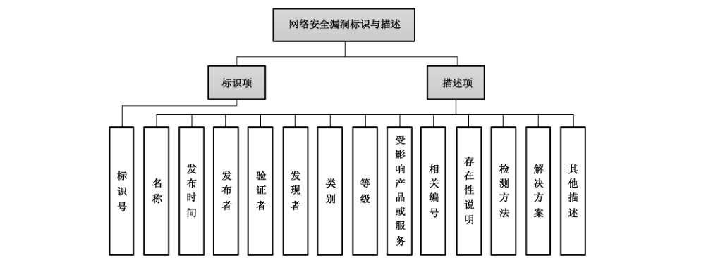

# GB/T 28458-2020 信息安全技术 网络安全漏洞标识与描述规范

> 来源：[GB/T 28458-2020 国家标准详情](https://openstd.samr.gov.cn/bzgk/std/newGbInfo?hcno=B502AB26F48381AD94C8CE37281F3C8B)；发布日期：2020-11-19；实施日期：2021-06-01。
> PDF SHA-256：5a2836f4372aa41fcd52ea429e09ae918dcc72a10461bbf69f47ec8b6891cc8a。
> 转写说明：按页渲染 PDF 并用 macOS Vision 进行图像识别，对照全部原页校正文字和附录 XML；两幅图保留原页裁切，省略封面、目录、页眉和页脚。正式引用请核对原 PDF。

## 前言

本标准按照 GB/T 1.1—2009 给出的规则起草。

本标准代替 GB/T 28458—2012《信息安全技术 安全漏洞标识与描述规范》，与 GB/T 28458—2012 相比，主要技术变化如下：

- 修改了网络安全漏洞的术语和定义（见 3.1，2012 年版的 3.2）；
- 增加了缩略语（见第 4 章）；
- 将标识与描述作为两个方面表述，增加了标识字段描述内容（见 5.2）；
- 增加了验证者、发现者、存在性说明和检测方法等描述项内容（见 5.3.4、5.3.5、5.3.10、5.3.11）；
- 修改了标识项、名称、受影响产品或服务、相关编号、解决方案等内容（见 5.2、5.3.1、5.3.8、5.3.9、5.3.12，2012 年版的 4.2.1、4.2.2、4.2.7、4.2.8、4.2.10）；
- 删除了利用方法描述项（见 2012 年版的 4.2.9）。

请注意本文件的某些内容可能涉及专利。本文件的发布机构不承担识别这些专利的责任。

本标准由全国信息安全标准化技术委员会（SAC/TC 260）提出并归口。

本标准起草单位：国家信息技术安全研究中心、国家计算机网络应急技术处理协调中心、中国信息安全测评中心、中国科学院大学国家计算机网络入侵防范中心、中国电子技术标准化研究院、中国科学院信息工程研究所、启明星辰信息技术集团股份有限公司、北京百度网讯科技有限公司、奇安信科技集团股份有限公司、北京神州绿盟信息安全科技股份有限公司、上海斗象信息科技有限公司、阿里巴巴（北京）软件服务有限公司、深圳市腾讯计算机系统有限公司、北京知道创宇信息技术有限公司、恒安嘉新（北京）科技股份公司、哈尔滨安天科技集团股份有限公司、浙江蚂蚁小微金融服务集团股份有限公司、深信服科技股份有限公司、北京数字观星科技有限公司、北京摄星科技有限公司。

本标准主要起草人：王宏、张玉清、谢安明、刘奇旭、高红静、舒敏、郝永乐、郭亮、黄正、上官晓丽、任泽君、崔牧凡、曲泷玉、贾依真、陈悦、贾子骁、郑亮、何茂根、赵旭东、李霞、傅强、赵焕菊、李柏松、刘楠、王文杰、王鹤。

本标准所代替标准的历次版本发布情况为：GB/T 28458—2012。

## 1 范围

本标准规定了网络安全漏洞（以下简称“漏洞”）的标识与描述信息。

本标准适用于从事漏洞发布与管理、漏洞库建设、产品生产、研发、测评与网络运营等活动的所有相关方。

## 2 规范性引用文件

下列文件对于本文件的应用是必不可少的。凡是注日期的引用文件，仅注日期的版本适用于本文件。凡是不注日期的引用文件，其最新版本（包括所有的修改单）适用于本文件。

- GB/T 7408—2005 数据元和交换格式 信息交换 日期和时间表示法
- GB/T 25069 信息安全技术 术语
- GB/T 30276—2020 信息安全技术 网络安全漏洞管理规范
- GB/T 30279—2020 信息安全技术 网络安全漏洞分类分级指南

## 3 术语和定义

GB/T 25069、GB/T 30276—2020、GB/T 30279—2020 界定的以及下列术语和定义适用于本文件。

### 3.1 网络安全漏洞 cybersecurity vulnerability

网络产品和服务在需求分析、设计、实现、配置、测试、运行、维护等过程中，无意或有意产生的、有可能被利用的缺陷或薄弱点。

> 注：这些缺陷或薄弱点以不同形式存在于网络产品和服务的各个层次和环节中，一旦被恶意主体所利用，就会对网络产品和服务的安全造成损害，从而影响其正常运行。

## 4 缩略语

下列缩略语适用于本文件。

- CNCVD：中国国家网络安全漏洞库（China National Cybersecurity Vulnerability Database）
- CVE：公共漏洞和暴露（Common Vulnerabilities and Exposures）
- XML：可扩展置标语言（Extensible Markup Language）

## 5 网络安全漏洞标识与描述

### 5.1 框架

针对每一个漏洞进行标识与描述的框架如图 1 所示，分标识项和描述项两大类，其中描述项包括名称、发布时间、发布者、验证者、发现者、类别、等级、受影响产品或服务、相关编号、存在性说明等十项必须项，并可根据需要扩展检测方法、解决方案、其他描述等扩展项。扩展项为可选。



### 5.2 标识项

标识项中仅有“标识号”一项内容。“标识号”是用来对每个漏洞进行唯一标识的代码，其格式为：CNCVD-YYYY-NNNNNN，如图 2 所示。


其中，CNCVD 为固定编码前缀；YYYY 为 4 位十进制数字，表示漏洞发现的年份；NNNNNN 为 6 位十进制数字序列号，表示 YYYY 年内漏洞的序号。序列号位数默认采用 6 位，从“000001”开始编号，当 YYYY 年漏洞数量超过 999999 时，可按需扩展其数字位数。

### 5.3 描述项

#### 5.3.1 名称

概括性描述漏洞信息的短语。采用分段式格式描述，包括固定字段和自定义字段，字段之间以“.”相隔。格式如下：

漏洞相关的产品或服务.等级.类别.自定义字段1.自定义字段2.……自定义字段n

前三段为固定字段，使用中英文或数字标识。其中：

a）“漏洞相关的产品或服务”为漏洞所存在的、正式发布的产品或服务名称，可包含版本号信息，例如，Internet Explorer 8.0、Chrome 等。“漏洞相关的产品或服务”需与 5.3.8 的内容保持一致，可为 5.3.8 的简要缩写。

b）“等级”为漏洞描述项中的“5.3.7 等级”。

c）“类别”为漏洞描述项中的“5.3.6 类别”。

第四段起为自定义字段，属可选项，可增加多个。自定义字段主要用于补充描述固定字段以外的其他信息，例如漏洞的别称等。

示例：GNU Bash.高危.远程代码执行漏洞.破壳漏洞

#### 5.3.2 发布时间

漏洞信息发布的日期。日期书写应采用 GB/T 7408—2005 中 5.2.1.1 完全表示法中的扩展格式。

格式为：YYYY-MM-DD，如 2019-01-01。其中，YYYY 表示一个日历年，MM 表示日历年中日历月的顺序数，DD 表示日历月中日历日的顺序数。

#### 5.3.3 发布者

“漏洞发布者”的简称，是发布经验证后的漏洞信息的个人或组织。发布者以其个人标识或组织名称命名。“组织名称”可以是发布者组织的正式名称或简称等。漏洞发布者为个人的，可以冠以其所属组织名称，格式如下：

漏洞发布者个人标识（漏洞发布者组织名称）

发布者允许多个，中间以逗号分隔。例如：

张三（组织 A），李四（组织 A，组织 B），王五，组织 C。

漏洞发布应符合 GB/T 30276—2020 中 5.5 漏洞发布规定的要求。

#### 5.3.4 验证者

“漏洞验证者”的简称，是对漏洞的存在性、等级、类别等进行技术验证的个人或组织。验证者以其个人标识或组织名称命名。“组织名称”可以是验证者组织的正式名称或简称等。漏洞验证者为个人的，可以冠以其所属组织名称，格式如下：

漏洞验证者个人标识（漏洞验证者组织名称）

验证者允许多个，中间以逗号分隔。例如：

张三（组织 A），李四（组织 A，组织 B），王五，组织 C。

漏洞验证应符合 GB/T 30276—2020 中 5.3 漏洞验证规定的要求。

#### 5.3.5 发现者

“漏洞发现者”的简称，是发现漏洞的个人或组织。发现者以其个人标识或组织名称命名。“个人标识”可以是发现者个人的姓名或代号等，“组织名称”可以是发现者组织的正式名称或简称等。不能确认发现者身份，或漏洞信息为匿名发布的，发现者可标识为“匿名”。漏洞发现者为个人的，可以冠以其所属组织名称，格式如下：

漏洞发现者个人标识（漏洞发现者组织名称）

发现者允许多个，中间以逗号分隔。例如：

张三（组织 A），李四（组织 A，组织 B），王五，组织 C。

漏洞发现应符合 GB/T 30276—2020 中 5.1 a）的要求。

#### 5.3.6 类别

漏洞所属分类。给出漏洞分类归属的信息。类别划分应符合 GB/T 30279—2020 中第 5 章网络安全漏洞分类规定的要求。

#### 5.3.7 等级

漏洞危害级别。给出漏洞能够造成的危害程度。等级划分应符合 GB/T 30279—2020 中 6.3.3 网络安全漏洞技术分级规定的要求。

#### 5.3.8 受影响产品或服务

漏洞所存在的产品或服务的详细信息，包括供应商、名称、版本号等内容。对于共用中间件或者组件的漏洞，受其影响的相关产品或服务信息均可列出。

#### 5.3.9 相关编号

同一漏洞在不同组织中的编号，例如，CNVD 编号、CNNVD 编号、CVE 编号或其他组织自定义的漏洞编号等，若存在多个编号可顺序给出，中间以逗号分隔。相关编号的 XML 表示方法参见附录 A。

#### 5.3.10 存在性说明

描述漏洞的触发条件、生成机理或概念性证明等。

#### 5.3.11 检测方法

漏洞扫描或测试的方法，例如漏洞检测代码、程序或方法说明等。

#### 5.3.12 解决方案

漏洞的解决方案，例如，补丁信息、修复或防范措施等。

#### 5.3.13 其他描述

需要说明的其他相关信息。

### 5.4 证实方法

漏洞标识项与描述项的具体内容可随着漏洞的分析与研究而动态变化。在漏洞管理和应用过程中，相关个人或组织应确定漏洞的标识与描述信息是否符合 5.2 及 5.3 的要求，漏洞标识项与描述项示例的 XML 表示参见附录 A。

## 附录 A（资料性附录）漏洞标识与描述规范示例的 XML 表示

本附录给出了一个采用本标准所规定的漏洞标识与描述的漏洞示例（非真实漏洞），目的是演示本标准的使用方法。为确保示例的简洁性和可读性，本附录采用了 XML 语言作为表示语言。

```xml
<?xml version="1.0" encoding="UTF-8"?>
<cncvd_items>
  <标识号>CNCVD-2020-101001</标识号>
  <名称>Linux Kernel.高危.竞争条件漏洞.脏牛Ⅱ漏洞</名称>
  <发布时间>2020-10-10</发布时间>
  <发布者>国家计算机网络应急技术处理协调中心</发布者>
  <验证者>中国信息安全测评中心、国家信息技术安全研究中心</验证者>
  <发现者>国家计算机网络入侵防范中心</发现者>
  <类别>竞争条件漏洞</类别>
  <等级>高危</等级>
  <受影响产品或服务>
    <生产厂商>Debian</生产厂商>
    <产品或服务信息>
      <产品或服务名称>debian_linux</产品或服务名称>
      <版本号>7.0</版本号>
      <版本号>8.0</版本号>
    </产品或服务信息>
  </受影响产品或服务>
  <相关编号>CNVD-2020-12345,CNNVD-202010-1234,NIPC-2020-123456,CVE-2020-2345</相关编号>
  <存在性说明>Linux kernel 2.x 至 4.8.3 之前的 4.x 版本中的 mm/gup.c 文件存在竞争条件漏洞，该漏洞源于程序没有正确处理 copy-on-write（COW）功能写入只读内存映射。</存在性说明>
  <检测方法>下载检测代码并编译，使用非 root 用户运行生成的程序，对只读文件进行写入，如果写入成功，则漏洞存在。检测代码下载地址为 https://github.com/dirtycow2/</检测方法>
  <解决方案>厂商发布了升级程序修复该漏洞，请及时关注更新：https://git.kernel.org/cgit/linux/kernel/git/torvalds/linux.git/commit/</解决方案>
  <其他描述></其他描述>
</cncvd_items>
```
