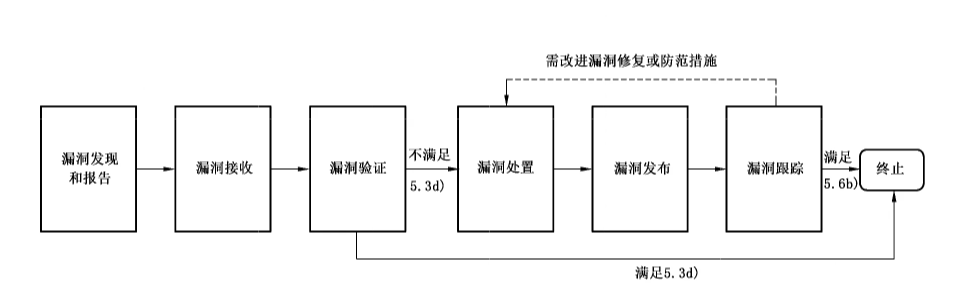

# GB/T 30276-2020 信息安全技术 网络安全漏洞管理规范

> 来源：[GB/T 30276-2020 国家标准详情](https://openstd.samr.gov.cn/bzgk/std/newGbInfo?hcno=7EF97931115A518655DCD136653CBD74)；发布日期：2020-11-19；实施日期：2021-06-01。
> 官方在线预览截图 SHA-256：c480d2fbfa4c612f4e11bae5479d892fb560eaa7e084518c5fc8fc5bb6ff583c。
> 转写说明：逐页截取官方在线预览并用 macOS Vision 进行图像识别，对照全部原页校正文字和列表；流程图保留原页裁切，省略封面、目录、页眉和页脚。正式引用请核对官方预览。

## 前言

本标准按照 GB/T 1.1—2009 给出的规则起草。

本标准代替 GB/T 30276—2013《信息安全技术 信息安全漏洞管理规范》，与 GB/T 30276—2013 相比，主要技术变化如下：

- 修改了范围的表述（见第 1 章，2013 年版的第 1 章）；
- 增加了规范性引用文件 GB/T 30279—2020，删除了规范性引用文件 GB/T 18336.1—2008（见第 2 章，2013 年版的第 2 章）；
- 增加了术语“（网络产品和服务的）提供者”“网络运营者”“漏洞收录组织”“漏洞应急组织”“漏洞发现”“漏洞报告”“漏洞接收”“漏洞验证”“漏洞发布”（见 3.2、3.3、3.4、3.5、3.6、3.7、3.8、3.9、3.10）；
- 删除了术语“修复措施”“厂商”“漏洞管理组织”“漏洞发现者”（2013 年版的 3.1、3.3、3.4、3.5）；
- 修改了漏洞管理流程，从漏洞管理的角度出发，重新定义了漏洞管理流程的各阶段，将原来的“预防、收集、消减、发布”管理阶段调整为“漏洞发现和报告、漏洞接收、漏洞验证、漏洞处置、漏洞发布、漏洞跟踪”，并提出各管理阶段中各相关角色应遵循的要求（见第 4 章、第 5 章，2013 年版的第 4 章、第 5 章）；
- 删除了“附录 A（规范性附录）漏洞处理策略”（2013 年版的附录 A）。

请注意本文件的某些内容可能涉及专利。本文件的发布机构不承担识别这些专利的责任。

本标准由全国信息安全标准化技术委员会（SAC/TC 260）提出并归口。

本标准起草单位：国家计算机网络应急技术处理协调中心、中国信息安全测评中心、国家信息技术安全研究中心、中国电子技术标准化研究院、上海交通大学、恒安嘉新（北京）科技股份公司、网神信息技术（北京）股份有限公司、上海斗象信息科技有限公司、北京数字观星科技有限公司、阿里巴巴（北京）软件服务有限公司、公安部第三研究所、中国科学院大学、北京奇虎科技有限公司。

本标准主要起草人：云晓春、舒敏、崔牧凡、王文磊、严寒冰、贾子骁、陈悦、任泽君、崔婷婷、高继明、王桂温、郭亮、谢忱、白晓媛、王宏、李斌、孟魁、姜开达、黄道丽、赵旭东、赵芸伟、蒋凌云、郝永乐、叶润国、刘楠、张玉清、姚一楠。

本标准所代替标准的历次版本发布情况为：GB/T 30276—2013。

## 1 范围

本标准规定了网络安全漏洞管理流程各阶段（包括漏洞发现和报告、接收、验证、处置、发布、跟踪等）的管理流程、管理要求以及证实方法。

本标准适用于网络产品和服务的提供者、网络运营者、漏洞收录组织、漏洞应急组织等开展的网络安全漏洞管理活动。

## 2 规范性引用文件

下列文件对于本文件的应用是必不可少的。凡是注日期的引用文件，仅注日期的版本适用于本文件。凡是不注日期的引用文件，其最新版本（包括所有的修改单）适用于本文件。

- GB/T 25069 信息安全技术 术语
- GB/T 28458—2020 信息安全技术 网络安全漏洞标识与描述规范
- GB/T 30279—2020 信息安全技术 网络安全漏洞分类分级指南

## 3 术语和定义

GB/T 25069、GB/T 28458—2020 界定的以及下列术语和定义适用于本文件。

### 3.1 用户 user

使用网络产品和服务的个人或组织。

### 3.2 （网络产品和服务的）提供者 provider of network products and services

提供网络产品和服务的个人或组织。

### 3.3 网络运营者 network operator

网络的所有者、管理者和网络服务提供者。

### 3.4 漏洞收录组织 vulnerability repository organization

提供公开渠道接收漏洞信息，并建有相应工作流程的组织。

### 3.5 漏洞应急组织 vulnerability emergency response organization

与提供者、网络运营者、漏洞收录组织、网络运营者、安全研究机构、网络安全企业等建有成熟的技术协作体系，负责安全漏洞的响应和处置工作的网络安全应急协调组织。

### 3.6 漏洞发现 vulnerability discovery

通过技术手段，识别出网络产品和服务存在漏洞的过程。

### 3.7 漏洞报告 vulnerability report

获得漏洞信息并将漏洞信息进行报告的过程。

### 3.8 漏洞接收 vulnerability receipt

接收漏洞信息的过程。

### 3.9 漏洞验证 vulnerability verification

对漏洞的存在性、等级、类别等进行技术验证的过程。

### 3.10 漏洞发布 vulnerability release

将漏洞信息向社会或受影响的用户等发布的过程。

## 4 网络安全漏洞管理流程

网络安全漏洞管理流程如图 1 所示。

网络安全漏洞管理包含以下阶段：

- 漏洞发现和报告：漏洞发现者通过人工或者自动的方法对漏洞进行探测、分析，证实漏洞存在的真实性，并由漏洞报告者将获得的漏洞信息向漏洞接收者报告；
- 漏洞接收：通过相应途径接收漏洞信息；
- 漏洞验证：收到漏洞报告后，进行漏洞信息的技术验证；满足相应要求可终止后续漏洞管理流程；
- 漏洞处置：对漏洞进行修复，或制定并测试漏洞修复或防范措施，可包括升级版本、补丁、更改配置等方式；
- 漏洞发布：通过网站、邮件列表等渠道将漏洞信息向社会或受影响的用户发布；
- 漏洞跟踪：在漏洞发布后跟踪监测漏洞修复情况、产品或服务的稳定性等；视情况对漏洞修复或防范措施做进一步改进；满足相应要求可终止漏洞管理流程。

漏洞管理流程中各阶段的管理要求见第 5 章。

## 5 网络安全漏洞管理要求

### 5.1 漏洞发现和报告

在漏洞发现和报告阶段，要求如下：

a）对漏洞发现者的要求：

- 遵循国家相关法律、法规的前提下，可通过人工或者自动化方法对漏洞进行探测、分析，并证实漏洞存在的真实性；
- 在实施漏洞发现活动时，不应对用户的系统运行和数据安全造成影响和损害，不应有为了发现漏洞而侵犯其他组织的业务运行和数据安全的行为；
- 在识别网络产品或服务的潜在漏洞时，应主动评估可能存在的安全风险；
- 应采取防止漏洞信息泄露的有效措施。

b）对漏洞报告者的要求：

- 发现网络或产品服务的漏洞后，应及时报告漏洞信息；
- 报告漏洞时，应客观、真实地对漏洞进行描述。

### 5.2 漏洞接收

在漏洞接收阶段，要求如下：

a）应为漏洞报告者提供漏洞接收渠道，如网站、邮箱或电话等，并采取措施保障漏洞信息的安全、保密接收；

b）应制定并公开发布漏洞接收策略，便于漏洞报告者报告漏洞，接收策略包括但不限于漏洞接收范围、漏洞接收渠道、漏洞接收要求、漏洞接收流程等内容；

c）在收到漏洞报告者的漏洞报告后，应及时给予漏洞报告者确认或反馈；

d）不应以产品或服务已经终止维护为由，拒绝接收漏洞报告；

e）应采取有效措施保护与被报告漏洞相关的信息的安全和保密性，防止漏洞信息泄漏；

f）若由与该漏洞相关联的提供者或网络运营者进行漏洞接收时，除满足 a）～e）的要求外，还应满足如下要求：

- 提供技术措施保证信息流转渠道安全；
- 如果发现漏洞涉及其他提供者或网络运营者，及时向相关提供者或网络运营者报告，当需要协调时可请求漏洞应急组织的帮助。

### 5.3 漏洞验证

在漏洞验证阶段，要求如下：

a）若由与该漏洞相关联的提供者或网络运营者进行验证：

- 应及时对漏洞的存在性、等级、类别等进行技术验证，向漏洞报告者发送漏洞报告接收确认或反馈，可联合漏洞报告者等对漏洞进行验证；
- 如果该漏洞涉及其他提供者或网络运营者，应及时通知相关提供者或网络运营者共同进行验证；
- 应客观地对漏洞信息进行验证和确认，不应对漏洞报告者等进行误导；
- 在漏洞验证后，应根据漏洞验证情况并依据 GB/T 28458—2020 中 5.3 的要求对漏洞进行描述，同时将验证结果反馈给漏洞报告者，也可反馈给漏洞应急组织等；
- 如果被报告的漏洞是在提供者或网络运营者目前不提供支持的产品或服务中发现的，提供者或网络运营者应继续完成调查和漏洞验证，并确认该漏洞对其他支持的产品或在线服务的影响。

b）若由漏洞收录组织进行验证：

- 确认漏洞接收后应及时协调对漏洞信息的验证，协调方式可包括：告知与漏洞相关的产品或服务的提供者进行验证和确认；与该漏洞相关联的提供者或者网络运营者共同进行验证和确认；联合漏洞报告者共同进行漏洞信息的验证和确认；
- 应客观、真实地反映漏洞情况，不应对与该漏洞相关联的提供者或网络运营者、漏洞报告者等进行误导；
- 验证完成后应及时通知与该漏洞相关联的提供者或网络运营者。

c）若由漏洞应急组织进行验证：

- 确认漏洞接收后应及时协调对漏洞信息的验证，协调方式可包括：告知与漏洞相关的产品或服务的提供者进行验证和确认；与该漏洞相关联的提供者或网络运营者共同进行验证和确认；
- 验证完成后应及时通知与该漏洞相关联的提供者或网络运营者。

d）在漏洞验证过程中发生如下情况时，可以终止后续的漏洞管理阶段，并给予漏洞报告者反馈：

- 重复漏洞：该漏洞是个已重复的漏洞，已解决或已修复的漏洞；
- 无法验证漏洞：该漏洞是提供者、网络运营者、漏洞收录组织等无法验证的漏洞；
- 无危害漏洞：该漏洞是一个无安全影响，或无法被现有技术利用的漏洞；

  > 注：漏洞利用方法可能随着新的技术或攻击方法的出现而改变，提供者及网络运营者宜时刻保持对当前漏洞攻击手段的了解。

- 该漏洞所存在的产品或服务均已超过规定期限以及当事人约定的期限，法律法规另有规定的除外。

### 5.4 漏洞处置

在漏洞处置阶段，要求如下：

a）对与该漏洞相关联的提供者、网络运营者的要求：

- 应与相关提供者、网络运营者协同开展漏洞处置工作，可与漏洞收录组织、漏洞应急组织协同开展漏洞处置工作；
- 在漏洞处置过程中应进行深入分析，判断该漏洞是否影响其他产品或服务；
- 对已确认的漏洞，在考虑漏洞严重程度、受影响用户的范围、被利用的潜在影响等因素的基础上，立即进行漏洞修复，或制定漏洞修复或防范措施；
- 在发布补丁和升级版本前应进行充分严格的有效性和安全性测试，避免补丁衍生的应用功能和安全缺陷。对于不能通过补丁或版本升级解决的漏洞风险，应提出有效的临时处置建议，出具指导技术说明；
- 对于依据 GB/T 30279—2020 中 6.3.3 评定的技术分级为超危、高危的漏洞，若不能立即给出修复措施，应给出有效的临时防护建议，并可联合漏洞应急组织根据漏洞影响范围及发展情况制定下一步处置方案和解决措施；
- 应向漏洞报告者和用户及时告知漏洞的处置措施，必要时向漏洞应急组织报告；
- 应提供有效途径和便利的条件，供用户获取补丁、升级版本和临时处置建议；
- 应对受影响的用户提供必要的技术支持，支持其完成漏洞修复；
- 宜调查漏洞更深层的原因，以及确定自身其他产品或服务是否有同样或者类似的漏洞。

b）对漏洞收录组织的要求：

- 可与漏洞应急组织及相关网络产品提供者、网络运营者协同开展漏洞处置工作；
- 在漏洞处置过程中应保持客观、准确的态度，及时将经过验证的漏洞信息与该漏洞相关联的提供者、网络运营者、漏洞应急组织共享；
- 可向与该漏洞相关联的提供者、网络运营者等提供漏洞处置建议及相关技术支持工作；
- 应采取相应必要措施保护与被报告漏洞相关信息的安全和保密性，防止信息泄露、被他人利用。

c）对漏洞应急组织的要求：

- 可对漏洞处置工作进行协调和监督，向相关漏洞接收者反馈漏洞归属、漏洞处置建议等处理意见和结果；
- 可督促与该漏洞相关联的提供者、网络运营者及时采取漏洞修复或者防范措施，防范因漏洞大规模利用传播引起的网络安全威胁；
- 可联合与该漏洞相关联的提供者或网络运营者对漏洞处置情况进行持续跟踪，根据漏洞影响范围及发展情况制定下一步处置方案及解决措施；
- 应采取相应必要措施保护与被报告漏洞相关信息的安全，防止信息泄露、被他人利用。

### 5.5 漏洞发布

在漏洞发布阶段，要求如下：

a）漏洞发布应遵循国家漏洞相关规定要求；

b）在漏洞未修复或尚未制定漏洞修复或防范措施前，不应发布漏洞信息；

c）漏洞信息涉及的目标对象、风险情况描述等相关信息应真实客观，不应将漏洞潜在风险作为网络攻击事件进行发布和引导；

d）不应发布专门用于危害网络安全的漏洞利用程序、工具和方法；

e）应建立漏洞发布内部审核机制，防范漏洞信息泄露和内部人员违规发布漏洞信息；

f）若由与该漏洞相关联的提供者或网络运营者进行漏洞发布时，除满足 a）～e）的要求外，还应满足：

- 根据漏洞的严重程度，及时发布漏洞修复或者防范措施；
- 通过向社会发布或者通过其他方式告知所有可能受影响的用户。

### 5.6 漏洞跟踪

在漏洞发布后进入漏洞跟踪阶段，对与该漏洞相关的提供者或网络运营者的要求如下：

a）应收集用户反馈信息，监测产品或服务是否稳定运行，并视情对漏洞修复或防范措施做进一步改进，确认需改进时漏洞管理流程再次进入漏洞处置阶段；

b）漏洞修复完成，且不影响产品或服务稳定运行时，可终止漏洞管理活动。

## 6 证实方法

在漏洞管理过程中，相关个人或组织应确定漏洞管理活动是否符合第 5 章的要求，并应随着漏洞管理阶段的推进及时对漏洞描述进行更新。

## 参考文献

- [1] ISO/IEC 29147 Information technology—Security techniques—Vulnerability disclosure
- [2] ISO/IEC 30111 Information technology—Security techniques—Vulnerability handling processes
