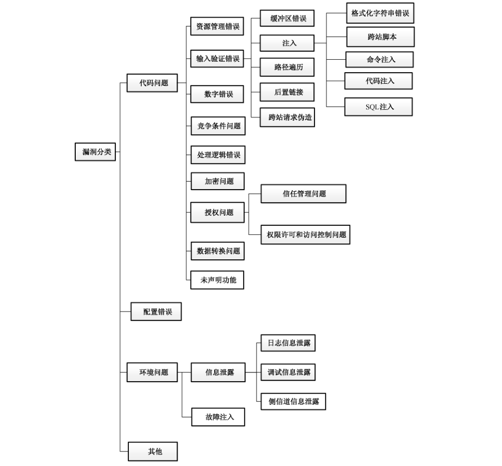
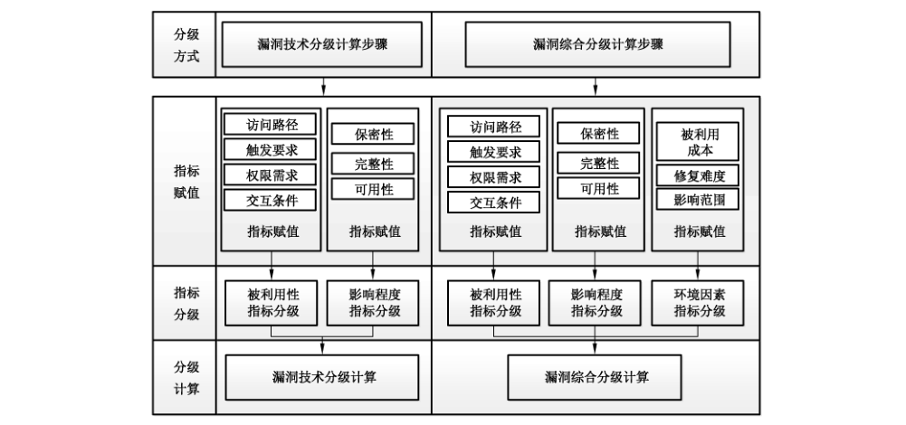

# GB/T 30279-2020 信息安全技术 网络安全漏洞分类分级指南

> 来源：[GB/T 30279-2020 国家标准详情](https://openstd.samr.gov.cn/bzgk/std/newGbInfo?hcno=458BACCE700CA8E0B728CFB5F762DE7A)。
> 发布日期：2020-11-19；实施日期：2021-06-01。
> 官方 PDF SHA-256：9dd2de5933392553422f9163b77048e2acdfd3c7a6ca98e34584197be88e9150。
> 转写说明：基于官方 PDF 的逐页图像识别并对照全部 22 页校正；表格的合并单元格逐行展开，图示保留原页裁切。省略封面、目录、页眉和页脚；正式引用请核对官方原文。

## 前言

本标准按照 GB/T 1.1—2009 给出的规则起草。

本标准代替 GB/T 33561—2017《信息安全技术 安全漏洞分类》、GB/T 30279—2013《信息安全技术 安全漏洞等级划分指南》，与 GB/T 33561—2017、GB/T 30279—2013 相比，主要技术变化如下：

- 将 GB/T 33561—2017 和 GB/T 30279—2013 的范围进行合并修改（见第 1 章）；
- 将 GB/T 33561—2017 和 GB/T 30279—2013 的规范性引用文件进行合并补充（见第 2 章）；
- 将 GB/T 33561—2017 和 GB/T 30279—2013 的术语和定义进行合并修改（见第 3 章）；
- 删除了 GB/T 33561—2017 中的缩略语；
- 将 GB/T 33561—2017 中的“按成因分类”对应本标准的“网络安全漏洞分类”，将 GB/T 33561—2017 采用的线性分类框架调整为树形（见图 1）；
- 删除了 GB/T 33561—2017 中的“按空间分类”；
- 删除了 GB/T 33561—2017 中的“按时间分类”；
- 将 GB/T 30279—2013 中的“等级划分要素”对应本标准的“网络安全漏洞分级指标”，扩展了漏洞分级指标（见图 2）；
- 将 GB/T 30279—2013 中的“等级划分”对应本标准的“网络安全漏洞分级方法”，将分级方法修改为技术分级和综合分级（见附录 D 中表 D.1 和附录 E 中表 E.1）。

请注意本文件的某些内容可能涉及专利。本文件的发布机构不承担识别这些专利的责任。

本标准由全国信息安全标准化技术委员会（SAC/TC 260）提出并归口。

本标准起草单位：中国信息安全测评中心、北京中测安华科技有限公司、中国电子技术标准化研究院、国家计算机网络应急技术处理协调中心、国家信息技术安全研究中心、北京邮电大学、北京华云安信息技术有限公司、北京华顺信安科技有限公司、国网思极网安科技（北京）有限公司、上海三零卫士信息安全有限公司、国家计算机网络入侵防范中心、中国科学院信息工程研究所、浙江蚂蚁小微金融服务集团有限公司、网神信息技术（北京）股份有限公司、北京长亭科技有限公司、杭州安恒信息技术股份有限公司、深信服科技股份有限公司、腾讯科技（北京）有限公司、四川省信息安全测评中心、上海犇众信息技术有限公司、启明星辰信息技术集团股份有限公司、恒安嘉新（北京）科技股份公司。

本标准主要起草人：郝永乐、郑亮、贾依真、时志伟、张宝峰、李斌、侯元伟、曲泷玉、毛军捷、饶华一、许源、孟德虎、张兰兰、任泽君、上官晓丽、舒敏、王文磊、王宏、连樱、赵旭东、崔宝江、付俊松、沈传宝、赵武、许勇刚、林亮成、李智林、张玉清、刘奇旭、史慧洋、王宇、简云定、柳本金、白健、杨坤、常明政、刘志乐、吴卓群、叶润国、刘桂泽、王丹琛、韩争光、丁斌、胡兵。

本标准所代替标准的历次版本发布情况为：

- GB/T 30279—2013；
- GB/T 33561—2017。

## 1 范围

本标准提供了网络安全漏洞（以下简称“漏洞”）的分类方式、分级指标，给出了分级方法的建议。

本标准适用于网络产品和服务的提供者、网络运营者、漏洞收录组织、漏洞应急组织在漏洞管理、产品生产、技术研发、网络运营等相关活动中进行的漏洞分类和危害等级评估等。

## 2 规范性引用文件

下列文件对于本文件的应用是必不可少的。凡是注日期的引用文件，仅注日期的版本适用于本文件。凡是不注日期的引用文件，其最新版本（包括所有的修改单）适用于本文件。

- GB/T 20984 信息安全技术 信息安全风险评估规范

- GB/T 25069 信息安全技术 术语

- GB/T 28458 信息安全技术 安全漏洞标识与描述规范

- GB/T 30276 信息安全技术 信息安全漏洞管理规范

## 3 术语和定义

GB/T 25069、GB/T 20984、GB/T 28458、GB/T 30276 界定的以及下列术语和定义适用于本文件。

### 3.1 受影响组件 impacted component

在网络产品和服务中，漏洞触发受影响的组件。

## 4 缩略语

下列缩略语适用于本文件。

SQL：结构化查询语言（Structured Query Language）

## 5 网络安全漏洞分类

### 5.1 概述

网络安全漏洞分类是基于漏洞产生或触发的技术原因对漏洞进行的划分，分类导图如图1所示。

本标准采用树形导图对漏洞进行分类，首先从根节点开始，根据漏洞成因将漏洞归入某个具体的类别，如果该类型节点有子类型节点，且漏洞成因可以归入该子类型，则将漏洞划分为该子类型，如此递归，直到漏洞归入的类型无子类型节点或漏洞不能归入子类型止。

图 1 文字转写：

- 漏洞分类
  - 代码问题
    - 资源管理错误
    - 输入验证错误
      - 缓冲区错误
      - 注入：格式化字符串错误、跨站脚本、命令注入、代码注入、SQL 注入
      - 路径遍历
      - 后置链接
      - 跨站请求伪造
    - 数字错误
    - 竞争条件问题
    - 处理逻辑错误
    - 加密问题
    - 授权问题：信任管理问题、权限许可和访问控制问题
    - 数据转换问题
    - 未声明功能
  - 配置错误
  - 环境问题
    - 信息泄露：日志信息泄露、调试信息泄露、侧信道信息泄露
    - 故障注入
  - 其他

### 5.2 代码问题

#### 5.2.1 概述

此类漏洞指网络产品和服务的代码开发过程中因设计或实现不当而导致的漏洞。

#### 5.2.2 资源管理错误

此类漏洞指因对系统资源（如内存、磁盘空间、文件、CPU 使用率等）的错误管理导致的漏洞。

#### 5.2.3 输入验证错误

##### 5.2.3.1 概述

此类漏洞指因对输入的数据缺少正确的验证而产生的漏洞。

##### 5.2.3.2 缓冲区错误

此类漏洞指在内存上执行操作时，因缺少正确的边界数据验证，导致在其向关联的其他内存位置上执行了错误的读写操作，如缓冲区溢出、堆溢出等。

##### 5.2.3.3 注入

###### 5.2.3.3.1 概述

此类漏洞指在通过用户输入构造命令、数据结构或记录的操作过程中，由于缺乏对用户输入数据的正确验证，导致未过滤或未正确过滤掉其中的特殊元素，引发的解析或解释方式错误问题。

###### 5.2.3.3.2 格式化字符串错误

此类漏洞指接收外部格式化字符串作为参数时，因参数类型、数量等过滤不严格，导致的漏洞。

###### 5.2.3.3.3 跨站脚本

此类漏洞是指在 WEB应用中，因缺少对客户端数据的正确验证，导致向其他客户端提供错误执行代码的漏洞。

###### 5.2.3.3.4 命令注入

此类漏洞指在构造可执行命令过程中，因未正确过滤其中的特殊元素，导致生成了错误的可执行命令。

###### 5.2.3.3.5 代码注入

此类漏洞指在通过外部输入数据构造代码段的过程中，因未正确过滤其中的特殊元素，导致生成了错误的代码段，修改了网络产品和服务的预期的执行控制流。

###### 5.2.3.3.6 SQL 注入

此类漏洞指在基于数据库的应用中，因缺少对构成 SQL 语句的外部输入数据的验证，导致生成并执行了错误的 SQL 语句。

##### 5.2.3.4 路径遍历

此类漏洞指因未能正确地过滤资源或文件路径中的特殊元素，导致访问受限目录之外的位置。

##### 5.2.3.5 后置链接

此类漏洞指在使用文件名访问文件时，因未正确过滤表示非预期资源的链接或者快捷方式的文件名，导致访问了错误的文件路径。

##### 5.2.3.6 跨站请求伪造

此类漏洞指在 WEB应用中，因未充分验证请求是否来自可信用户，导致受欺骗的客户端向服务器发送非预期的请求。

#### 5.2.4 数字错误

此类漏洞指因未正确计算或转换所产生数字，导致的整数溢出、符号错误等漏洞。

#### 5.2.5 竞争条件问题

此类漏洞指因在并发运行环境中，一段并发代码需要互斥地访问共享资源时，因另一段代码在同一个时间窗口可以并发修改共享资源而导致的安全问题。

#### 5.2.6 处理逻辑错误

此类漏洞是在设计实现过程中，因处理逻辑实现问题或分支覆盖不全面等原因造成。

#### 5.2.7 加密问题

此类漏洞指未正确使用相关密码算法，导致的内容未正确加密、弱加密、明文存储敏感信息等问题。

#### 5.2.8 授权问题

##### 5.2.8.1 信任管理问题

此类漏洞是因缺乏有效的信任管理机制，导致受影响组件存在可被攻击者利用的默认密码或者硬编码密码、硬编码证书等问题。

##### 5.2.8.2 权限许可和访问控制问题

此类漏洞指因缺乏有效的权限许可和访问控制措施而导致的安全问题。

#### 5.2.9 数据转换问题

此类漏洞是指程序处理上下文因对数据类型、编码、格式、含义等理解不一致导致的安全问题。

#### 5.2.10 未声明功能

此类漏洞指通过测试接口、调试接口等可执行非授权功能导致的安全问题。例如，若测试命令或调试命令在使用阶段仍可用，则可被攻击者用于显示存储器内容或执行其他功能。

### 5.3 配置错误

此类漏洞指网络产品和服务或组件在使用过程中因配置文件、配置参数或因默认不安全的配置状态而产生的漏洞。

### 5.4 环境问题

#### 5.4.1 概述

此类漏洞指因受影响组件部署运行环境的原因导致的安全问题。

#### 5.4.2 信息泄露

##### 5.4.2.1 概述

此类漏洞是指在运行过程中，因配置等错误导致的受影响组件信息被非授权获取的漏洞。

##### 5.4.2.2 日志信息泄露

此类漏洞指因日志文件非正常输出导致的信息泄露。

##### 5.4.2.3 调试信息泄露

此类漏洞指在运行过程中因调试信息输出导致的信息泄露。

##### 5.4.2.4 侧信道信息泄露

此类漏洞是指功耗、电磁辐射、I/O 特性、运算频率、时耗等侧信道信息的变化导致的信息泄露。

#### 5.4.3 故障注入

此类漏洞是指通过改变运行环境（如温度、电压、频率等，或通过注入强光等方式）触发，可能导致代码、系统数据或执行过程发生错误的安全问题。

### 5.5 其他

暂时无法将漏洞归入上述任何类别，或者没有足够充分的信息对其进行分类，漏洞细节未指明。

## 6 网络安全漏洞分级

### 6.1 概述

网络安全漏洞分级根据漏洞分级的场景不同，分技术分级和综合分级两种分级方式，每种分级方式均包括超危、高危、中危和低危四个等级。其中，技术分级反映特定产品或系统的漏洞危害程度，用于从技术角度对漏洞危害等级进行划分，主要针对漏洞分析人员、产品开发人员等特定产品或系统漏洞的评估工作。综合分级反映在特定时期特定环境下漏洞危害程度，用于在特定场景下对漏洞危害等级进行划分，主要针对用户对产品或系统在特定网络环境中的漏洞评估工作。漏洞技术分级和综合分级均可对单一漏洞进行分级，也可对多个漏洞构成的组合漏洞进行分级。

网络安全漏洞分级过程包括分级指标和分级方法两方面内容。分级指标主要阐述反映漏洞特征的属性和赋值，包括被利用性指标类、影响程度指标类和环境因素指标类等三类指标。分级方法主要阐述漏洞技术分级和综合分级的具体实现步骤和实现方法，包括漏洞指标类的分级方法、漏洞技术分级方法和漏洞综合分级方法。

### 6.2 网络安全漏洞分级指标

#### 6.2.1 被利用性

##### 6.2.1.1 访问路径

“访问路径”是指触发漏洞的路径前提，反映漏洞触发时与受影响组件最低接触程度。

访问路径的赋值包括：网络、邻接、本地和物理。通常因网络、邻接、本地和物理触发的漏洞，其被利用性程度由高到低依次降序，见表1。

**表 1 访问路径赋值说明**

| 赋值 | 描述 |
| --- | --- |
| 网络 | 网络安全漏洞可以通过网络远程触发 |
| 邻接 | 网络安全漏洞需通过共享的物理网络或逻辑网络触发 |
| 本地 | 网络安全漏洞需要在本地环境中触发 |
| 物理 | 网络安全漏洞需通过物理接触/操作才能触发 |

##### 6.2.1.2 触发要求

“触发要求”是指漏洞成功触发的要求，反映受影响组件在系统环境的版本、配置等因素影响下，成功触发漏洞的要求。

触发要求的赋值包括：低、高。通常触发要求低的漏洞危害程度高，见表2。

**表 2 触发要求赋值说明**

| 赋值 | 描述 |
| --- | --- |
| 低 | 漏洞触发对受影响组件的配置参数、运行环境、版本等无特别要求，包括：默认的配置参数、普遍的运行环境 |
| 高 | 漏洞触发对受影响组件的配置参数、运行环境等有特别要求，包括：不常用的参数配置、特殊的运行环境条件 |

##### 6.2.1.3 权限需求

“权限需求”是指触发漏洞所需的权限，反映漏洞成功触发需要的最低的权限。

权限需求的赋值包括：无、低和高。通常所需要的权限越少漏洞危害程度越高，见表3。

**表 3 权限需求赋值说明**

| 赋值 | 描述 |
| --- | --- |
| 无 | 网络安全漏洞触发无需特殊的权限，只需要公开权限和匿名访问权限 |
| 低 | 网络安全漏洞触发需要较低的权限，需要普通用户权限 |
| 高 | 网络安全漏洞触发需要较高的权限，需要管理员权限 |

##### 6.2.1.4 交互条件

“交互条件”是指漏洞触发是否需要其他主体（如：系统用户、外部用户、其他系统等）的参与、配合，反映漏洞触发时，是否需要除触发漏洞的主体之外的其他主体参与。

交互条件的赋值包括：不需要、需要。通常不需交互条件即能触发的漏洞，其危害程度较高，见表 4。

**表 4 交互条件赋值说明**

| 赋值 | 描述 |
| --- | --- |
| 不需要 | 网络安全漏洞触发无需用户或系统的参与或配合 |
| 需要 | 网络安全漏洞触发需要用户或系统的参与或配合。例如：通常跨站脚本漏洞、跨站请求伪造漏洞等需要用户的参与 |

#### 6.2.2 影响程度

“影响程度”指触发漏洞对受影响组件造成的损害程度。影响程度根据受漏洞影响的各个对象所承载信息的保密性、完整性、可用性等三个指标决定，每个指标的影响赋值为：严重、一般和无，见表 5、表 6、表 7。

“保密性影响”指标反映漏洞对受影响实体（如：系统、模块、软硬件等）承载（如：处理、存储、传输等）信息的保密性的影响程度。

“完整性影响”指标反映漏洞对受影响实体（如：系统、模块、软硬件等）承载（如：处理、存储、传输等）信息的完整性的影响程度。

“可用性影响”指标反映漏洞对受影响实体（如：系统、模块、软硬件等）承载（如：处理、存储、传输等）信息的可用性的影响程度。

**表 5 保密性影响赋值说明**

| 赋值 | 描述 |
| --- | --- |
| 严重 | 信息保密性影响严重，例如：保密性完全丢失，导致受影响组件的所有信息资源暴露给攻击者；或者攻击者只能得到一些受限信息，但被暴露的信息可以直接导致严重的信息丢失 |
| 一般 | 信息保密性影响一般，例如：保密性部分丢失，攻击者可以获取一些受限信息，但是攻击者不能控制获得信息的数量和种类。被暴露的信息不会引起受影响组件直接的、严重的信息丢失 |
| 无 | 信息保密性无影响，漏洞对保密性不产生影响 |

**表 6 完整性影响赋值说明**

| 赋值 | 描述 |
| --- | --- |
| 严重 | 信息完整性破坏严重，例如：完整性完全丢失，攻击者能够修改受影响组件中的任何信息；或者，攻击者只能修改一些信息，但是，能够对受影响组件带来严重的后果 |
| 一般 | 信息完整性破坏程度一般，例如：完整性部分丢失，攻击者可以修改信息，信息修改不会给受影响组件带来严重的影响 |
| 无 | 信息完整性无影响，漏洞对完整性不产生影响 |

**表 7 可用性影响赋值说明**

| 赋值 | 描述 |
| --- | --- |
| 严重 | 信息可用性破坏严重。可用性完全丧失，攻击者能够完全破坏对受影响组件中信息资源的使用访问；或者，攻击者可破坏部分信息的可用性，但是能够给受影响组件带来直接严重的后果 |
| 一般 | 信息可用性破坏程度一般。可用性部分丧失，攻击者能够降低信息资源的性能或者导致其可用性降低。受影响组件的资源是部分可用的，或在某些情况是完全可用的，但总体上不会给受影响组件带来直接严重的后果 |
| 无 | 信息可用性无影响，漏洞对可用性不产生影响 |

#### 6.2.3 环境因素

##### 6.2.3.1 被利用成本

被利用成本包括：低、中、高。通常成本越低，漏洞的危害越严重，如表8所示。

“被利用成本”指标反映，在参考环境下（例如：当前全球互联网环境，或者某企业内网环境等），漏洞触发所需的成本，例如：是否有公开的漏洞触发工具、漏洞触发需要的设备是否容易获取等。

**表 8 被利用成本赋值说明**

| 赋值 | 描述 |
| --- | --- |
| 低 | 漏洞触发所需资源很容易获取，成本低，通常付出很少的成本即可成功触发漏洞，例如：漏洞触发工具已被公开下载、漏洞脆弱性组件暴露在公开网络环境下等 |
| 中 | 漏洞触发所需的部分资源比较容易获取，成本不高，在现有条件基础上通过一定的技术、资源投入可以触发漏洞，例如：漏洞触发原理已公开但是无相应工具、漏洞触发需要某种硬件设备、漏洞触发需要一定的网络资源等 |
| 高 | 漏洞触发需要的资源多，成本高，难于获取，例如：漏洞脆弱性组件未暴露在公开网络、漏洞触发工具难以获取等 |

##### 6.2.3.2 修复难度

修复难度包括：高、中、低。通常漏洞修复的难度越高，危害越严重，如表9所示。

“修复难度”指标反映，在参考环境下（例如：当前全球互联网环境，或者某企业内网环境等），修复漏洞所需的成本。

**表 9 修复难度赋值说明**

| 赋值 | 描述 |
| --- | --- |
| 高 | 缺少有效、可行的修复方案，或者修复方案难以执行，例如：无法获取相应的漏洞补丁、由于某种原因无法安装补丁等 |
| 中 | 虽然有修复方案，但是需要付出一定的成本，或者修复方案可能影响系统的使用，或者修复方案非常复杂，适用性差，例如：虽然有临时漏洞修复措施，但是需要关闭某些网络服务等 |
| 低 | 已有完善的修复方案，例如：已有相应漏洞的补丁等 |

##### 6.2.3.3 影响范围

影响范围包括：高、中、低、无。通常漏洞对环境的影响越高，危害越严重，如表10所示。

影响范围指标描述反映漏洞触发对环境的影响，漏洞受影响组件在环境中的重要性。

**表 10 影响范围赋值说明**

| 赋值 | 描述 |
| --- | --- |
| 高 | 触发漏洞会对系统、资产等造成严重影响，例如：对环境中大部分资产造成影响，通常高于50%；或者受影响实体处于参考环境的重要位置，或者具有重要作用 |
| 中 | 触发漏洞会对系统、资产等造成中等程度的影响，例如：对环境中相当部分资产造成影响，通常介于10%~50%；或者受影响实体处于参考环境的比较重要位置，或者具有比较重要的作用 |
| 低 | 触发漏洞只会对系统、资产等造成轻微的影响，例如：只对环境中小部分资产造成影响，通常低于 10%；或者受影响实体处于参考环境的不重要位置，或者具有不重要作用 |
| 无 | 触发漏洞不会对系统、资产等造成任何资产损失 |

### 6.3 网络安全漏洞分级方法

#### 6.3.1 概述

网络安全漏洞分级是指采用分级的方式对网络安全漏洞潜在危害的程度进行描述，包括技术分级和综合分级两种分级方式，每种方式均分为超危、高危、中危和低危四个等级，具体内容如下：

- 超危：漏洞可以非常容易地对目标对象造成特别严重后果；
- 高危：漏洞可以容易地对目标对象造成严重后果；
- 中危：漏洞可以对目标对象造成一般后果，或者比较困难地对目标造成严重后果；
- 低危：漏洞可以对目标对象造成轻微后果，或者比较困难地对目标对象造成一般严重后果，或者非常困难地对目标对象造成严重后果。

漏洞分级过程主要包括最初的指标赋值、中间的指标分级和最后的分级计算三个步骤，其中，指标赋值是根据具体漏洞对每个漏洞分级指标进行人工赋值；指标分级是根据指标赋值结果分别对被利用性、影响程度和环境因素等三个指标类进行分级；分级计算是根据指标分级计算产生技术分级或综合分级的结果，技术分级结果由被利用性和影响程度两个指标类计算产生，综合分级由被利用性、影响程度和环境因素三个指标类计算产生。漏洞分级过程如图2所示。

图 2 文字转写：

| 分级方式 | 指标赋值 | 指标分级 | 分级计算 |
| --- | --- | --- | --- |
| 漏洞技术分级 | 访问路径、触发要求、权限需求、交互条件；保密性、完整性、可用性 | 被利用性指标分级、影响程度指标分级 | 漏洞技术分级计算 |
| 漏洞综合分级 | 访问路径、触发要求、权限需求、交互条件；保密性、完整性、可用性；被利用成本、修复难度、影响范围 | 被利用性指标分级、影响程度指标分级、环境因素指标分级 | 漏洞综合分级计算 |

#### 6.3.2 网络安全漏洞指标分级

##### 6.3.2.1 被利用性分级

被利用性分级反映网络安全漏洞触发的技术可能性。被利用性指标组中各指标的不同取值的组合对应不同的被利用性级别。被利用性级别分为9级，用1～9的数字表示，数值越大被利用的可能性越高，见附录 A。

##### 6.3.2.2 影响程度分级

影响程度分级反映网络安全漏洞触发造成的危害程度。影响程度指标组中各指标的不同取值的组合对应不同的影响程度级别。不同的影响程度级分为9级，用1～9的数字表示，数值越大导致的危害程度越高，见附录B。

##### 6.3.2.3 环境因素分级

环境因素是对漏洞进行分级时需要考虑的漏洞所处的网络环境、当前漏洞被利用的技术程度等外部环境。环境因素分级反映在参考环境下，漏洞的危害程度。环境因素指标组中各指标的不同取值的组合对应不同的环境因素级别。不同的环境因素级别分为9级，用1～9的数字表示，数值越大环境因素导致的漏洞危害程度越高，见附录C。

#### 6.3.3 网络安全漏洞技术分级

网络安全漏洞技术分级分为：超危、高危、中危、低危四个级别。网络安全漏洞技术分级由被利用性和影响程度两个指标类决定，漏洞被利用可能性越高（被利用性分级越高）、影响程度越严重（影响程度分级越高），漏洞技术分级的级别越高（漏洞危害程度越大）。漏洞技术分级方法如下：

- 首先，对被利用性指标进行赋值，根据赋值结果，按照附录 A 计算得到漏洞被利用性分级；
- 然后，对影响程度指标进行赋值，根据赋值结果，按照附录 B计算得到影响程度分级；
- 最后，根据被利用性和影响程度分级的结果，按照附录 D，计算得到网络安全漏洞技术分级。

#### 6.3.4 网络安全漏洞综合分级

网络安全漏洞综合分级分为：超危、高危、中危、低危四个级别。网络安全漏洞综合分级由被利用性、影响程度和环境因素三个指标类决定，漏洞被利用可能性越高（被利用性分级越高）、影响程度越严重（影响程度分级越高），环境对漏洞影响越敏感（环境因素分级越高），漏洞综合分级的级别越高（漏洞危害程度越大）。漏洞综合分级方法如下：

- 首先，对漏洞进行技术分级，根据前述漏洞技术分级步骤，对被利用性指标进行赋值，根据赋值结果，按照附录 A 计算得到漏洞被利用性分级；对影响程度指标进行赋值，根据赋值结果，按照附录B计算得到影响程度分级；根据被利用性和影响程度分级的结果，按照附录 D，计算得到网络安全漏洞技术分级。
- 然后，对环境因素指标进行赋值，根据赋值结果，按照附录C计算得到漏洞环境因素分级。
- 最后，根据技术分级和环境因素分级的结果，按照附录E，计算得到网络安全漏洞综合分级，漏洞分级示例参见附录F。

## 附录 A（规范性附录）被利用性分级表

被利用性分级见表 A.1。

**表 A.1 被利用性分级**

| 序号 | 访问路径 | 触发要求 | 权限需求 | 交互条件 | 被利用性分级 |
| --- | --- | --- | --- | --- | --- |
| 1 | 网络 | 低 | 无 | 不需要 | 9 |
| 2 | 网络 | 低 | 低 | 不需要 | 8 |
| 3 | 网络 | 低 | 无 | 需要 | 8 |
| 4 | 邻接 | 低 | 无 | 不需要 | 8 |
| 5 | 本地 | 低 | 无 | 不需要 | 8 |
| 6 | 网络 | 高 | 无 | 不需要 | 8 |
| 7 | 网络 | 低 | 低 | 需要 | 7 |
| 8 | 邻接 | 低 | 低 | 不需要 | 7 |
| 9 | 网络 | 低 | 高 | 不需要 | 7 |
| 10 | 邻接 | 低 | 无 | 需要 | 6 |
| 11 | 本地 | 低 | 无 | 需要 | 6 |
| 12 | 本地 | 低 | 低 | 不需要 | 6 |
| 13 | 网络 | 高 | 低 | 不需要 | 5 |
| 14 | 网络 | 高 | 无 | 需要 | 5 |
| 15 | 邻接 | 高 | 无 | 不需要 | 5 |
| 16 | 邻接 | 低 | 低 | 需要 | 5 |
| 17 | 邻接 | 高 | 无 | 需要 | 4 |
| 18 | 邻接 | 高 | 低 | 不需要 | 4 |
| 19 | 本地 | 高 | 无 | 不需要 | 4 |
| 20 | 本地 | 低 | 低 | 需要 | 4 |
| 21 | 网络 | 高 | 低 | 需要 | 4 |
| 22 | 本地 | 高 | 低 | 不需要 | 3 |
| 23 | 网络 | 高 | 高 | 不需要 | 3 |
| 24 | 网络 | 低 | 高 | 需要 | 3 |
| 25 | 邻接 | 低 | 高 | 需要 | 3 |
| 26 | 邻接 | 低 | 高 | 不需要 | 3 |
| 27 | 本地 | 低 | 高 | 不需要 | 2 |
| 28 | 本地 | 高 | 无 | 需要 | 2 |
| 29 | 物理 | 低 | 无 | 不需要 | 2 |
| 30 | 网络 | 高 | 高 | 需要 | 2 |
| 31 | 邻接 | 高 | 高 | 不需要 | 2 |
| 32 | 邻接 | 高 | 低 | 需要 | 2 |
| 33 | 本地 | 低 | 高 | 需要 | 2 |
| 34 | 物理 | 低 | 无 | 需要 | 2 |
| 35 | 物理 | 低 | 低 | 不需要 | 2 |
| 36 | 本地 | 高 | 高 | 不需要 | 2 |
| 37 | 本地 | 高 | 低 | 需要 | 1 |
| 38 | 邻接 | 高 | 高 | 需要 | 1 |
| 39 | 物理 | 高 | 无 | 不需要 | 1 |
| 40 | 物理 | 低 | 高 | 不需要 | 1 |
| 41 | 物理 | 低 | 低 | 需要 | 1 |
| 42 | 物理 | 高 | 低 | 不需要 | 1 |
| 43 | 本地 | 高 | 高 | 需要 | 1 |
| 44 | 物理 | 高 | 无 | 需要 | 1 |
| 45 | 物理 | 高 | 高 | 需要 | 1 |
| 46 | 物理 | 高 | 高 | 不需要 | 1 |
| 47 | 物理 | 高 | 低 | 需要 | 1 |
| 48 | 物理 | 低 | 高 | 需要 | 1 |

注：按照“访问路径”“触发要求”“权限需求”“交互程度”的不同，可分为 48 种组合情况，按照每种组合的被利用程度的差异，从高到低可分为 9 个级别。

## 附录 B（规范性附录）影响程度分级表

影响程度分级见表 B.1。

**表 B.1 影响程度分级**

| 序号 | 严重（次数） | 一般（次数） | 无（次数） | 影响程度分级 |
| --- | --- | --- | --- | --- |
| 1 | 3 | 0 | 0 | 9 |
| 2 | 2 | 1 | 0 | 8 |
| 3 | 2 | 0 | 1 | 7 |
| 4 | 1 | 2 | 0 | 6 |
| 5 | 1 | 1 | 1 | 5 |
| 6 | 1 | 0 | 2 | 4 |
| 7 | 0 | 3 | 0 | 3 |
| 8 | 0 | 2 | 1 | 2 |
| 9 | 0 | 1 | 2 | 1 |

注：按照保密性、完整性、可用性权重相同，按照影响程度指标“严重”“一般”“无”的数量进行影响程度的分级，如：严重出现 2 次，一般出现 1 次，无出现 0 次，则影响程度的组合可能性包括：保密性（严重）、完整性（严重）、可用性（一般），保密性（严重）、完整性（一般）、可用性（严重），保密性（一般）、完整性（严重）、可用性（严重）三种情况。同时，这三种情况的影响程度分级均为 8 级。

## 附录 C（规范性附录）环境因素分级表

环境因素分级见表 C.1。

**表 C.1 环境因素分级**

| 序号 | 影响范围 | 被利用成本 | 修复难度 | 环境因素分级 |
| --- | --- | --- | --- | --- |
| 1 | 高 | 低 | 高 | 9 |
| 2 | 高 | 低 | 中 | 8 |
| 3 | 高 | 中 | 高 | 8 |
| 4 | 中 | 低 | 高 | 8 |
| 5 | 高 | 低 | 低 | 7 |
| 6 | 高 | 中 | 中 | 7 |
| 7 | 高 | 高 | 高 | 7 |
| 8 | 中 | 低 | 中 | 7 |
| 9 | 中 | 中 | 高 | 7 |
| 10 | 高 | 中 | 低 | 6 |
| 11 | 高 | 高 | 中 | 6 |
| 12 | 中 | 低 | 低 | 6 |
| 13 | 中 | 中 | 中 | 6 |
| 14 | 中 | 高 | 高 | 6 |
| 15 | 高 | 高 | 低 | 5 |
| 16 | 中 | 中 | 低 | 5 |
| 17 | 中 | 高 | 中 | 5 |
| 18 | 低 | 低 | 高 | 5 |
| 19 | 中 | 高 | 低 | 4 |
| 20 | 低 | 低 | 中 | 4 |
| 21 | 低 | 中 | 高 | 4 |
| 22 | 低 | 低 | 低 | 4 |
| 23 | 低 | 中 | 中 | 4 |
| 24 | 低 | 高 | 高 | 4 |
| 25 | 低 | 中 | 低 |  |
| 26 | 低 | 高 | 中 |  |
| 27 | 低 | 高 | 低 | 1 |

注：按照“影响范围”“被利用成本”“修复难度”的不同，可分为 27 种组合情况，按照每种组合环境因素分级的差异，从高到低可分为 9 个级别。

> 转写注：原表第 22～24 行的环境因素分级均为 4，第 25～26 行分级栏留白；此处按原页保留，未推断数值。

## 附录 D（规范性附录）漏洞技术分级表

漏洞技术分级见表 D.1。

**表 D.1 漏洞技术分级**

| 序号 | 被利用性分级 | 影响程度分级 | 安全漏洞技术分级 |
| --- | --- | --- | --- |
| 1 | 9 | 7～9 | 超危 |
| 2 | 2～8 | 9 | 高危 |
| 3 | 5～8 | 8 | 高危 |
| 4 | 6～8 | 7 | 高危 |
| 5 | 8～9 | 6 | 高危 |
| 6 | 8～9 | 5 | 高危 |
| 7 | 9 | 4 | 高危 |
| 8 | 9 | 3 | 高危 |
| 9 | 1 | 9 | 中危 |
| 10 | 1～4 | 8 | 中危 |
| 11 | 1～5 | 7 | 中危 |
| 12 | 1～7 | 6 | 中危 |
| 13 | 1～7 | 5 | 中危 |
| 14 | 2～8 | 4 | 中危 |
| 15 | 3～8 | 3 | 中危 |
| 16 | 3～9 | 2 | 中危 |
| 17 | 9 | 1 | 中危 |
| 18 | 1 | 4 | 低危 |
| 19 | 1～2 | 3 | 低危 |
| 20 | 1～2 | 2 | 低危 |
| 21 | 1～8 | 1 | 低危 |

## 附录 E（规范性附录）漏洞综合分级表

漏洞综合分级见表 E.1。

**表 E.1 漏洞综合分级**

| 序号 | 技术分级 | 环境因素分级 | 网络安全漏洞综合分级 |
| --- | --- | --- | --- |
| 1 | 超危 | 7～9 | 超危 |
| 2 | 超危 | 4～6 | 高危 |
| 3 | 超危 | 1～3 | 中危 |
| 4 | 高危 | 8～9 | 超危 |
| 5 | 高危 | 7 | 高危 |
| 6 | 高危 | 5～6 | 中危 |
| 7 | 高危 | 1～4 | 低危 |
| 8 | 中危 | 9 | 超危 |
| 9 | 中危 | 8 | 高危 |
| 10 | 中危 | 6～7 | 中危 |
| 11 | 中危 | 1～5 | 低危 |
| 12 | 低危 | 9 | 高危 |
| 13 | 低危 | 7～8 | 中危 |
| 14 | 低危 | 1～6 | 低危 |

## 附录 F（资料性附录）漏洞分级示例

### F.1 示例一 OpenSSL 缓冲区溢出（CVE-2014-0160）漏洞分级示例

#### F.1.1 漏洞名称

OpenSSL 缓冲区溢出（CVE-2014-0160）。

#### F.1.2 漏洞简介

OpenSSL 的 TLS 和 DTLS 实现过程中的 d1_both.c 和 t1_lib.c 文件中存在安全漏洞，该漏洞源于处理 Heartbeat Extension 数据包时，缺少边界检查。远程攻击者可借助特制的数据包利用该漏洞读取服务器内存中的敏感信息（如用户名、密码、Cookie、私钥等）。

#### F.1.3 漏洞分级示例

见表 F.1。

**表 F.1 CVE-2014-0160 漏洞分级**

| 指标类 | 指标子类 | 描述 | 赋值说明 | 分级说明 |
| --- | --- | --- | --- | --- |
| 被利用性 | 访问路径 | 通过网络远程访问 | 网络 | 9 |
| 被利用性 | 触发要求 | 无需特定环境，普通环境即可触发 | 低 | 9 |
| 被利用性 | 权限需求 | 无需任何特权信息或身份验证 | 无 | 9 |
| 被利用性 | 交互条件 | 漏洞触发无需用户或系统的参与或配合 | 不需要 | 9 |
| 影响程度 | 保密性 | 攻击者从内存中可读取多达 64 KB 的数据，通过该漏洞读取每次攻击泄露出来的信息，可轻松获取到服务器的私钥、用户 cookie 和密码等 | 严重 | 4 |
| 影响程度 | 完整性 | 漏洞对完整性不产生影响 | 无 | 4 |
| 影响程度 | 可用性 | 漏洞对可用性不产生影响 | 无 | 4 |
| 环境因素 | 被利用成本 | 协议本身漏洞，直接暴露于公网之下，容易被利用 | 低 | 7 |
| 环境因素 | 修复难度 | 已有较为完善的修复方案，修复难度不大 | 低 | 7 |
| 环境因素 | 影响范围 | 影响范围广泛 | 高 | 7 |

#### F.1.4 漏洞分级

通过表 F.1，CVE-2014-0160 漏洞的被利用性为 9 级、影响程度为 4 级，因此技术分级为高危；同时，该漏洞的环境因素为 7 级，结合技术分级为高危，可知该漏洞的综合分级为高危。

### F.2 示例二 开源软件 Plait plaiter 文件覆盖（CVE-2008-4085）漏洞分级示例

#### F.2.1 漏洞名称

开源软件 Plait plaiter 文件覆盖（CVE-2008-4085）。

#### F.2.2 漏洞简介

Plait 是一款命令行方式的音乐播放软件。

Plait 1.6 之前版本的 plaiter 存在文件覆盖漏洞。本地用户可通过在 cut.$$, head.$$, awk.$$, ps.$$ 的临时文件中使用 symlink，覆盖任意文件。

#### F.2.3 漏洞分级示例

见表 F.2。

**表 F.2 CVE-2008-4085 漏洞分级**

| 指标类 | 指标子类 | 描述 | 赋值说明 | 分级说明 |
| --- | --- | --- | --- | --- |
| 被利用性 | 访问路径 | 需要在本地环境中触发 | 本地 | 6 |
| 被利用性 | 触发要求 | 无需特定环境，普通环境即可触发 | 低 | 6 |
| 被利用性 | 权限需求 | 无需特殊的权限，普通用户即可 | 低 | 6 |
| 被利用性 | 交互条件 | 无需用户或系统的参与或配合 | 不需要 | 6 |
| 影响程度 | 保密性 | 保密性部分丢失，攻击者可以获取一些受限信息 | 一般 | 3 |
| 影响程度 | 完整性 | 完整性部分丢失，攻击者可以修改信息 | 一般 | 3 |
| 影响程度 | 可用性 | 信息可用性破坏程度一般 | 一般 | 3 |
| 环境因素 | 被利用成本 | 编辑使用 symlink 即可覆盖任意文件，所付出成本较低 | 低 | 3 |
| 环境因素 | 修复难度 | 目前厂商已经发布了升级补丁以修复这个安全问题 | 低 | 3 |
| 环境因素 | 影响范围 | 该漏洞为一款开源音乐播放软件，只对环境中小部分资产造成影响，影响范围不大 | 低 | 3 |

#### F.2.4 漏洞分级

通过表 F.2，CVE-2008-4085 漏洞的被利用性为 6 级、影响程度为 3 级，因此技术分级为中危；同时，该漏洞的环境因素为 3 级，结合技术分级为中危，可知该漏洞的综合分级为低危。

## 参考文献

- [1] GB/T 22186 信息安全技术 具有中央处理器的IC 卡芯片安全技术要求

- [2] Common Vulnerability Scoring System v3.1:Specification Document.

- [3] Common Weakness Enumeration List Version 3.1.
