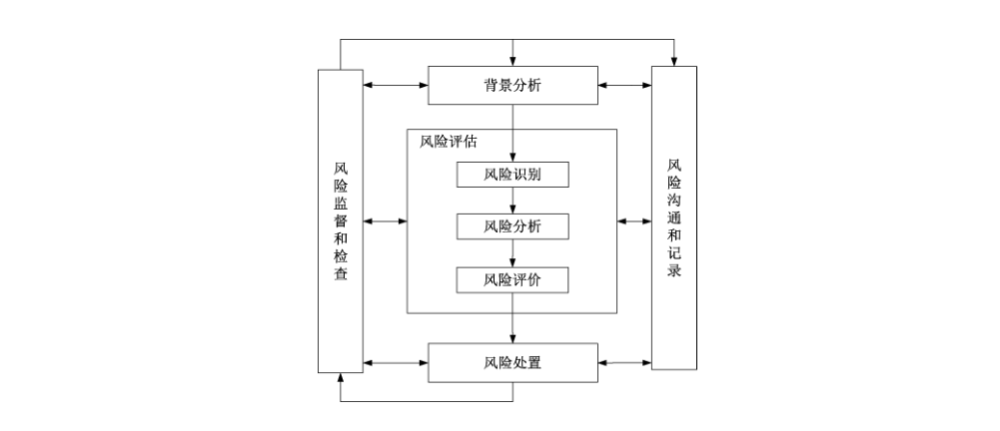
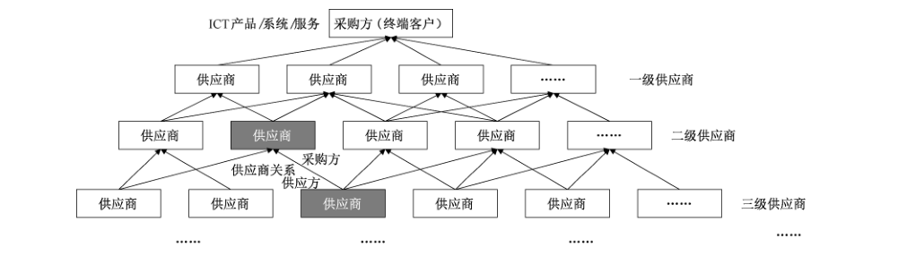

# GB/T 36637-2018 信息安全技术 ICT供应链安全风险管理指南

> 来源：[GB/T 36637-2018 国家标准详情](https://openstd.samr.gov.cn/bzgk/std/newGbInfo?hcno=8C81D84FB9FF253645FEE8AE17EC0F53)。
> PDF SHA-256：6a826a2f5234a471c89f8cd0f186954d47e241edfcadcbf314eb67b3eab8488b。
> 发布日期：2018-10-10；实施日期：2019-05-01。依据官方公开 PDF 的 29 页图像逐页核对，已去除封面、目录、分页和页眉页脚；正式引用请核对原 PDF。

## 前言

本标准按照 GB/T 1.1—2009给出的规则起草。

请注意本文件的某些内容可能涉及专利。本文件的发布机构不承担识别这些专利的责任。

本标准由全国信息安全标准化技术委员会（SAC/TC 260）提出并归口。

本标准起草单位：中国电子技术标准化研究院、中国科学院软件研究所、联想（北京）有限公司、华为技术有限公司、浙江蚂蚁小微金融服务集团股份有限公司、阿里巴巴（北京）软件服务有限公司、北京京东叁佰陆拾度电子商务有限公司、中国信息通信研究院、微软（中国）有限公司、浪潮电子信息产业股份有限公司、国家信息技术安全研究中心、英特尔（中国）有限公司、北京赛西科技发展有限责任公司、阿里云计算有限公司、中国信息安全认证中心、中国科学院信息工程研究所信息安全国家重点实验室、北京工业大学、北京邮电大学、北京中电普华信息技术有限公司。

本标准主要起草人：刘贤刚、胡影、卿斯汉、叶润国、孙彦、李汝鑫、薛勇波、范科峰、王昕、白晓媛、黄少青、刘陶、赵江、杨煜东、赵丹丹、张凡、陈星、宁华、樊洞阳、陈晔、吴迪、朱红儒、杨震、马占宇、曹占峰。

## 引言

随着信息通信技术的普及应用，加强ICT 供应链的安全可控保障变得至关重要。目前，世界各国和ICT行业已普遍认识到，相比传统行业ICT行业供应链更加复杂，存在安全风险的概率更大。加强ICT 供应链安全管理，可增强客户对ICT 供应链以及 ICT 行业的安全信任。

与传统供应链相比，ICT 供应链具有许多不同的特点，例如：ICT 供应链涵盖 ICT 产品和服务的全生命周期，不仅包括传统供应链的生产、集成、仓储、交付等供应阶段，也包括产品服务的设计开发阶段和售后运维阶段；ICT 产品由全球分布的供应商开发、集成或交付，供应链的全球分布性使得客户对供应链的掌握情况和安全风险控制能力在下降；传统供应链主要关注如何将产品有效地交付给客户，或者供应链健壮性的强度，而ICT 供应链安全更关注是否会有额外的功能注入产品和服务中，交付的产品和服务是否与预期一致等。这些特点使得ICT 供应链比传统供应链存在更多的安全风险，加强ICT 供应链的安全风险管理刻不容缓。

本标准不规范信息技术产品供应方的安全行为准则。推荐在关键信息基础设施或重要信息系统中使用本标准。然而，由于个别需要和相关性，组织可选择将标准应用到其他系统或特定组织，不过应用本标准的控制措施可能会增加组织和外部供应商的潜在成本，需要组织在成本和风险间进行权衡。

## 1 范围

本标准规定了信息通信技术（以下简称 ICT）供应链的安全风险管理过程和控制措施。

本标准适用于重要信息系统和关键信息基础设施的 ICT 供方和运营者对 ICT 供应链进行安全风险管理，也适用于指导ICT 产品和服务的供方和需方加强供应链安全管理，同时还可供第三方测评机构对ICT 供应链进行安全风险评估时参考。

## 2 规范性引用文件

下列文件对于本文件的应用是必不可少的。凡是注日期的引用文件，仅注日期的版本适用于本文件。凡是不注日期的引用文件，其最新版本（包括所有的修改单）适用于本文件。

- GB/T 25069—2010 信息安全技术 术语

- GB/T 31722—2015 信息技术 安全技术 信息安全风险管理

## 3 术语和定义

GB/T 25069—2010 和 GB/T 31722—2015 界定的以及下列术语和定义适用于本文件。

### 3.1 ICT 需方 ICT acquirer

从其他组织获取ICT 产品和服务的组织或个人。

> 注1：获取可能涉及或不涉及资金交换。

> 注2：重要信息系统和关键信息基础设施的运营者，通常是从 ICT 供方获取网络产品和服务的 ICT 需方。

### 3.2 ICT 供方 ICT supplier

提供ICT 产品和服务的组织。

> 注1：供方也可称供应商、供应方。

> 注2：供方可以是内部的或外部的组织。

> 注3：ICT供方包括产品供应商、服务提供商、系统集成商、生产商、销售商、代理商等。

### 3.3 供应关系 supplier relation

在需方和供方之间的协议，可用于开展业务，提供产品和服务，实现商业收益。

> 注1：需方和供方可以是同一个机构。

> 注2：在供应链中，上游机构的需方同时也是下游机构的供方。终端客户可以理解为一种特殊的需方。

### 3.4 ICT 供应链 ICT supply chain

ICT 产品和服务的供应链，是指为满足供应关系通过资源和过程将需方、供方相互连接的网链结构，可用于将ICT 的产品和服务提供给需方。

### 3.5 供应链安全风险 supply chain security risk

供应链安全威胁利用供应链管理中存在的脆弱性导致供应链安全事件的可能性，及其由此对组织造成的影响。

### 3.6 供应链安全风险管理 supply chain security risk management

指导和控制组织与供应链安全风险相关问题的协调活动。

### 3.7 ICT 供应链生命周期 ICT supply chain life cycle

ICT 产品和服务从无到有直至废弃的全生命周期涉及的供应链活动。

> 注：ICT供应链通常以 ICT 产品和服务的设计为起点，经过开发、生产、集成、仓储、交付等环节将产品和服务交付给需方，并对产品和服务进行运维等直至其废弃。

### 3.8 ICT 供应链基础设施 ICT supply chain infrastructure

由组织内的硬件、软件和制度流程等构成的集合，用于构建产品和服务的设计、开发、生产、集成、仓储、交付、运维、废弃等ICT 供应链生命周期的环境。

> 注1：ICT供应链基础设施，主要包括组织内部支撑ICT 供应链生命周期的信息系统和物理设施，如供应链管理信息系统、采购管理系统、软件开发环境、零部件生产车间、产品仓库等。

> 注2：ICT 供应链信息系统，属于 ICT 供应链基础设施，是由计算机、其他信息终端、相关设备、软件和数据等组成的，按照一定的规则和程序支撑产品和服务的开发、生产、集成、仓储、交付、运维、废弃等供应链生命周期的系统。

## 4 缩略语

下列缩略语适用于本文件。

ICT 信息通信技术（Information and Communication Technology）

## 5 概述

ICT 供应链是一个全球分布的，具有供应商多样性、产品服务复杂性、全生命周期覆盖性等多维特点的复杂系统，相关说明参见附录A。本标准主要对重要信息系统和关键信息基础设施的ICT 供方管理其供应链安全风险进行规范，而关键信息基础设施的运营者也可在自身安全风险管理中考虑供应链安全风险管理。

ICT 供应链相比传统供应链面临更多的安全风险，宜加强对ICT 供应链安全风险管理，重点实现以下目标：

a） 完整性：保障在ICT 供应链所有环节中，产品和服务及其所包含的组件、部件、元器件、数据等不被植入、篡改、替换和伪造。

b） 保密性：保障ICT 供应链上传递的信息不被泄露给未授权者。

c） 可用性：保障需方对ICT 供应链的使用。一方面，确保ICT 供应链按照与需方签订的协议能够正常供应，不易被人为或自然因素中断，即可供应性；另一方面，即使在 ICT 供应链部分失效时，仍能保持连续供应且快速恢复到正常供应状态的能力，即弹性。

d） 可控性：保障需方对ICT 产品和服务或供应链的控制能力。可控性包括：供应链可追溯性，即一旦 ICT 供应链发生问题，可以有效识别出现问题的环节、供应商和组件，并可进行追溯或修复；可控性，也包括需方对供应链信息的理解或透明度、用户对自己数据的支配能力、用户对自己所拥有和使用产品的控制能力、用户对使用产品和服务的选择权和产品和服务的行为与合同协议相符等。

本标准涉及密码算法的相关内容，按国家有关法规实施；涉及采用密码技术解决保密性、完整性、真实性、不可否认性需求的应遵循密码相关国家标准和行业标准。

## 6 ICT供应链安全风险管理过程

### 6.1 概述

ICT 供应链安全风险管理过程由背景分析（6.2）、风险评估（6.3）、风险处置（6.4）、风险监督和检查（6.5）、风险沟通和记录（6.6）五个步骤组成，见图1。组织宜按照GB/T 31722—2015 的规定建立ICT供应链风险管理过程，也可将 ICT 供应链安全风险管理分散到对ICT 供应链生命周期各环节、ICT 供应链基础设施、外部供应商的风险管理活动中。

### 6.2 背景分析

ICT 供应链安全风险管理是组织整体风险管理的组成部分，组织宜结合实际情况建立 ICT 供应链安全风险管理的背景，包括基本准则、范围边界和风险约束等。其中，基本准则是ICT 供应链安全风险管理需要遵循的准则，如风险评价准则、影响准则、风险接受准则等；范围边界宜明确供应链管理涉及的供应商、ICT 供应链基础设施、产品/服务/组件等；风险约束宜确定执行ICT 供应链安全风险管理活动需满足的约束，包括组织约束和 ICT 供应链约束。

宜考虑以下因素以建立背景：

a） 组织战略、业务目标、职能架构；

b） 组织流程（安全方面、质量方面等）；

c） 组织的整体风险管理方法、安全策略、信息安全方针；

d） 基于组织战略的ICT 供应链风险管理业务目标、职能架构、组织流程、供应链结构；

e） ICT 供应链风险管理策略，包括但不限于购置、采购、信息安全、质量、物流等内容；

f） 供应链内部和外部利益相关者及其价值观和风险偏好；

g） 供应商信息，包括资质、信用、支付能力、管理状况、地理分布、合作历史等；

h）供应链在资金、时间、人力、过程、系统和技术等方面的能力和约束；

i） ICT 供应链基础设施、信息流和决策过程；

j） 供应链管理的历史数据；

k）适用的法律法规。

### 6.3 风险评估

#### 6.3.1 概述

组织在进行背景分析后，可开展风险评估，对ICT 供应链面临的安全风险进行风险识别（6.3.2）、风险分析（6.3.3）和风险评价（6.3.4）。风险评估可多次迭代直至结果满足要求。

#### 6.3.2 风险识别

##### 6.3.2.1 资产识别

组织宜识别ICT供应链的关键资产，此类资产对组织的业务功能有直接影响，一旦被禁用或受损，可能导致组织的产品和服务失效或质量下降。宜考虑以下因素以识别关键资产：

a） 组织的关键业务；

b） 对业务至关重要的系统、组件（硬件、软件和固件）、功能和流程；

c） 依赖性分析和评估，确定可能需要在系统架构中进行加固的组件和功能；

d） 关键系统、组件、功能、信息的获取和审核，例如其制造或开发位置、物理和逻辑交付路径、与关键组件相关的信息流等；

e） 将已识别的关键组件与ICT 供应链信息、历史数据和系统开发生命周期相关联，以确认 ICT供应链关键路径；

f） 关键功能依赖的功能，如软件补丁使用的数字签名技术等；

g） 对所有接入点的确认，识别并限制对关键功能、组件的直接访问（如最小特权执行）；

h） 在系统生命周期内可能发生的恶意变更。

##### 6.3.2.2 威胁识别

###### 6.3.2.2.1 威胁来源识别

ICT 供应链安全威胁见表1，主要来源于环境因素、供应链攻击和人为错误。其中，环境因素是由环境原因造成的供应链安全问题。供应链攻击是攻击者通过供应链发起的网络或物理攻击。供应链的设计、开发、生产、集成、仓储、交付、运维、废弃等任意环节都可能遭受此类攻击。人为错误，是指由于内部人员、供应商人员安全意识不足，没有遵循供应链安全规章制度和操作流程而导致的安全问题。

**表1 ICT 供应链安全威胁来源**

<table>
<thead><tr><th>类型</th><th>子类</th><th>示例</th></tr></thead>
<tbody>
<tr><td colspan="2">环境因素</td><td>静电、灰尘、潮湿、鼠蚁虫害、电磁干扰、洪灾、地震、台风、意外事故等环境危害或自然灾害；软件、硬件、数据、通讯线路、电力、云计算平台等基础设施的故障；贸易管制、限制销售、知识产权等国际环境因素；罢工等人为突发事件</td></tr>
<tr><td rowspan="5">供应链攻击</td><td>假冒伪造者</td><td>假冒伪造者试图获取和销售 ICT 伪造组件用于盈利，特别是假冒伪劣者寻找处理机构、购买库存积压产品，获得 ICT 组件的设计蓝图，通过灰色销售渠道提供给购买者</td></tr>
<tr><td>恶意攻击者</td><td>恶意攻击者试图渗透或中断 ICT 供应链，植入恶意功能或进行未授权访问，来收集信息或造成损坏</td></tr>
<tr><td>商业间谍</td><td>商业间谍等针对供应链或产品和服务、产品和服务的组件等发起网络或物理攻击，窃取知识产权等敏感信息，破坏业务操作或系统</td></tr>
<tr><td>内部人员</td><td>不满的或有预谋的内部人员对产品服务进行恶意篡改、植入、替换、伪造或者破坏；采用自主或内外勾结的方式盗窃软件代码、设计文档等知识产权信息销售或转移给竞争对手或外部情报机构，以获取利益</td></tr>
<tr><td>供应商人员</td><td>供应商人员利用供应链管理的脆弱性，从 ICT 供应链的开发、生产、交付、销售、维护、返回等环节，对 ICT 供应链进行恶意攻击，或对产品的上游组件进行恶意篡改或伪造</td></tr>
<tr><td colspan="2">人为错误</td><td>内部人员、供应商人员由于缺乏培训、专业技能不足、不具备岗位技能要求而导致 ICT 供应链基础设施故障，及由其引发的供应链中断</td></tr>
</tbody>
</table>

###### 6.3.2.2.2 威胁类型识别

组织宜识别ICT 供应链可能面临的安全威胁，典型的 ICT 供应链安全威胁见表2，主要包括：恶意篡改、假冒伪劣、供应中断、信息泄露、违规操作和其他威胁。威胁类型的更多信息参见附录 B。

**表2 ICT 供应链安全威胁**

| 类型 | 描述 | 示例 |
| --- | --- | --- |
| 恶意篡改 | 在ICT 供应链的设计、开发、采购、生产、仓储、物流、销售、维护、返回等某一环节，对ICT 产品或上游组件进行恶意篡改、植入、替换等，以嵌入包含恶意逻辑的软件或硬件 | 恶意程序、硬件木马、外来组件被篡改、未经授权的配置、供应信息篡改 |
| 假冒伪劣 | ICT 产品或上游组件存在侵犯知识产权、质量低劣等问题 | 不合格产品、未经授权的生产、假冒产品 |
| 供应中断 | 由于人为或自然的原因，造成ICT 产品和服务的供应量或质量下降，甚至出现 ICT供应链中断或终止 | 人为或自然的突发事件中断、基础设施故障、国际环境影响、不正当竞争行为、不被支持的组件 |
| 信息泄露 | ICT 供应链上传递的敏感信息被非法泄露 | 供应链的共享信息、商业秘密泄露 |
| 违规操作 | ICT 供方的违规操作行为 | 供应商违规收集或使用用户数据、滥用大数据分析、非法远程控制用户产品、影响市场秩序 |
| 其他威胁 | ICT 供应链的全球分布性为供应链安全带来了新的威胁或挑战 | 需方安全风险控制能力下降、法律法规差异性挑战、全球化供应链管理挑战 |

##### 6.3.2.3 脆弱性识别

ICT 供应链脆弱性是在产品和服务的设计、开发、生产、集成、仓储、交付、运维、废弃等任意供应链环节能被威胁利用的缺陷。脆弱性是资产本身的特性，仅被威胁利用时会产生危害，没有相应威胁时可能不需要实施控制措施，但宜关注和监视其变化。

ICT 供应链脆弱性既包括产品和服务在其生命周期内的脆弱性，也包括 ICT 供应链脆弱性。ICT供应链脆弱性可能存在于：

a） 产品和服务生命周期中的系统或组件；

b） 直接影响系统生命周期的开发和运维环境；

c） 运输ICT 产品或组件的物流和交付环境，包括逻辑或物理的。

脆弱性识别宜围绕ICT 供应链关键资产展开，针对每一项需要保护的资产，识别可能被威胁利用的脆弱性，并对其严重程度进行评估。ICT 供应链脆弱性示例见表3，详细的脆弱性信息参见附录C。

脆弱性识别时需要特别关注能使攻击者获得供应链敏感信息、植入恶意组件、触发系统运行故障、访问关键功能依赖的支撑或关联组件的脆弱性。

**表3 ICT 供应链脆弱性**

<table>
<thead><tr><th>类型</th><th>子类</th><th>示例</th></tr></thead>
<tbody>
<tr><td rowspan="3">供应链生命周期的脆弱性</td><td>开发阶段脆弱性</td><td>ICT 产品和服务在设计、开发阶段可能存在安全隐患，如：产品和服务设计时未对安全需求、安全威胁进行分析，开发时未遵循安全开发流程，没有建立完善的配置管理控制产品或组件的变更，没有适当的操作流程来检测伪造品、替换零件，合作或外包开发没有明确安全要求，第三方软件使用前没有进行安全检查等</td></tr>
<tr><td>供应阶段脆弱性</td><td>ICT 产品和服务在生产、集成、仓储、交付等供应阶段可能存在安全隐患，如：采购时无法识别被篡改或伪造的组件，生产环境的物理安全访问控制不严，采用了不可靠或不安全的仓储商，运输时产品被植入、篡改或替换，供应商未经授权私自预装程序等</td></tr>
<tr><td>运维阶段脆弱性</td><td>ICT 产品和服务在运维阶段可能存在安全隐患，如：产品返回维修时被植入、篡改或替换，缺乏对安全漏洞的应急响应能力，售后人员盗窃用户数据等</td></tr>
<tr><td rowspan="4">供应链基础设施的脆弱性</td><td>供应链管理脆弱性</td><td>由于 ICT 供应链安全管理缺乏或管理不严，可能存在安全隐患，如：未完全建立供应链安全管理制度和流程，缺乏供应链安全责任部门和人员，在选择供应商时未考虑网络安全要求，没有对供应商的绩效和安全风险进行定期评估，缺乏对外包项目、外包人员的安全规定等</td></tr>
<tr><td>供应链信息系统脆弱性</td><td>组织的 ICT 供应链信息系统，可能存在安全隐患，如：未对供应商访问供应链相关信息进行访问控制，个人信息保护未满足相关法规标准要求，未对个人信息访问和使用进行控制，供应链信息不透明或阻塞，信息系统存在漏洞等</td></tr>
<tr><td>ICT 上下游脆弱性</td><td>供应链、供应商安全能力参差不齐，ICT 供应链整体安全水平不高，如：一些供应商的产品安全标准和供应链安全管理流程缺乏，也有的供应商不能及时发现安全缺陷并进行修复和响应等；由于上游供应商安全能力不足、产品市场被部分企业垄断、部分下游供应商安全检测能力有限、长期合作独家供应商造成依赖等原因，导致下游供应商难以控制和追溯上游的供应链风险</td></tr>
<tr><td>供应链物理安全脆弱性</td><td>厂房、仓库、数据中心、机房的位置，缺少抵御自然灾害或人为破坏等的能力</td></tr>
</tbody>
</table>

##### 6.3.2.4 现有安全措施识别

组织宜识别ICT 供应链现有或已计划的安全措施，并对安全措施的有效性进行确认。

宜考虑以下活动以实现现有或计划的安全措施识别：

a） 检查 ICT 供应链安全措施相关的制度文件，了解计划采取哪些安全措施；

b） 访谈组织的信息安全人员和供应链管理人员，了解实际采取了哪些安全措施；

c） 现场检查验证已采取的ICT 供应链安全措施，确认安全措施是否在正确和有效地工作；

d） 参考供应链或网络安全相关标准规范，判断已实施的安全措施是否满足相关标准规范要求。

#### 6.3.3 风险分析

风险分析包括可能性分析、后果分析和风险估算。

可能性是威胁利用脆弱性导致安全事件发生的概率。可能性分析应从两个角度进行：一是ICT 供应链本身受到损害的可能性，例如可能影响关键组件使用或增加知识产权被窃取风险；二是供应链内的产品、服务、系统、组件受到损害的可能性，例如系统被植入恶意代码或组件被电击损坏。

后果分析针对已识别的ICT供应链安全事件，分析事件的潜在影响。组织宜从资产的重要性，引发安全事件的威胁来源的特征，已识别的脆弱性，现有或已计划安全措施反映出的组织对事件的敏感性等方面进行后果分析。

风险估算为ICT 供应链安全风险的可能性和后果赋值，风险估算应基于可能性分析和后果分析的结论进行。

#### 6.3.4 风险评价

风险评价将风险估算结果与风险评价准则和风险接受准则比较，输出依据风险评价准则按优先顺序排列的风险列表。风险识别和分析中得到的后果、可能性也可用于风险评价活动。需要注意的是多个中低风险的聚合可能导致更高的整体风险。

### 6.4 风险处置

对风险评估给出的具体风险宜制定风险处置计划，并结合组织自身的业务要求和能力限制，选择风险处置策略。风险处置策略主要包括以下类型：

a） 风险降低：指为降低风险的可能性，减少风险负面结果所采取的行动。即对风险采取控制措施，减少威胁发生的可能性和带来的影响，使风险级别降低，残余风险在重新评估后能够为组织风险策略接受。

b） 风险规避：指不卷入风险处境的决定或撤离风险处境的行动。通过选择放弃某些可能引发风险的业务或资产、采用改变环境或取消风险相关活动等方式实现对风险的规避。

c） 风险转移：指与另一方对风险带来的损失或收益的共享行为。即将风险全部或部分转移给其他方，组织可采用购买保险，与合作伙伴共同承担的方式对风险进行转移。

d） 风险保留：指对来自特定风险的损失或收益的接受行为。在满足组织安全策略的情况下，对风险不采取任何控制措施，接受特定风险可能带来的损失。

如果组织选择风险降低策略，则需针对风险选择相应 ICT 供应链安全风险控制措施，以保证控制措施执行后，残余风险能够被组织所接受。具体控制措施见第7章。

### 6.5 风险监督和检查

风险监督和检查的目的是确保组织的风险在可接受范围内。ICT 供应链的风险是动态的。威胁、脆弱性、风险可能性、风险影响等均可能会随着组织业务的变化而改变。组织应设置风险监督和检查计划，监视风险管理活动，定期评审控制措施，及时调整范围边界。

宜持续监督和检查以下事项：

a） 资产新增以及资产价值发生变更的情况；

b） 新增的威胁、脆弱性；

c） 已评估的威胁、脆弱性和风险因聚合导致的不可接受的风险；

d） ICT 供应链安全事件。

### 6.6 风险沟通和记录

风险沟通和记录是在风险管理者以及利益相关者之间就如何通过交换和（或）共享有关风险信息来管理风险而达成一致的活动。宜沟通和记录的内容包括但不限于：

a） 利益相关者的关注点；

b） ICT 供应链背景信息；

c） 供应商基本信息；

d） 产品和服务的基本信息；

e） 充分识别 ICT 供应链风险的方法；

f） ICT 供应链风险基本信息，包括供应链风险事件描述、风险评估结果等；

g） ICT 供应链风险处置措施、实施计划及效果等。

## 7 ICT 供应链安全风险控制措施

### 7.1 概述

本章列出了ICT 供应链安全风险控制措施集合，需方或供方宜针对组织的特点和识别的安全风险，选择、定制和实施供应链安全措施。

基于 ICT 供应链风险管理过程，本标准推荐组织依据以下原则选择供应链的安全控制措施：

a） 组织的类型、战略、业务目标、客户需求；

b） 组织架构和组织流程（安全方面、质量方面等）；

c） 组织的安全策略和安全风险承受能力；

d） 组织的 ICT 供应链的安全威胁、脆弱性；

e） 相关的法律法规；

f） 组织 ICT 供应链结构和背景；

g） 组织的 ICT 供应链安全风险评估结果。

### 7.2 技术安全措施

#### 7.2.1 物理与环境安全

组织宜：

a） 确保外部人员访问ICT 供应链基础设施受控区域前得到授权或审批，由专人全程陪同，并登记备案；

b） 及时更新供方对ICT 供应链基础设施的物理访问权限；

c） 评估系统集成商是否具有物理与环境安全策略，是否具有持续保证物理与环境安全的能力，并通过合同协议对系统集成商的物理与环境安全进行要求；

d） 具有备用的工作场所、通信线路和供应链管理信息系统，防止自然灾害或不可抗力的外因导致供应链中断。

#### 7.2.2 系统与通信安全

组织宜：

a） 具备边界保护机制，保护 ICT 供应链基础设施内的物理连接和逻辑连接；

b） 定期开展ICT 供应链基础设施边界安全脆弱性评估及抽样检查，并及时采取纠正措施；

c） 如在ICT供应链基础设施中采用密码技术的，宜符合国家密码管理相关规定；

d） 使用多个供应来源以提高通信系统组件可用性，减少 ICT 供应链基础设施受损害的影响；

e） 确保供应链关键信息的传输安全，采取安全措施保证信息传输保密性。

#### 7.2.3 访问控制

组织宜：

a） 建立用户的账户管理体系，包括用户注册、角色管理、权限和授权管理及身份鉴别等措施；

b） 在系统集成商、供应商和外部服务提供商发生变更的情况下，更新访问权限等控制措施；

c） 在信息系统及 ICT 供应链决策过程明确职责定位；

d） 在职责定位的基础上，采取最小权限和授权机制；

e） 监控、审核和记录从外部对ICT 供应链基础设施相关的访问；

f） 根据组织的信息安全策略制定访问控制协议要求，并对访问协议进行定期更新，如明确系统集成商和外部供应商对信息系统和 ICT 供应链基础设施的访问级别；

g） 限制组织内设备在外部信息系统中的使用；

h）依据不同的访问级别，把ICT 供应链基础设施的接口，选择性地提供给系统集成商、供应商和外部服务提供商；

i） 使用自动化方式实现账户管理，包括进行包括通知变更、禁用过期账户、自行审核高危操作和超时自动注销等；

j） 从供应链角度，对组织与外部供应商互连的信息系统和操作任务进行核查和记录，包括了解与各类供方的组件/系统连接状况、共同开发和操作环境、共享的数据请求和检索事务等。

> 转写注：7.2.3 i）原文“包括进行包括”按原版保留。

#### 7.2.4 标识与鉴别

组织宜：

a） 对组织供应链基础设施的系统或人员分配身份标识，对访问 ICT 供应链基础设施的用户（包括组织内部用户、外部供应商用户等）进行身份标识和鉴别。

b）管理ICT 供应链基础设施内非组织用户的用户身份标识和鉴别的建立、审计、使用和撤销。

c） 对交付前产品标识的改变提供相应的规则，使所交付的产品在 ICT 供应链中可进行验证。

d） 对设备和组件分配产品标识，使用编码、条码、ID 或者组织自定义的其他标识，包括：

<ol class="standard-subclauses">
<li>1） 对于软件开发，宜为已实现配置项识别的组件分配产品标识；</li>
<li>2） 对于设备和操作系统，宜在其进入组织的ICT 供应链基础设施时分配产品标识，例如通过运输、接收或下载完成时。</li>
</ol>

#### 7.2.5 供应链完整性保护

组织宜：

a） 对可能造成ICT 供应链基础设施破坏的行为进行监控（如外部攻击或软件开发过程中植入的恶意代码）；

b） 对信息系统和组件的完整性进行测试和验证（如使用数字签名或校验和机制），或使用有限权限环境（如沙箱）等；

c） 确保实施代码鉴别机制，如数字签名，以确保ICT 供应链框架和信息系统的软件、固件和信息的完整性；

d） 获取二进制或机器可执行代码、工具的来源应经过验证；

e） 采取硬件完整性保护措施，如硬件拆箱保护措施；

f） 验证集成商、供应商和外部服务提供商提供的篡改保护机制。

#### 7.2.6 可追溯性

组织宜：

a） 建立和维护可追溯性的策略和程序，记录和保留信息系统、组件或ICT 供应链中产品和服务的原产地或原提供商的相关信息；

b） 对于追溯源的改变，跟踪、记录并通知到有关供应链相关人员；

c） 确保追溯到对信息系统或 ICT 供应链中组件、工具、数据和过程有影响的个人；

d） 确保可追溯信息和可追溯更改记录的抗抵赖性，包括时间、用户信息等；

e） 建立可追溯基线，对组件、系统以及整个供应链进行记录、监测和维护，并将可追溯基线嵌入供应链流程和相关信息系统；

f） 使用多种可重复的方法跟踪追溯源的变更，包括变更的数量和频率，减少过程、程序和人为的错误，例如，配置管理数据库可用于跟踪对软件模块、硬件组件和文档的更改。

### 7.3 管理安全措施

#### 7.3.1 制度和人员管理

##### 7.3.1.1 管理制度

组织宜：

a） 制定供应链管理的总体方针和安全策略，说明供应链管理的总体目标、范围、原则和安全框架等；

b） 对供应链建立安全管理制度，包含供应链生命周期中主要活动、ICT 供应链基础设施和外部供应商管理等内容；

c） 对要求供应链管理人员或操作人员执行的重要管理操作建立操作规程；

d） 在供应商关系发生重大变化或供应链发生重大安全事件时，对供应链安全管理制度进行检查和审定，对存在不足或需要改进的安全管理制度进行修订。

##### 7.3.1.2 管理机构

组织宜：

a） 明确负责指导和协调组织相关部门的供应链安全管理工作的供应链安全管理部门，并定义供应链安全管理职责；

b） 提供用于供应链安全管理的资金、人员和权限等可用资源。

##### 7.3.1.3 人员管理

组织宜：

a） 制定针对涉及 ICT 供应链基础设施的人员的安全要求，包括管理者、员工和第三方人员等。

b） 确保涉及 ICT 供应链各部门、各环节的责任人的可信度，可以满足对其职位的安全要求。

c） 及时终止离岗和调任人员对供应链基础设施的访问权限。包括：

<ol class="standard-subclauses">
<li>1） 采购和承包人员、供应链和物流人员、运输和接收人员；</li>
<li>2） 信息技术人员、质量人员、高级管理人员、系统管理员、网络管理员、安全管理员。</li>
</ol>

d） 明确划分管理 ICT 供应链的人员职责定位，包括：

<ol class="standard-subclauses">
<li>1） 高级管理人员以及支撑ICT 供应链的签约、物流、交付/接收、采购安全等职责定位；</li>
<li>2） 供应链管理人员和负责完成管理的需方组织内部人员的职责定位；</li>
<li>3） 覆盖系统生命周期的系统工程师或安全工程师，涉及需求定义、开发、测试、部署、维护、更新、更换、交付和接收、IT技术等职责定位。</li>
</ol>

##### 7.3.1.4 教育培训

组织宜：

a） 制定安全培训计划，将ICT 供应链安全风险管理培训纳入安全培训计划中，并定期执行；

b）设立专人负责供应链安全培训工作，培训对象宜包括所有参与供应链基础设施的组织内部人员和供应商人员或相关责任人；

c） 培训内容可包括供应链安全相关的法律法规、标准规范、程序流程、应急处理等，培训内容需要根据安全形势变化和组织，进行不断更新。

#### 7.3.2 供应链生命周期管理

##### 7.3.2.1 配置管理

组织宜：

a） 明确供应链管理人员在配置管理中的职责定位，包括确定和协调组织不同部门间在配置管理中的目标、范围、角色、职责、义务和管理规范。

b） 制定覆盖全生命周期的配置管理策略，包括定义在整个系统开发生命周期中的配置参数，定义信息系统的配置项并进行配置管理，考虑配置项的数据留存、追踪和元数据等。

c） 与系统集成商、外部服务提供商等供应商协调配置管理策略。

d） 建立相应的实施配置管理控制程序，包括向产品和服务插入和删除组件的规程，制定主体配置操作手册，依据手册对设备进行安全访问、优化配置更改等工作。

e） 将信息系统设置为仅提供基本功能，禁止或限制使用不必要的物理和逻辑端口、协议或服务，指定可以实现系统最少功能的组件，以减少ICT 供应链受到攻击的风险。

f） 对产品/服务和ICT 供应链基础设施的变更进行安全影响分析，以确定是否需要采取额外的安全控制措施，影响分析人员宜包含系统工程师和安全工程师。

g） 及时记录和保存系统的基本配置信息，包括网络拓扑结构、各个设备安装的软件组件、软件版本和补丁信息、各个设备或软件组件的配置参数等。

h） 在组织内部建立和维护配置管理基线，包括：

<ol class="standard-subclauses">
<li>1） 建立信息系统和 ICT供应链基础设施的配置基线，并与系统集成商、外部服务提供商和供应商达成一致；</li>
<li>2） 建立基线配置的规范，并可根据需要建立基线配置的开发及测试环境；</li>
<li>3） 记录基线配置的变更和相关组织的通报、调整；</li>
<li>4） 运行和维护基线配置的基本要求，通过基本要求保证供应链的基本安全条件；</li>
<li>5） 定期审核和更新基线配置，实现基线变化的可追溯。</li>
</ol>

i） 对配置访问进行安全控制，包括：

<ol class="standard-subclauses">
<li>1） 对配置更改相关的物理和逻辑访问控制进行定义、记录，批准和管理；</li>
<li>2） 对配置的强制执行和自动访问进行审核和限制；</li>
<li>3） 对签名组件的更改进行审核和限制，以确定组件使用组织认可和批准的数字签名证书；</li>
<li>4） 限制软件库驻留、查询、更改的权限，并定义特权程序和相应权限；</li>
<li>5） 建立对非授权访问实施控制的技术能力和应急响应能力。</li>
</ol>

j） 对 ICT 供应链基础设施的配置更改实施安全控制，监控审核配置设置中未授权的更改，包括：

<ol class="standard-subclauses">
<li>1） 根据职责定位，要求配置的所有者、授权管理者，对配置更改进行系统审核，以确定是否发生未经授权的更改；</li>
<li>2） 明确配置可更改的类型、程序、批准和审计要求；</li>
<li>3） 基于安全风险分析和组织策略，审核对信息系统配置的变更并决定是否批准；</li>
<li>4） 经过审批后才可更改、安装经审核的配置组件或调整配置参数，操作过程宜保留不可更改的审计日志，操作结束后宜同步更新配置信息库，识别、记录所有的配置改变细节，包括与原有配置的差异和原因；</li>
<li>5） 按照组织定义的时间，保留信息系统的配置更改记录；</li>
<li>6） 建立未经授权的配置更改的应急响应和配置恢复能力；</li>
<li>7） 审计和审核信息系统的配置控制变更相关活动；</li>
<li>8） 提高管理、审核和控制配置更改的自动化程度。</li>
</ol>

##### 7.3.2.2 供应商开发要求

ICT 产品和服务的开发商和供应商宜：

a） 具备软件开发管理制度，明确开发过程的控制方法、管理流程和人员行为准则。

b） 制定代码安全规范，要求开发人员参照规范提升代码质量，例如：

<ol class="standard-subclauses">
<li>1） 使用最佳安全编码实践来避免常见的安全缺陷；</li>
<li>2） 使用安全硬件设计实践（如适用）；</li>
<li>3） 定期安排对相关人员的安全开发工程实战培训。</li>
</ol>

c） 在发现安全缺陷及漏洞时，立即采取修复或替代方案等补救措施，及时告知用户安全风险，并按照国家网络安全监测预警和信息通报制度等要求向有关主管部门报告。

d） 确保具备软件安全设计的相关文档和使用指南，并由专人负责保管。

e） 确保具备物理隔离的开发环境，实际环境的测试数据和测试结果受到控制。

f） 确保开发流程及实践在整个生命周期中得到记录、管理及遵循，记录的开发流程可包含开发合作伙伴。如发现被证实为恶意篡改或伪冒目标的组件，需对其在整个生命周期内的组装和使用进行跟踪检查，并提供解决方案。

g） 执行产品和服务开发生命周期的安全测试管理，制定产品安全应急响应计划，以确保各种产品和服务在整个生命周期内达到一定的安全要求。

##### 7.3.2.3 生产交付安全

组织宜：

a） 生产区域具备独立的电子安全系统并且有专人管理，安保人员按要求实施监控，并维护安保系统；

b） 运输服务商具备服务许可资质、具备电子行业作业经验，运输车辆符合安全资质配送要求，运输作业人员通过组织或运输服务商提供的安全培训；

c） 使用资产跟踪，如数字签名、Global Positioning System 定位等措施来保障在生产、运输、存储、交付中的系统和相关组件安全，以防止系统和组件被假冒、丢失、受损等导致的供应链中断。

##### 7.3.2.4 安全审计

组织宜：

a） 建立供应链管理安全审计制度和流程，对相关的安全事件进行审计，包括：

<ol class="standard-subclauses">
<li>1） 技术事件：包括软件、硬件、数据等的更改、移除和迁移，对访问控制和身份鉴别的日志监测等；</li>
<li>2） 非技术事件：包括组织安全或运营政策和策略的变化，采购或合同流程的变更，以及系统集成商、供应商和外部服务提供商，对系统或组件计划进行的更新、优化、淘汰等。</li>
</ol>

b） 对审计事件进行定级，根据不同的安全等级，采用不同的应对策略和问责机制。

c） 按要求留存和保护供应链相关的审计记录。

d） 对要公开披露的信息进行审核，包括组织自己披露的信息和授权供应商披露的组织信息。

e） 监测和审计ICT 供应链活动中的信息共享，包括与系统集成商、供应商和外部服务提供商的信息共享。

f） 在合作协议中，要求系统集成商和外部服务提供商建立适当的审计机制和办法。

g） 建议系统集成商和外部服务提供商，定期对供应链信息系统进行安全风险自审或引入第三方审计。

h）定期或者根据自身需要，对供应链进行来源审核和验证。

i） 根据访问控制策略部署安全审计机制，以审核、更新并跟踪外部供应商第三方对供应链基础设施和相关系统的访问。

##### 7.3.2.5 应急计划

组织宜：

a） 针对ICT 供应链基础设施，建立、维护并有效实施 ICT 供应链的应急响应和灾后恢复计划，按照年度更新应急响应计划。

b） 应急响应计划覆盖 ICT 供应链基础设施的基本业务功能及其应急响应需求。

c） ICT 供应链基础设施的应急响应计划可包括：

<ol class="standard-subclauses">
<li>1） 进行业务影响分析，标识关键流程和组件及其安全风险，确定优先次序；</li>
<li>2） 提供应急响应的恢复目标、恢复优先级和度量指标；</li>
<li>3） 描述应急响应的结构和组织形式，明确应急响应责任人的角色、职责及其联系信息。将应急响应计划向供应链相关部门及所有干系人进行通报。</li>
</ol>

d） 如系统发生变更或应急响应计划在实施、执行或测试中遇到问题，及时修改应急响应计划并向相关干系人进行通报。

e） 避免应急响应计划的非授权泄露和更改。

f） 确保在发生安全事故时，实施应急响应计划以维持供应链的基本业务功能。

g） 建立ICT供应链信息备份，保障备份信息的保密性、完整性和可用性，并定期验证信息系统备份的可用性。

h）确保外部服务提供商提供的信息系统和 ICT 供应链基础设施具有适当的失效备援方案，并将其纳入服务协议。

##### 7.3.2.6 事件响应

组织宜：

a） 跟踪、记录各类事件，并与ICT 供应链相关的合作伙伴建立双向沟通机制，包括：

<ol class="standard-subclauses">
<li>1） 对影响ICT 供应链的事件进行界定和描述，包括对事件等级进行划分；</li>
<li>2） 对响应ICT 供应链事件的接口人、响应时间、处理要求进行记录，对处理方式进行说明。</li>
</ol>

b） 与外部供应商定义统一的事件处理标准，并根据事件处理结果和产生影响，对事件处理标准及时修订。

c） 指定处于关键位置的人员作为事件响应联系人，并授予其一定权限。

d） 确保事件报告相关内容和数据只能由授权人员进行传输和接收。

##### 7.3.2.7 维护

组织宜：

a） 为信息系统和 ICT 供应链基础设施制定安全维护策略。

b） 对维护工具的使用和升级进行控制和鉴别，涉及维护工具的选择、订购、存储、集成、使用和更换等各个环节，包括：

<ol class="standard-subclauses">
<li>1） 对用于ICT 供应链基础设施的维护工具进行部署、测试、验收，审核是否符合要求；</li>
<li>2） 在未经安全许可的情况下，不允许将正在使用的ICT 维护工具（软件、硬件）带离维护现场；</li>
<li>3） 需要记录对维护工具的使用和存储情况，如工具的使用者、使用和存储时间。如果维护工具自身具备审计功能的，建议保持开启。</li>
</ol>

c） 采取适当的保护措施，来管理非本地维护带来的风险，有关的控制手段推荐如下：

<ol class="standard-subclauses">
<li>1） 记录远程维护的时间、人员和使用的工具；</li>
<li>2） 对信息系统中涉及远程维护的审核功能，建议实时开启。</li>
</ol>

d）采取适当的保护措施，来管理涉及维护人员的相关风险。如对人员进行培训、利用合同约束条件。

e） 对于备件、更换部件等，组织确保通过原始设备制造商（OEM）或授权供应商购买。如果 OEM不可用，则优选从授权供应商处购买。如果 OEM或授权供应商均不可用，只能从非授权供应商购买，宜在购买之前进行风险评估。

#### 7.3.3 采购外包与供应商管理

##### 7.3.3.1 供应商选择

组织宜：

a） 制定供应商选择策略和制度，根据产品和服务重要程度对供应商开展安全调查。

b） 对关键产品和服务供应商实行筛选，与产品和服务供应商进行合作时，组织宜考虑以下几方面因素：

<ol class="standard-subclauses">
<li>1） 优先选择满足下列条件的供应商：保护措施符合法律法规安全要求，组织运转过程和安全措施相对透明，对下级供应商、关键组件和服务的安全实行进一步核查，在合同中声明不使用有恶意代码产品或假冒产品，使用可信任的员工；</li>
<li>2） 交货周期短且稳定；</li>
<li>3） 使用可信或可控的分发、交付和仓储手段；</li>
<li>4） 限制从特定供应商或国家采购产品和服务。</li>
</ol>

c） 在签署合同前对供应商进行调查，根据实际情况，包括但不限于：

<ol class="standard-subclauses">
<li>1） 分析供应商对信息系统、组件和服务的设计、开发、实施、验证、交付、支持过程；</li>
<li>2） 评价供应商在开发信息系统、组件或服务时接受的安全培训和积累的经验，以判断其安全能力。</li>
</ol>

##### 7.3.3.2 采购过程

组织宜：

a） 在采购前建立与ICT供应链的信息安全风险承受能力相适应的采购策略，制定供应商的信息安全基线要求，安全要求宜包括ICT 相关的管理要求、技术要求、透明性、供应链的信息安全事件共享、组件的废弃或留存规则、数据、知识产权和其他相关要求。

b） 与供应商签订产品和服务采购协议，并体现产品和服务安全保障、保密和验收准则等内容。

c） 要求供应商对其交付的网络安全产品实行安全配置，并在安全组件、安全服务重启或重装后进行安全默认配置。

d） 确保与供应商签订的服务水平协议中的相关指标，不低于与客户所签订的服务水平协议中的相关指标。

e） 要求产品和服务供应商制定用户文档，可涵盖以下信息：

<ol class="standard-subclauses">
<li>1） 产品和服务的安全配置，以及安装和运行说明；</li>
<li>2） 与管理功能有关的配置和使用方面的注意事项；</li>
<li>3） 有助于用户更安全地使用信息系统、组件或服务的方法或说明；对用户安全责任和注意事项的说明。</li>
</ol>

##### 7.3.3.3 供应商管理

组织宜：

a） 要求供应商提供所交付产品和服务的安全功能、应急响应措施和培训计划；

b） 要求供应商发现其交付的产品和服务的脆弱性和漏洞后，及时通报并进行快速修复；

c） 要求供应商对其交付的产品和服务实行防篡改措施，并协助组织定期检查产品和服务是否受到篡改；

d） 要求供应商制定和实施防赝品的策略和规程，检测并防止赝品组件进入产品和服务；

e） 要求供应商变更时，对供应商变更带来的安全风险进行评估，并采取有关措施对风险进行控制；

f） 根据组织供应链安全检查需求或系统安全要求，产品和服务供应商宜协助提供ICT 供应链相关资料；

g） 要求供应商在合同约定期限内持续提供支持，若供应商需使用不被支持的产品和服务时需获得组织管理层批准。

## 附录A（资料性附录）ICT 供应链概述

### A.1 ICT 供应链结构

ICT 供应链，是一个由多个上游与下游组织相互连接形成的网链结构，如图A.1所示。供应链中的组织是参与到供应链环节中的实体，通常包括需方和供应商（供方）两种角色。需方与供应商之间存在供应关系，即需方从供应商购买 ICT 产品和服务，供应商根据与需方签订的协议提供相应产品、系统或服务。在供应链中，一个组织可能既是上游组织的需方，也是下游组织的供应方，与其上游、下游均存在供应商关系，因此供应链也是由连续的供应商关系组成的网链结构。供应链的终点需方也被称为终端客户，为终端客户直接提供产品、系统或服务的供应商为一级供应商（也称为直接供应商）。一级供应商的供应商为二级供应商，依此类推，他们与终端客户存在间接供应商关系。而随着供应商层级的增多，需方对ICT供应链的透明度、理解能力都在降低，从而使得对ICT 供应链安全风险的控制能力也在下降。从终端客户的角度来看，终端客户的一级供应商宜承担供应链安全的主要责任。

### A.2 ICT 供应链特点

相对于传统领域的实体供应链，ICT 供应链有其特殊性，主要体现在：

a） 全球分布性。随着ICT 产业的全球化发展，许多ICT 产品（如手机、个人计算机、服务器等）均由全球分布的供应商开发、集成和交付。例如，计算机芯片可能在一个国家或地区设计，在另一个地方制造，然后在其他国家与软件一起装载，并仓储于全球多个地点，为世界各地的需方进行产品供应。

b） 全生命周期。ICT 供应链涵盖了ICT 产品、系统或服务从无到有再到废弃的整个生命周期，不仅包含传统供应链的计划、获取、制造、交付、返回等流程，还延伸到系统开发的生命周期，以及产品和服务交付后的运营维护过程。可以说，ICT 供应链以ICT 产品、系统或服务的规划或设计为起点，经过开发、采购、外包、制造、集成、实施、分发、安装、维护、终止等环节，最终将通信技术的产品、系统或服务交付给需方。

c） 产品服务复杂。ICT 产品、系统和服务的类型多样、构成复杂。软件产品如操作系统、数据库、办公套件等，且通常由多个组件构成；硬件产品如路由器、打印机、服务器等，通常由多个零部件组装而成；信息系统通常由多个软件、硬件产品集成；云计算服务则包括多个软硬件产品和若干信息系统。例如，手机上一个可识别指纹的 Home 键，就由蓝宝石、金属边环、Touch ID传感器、驱动芯片、加固件、柔性电路、按钮开关7个模块组成。

d） 供应商多样性。在ICT 供应链的设计、开发、采购、制造、集成、仓储、分销、退回等多个环节中，不同类型的供应商均参与其中，包括但不限于产品供应商、服务提供商、系统集成商、销售商、制造工厂、物流供应商、配送中心、分销商、批发商等。

上述特点使得 ICT 供应链成为一个遍布全球，并具有供应商多样性、产品服务复杂性、全生命周期覆盖性这三维特性的复杂系统。任何一维的任一环节出现问题，例如供应链中的任一供应商、产品/服务中的任一组件、系统生命周期的任一阶段出现安全隐患，都可能造成 ICT 产品、系统或服务不安全，导致ICT 供应链安全风险。因此，与传统领域的实体供应链相比，ICT 供应链面临更多的安全风险。

### A.3 ICT 供应链范围和供应商类型

虽然从广义来说，ICT 供应链的范围包含产品、系统或服务中所有部件在其生命周期各环节中涉及的所有供应商。但是考虑到组织实践和管理成本，需方可根据组织的业务目标自行划分 ICT 供应链的管理范围，对其组织范围内的ICT 产品、系统或服务的创建、维护、终止等全生命周期过程涉及的供应商关系进行管理。例如一些组织只关注与其存在直接供应商关系的供应商，以及重要组件的供应商。

而其他一些组织，可能由于业务的考虑，将ICT 供应链的范围延伸到存在间接供应商关系的二级供应商、三级供应商等。

但需要注意的是，较小的供应链范围虽然可以简化风险管理流程，减少风险管理的成本，但也可能造成风险管理的失控。例如，需方如果只管理直接关联的供应商，可能无法避免由上游供应商引入的ICT 产品和服务风险。而如果将 ICT 产品中所有部件均纳入ICT 供应链范围，虽然可覆盖供应链的多个层次，但可能造成管理成本的明显上升和流程复杂度的增加，从而导致风险管理难以执行。

从终端客户的角度来看，终端客户的直接供应商或ICT 供应链中的品牌拥有者宜承担供应链安全的主要责任。与需方存在直接供应商关系的供应商，通常可分为三种类型：

a） 产品供应商。为需方提供ICT 产品的供应商。根据产品类型不同，产品供应商通常分为软件供应商、硬件供应商、网络供应商等，而根据产品形态不同，又可分为商用现货（commercial off-the-shelf,COTS）、政府现货（government off-the-shelf,GOTS）、定制产品、开源产品等。

b） 系统集成商。针对需方的需求，提供定制解决方案或服务的实体，如设备系统集成商、应用系统集成商等。系统集成商提供的解决方案通常融合了许多层面的供应商。

c） 服务提供商。为需方提供信息通信技术服务的供应商，如运维服务、云计算服务等。

## 附录B（资料性附录）ICT 供应链安全威胁

> 转写注：本附录原文合称“五类”，正文表 2 列为六类，此处均按原版保留。

ICT 供应链主要面临恶意篡改、假冒伪劣、供应中断、信息泄露或违规操作、其他威胁等五类安全威胁，破坏 ICT 供应链的完整性、可用性和保密性。

### B.1 恶意篡改

在ICT 供应链的设计、开发、生产、集成、仓储、交付、运维、废弃等某一环节，对ICT 产品或上游组件进行恶意篡改、植入、替换等，以嵌入包含恶意逻辑的软件或硬件，危害产品和数据的保密性、完整性和可用性。例如：

a） 恶意程序：是指在用户不知情或未授权的情况下，在ICT软件产品或上游组件中植入具有恶意逻辑的可执行文件、代码模块或代码片段。

b） 硬件木马：是指攻击者恶意更改硬件电路，例如通过更改专用集成电路、商业现货（COTS）部件、微处理器、网络处理器或数字信号处理器来实现，植入微芯片或电路逻辑，破坏电子电路处理、存储或传输信息的保密性、完整性、可用性。

c） 外来组件被篡改：供应链中的产品和服务所使用外来的部件、组件、元器件、数据在其生产、运输、存储等环节被篡改、植入、替换、伪造，导致部件、组件、元器件的一项或者全部特性与其设计和出厂规格不一致，导致数据与其原始信息不一致。

d） 未经授权的配置：将具有潜在威胁的变更引入控制背景，攻击表面等。例如，产品出厂到最终用户使用前存在供应商改配的情况。

e） 供应信息篡改：是指在供应商不知情或未授权的情况下，篡改ICT 供应链上传递的供应信息，如销售信息、库存信息、商品信息等。

### B.2 假冒伪劣

ICT 产品或上游组件存在侵犯知识产权、质量低劣等问题，例如未经授权，对已受知识产权保护的产品进行复制和销售，或由未经供应商授权的渠道提供给供应商并被包装成合法正规产品。

a） 不合格产品：是指不符合规范的、有缺陷的产品。例如，将在供应链的早期阶段因不满足规格或已达到使用寿命的被丢弃的软硬件融入供应链中，将用过的原始部件生产商的产品经过翻新后得到的产品，将低配冒充高配销售。

b） 未经授权的生产：未经授权而生产或销售的产品，例如：盗版产品、未经授权的抄袭产品，不符合原始部件生产商的设计、模型和性能标准的产品，未授权生产的产品，安装盗版软件，授权供应商生产未经授权的部件或产品，未经授权的贴牌或代工等。

c） 假冒产品：提供错误的标志和证明文件的产品，如伪造或假冒产地、厂名、厂址、商标、商品标志等。

### B.3 供应中断

由于人为的或自然的原因，造成ICT 产品和服务的供应量或质量下降，甚至ICT 供应链中断或终止。例如：

a） 突发事件中断：由于人为的（如政治争论造成的中断）和自然的（如地震、火灾、洪水或台风）突发事件，造成关键产品/服务的供应链中断，主要表现为数量、质量或成本与预订管理目标的显著偏离等。

b） 基础设施中断：由于 ICT 产品和服务对基础设施（如能源电力、通信基础设施、云计算平台等）的依赖性，一旦基础设施提供方出现问题，如在云平台上的系统崩溃、数据泄漏或丢失等，则可能直接造成 ICT 产品和服务的中断。

c） 国际环境影响：在全球一体化的背景下，ICT 产品的开发、制造在不同区域的，由不同的公司分工合作完成，并在全球销售，但是由于国际环境和地域的复杂性，存在因国际政治、战争、贸易管制、限制销售、知识产权等一种或者多种因素导致供应链中的产品和服务中必须的一个或者多个组件、部件、算法和技术等无法获取而导致整个产品/系统、解决方案的全部/部分功能无法实现，不能/及时交付的风险。另外还要考虑地域风险。

d） 不正当竞争行为：ICT 供应商利用用户对产品和服务的依赖性，实施不正当竞争或损害用户利益的行为，例如供应商通过技术手段，限制或阻碍用户选择其他供应商的产品、组件或技术等。

e） 不被支持的组件：当供应商停止生产和维护某些系统组件时，ICT 产品和服务可能由于不被支持而被迫中断运行。

### B.4 信息泄露

信息泄露是指 ICT 供应链上传递的敏感信息被未授权泄露。例如：

a） 共享信息泄露。为了提高供应链协同管理效率和整体绩效，供应链上下游的供应商之间通常会共享一些信息，例如销售信息、采购信息、库存信息、制造信息、技术信息、客户数据等。这些共享信息可能会被供应链上的企业有意或无意泄露，特别是随着数据在生态圈合作伙伴内的交换和流动日益增多，而由于各企业数据安全管理能力参差不齐，造成供应链或生态圈的共享信息泄露。

b） 商业秘密泄露。外包后需方的大量信息要让供应商知晓，如采购计划就涉及组织的生产经营计划、新项目运作等商业秘密，而这些核心信息一旦外泄，将会给组织带来相当大的风险。另一方面，公司的很多工作也需要让服务商来支持，如项目信息、未来规划等，这些信息属于保密的信息，服务供应商的参与使信息外泄的风险增大。

### B.5 违规操作

违规操作是指ICT 供方的违规操作行为。例如：

a） 违规收集或使用用户数据。ICT 产品和服务在使用过程中会记录使用者的用户数据，这些数据可能会因为不当的设计或者处置，导致其在收集、存储、修改、使用、披露、转移、公开、删除等环节发生超出法律或数据主体授权的范围，侵害个人隐私或用户权益。

b） 滥用大数据分析。在ICT 供应链中的重要供应商，可能汇聚了大量ICT产品和服务的供应信息，尤其当这些产品和服务应用于关键信息基础设施时，一旦滥用大数据技术对掌握的大量敏感数据进行分析挖掘并任意共享或发布，可能对国家安全或公众利益造成威胁。

c） 影响市场秩序。如通过技术手段限制用户合理选择其他供应方的产品、部件或技术，强制或诱导用户安装和升级用户不知情的产品和组件等。

### B.6 其他威胁

除上述安全威胁外，ICT 供应链还存在许多其他威胁或挑战，例如：

a） 需方风险控制能力下降。ICT 供应链通常由分布在各地、多个层级的供应商组成，随着异地供应商、供应商层级的增多，需方对供应链的透明度理解和安全风险控制能力都在下降。

b） 合规差异性挑战。当前全球各区域的网络安全法规标准可能存在差异，如国内外密码标准、可信技术、个人隐私等要求不同，如果供应商的产品与解决方案不满足生产、销售、使用区域的法律法规、标准规范，可能导致提供的产品和解决方案无法在当地生产、销售、使用。

c） 全球化外包管理挑战。全球化的外包合作带来的多元文化，如法律环境、生活、工作习惯、其他各种文化差异等，对外包项目管理形成了潜在的风险，如对项目的进度计划、经费控制产生不利影响。

## 附录C（资料性附录）ICT 供应链安全脆弱性

在ICT 供应链的设计、开发、采购、制造、物流、销售、维护、返回等各环节，由于ICT 供应链安全管理缺失或管理不严，均会导致ICT 供应链存在安全脆弱性。

### C.1 设计研发阶段的安全隐患

ICT 产品和服务在设计、开发阶段可能存在安全隐患，例如：

a） 安全需求和设计。供应链中的产品和服务（含合作产品）在开发时未基于业务应用场景，开展安全需求、安全威胁分析，也未完全遵循相关法律规定、业界标准以及内部的相关设计规范进行安全架构与系统设计，导致安全特性定义不完善，安全能力不足的风险。

b） 安全开发和测试。供应链中的产品和解决方案不是基于严谨的开发流程开发，选用存在安全隐患的开发环境和组件，缺乏有效的安全评审点或验收点，不能依据安全开发的最佳实践和最新的安全技术开发，也没有进行全面的安全代码检查和测试，导致产品和解决方案安全能力低下、无法满足需方需求或者损害需方利益的风险。

c） 配置管理。供应链中的产品和服务（含合作产品）在开发过程中缺乏配置和编译构建管理、开源和第三方软件管理以及相关开发工具的管理，也不能实现数字签名、数字证书、TPM 等安全验证技术，导致产品的防植入防篡改和可追溯的能力不足，不能保证产品在研发和生命周期中的完整性、一致性和可追溯性的风险。

d） 合作开发。供应链中的产品和服务存在在进行合作开发、外包开发时委托方未制定或者未明确安全需求规格并传递给合作方实现，对合作产品未或者缺乏选型和验收测试，对外包开发未或者缺乏在阶段验收和结项验收环节开展网络安全验收活动，不能保证合作产品和研发外包项目满足网络安全需求规格和交付要求的风险。

e） 第三方软件管理。供应链中的产品和解决方案在开发设计时未对集成或者嵌入的第三方软件、开源软件、公共软件进行安全测试、安全验证和管理，无法识别这些产品存在安全威胁、薄弱点的风险。

### C.2 供应阶段的安全隐患

ICT 产品和服务在生产、仓储、运输、销售等供应阶段可能存在安全隐患，例如：

a） 采购安全。采购阶段的安全风险，例如由于缺乏元件供货质量、来源安全验证手段，无法识别完整性、真实性遭到破坏的部件、组件或器件；采购合同中未协商安全条件等。

b） 生产安全。生产阶段的安全风险，例如：生产环境物理安全。由于采取薄弱的物理安全防护措施和准入控制措施，导致产品在预生产、生产过程中存在完整性和真实性受到破坏的风险。例如，制造车间缺乏一定的安全隔离，制造环境温湿度要求标准较低，照明要求标准较低，监控类电子安全系统缺乏，门禁报警系统缺乏，安全信息载体未定期销毁。生产测试网络安全。由于生产测试网络安全防护不完善，被渗透、攻破导致产品的功能和安全受到威胁。例如，制造网络缺乏隔离，制造设备缺乏联网控制，制造数据未安全传输，私人设备可接入制造网络等。

c） 仓储安全。由于采用了不可靠或不安全的仓储商，导致在仓储过程中，产品的完整性、一致性被破坏。例如，仓储服务商缺乏相关安全资质，仓储服务商的安全保障能力不足。仓库消防标准太低，仓库保险标准缺乏或太低，仓库作业安全规范缺乏或较低，仓储作业人员安全规范缺乏或较低。

d）运输安全。由于采用了不可靠或不安全的承运商，导致在运输过程中，产品被植入、篡改、替换、伪造、破坏、滞留、丢失，造成无法及时交付需方的风险。例如，承运商资质标准太低，运输工具硬件标准太低，运输工具保险标准太低，运输人员缺乏有效合同控制。

e） 销售安全。由于采用了不可靠/不安全的供应商，导致在销售过程中，产品被私自预装程序、私下改动硬件，或者出售赝品假货、低配冲高配等。

### C.3 服务运维阶段的安全隐患

ICT 产品和服务在维护、返回等服务运维阶段可能存在安全隐患，例如：

a） 返回安全。针对逆向返回物料未采取有效措施保证其产品的质量、安全功能和完整性，由于其内部存在原需方数据、IPR 软件、部分功能失效或者因为返回时被植入、篡改、替换，而导致其无法达到或恢复到原出厂技术状态，无法再利用的风险。

b） 漏洞管理。供应链中的产品和服务的开发者/提供者自身安全保障能力有限，未建立或者缺乏漏洞的管理流程，不能对产品和解决方案中开发和生命周期中发现的漏洞进行收集、处理和披露，不能满足需方对产品漏洞响应及时性和透明性要求的风险。

c） 售后人员安全。售后人员是否合理改动硬件，售后人员是否盗窃数据及预装程序，售后人员针对应急事件的响应能力。

### C.4 ICT 供应链管理的安全隐患

由于ICT供应链安全管理缺乏或管理不严，可能存在安全隐患，例如：

a） 缺乏安全管理制度。没有明确的供应链安全战略或未完全建立相应的供应链安全制度和流程，缺乏供应链安全责任部门和人员，缺乏供应链安全管理目标、范围、应急流程、事件定级和熔断机制等规范，缺乏供应链供应商的评估机制，不能定期识别和管理安全风险，无法管控其供应链安全的风险。

b） 未遵循网络安全标准。供应商不能遵循业界的最佳网络安全实践，包括加密算法，开发出的产品和解决方案安全能力低下，无法满足需方需求的风险。

c） 人员安全意识和能力不足。供应商及其供应链上的人员缺乏安全意识、知识、能力，不能识别威胁，预防风险，或不能对安全问题进行快速和有效的检测。

d） 供应链环节存在管理缺失。在从产品研发、原材料采购、产品生产、物流运输直到按合同交付给需方过程中的一环或者多环缺失，导致无法追溯到产品和解决方案中使用的原材料、半成品、成品和软件组件、第三方软件、开源软件等产品构成元素，无法对安全问题、质量问题等追根溯源，快速解决，也无法满足对生产者和需方关注的过程进行管理和监控的风险。

e） 供应商选择流程不完善。需方在选择供应商时未明确对供应商的网络安全要求，个别承担方的资质与实际承担能力不符，也未签署相关协议，或者供应商认证选择流程不够完善，缺乏数据供应商的评估机制，导致选择了不符合要求的供应商，不能满足相关的法律和客户要求。

f） 缺乏供应商评估。需方未对供应商的绩效、安全状况及风险进行定期或者不定期的评估，未对风险高的供应商进行稽查和推动改善，或者未对绩效评估不符合要求的外包供应商采取有效措施，也未对改进措施进行验证，导致供应商设计或生产的产品不能满足需方网络安全要求的风险。

g） 行为审计执行不严。公司没有对内部人员、外包人员的行为进行严格审计，如数据消费行为合规性审计，数据采集和发布的设备和行为的审计。

h） 外包项目的立项决策机制不够完善，缺乏严格的控制机制。在立项前期，项目提出部门对拟外包项目的必要性论证不够充分，参与评审的人员未涉及各个专业，对项目立项的必要性、可行性和经济性论证不够充分。并且缺乏严格的监管和控制机制。

i） 外包控制不足。外包常常会使组织失去对一些产品和服务的控制，从而增加组织正常运营的不确定性，例如：缺乏对承担方的有效管理，有的承担方擅自将承接的项目进行二次分包或转包，由于没有二次分包的相关管理规定，造成对外包项目管理的失控。

j） 供应商安全能力参差不齐。ICT 供应链上各企业的安全能力存在参差不齐，一些企业的员工在设计研发方面缺乏安全意识和经验，企业自身的产品安全标准和流程也比较缺乏。另外有些外包供应商缺乏自我改进的意愿，未及时针对发现的网络安全问题制定改善措施并闭环，也可能导致其设计或生产的产品不能满足需方网络安全要求。

k） 上游风险不可控。虽然许多供应商会对供应商关系进行管理，对采购的上游部件或组件进行安全检测，但是在现实中，由于供应链上游企业安全保障能力参差不齐，或者产品市场被部分企业垄断，部分下游企业安全检测能力有限，长期合作独家供应商造成依赖等原因，导致下游供应商难以控制和追溯上游企业的供应链风险。

### C.5 ICT 供应链信息系统的安全隐患

ICT 供应链信息系统可能存在安全隐患，例如：

a） 数据分类。ICT 产品和服务中个人信息保护设计未遵从相关的法律法规和合同约定，定义的数据分类和保护策略/标准，无法满足保护不同类的个人信息的风险。

b） 数据采集。ICT 供应商在提供产品和服务时，采集个人信息未获得用户的显示同意和授权，也未对采集数据的范围进行评估，未按照最小满足业务场景需求采集数据，也未按照相关法律法规要求对未成年人数据采取额外的保护，导致侵犯用户和未成年人权益的风险。

c） 数据使用保障。ICT 供应商在提供产品和服务时未对使用个人信息的目的的合理性进行评估，未对各角色访问个人信息提供安全保障机制，在大数据分析、定向推送服务、第三方合作等业务时也未制定相应的规范并获得用户的许可，导致用户数据扩散、滥用或者被骚扰的风险。

d） 信息不透明或信息阻塞。由于利益等原因，使数据供应链下游企业不能完全了解数据供应链各环节信息，导致无法提供最优化的数据产品和服务，或提供的数据产品和服务功能减退。

e） 数据留存期与销毁。网络产品和服务在用户注销后，企业通常会考虑业务实际情况和监管需要，根据相关法律法规要求将用户数据留存一段时间，不会真正删除用户的信息。

f） 供应商访问控制不严。供应链信息系统未对供应商访问供应信息进行访问控制，未对供应商安全进行分级管理等。

g） 系统安全漏洞。供应链管理信息系统存在可能被安全威胁利用的安全漏洞。

> 转写注：C.5 b）原文用“显示同意”；C.5 e）关于用户注销后数据留存的表述为 2018 年版本原文，按原版保留。

### C.6 ICT 供应链物理安全隐患

ICT 供应链相关的厂房、仓库、数据中心、机房等物理设施可能存在安全隐患，例如：

a） 访问控制不严格。未对厂房、仓库、数据中心等进行访问控制管理，没有划分机房受控区域，没有人员访问登记或陪同等。

b）厂址选择不合理。厂房、仓库、数据中心等未远离水灾、火灾、有害气体、易燃易爆物品等隐患区域，未远离强振源、强噪声源、强电磁场干扰等区域。

## 参考文献

- ［1］ GB/T 20984—2007 信息安全技术 信息安全风险评估规范

- ［2］ GB/T 22080—2008 信息技术 安全技术 信息安全管理体系 要求

- ［3］ GB/T 22081—2016 信息技术 安全技术 信息安全控制实践指南

- ［4］ GB/T 22239—2008 信息安全技术 信息系统安全等级保护基本要求

- ［5］ GB/Z 24364—2009 信息安全技术 信息安全风险管理指南

- ［6］ GB/T 29245—2012 信息安全技术 政府部门信息安全管理基本要求

- ［7］ GB/T 31168—2014 信息安全技术 云计算服务安全能力要求

- ［8］ GB/T 31509—2015 信息安全技术 信息安全风险评估实施指南

- ［9］ GB/T 32921—2016 信息安全技术 信息技术产品供应方行为安全准则

- ［10］ ISO/IEC 20243:2015 Information technology—Open Trusted Technology Provider™ Standard (O-TTPS)—Mitigating Maliciously Tainted and Counterfeit Products

- ［11］ ISO/IEC 27002: 2013 Code of practice for information security controls

- ［12］ ISO/IEC 27036-1 Information technology—Security techniques—Information security for supplier relationships—Part 1: Overview and concepts

- ［13］ ISO/IEC 27036-2 Information technology—Security techniques—Information security for supplier relationships—Part 2: Requirements

- ［14］ ISO/IEC 27036-3 Information technology—Security techniques—Information security for supplier relationships—Part 3: Guidelines for ICT supply chain security

- ［15］ ISO 28000:2007 Specification for security management systems for the supply chain

- ［16］ ISO 28001:2007 Best practices for implementing supply chain security, assessments and plans—Requirements and guidance

- ［17］ ISO 28003:2007 Requirements for bodies providing audit and certification of supply chain security management systems

- ［18］ ISO 28004:2007 Guidelines for the implementation of ISO 28000

- ［19］ NIST SP 800-161 Supply Chain Risk Management Practices for Federal Information Systems and Organizations
