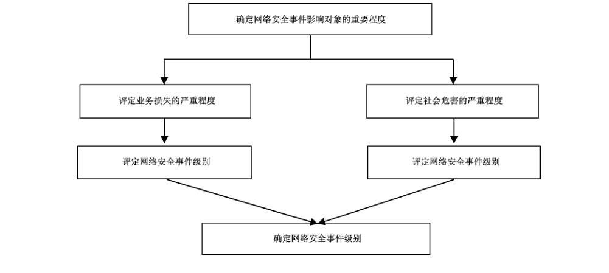

# GB/T 20986-2023 信息安全技术 网络安全事件分类分级指南

> 来源：[GB/T 20986-2023 国家标准详情](https://openstd.samr.gov.cn/bzgk/std/newGbInfo?hcno=CAE2104B8F1370E0D6E9BA4F43022157)；封面发布日期：2023-05-23；实施日期：2023-12-01。
> PDF SHA-256：1d5bc3236ca36cb4501eb27e12f6d5c64d58e73d1ba8f3756501edf6a81ba11c。
> 转写说明：按官方 PDF 全部 24 页的页面图像核对正文、图表和附录；省略封面、目录、索引、页眉、页脚和页码，合并跨页内容。正式引用请核对原 PDF。

## 前言

本文件按照 GB/T 1.1—2020《标准化工作导则 第1部分：标准化文件的结构和起草规则》的规定起草。

本文件代替 GB/Z 20986—2007《信息安全技术 信息安全事件分类分级指南》，与 GB/Z 20986—2007 相比，除结构调整和编辑性改动外，主要技术变化如下：

a） 由指导性技术文件GB/Z更改为推荐性国家标准 GB/T；

b）更改了“范围”的表述（见第1章，2007年版的第1章）；

c） 在“术语和定义”中，更改了“信息系统”的定义（见3.1,2007 年版的2.1），增加了“数据、网络安全、网络安全事件”的定义（见3.1~3.4）；

d） 更改了“缩略语”，删除了原缩略语内容（见2007年版的第3章），增加了新的缩略语“APT、BGP、DDOS、DNS、IP、WLAN”等（见第4章）；

e） 在“网络安全事件分类”中，更改了“分类方法”的表述，将网络安全事件的分类由7类增加至10类（见5.1,2007 年版的 4.1）：

1） 在“恶意程序事件”中增加了“恶意代码宿主站点事件、勒索软件事件、挖矿病毒事件”3个事件子类（见5.2.1,2007年版的4.2.1）；

2） 在“网络攻击事件”中增加了“后门植入事件、凭据攻击事件、网页篡改事件、暗链植入事件、域名劫持事件、域名转嫁事件、DNS污染事件、WLAN 劫持事件、流量劫持事件、BGP劫持攻击事件、广播欺诈事件、失陷主机事件、供应链攻击事件、APT 事件”14个事件子类（见5.2.2,2007年版的4.2.2）；

3） 将“信息破坏事件”名称更改为“数据安全事件”，事件子类更改“数据篡改事件、数据假冒事件、数据泄露事件、数据窃取事件、数据损失事件”，增加了“社会工程事件、数据拦截事件、位置检测事件、数据投毒事件、数据滥用事件、隐私侵犯事件”6个事件子类（见5.2.3,2007 年版的 4.2.3）；

4） 在“信息内容安全事件”中，事件子类由4个增加到8个，名称更改为“反动宣传事件、暴恐宣扬事件、色情传播事件、虚假信息传播事件、权益侵害事件、信息滥发事件、网络欺诈事件和其他信息内容安全事件”（见5.2.4,2007年版的4.2.4）；

5） 在“设备设施故障事件”中，事件子类由4个增加到5个，名称更改为“技术故障事件、配套设施故障事件、物理损害事件、辐射干扰事件、其他设备设施故障事件”（见5.2.5,2007年版的4.2.5）；

6） 增加了“违规操作事件”类，包括“权限滥用事件、权限伪造事件、行为抵赖事件、故意违规操作事件、误操作事件、人员可用性破坏事件、资源未授权使用事件、版权违反事件、其他违规操作事件”9个事件子类（见 5.2.6）；

7） 增加了“安全隐患事件”类，包括“网络漏洞事件、网络配置合规缺陷事件，其他安全隐患事件”3个事件子类（见 5.2.7）；

8） 增加了“异常行为事件”类，包括“访问异常事件、流量异常事件和其他异常行为事件”3个事件子类（见5.2.8）；

9） 将“灾害性事件”更改为“不可抗力事件”，包括“自然灾害事件、事故灾难事件、公共卫生事件、社会安全事件、其他不可抗力事件”5个事件子类（见5.2.9,2007年版的4.2.6）；

f） 在“网络安全事件分级”中，将“信息系统”更改为“事件影响对象”：

1） 更改了“分级方法”的表述（见6.1,2007年版的 5.1）；

2） 增加了3个重要等级“事件影响对象”的说明（见 6.1.2）；

3） 将“系统损失”更改为“业务损失”，其中的“系统关键数据”更改为“重要数据/敏感个人信息”（见 6.1.3,2007年版的 5.1.3）；

4） 将“社会影响”更改为“社会危害”（见 6.1.4，2007 年版的 5.1.4）；

5） 更改了“事件级别”的表述（见6.2.1~6.2.5,2007年版的 5.2）；

6） 增加了“事件分级流程”（见 6.3）；

g） 为便于信息通报、事件研判等应用，增加了“附录B”，给出了事件分类代码。

请注意本文件的某些内容可能涉及专利。本文件的发布机构不承担识别专利的责任。

本文件由全国信息安全标准化技术委员会（SAC/TC 260）提出并归口。

本文件起草单位：北京时代新威信息技术有限公司、中国科学院软件研究所、中国长江三峡集团有限公司、杭州安恒信息技术股份有限公司、北京天融信网络安全技术有限公司、启明星辰信息技术集团股份有限公司、陕西省网络与信息安全测评中心、北京东方通网信科技有限公司、北京神州绿盟科技有限公司、国网智能电网研究院有限公司、中国软件评测中心、中国信息安全测评中心、公安部第三研究所、国家计算机网络应急技术处理协调中心、南方电网数字电网研究院有限公司、OPPO广东移动通信有限公司。

本文件主要起草人：王连强、王新杰、郭启全、黄小苏、杨玉忠、阎若彤、俞政臣、任娟娟、夏雨、任彬、连一峰、张海霞、黄克振、李旸照、黎奇、梁伟、杨剑、刘书鹏、魏玉峰、崔婷婷、李文瑾、张道娟、李婧、尚可、曲洁、郭品、左晓栋、王健、王小璞、余国平、何余、王元戎、吕明、高琪、朱建兴。

本文件及其所代替文件的历次版本发布情况为：

- 2007 年首次发布为 GB/Z 20986—2007；
- 本次为第一次修订。

## 引言

网络安全事件的防范和处置是国家网络安全保障体系中的重要环节，也是重要的工作内容。网络安全事件的分类分级是快速有效处置网络安全事件的基础之一。

本文件编制的目的是：

a） 利于安全事件数据的收集和分析；

b） 利于识别安全事件的严重程度；

c） 促进安全事件信息的交换和共享；

d） 便于实现安全事件的自动化报告和响应；

e） 提高安全事件通报和应急处置的效率和效果。

在附录A中给出了安全事件分类和安全事件分级的关系。

## 1 范围

本文件描述了网络安全事件分类和分级的方法，界定了网络安全事件类别和级别，并明确了网络安全事件分类代码。

本文件适用于网络运营者以及相关部门开展网络安全事件研判、信息通报、监测预警和应急处置等活动。

## 2 规范性引用文件

下列文件中的内容通过文中的规范性引用而构成本文件必不可少的条款。其中，注日期的引用文件，仅该日期对应的版本适用于本文件；不注日期的引用文件，其最新版本（包括所有的修改单）适用于本文件。

- GB/T 22240—2020 信息安全技术 网络安全等级保护定级指南

- GB/T 25069—2022 信息安全技术 术语

## 3 术语和定义

GB/T 25069—2022界定的以及下列术语和定义适用于本文件。

### 3.1 信息系统 information system

应用、服务、信息技术资产或其他信息处理组件的组合。

> 注：信息系统通常由计算机或者其他信息终端及相关设备组成，并按照一定的应用目标和规则进行信息处理或过程控制。

［来源：GB/T 25069—2022,3.696，有修改］

### 3.2 数据 data

任何以电子或者其他方式对信息的记录。

### 3.3 网络安全 cybersecurity

通过采取必要措施，防范对网络的攻击、侵入、干扰、破坏和非法使用以及意外事故，使网络处于稳定可靠运行的状态，以及保障数据的完整性、保密性、可用性的能力。

［来源：GB/T 22239—2019,3.1］

### 3.4 网络安全事件 cybersecurity incident

由于人为原因、网络遭受攻击、网络存在漏洞隐患、软硬件缺陷或故障、不可抗力等因素，对网络和信息系统或者其中的数据和业务应用造成危害，对国家、社会、经济造成负面影响的事件。

［来源：GB/T 38645—2020,3.1，有修改］

## 4 缩略语

下列缩略语适用于本文件。

APT：高级持续性威胁（advanced persistent threat）

BGP：边界网关协议（border gateway protocol）

DDOS：分布式拒绝服务（distributed denial of service）

DNS：域名系统（domain name system）

IP：互联网协议（internet protocol）

WLAN：无线局域网（wireless local area network）

## 5 网络安全事件分类

### 5.1 分类方法

综合考虑网络安全事件的起因、威胁、攻击方式、损害后果等因素，对网络安全事件进行分类，分为恶意程序事件、网络攻击事件、数据安全事件、信息内容安全事件、设备设施故障事件、违规操作事件、安全隐患事件、异常行为事件、不可抗力事件和其他事件等10类，每类之下再分若干子类。附录B确定了网络安全事件分类代码。

### 5.2 事件类别

#### 5.2.1 恶意程序事件

恶意程序指带有恶意意图所编写的一段程序，该程序插入网络损害网络中的数据、应用程序或操作系统，或影响网络的正常运行。恶意程序事件指在网络蓄意制造或传播恶意程序而导致业务损失或造成社会危害的网络安全事件。

恶意程序事件包括计算机病毒事件、网络蠕虫事件、特洛伊木马事件、僵尸网络事件、恶意代码内嵌网页事件、恶意代码宿主站点事件、勒索软件事件、挖矿病毒事件、混合攻击程序事件和其他恶意程序事件等10个子类，具体如下：

a） 计算机病毒事件：制造、传播或利用恶意程序，影响计算机使用，破坏计算机功能，毁坏或窃取数据；

b） 网络蠕虫事件：利用网络缺陷，蓄意制造或通过网络自动复制并传播网络蠕虫；

c） 特洛伊木马事件：制造、传播或利用具有远程控制功能的恶意程序，实现非法窃取或截获数据；

d） 僵尸网络事件：利用僵尸工具程序形成僵尸网络；

e） 恶意代码内嵌网页事件：在访问被嵌入恶意代码而受到污损的网页时，该恶意代码在访问该网页的计算机系统中安装恶意软件；

f） 恶意代码宿主站点事件：诱使目标用户到存储恶意代码的宿主站点下载恶意代码；

g） 勒索软件事件：采取加密或屏蔽用户操作等方式劫持用户对系统或数据的访问权，并籍此向用户索取赎金；

h） 挖矿病毒事件：以获得数字加密货币为目的，控制他人的计算机并植入挖矿病毒程序完成大量运算；

i） 混合攻击程序事件：利用多种方法传播和利用多种恶意程序，例如，一个计算机病毒在侵入计算机系统后在系统中安装木马程序；

j） 其他恶意程序事件：不在以上子类之中的恶意程序事件。

#### 5.2.2 网络攻击事件

网络攻击事件指通过技术手段对网络实施攻击而导致业务损失或造成社会危害的网络安全事件。

网络攻击事件包括网络扫描探测事件、网络钓鱼事件、漏洞利用事件、后门利用事件、后门植入事件、凭据攻击事件、信号干扰事件、拒绝服务事件、网页篡改事件、暗链植入事件、域名劫持事件、域名转嫁事件、DNS污染事件、WLAN 劫持事件、流量劫持事件、BGP 劫持攻击事件、广播欺诈事件、失陷主机事件、供应链攻击事件、APT事件和其他网络攻击事件等21 个子类，具体如下：

a） 网络扫描探测事件：利用网络扫描软件获取有关网络配置、端口、服务和现有脆弱性等信息；

b） 网络钓鱼事件：利用欺诈性网络技术诱使用户泄露重要数据或个人信息；

c） 漏洞利用事件：通过挖掘并利用网络配置缺陷、通信协议缺陷或应用程序缺陷等漏洞对网络实施攻击；

d） 后门利用事件：恶意利用软件或硬件系统设计过程中未经严格验证所留下的接口、功能模块、程序等，非法获取网络管理权限；

e） 后门植入事件：非法在网络中创建能够持续获取其管理权限的后门；

f） 凭据攻击事件：破解口令，解析登录口令或凭据等；

g） 信号干扰事件：通过技术手段阻碍有线或无线信号在网络中正常传播；

h）拒绝服务事件：通过非正常使用网络资源（诸如CPU、内存、磁盘空间或网络带宽）影响或破坏网络可用性，例如：DDOS 等；

i） 网页篡改事件：通过恶意破坏或更改网页内容影响网站声誉或破坏网页及网站可用性；

j） 暗链植入事件：通过隐形篡改技术在网页内非法植入违法网站链接；

k）域名劫持事件：通过攻击或伪造 DNS的方式蓄意或恶意诱导用户访问非预期的指定IP地址（网站）；

l） 域名转嫁事件：把自己的域名指向一个不属于自己的 IP 地址，导致针对该域名的攻击都将被引向所指向的 IP 地址；

m）DNS污染事件：利用刻意制造或无意制造的 DNS数据包，把域名指向不正确的IP 地址；

n） WLAN劫持事件：通过口令破解、固件替换等方法非法获取无线局域网的控制权限；

o） 流量劫持事件：通过恶意诱导或非法强制用户访问特定网络资源造成用户流量损失；

p） BGP 劫持攻击事件：通过 BGP 恶意操纵网络路由路径；

q） 广播欺诈事件：通过广播欺骗的方式干扰网络数据包正常传输或窃取网络用户敏感信息；

r） 失陷主机事件：攻击者获得某主机的控制权后，能以该主机跳板继续攻击组织内网其他主机；

s） 供应链攻击事件：通过利用供应链管理中存在的脆弱性，感染合法应用来分发恶意程序；

t） APT事件：通过对特定对象展开持续有效的攻击活动，这种攻击活动具有极强的隐蔽性和针对性，通常会运用受感染的各种介质、供应链和社会工程学等多种手段实施先进的、持久的且有效的威胁和攻击；

u） 其他网络攻击事件：不在以上子类之中的网络攻击事件。

#### 5.2.3 数据安全事件

数据安全事件指通过技术或其他手段对数据实施篡改、假冒、泄露、窃取等导致业务损失或造成社会危害的网络安全事件。

数据安全事件包括数据篡改事件、数据假冒事件、数据泄露事件、社会工程事件、数据窃取事件、数据拦截事件、位置检测事件、数据投毒事件、数据滥用事件、隐私侵犯事件、数据损失事件和其他数据安全事件等12个子类，具体如下：

a） 数据篡改事件：未经授权接触或修改数据；

b） 数据假冒事件：非法或未经许可使用、伪造数据；

c） 数据泄露事件：无意或恶意通过技术手段使数据或敏感个人信息对外公开泄露；

d） 社会工程事件：通过非技术手段（如心理学、话术等）诱导他人泄露数据或执行行动；

e） 数据窃取事件：未经授权利用技术手段（例如窃听、间谍等）偷窃数据；

f） 数据拦截事件：在数据到达目标接收者之前非法捕获数据；

g） 位置检测事件：非法检测系统、个人的地理位置信息或敏感数据的存储位置；

h） 数据投毒事件：干预深度学习训练数据集，在训练数据中加入精心构造的异常数据，破坏原有训练数据的概率分布，导致模型在某些特定条件下产生分类或聚类错误；

i） 数据滥用事件：无意或恶意滥用数据；

j） 隐私侵犯事件：无意或恶意侵犯网络中存在的敏感个人信息；

k） 数据损失事件：因误操作、人为蓄意或软硬件缺陷等因素导致数据损失；

l） 其他数据安全事件：不在以上子类之中的数据安全事件。

#### 5.2.4 信息内容安全事件

信息内容安全事件指通过网络传播危害国家安全、社会稳定、公共安全和利益的有害信息导致业务损失或造成社会危害的网络安全事件。

信息内容安全事件包括反动宣传事件、暴恐宣扬事件、色情传播事件、虚假信息传播事件、权益侵害事件、信息滥发事件、网络欺诈事件和其他信息内容安全事件等8个子类，具体如下：

a） 反动宣传事件：利用网络传播煽动颠覆国家政权、推翻社会主义制度，煽动分裂国家、破坏国家统一等危害国家安全、荣誉和利益的非法信息；

b） 暴恐宣扬事件：利用网络宣扬恐怖主义、极端主义，煽动民族仇恨、民族歧视的信息，引起社会恐慌和动乱；

c） 色情传播事件：利用网络传播违背社会伦理道德的淫秽色情信息；

d） 虚假信息传播事件：利用网络编造并传播虚假信息来扰乱经济秩序和社会秩序，造成负面影响；

e） 权益侵害事件：利用网络传播的信息侵害了社会组织或公民的合法权益；

f） 信息滥发事件：利用网络传播未经接收者准许的信息，例如：垃圾邮件等；

g） 网络欺诈事件：恶意利用技术或非技术手段对特定或不特定目标通过网络进行欺诈以非法获取信息或钱财；

h） 其他信息内容安全事件：不在以上子类之中的信息内容安全事件。

#### 5.2.5 设备设施故障事件

设备设施故障事件指由于网络自身出现故障或设备设施受到破坏或干扰而导致业务损失或造成社会危害的网络安全事件。

设备设施故障事件包括技术故障事件、配套设施故障事件、物理损害事件、辐射干扰事件和其他设备设施故障事件等5个子类，具体如下：

a） 技术故障事件：网络中软硬件的自然缺陷、设计缺陷或运行环境发生变化而引起系统故障，例如：硬件故障、软件故障、过载等；

b） 配套设施故障事件：支撑网络运行的配套设施发生故障，例如：电力供应故障、照明系统故障、温湿度控制系统故障等；

c） 物理损害事件：故意或意外的物理行动造成网络环境或网络设备损坏，例如：失火、漏水、静电、设备毁坏或丢失等；

d） 辐射干扰事件：因辐射产生干扰影响网络正常运行，例如：电磁辐射、电磁脉冲、电子干扰、电压波动、热辐射等；

e） 其他设备设施故障事件：不在以上子类之中的设备设施故障事件。

#### 5.2.6 违规操作事件

违规操作事件指人为故意或意外地损害网络功能而导致业务损失或造成社会危害的网络安全事件。

违规操作事件包括权限滥用事件、权限伪造事件、行为抵赖事件、故意违规操作事件、误操作事件、人员可用性破坏事件、资源未授权使用事件、版权违反事件和其他违规操作事件等9个子类，具体如下：

a） 权限滥用事件：由于网络服务端功能开放过多或权限限制不严格，导致攻击者通过直接或间接调用权限的方式进行攻击；

b） 权限伪造事件：为了欺骗制造虚假权限；

c） 行为抵赖事件：用户否认其有害行为；

d） 故意违规操作事件：故意执行非法操作；

e） 误操作事件：无意地执行错误操作；

f） 人员可用性破坏事件：人力资源受损，导致人员缺失或缺席；

g） 资源未授权使用事件：未经授权访问资源；

h）版权违反事件：违反版权要求安装使用商业软件或其他受版权保护的材料；

i） 其他违规操作事件：不在以上子类之中的违规操作事件。

#### 5.2.7 安全隐患事件

安全隐患事件指网络中出现能被攻击者利用的漏洞或隐患，一旦被利用可能对网络造成破坏，进而导致业务损失或造成社会危害的网络安全事件。提前发现这些漏洞或隐患能防范由此引起的其他网络安全事件。

安全隐患事件包括网络漏洞事件、网络配置合规缺陷事件、其他安全隐患事件等3个子类，具体如下：

a） 网络漏洞事件：因操作系统、应用程序或安全协议开发及设计过程中，对安全性考虑不充分而出现安全隐患；

b） 网络配置合规缺陷事件：由于软硬件安全配置不合理或缺省配置，不符合网络安全要求而产生安全缺陷或隐患；

c） 其他安全隐患事件：不在以上子类之中的安全隐患事件。

#### 5.2.8 异常行为事件

异常行为事件指网络本身稳定性不足或违规访问网络造成访问、流量等异常行为，进而导致业务损失或造成社会危害的网络安全事件。

异常行为事件包括访问异常事件、流量异常事件和其他异常行为事件等3个子类，具体如下：

a） 访问异常事件：因网络软硬件运行环境发生变化导致不能提供服务；

b） 流量异常事件：网络流量行为模式偏离正常基线；

c） 其他异常行为事件：不在以上子类之中的异常行为事件。

#### 5.2.9 不可抗力事件

不可抗力事件指因突发事件损害网络的可用性而导致业务损失或造成社会危害的网络安全事件。

不可抗力事件包括自然灾害事件、事故灾难事件、公共卫生事件、社会安全事件和其他不可抗力事件等5个子类，具体如下：

a） 自然灾害事件：大自然的极端现象导致信息和信息系统受损，例如：地震、火山、洪水、暴风、闪电、海啸、崩塌等；

b） 事故灾难事件：具有灾难性后果的事故导致信息和信息系统受损，例如：公共设施和设备事故、环境污染事故等；

c） 公共卫生事件：传染病疫情等导致信息和信息系统受损；

d） 社会安全事件：危害国家和社会的突发性群体性事件导致信息和信息系统受损，例如：恐怖袭击事件等；

e） 其他不可抗力事件：不在以上子类之中的不可抗力事件。

#### 5.2.10 其他事件

其他事件指未归为上述分类的网络安全事件。

## 6 网络安全事件分级

### 6.1 分级方法

#### 6.1.1 概述

网络安全事件按照事件影响对象的重要程度、业务损失的严重程度和社会危害的严重程度三个要素进行分级。事件影响对象主要包括信息系统、通信网络设施和数据等。

#### 6.1.2 事件影响对象的重要程度

按 GB/T 22240—2020描述的网络安全等级保护定级方法，事件影响对象的重要程度根据国家安全、社会秩序、经济建设和公众利益以及业务对事件影响对象的依赖程度进行评估，分为3个等级：特别重要、重要和一般，具体如下：

a） 特别重要：受到破坏后，对国家安全造成危害，或对社会秩序、经济建设和公共利益造成严重危害或特别严重危害；

b） 重要：受到破坏后，对社会秩序、经济建设和公共利益造成危害，或对相关公民、法人和其他组织的合法权益造成严重或特别严重损害，但不危害国家安全；

c） 一般：指受到破坏后，对相关公民、法人和其他组织的合法权益造成一般损害，但不危害国家安全、社会秩序、经济建设和公共利益。

#### 6.1.3 业务损失的严重程度

业务损失的严重程度由网络的硬件/软件、功能和数据的损坏导致业务中断影响的严重程度进行评估，其大小可取决于恢复业务正常运行和消除网络安全事件负面影响所需付出的代价，分为4个级别：特别严重、严重、较大和较小，具体如下：

a） 特别严重：造成网络大面积瘫痪，使其丧失业务处理能力，或重要数据/敏感个人信息遭到严重破坏，恢复业务正常运行和消除安全事件负面影响所需付出的代价十分巨大，对于事发组织是不可承受的；

b） 严重：造成网络长时间中断或局部业务瘫痪，使其业务处理能力受到极大影响，或重要数据/敏感个人信息遭到破坏，恢复业务正常运行和消除安全事件负面影响所需付出的代价巨大，但对于事发组织是可承受的；

c） 较大：造成网络中断，导致业务处理能力受到较大影响，或数据/敏感个人信息受到损害，恢复业务正常运行和消除安全事件负面影响所需付出的代价较大，但对于事发组织是完全可以承受的；

d） 较小：造成网络短暂中断，导致业务处理能力受到一定影响，或数据/敏感个人信息受到影响，恢复业务正常运行和消除安全事件负面影响所需付出的代价较小。

#### 6.1.4 社会危害的严重程度

社会危害的严重程度根据对国家安全、社会秩序、经济建设和公众利益等方面的危害程度进行评估，分4个级别：特别重大、重大、较大和一般，具体如下：

a） 特别重大：波及一个或多个省市的大部分地区，危害到国家安全，引起社会动荡，对经济建设有极其恶劣的负面影响，或者特别严重损害公众利益；

b） 重大：波及一个或多个地市的大部分地区，影响到国家安全，引起社会恐慌，对经济建设有恶劣的负面影响，或者严重损害公众利益；

c） 较大：波及一个或多个地市的部分地区，不影响国家安全，但是扰乱社会秩序，对经济建设或者公众利益造成一般损害，对相关公民、法人或其他组织的利益会造成严重损害或特别严重损害；

d）一般：波及一个地市的部分地区，不影响国家安全、社会秩序、经济建设和公众利益，但是对相关公民、法人或其他组织的利益会造成一般损害。

### 6.2 事件级别

#### 6.2.1 概述

按照事件影响对象的重要程度、业务损失的严重程度和社会危害的严重程度三个要素，网络安全事件分为4个级别：特别重大事件、重大事件、较大事件和一般事件，由高到低分别为一级、二级、三级和四级。

#### 6.2.2 特别重大事件（一级）

特别重大事件发生在特别重要的事件影响对象上，并且：

a） 导致特别严重的业务损失，或

b） 造成特别重大的社会危害。

#### 6.2.3 重大事件（二级）

重大事件发生在特别重要或重要的事件影响对象上，并且：

a） 导致特别重要的事件影响对象遭受严重的业务损失或导致重要的事件影响对象遭受特别严重的业务损失，或

b） 造成重大的社会危害。

#### 6.2.4 较大事件（三级）

较大事件发生在特别重要或重要或一般的事件影响对象上，并且：

a） 导致特别重要的事件影响对象遭受较大或较小的业务损失，或重要的事件影响对象遭受严重或较大的业务损失，或导致一般的事件影响对象遭受较大（含）以上级别的业务损失，或

b） 造成较大的社会危害。

#### 6.2.5 一般事件（四级）

一般事件发生在重要或一般的事件影响对象上，并且：

a） 导致较小的业务损失，或

b） 造成一般的社会危害。

### 6.3 事件分级流程

对网络安全事件的分级根据三个分级要素进行评定，流程如下：

a） 确定网络安全事件影响对象的重要程度；

b） 分别评定业务损失的严重程度和社会危害的严重程度；

c） 根据表1、表2分别评定对应的网络安全事件级别；

d） 两者中取高者确定为网络安全事件级别。

**表1 网络安全事件级别与业务损失的严重程度的关系**

| 事件影响对象的重要程度 | 特别严重 | 严重 | 较大 | 较小 |
| --- | --- | --- | --- | --- |
| 特别重要 | 一级 | 二级 | 三级 | 三级 |
| 重要 | 二级 | 三级 | 三级 | 四级 |
| 一般 | 三级 | 三级 | 三级 | 四级 |

**表2 网络安全事件级别与社会危害的严重程度的关系**

| 事件影响对象的重要程度 | 特别重大 | 重大 | 较大 | 一般 |
| --- | --- | --- | --- | --- |
| 特别重要 | 一级 | 二级 | 三级 | — |
| 重要 | — | 二级 | 三级 | 四级 |
| 一般 | — | — | 三级 | 四级 |

注：“—”表示忽略这种情况，或依据实际情况综合判断网络安全事件级别。

网络安全事件分级流程示意图如图1所示。

图 1 的流程：先确定事件影响对象的重要程度；并行评定业务损失和社会危害的严重程度，分别得到事件级别；最后取两者中较高的级别。

## 附录 A（资料性） 网络安全事件类别和级别的关联关系

一个网络安全事件类别可能具有不同的网络安全事件级别（以下简称“事件级别”），这不仅取决于业务，还取决于网络安全事件的性质，例如：故意性、目标性、时机、量级。

表 A.1 给出了具有不同严重级别的网络安全事件类的示例。

**表 A.1 网络安全事件类别和级别的关联关系示例**

| 事件类别 | 一般事件（四级） | 较大事件（三级） | 重大事件（二级） | 特别重大事件（一级） |
| --- | --- | --- | --- | --- |
| 恶意程序事件 | 一次已知的恶意程序事件，被防病毒保护发现并拦截，没有导致业务损失或导致较小的业务损失 | 重要信息系统受单次的恶意程序感染，或一般信息系统受恶意程序多次感染，导致较大的业务损失 | 特别重要信息系统遭受单次恶意程序，或重要信息系统受恶意程序多次感染或严重感染，对系统用户、应用程序造成损害，导致严重的业务损失 | 特别重要信息系统遭受恶意程序多次感染或严重感染，导致特别严重的业务损失 |
| 网络攻击事件 | 一次尝试失败的网络攻击事件，没有导致业务损失或导致较小的业务损失 | 重要信息系统受到骚扰或少量攻击，或一般信息系统遭受多次网络攻击，导致较大业务损失 | 特别重要的信息系统受到骚扰或少量攻击，或重要信息系统受到多次网络攻击，导致严重的业务损失 | 针对特别重要的信息系统进行持续、大量、有组织的网络攻击，对系统功能造成损害，导致特别严重的业务损失 |
| 数据安全事件 | 一般信息系统少量敏感信息或业务数据泄露，及时发现并控制，没有导致业务损失或导致较小的业务损失 | 重要信息系统少量敏感信息或业务数据泄露，或一般信息系统大量敏感信息或业务数据泄露，导致较大的业务损失，造成较大的社会危害 | 特别重要信息系统少量敏感信息或业务数据泄露，或重要信息系统大量敏感信息或重要业务数据泄露，导致严重的业务损失，造成重大的社会危害 | 特别重要的信息系统大量敏感信息或业务数据泄露，导致特别严重的业务损失，造成特别重大的社会危害 |
| 信息内容安全事件 | 信息系统出现轻微有害信息，及时发现并删除，没有造成不良影响或影响较小 | 重要信息系统出现轻微有害信息，或一般信息系统出现严重有害信息，经有限传播造成较大的社会危害 | 重要信息系统出现严重有害信息，或特别重要信息系统出现轻微有害信息，传播广泛，造成重大的社会危害 | 特别重要的信息系统出现严重有害信息，传播广泛，造成特别重大的社会危害 |
| 设备设施故障事件 | 一般信息系统非主要设备设施故障，及时发现并解决，没有导致业务损失或导致较小的业务损失 | 重要信息系统非主要设备设施故障，或一般信息系统主要设备设施故障，故障持续一段时间，导致系统部分功能停止运行，导致较大的业务损失，或造成较大的社会危害 | 重要信息系统主要设备设施故障，导致系统大部分或全部功能停止运行，或特别重要信息系统非主要设备设施故障，使系统部分功能停止运行，持续时间较长，导致严重的业务损失，或造成重大的社会危害 | 特别重要信息系统主要设备设施故障，使系统大部分或全部功能停止运行，持续时间较长，导致特别严重的业务损失，或造成特别重大的社会危害 |
| 违规操作事件 | 单次对信息系统的非授权访问行为，没有导致业务损失或导致较小的业务损失 | 单次或多次对信息系统的非授权访问行为，导致系统功能损害或数据泄露，导致较大的业务损失 | 单次或多次对重要信息系统非授权访问行为，导致系统功能损害或数据泄露，导致严重的业务损失 | 单次或多次对特别重要信息系统非授权访问行为，导致系统功能损害或数据泄露，导致特别严重的业务损失 |
| 安全隐患事件 | 一般信息系统存在已知的漏洞隐患，漏洞风险级别较低，及时发现并修复，没有造成业务损失或造成较小的业务损失 | 重要信息系统存在漏洞隐患，漏洞风险级别较低，或一般信息系统存在漏洞隐患，漏洞风险级别较高，处理不当造成较大的业务损失 | 特别重要信息系统或重要信息系统存在漏洞隐患，漏洞风险级别较高，处理不当导致严重的业务损失 | — |
| 异常行为事件 | 一般信息系统发现网络异常行为，及时发现并解决，没有导致业务损失或导致较小的业务损失 | 重要信息系统发现网络异常行为，对系统功能造成损害，导致较大的业务损失 | 特别重要信息系统发现网络异常行为，对系统功能造成损害，导致严重的业务损失 | — |
| 不可抗力事件 | 发生不可抗力事件，及时启动了备份系统或灾备中心，没有导致业务损失或导致较小的业务损失 | 发生不可抗力事件，对重要信息系统或一般信息系统导致较大的业务损失 | 发生不可抗力事件，对特别重要信息系统或重要信息系统导致严重的业务损失 | 发生不可抗力事件，对特别重要信息系统导致特别严重的业务损失 |

## 附录 B（规范性） 网络安全事件分类代码

### B.1 编码方法

网络安全事件分类代码（以下简称“事件代码”）是对网络安全事件类别（以下简称“事件类别”）的编码，采用层次编码方法，代码由 5 位等长码构成，其中：

a） 第一层表示网络安全事件类（如：网络攻击事件），用两位阿拉伯数字（01~99）表示；

b）第二层表示网络安全事件类下的子类（如：网络攻击事件中的网络钓鱼），用三位阿拉伯数字（001~999）表示。

编码结构如图 B.1所示。

图 B.1 中前两位代码表示网络安全事件类，后三位代码表示网络安全事件子类。

### B.2 分类代码表

网络安全事件分类代码见表 B.1。

**表B.1 网络安全事件分类代码表**

| 事件代码 | 事件类别 | 英文名称 |
| --- | --- | --- |
| 01000 | 恶意程序事件 | malware incident |
| 01001 | 计算机病毒事件 | computer virus incident |
| 01002 | 网络蠕虫事件 | network worm incident |
| 01003 | 特洛伊木马事件 | trojan horse incident |
| 01004 | 僵尸网络事件 | botnet incident |
| 01005 | 恶意代码内嵌网页事件 | malicious code embedded web page incident |
| 01006 | 恶意代码宿主站点事件 | malicious code hosting site incident |
| 01007 | 勒索软件事件 | ransomware incident |
| 01008 | 挖矿病毒事件 | miner virus incident |
| 01009 | 混合攻击程序事件 | blended attack incident |
| 01999 | 其他恶意程序事件 | other malware incidents |
| 02000 | 网络攻击事件 | network attack incident |
| 02001 | 网络扫描探测事件 | network scan detection incident |
| 02002 | 网络钓鱼事件 | network phishing incident |
| 02003 | 漏洞利用事件 | exploitation of vulnerability incident |
| 02004 | 后门利用事件 | exploitation of backdoor incident |
| 02005 | 后门植入事件 | implantation of backdoor incident |
| 02006 | 凭据攻击事件 | credential attack incident |
| 02007 | 信号干扰事件 | signal interference incident |
| 02008 | 拒绝服务事件 | denial of service incident |
| 02009 | 网页篡改事件 | webpage tampering incident |
| 02010 | 暗链植入事件 | implantation of dark chain incident |
| 02011 | 域名劫持事件 | DNS hijacking incident |
| 02012 | 域名转嫁事件 | DNS redirection incident |
| 02013 | DNS 污染事件 | DNS cache poisoning incident |
| 02014 | WLAN 劫持事件 | WLAN hijacking incident |
| 02015 | 流量劫持事件 | traffic hijacking incident |
| 02016 | BGP 劫持攻击事件 | BGP hijacking attack incident |
| 02017 | 广播欺诈事件 | broadcast deception incident |
| 02018 | 失陷主机事件 | lost host incident |
| 02019 | 供应链攻击事件 | supply chain attack incident |
| 02020 | APT事件 | advanced persistent threat incident |
| 02999 | 其他网络攻击事件 | other network attack incidents |
| 03000 | 数据安全事件 | data security incident |
| 03001 | 数据篡改事件 | data tampering incident |
| 03002 | 数据假冒事件 | data counterfeiting incident |
| 03003 | 数据泄露事件 | data breach incident |
| 03004 | 社会工程事件 | social engineering incident |
| 03005 | 数据窃取事件 | data theft incident |
| 03006 | 数据拦截事件 | data interception incident |
| 03007 | 位置检测事件 | position detection incident |
| 03008 | 数据投毒事件 | data poisoning incident |
| 03009 | 数据滥用事件 | data abuse incident |
| 03010 | 隐私侵犯事件 | privacy violation incident |
| 03011 | 数据损失事件 | data loss incident |
| 03999 | 其他数据安全事件 | other network data security incidents |
| 04000 | 信息内容安全事件 | information content safety incident |
| 04001 | 反动宣传事件 | reactionary propaganda incident |
| 04002 | 暴恐宣扬事件 | violent terrorism propaganda incident |
| 04003 | 色情传播事件 | pornography dissemination incident |
| 04004 | 虚假信息传播事件 | false information dissemination incident |
| 04005 | 权益侵害事件 | infringement of rights incident |
| 04006 | 信息滥发事件 | information spamming incident |
| 04007 | 网络欺诈事件 | network fraud incident |
| 04999 | 其他信息内容安全事件 | other information content safety incidents |
| 05000 | 设备设施故障事件 | equipment and facilities failure incident |
| 05001 | 技术故障事件 | technical failure incident |
| 05002 | 配套设施故障事件 | supporting facilities failure incident |
| 05003 | 物理损害事件 | physical damage incident |
| 05004 | 辐射干扰事件 | radiation disturbance incident |
| 05999 | 其他设备设施故障事件 | other equipment and facilities failure incidents |
| 06000 | 违规操作事件 | violating operation incident |
| 06001 | 权限滥用事件 | abuse of rights incident |
| 06002 | 权限伪造事件 | forging of rights incident |
| 06003 | 行为抵赖事件 | denial of behavior incident |
| 06004 | 故意违规操作事件 | deliberate violating operation incident |
| 06005 | 误操作事件 | misoperation incident |
| 06006 | 人员可用性破坏事件 | breach of personnel availability incident |
| 06007 | 资源未授权使用事件 | unauthorized use of resources incident |
| 06008 | 版权违反事件 | breach of copyright incident |
| 06999 | 其他违规操作事件 | other violating operation incidents |
| 07000 | 安全隐患事件 | security hazard incident |
| 07001 | 网络漏洞事件 | cybersecurity vulnerability incident |
| 07002 | 网络配置缺陷事件 | cyber configuration flaw incident |
| 07999 | 其他安全隐患事件 | other security hazard incidents |
| 08000 | 异常行为事件 | abnormal behavior incident |
| 08001 | 访问异常事件 | access exception incident |
| 08002 | 流量异常事件 | traffic anomaly incident |
| 08999 | 其他异常行为事件 | other abnormal behavior incidents |
| 09000 | 不可抗力事件 | force majeure incident |
| 09001 | 自然灾害事件 | natural disaster incident |
| 09002 | 事故灾难事件 | accident disaster incident |
| 09003 | 公共卫生事件 | public health incident |
| 09004 | 社会安全事件 | social security incident |
| 09999 | 其他不可抗力事件 | other force majeure incidents |
| 99999 | 其他事件 | other incidents |

## 参考文献

- ［1］ GB/T 20985.2—2020 信息技术 安全技术 信息安全事件管理 第2部分：事件响应规划和准备指南

- ［2］ GB/T 22239—2019 信息安全技术 网络安全等级保护基本要求

- ［3］ GB/T 29246—2017 信息技术 安全技术 信息安全管理体系 概述和词汇

- ［4］ GB/T 31722—2015 信息技术 安全技术 信息安全风险管理

- ［5］ GB/T 35561—2017 突发事件分类与编码

- ［6］ GB/T 38645—2020 信息安全技术 网络安全事件应急演练指南
