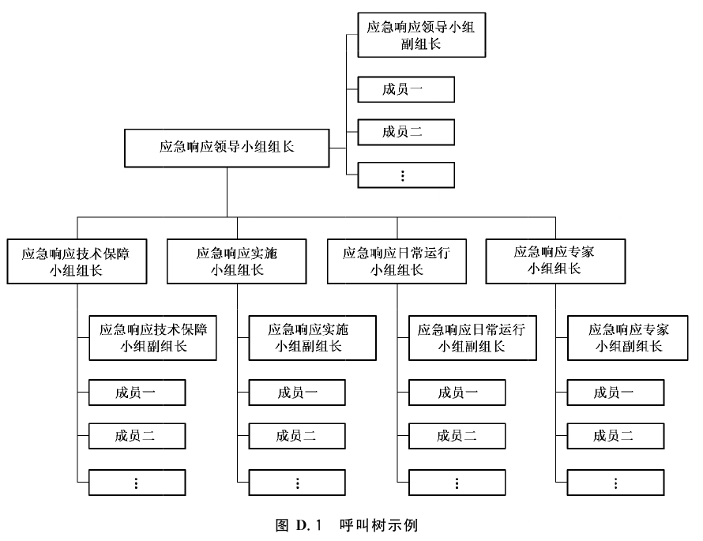

# GB/T 24363-2009 信息安全技术 信息安全应急响应计划规范

> 来源：[GB/T 24363-2009 国家标准详情](https://openstd.samr.gov.cn/bzgk/std/newGbInfo?hcno=FA322E1BF8144691C3CAC59C11E19928)。
> 来源图像：国家标准全文公开系统官方在线预览；32 张预览图 SHA-256：8547fa54bee05e68a616a7268cb50d2bde0e1e7cae0d86bd53a83dba541f49d9。发布日期：2009-09-30；实施日期：2009-12-01。
> 转写说明：对照全部原始预览页图识别和校正文字、列表、表单与图示；省略封面、目录、页眉、页脚和空白页，连续内容不保留分页。正式引用请核对官方原图。

## 前言

本标准的附录A、附录B、附录C、附录D为资料性附录。

本标准由全国信息安全标准化技术委员会提出并归口。

本标准起草单位：中国科学院研究生院国家计算机网络入侵防范中心、中国电子技术标准化研究所。

本标准主要起草人：张玉清、付安民、肖晖、游双燕、刘奇旭、宋杨、陈深龙、许玉娜、上官晓丽。

## 引言

本标准根据《中华人民共和国计算机信息系统安全保护条例》，参照 GB/Z 20985—2007《信息技术 安全技术 信息安全事件管理指南》、GB/T 20988—2007《信息安全技术 信息系统灾难恢复规范》、GB/Z 20986—2007《信息安全技术 信息安全事件分类分级指南》、GB/T 20984—2007《信息安全技术 信息安全风险评估规范》、GB/T 22240《信息安全技术 信息系统安全等级保护定级指南》、GB/T 22239《信息安全技术 信息系统安全等级保护基本要求》以及 NIST SP 800-34《信息技术系统应急规划指南》和 NIST SP 800-61《计算机安全事件处理指南》等标准的有关部分，结合《国家通信保障应急预案》和《上海市网络与信息安全事件专项应急预案》以及相关行业技术发展和实践经验制定而成。

信息系统容易受到各种已知和未知的威胁而导致有害程序事件、网络攻击事件、信息破坏事件、信息内容安全事件、设备设施故障和灾害性事件等信息安全事件的发生。虽然很多信息安全事件可以通过技术的、管理的、操作的方法予以消减，但没有任何一种信息安全策略或防护措施，能够对信息系统提供绝对的保护。即使采取了防护措施，仍可能存在残留的弱点，使得信息安全防护可能被攻破，从而导致业务中断、系统宕机、网络瘫痪等突发/重大信息安全事件发生，并对组织和业务的运行产生直接或间接的负面影响。因此，为了减少信息安全事件对组织和业务的影响，应制定有效的信息安全应急响应计划，并形成预案。

信息安全应急响应计划的制定是一个周而复始、持续改进的过程，包含以下几个阶段：

a） 应急响应计划的编制准备；

b） 编制应急响应计划文档；

c） 应急响应计划的测试、培训、演练和维护。

## 1 范围

本标准规定了编制信息安全应急响应计划的前期准备，确立了信息安全应急响应计划文档的基本要素、内容要求和格式规范。

本标准适用于包括整个组织、组织中的部门和组织的信息系统（包括网络系统）的各层面上的信息安全应急响应计划。

本标准为负责制定和维护信息安全应急响应计划的人员提供指导。

## 2 规范性引用文件

下列文件中的条款通过本标准的引用而成为本标准的条款。凡是注日期的引用文件，其随后所有的修改单（不包括勘误的内容）或修订版均不适用于本标准，然而，鼓励根据本标准达成协议的各方研究是否可使用这些文件的最新版本。凡是不注日期的引用文件，其最新版本适用于本标准。

- GB/T 20984—2007 信息安全技术 信息安全风险评估规范

- GB/Z 20985—2007 信息技术 安全技术 信息安全事件管理指南

- GB/Z 20986—2007 信息安全技术 信息安全事件分类分级指南

- GB/T 20988—2007 信息安全技术 信息系统灾难恢复规范

- GB/T 22239—2008 信息安全技术 信息系统安全等级保护基本要求

- GB/T 22240—2008 信息安全技术 信息系统安全等级保护定级指南

## 3 术语和定义

下列术语和定义适用于本标准。

### 3.1 信息系统 information system

由计算机及其相关的和配套的设备、设施（含网络）构成的，按照一定的应用目标和规则对信息进行采集、加工、存储、传输、检索等处理的人机系统。

> ［GB/Z 20986—2007］

### 3.2 信息安全事件 information security incident

由于自然或者人为以及软硬件本身缺陷或故障的原因，对信息系统造成危害，或在信息系统内发生对社会造成负面影响的事件。

> ［GB/Z 20986—2007］

### 3.3 业务影响分析 business impact analysis

对业务功能及其相关信息系统资源进行分析，评估特定信息安全事件对各种业务功能的影响的过程。

### 3.4 应急响应 emergency response

组织为了应对突发/重大信息安全事件的发生所做的准备，以及在事件发生后所采取的措施。

### 3.5 应急响应计划 emergency response plan

组织为了应对突发/重大信息安全事件而编制的，对包括信息系统运行在内的业务运行进行维持或恢复的策略和规程。

### 3.6 灾难恢复 disaster recovery

为了将信息系统从灾难造成的故障或瘫痪状态恢复到可正常运行状态、并将其支持的业务功能从灾难造成的不正常状态恢复到可接受状态而设计的活动和流程。

> ［GB/T 20988—2007］

### 3.7 风险评估 risk assessment

依据有关信息安全技术与管理标准，对信息系统及由其处理、传输和存储的信息的保密性、完整性和可用性等安全属性进行评价的过程。

> ［GB/T 20984—2007］

### 3.8 恢复时间目标 recovery time objective

信息安全事件发生后，信息系统或业务功能从停顿到恢复的时间要求。

> ［GB/T 20988—2007］

### 3.9 恢复点目标 recovery point objective

信息安全事件发生后，系统和数据应恢复到的时间点的要求。

> ［GB/T 20988—2007］

## 4 缩略语

- BIA 业务影响分析（Business Impact Analysis）
- POC 联系点（Point of Contact）
- RTO 恢复时间目标（Recovery Time Objective）
- RPO 恢复点目标（Recovery Point Objective）
- SLA 服务水平协议（Service Level Agreement）

## 5 应急响应计划的编制准备

### 5.1 风险评估

标识信息系统的资产价值，识别信息系统面临的自然的和人为的威胁，识别信息系统的脆弱性，分析各种威胁发生的可能性。风险评估具体内容见 GB/T 20984—2007的第5章风险评估实施和第6章信息系统生命周期各阶段的风险评估。

### 5.2 业务影响分析

#### 5.2.1 概述

业务影响分析（BIA）是在风险评估的基础上，分析各种信息安全事件发生时对业务功能可能产生的影响，进而确定应急响应的恢复目标。

#### 5.2.2 分析业务功能和相关资源配置

对单位或者部门的各项业务功能及各项业务功能之间的相关性进行分析，确定支持各种业务功能的相应信息系统资源及其他资源，明确相关信息的保密性、完整性和可用性要求。

#### 5.2.3 确定信息系统关键资源

对信息系统进行评估，以确定系统所执行的关键功能，并确定执行这些功能所需的特定系统资源。

#### 5.2.4 确定信息安全事件影响

应采用如下的定量和/或定性的方法，对业务中断、系统宕机、网络瘫痪等信息安全事件造成的影响进行评估：

a） 定量分析——以量化方法，评估业务中断、系统宕机、网络瘫痪等可能给组织带来的直接经济损失和间接经济损失；

b） 定性分析——运用归纳与演绎、分析与综合以及抽象与概括等方法，评估业务中断、系统宕机、网络瘫痪等可能给组织带来的非经济损失，包括组织的声誉、顾客的忠诚度、员工的信心、社会和政治影响等。

#### 5.2.5 确定应急响应的恢复目标

根据业务影响分析的结果，同时结合 GB/T 22239 和 GB/T 22240，确定应急响应的恢复目标，包括：

a） 关键业务功能及恢复的优先顺序；

b） 恢复时间范围，即恢复时间目标（RTO）和恢复点目标（RPO）的范围。

### 5.3 制定应急响应策略

#### 5.3.1 概述

应急响应策略提供了在业务中断、系统宕机、网络瘫痪等信息安全事件发生后，快速有效地恢复信息系统运行的方法。这些策略应涉及到在业务影响分析（BIA）中确定的应急响应的恢复目标。

#### 5.3.2 系统恢复能力等级划分

系统恢复能力可以划分为基本支持、备用场地支持、电子传输和部分设备支持、电子传输及完整设备支持、实时数据传输及完整设备支持、数据零丢失及远程集群支持等6个等级，具体划分遵照GB/T 20988—2007的附录A灾难恢复能力等级划分。

#### 5.3.3 系统恢复资源的要求

系统恢复资源的要求遵照 GB/T 20988—2007的6.3灾难恢复资源的要求。

#### 5.3.4 费用考虑

信息系统的使用或管理组织（以下简称“组织”）应确保有足够的人员和资金执行所选择的策略。各种类型的备用站点、设备更换和存储方式的费用应与预算限制相平衡。

应保证预算充足，应包括软件、硬件、差旅及运送、测试、计划培训项目、意识培训项目、劳务、其他合同服务以及任何其他适用资源的费用。

组织应进行成本效益分析，以确定最佳应急响应策略。

## 6 编制应急响应计划文档

### 6.1 概述

编制信息安全应急响应计划文档是应急响应规划过程中的关键一步。应急响应计划应描述支持应急操作的技术能力，并适应机构需求。应急响应计划需要在详细程度和灵活程度之间取得平衡，通常是计划越详细，其方法就越缺乏弹性和通用性。本标准说明了编制应急响应计划的要点。计划编制者应根据实际情况对其内容进行适当地调整、充实和本地化，以更好地满足组织特定的系统、操作和机构需求。同时可以参考GB/Z 20985—2007的第8章使用。

应急响应计划应能为信息安全事件中不熟悉计划的人员或要求进行恢复操作的系统提供快速明确的指导。计划应明确、简洁、易于在紧急情况下执行，并尽量使用检查列表和详细规程。

应急响应计划文档包括总则、角色及职责、预防和预警机制、应急响应流程、应急响应保障措施和附件6个部分。

### 6.2 总则

总则部分提供了重要的背景或相关信息，使应急响应计划更容易理解、实施和维护。通常这部分包括编制目的、编制依据、适用范围、工作原则等。

a） 编制目的：介绍制定信息安全应急响应计划的原因和目标；

b） 编制依据：说明编制信息安全应急响应计划的依据；

c） 适用范围：说明计划的作用范围，解决哪些问题，不解决哪些问题；

d） 工作原则：确定应急响应计划的组织和实施原则。

### 6.3 角色及职责

#### 6.3.1 角色的划分

组织应结合本单位日常机构建立信息安全应急响应的工作机构，并明确其职责。其中一些人可负责两种或多种职责，一些职位可由多人担任（应急响应计划文档中应明确他们的替代顺序）。

应急响应的工作机构由管理、业务、技术和行政后勤等人员组成，一般来说，按角色可划分为5个功能小组：应急响应领导小组、应急响应技术保障小组、应急响应专家小组、应急响应实施小组和应急响应日常运行小组等。组织应该根据其所具备的技能和知识将人员分配到这些小组中，理想的情况是，分配到相关小组中的人员在正常条件下负责的是相同或类似的工作。

实际中，可以不必成立专门机构对应各功能小组，组织可以根据自身情况由其具体的某个或某几个部门或部门中的某几个人担当其中的一个或几个角色。

组织可聘请具有相应资质的外部专家协助应急响应工作，也可委托具有相应资质的外部机构承担实施小组以及日常运行小组的部分或全部工作。在聘请外部专家协助应急响应工作或者委托外部机构承担部分或者全部应急响应工作时，需要和其签订相关协议（例如信息保密协议、服务水平协议、服务持续协议等）。

#### 6.3.2 功能小组的职责

##### 6.3.2.1 应急响应领导小组

应急响应领导小组是信息安全应急响应工作的组织领导机构，组长应由组织最高管理层成员担任。

领导小组的职责是领导和决策信息安全应急响应的重大事宜，主要如下：

a） 对应急响应工作的承诺和支持，包括发布正式文件、提供必要资源（人、财、物）等；

b） 审核并批准应急响应策略；

c） 审核并批准应急响应计划；

d） 批准和监督应急响应计划的执行；

e） 启动定期评审、修订应急响应计划；

f） 负责组织内部的、外部的协调工作。

##### 6.3.2.2 应急响应技术保障小组

应急响应技术保障小组的主要职责包括：

a） 制定信息安全事件技术应对表；

b） 制定具体角色和职责分工细则；

c） 制定应急响应协同调度方案；

d） 考察和管理相关技术基础。

##### 6.3.2.3 应急响应专家小组

应急响应专家小组的主要职责包括：

a） 对重大信息安全事件进行评估，提出启动应急响应的建议；

b） 研究分析信息安全事件的相关情况及发展趋势，为应急响应提供咨询或提出建议；

c） 分析信息安全事件原因及造成的危害，为应急响应提供技术支持。

##### 6.3.2.4 应急响应实施小组

应急响应实施小组的主要职责包括：

a） 分析应急响应需求（如风险评估、业务影响分析等）；

b） 确定应急响应策略和等级；

c） 实现应急响应策略；

d） 编制应急响应计划文档；

e） 实施应急响应计划；

f）组织应急响应计划的测试、培训和演练；

g） 合理部署和使用应急响应资源；

h） 总结应急响应工作，提交应急响应总结报告；

i）执行应急响应计划的评审、修订任务。

##### 6.3.2.5 应急响应日常运行小组

应急响应日常运行小组的主要职责包括：

a） 协助灾难恢复系统的实施；

b） 备份中心的日常管理；

c） 备份系统的运行与维护；

d） 应急监控系统的运作和维护；

e） 落实基础物质的保障工作；

f） 维护和管理应急响应计划文档；

g） 信息安全事件发生时的损失控制和损害评估；

h） 参与和协助应急响应计划的测试、培训和演练。

#### 6.3.3 组织的外部协作

组织应与相关管理部门、设备设施及服务提供商（包括通信、电力等）、利益相关方和新闻媒体等保持联络和协作，以确保在信息安全事件发生时，能及时通报准确情况并获得适当支持。

### 6.4 预防和预警机制

#### 6.4.1 信息监测及报告

组织应加强信息安全监测、分析和预警工作，建立信息安全事件报告和通报制度，发生信息安全事件的单位或者部门应当在信息安全事件发生后，立即向应急响应日常运行小组报告。

#### 6.4.2 预警

应急响应日常运行小组接到信息安全事件报告后，应当经初步核实后，将有关情况及时向应急响应领导小组报告，并进一步进行情况综合，研究分析可能造成损害的程度，提出初步行动对策。应急响应领导小组视情况召集协调会，决策行动方案，发布指示和命令。

#### 6.4.3 预防

积极推行信息安全等级保护制度，基础信息网络和重要信息系统建设要充分考虑抗毁性与灾难恢复。

预防机制应被记录在应急响应计划中，应对系统相关的人员进行培训，使他们明确如何以及何时使用预防机制。预防机制应得到维护以处于良好状态，确保它们在信息安全事件中的有效性。

### 6.5 应急响应流程

#### 6.5.1 事件通告

##### 6.5.1.1 信息通报

###### 6.5.1.1.1 组织内信息通报

在信息安全事件发生后，应通知应急响应日常运行小组，使其能够确定事态的严重程度和下一步将要采取的行动。在损害评估完成后，应通知应急响应领导小组。

可以通过各种方法完成通知，包括固定电话、移动电话和电子邮件等。由于电子邮件无法确定能否得到有效回复，所以应谨慎使用电子邮件发送通知。

通知策略应定义信息安全事件发生后人员无法联络时的规程。通知规程应在应急响应计划中明确描述。一种通用的通知方法是“呼叫树”¹）。呼叫树应包括主要的和备用的联络方法，应确定在某个人无法联系上时应采取的规程。

需要通知的人员应在应急响应计划附录中的联系人清单中标明。联系人清单确定人员在其小组中的职位、姓名和联络信息（如家庭、工作电话号码、手机号码、电子邮件地址和家庭地址等），联系人清单条目可以参照附录 D。

> 脚注 1：呼叫树也叫“电话链”，是指姓名列表和所有可用的联系信息（如家庭电话和手机号码）。位于树顶的人负责呼叫他（她）的直属人员，向他们通知信息安全事件的发生，位于第二级的每个人接到通知后，应当负责通知直属的第三级人员。如果某级的某个人没有联系上，那么呼叫此人者应当负责呼叫此人直属层级的人员，并依次类推。

###### 6.5.1.1.2 相关外部组织信息通报

信息安全事件发生后，应将相关信息及时通报给受到负面影响的外部机构、互联的单位系统以及重要用户，同时根据应急响应的需要，应将相关信息准确通报给相关设备设施及服务提供商（包括通信、电力等），以获得适当的应急响应支持。对外信息通报应符合组织的对外信息发布策略。

##### 6.5.1.2 信息上报

信息安全事件发生后，应按照相关规定和要求，及时将情况上报相关主管或监管单位/部门。

##### 6.5.1.3 信息披露

信息安全事件发生后，根据信息安全事件的严重程度，组织应指定特定的小组及时向新闻媒体发布相关信息，指定的小组应严格按照组织相关规定和要求对外发布信息，同时组织内其他部门或者个人不得随意接受新闻媒体采访或对外发表自己的看法。

#### 6.5.2 事件分类与定级

##### 6.5.2.1 概述

信息安全事件发生后，应急响应日常运行小组对信息安全事件进行评估，确定信息安全事件的类别与级别。

##### 6.5.2.2 事件分类

事件分类遵照GB/Z 20986—2007的第4章信息安全事件分类。

##### 6.5.2.3 事件定级

事件定级遵照GB/Z 20986—2007的第5章信息安全事件分级。

#### 6.5.3 应急启动

应急启动具体操作遵循如下规则：

a） 启动原则——快速、有序。

b） 启动依据——一般而言，对于导致业务中断、系统宕机、网络瘫痪等突发/重大信息安全事件应立即启动应急。但由于组织规模、构成、性质等的不同，不同组织对突发/重大信息安全事件的定义可能不一样，因此，各组织的应急启动条件可能各不相同。启动条件可以基于以下方面考虑：人员的安全和/或设施损失的程度；系统损失的程度（如物理的、运作的或成本的）；系统对于组织使命的影响程度；预期的中断持续时间等。只有当损害评估的结果显示一个或多个启动条件被满足时，应急响应计划才应被启动。

c） 启动方法——由应急响应领导小组发布应急响应启动令。

应急响应启动后，应急响应领导小组要对人力、财力、物力到位情况实施检查与督察，并记录实际发生的情况。

#### 6.5.4 应急处置

##### 6.5.4.1 概述

启动应急响应计划后，应立即采取相关措施抑制信息安全事件影响，避免造成更大损失。在确定有效控制了信息安全事件影响后，开始实施恢复操作。恢复阶段的行动集中于建立临时业务处理能力、修复原系统的损害、在原系统或新设施中恢复运行业务能力等应急措施。

##### 6.5.4.2 恢复顺序

当恢复复杂系统时，恢复进程应反映出 BIA 中确定的系统优先顺序。恢复的顺序应反映出系统允许的中断时间，以避免对相关系统及业务的重大影响。

##### 6.5.4.3 恢复规程

为了进行恢复操作，应急响应计划应提供恢复业务能力的详细规程。规程应被设定给适当的恢复小组，并且通常涉及到以下行动：

a） 获得访问受损设施和/或地理区域的授权；

b） 通知相关系统的内部和外部业务伙伴；

c） 获得所需的办公用品和工作空间；

d） 获得安装所需的硬件部件；

e） 获得装载备份介质；

f） 恢复关键操作系统和应用软件；

g） 恢复系统数据；

h） 成功运行备用设备。

恢复规程应按照直接和逐步的风格书写。为了防止在信息安全事件中产生困难或混乱，不能假定或忽略规程的步骤。

#### 6.5.5 后期处置

##### 6.5.5.1 信息系统重建

在应急处置工作结束后，要迅速采取措施，抓紧组织抢修受损的基础设施，减少损失，尽快恢复正常工作。

通过统计各种数据，查明原因，对信息安全事件造成的损失和影响以及恢复重建能力进行分析评估，认真制订重建计划，迅速组织实施信息系统重建。

##### 6.5.5.2 应急响应总结

应急响应总结是应急处置之后应进行的工作，具体工作包括：

a） 分析和总结事件发生的原因；

b） 分析和总结事件的现象；

c） 评估系统的损害程度；

d） 评估事件导致的损失；

e） 分析和总结应急处置记录；

f） 评审应急响应措施的效果和效率，并提出改进建议；

g） 评审应急响应计划的效果和效率，并提出改进建议。

### 6.6 应急响应保障措施

#### 6.6.1 概述

应急响应保障措施是信息安全应急响应计划的重要组成部分，是保证信息安全事件发生后能够快速有效地实施应急响应计划的关键要素。考虑到各个组织性质和需求可能存在很大的差异性，本条描述的具体内容是可选的，也可以做适当调整，但人力保障、物质保障和技术保障这三个大的方面是必要的。

#### 6.6.2 人力保障

##### 6.6.2.1 管理人力保障

组织要依据自身的职责，制定具体角色和职责分工细则，细则需要制度化，并依据现有人员的实际情况制定合理的工作安排。工作安排要直接落实到人，形成所有工作人员的独立工作手册，如有人员工作安排变动时，要及时更正工作手册。管理人力的具体保障由应急响应领导小组统一规划和组织管理。

##### 6.6.2.2 技术人力保障

技术人力保障通过建立应急响应技术保障小组和应急响应专家小组来进行保障，所有技术保障问题统一由技术保障小组负责。技术保障小组要依据应急的技术需要，制定具体角色和职责分工细则。

细则需要制度化，并依据现有人员的实际情况制定合理工作安排。工作安排要直接落实到人，形成所有工作人员的独立工作手册，如有人员工作安排变动时，要及时更正工作手册。

由于技术保障小组除了建立自身的技术支持队伍外，所确定的角色与职责大多需要依赖合作者（包括社会力量和专家等），因此，技术保障小组要建立完备的技术培训机构和操作管理方案，保证新技术与应急响应技术的及时培训，保证应急响应技术的有效性。

技术保障小组可以依据自身的工作特点、协作单位与人员的具体情况，制定应急响应协同调度方案，但无论采取什么方案，均要有具体的协同工作记录以备审计。

#### 6.6.3 物质保障

##### 6.6.3.1 基础物质保障

基础物质保障需求应与技术保障和日常管理相关联，即应保证日常技术保障的实现、日常管理工作的开展和应急响应技术服务在应急响应时的及时到位。物质需求由应急响应技术保障小组提出，由应急响应日常运行小组落实。

##### 6.6.3.2 应急响应物质保障

应急响应物质保障包括财力保障、交通运输保障、治安维护和通信保障等部分：

a） 财力保障———要保证所需应急响应资金。

b） 交通运输保障——要保证紧急情况下应急交通工具的优先安排、优先调度、优先放行，确保运输安全畅通。根据应急处置需要，对现场及相关通道实行交通管制，开设应急响应“绿色通道”，保证应急响应工作的顺利开展。

c） 通信保障——建立健全应急通信、应急广播电视保障工作体系，完善公用通信网，建立有线和无线相结合、基础电信网络与机动通信系统相配套的应急通信系统，确保通信畅通。

#### 6.6.4 技术保障

##### 6.6.4.1 应急响应技术服务

技术保障由应急响应技术保障小组统一负责，依据应急响应的需要，应急响应技术保障小组应制定信息安全事件技术应对表，全面考察和管理相关技术基础，选择合适的技术服务者，明确职责和沟通方式。

##### 6.6.4.2 日常技术保障

日常技术保障包括事件监控与预警的技术保障，应急技术储备两部分。

a） 事件监控与预警的技术保障——事件监控与预警的技术保障由应急响应日常运行小组负责。应急响应日常运行小组应保证信息安全事件的快速发现和及时预警。对信息安全事件进行日常监控的方法（手段）、流程、记录等应明确职责，落实到人。

b） 应急技术储备——应急技术储备由应急响应技术保障小组配合应急处理技术服务和技术人力保障实现。

### 6.7 编制计划必需的附件

应急响应计划的附件提供了计划主体不包含的关键细节。常见的应急响应计划附件包括以下几种：

a） 具体的组织体系结构及人员职责；

b） 应急响应计划各小组成员的联络信息；

c） 供应商联络信息，包括离站存储和备用站点的外部联系点（POC）；

d） 系统恢复或处理的标准操作规程和检查列表；

e） 支持系统运行所需的硬件、软件、固件和其他资源的设备与系统需求清单，清单中的每个条目应包含型号或版本号、规定说明和数量等详细内容；

f）供应商服务水平协议（SLA）、与其他机构的互惠协议和其他关键记录；

g） 备用站点的描述和说明；

h） 在计划制定前进行的 BIA，包含关于系统各部分的相互关系、风险、优先级别等；

i） 应急响应计划文档的保存和分发方法。

## 7 应急响应计划的测试、培训、演练和维护

### 7.1 应急响应计划的测试、培训和演练

为了检验应急响应计划的有效性，同时使相关人员了解信息安全应急响应计划的目标和流程，熟悉应急响应的操作规程，组织应按以下要求组织应急响应计划的测试、培训和演练：

a） 预先制定测试、培训和演练计划，在计划中说明测试和演练的场景；

b） 测试、培训和演练的整个过程应有详细的记录，并形成报告；

c） 测试和演练不能打断信息系统正常的业务运行；

d） 每年应至少完成一次有最终用户参与的完整测试和演练。

### 7.2 应急响应计划的管理和维护

#### 7.2.1 应急响应计划文档的保存与分发

经过审核和批准的应急响应计划文档，应：

a） 由专人负责保存与分发；

b） 具有多份拷贝，并在不同的地点保存；

c） 分发给参与应急响应工作的所有人员；

d） 在每次修订后所有拷贝统一更新，并保留一套，以备查阅；

e） 旧版本应按有关规定销毁。

#### 7.2.2 应急响应计划文档的维护

为了保证应急响应计划的有效性，应从以下方面对应急响应计划文档进行严格的维护：

a） 业务流程的变化、信息系统的变更、人员的变更都应在应急响应计划文档中及时反映；

b） 应急响应计划在测试、演练和信息安全事件发生后实际执行时，其过程均应有详细的记录，并应对测试，演练和执行的效果进行评估，同时对应急响应计划文档进行相应的修订；

c） 应急响应计划文档应定期评审和修订，至少每年一次。

## 附录 A（资料性附录）信息安全应急响应计划示例——××大学信息安全应急响应预案

本附录提供了一个信息安全应急响应计划的编制示例。组织可以参考该编制示例，并结合自身的实际情况，制定本单位的信息安全应急响应预案。

大学校园网作为服务于教育、科研和行政管理的计算机网络，实现了校园内联网、信息共享，并与Internet 互联。随着各高校网络规模的急剧膨胀、网络用户数量的快速增长，校园网安全已经成为当前各高校网络建设中不可忽视的首要问题。高校在信息安全事件爆发后，启动事先准备的应急响应预案不仅能使信息系统尽快恢复到正常运行状态，最大限度地减少损失和影响，而且有利于危机过后的快速恢复。因此，编制一套科学完备、切实可行的应急响应预案对高校校园网络的正常运行有着十分重要的意义。

### A.1 总则

#### A.1.1 编制目的

为了切实做好学校信息安全事件的防范和应急响应工作，进一步提高我校预防和控制信息安全事件的能力和水平，减轻或消除信息安全事件的危害和影响，确保我校校园网信息安全，结合学校工作实际，制定本应急响应预案。

#### A.1.2 编制依据

为了贯彻落实《中华人民共和国计算机信息系统安全保护条例》、《中华人民共和国计算机信息网络国际联网安全保护管理办法》、《国家信息化工作领导小组关于加强信息安全保障工作的意见》和公安部、国务院信息化工作办公室等4部门《关于信息安全等级保护工作的实施意见》以及学校制定的《××大学网站公共信息管理暂行办法》、《××大学校园网络信息保密管理办法》等文件精神，依据GB/T 24363《信息安全技术 信息安全应急响应计划规范》，制定我校信息安全应急响应预案。

#### A.1.3 适用范围

本预案适用于我校校园网运行及网络信息方面发生的有可能影响学校、社会和国家安全稳定的网络与信息安全突发事件，具体包括：

a） 攻击事件：指校园网络与信息系统因病毒感染、非法入侵等造成学校网站或部门二级网站主页被恶意篡改、交互式栏目和邮件系统发布有害信息；应用服务器与相关应用系统被非法入侵，应用服务器上的数据被非法拷贝、篡改、删除；在网站上发布的内容违反国家的法律法规、侵犯知识版权并造成严重后果等，由此导致的业务中断、系统宕机、网络瘫痪等；

b） 故障事件：指校园网络与信息系统因网络设备和计算机软硬件故障、人为误操作等导致业务中断、系统宕机、网络瘫痪等；

c） 灾害事件：指因洪水、火灾、雷击、地震、台风等外力因素导致网络与信息系统损毁，造成业务中断、系统宕机、网络瘫痪等。

#### A.1.4 工作原则

校园网运行与网络信息安全事件的处理原则：

a） 依法管理：即坚决贯彻落实《中华人民共和国计算机信息系统安全保护条例》、《中华人民共和国计算机信息网络国际联网安全保护管理办法》、《国家信息化工作领导小组关于加强信息安全保障工作的意见》和公安部、国务院信息化工作办公室等4部门《关于信息安全等级保护工作的实施意见》以及学校制定的《××大学网站公共信息管理暂行办法》、《××大学校园网络信息保密管理办法》等文件精神；

b） 分级负责、责任到头：学校一级由校园网络与信息安全应急响应领导小组负责，系处部门一级由系处部门主管领导负责，切实做到“责任落实，层层负责”；

c） 谁主管，谁负责：各系处部门除确定一名党政负责人主管网络信息与运行安全外，必须确定一名专、兼职的网络信息及技术管理员，具体负责本部门网络运行及信息安全，及时掌握信息动态，清除各类不良信息，营造健康文明的网络环境，将有害信息造成的不良影响减小到最低限度。

### A.2 角色及职责

#### A.2.1 角色的划分及职责

我校应急响应工作机构按角色划分为3个功能小组：应急响应领导小组，应急响应实施小组，应急响应日常运行小组。信息安全事件发生后，在应急响应领导小组的统一部署下，工作人员各司其职，并严格按照应急响应预案组织实施如下应急响应工作：

a） 应急响应领导小组：在校党委和行政的领导下对学校的信息安全工作进行全面的分析研究，制定工作方案，提供人员和物质保证，指导和协调校内各单位实施信息安全工作预案，处置各类危害校园信息安全的突发事件。具体职责包括制定工作方案，提供人员和物质保证，审核批准应急响应策略，审核批准应急响应预案，批准和监督应急响应预案的执行，指导应急响应实施小组的应急处置工作，启动定期评审、修订应急响应预案以及负责组织的外部协作。

b） 应急响应实施小组：当由于系统崩溃、病毒攻击、非法入侵等原因造成校园网运行异常或瘫痪时，根据信息安全事件的发展态势和实际控制需要，具体负责现场应急处置工作，尽快恢复学校网络的正常运行。

c） 应急响应日常运行小组（由学校网络信息中心承担）：负责做好校园网信息安全的日常巡查及日志保存工作，以确保及早发现网络异常。同时负责信息安全事件发生后的损失控制和损害评估，并协助应急响应实施小组实施应急响应工作。

应急响应工作机构具体设置见附件一。

#### A.2.2 组织的外部协作

依据校园信息安全事件的影响程度，如需向上级部门及时通报准确情况或向其他单位寻求支持时，应与相关管理部门以及外部组织机构保持联络和协作。外部组织和机构主要包括国家计算机网络应急技术处理协调中心（CNCERT/CC）××地区分中心、国家计算机网络应急技术处理协调中心（CNCERT/CC）、中国教育科研网络××地区网络中心、中国教育科研网网络中心、××市公安局网络安全监察室、××省公安厅网络安全监察处、中国电信××分公司网管中心以及主要相关设备供应商，如 Cisco 公司××分公司等。

### A.3 预防和预警机制

a） 校园网络现有和以后新建的网络通信平台、应用平台和信息系统，参照国家有关信息安全等级保护的要求，按照最终确定的保护等级采取相应的安全保障措施。不断完善网络安全防御系统，包括防火墙、入侵检测系统、网络杀毒系统、校内网络分布式防御系统等，并对网络设备的安全性进行合理配置，根据实际需要做好升级更新工作。

b） 建立健全安全事件预警预报体系，严格执行校园网络与信息安全管理制度，常年坚持校园网络安全工作值班制度。加强对校园网络与学校网站等重点信息系统的监测、监控和安全管理，做好相关数据日志记录，设立内容过滤系统，确定合理规则，对校园网络进出信息实行过滤及预警。实行信息网上发布审批制度，对可能引发校园网络与信息安全事件的有关信息，要认真收集、分析、判断，发现有异常情况时，及时处理并逐级报告。

c） 做好服务器及数据中心的数据备份及登记工作，建立灾难性数据恢复机制。一旦发生校园网络与信息安全事件，立即启动应急预案，采取应急处置措施，判定事件危害程度，并立即将情况向有关领导报告。在处置过程中，应及时报告处置工作进展情况，直至处置工作结束。

d） 特殊时期，可根据应急响应领导小组的统一要求和部署，由网络中心进行统一安排，组织专业技术人员对校园网络和信息数据采取加强性保护措施，对校园网络进行不间断的监控。

### A.4 应急响应流程

#### A.4.1 事件通告

##### A.4.1.1 信息通报

在信息安全事件发生后，通知学校网络信息中心使其能够确定事态的严重程度和下一步将要采取的行动。在损害评估完成后，通知应急响应领导小组。应急响应领导小组在决定启动应急响应后，通知应急响应实施小组和学校网络信息中心负责人，并将事件的细节告知他们。收到应急响应领导小组的通知后，小组负责人应及时通知各自小组成员，并将所有适当信息通知各小组成员，小组成员应做好应急响应和重新配置的准备工作。需要通知的人员在附件中的联系人清单中标明，详见附件二。

##### A.4.1.2 信息上报

对于重大的校园信息安全事件，由应急响应领导小组报国家计算机网络应急技术处理协调中心（CNCERT/CC）××地区分中心，请求上级领导帮助指导，同时向××市公安局网络安全监察室汇报。

上报表格详见附件三。

##### A.4.1.3 信息披露

根据信息安全事件的严重程度，应急响应领导小组指派有关人员按照学校相关规定和要求及时向新闻媒体发布相关信息，同时其他小组和个人必须坚守各自岗位，未经允许，不得擅自发布误导信息，共同做好维护稳定工作。

#### A.4.2 事件分类与定级

##### A.4.2.1 概述

信息安全事件发生后，学校网络中心对事件进行评估，确定事件的类别与级别。

##### A.4.2.2 事件的分类

校园网络与信息安全事件可分为三类：

a） 攻击事件：指校园网络与信息系统因病毒感染、非法入侵等造成学校网站或部门二级网站主页被恶意篡改、交互式栏目和邮件系统发布有害信息；应用服务器与相关应用系统被非法入侵，应用服务器上的数据被非法拷贝、篡改、删除；在网站上发布的内容违反国家的法律法规、侵犯知识版权并造成严重后果等，由此导致的业务中断、系统宕机、网络瘫痪等。

b） 故障事件：指校园网络与信息系统因网络设备和计算机软硬件故障、人为误操作等导致业务中断、系统宕机、网络瘫痪等。

c） 灾害事件：指因洪水、火灾、雷击、地震、台风等外力因素导致网络与信息系统损毁，造成业务中断、系统宕机、网络瘫痪等。

##### A.4.2.3 事件的定级

校园网络与信息安全事件分为三级：一般（Ⅲ级）、重大（II级）和特别重大（I级），对应颜色依次为蓝色、黄色和红色。

一般事件（Ⅲ级）：

a） 校园网提供有信息交互能力的服务出现非法信息，但尚未在学校和社会造成广泛影响的；

b） 校外互联网上出现少量非法信息，经查非法信息确来自学校IP 地址机器，但未造成严重影响的；

c） 校园网用户邮箱出现大量非法宣传邮件，但未造成严重影响的；

d） 校园网用户未经审批在校园网上私自设立网站并提供非法信息，但尚未在校内造成影响的；

e） 由于病毒攻击、非法入侵等原因，校园网部分楼宇出现网络瘫痪，或者 FTP 及部分网站服务器不能响应用户请求。

重大事件（II级）：

a）校园网提供有信息交互能力的服务出现非法信息，在校内外有一定影响，但未造成实质性危害的；

b） 校外互联网上出现非法信息，经查非法信息确来自学校IP 地址机器，在社会上造成一定影响但未造成实质性危害的；

c） 校园网用户未经审批在校园网上私自设立网站，提供危害国家和社会安全信息，在校园内造成危害的；

d） 利用校园网散布信息，煽动危害国家和社会的行动，尚未造成实质性危害的；

e）由于病毒攻击、非法入侵等原因，校园网部分园区出现网络瘫痪，或者邮件、计费服务器不能正常工作。

特别重大事件（I级）：

a） 校园网提供有信息交互能力的服务出现非法信息，在校内外造成实质性危害或利用校园网组织危害国家和社会的行动；

b） 校外互联网上出现非法信息，经查非法信息确来自学校IP 地址机器，在社会上造成实质性危害的，或利用校园网组织危害国家和社会的行动；

c） 校园网用户邮箱出现大量煽动性宣传邮件，在社会上造成实质性危害的，或者利用校园网组织危害国家和社会的行动；

d） 校园网用户在校园网内建立非法网站提供危害国家和社会安全的信息，在社会上造成实质性危害的，或者利用校园网组织危害国家和社会的行动；

e） 由于病毒攻击、非法入侵等原因，校园网整体瘫痪，或者校园网络中心全部 DNS、主WEB服务器不能正常工作；

f） 由于病毒攻击、非法入侵、人为破坏或不可抗力等原因，造成校园网出口中断。

#### A.4.3 应急启动

对于特别重大（I级）以及重大（II级）事件，应按照快速有序的原则启动应急，并由应急响应领导小组发布应急响应启动令。

对于一般（Ⅲ级）事件，通过日常监测和维护就可以解决的安全事件则不需启动应急，由网络中心直接负责处理。

#### A.4.4 应急处置

应急响应预案启动后，应急响应实施小组应立即采取相关措施抑制信息安全事件的影响，避免造成更大损失。

根据信息安全事件的分类，初步确定应急处置方式，区别对待。

灾害事件：根据实际情况，在保障人身安全的前提下，保障数据安全和设备安全。具体方法包括：硬盘的拔出与保存，设备的断电与拆卸、搬迁等。

故障或攻击事件：判断故障或攻击的来源与性质，关闭影响安全与稳定的网络设备和服务器设备，断开信息系统与攻击来源的网络物理连接，跟踪并锁定攻击来源的IP地址或其他网络用户信息，修复被破坏的信息，恢复信息系统。按照信息安全事件的性质分别采用以下方案：

a） 病毒传播：及时寻找并断开传播源，判断病毒的类型、性质、可能的危害范围；为避免产生更大的损失，保护健康的计算机，必要时可关闭相应的端口，甚至相应楼层的网络，及时请有关技术人员协助，寻找并公布病毒攻击信息，以及杀毒、防御方法。

b） 外部入侵：判断入侵的来源，区分外网与内网，评价入侵可能或已经造成的危害。对入侵未遂、未造成损害的，且评价威胁很小的外网入侵，定位入侵的IP地址，及时关闭入侵的端口，限制入侵的IP地址的访问。对于已经造成危害的，应立即采用断开网络连接的方法，避免造成更大损失和带来恶劣影响。

c） 内部入侵：查清入侵来源，如IP 地址、所在办公室等信息，同时断开对应的交换机端口，针对入侵方法调整或更新入侵检测设备。对于无法制止的多点入侵和造成损害的，应及时关闭被入侵的服务器或相应设备。

d） 网络故障：判断故障发生点和故障原因，能够迅速解决的尽快排除故障；必要时向计算机网络公司求助技术援助，并优先保证主要应用系统的运转。

e） 其他没有列出的不确定因素造成的灾害，可根据总的安全原则，结合具体的情况，做出相应的处理。不能处理的可以请示相关的专业人员。

#### A.4.5 后期处置

##### A.4.5.1 概述

通过应急处置成功解决信息安全事件后，应急响应工作并未结束，还需要尽快组织相关人员进行网络信息系统重建，同时还需要对信息安全事件应急响应进行总结。

##### A.4.5.2 信息系统重建

在应急处置工作结束后，要迅速采取措施，抢修受损的基础设施，减少损失，尽快恢复正常工作。

通过统计各种数据，查明原因，对安全事件造成的损失和影响以及恢复重建能力进行分析评估，认真制定恢复重建计划，迅速组织实施信息系统重建。

##### A.4.5.3 应急响应总结

回顾并整理已发生信息安全事件的各种相关信息，尽可能地把所有情况记录到文档中。发生重大信息安全事件时，应急响应实施小组应当在事件处理完毕后一个工作日内，将处理结果上报到学校网络信息中心备案。通过对信息安全事件进行统计、汇总以及任务完成情况总结，不断改进信息安全应急响应预案。信息安全事件应急响应结果报告表见附件四。

### A.5 应急响应保障措施

#### A.5.1 人力保障

加强学校信息安全人才培养，强化信息安全宣传教育，培养和建立一支高素质、高技术的信息安全核心人才和管理队伍，提高信息安全防御意识。

#### A.5.2 物质保障

学校要根据近几年全国乃至全世界网络信息系统安全防治工作所需经费情况，将本年度信息安全应急响应经费纳入年度财政计划和预算，建立校园网专项资金用于校园网安全事件的处置，购买相应的应急设施，避免时间拖延造成不必要的损失，保证应急响应技术装备的及时更新，以确保应急响应工作的顺利进行。

#### A.5.3 技术保障

加强学校网络信息中心的建设，建立预警与应急处理的技术平台，进一步提高信息安全事件的发现和分析能力。从技术上逐步实现发现、预警、处置、通报等多个环节和不同的网络、系统、部门之间应急处理的联动机制。

### A.6 附件

#### A.6.1 附件一 ××大学信息安全应急响应工作机构

**××大学信息安全应急响应工作机构**

一 应急响应领导小组

组长：×××　副组长：×××、×××

成员：×××、×××、×××、×××

二 应急响应实施小组

组长：×××　副组长：×××、×××

成员：×××、×××、×××、×××、×××、×××

三 应急响应日常运行小组

组长：×××　副组长：×××、×××

成员：×××、×××、×××、×××、×××、×××

#### A.6.2 附件二 联系人清单表

**联系人清单表**

<table>
<thead>
<tr><th rowspan="2">小组名称</th><th rowspan="2">姓名</th><th rowspan="2">在小组中的职位</th><th colspan="5">联络信息</th></tr>
<tr><th>工作电话</th><th>家庭电话</th><th>手机</th><th>电子邮件</th><th>家庭地址</th></tr>
</thead>
<tbody>
<tr><th rowspan="5" scope="rowgroup">应急响应领导小组</th><td>×××</td><td>组长</td><td></td><td></td><td></td><td></td><td></td></tr>
<tr><td>×××</td><td>副组长</td><td></td><td></td><td></td><td></td><td></td></tr>
<tr><td></td><td>……</td><td></td><td></td><td></td><td></td><td></td></tr>
<tr><td>×××</td><td>成员</td><td></td><td></td><td></td><td></td><td></td></tr>
<tr><td></td><td>……</td><td></td><td></td><td></td><td></td><td></td></tr>
<tr><th rowspan="5" scope="rowgroup">应急响应实施小组</th><td>×××</td><td>组长</td><td></td><td></td><td></td><td></td><td></td></tr>
<tr><td>×××</td><td>副组长</td><td></td><td></td><td></td><td></td><td></td></tr>
<tr><td></td><td>……</td><td></td><td></td><td></td><td></td><td></td></tr>
<tr><td>×××</td><td>成员</td><td></td><td></td><td></td><td></td><td></td></tr>
<tr><td></td><td>……</td><td></td><td></td><td></td><td></td><td></td></tr>
<tr><th rowspan="5" scope="rowgroup">应急响应日常运行小组</th><td>×××</td><td>组长</td><td></td><td></td><td></td><td></td><td></td></tr>
<tr><td>×××</td><td>副组长</td><td></td><td></td><td></td><td></td><td></td></tr>
<tr><td></td><td>……</td><td></td><td></td><td></td><td></td><td></td></tr>
<tr><td>×××</td><td>成员</td><td></td><td></td><td></td><td></td><td></td></tr>
<tr><td></td><td>……</td><td></td><td></td><td></td><td></td><td></td></tr>
</tbody>
</table>

#### A.6.3 附件三 信息安全事件报告表

**信息安全事件报告表**

| 项目 | 内容 |
| --- | --- |
| 报告时间 | 年　月　日　时　分 |
| 发生事件的时间 | 年　月　日　时　分 |
| 发现事件的时间 | 年　月　日　时　分 |
| 单位名称 |  |
| 报告人 |  |
| 联系电话 |  |
| 传真 |  |
| 电子邮件 |  |
| 通信地址 |  |
| 信息系统名称 |  |
| 主要用途 |  |
| 信息安全事件的简要描述（如以前出现过类似情况也应加以说明） | 发生了什么；如何发生的；为什么会发生；受影响的部分；对业务的负面影响；任何已确定的脆弱性 |
| 信息安全事件的类型 | □ 攻击事件　□ 故障事件　□ 灾害事件 |
| 信息安全事件的级别 | □ 一般　□ 重大　□ 特别重大 |
| 受影响的资产（提供受事件影响或与事件有关的资产的描述，包括相关序号、许可证和版本号） | 信息/数据；硬件；软件；通信设施；文档 |
| 事件对业务的负面影响 | □ 违背保密性（即未授权泄露）　□ 违背完整性（即未授权篡改）　□ 违背可用性（即不可用）　□ 违背抗抵赖性　□ 遭受破坏 |
| 影响范围 |  |
| 攻击者的描述（实际的或察觉的动机） | □ 犯罪/经济收益　□ 消遣/黑客攻击　□ 政治/恐怖主义　□ 报复　□ 其他 |
| 已采取的解决事件行动（例如“无行动”“内部行动”“内部调查”“由……进行外部调查”） |  |
| 计划采取的解决事件行动 |  |

#### A.6.4 附件四 信息安全事件应急响应结果报告表

**信息安全事件应急响应结果报告表**

| 项目 | 内容 |
| --- | --- |
| 事件报告时间 | 年　月　日　时　分 |
| 原事件报告时间 | 年　月　日　时　分 |
| 单位名称 |  |
| 报告人 |  |
| 联系电话 |  |
| 通信地址 |  |
| 信息系统名称 |  |
| 主要用途 |  |
| 已采用的安全措施 |  |
| 信息安全事件的补充描述 |  |
| 信息安全事件最后判定的事故原因 |  |
| 本次信息安全事件的影响状况 |  |
| 影响范围 |  |
| 事件后果 |  |
| 严重程度 |  |
| 本次信息安全事件的主要处理过程及结果 |  |
| 针对此类信息安全事件应采取的保障信息系统安全的措施和建议 |  |

## 附录 B（资料性附录）业务影响分析（BIA）示例

在这个示例中，机构维护一个小型现场办公处局域网，该局域网（LAN）支持 50 个用户。办公场所的标准自动化处理依赖于 LAN 及其部件，这些处理包括电子表格、文字处理和电子邮件（E-mail）。现场办公处还维护一个用于存货管理的数据库程序。应急响应实施小组负责制定 LAN 应急响应计划，并且开始进行业务影响分析（BIA）²）。该 LAN 包括以下部件：

a） 认证/网络操作系统服务器；

b） 数据库服务器（支持用户的存货管理的数据库程序）；

c） 文件服务器（存储普通的、与存货无关的文件）；

d） 应用服务器（支持办公自动化软件）；

e） 网络打印机；

f） E-mail 服务器和应用程序；

g） 50 台桌面计算机；

h）5个集线器。

> 脚注 2：虽然 LAN 与机构通过广域网（WAN）相连，但是由于计划范围所限，所以这里不涉及 WAN 部件。

应急响应实施小组通过确定网络相关人员开始进行BIA。在这个例子里，应急响应实施小组确定以下人员并和他们进行沟通：

a） 现场办公处负责人；

b） 存货管理负责人；

c） 网络用户代表；

d） 各网络服务器的系统管理员。

依据所进行的讨论，负责人获得了以下信息：

a） 存货管理系统对于上一级机构的重要资源管理活动是非常重要的，系统在每一个工作日结束时为更大的系统提供数据更新。如果系统超过一个工作日（8h）无法使用，就会对上一级机构产生重大业务影响。存货管理至少需要5个使用桌面计算机的人员访问系统数据库来处理数据。

b） 其他不涉及到库存的处理可以被认为是不关键的，可以允许长达10d 的不可用状态。

c） 现场办公处负责人和库存管理负责人指出，E-mail 是一项重要服务，但是员工可以在无法使用E-mail 的情况下进行长达3d的有效工作。

d） 员工可以在无法使用电子表格程序的情况下，进行长达15d 的工作，而不严重影响业务处理。

e） 文字处理需要在5个工作日内恢复使用，但是如果有所需表格的硬拷贝格式，员工可以进行长达10d的手工处理。

f） 每天要对当日的库存系统记录进行打印输出，要打印的数据可以存储到任何桌面计算机中由库存系统工作人员使用。在紧急情况下，库存系统的输出可以通过E-mail 方式进行长达3d的电子传输而不至于对业务运行造成重大影响。其他打印工作被认为是不重要的，可以持续长达10d的不可用状态而不会影响业务工作。

依据与相关人员讨论收集到的信息，应急响应实施小组通过三个阶段的BIA确定关键的信息系统资源、确定中断影响和允许的中断时间并制定恢复优先顺序。

**确定关键的信息系统资源**

负责人确定以下资源是关键的，这意味着它们支持关键的业务处理：

a） 认证/网络操作系统服务器（用户访问 LAN 所需要的）；

b） 数据库服务器（库存系统处理所需要的）；

c） E-mail 服务器和应用程序；

d） 5 台桌面计算机（支持5个库存管理用户）；

e）一台集线器（支持5个库存管理用户）；

f） 网络电缆系统；

g） 电源；

h） 制热、通风和空调；

i） 物理安全；

j） 设施。

**确定中断影响和允许的中断时间**

然后，负责人确定关键资源的中断影响和允许的中断时间，如表 B.1 所示：

**表 B.1 关键资源的中断影响和允许的中断时间**

| 资源 | 中断影响 | 允许的中断时间 |
| --- | --- | --- |
| 认证服务器 | 用户无法使用库存管理系统 | 8 h |
| 数据库服务器 | 用户无法使用库存管理系统 | 8 h |
| E-mail 服务器 | 用户无法发送 E-mail | 2 d |
| 5 台桌面计算机 | 用户无法使用库存管理系统 | 8 h |
| 集线器 | 用户无法使用库存管理系统 | 8 h |
| 网络电缆系统 | 用户无法使用库存管理系统 | 8 h |
| 电源 | 用户无法使用库存管理系统 | 8 h |
| 打印机 | 用户无法制作库存报告 | 4 d |

**制定恢复的优先顺序**

使用表 B.1，应急响应实施小组为系统资源制定恢复的优先顺序。负责人将资源的优先顺序简单地划分为高、中和低。依据在其允许的中断时间内恢复关键资源的需要，确定高、中和低优先级，反映了通过较长恢复期恢复完整运行能力的需求。表 B.2 为系统资源制定的恢复优先顺序。

**表 B.2 系统资源制定的恢复优先顺序**

| 恢复 | 恢复的优先顺序 |
| --- | --- |
| 认证服务器 | 高 |
| 数据库服务器 | 高 |
| 5 台桌面计算机 | 高 |
| 一台集线器 | 高 |
| 网络电缆系统 | 高 |
| 电源 | 高 |
| E-mail 服务器 | 中 |
| 打印机 | 中 |
| 剩余的桌面计算机（45 台） | 低 |
| 剩余的集线器（4 台） | 低 |

完成 BIA 后，应急响应实施小组可以使用恢复优先顺序的信息来制定策略，使得所有系统资源在各自允许的中断时间内先后获得恢复。

## 附录 C（资料性附录）业务影响分析（BIA）模板

本模板可以直接用来协助用户完成信息系统的 BIA，用户也可以根据需要更改本模板以便最好地适应特定信息系统。

| 机构 |  | 完成 BIA 的日期 | 年　月　日 |
| --- | --- | --- | --- |
| 系统名称 |  | BIA 联系点 |  |

系统负责人联系点 POC（Point of Contact）：

系统描述：{讨论系统的目的和体系结构，包括系统结构图}

### A. 确定系统 POC 角色

> 转写注：原版 A 行中的“角色”为右列标题；下表恢复 POC 与角色的两列关系。

<table>
<thead><tr><th>系统 POC</th><th>角色</th></tr></thead>
<tbody>
<tr><td colspan="2">内部：{确定机构内部依赖或支持系统的人员、职位或办公室，并且说明他们和系统的关系}</td></tr>
<tr><td>■ ■</td><td>■ ■</td></tr>
<tr><td colspan="2">外部：{确定机构外部依赖或支持系统的人员、职位或办公室，并且说明他们和系统的关系}</td></tr>
<tr><td>■ ■</td><td>■ ■</td></tr>
</tbody>
</table>

### B. 确定系统资源

{确定特定的硬件、软件与其他组成系统的资源：包括数量和类型}

- 硬件：
- 软件：
- 其他资源：

### C. 确定关键角色

{列出 A 中确定为关键的角色}

### D. 将关键角色与关键资源联系起来

{确定完成 C 中列出的角色任务所需的信息系统资源}

| 关键角色 | 关键资源 |
| --- | --- |
|  |  |
|  |  |
|  |  |

### E. 确定中断影响和允许的中断时间

{确定在关键资源无法使用的情况下，对关键角色的影响情况；还要确定在造成无法接受的影响之前，允许资源无法使用的最长期限}

| 资源 | 中断影响 | 允许的中断时间 |
| --- | --- | --- |
|  |  |  |
|  |  |  |
|  |  |  |

### F. 确定资源的恢复顺序

{依据 E 提供的中断影响和允许的中断时间，按照定量或定性的方式（如高/中/低、1～5、A/B/C）列出与恢复特定资源相关的优先顺序}

| 资源 | 恢复的优先顺序 |
| --- | --- |
|  |  |
|  |  |
|  |  |

## 附录 D（资料性附录）呼叫树示例和联系人清单表

通知策略应定义信息安全事件发生后，人员无法联络时的规程。通知规程应在应急响应计划中明确描述。一种通用通知方法是呼叫树。呼叫树应包括主要的和备用的联络方法，应确定在某个人无法联系上时采取的规程。呼叫树示例见图 D.1。

需要通知的人员应该在计划附录中的联系人清单中标明。联系人清单应包含小组名称、姓名、在小组的职位和联络信息（如家庭、工作电话号码、手机号码、电子邮件地址和家庭地址等）。表 D.1 为联系人清单表。

**表 D.1 联系人清单表**

<table>
<thead>
<tr><th rowspan="2">小组名称</th><th rowspan="2">姓名</th><th rowspan="2">在小组中的职位</th><th colspan="5">联络信息</th></tr>
<tr><th>工作电话</th><th>家庭电话</th><th>手机</th><th>电子邮件</th><th>家庭地址</th></tr>
</thead>
<tbody>
<tr><th rowspan="5" scope="rowgroup">应急响应领导小组</th><td>×××</td><td>组长</td><td></td><td></td><td></td><td></td><td></td></tr>
<tr><td>×××</td><td>副组长</td><td></td><td></td><td></td><td></td><td></td></tr>
<tr><td></td><td>……</td><td></td><td></td><td></td><td></td><td></td></tr>
<tr><td>×××</td><td>成员</td><td></td><td></td><td></td><td></td><td></td></tr>
<tr><td></td><td>……</td><td></td><td></td><td></td><td></td><td></td></tr>
<tr><th rowspan="5" scope="rowgroup">应急响应日常运行小组</th><td>×××</td><td>组长</td><td></td><td></td><td></td><td></td><td></td></tr>
<tr><td>×××</td><td>副组长</td><td></td><td></td><td></td><td></td><td></td></tr>
<tr><td></td><td>……</td><td></td><td></td><td></td><td></td><td></td></tr>
<tr><td>×××</td><td>成员</td><td></td><td></td><td></td><td></td><td></td></tr>
<tr><td></td><td>……</td><td></td><td></td><td></td><td></td><td></td></tr>
<tr><th rowspan="5" scope="rowgroup">应急响应实施小组</th><td>×××</td><td>组长</td><td></td><td></td><td></td><td></td><td></td></tr>
<tr><td>×××</td><td>副组长</td><td></td><td></td><td></td><td></td><td></td></tr>
<tr><td></td><td>……</td><td></td><td></td><td></td><td></td><td></td></tr>
<tr><td>×××</td><td>成员</td><td></td><td></td><td></td><td></td><td></td></tr>
<tr><td></td><td>……</td><td></td><td></td><td></td><td></td><td></td></tr>
<tr><th rowspan="5" scope="rowgroup">应急响应技术保障小组</th><td>×××</td><td>组长</td><td></td><td></td><td></td><td></td><td></td></tr>
<tr><td>×××</td><td>副组长</td><td></td><td></td><td></td><td></td><td></td></tr>
<tr><td></td><td>……</td><td></td><td></td><td></td><td></td><td></td></tr>
<tr><td>×××</td><td>成员</td><td></td><td></td><td></td><td></td><td></td></tr>
<tr><td></td><td>……</td><td></td><td></td><td></td><td></td><td></td></tr>
<tr><th rowspan="5" scope="rowgroup">应急响应专家小组</th><td>×××</td><td>组长</td><td></td><td></td><td></td><td></td><td></td></tr>
<tr><td>×××</td><td>副组长</td><td></td><td></td><td></td><td></td><td></td></tr>
<tr><td></td><td>……</td><td></td><td></td><td></td><td></td><td></td></tr>
<tr><td>×××</td><td>成员</td><td></td><td></td><td></td><td></td><td></td></tr>
<tr><td></td><td>……</td><td></td><td></td><td></td><td></td><td></td></tr>
</tbody>
</table>

## 参考文献

［1］ NIST Special Publication 800-34, Contingency Planning Guide for Information Technology Systems, June 2002. http://csrc.nist.gov/publications/nistpubs/800-34/sp800-34.pdf. NIST SP 800-34，《信息技术系统应急规划指南》，2002 年 6 月。http://csrc.nist.gov/publications/nistpubs/800-34/sp800-34.pdf.

［2］ NIST Special Publication 800-61, Computer Security Incident Handling Guide, January 2004. http://csrc.nist.gov/publications/nistpubs/800-61/sp800-61.pdf. NIST SP 800-61，《计算机安全事件处理指南》，2004 年 1 月。http://csrc.nist.gov/publications/nistpubs/800-61/sp800-61.pdf.

［3］ NIST Special Publication 800-3, Establishing a Computer Security Incident Response Capability, November 1991. http://csrc.nist.gov/publications/nistpubs/800-3/800-3.pdf. NIST SP 800-3，《建立计算机安全事件响应能力》，1991 年 11 月。http://csrc.nist.gov/publications/nistpubs/800-3/800-3.pdf.

［4］ NIST Special Publication 800-47, Security Guide for Interconnecting Information Technology Systems, August 2002. http://csrc.nist.gov/publications/nistpubs/800-47/sp800-47.pdf. NIST SP 800-47，《互联信息技术系统的安全指南》，2002 年 12 月。http://csrc.nist.gov/publications/nistpubs/800-47/sp800-47.pdf.

［5］ NIST Special Publication 800-26, Security Self-Assessment Guide for Information Technology Systems, November 2001. http://csrc.nist.gov/publications/nistpubs/800-26/sp800-26.pdf. NIST SP 800-26，《信息技术系统自我安全评估指南》，2001 年 11 月。http://csrc.nist.gov/publications/nistpubs/800-26/sp800-26.pdf.

［6］ NIST Special Publication 800-30, Risk Management Guide for Information Technology Systems, July 2002. http://csrc.nist.gov/publications/nistpubs/800-30/sp800-30.pdf. NIST SP 800-30，《信息技术系统风险管理指南》，2002 年 7 月。http://csrc.nist.gov/publications/nistpubs/800-30/sp800-30.pdf.

［7］ Expectations for Computer Security Incident Response—Best Practice, June 98, ftp://ftp.isi.edu/in-notes/rfc2350.txt.《对计算机安全事件响应的期望——最佳实践》，1998 年 6 月。ftp://ftp.isi.edu/in-notes/rfc2350.txt.

［8］ 国家通信保障应急预案，2006 年 1 月 24 日。http://www.gov.cn/yjgl/2006-01/24/content_170422.htm.

［9］ 上海市网络与信息安全事件专项应急预案，2006 年 10 月 18 日。http://www.shanghai.gov.cn/shanghai/node2314/node17901/node17910/node17913/userobject21ai182474.html.
