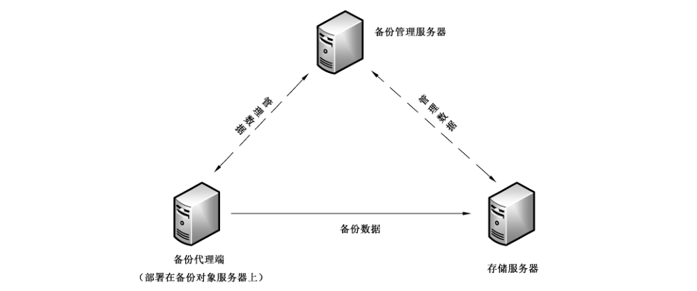
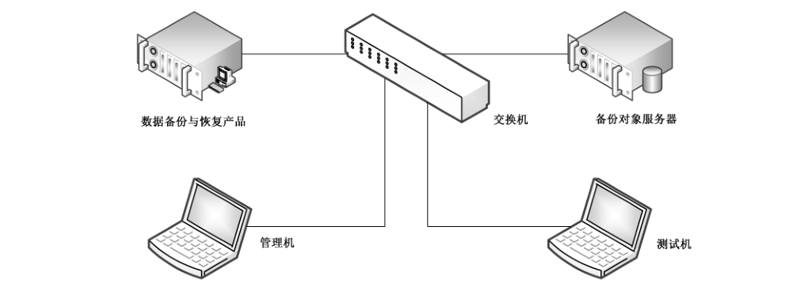

# GB/T 29765-2021 信息安全技术 数据备份与恢复产品技术要求与测试评价方法

> 来源：[GB/T 29765-2021 国家标准详情](https://openstd.samr.gov.cn/bzgk/std/newGbInfo?hcno=44239E7B8E187FF1752ABE9AFB6BBEE9)；发布日期：2021-10-11；实施日期：2022-05-01。
> PDF SHA-256：1079ae035d2327fc64aead986a3f9d0bafd5cd67b2054b8a7f28a260191fd114。
> 转写说明：对照官方 PDF 全部 30 页图像整理；省略封面、目录、页眉、页脚及页码，合并跨页内容。原文加粗宋体字表示仅适用于增强级产品，以下用 **粗体** 保留；正式引用请核对官方 PDF。

## 前言

本文件按照 GB/T 1.1—2020《标准化工作导则 第1部分：标准化文件的结构和起草规则》的规定起草。

本文件代替 GB/T 29765—2013《信息安全技术 数据备份与恢复产品技术要求与测试评价方法》，与 GB/T 29765—2013 相比，除结构调整和编辑性改动外，主要技术变化如下：

- 修改了“术语和定义”（见第 3 章，2013 年版的第 3 章）；
- 增加了“产品描述”章节（见第 5 章）；
- 增加了“云环境适应性（有则适用）”要求（见 6.1.2）；
- 增加了“备份存储空间监控告警”要求（见 6.1.8.2）；
- 增加了“断点续传”要求（见 6.1.9.1）；
- 增加了“重复数据删除”要求（见 6.1.9.6）；
- 增加了“持续数据保护（有则适用）”要求（见 6.1.10）；
- 增加了“副本数据管理（有则适用）”要求（见 6.1.11）；
- 修改了“磁带管理”要求（见 6.1.8.4，2013 年版的 5.2.1.5.3）；
- 修改了“备份对象支持”要求（见 6.1.1，2013 年版的 5.1.1.1 和 5.2.1.1）；
- 修改了“备份方式支持”要求（见 6.1.3，2013 年版的 5.1.1.7.1 和 5.2.1.7.1）；
- 修改了“备份介质支持”要求（见 6.1.5，2013 年版的 5.1.1.4）；
- 修改了“备份策略支持”要求（见 6.1.6，2013 年版的 5.2.1.5）；
- 修改了“恢复自动化（有则适用）”要求（见 6.1.7.4，2013 年版的 5.2.1.7.9）；
- 修改了“恢复缺失文件”要求（见 6.1.7.5，2013 年版的 5.2.1.7.10）；
- 修改了“展示与统计功能”要求（见 6.1.8.3，2013 年版的 5.2.1.5.4）；
- 修改了“缓存支持（有则适用）”要求（见 6.1.9.3，2013 年版的 5.2.1.7.6）；
- 修改了“自身安全要求”（见 6.2，2013 年版的 5.1.2 和 5.2.2）；
- 修改了“安全保障要求”（见 6.3、7.4，2013 年版的 5.1.3、5.2.3）；
- 删除了“运行平台支持”“中文化支持”要求（见 2013 年版的 5.1.1.2、5.1.1.6）；
- 删除了“基于存储区域网备份”要求（见 2013 年版的 5.2.1.3.2）；
- 删除了“基于网络数据管理协议备份”要求（见 2013 年版的 5.2.1.3.3）。

请注意本文件的某些内容可能涉及专利。本文件的发布机构不承担识别专利的责任。

本文件由全国信息安全标准化技术委员会（SAC/TC 260）提出并归口。

本文件起草单位：中认信安（北京）技术服务有限公司、中国网络安全审查技术与认证中心、北京信息安全测评中心、上海市信息安全测评认证中心、公安部第三研究所、中国电子科技集团公司第十五研究所、北京天融信网络安全技术有限公司、蓝盾信息安全技术股份有限公司、公安部第一研究所、杭州美创科技有限公司、华为技术有限公司、中国科学院信息工程研究所、南京壹进制信息科技有限公司、广州鼎甲计算机科技有限公司、联想（北京）有限公司。

本文件主要起草人：刘海峰、布宁、申永波、贺海、田霞、董晶品、徐佟海、安高峰、赵婷、王晨、刘强、韩煜、吴迪、刘思蓉、李海鹏、张宇、刘玉岭、朱厚洪、刘俊。

本文件及其所代替文件的历次版本发布情况为：

- 2013 年首次发布为 GB/T 29765—2013；
- 本次为第一次修订。

## 1 范围

本文件规定了数据备份与恢复产品安全功能要求、自身安全要求、安全保障要求与测试评价方法。

本文件适用于对数据备份与恢复产品的研制、生产、测试和评价。

## 2 规范性引用文件

下列文件中的内容通过文中的规范性引用而构成本文件必不可少的条款。其中，注日期的引用文件，仅该日期对应的版本适用于本文件；不注日期的引用文件，其最新版本（包括所有的修改单）适用于本文件。

- GB/T 18336.1—2015 信息技术 安全技术 信息技术安全评估准则 第1部分：简介和一般模型

- GB/T 25069 信息安全技术 术语

## 3 术语和定义

GB/T 18336.1—2015 和GB/T 25069界定的以及下列术语和定义适用于本文件。

### 3.1 备份数据 backup data

为防止数据丢失，存储在其他非易失性存储介质上某一时间点的数据集合或数据副本。

### 3.2 备份 backup

创建备份数据的过程。

### 3.3 数据恢复 data recovery

利用备份数据将需要恢复的数据还原为某一备份时间点的内容或状态的过程。

### 3.4 快照 snapshot

指定数据集合的一个完整可用的拷贝，其中包含数据在拷贝启动时间点的镜像。

### 3.5 备份对象 backup object

需要进行备份的数据集合。

### 3.6 备份介质 backup media

存放备份数据的非易失性储存物理载体。

### 3.7 备份系统 backup system

实现数据备份与数据恢复的相关软件和硬件组成的系统。

### 3.8 备份管理服务器 backup server

数据备份与恢复产品中提供系统管理和控制服务的部分。

### 3.9 完全备份 full backup

备份指定数据对象的全部数据的过程。

### 3.10 增量备份 incremental backup

仅备份自上次备份后更改过的数据对象的过程。

### 3.11 差量备份 differential backup

备份自上次完全备份后更改过的数据对象的过程。

### 3.12 持续数据保护 continuous data protection

在不影响主要数据运行的前提下，可以实现持续监测和保存目标数据所发生的任何改变，并且能够恢复到此前任意时间点的方法。

### 3.13 副本数据管理 copy data management

基于原始数据副本实现生产系统数据和业务快速恢复的方法。

## 4 缩略语

下列缩略语适用于本文件。

CDP：持续数据保护（Continuous Data Protection）

## 5 产品描述

数据备份与恢复产品是指能够对信息系统数据进行备份和恢复，且对备份与恢复过程进行管理的产品，其产品逻辑结构如图1所示。

备份管理服务器提供备份管理平台，管理备份代理端、存储服务器的接入，统一监控和管理各备份对象服务器上资源的备份、恢复等业务信息，并保存备份集的相关信息。备份管理服务器是数据备份管理系统的核心模块，所有系统任务、用户操作均由它统一调度执行，包括作业调度下发、介质读写管理等。

存储服务器负责接收和存储备份数据（备份集、CDP数据等），通过快照等技术实现业务系统及数据的存储，从而实现对非结构化数据、数据库等不同类型数据的完全备份、增量备份、差量备份等备份方式。存储服务器还能够提供磁带归档，将备份数据归档至物理磁带中，实现数据长期保存，满足法规要求、经济高效的归档需求。

备份代理端部署在备份对象服务器上，用于对备份对象服务器上的备份资源进行整合，以便在连入备份管理服务器后，由备份管理服务器进行统一操作管理。备份代理是安装在生产系统中提供备份数据抓取服务的客户端代理，负责从目标服务器获取数据，并进行数据删重和加密处理，然后将备份数据传输至存储服务器进行存储和归档。

备份管理服务器可以将调度执行命令、介质读写管理等管理数据下发至备份代理端和存储服务器，备份代理端和存储服务器也可以将命令执行结果或状态信息作为管理数据发送至备份管理服务器。

数据备份与恢复产品安全技术要求分为安全功能要求、自身安全要求、安全保障要求三个大类。其中，安全功能要求是对数据备份与恢复产品应具备的通用功能提出具体要求，主要包括备份对象、备份方式、备份模式、备份介质、备份策略、恢复功能、平台支持、系统管理、附加功能等；自身安全要求针对数据备份与恢复产品的自身安全提出具体要求，主要包括身份鉴别、访问控制、安全审计、数据保护、功能保护等；安全保障要求针对数据备份与恢复产品的生命周期过程提出具体要求，主要包括开发、指导性文档、生命周期支持、测试、脆弱性评定等。

数据备份与恢复产品的安全等级分为基本级和增强级（加粗宋体字）。安全功能与自身安全的强弱、以及安全保障要求的高低是等级划分的具体依据，安全等级突出安全特性，具体安全技术要求的等级划分按附录 A。

## 6 技术要求

### 6.1 安全功能要求

#### 6.1.1 备份对象支持

应能对其声明支持的备份对象、备份内容进行备份和恢复，常见的备份对象有数据库、数据卷、文件、操作系统等，常见的备份内容有备份对象的数据、结构等。

#### 6.1.2 云环境适应性（有则适用）

应支持云环境中虚拟机操作系统、文件、数据库、虚拟机整机等备份对象的备份与恢复。

#### 6.1.3 备份方式支持

应支持完全备份、增量备份或差量备份等备份方式。

#### 6.1.4 备份模式支持

应支持网络备份模式，能通过网络备份和恢复数据。

#### 6.1.5 备份介质支持

应支持至少一种备份介质，常见的备份介质有磁盘、磁带、光盘等。

#### 6.1.6 备份策略支持

##### 6.1.6.1 策略定制

应能根据备份对象、备份时间、备份方式、备份介质、备份模式等制定备份策略。

##### 6.1.6.2 策略管理

应支持对备份策略进行添加、删除、修改、查询、保存等操作。

##### 6.1.6.3 其他备份策略

应至少支持一种其他备份策略，如有备份数据保存时间、备份作业循环、备份作业开始或结束条件、自定义备份策略等。

#### 6.1.7 恢复功能支持

##### 6.1.7.1 恢复内容选择

应能选择全部或部分备份数据进行恢复，恢复后的数据应与原数据一致。

##### 6.1.7.2 恢复重定向

应支持将备份数据恢复到与备份对象不同的主机或目录中的功能。

##### 6.1.7.3 恢复时间点选择

应能选择不同备份时间点的备份数据进行恢复。

##### 6.1.7.4 恢复自动化（有则适用）

**恢复任务建立后，应支持通过恢复过程自动执行的方式，快速恢复备份数据。**

##### 6.1.7.5 恢复缺失文件

**应支持标识备份对象中已缺失的文件，并能够对已缺失的文件进行恢复。**

#### 6.1.8 系统管理功能

##### 6.1.8.1 任务监控告警

应能监控并记录备份恢复任务的执行情况，当任务未成功执行时，告警提示。

##### 6.1.8.2 备份存储空间监控告警

应能监控备份存储空间使用情况，当存储空间已满或达到阈值时，告警提示。

##### 6.1.8.3 展示与统计功能

应提供作业状态和设备状态的展示与统计功能，如使用报表等方式。

##### 6.1.8.4 磁带管理（有则适用）

应能对磁带进行管理，如磁带出入库、磁带重用等。

#### 6.1.9 附加功能

##### 6.1.9.1 断点续传

应支持断点续传功能，在异常状态（如网络故障）恢复后，被中断的备份任务能自动从上次中断的位置起恢复作业或通过新任务恢复剩余作业。

##### 6.1.9.2 快照支持

**应支持快照技术，保证备份对象在备份时间点的数据一致性。**

##### 6.1.9.3 缓存支持（有则适用）

**应为备份和恢复作业提供高速缓存支持，以提高备份和恢复作业的性能。**

##### 6.1.9.4 压缩传输

**应支持将备份数据压缩传输。**

##### 6.1.9.5 压缩存储

**应支持将备份数据压缩存储。**

##### 6.1.9.6 重复数据删除

**应支持重复数据删除功能。**

#### 6.1.10 持续数据保护（有则适用）

##### 6.1.10.1 数据跟踪捕获

应支持数据跟踪捕获功能，能对备份对象数据的改变进行连续的监测和保存。

##### 6.1.10.2 任意时间点恢复

应支持任意时间点恢复功能，管理员无需事先定义目标恢复点，即可在任意时间点恢复目标数据。

#### 6.1.11 副本数据管理（有则适用）

##### 6.1.11.1 副本数据获取

应支持生成具有应用一致性的数据副本，该数据副本应保持受保护数据的原始格式。

##### 6.1.11.2 副本数据使用

应支持通过直接挂载副本的方式，无需经过数据恢复环节快速接管或恢复业务功能。

### 6.2 自身安全要求

#### 6.2.1 身份鉴别

产品的身份鉴别功能要求包括但不限于：

a） 应对用户身份进行标识和鉴别，用户标识应具有唯一性；

b） 应对用户身份鉴别信息进行安全保护，保障用户鉴别信息存储和传输过程中的保密性；

c） 应提供登录失败处理功能，包括但不限于限制连续的非授权登录尝试次数等；

d） 应提供登录超时锁定或退出、会话锁定功能，在重新管理备份系统时需再次进行身份鉴别；

e） 在采用基于口令的身份鉴别时，要求对用户设置的口令进行复杂度检查，确保用户口令满足一定的复杂度要求；

f） 当产品中存在默认口令时，应在用户首次登录时提示用户对默认口令进行修改；

**g） 应对授权管理员选择两种或两种以上组合的鉴别技术进行身份鉴别。**

#### 6.2.2 访问控制

应能对备份系统中与安全相关的所有操作设置访问控制策略，包括但不限于备份作业、日志访问、策略管理、备份数据访问等。

#### 6.2.3 安全审计

产品的安全审计功能要求包括但不限于：

a） 应能对备份系统的身份鉴别、策略管理、备份作业、恢复作业、删除作业等事件，以及管理员和用户的各类操作进行审计；

b） 审计记录中应至少包括事件发生的日期和时间、事件主/客体身份、事件内容、事件的结果（如成功或失败）等内容，且易于阅读；

c） 产品应保证只有授权管理员才能访问相应的审计记录；

d） 审计数据存储空间达到阈值时，应采取措施防止审计数据丢失，如自动告警、转存或删除旧日志等。

#### 6.2.4 数据保护

产品的数据保护功能要求包括但不限于：

a） 应能对数据在备份、恢复过程中的完整性进行校验；

b） 应能在备份和恢复过程中利用编码、协议等方式增加数据传输安全性；

c） 应能以非明文的方式将备份数据存储于备份介质上；

**d） 应提供完整性校验机制，保证备份数据完整性，一旦发现完整性破坏应及时告警。**

#### 6.2.5 功能保护

**产品的功能保护包括但不限于：**

**a） 应监控产品关键功能的运行状态，并对功能失效等异常状态进行提示或告警；**

**b） 应提供产品关键功能失效时的保护机制，包括但不限于系统自动恢复、人工干预恢复等。**

### 6.3 安全保障要求

#### 6.3.1 开发

##### 6.3.1.1 安全架构

开发者应提供产品安全功能的安全架构描述，安全架构描述应满足以下要求：

a） 与产品设计文档中对安全功能实施抽象描述的级别一致；

b） 描述与安全功能要求一致的产品安全功能的安全域；

c） 描述产品安全功能初始化过程为何是安全的；

d） 证实产品安全功能能够防止被破坏；

e） 证实产品安全功能能够防止安全特性被旁路。

##### 6.3.1.2 功能规范

开发者应提供完备的功能规范说明，功能规范说明应满足以下要求：

a） 完全描述产品的安全功能；

b） 描述所有安全功能接口的目的与使用方法；

c） 标识和描述每个安全功能接口相关的所有参数；

d） 描述安全功能接口相关的安全功能实施行为；

e） 描述由安全功能实施行为处理而引起的直接错误消息；

f） 证实安全功能要求到安全功能接口的追溯；

**g） 描述安全功能实施过程中，与安全功能接口相关的所有行为；**

**h） 描述可能由安全功能接口的调用而引起的所有直接错误消息。**

##### 6.3.1.3 实现表示

**开发者应提供全部安全功能的实现表示，实现表示应满足以下要求：**

**a） 提供产品设计描述与实现表示实例之间的映射，并证明其一致性；**

**b） 按详细级别定义产品安全功能，详细程度达到无须进一步设计就能生成安全功能的程度；**

**c） 以开发人员使用的形式提供。**

##### 6.3.1.4 产品设计

开发者应提供产品设计文档，产品设计文档应满足以下要求：

a） 根据子系统描述产品结构，标识和描述产品安全功能的所有子系统，并描述安全功能所有子系统间的相互作用；

b） 提供子系统和安全功能接口间的对应关系；

c） 通过实现模块描述安全功能，标识和描述实现模块的目的、相关接口及返回值等，并描述实现模块间的相互作用及调用的接口；

d） 提供实现模块和子系统间的对应关系。

#### 6.3.2 指导性文档

##### 6.3.2.1 操作用户指南

开发者应提供明确和合理的操作用户指南，操作用户指南与为评估而提供的其他所有文档保持一致，对每一种用户角色的描述应满足以下要求：

a） 描述在安全处理环境中被控制的用户可访问的功能和特权，包含适当的告警信息；

b） 描述如何以安全的方式使用产品提供的可用接口；描述产品支持的存储介质及对存储介质的保护；

c） 描述可用功能和接口，尤其是受用户控制的所有安全参数，适当时指明安全值；

d） 明确说明与需要执行的用户可访问功能有关的每一种安全相关事件，包括改变安全功能所控制实体的安全特性；

e） 标识产品运行的所有可能状态（包括操作导致的失败或者操作性错误），以及它们与维持安全运行之间的因果关系和联系；

f） 充分实现安全目的所必需执行的安全策略。

##### 6.3.2.2 准备程序

开发者应提供产品及其准备程序，准备程序描述应满足以下要求：

a） 描述与开发者交付程序相一致的安全接收所交付产品必需的所有步骤；

b） 描述安全安装产品及其运行环境必需的所有步骤。

#### 6.3.3 生命周期支持

##### 6.3.3.1 配置管理能力

开发者的配置管理能力应满足以下要求：

a） 为产品的不同版本提供唯一的标识；

b） 使用配置管理系统对组成产品的所有配置项进行维护，并唯一标识配置项；

c） 提供配置管理文档，配置管理文档描述用于唯一标识配置项的方法；

**d） 配置管理系统提供一种自动方式来支持产品的生成，通过该方式确保只能对产品的实现表示进行已授权的修改；**

**e） 配置管理文档包括一个配置管理计划，配置管理计划描述如何使用配置管理系统开发产品；实施的配置管理与配置管理计划相一致；**

**f） 配置管理计划描述用来接受修改过的或新建的作为产品组成部分的配置项的程序。**

##### 6.3.3.2 配置管理范围

开发者应提供产品配置项列表，并说明配置项的开发者。配置项列表应包含以下内容：

a） 产品、安全保障要求的评估证据和产品的组成部分；

**b） 实现表示、安全缺陷报告及其解决状态。**

##### 6.3.3.3 交付程序

开发者应使用一定的交付程序交付产品，并将交付过程文档化。在给用户方交付产品的各版本时，交付文档应描述为维护安全所必需的所有程序。

##### 6.3.3.4 开发安全

**开发者应提供开发安全文档。开发安全文档应描述在产品的开发环境中，为保护产品设计和实现的保密性和完整性所必需的所有物理的、程序的、人员的和其他方面的安全措施。**

##### 6.3.3.5 生命周期定义

**开发者应建立一个生命周期模型对产品的开发和维护进行的必要控制，并提供生命周期定义文档描述用于开发和维护产品的模型。**

##### 6.3.3.6 工具和技术

**开发者应明确定义用于开发产品的工具，并提供开发工具文档无歧义地定义实现中每个语句的含义和所有依赖于实现的选项的含义。**

#### 6.3.4 测试

##### 6.3.4.1 测试覆盖

开发者应提供测试覆盖文档，测试覆盖描述应满足以下要求：

a） 表明测试文档中所标识的测试与功能规范中所描述的产品的安全功能间的对应性；

**b） 表明上述对应性是完备的，并证实功能规范中的所有安全功能接口都进行了测试。**

##### 6.3.4.2 测试深度

**开发者应提供测试深度的分析。测试深度分析描述应满足以下要求：**

**a） 证实测试文档中的测试与产品设计中的安全功能子系统和实现模块之间的一致性；**

**b） 证实产品设计中的所有安全功能子系统、实现模块都已经进行了测试。**

##### 6.3.4.3 功能与性能测试

开发者应测试产品安全功能与性能，将结果文档化并提供测试文档。测试文档应包括以下内容：

a） 测试计划，标识要执行的测试，并描述执行每个测试的方案，这些方案包括对于其他测试结果的任何顺序依赖性；

b） 预期的测试结果，表明测试成功后的预期输出；

c） 实际测试结果和预期的测试结果一致。

##### 6.3.4.4 独立测试

开发者应提供一组与其自测安全功能时使用的同等资源，以用于安全功能的抽样测试。

#### 6.3.5 脆弱性评定

基于已标识的潜在脆弱性，产品能够抵抗以下攻击行为；

a） 具有基本攻击潜力的攻击者的攻击；

**b） 具有增强型攻击潜力的攻击者的攻击。**

## 7 测评方法

测评方法包括针对基本级产品和增强级产品的安全功能要求、自身安全要求的测试和安全保障要求的评估。有关性能指标和测试方法参见附录 B。

### 7.1 测试环境与工具

典型的数据备份与恢复产品测试环境如图2所示。

测试设备包括但不限于测试所需的交换机、管理机、备份对象服务器等其他设备。

测试机包括但不限于测试工具集等。

### 7.2 安全功能要求测试

#### 7.2.1 备份对象支持

测试评价方法如下。

a） 测试方法：

1） 按产品提供的指导性文档配置备份对象、备份内容及测试环境；

2） 执行备份操作，并确认备份成功；

3） 移除备份对象；

4） 利用备份数据进行恢复；

5） 验证恢复后的数据是否与备份对象一致且可用。

b） 预期结果：产品能对其声明支持的备份对象、备份内容进行备份和恢复。

c） 结果判定：实际测试结果与相关预期结果一致则判定为符合，其他情况判定为不符合。

#### 7.2.2 云环境适应性（有则适用）

测试评价方法如下。

a） 测试方法：

1） 在云环境中（如云计算平台）部署产品；

2） 配置能够完成产品所有功能测试的环境；

3） 验证产品是否能对虚拟机操作系统、文件、数据库、虚拟机整机等备份对象进行备份与恢复。

b） 预期结果：对所支持的备份对象均能进行完整准确的备份与恢复。

c） 结果判定：实际测试结果与相关预期结果一致则判定为符合，其他情况判定为不符合。

#### 7.2.3 备份方式支持

测试评价方法如下。

a） 测试方法：

1） 按产品提供的指导性文档配置备份对象、备份内容及测试环境；

2） 分别设置完全备份、增量备份或差量备份等备份方式；

3） 对每种备份方式分别进行验证，是否能按预期的备份方式进行备份；

4） 对每种备份方式的备份数据分别进行恢复，恢复后的数据是否与备份对象一致且可用。

b） 预期结果：产品支持完全备份、增量备份或差量备份等备份方式。

c） 结果判定：实际测试结果与相关预期结果一致则判定为符合，其他情况判定为不符合。

#### 7.2.4 备份模式支持

测试评价方法如下。

a） 测试方法：

1） 按产品提供的指导性文档配置备份对象、备份内容；

2） 设置网络备份模式；

3） 验证产品是否能通过网络备份数据；

4） 验证产品是否能通过网络恢复数据，恢复后的数据是否与备份对象一致且可用。

b） 预期结果：产品支持网络备份模式，能通过网络备份和恢复数据。

c） 结果判定：实际测试结果与相关预期结果一致则判定为符合，其他情况判定为不符合。

#### 7.2.5 备份介质支持

测试评价方法如下。

a） 测试方法：

1） 按产品提供的指导性文档配置备份对象、备份内容；

2） 设置产品声称支持的介质作为备份介质；

3） 验证产品是否支持该备份介质进行备份；

4） 验证产品是否能从备份介质中读取数据进行恢复，恢复后的数据是否与备份对象一致且可用。

b） 预期结果：产品声称支持的介质能作为备份介质正常工作。

c） 结果判定：实际测试结果与相关预期结果一致则判定为符合，其他情况判定为不符合。

#### 7.2.6 备份策略支持

##### 7.2.6.1 策略定制

测试评价方法如下。

a） 测试方法：

1） 按产品提供的指导性文档，对备份对象、备份时间、备份方式、备份介质、备份模式等配置相关策略。

2） 执行备份策略；

3） 验证产品备份策略的有效性。

b） 预期结果：产品能根据备份对象、备份时间、备份方式、备份介质、备份模式等制定备份策略。

c） 结果判定：实际测试结果与相关预期结果一致则判定为符合，其他情况判定为不符合。

##### 7.2.6.2 策略管理

测试评价方法如下。

a） 测试方法：

1） 按产品提供的指导性文档，配置相关策略；

2） 分别对备份策略进行添加、删除、修改、查询、保存等操作；

3） 验证对产品备份策略的管理操作的有效性。

b） 预期结果：产品支持对备份策略进行添加、删除、修改、查询、保存等操作。

c） 结果判定：实际测试结果与相关预期结果一致则判定为符合，其他情况判定为不符合。

##### 7.2.6.3 其他备份策略

测试评价方法如下。

a） 测试方法：

1） 按产品提供的指导性文档，配置相关策略，如指定备份数据保存时间、备份作业循环、备份作业开始或结束条件、自定义备份策略等；

2） 针对配置的策略，分别进行相关操作或执行相关任务；

3） 验证产品备份策略的有效性。

b） 预期结果：产品至少支持一种其他备份策略。

c） 结果判定：实际测试结果与相关预期结果一致则判定为符合，其他情况判定为不符合。

#### 7.2.7 恢复功能支持

##### 7.2.7.1 恢复内容选择

测试评价方法如下。

a） 测试方法：

1） 按产品提供的指导性文档，执行恢复任务；

2） 选择全部或部分备份数据进行恢复；

3） 验证恢复后的数据是否与原数据一致。

b） 预期结果：产品能选择全部或部分备份数据进行恢复，恢复后的数据与原数据一致。

c） 结果判定：实际测试结果与相关预期结果一致则判定为符合，其他情况判定为不符合。

##### 7.2.7.2 恢复重定向

测试评价方法如下。

a） 测试方法：

1） 按产品提供的指导性文档，执行恢复任务；

2） 选择备份数据恢复到与原备份对象不同的主机或者目录；

3） 验证恢复后的数据是否与原数据一致。

b） 预期结果：产品能选择全部或部分备份数据进行恢复，恢复后的数据与原数据一致。

c） 结果判定：实际测试结果与相关预期结果一致则判定为符合，其他情况判定为不符合。

##### 7.2.7.3 恢复时间点选择

测试评价方法如下。

a） 测试方法：

1） 按产品提供的指导性文档，执行恢复任务；

2） 选择不同备份时间点的备份数据进行恢复；

3） 验证恢复后的数据是否与原数据一致。

b） 预期结果：产品能选择不同备份时间点的备份数据进行恢复。

c） 结果判定：实际测试结果与相关预期结果一致则判定为符合，其他情况判定为不符合。

##### 7.2.7.4 恢复自动化（有则适用）

测试评价方法如下。

a） 测试方法：

1） 按产品提供的指导性文档，建立并执行恢复任务；

2） 启用恢复自动化的相关功能选项；

3） 按照恢复自动化的要求进行恢复。

b） 预期结果：产品能通过恢复过程自动执行的方式，快速恢复备份数据。

c） 结果判定：实际测试结果与相关预期结果一致则判定为符合，其他情况判定为不符合。

##### 7.2.7.5 恢复缺失文件

**测试评价方法如下。**

**a） 测试方法：**

**1） 按产品提供的指导性文档，执行恢复任务；**

**2） 在对备份对象的数据完成备份后，删除备份对象的部分或全部文件；**

**3） 创建恢复任务时，支持查看恢复数据原路径下被删除的文件；查看被删除的文件是否被有效标示；**

**4） 选择被删除的文件进行恢复；**

**5） 验证恢复后的数据是否与原数据一致。**

**b） 预期结果：产品在配置恢复任务时，支持标识出备份对象中已缺失文件，并能够对已缺失的备份文件进行恢复。**

**c） 结果判定：实际测试结果与相关预期结果一致则判定为符合，其他情况判定为不符合。**

#### 7.2.8 系统管理功能

##### 7.2.8.1 任务监控告警

测试评价方法如下。

a） 测试方法：

1） 按产品提供的指导性文档，执行备份任务；

2） 在备份任务执行过程中，中断备份任务使之未成功执行；

3） 验证产品是否能监控并记录备份恢复任务的执行情况，当任务未成功执行时，有告警提示。

b） 预期结果：产品能监控并记录备份恢复任务的执行情况，当任务未成功执行时，告警提示。

c） 结果判定：实际测试结果与相关预期结果一致则判定为符合，其他情况判定为不符合。

##### 7.2.8.2 备份存储空间监控告警

测试评价方法如下。

a） 测试方法：

1） 按产品提供的指导性文档，执行备份任务；

2） 使备份存储空间已满或达到阈值；

3） 验证产品是否能监控备份存储空间使用情况，当存储空间已满或达到阈值时，是否有告警提示。

b） 预期结果：产品能监控备份存储空间使用情况，当存储空间已满或达到阈值时，告警提示。

c） 结果判定：实际测试结果与相关预期结果一致则判定为符合，其他情况判定为不符合。

##### 7.2.8.3 展示与统计功能

测试评价方法如下。

a） 测试方法：

1） 按产品提供的指导性文档，执行备份恢复任务；

2） 验证产品能否提供作业状态和设备状态的展示与统计功能，如报表。

b） 预期结果：产品提供作业状态和设备状态的展示与统计功能。

c） 结果判定：实际测试结果与相关预期结果一致则判定为符合，其他情况判定为不符合。

##### 7.2.8.4 磁带管理（有则适用）

测试评价方法如下。

a） 测试方法：

1） 按产品提供的指导性文档，在存储服务器配置磁带驱动器以提供使磁带管理功能测试能够正常执行的环境；

2） 测试产品支持的磁带管理功能；

3） 验证磁带管理功能是否有效。

b） 预期结果：产品支持磁带管理功能。

c） 结果判定：实际测试结果与相关预期结果一致则判定为符合，其他情况判定为不符合。

#### 7.2.9 附加功能

##### 7.2.9.1 断点续传

测试评价方法如下。

a） 测试方法：

1） 按产品提供的指导性文档，执行备份任务；

2） 断开网络连接或采取其他方式，使备份任务异常中断；

3） 恢复网络连接或采取其他方式恢复正常工作状态；

4） 验证产品被中断的备份任务是否能自动从上次中断的位置起恢复作业。

b） 预期结果：产品支持断点续传功能，在异常状态恢复后（如网络故障），被中断的备份任务能自动从上次中断的位置起恢复作业。

c） 结果判定：实际测试结果与相关预期结果一致则判定为符合，其他情况判定为不符合。

##### 7.2.9.2 快照支持

**测试评价方法如下。**

**a） 测试方法：**

**1） 按产品提供的指导性文档，配置执行备份任务；**

**2） 产品执行快照的相关功能；**

**3） 确保备份作业进行的同时，备份对象的数据有变化；**

**4） 验证恢复后的数据与备份对象在备份启动时间点时的数据是否一致且可用。**

**b） 预期结果：产品支持快照技术，能保证备份对象在备份时间点的数据一致性。**

**c） 结果判定：实际测试结果与相关预期结果一致则判定为符合，其他情况判定为不符合。**

##### 7.2.9.3 缓存支持（有则适用）

**测试评价方法如下。**

**a） 测试方法：**

**1） 按产品提供的指导性文档，配置执行备份和恢复任务；**

**2） 配置作为缓存的介质，并启用缓存功能；**

**3） 验证备份数据流是否先写入作为缓存的介质，再写入备份介质。**

**b） 预期结果：产品能为备份和恢复作业提供高速缓存支持。**

**c） 结果判定：实际测试结果与相关预期结果一致则判定为符合，其他情况判定为不符合。**

##### 7.2.9.4 压缩传输

**测试评价方法如下。**

**a） 测试方法：**

**1） 按产品提供的指导性文档，配置执行备份任务；**

**2） 启用压缩传输功能；**

**3） 验证传输的备份数据是否经过了压缩。**

**b） 预期结果：产品支持压缩传输功能。**

**c） 结果判定：实际测试结果与相关预期结果一致则判定为符合，其他情况判定为不符合。**

##### 7.2.9.5 压缩存储

**测试评价方法如下。**

**a） 测试方法：**

**1） 按产品提供的指导性文档，配置执行备份任务；**

**2） 启用压缩存储功能；**

**3） 验证存储的备份数据是否经过了压缩。**

**b） 预期结果：产品支持压缩存储功能。**

**c） 结果判定：实际测试结果与相关预期结果一致则判定为符合，其他情况判定为不符合。**

##### 7.2.9.6 重复数据删除

**测试评价方法如下。**

**a） 测试方法：**

**1） 按产品提供的指导性文档，配置执行备份任务；**

**2） 启用重复数据删除功能；**

**3） 验证产品是否正确执行了重复数据删除功能。**

**b） 预期结果：产品支持重复数据删除功能。**

**c） 结果判定：实际测试结果与相关预期结果一致则判定为符合，其他情况判定为不符合。**

#### 7.2.10 持续数据保护（有则适用）

##### 7.2.10.1 数据跟踪捕获

测试评价方法如下。

a） 测试方法：

1） 按产品提供的指导性文档，配置执行备份任务；

2） 持续多次改变备份对象数据；

3） 验证产品是否能对备份对象数据的改变进行连续的监测和保存。

b） 预期结果：产品支持对备份对象数据的改变进行连续的监测和保存。

c） 结果判定：实际测试结果与相关预期结果一致则判定为符合，其他情况判定为不符合。

##### 7.2.10.2 任意时间点恢复

测试评价方法如下。

a） 测试方法：

1） 按产品提供的指导性文档，配置执行备份任务；

2） 启用任意时间点恢复功能；

3） 选择任意时间点进行恢复；

4） 验证产品是否能在任意时间点恢复目标数据。

b） 预期结果：产品支持任意时间点恢复功能，管理员无需事先定义目标恢复点，即可在任意时间点恢复目标数据。

c） 结果判定：实际测试结果与相关预期结果一致则判定为符合，其他情况判定为不符合。

#### 7.2.11 数据副本管理

##### 7.2.11.1 副本数据获取

测试评价方法如下。

a） 测试方法：

1） 按产品提供的指导性文档配置备份对象、备份内容及测试环境；

2） 在基本备份方式设置的基础上，启用原始格式备份数据获取功能；

3） 对原始格式备份进行验证，是否能按预期的备份方式进行备份，并检查备份数据是否为原始格式。

b） 预期结果：产品备份功能正常，备份数据以原始格式存放，并保持一致性。

c） 结果判定：实际测试结果与相关预期结果一致则判定为符合，其他情况判定为不符合。

##### 7.2.11.2 副本数据使用

测试评价方法如下。

a） 测试方法：

1） 按产品提供的指导性文档，执行副本数据挂载式启用任务；

2） 在数据副本的目标环境上，检查是否可以立即访问到副本数据，通过挂载并无需等待数据的恢复，快速接管业务或恢复业务功能。

b） 预期结果：产品能通过副本数据挂载处理，立即访问副本数据，并无需等待数据恢复快速接管业务或恢复业务。

c） 结果判定：实际测试结果与相关预期结果一致则判定为符合，其他情况判定为不符合。

### 7.3 自身安全测试

#### 7.3.1 身份鉴别

测试评价方法如下。

a） 测试方法：

1） 测试产品是否对其用户进行唯一性标识，如不准许创建重名用户；

2） 测试产品对于用户鉴别信息的存储和传输过程中，采取何种措施对其保密性和完整性进行保护；

3） 尝试连续多次失败登录产品，触发产品的登录失败处理功能，检查产品采用何种机制防止用户进一步进行尝试；

4） 产品登录后，在超时时间内无任何操作，查看产品是否锁定或退出；

5） 验证产品是否提供会话锁定功能；

6） 验证产品超时锁定和会话锁定后是否需要再次进行身份鉴别才能够重新管理备份系统；

7） 若产品采用口令鉴别机制，测试产品是否提供了口令复杂度校验机制，是否不准许用户设置弱口令，如空口令、纯数字等；

8） 产品存在默认口令时，检查产品是否提示用户对默认口令进行修改；

**9） 查看产品本地和远程管理是否支持双因子身份鉴别。**

b） 预期结果：

1） 产品确保在管理员进行操作之前，对管理员、主机和用户等进行唯一的身份识别；

2） 产品支持非明文的远程管理会话，明文的远程管理方式能够关闭；

3） 输入错误口令达到设定的最大失败次数后，产品终止可信主机或用户建立会话的过程，并对该失败用户做禁止访问处理；

4） 产品登录后，在超时时间内无任何操作，产品自动锁定或退出；

5） 产品提供了会话锁定功能；

6） 产品需要再次进行身份鉴别；

7） 管理员需通过口令验证等身份鉴别措施；并对口令强度具有要求；

8） 产品存在默认口令时，产品能够提示用户对默认口令进行修改；

**9） 产品支持双因子鉴别。**

c） 结果判定：实际测试结果与相关预期结果一致则判定为符合，其他情况判定为不符合。

#### 7.3.2 访问控制

测试评价方法如下。

a） 测试方法：

1） 针对产品中与安全相关的操作设置访问控制策略；

2） 验证已设置的访问控制策略在进行与安全相关的操作是否有效。

b） 预期结果：

1） 访问控制策略设置成功；

2） 在进行与安全相关的操作时已设置的访问控制策略有效。

c） 结果判定：实际测试结果与相关预期结果一致则判定为符合，其他情况判定为不符合。

#### 7.3.3 安全审计

测试评价方法如下。

a） 测试方法：

1） 使用授权用户登录备份系统、进行备份作业、恢复作业、删除作业、策略管理等操作；

2） 以授权管理员的身份查阅审计记录，检查是否对执行的事件产生了审计记录；

3） 验证审计记录中是否包括事件发生的日期和时间、事件主体客体身份、事件内容、事件的结果等信息，且易于阅读；

4） 分别以授权用户和非授权用户身份访问审计记录；

5） 分别以授权用户和非授权用户身份执行审计记录的管理操作，验证产品是否仅允许用户执行审计记录的管理操作（如删除或修改审计记录）；查看产品是否能够防止修改审计记录的操作；

6） 设定存储空间阈值，进行操作使审计数据存储空间达到阈值，检查是否采取了措施防止审计数据丢失，如自动告警、转存或删除旧日志等。

b） 预期结果：

1） 对于 a）1）中支持的事件，产品能产生相应的审计记录；

2） 产品的每个审计记录中均包含以下信息：事件发生的日期和时间、事件主体客体身份、事件描述；

3） 产品的每个审计记录中均包含以下信息：事件发生的日期和时间、事件主体客体身份、事件描述，且易于阅读；

4） 仅授权用户能访问审计记录，非授权用户均不能执行修改或删除审计记录的管理操作；

5） 达到阈值时，能够进行告警，并且采取了日志转存或覆盖旧日志等措施。

c） 结果判定：实际测试结果与相关预期结果一致则判定为符合，其他情况判定为不符合。

#### 7.3.4 数据保护

测试评价方法如下。

a） 测试方法：

1） 配置备份系统的数据完整性校验功能；

2） 人为破坏备份数据的完整性；

3） 验证产品能否校验出备份数据的完整性已被破坏，并给出相应的告警；

4） 配置产品为基于网络备份模式；

5） 启用安全传输功能；

6） 执行备份作业；

7） 验证备份数据在传输时的安全性；

8） 启用安全存储功能；

9） 执行备份作业；

10） 验证备份数据是否是非明文的方式存储于备份介质上；

**11） 验证非授权用户尝试修改备份数据，验证是否提供完整性保护措施，并且是否能够进行告警。**

b） 预期结果：

1） 产品数据完整性校验，能校验出备份数据的完整性已被破坏，并能给出相应的告警；

2） 产品能保证传输数据的安全性；

3） 备份数据是非明文方式存储于备份介质上；

**4） 产品提供了完整性保护措施，并且对非法修改进行告警。**

c） 结果判定：实际测试结果与相关预期结果一致则判定为符合，其他情况判定为不符合。

#### 7.3.5 功能保护

测试评价方法如下。

**a） 测试方法：**

**1） 在系统正常运行的状态下，人为使其部分功能失效，如恢复功能；**

**2） 验证产品能否提供对功能失效，如恢复功能进行提示或告警；**

**3） 人为造成备份系统部分关键功能失效，如恢复功能；**

**4） 验证产品是否提供关键功能失效时的保护机制，如人工干预恢复。**

**b） 预期结果：**

**1） 能够提供对其自身部分功能的失效进行监控；**

**2） 具有关键功能失效时的相应保护机制。**

**c） 结果判定：实际测试结果与相关预期结果一致则判定为符合，其他情况判定为不符合。**

### 7.4 安全保障评估方法

#### 7.4.1 开发

##### 7.4.1.1 安全架构

测试评价方法如下。

a） 测试方法：检查安全架构文档是否准确描述如下内容：

1） 与产品设计文档中对安全功能实施抽象描述的级别一致；

2） 描述与安全功能要求一致的产品安全功能的安全域；

3） 描述产品安全功能初始化过程为何是安全的；

4） 证实产品安全功能能够防止被破坏；

5） 证实产品安全功能能够防止安全特性被旁路。

b） 预期结果：开发者提供的文档内容应满足上述要求。

c） 结果判定：实际测试结果与相关预期结果一致则判定为符合，其他情况判定为不符合。

##### 7.4.1.2 功能规范

测试评价方法如下。

a） 测试方法：检查功能规范文档是否准确描述如下内容：

1） 完全描述产品的安全功能；

2） 描述所有安全功能接口的目的与使用方法；

3） 标识和描述每个安全功能接口相关的所有参数；

4） 描述安全功能接口相关的安全功能实施行为；

5） 描述由安全功能实施行为处理而引起的直接错误消息；

6） 证实安全功能要求到安全功能接口的追溯；

**7） 描述安全功能实施过程中，与安全功能接口相关的所有行为；**

**8） 描述可能由安全功能接口的调用而引起的所有直接错误消息。**

**b） 预期结果：开发者提供的文档内容应满足上述要求。**

c） 结果判定：实际测试结果与相关预期结果一致则判定为符合，其他情况判定为不符合。

##### 7.4.1.3 实现表示

测试评价方法如下。

**a） 测试方法：检查实现表示文档是否准确描述如下内容：**

**1） 以开发人员使用的形式提供产品设计描述与实现表示实例之间的映射，并证明其一致性；**

**2） 按详细级别定义产品安全功能，详细程度达到无须进一步设计就能生成安全功能的程度。**

**b） 预期结果：开发者提供的文档内容应满足上述要求。**

c） 结果判定：实际测试结果与相关预期结果一致则判定为符合，其他情况判定为不符合。

##### 7.4.1.4 产品设计

测试评价方法如下。

a） 测评方法：检查开发者提供的产品设计证据，并检查开发者提供的信息是否满足证据的内容和形式的所有要求：

1） 是否根据子系统描述产品结构，是否标识和描述产品安全功能的所有子系统，是否描述安全功能所有子系统间的相互作用；

2） 提供的对应关系是否能证实设计中描述的所有行为映射到调用的安全功能接口；

3） 是否根据实现模块描述安全功能，是否描述所有实现模块的安全功能要求相关接口、接口的返回值、与其他模块间的相互作用及调用的接口；

4） 是否提供实现模块和子系统间的对应关系。

b） 预期结果：开发者提供的信息应满足上述要求。

c） 结果判定：实际测评结果与相关预期结果一致则判定为符合，其他情况判定为不符合。

#### 7.4.2 指导性文档

##### 7.4.2.1 操作用户指南

测试评价方法如下。

a） 测试方法：检查操作用户指南是否准确描述如下内容：

1） 描述在安全处理环境中被控制的用户可访问的功能和特权，包含适当的告警信息；

2） 描述如何以安全的方式使用产品提供的可用接口；描述产品支持的存储介质及对存储介质的保护；

3） 描述可用功能和接口，尤其是受用户控制的所有安全参数，适当时指明安全值；

4） 明确说明与需要执行的用户可访问功能有关的每一种安全相关事件，包括改变安全功能所控制实体的安全特性；

5） 标识产品运行的所有可能状态（包括操作导致的失败或者操作性错误），以及它们与维持安全运行之间的因果关系和联系；

6） 充分实现安全目的所必需执行的安全策略。

b） 预期结果：开发者提供的文档内容应满足上述要求。

c） 结果判定：实际测试结果与相关预期结果一致则判定符合，其他情况判定为不符合。

##### 7.4.2.2 准备程序

测试评价方法如下。

b） 测试方法：检查准备程序文档是否准确描述如下内容：

1） 描述与开发者交付程序相一致的安全接收所交付产品必需的所有步骤；

2） 描述安全安装产品及其运行环境必需的所有步骤。

c） 预期结果：开发者提供的文档内容应满足上述要求。

d） 结果判定：实际测试结果与相关预期结果一致则判定为符合，其他情况判定为不符合。

#### 7.4.3 生命周期支持

##### 7.4.3.1 配置管理能力

测试评价方法如下。

a） 测试方法：检查开发者提供的配置管理能力证据，并检查开发者提供的信息是否满足内容和形式的所有要求：

1） 检查开发者是否为不同版本的产品提供唯一的标识；

2） 现场检查配置管理系统是否对所有的配置项作出唯一的标识，且配置管理系统是否对配置项进行了维护；

3） 检查开发者提供的配置管理文档，是否描述了对配置项进行唯一标识的方法；

**4） 现场检查是否能够通过自动化配置管理系统支持产品的生成，确保只能对产品的实现表示进行已授权的改变；**

**5） 检查配置管理计划是否描述如何使用配置管理系统开发产品，现场核查活动是否与计划一致；**

**6） 检查配置管理计划是否描述了用来接受修改过的或新建的作为产品组成部分的配置项的程序。**

b） 预期结果：开发者提供的文档和现场活动证据内容应满足上述要求。

c） 结果判定：实际测试结果与相关预期结果一致则判定为符合，其他情况判定为不符合。

##### 7.4.3.2 配置管理范围

测试评价方法如下。

a） 测试方法：

1） 检查开发者提供的配置项列表；

2） 配置项列表是否描述了组成产品的全部配置项及相应的开发者；

**3） 检查开发者是否将实现表示、安全缺陷报告及其解决状态纳入配置管理范围，是否对安全缺陷进行跟踪。**

b） 预期结果：开发者提供的文档和现场活动证据内容应满足上述要求。

c） 结果判定：实际测试结果与相关预期结果一致则判定为符合，其他情况判定为不符合。

##### 7.4.3.3 交付程序

测试评价方法如下。

a） 测试方法：

1） 现场检查开发者是否使用一定的交付程序交付产品；

2） 检查开发者是否使用文档描述交付过程，文档中是否包含以下内容：在给用户方交付系统的各版本时，为维护安全所必需的所有程序。

b） 预期结果：开发者提供的文档和现场活动证据内容应满足上述要求。

c） 结果判定：实际测试结果与相关预期结果一致则判定为符合，其他情况判定为不符合。

##### 7.4.3.4 开发安全

测试评价方法如下。

a） 测试方法：

**1） 检查开发者提供的开发安全文档，该文档是否描述了在系统的开发环境中，为保护系统设计和实现的保密性和完整性所必需的所有物理的、程序的、人员的和其他方面的安全措施；**

**2） 现场检查产品的开发环境，开发者是否使用了物理的、程序的、人员的和其他方面的安全措施保证产品设计和实现的保密性和完整性，这些安全措施是否得到了有效的执行。**

**b） 预期结果：开发者提供的文档和现场活动证据内容应满足上述要求。**

c） 结果判定：实际测试结果与相关预期结果一致则判定为符合，其他情况判定为不符合。

##### 7.4.3.5 生命周期定义

测试评价方法如下。

a） 测试方法：

**1） 开发者应提供证据证明使用生命周期模型对产品的开发和维护进行的必要控制，评价者应对证据的内容进行检查；**

**2） 评价者应检查开发者提供生命周期定义文档是否描述了用于开发和维护产品的模型。**

**b） 预期结果：开发者提供的文档和现场活动证据内容应满足上述要求。**

c） 结果判定：实际测试结果与相关预期结果一致则判定为符合，其他情况判定为不符合。

##### 7.4.3.6 工具和技术

测试评价方法如下。

**a） 测试方法：评价者应检查开发者所提供的开发安全文档是否明确定义了用于开发产品的工具，并提供了开发工具文档无歧义地定义实现中每个语句的含义和所有依赖于实现的选项的含义。**

**b） 预期结果：开发者提供的文档和现场活动证据内容应满足上述要求。**

c） 结果判定：实际测试结果与相关预期结果一致则判定为符合，其他情况判定为不符合。

#### 7.4.4 测试

##### 7.4.4.1 测试覆盖

测试评价方法如下。

a） 测试方法：

1） 检查开发者提供的测试覆盖文档，在测试覆盖证据中，是否表明测试文档中所标识的测试与功能规范中所描述的产品的安全功能是对应的；

**2） 检查开发者提供的测试覆盖分析结果，是否表明功能规范中的所有安全功能接口都进行了测试。**

**b） 预期结果：开发者提供的文档内容应满足上述要求。**

c） 结果判定：实际测试结果与相关预期结果一致则判定为符合，其他情况判定为不符合。

##### 7.4.4.2 测试深度

测试评价方法如下。

a） 测试方法：

**1） 检查开发者提供的测试深度分析，是否说明了测试文档中所标识的对安全功能的测试，并足以表明与产品设计中的安全功能子系统和实现模块之间的一致性；**

**2） 是否能够证实所有安全功能子系统、实现模块都已经进行了测试。**

**b） 预期结果：开发者提供的文档内容应满足上述要求。**

c） 结果判定：实际测试结果与相关预期结果一致则判定为符合，其他情况判定为不符合。

##### 7.4.4.3 功能与性能测试

测试评价方法如下。

a） 测试方法：

1） 检查开发者提供的测试文档，是否包括测试计划、预期的测试结果和实际测试结果；

2） 检查测试计划是否标识了要测试的安全功能与性能，是否描述了每个安全功能的测试方案（包括对其他测试结果的顺序依赖性）；

3） 检查期望的测试结果是否表明测试成功后的预期输出；

4） 检查实际测试结果是否表明每个被测试的安全功能能按照规定进行运作。

b） 预期结果：开发者提供的文档内容应满足上述要求。

c） 结果判定：实际测试结果与相关预期结果一致则判定为符合，其他情况判定为不符合。

##### 7.4.4.4 独立测试

测试评价方法如下。

a） 测试方法：

1） 评价者应检查开发者提供的测试资源；

2） 评价者应检查开发者提供的测试集合是否与其自测系统功能时使用的测试集合相一致。

b） 预期结果：开发者提供的资源应满足上述要求。

c） 结果判定：实际测试结果与相关预期结果一致则判定为符合，其他情况判定为不符合。

#### 7.4.5 脆弱性评定

测试评价方法如下。

a） 测试方法：从用户可能破坏安全策略的明显途径出发，按照安全机制定义的安全强度级别，对产品进行脆弱性分析。

b） 预期结果：

1） 渗透性测试结果应表明产品能够抵抗具有基本攻击潜力的攻击者的攻击；

**2） 渗透性测试结果应表明产品能够抵抗具有增强型攻击潜力的攻击者的攻击。**

c） 结果判定：实际测试结果与相关预期结果一致则判定为符合，其他情况判定为不符合。

## 附录 A（规范性）数据备份与恢复产品等级划分

根据安全功能要求的不同，将数据备份与恢复产品划分为两个等级：基本级和增强级。产品等级划分如表 A.1 所示。

第 6 章和第 7 章对每一等级的具体要求分别进行描述。其中“加粗宋体字”表示所描述的要求仅适用于增强级产品。

**表 A.1 数据备份与恢复产品等级划分表**

| 安全技术要求 | 项目 | 基本级 | 增强级 |
| --- | --- | --- | --- |
| 安全功能要求 | 备份对象支持 | 6.1.1 | 6.1.1 |
| 安全功能要求 | 云环境适应性（有则适用） | 6.1.2 | 6.1.2 |
| 安全功能要求 | 备份方式支持 | 6.1.3 | 6.1.3 |
| 安全功能要求 | 备份模式支持 | 6.1.4 | 6.1.4 |
| 安全功能要求 | 备份介质支持 | 6.1.5 | 6.1.5 |
| 安全功能要求／备份策略支持 | 策略定制 | 6.1.6.1 | 6.1.6.1 |
| 安全功能要求／备份策略支持 | 策略管理 | 6.1.6.2 | 6.1.6.2 |
| 安全功能要求／备份策略支持 | 其他备份策略 | 6.1.6.3 | 6.1.6.3 |
| 安全功能要求／恢复功能支持 | 恢复内容选择 | 6.1.7.1 | 6.1.7.1 |
| 安全功能要求／恢复功能支持 | 恢复重定向 | 6.1.7.2 | 6.1.7.2 |
| 安全功能要求／恢复功能支持 | 恢复时间点选择 | 6.1.7.3 | 6.1.7.3 |
| 安全功能要求／恢复功能支持 | 恢复自动化（有则适用） | — | 6.1.7.4 |
| 安全功能要求／恢复功能支持 | 恢复缺失文件 | — | 6.1.7.5 |
| 安全功能要求／系统管理功能 | 任务监控告警 | 6.1.8.1 | 6.1.8.1 |
| 安全功能要求／系统管理功能 | 备份存储空间监控告警 | 6.1.8.2 | 6.1.8.2 |
| 安全功能要求／系统管理功能 | 展示与统计功能 | 6.1.8.3 | 6.1.8.3 |
| 安全功能要求／系统管理功能 | 磁带管理（有则适用） | 6.1.8.4 | 6.1.8.4 |
| 安全功能要求／附加功能 | 断点续传 | 6.1.9.1 | 6.1.9.1 |
| 安全功能要求／附加功能 | 快照支持 | — | 6.1.9.2 |
| 安全功能要求／附加功能 | 缓存支持（有则适用） | — | 6.1.9.3 |
| 安全功能要求／附加功能 | 压缩传输 | — | 6.1.9.4 |
| 安全功能要求／附加功能 | 压缩存储 | — | 6.1.9.5 |
| 安全功能要求／附加功能 | 重复数据删除 | — | 6.1.9.6 |
| 安全功能要求／持续数据保护（有则适用） | 数据跟踪捕获 | 6.1.10.1 | 6.1.10.1 |
| 安全功能要求／持续数据保护（有则适用） | 任意时间点恢复 | 6.1.10.2 | 6.1.10.2 |
| 安全功能要求／副本数据管理（有则适用） | 副本数据获取 | 6.1.11.1 | 6.1.11.1 |
| 安全功能要求／副本数据管理（有则适用） | 副本数据使用 | 6.1.11.2 | 6.1.11.2 |
| 自身安全要求 | 身份鉴别 | 6.2.1 a）～f） | 6.2.1 |
| 自身安全要求 | 访问控制 | 6.2.2 | 6.2.2 |
| 自身安全要求 | 安全审计 | 6.2.3 | 6.2.3 |
| 自身安全要求 | 数据保护 | 6.2.4 a）～c） | 6.2.4 |
| 自身安全要求 | 功能保护 | — | 6.2.5 |
| 安全保障要求／开发 | 安全架构 | 6.3.1.1 | 6.3.1.1 |
| 安全保障要求／开发 | 功能规范 | 6.3.1.2 a）～f） | 6.3.1.2 |
| 安全保障要求／开发 | 实现表示 | — | 6.3.1.3 |
| 安全保障要求／开发 | 产品设计 | 6.3.1.4 | 6.3.1.4 |
| 安全保障要求／指导性文档 | 操作用户指南 | 6.3.2.1 | 6.3.2.1 |
| 安全保障要求／指导性文档 | 准备程序 | 6.3.2.2 | 6.3.2.2 |
| 安全保障要求／生命周期支持 | 配置管理能力 | 6.3.3.1 a）～c） | 6.3.3.1 |
| 安全保障要求／生命周期支持 | 配置管理范围 | 6.3.3.2 a） | 6.3.3.2 |
| 安全保障要求／生命周期支持 | 交付程序 | 6.3.3.3 | 6.3.3.3 |
| 安全保障要求／生命周期支持 | 开发安全 | 6.3.3.4 | 6.3.3.4 |
| 安全保障要求／生命周期支持 | 生命周期定义 | 6.3.3.5 | 6.3.3.5 |
| 安全保障要求／生命周期支持 | 工具和技术 | 6.3.3.6 | 6.3.3.6 |
| 安全保障要求／测试 | 测试覆盖 | 6.3.4.1 a） | 6.3.4.1 |
| 安全保障要求／测试 | 测试深度 | — | 6.3.4.2 |
| 安全保障要求／测试 | 功能与性能测试 | 6.3.4.3 | 6.3.4.3 |
| 安全保障要求／测试 | 独立测试 | 6.3.4.4 | 6.3.4.4 |
| 安全保障要求 | 脆弱性评定 | 6.3.5 a） | 6.3.5 b） |

## 附录 B（资料性）性能参数与测试

### B.1 性能指标

#### B.1.1 备份速度

单位时间内备份的数据总量，单位 MB/s。

#### B.1.2 恢复速度

单位时间内恢复的数据总量，单位 MB/s。

#### B.1.3 数据恢复时间

数据受到损坏到数据成功恢复所需要的时间。该指标由数据量、文件大小、数据类型、传输带宽等因素决定。数据恢复时间越短，恢复效率越高。

### B.2 性能测试

#### B.2.1 备份速度

备份速度的测试方法如下：

a） 测试方法：

1） 根据测试要求选取测试样例，包括文件的数量，每个文件数量大小和文件类型等并记录测试样例的大小，以 MB 为单位；

2） 对测试样例进行备份，使用第三方计时设备记录备份测试样例所用的时间，记录备份测试样例所使用的时间，以秒（s）为单位；

3） 计算备份速度为测试样例的大小和完成时间的比值，单位为 MB/s。

b） 测试结果：根据实际测试情况，记录测试所用工具、参数以及测试结果。

#### B.2.2 恢复速度

恢复速度的测试方法如下：

a） 测试方法：

1） 根据测试要求选取测试样例，包括文件的数量，每个文件数量大小和文件类型等并记录测试样例的大小，以 MB 为单位；

2） 对测试样例进行恢复，使用第三方计时设备记录恢复测试样例所用的时间，记录恢复测试样例所使用的时间，以秒（s）为单位；

3） 计算恢复速度为测试样例的大小和完成时间的比值，单位为 MB/s。

b） 测试结果：根据实际测试情况，记录测试所用工具、参数以及测试结果。

#### B.2.3 数据恢复时间

数据恢复时间的测试方法如下：

a） 测试方法：

1） 准备测试用例，包括文件的数量，每个文件数量大小和文件类型等；

2） 准备测试环境，包括网络环境、主机环境等；

3） 进行数据恢复，同时使用第三方计时设备记录从开始恢复到数据成功恢复所需要的时间。

b） 测试结果：记录数据从受到破坏到成功恢复使用的时间，以秒（s）为单位。
