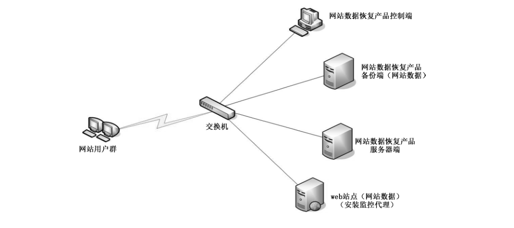
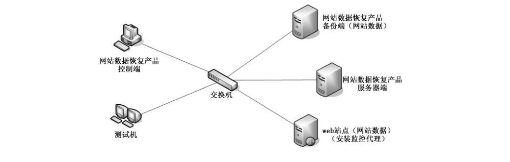

# GB/T 29766-2021 信息安全技术 网站数据恢复产品技术要求与测试评价方法

> 来源：[GB/T 29766-2021 国家标准详情](https://openstd.samr.gov.cn/bzgk/std/newGbInfo?hcno=80BA91D23400E80F4777F6FB538C5244)。
> PDF SHA-256：e75b77329c0be401a5a2a9aa1a335359010cd8f916b372b21217f095c23d4dcc。
> 发布日期：2021-10-11；实施日期：2022-05-01。依据官方 PDF 的 34 页图像逐页核对，保留图 1、图 2，合并跨页续表，并以粗体保留仅适用于增强级的条款标识。已去除封面、目录、分页和页眉页脚，正式引用请核对官方原文。

> 转写注：原版附录 A 标题为“网站恢复产品等级划分”；6.3.1.2 a）引用“6.2、6.3”，B.2.1 正文写作“监控相应时间”，7.4.5 a）3）写作“中等型型攻击”，均按原版保留。

## 前言

本文件按照 GB/T 1.1—2020《标准化工作导则 第1部分：标准化文件的结构和起草规则》的规定起草。

本文件代替 GB/T 29766—2013《信息安全技术 网站数据恢复产品技术要求与测试评价方法》，与 GB/T 29766—2013 相比，除结构调整和编辑性改动外，主要技术变化如下：

——修改了“术语与定义”章节（见第 3 章，2013 年版的第 3 章）；

——增加了“缩略语”章节（见第 4 章）；

——增加了“产品描述”章节（见第 5 章）；

——增加了“网站数据防篡改”要求（见 6.1.2）；

——修改了“实施告警事件”要求（见 6.1.3.1，2013 年版的 5.1.1.2.1）；

——增加了“告警信息”要求（见 6.1.3.3）；

——修改了“可审计事件”“审计数据内容”的要求（见 6.1.8.1、6.1.8.2，2013 年版的 5.1.1.9.1、5.1.1.9.2）；

——增加了“审计数据存储”“审计报表”的要求（见 6.1.8.3、6.1.8.6）；

——修改了“备份数据保护”（见 6.1.9，2013 年版的 5.1.1.10）；

——增加了“自身安全要求”（见 6.2、7.3）；

——删除了“抵御已知攻击”的要求（见 2013 年版的 5.1.1.12）；

——修改了“安全保障要求”（见 6.3、7.4，2013 年版的 5.1.2、5.2.2）。

请注意本文件的某些内容可能涉及专利。本文件的发布机构不承担识别专利的责任。

本文件由全国信息安全标准化技术委员会（SAC/TC 260）提出并归口。

本文件起草单位：中认信安（北京）技术服务有限公司、中国网络安全审查技术与认证中心、公安部第三研究所、中国电子科技集团公司第十五研究所、上海市信息安全测评认证中心、北京信息安全测评中心、公安部第一研究所、北京天融信网络安全技术有限公司、北京神州绿盟科技有限公司、蓝盾信息安全技术有限公司、厦门服云信息科技有限公司、杭州安恒信息技术股份有限公司、北京山石网科信息技术有限公司、北京北信源软件股份有限公司、中国科学院信息工程研究所。

本文件主要起草人：布宁、甘杰夫、赵婷、申永波、贺海、田霞、吴迪、董晶晶、张笑笑、张俊彦、徐佟海、雷晓锋、安高峰、刘强、潘文欣、程长高、韩煜、李宇、刘思蓉、段静辉、寇石磊、刘兴安、刘玉岭。

本文件及其所代替文件的历次版本发布情况为：

——2013 年首次发布为 GB/T 29766—2013；

——本次为第一次修订。

## 1 范围

本文件规定了网站数据恢复产品安全功能要求、自身安全要求、安全保障要求与测试评价方法。

本文件适用于对网站数据恢复产品的研制、生产、测试和评价。

## 2 规范性引用文件

下列文件中的内容通过文中的规范性引用而构成本文件必不可少的条款。其中，注日期的引用文件，仅该日期对应的版本适用于本文件；不注日期的引用文件，其最新版本（包括所有的修改单）适用于本文件。

- GB/T 18336.1 信息技术 安全技术 信息技术安全评估准则 第1部分：简介和一般模型

- GB/T 25069 信息安全技术 术语

## 3 术语和定义

GB/T 18336.1 和 GB/T 25069界定的以及下列术语和定义适用于本文件。

### 3.1 网站数据恢复产品 website data recovery product

实现网站数据防篡改、备份与恢复的软件或软硬件组合。

### 3.2 网站静态数据 static website data

网站服务器上不会因访问对象或下载请求的不同而发生变化的数据。

### 3.3 网站动态数据 dynamic website data

网站服务器上可根据访问对象或下载请求的不同而发生变化的数据，可由网站服务器端脚本语言根据提交条件或状态生成。

### 3.4 网站数据 website data

与网站发布的内容相关的数据。

> 注：网站数据包括网站静态数据、网站动态数据和网站目录。

### 3.5 网站数据恢复 website data recovery

对遭受非授权更改的网站数据及时进行恢复的过程。

### 3.6 授权管理员 authorized administrator

具有使用网站数据恢复产品管理功能权限的人员。

### 3.7 网站备份数据 backup for website

授权管理员认可的网站数据副本。

### 3.8 完全备份 full backup

备份所有指定的数据对象的过程。

### 3.9 增量备份 incremental backup

仅备份自上次备份后更改过的数据对象的过程。

## 4 缩略语

下列缩略语适用于本文件。

IP：网际互联协议（Internet Protocol）

## 5 产品描述

网站数据恢复产品是指提供对网站数据的监测、防篡改，并实现数据备份和恢复等安全功能的产品，通常由网站数据恢复产品服务器端、控制端、备份端和监控代理等组件组成，其中监控代理运行在网站服务器上，主要提供网站数据监测、防篡改等功能，当监测到网站数据被篡改等安全事件后，产品可使用备份文件自动或手动对遭受非授权更改的网站数据进行恢复；网站数据恢复产品服务器端用于集中监控和收集事件记录，并进行告警；控制端用于对产品服务器端进行管理，备份端主要用于备份、存储网站数据。

网站数据恢复产品保护的资产是 WEB 站点的网页文件、脚本等受保护的网站数据，此外网站数据恢复产品本身及其内部的重要数据也是受保护的资产。

网站数据恢复产品典型部署网络拓扑图如图1所示。

网站数据恢复产品的安全技术要求分为安全功能要求、自身安全要求和安全保障要求。其中，安全功能要求是对网站数据恢复产品应具备的安全功能提出具体要求，包括网站数据监测功能、网站数据防篡改功能、告警功能、网站数据恢复功能、网站数据备份、网站数据正常更新、管理控制功能、审计功能、备份数据保护；自身安全功能要求针对网站数据恢复产品的自身安全提出具体的要求，包括身份标识与鉴别、管理能力、管理审计、管理方式和程序数据保护；安全保障要求针对网站数据恢复产品的生命周期过程提出具体要求，包括开发、指导性文档、生命周期支持、测试和脆弱性评定。

网站数据恢复产品的安全等级分为基本级和增强级。安全功能与自身安全的强弱、以及安全保障要求的高低是等级划分的具体依据，安全等级突出安全特性，其中“加粗宋体字”表示所描述的要求仅适用于增强级产品，具体安全技术要求的等级划分按附录 A 要求。

## 6 技术要求

### 6.1 安全功能要求

#### 6.1.1 网站数据监测

##### 6.1.1.1 网站静态数据监测

产品应提供网站静态数据监测功能，并能对其非授权增加、删除、修改（包括文件内容或属性修改、重命名、移动等）进行实时告警和审计。

##### 6.1.1.2 网站动态数据监测

**产品应提供网站动态数据监测功能，并能对其非授权增加、删除、修改（包括文件内容或属性修改、重命名、移动等）进行实时告警和审计。**

##### 6.1.1.3 网站目录监测

产品应提供网站目录监测功能，并能对其非授权增加、删除、修改（包括目录属性修改、重命名、移动等）进行实时告警和审计。

#### 6.1.2 网站数据防篡改

##### 6.1.2.1 网站静态数据防篡改

应提供防止受保护网站静态数据被非授权更改的能力。

##### 6.1.2.2 网站动态数据防篡改

**应能够提供防止受保护网站动态数据被非授权更改的能力。**

##### 6.1.2.3 网站目录防篡改

应提供防止受保护网站目录被非授权更改的能力。

#### 6.1.3 告警功能

##### 6.1.3.1 实时告警事件

产品应对以下事件进行实时告警：

<ol class="standard-subclauses">
<li>a）受保护网站静态数据、<strong>受保护网站动态数据</strong>、受保护网站目录的非授权操作；
</li>
<li>b） 监控保护程序的异常关闭；
</li>
<li>c） 监控保护程序或相关的功能文件被更改或删除；
</li>
<li>d）<strong>网站服务状态异常。</strong>
</li>
</ol>

##### 6.1.3.2 告警方式

应提供适当的告警方式。如：邮件、声音或屏幕提示等告警方式。

##### 6.1.3.3 告警信息

告警信息内容应包括但不限于：事件发生时间、事件类型、操作者（进程）、访问数据信息等。

#### 6.1.4 网站数据备份

##### 6.1.4.1 网站数据备份初始化

产品在初次安装后应采取一定措施确保被监控的网站数据与网站备份数据一致，并保证网站备份数据的正确性和可用性。

##### 6.1.4.2 网站数据备份功能

应实现对网站数据进行备份的功能，并保证备份的及时性。备份功能的实现采用完全备份或增量备份的方式进行。

##### 6.1.4.3 网站数据备份方式

**备份方式应支持手动备份和自动备份，自动备份应具备一定的实时性。**

#### 6.1.5 网站数据恢复

##### 6.1.5.1 网站静态数据恢复

产品应使用备份文件自动恢复遭受非授权更改的受保护网站静态数据。

##### 6.1.5.2 网站动态数据恢复

**产品应使用备份文件（自动或手动）恢复遭受非授权更改的受保护网站动态数据。**

##### 6.1.5.3 网站目录恢复

产品应使用备份目录自动恢复遭受非授权更改的受保护网站目录。

#### 6.1.6 网站数据正常更新

产品应提供或支持网站数据正常更新功能。该功能可以采用自动更新或手动更新的方式实现。手动更新时，产品应确保只有经授权的用户能够对网站数据进行更新。自动更新时，产品应能够及时发现备份数据的变化，并自动同步备份数据（包括网站静态数据、**网站动态数据**和网站目录）到 WEB 服务器，从而保证备份数据与被监控网站数据的一致性。

#### 6.1.7 管理控制功能

##### 6.1.7.1 监控对象管理

产品应能增加或撤销被监控的目录、文件或**网站动态数据**。

##### 6.1.7.2 与网站发布系统的兼容性

产品应至少支持一种网站发布系统。安装产品后，产品及网站发布系统均能稳定运行。

##### 6.1.7.3 策略定制

产品应支持对网站数据监测、网站数据防篡改、网站数据备份与恢复、网站数据正常更新和事件告警方式等定制策略，并提供缺省配置策略。

##### 6.1.7.4 策略管理

产品应支持对已配置的策略进行添加、删除、修改、分发、导入、导出等操作。

#### 6.1.8 审计功能

##### 6.1.8.1 可审计事件

产品应对以下事件进行审计：

<ol class="standard-subclauses">
<li>a） 网站数据的正常更新；
</li>
<li>b） 受保护网站静态数据非授权操作与恢复；
</li>
<li>c）<strong>受保护网站动态数据非授权操作和恢复；</strong>
</li>
<li>d） 受保护网站目录非授权操作与恢复；
</li>
<li>e） 更改策略操作、监控保护程序异常情况。
</li>
</ol>

##### 6.1.8.2 审计数据内容

审计数据中至少应包括事件发生的时间、用户标识（进程）、事件类型、网站数据的位置和名称、事件结果等内容。

##### 6.1.8.3 审计数据存储

审计数据应存储于掉电非易失性存储介质中。审计数据存储空间达到阈值时，应能对审计数据进行自动备份或转存。

##### 6.1.8.4 内容可读性

审计记录应便于为人所理解，不应有歧义。

##### 6.1.8.5 审计记录查询

应能按条件或条件组合对审计记录进行查询。例如，按时间、事件类型等条件进行查询。

##### 6.1.8.6 审计报表

应提供审计数据统计分析功能，并生成报表和导出报表。

#### 6.1.9 备份数据保护

##### 6.1.9.1 备份数据的安全存储

备份数据的安全存储的要求包括但不限于：

<ol class="standard-subclauses">
<li>a） 应设置备份数据访问控制策略，以保证所有访问备份数据的操作均得到了正确的授权；
</li>
<li>b）<strong>应采取安全措施保证备份数据的完整性，保证网站数据恢复的正确性。</strong>
</li>
</ol>

##### 6.1.9.2 备份数据的安全传输

当通过网络进行网站数据备份或恢复时，应采取安全措施保证传输数据的完整性。

### 6.2 自身安全要求

#### 6.2.1 身份标识与鉴别

身份标识与鉴别的要求包括但不限于：

<ol class="standard-subclauses">
<li>a） 应对用户身份进行标识和鉴别，用户标识应具有唯一性；
</li>
<li>b） 应对用户身份鉴别信息进行安全保护，保障用户鉴别信息存储和传输过程中的保密性和完整性；
</li>
<li>c） 应提供登录失败处理功能，包括但不限于限制连续的非授权登录尝试次数等；
</li>
<li>d） 应提供登录超时处理功能，当登录连接超时自动退出；
</li>
<li>e） 在采用基于口令的身份鉴别时，要求对用户设置的口令进行复杂度及有效期检查，确保用户口令满足一定的复杂度要求，并在口令使用时间达到有效期时要求用户进行修改；
</li>
<li>f） 当网站数据恢复产品中存在默认口令时，应在用户首次登录时提示用户对默认口令进行修改；
</li>
<li>g）<strong>应对授权管理员选择两种或两种以上组合的鉴别技术进行身份鉴别。</strong>
</li>
</ol>

#### 6.2.2 管理能力

管理能力的要求包括但不限于：

<ol class="standard-subclauses">
<li>a） 向授权用户提供设置和修改安全管理相关的数据参数的功能；
</li>
<li>b） 向授权用户提供设置、查询和修改各种安全策略的功能；
</li>
<li>c） 向授权用户提供管理审计日志的功能，包括审计的存档、删除、清空、导出和备份等；
</li>
<li>d）<strong>支持更新自身系统的能力，包括对软件系统的升级以及各种特征库的升级；</strong>
</li>
<li>e）<strong>应区分管理用户角色，应能够划分为系统管理员、安全操作员和安全审计员，三类管理角色权限能够相互制约。</strong>
</li>
</ol>

#### 6.2.3 管理审计

管理审计的要求包括但不限于：

<ol class="standard-subclauses">
<li>a） 对用户账户的登录和注销、服务启动、重要配置变更、增加/删除/修改管理员、保存/删除审计日志等操作行为进行日志记录；
</li>
<li>b） 对网站数据恢复产品及其模块的异常状态进行告警，并记录日志；
</li>
<li>c） 日志记录中包括如下内容：事件发生的日期和时间、事件的类型、事件主体、事件操作结果；
</li>
<li>d） 保护审计日志，防止未授权的操作。
</li>
</ol>

#### 6.2.4 管理方式

产品的管理方式要求包括但不限于：

<ol class="standard-subclauses">
<li>a） 若支持通过网络接口进行远程管理，应能够限定进行远程管理的IP地址；
</li>
<li>b） 若支持通过网络接口进行远程管理，管理端与网站数据恢复产品之间的所有通讯数据应非明文传输；
</li>
<li>c）<strong>应支持集中管理，通过集中管理平台实现监控运行状态、下发安全策略、升级系统版本、升级特征库版本。</strong>
</li>
</ol>

#### 6.2.5 程序数据保护

##### 6.2.5.1 自身进程、服务保护

产品应具备防止非授权终止自身运行的措施。

##### 6.2.5.2 程序文件保护

**产品应采取保护措施，以保证产品的主要程序文件（如执行文件、日志库文件等）不被非授权删除或修改。**

### 6.3 安全保障要求

#### 6.3.1 开发

##### 6.3.1.1 安全架构

开发者应提供网站数据恢复产品安全功能的安全架构描述，安全架构描述应满足以下要求：

<ol class="standard-subclauses">
<li>a） 与网站数据恢复产品设计文档中对安全功能的描述范围相一致；
</li>
<li>b） 充分描述网站数据恢复产品采取的自我保护、不可旁路的安全机制。
</li>
</ol>

##### 6.3.1.2 功能规范

开发者应提供完备的功能规范说明，功能规范说明应满足以下要求：

<ol class="standard-subclauses">
<li>a） 根据网站数据恢复产品类型清晰描述6.2、6.3中定义的安全功能；
</li>
<li>b） 标识和描述网站数据恢复产品所有安全功能接口的目的、使用方法及相关参数；
</li>
<li>c） 描述安全功能实施过程中，与安全功能接口相关的所有行为；
</li>
<li>d） 描述可能由安全功能接口的调用而引起的所有直接错误消息。
</li>
</ol>

##### 6.3.1.3 产品设计

开发者应提供网站数据恢复产品设计文档，网站数据恢复产品设计文档应满足以下要求：

<ol class="standard-subclauses">
<li>a） 通过子系统描述网站数据恢复产品结构，标识和描述网站数据恢复产品安全功能的所有子系统，并描述子系统间的相互作用；
</li>
<li>b） 提供子系统和安全功能接口间的对应关系；
</li>
<li>c）<strong>通过实现模块描述安全功能，标识和描述实现模块的目的、相关接口及返回值等，并描述实现模块间的相互作用及调用的接口；</strong>
</li>
<li>d）<strong>提供实现模块和子系统间的对应关系。</strong>
</li>
</ol>

##### 6.3.1.4 实现表示

**开发者应提供网站数据恢复产品安全功能的实现表示，实现表示应满足以下要求：**

<ol class="standard-subclauses">
<li>a）<strong>详细定义网站数据恢复产品安全功能，包括软件代码、设计数据等实例；</strong>
</li>
<li>b）<strong>提供实现表示与网站数据恢复产品设计描述间的对应关系。</strong>
</li>
</ol>

#### 6.3.2 指导性文档

##### 6.3.2.1 操作用户指南

开发者应提供明确和合理的操作用户指南，对每一种用户角色的描述应满足以下要求：

<ol class="standard-subclauses">
<li>a） 描述用户能够访问的功能和特权，包含适当的警示信息；
</li>
<li>b） 描述网站数据恢复产品安全功能及接口的用户操作方法，包括配置参数的安全值等；
</li>
<li>c） 标识和描述网站数据恢复产品运行的所有可能状态，包括操作导致的失败或者操作性错误；
</li>
<li>d） 描述实现网站数据恢复产品安全目的必需执行的安全策略。
</li>
</ol>

##### 6.3.2.2 准备程序

开发者应提供网站数据恢复产品及其准备程序，准备程序描述应满足以下要求：

<ol class="standard-subclauses">
<li>a） 描述与开发者交付程序相一致的安全接收所交付网站数据恢复产品必需的所有步骤；
</li>
<li>b） 描述安全安装网站数据恢复产品及其运行环境必需的所有步骤。
</li>
</ol>

#### 6.3.3 生命周期支持

##### 6.3.3.1 配置管理能力

开发者的配置管理能力应满足以下要求：

<ol class="standard-subclauses">
<li>a） 为网站数据恢复产品的不同版本提供唯一的标识。
</li>
<li>b） 使用配置管理系统对组成网站数据恢复产品的所有配置项进行维护，并进行唯一标识。
</li>
<li>c） 提供配置管理文档，配置管理文档描述用于唯一标识配置项的方法。
</li>
<li>d）<strong>配置管理系统提供自动方式来支持网站数据恢复产品的生成，通过自动化措施确保配置项仅接受授权变更。</strong>
</li>
<li>e）<strong>配置管理文档包括一个配置管理计划，描述用来接受修改过的或新建的作为网站数据恢复产品组成部分的配置项的程序。配置管理计划描述应描述如何使用配置管理系统开发网站数据恢复产品，开发者实施的配置管理应与配置管理计划相一致。</strong>
</li>
</ol>

##### 6.3.3.2 配置管理范围

开发者应提供网站数据恢复产品配置项列表，并说明配置项的开发者。配置项列表应包含以下内容：

<ol class="standard-subclauses">
<li>a） 网站数据恢复产品、安全保障要求的评估证据和网站数据恢复产品的组成部分；
</li>
<li>b）<strong>实现表示、安全缺陷报告及其解决状态。</strong>
</li>
</ol>

##### 6.3.3.3 交付程序

**开发者应使用一定的交付程序交付网站数据恢复产品，并将交付过程文档化。在给用户方交付网站数据恢复产品的各版本时，交付文档应描述为维护安全所必需的所有程序。**

##### 6.3.3.4 开发安全

**开发者应提供开发安全文档。开发安全文档应描述在网站数据恢复产品的开发环境中，为保护网站数据恢复产品设计和实现的保密性和完整性所必需的所有物理的、程序的、人员的和其他方面的安全措施。**

##### 6.3.3.5 生命周期定义

**开发者应建立一个生命周期模型对网站数据恢复产品的开发和维护进行的必要控制，并提供生命周期定义文档描述用于开发和维护网站数据恢复产品的模型。**

##### 6.3.3.6 工具技术

**开发者应明确定义用于开发网站数据恢复产品的工具，并提供开发工具文档无歧义地定义实现中每个语句的含义和所有依赖于实现的选项的含义。**

#### 6.3.4 测试

##### 6.3.4.1 测试覆盖

开发者应提供测试覆盖文档，测试覆盖描述应满足以下要求：

<ol class="standard-subclauses">
<li>a） 表明测试文档中所标识的测试与功能规范中所描述的网站数据恢复产品的安全功能间的对应性；
</li>
<li>b）<strong>表明上述对应性是完备的，并证实功能规范中的所有安全功能接口都进行了测试。</strong>
</li>
</ol>

##### 6.3.4.2 测试深度

**开发者应提供测试深度的分析。测试深度分析描述应满足以下要求：**

<ol class="standard-subclauses">
<li>a）<strong>证实测试文档中的测试与网站数据恢复产品设计中的安全功能子系统和实现模块之间的一致性；</strong>
</li>
<li>b）<strong>证实网站数据恢复产品设计中的所有安全功能子系统、实现模块都已经进行过测试。</strong>
</li>
</ol>

##### 6.3.4.3 功能测试

开发者应测试网站数据恢复产品安全功能，将结果文档化并提供测试文档。测试文档应包括以下内容：

<ol class="standard-subclauses">
<li>a） 测试计划，标识要执行的测试，并描述执行每个测试的方案，这些方案包括对于其他测试结果的任何顺序依赖性；
</li>
<li>b） 预期的测试结果，表明测试成功后的预期输出；
</li>
<li>c） 实际测试结果和预期的测试结果的对比。
</li>
</ol>

##### 6.3.4.4 独立测试

开发者应提供一组与其自测安全功能时使用的同等资源，以用于安全功能的抽样测试。

#### 6.3.5 脆弱性评定

基于已标识的潜在脆弱性，产品能抵抗以下强度的攻击：

<ol class="standard-subclauses">
<li>a） 具有基本攻击潜力的攻击者的攻击；
</li>
<li>b） 具有中等攻击潜力的攻击者的攻击。
</li>
</ol>

## 7 测试评价方法

### 7.1 测试环境与工具

测评评价方法包括针对基本级产品和增强级产品的安全功能要求测试和安全保障要求评估。有关性能指标和测试方法应按附录B的规定。

网站数据恢复产品测试的典型网络拓扑结构示意图如图2所示。

测试设备包括但不限于测试所需的交换机、Web 服务器、网站数据恢复产品控制主机等其他设备。

测试机包括但不限于测试控制设备、测试工具集等。

### 7.2 安全功能要求测试

#### 7.2.1 网站数据监测

##### 7.2.1.1 网站静态数据监测

测试评价方法如下。

<ol class="standard-subclauses">
<li>a） 测试方法：
<ol class="standard-subclauses">
<li>1） 配置相关策略，指定需要监测的Web 服务器和相关静态数据，如目录、文件。
</li>
<li>2） 尝试登录网页所在的Web 服务器，并分别进行以下操作：
<ol class="standard-subclauses">
<li>（1） 对受保护的网站静态数据进行非授权增加；
</li>
<li>（2） 对受保护的网站静态数据进行非授权删除；
</li>
<li>（3） 对受保护的网站静态数据进行非授权修改（包括文件属性修改、重命名、移动等）；
</li>
<li>（4） 对受保护的网站静态数据内容进行非授权添加、删除或修改。
</li>
</ol>

</li>
<li>3） 检查产品能否对非授权增加、删除和修改网站静态数据的事件进行实时告警，并且告警事件与实际情况相符。
</li>
</ol>

</li>
<li>b） 预期结果：产品能对非授权增加、删除和修改网站静态数据的事件进行实时告警，并且告警事件与实际情况相符。
</li>
<li>c） 结果判定：实际测试结果与相关预期结果一致则判定为符合，其他情况判定为不符合。
</li>
</ol>

##### 7.2.1.2 网站动态数据监测

测试评价方法如下。

<ol class="standard-subclauses">
<li>a） 测试方法：
<ol class="standard-subclauses">
<li>1） <strong>配置相关策略，指定需要监测的Web 服务器和相关动态数据，如数据库数据或文件。</strong>
</li>
<li>2） <strong>尝试登录网站动态数据所在的Web 服务器，并分别进行以下操作：</strong>
<ol class="standard-subclauses">
<li>（1） <strong>对受保护的网站动态数据进行非授权增加；</strong>
</li>
<li>（2） <strong>对受保护的网站动态数据进行非授权删除；</strong>
</li>
<li>（3） <strong>对受保护的网站动态数据进行非授权修改；</strong>
</li>
<li>（4） <strong>对受保护的网站动态数据内容进行非授权添加、删除或修改。</strong>
</li>
</ol>

</li>
<li>3） <strong>检查产品能否对非授权增加、删除和修改网站动态数据的事件进行实时告警，并且告警事件与实际情况相符。</strong>
</li>
</ol>

</li>
<li>b） 预期结果：<strong>产品能对非授权增加、删除和修改网站动态数据的事件进行实时告警，并且告警事件与实际情况相符。</strong>
</li>
<li>c） 结果判定：实际测试结果与相关预期结果一致则判定为符合，其他情况判定为不符合。
</li>
</ol>

##### 7.2.1.3 网站目录监测

测试评价方法如下。

<ol class="standard-subclauses">
<li>a） 测试方法：
<ol class="standard-subclauses">
<li>1） 配置相关策略，指定需要监测的Web 服务器和相关目录。
</li>
<li>2） 尝试登录网站目录所在的 Web 服务器，并分别进行以下操作：
<ol class="standard-subclauses">
<li>（1） 对受保护的网站目录进行非授权增加；
</li>
<li>（2） 对受保护的网站目录进行非授权删除；
</li>
<li>（3） 对受保护的网站目录进行非授权修改（包括目录属性修改、重命名、移动等）。
</li>
</ol>

</li>
<li>3） 检查产品能否对非授权增加、删除和修改网站目录的事件进行实时告警，并且告警事件与实际情况相符。
</li>
</ol>

</li>
<li>b） 预期结果：产品能对非授权增加、删除和修改网站目录的事件进行实时告警，并且告警事件与实际情况相符。
</li>
<li>c） 结果判定：实际测试结果与相关预期结果一致则判定为符合，其他情况判定为不符合。
</li>
</ol>

#### 7.2.2 网站数据防篡改

##### 7.2.2.1 网站静态数据防篡改

测试评价方法如下。

<ol class="standard-subclauses">
<li>a） 测试方法：
<ol class="standard-subclauses">
<li>1） 配置相关策略，指定需要保护的Web 服务器和相关静态数据，如文件。
</li>
<li>2） 尝试登录网页所在的 Web 服务器，并分别进行以下操作：
<ol class="standard-subclauses">
<li>（1） 对受保护的网站静态数据进行非授权增加；
</li>
<li>（2） 对受保护的网站静态数据进行非授权删除；
</li>
<li>（3） 对受保护的网站静态数据进行非授权修改（包括文件属性修改、重命名、移动等）；
</li>
<li>（4） 对受保护的网站静态数据内容进行非授权添加、删除或修改。
</li>
</ol>

</li>
<li>3） 检查产品能否对阻止非授权增加、删除和修改网站静态数据的事件。
</li>
</ol>

</li>
<li>b） 预期结果：产品能防止非授权增加、删除和修改网站静态数据。
</li>
<li>c） 结果判定：实际测试结果与相关预期结果一致则判定为符合，其他情况判定为不符合。
</li>
</ol>

##### 7.2.2.2 网站动态数据防篡改

测试评价方法如下。

<ol class="standard-subclauses">
<li>a） 测试方法：
<ol class="standard-subclauses">
<li>1） <strong>配置相关策略，指定需要保护的 Web 服务器和相关动态数据，如数据库数据或文件。</strong>
</li>
<li>2） <strong>尝试登录相关服务器进行以下操作：</strong>
<ol class="standard-subclauses">
<li>（1） <strong>对受保护的网站动态数据进行非授权增加；</strong>
</li>
<li>（2） <strong>对受保护的网站动态数据进行非授权删除；</strong>
</li>
<li>（3） <strong>对受保护的网站动态数据进行非授权修改（包括但不限于文件属性修改、重命名、移动等）；</strong>
</li>
<li>（4） <strong>对受保护的网站动态数据的内容进行非授权添加、删除或修改。</strong>
</li>
</ol>

</li>
<li>3） <strong>检查产品能否阻止非授权增加、删除和修改网站动态数据的事件。</strong>
</li>
</ol>

</li>
<li>b） 预期结果：<strong>产品能防止对非授权增加、删除和修改网站动态数据。</strong>
</li>
<li>c） 结果判定：实际测试结果与相关预期结果一致则判定为符合，其他情况判定为不符合。
</li>
</ol>

##### 7.2.2.3 网站目录防篡改

测试评价方法如下。

<ol class="standard-subclauses">
<li>a） 测试方法：
<ol class="standard-subclauses">
<li>1） 配置相关策略，指定需要监测的Web 服务器和相关目录。
</li>
<li>2） 尝试登录网站目录所在的 Web 服务器，并分别进行以下操作：
<ol class="standard-subclauses">
<li>（1） 对受保护的网站目录进行非授权增加；
</li>
<li>（2） 对受保护的网站目录进行非授权删除；
</li>
<li>（3） 对受保护的网站目录进行非授权修改（包括目录属性修改、重命名、移动等）。
</li>
</ol>

</li>
<li>3） 检查产品能否阻止非授权增加、删除和修改网站目录的事件，并进行实时告警，并且告警事件与实际情况相符。
</li>
</ol>

</li>
<li>b） 预期结果：产品能阻止非授权增加、删除和修改网站目录，并进行实时告警，且告警事件与实际情况相符。
</li>
<li>c） 结果判定：实际测试结果与相关预期结果一致则判定为符合，其他情况判定为不符合。
</li>
</ol>

#### 7.2.3 告警功能

##### 7.2.3.1 实时告警事件

测试评价方法如下。

<ol class="standard-subclauses">
<li>a） 测试方法：
<ol class="standard-subclauses">
<li>1） 尝试登录网页和网站目录所在的Web 服务器，并分别进行以下操作：
<ol class="standard-subclauses">
<li>（1） 对受保护的网站静态数据进行非授权增、删、改操作；
</li>
<li>（2） <strong>对受保护的网站动态数据进行非授权增、删、改操作；</strong>
</li>
<li>（3） 对受保护的网站目录进行非授权增、删、改操作；
</li>
</ol>

</li>
<li>2） 尝试登录监控保护程序所在的Web 服务器，并使用相关工具，如操作系统中的任务管理器或管理工具中“服务”关闭监控保护程序或相关服务；
</li>
<li>3） 尝试修改或删除监控保护程序或相关的功能文件；
</li>
<li>4） <strong>检查产品是否监测 Web 服务器相关性能；</strong>
</li>
<li>5） 检查产品是否对以上由非授权操作引起的安全事件进行实时告警。
</li>
</ol>

</li>
<li>b） 预期结果：<strong>产品对以上的所有事件都能进行实时告警。</strong>
</li>
<li>c） 结果判定：实际测试结果与相关预期结果一致则判定为符合，其他情况判定为不符合。
</li>
</ol>

##### 7.2.3.2 告警方式

测试评价方法如下。

<ol class="standard-subclauses">
<li>a） 测试方法：
<ol class="standard-subclauses">
<li>1） 设置不同告警方式，并分别触发6.1.3.1 中所列的事件；
</li>
<li>2） 检查产品是否按照设定的方式进行了告警。
</li>
</ol>

</li>
<li>b） 预期结果：产品对所有告警事件都能按照设定的方式进行告警。
</li>
<li>c） 结果判定：实际测试结果与相关预期结果一致则判定为符合，其他情况判定为不符合。
</li>
</ol>

##### 7.2.3.3 告警信息

测试评价方法如下。

<ol class="standard-subclauses">
<li>a） 测试方法：
<ol class="standard-subclauses">
<li>1） 设置不同告警方式，并分别触发6.1.3.1 中所列的事件；
</li>
<li>2） 检查产品的告警信息内容应包括但不限于：事件发生时间、事件类型、操作者（进程）、访问数据信息等。
</li>
</ol>

</li>
<li>b） 预期结果：告警信息内容都包括但不限于：事件发生时间、事件类型、操作者（进程）、访问数据信息等。
</li>
<li>c） 结果判定：实际测试结果与相关预期结果一致则判定为符合，其他情况判定为不符合。
</li>
</ol>

#### 7.2.4 网站数据备份

##### 7.2.4.1 网站数据备份初始化

测试评价方法如下。

<ol class="standard-subclauses">
<li>a） 测试方法：检查产品相关资料中是否存在对网站数据备份初始化的描述，并验证在初次安装产品后，系统是否采取措施确保被监控的网站数据与网站备份数据一致。
</li>
<li>b） 预期结果：产品在初次安装后，采取一定措施确保被监控的网站数据与网站备份数据一致。
</li>
<li>c） 结果判定：实际测试结果与相关预期结果一致则判定为符合，其他情况判定为不符合。
</li>
</ol>

##### 7.2.4.2 网站数据备份

测试评价方法如下。

<ol class="standard-subclauses">
<li>a） 测试方法：
<ol class="standard-subclauses">
<li>1） 登录产品管理界面，验证是否能够按照操作或预设的备份策略，实现网站数据备份功能；
</li>
<li>2） 验证产品实际的备份功能是否能够实现。
</li>
</ol>

</li>
<li>b） 预期结果：产品能够按照操作或预设备份方式，实现完全备份功能或增量备份功能。
</li>
<li>c） 结果判定：实际测试结果与相关预期结果一致则判定为符合，其他情况判定为不符合。
</li>
</ol>

##### 7.2.4.3 网站数据备份方式

测试评价方法如下。

<ol class="standard-subclauses">
<li>a） 测试方法：<strong>登录产品管理界面，验证产品的备份方式是否支持手动备份和自动备份，自动备份是否具备一定的实时性。</strong>
</li>
<li>b） 预期结果：<strong>产品提供的网站数据备份方式支持手动备份和自动备份，自动备份具备一定的实时性。</strong>
</li>
<li>c） 结果判定：实际测试结果与相关预期结果一致则判定为符合，其他情况判定为不符合。
</li>
</ol>

#### 7.2.5 网站数据恢复

##### 7.2.5.1 网站静态数据恢复

测试评价方法如下。

<ol class="standard-subclauses">
<li>a） 测试方法：
<ol class="standard-subclauses">
<li>1） 配置相关策略，指定需要监测的Web 服务器和相关静态数据，如目录或文件；
</li>
<li>2） 尝试登录网页所在的 Web 服务器，并分别进行以下操作：
<ol class="standard-subclauses">
<li>（1） 对受保护的网站静态数据进行非授权增加；
</li>
<li>（2） 对受保护的网站静态数据进行非授权删除；
</li>
<li>（3） 对受保护的网站静态数据进行非授权修改（包括文件属性修改、重命名、移动等）；
</li>
<li>（4） 对受保护的网站静态数据的内容进行添加、删除或修改；
</li>
</ol>

</li>
<li>3） 检查产品能否使用备份文件自动恢复遭受非授权更改的网站静态数据。
</li>
</ol>

</li>
<li>b） 预期结果：产品能自动删除非授权增加的网站静态数据，自动添加非授权删除的网站静态数据，自动恢复非授权修改的网站静态数据，自动恢复对数据内容进行添加、删除或修改。
</li>
<li>c） 结果判定：实际测试结果与相关预期结果一致则判定为符合，其他情况判定为不符合。
</li>
</ol>

##### 7.2.5.2 网站动态数据恢复

测试评价方法如下。

<ol class="standard-subclauses">
<li>a） 测试方法：
<ol class="standard-subclauses">
<li>1） <strong>配置相关策略，指定需要监测的 Web 服务器和相关动态数据，如文件或数据库数据等；</strong>
</li>
<li>2） <strong>尝试登录 Web 服务器，并进行非授权操作，如对受保护的网站动态数据进行添加、删除或修改等；</strong>
</li>
<li>3） <strong>检查产品能否使用备份数据以手动或自动的方式对网站数据进行恢复。</strong>
</li>
</ol>

</li>
<li>b） 预期结果：<strong>产品能使用备份数据以手动或自动的方式恢复因非授权操作而改变的产品适用的动态数据。</strong>
</li>
<li>c） 结果判定：实际测试结果与相关预期结果一致则判定为符合，其他情况判定为不符合。
</li>
</ol>

##### 7.2.5.3 网站目录恢复

测试评价方法如下。

<ol class="standard-subclauses">
<li>a） 测试方法：
<ol class="standard-subclauses">
<li>1） 配置相关策略，指定需要监测的 Web 服务器和相关目录；
</li>
<li>2） 尝试登录网站目录所在的Web 服务器，并分别进行以下操作：
<ol class="standard-subclauses">
<li>（1） 对受保护的网站目录进行非授权增加；
</li>
<li>（2） 对受保护的网站目录进行非授权删除；
</li>
<li>（3） 对受保护的网站目录进行非授权修改（包括目录属性修改、重命名、移动等）；
</li>
</ol>

</li>
<li>3） 检查产品能否使用备份目录自动恢复遭受非授权更改的网站目录。
</li>
</ol>

</li>
<li>b） 预期结果：产品能自动删除非授权增加的网站目录，自动添加非授权删除的网站目录，自动恢复非授权修改的网站目录。
</li>
<li>c） 结果判定：实际测试结果与相关预期结果一致则判定为符合，其他情况判定为不符合。
</li>
</ol>

#### 7.2.6 网站数据正常更新

测试评价方法如下。

<ol class="standard-subclauses">
<li>a） 测试方法：登录产品管理界面，验证产品是否提供或支持自动或手动方式对网站数据进行正常更新的功能。同时，在手动更新时，验证只有经授权的用户能够对网站数据（包括网站静态数据、<strong>网站动态数据</strong>、网站目录）进行更新；在自动更新时，验证产品能及时发现备份数据的变化，并自动同步该数据到 Web 服务器。
</li>
<li>b） 预期结果：<strong>产品能提供网站数据正常更新功能，且该功能满足要求。</strong>
</li>
<li>c） 结果判定：实际测试结果与相关预期结果一致则判定为符合，其他情况判定为不符合。
</li>
</ol>

#### 7.2.7 管理控制功能

##### 7.2.7.1 监控对象管理

测试评价方法如下。

<ol class="standard-subclauses">
<li>a） 测试方法：
<ol class="standard-subclauses">
<li>1） 以普通用户身份登录产品管理界面，查看其监控内容，尝试增加或撤销本用户的被监控的目录或文件或<strong>网站动态数据</strong>；
</li>
<li>2） 以另一普通用户身份登录产品管理界面，查看其监控内容，确认管理界面未提供查看或修改其他用户的被监控目录或文件或<strong>网站动态数据的功能</strong>；
</li>
<li>3） 针对调整过的目录或文件或<strong>网站动态数据</strong>引发告警事件，验证系统是否能进行告警。
</li>
</ol>

</li>
<li>b） 预期结果：<strong>产品能够实现监控对象管理功能。</strong>
</li>
<li>c） 结果判定：实际测试结果与相关预期结果一致则判定为符合，其他情况判定为不符合。
</li>
</ol>

##### 7.2.7.2 与网站发布系统的兼容性

测试评价方法如下。

<ol class="standard-subclauses">
<li>a） 测试方法：
<ol class="standard-subclauses">
<li>1） 把产品与几种网站发布系统分别进行配置；
</li>
<li>2） 分别对产品和几种网站发布系统进行功能测试；
</li>
<li>3） 验证产品和网站发布系统是否均能实现相应功能，并记录网站发布系统的型号。
</li>
</ol>

</li>
<li>b） 预期结果：产品至少兼容一种网站发布系统，且均能实现相应功能。
</li>
<li>c） 结果判定：实际测试结果与相关预期结果一致则判定为符合，其他情况判定为不符合。
</li>
</ol>

##### 7.2.7.3 策略定制

测试评价方法如下。

<ol class="standard-subclauses">
<li>a） 测试方法：
<ol class="standard-subclauses">
<li>1） 检查文档并查验策略定制的机制，是否提供缺省策略；
</li>
<li>2） 执行产品的各项待测策略定制功能；
</li>
<li>3） 验证待测策略定制功能是否有效。
</li>
</ol>

</li>
<li>b） 预期结果：产品提供缺省策略，并能够有效地进行策略定制。
</li>
<li>c） 结果判定：实际测试结果与相关预期结果一致则判定为符合，其他情况判定为不符合。
</li>
</ol>

##### 7.2.7.4 策略管理

测试评价方法如下。

<ol class="standard-subclauses">
<li>a） 测试方法：
<ol class="standard-subclauses">
<li>1） 执行产品的各项待测策略管理功能；
</li>
<li>2） 验证待测策略管理功能是否有效。
</li>
</ol>

</li>
<li>b） 预期结果：产品能够有效地进行策略管理。
</li>
<li>c） 结果判定：实际测试结果与相关预期结果一致则判定为符合，其他情况判定为不符合。
</li>
</ol>

#### 7.2.8 审计功能

##### 7.2.8.1 可审计事件

测试评价方法如下。

<ol class="standard-subclauses">
<li>a） 测试方法：
<ol class="standard-subclauses">
<li>1） 触发6.1.8.1a）中的所有事件，检查生成的审计记录；
</li>
<li>2） 触发 6.1.8.1b）中的所有事件，检查生成的审计记录；
</li>
<li>3） <strong>触发6.1.8.1c）中的所有事件，检查生成的审计记录；</strong>
</li>
<li>4） 触发6.1.8.1d）中的所有事件，检查生成的审计记录；
</li>
<li>5） 触发6.1.8.1e）中的所有事件，检查生成的审计记录。
</li>
</ol>

</li>
<li>b） 预期结果：
<ol class="standard-subclauses">
<li>1） 产品对6.1.8.1a）中的所有事件形成记录；
</li>
<li>2） 产品对 6.1.8.1b）中的所有事件形成记录；
</li>
<li>3） <strong>产品对 6.1.8.1c）中的所有事件形成记录；</strong>
</li>
<li>4） 产品对 6.1.8.1d）中的所有事件形成记录；
</li>
<li>5） 产品对 6.1.8.1e）中的所有事件形成记录。
</li>
</ol>

</li>
<li>c） 结果判定：实际测试结果与相关预期结果一致则判定为符合，其他情况判定为不符合。
</li>
</ol>

##### 7.2.8.2 审计数据内容

测试评价方法如下。

<ol class="standard-subclauses">
<li>a） 测试方法：
<ol class="standard-subclauses">
<li>1） 分别触发6.1.8.1a），6.1.8.1b），<strong>6.1.8.1c）</strong>中的所有事件；
</li>
<li>2） 检查产品的审计数据的内容是否包含了 6.1.8.1 中要求的内容。
</li>
</ol>

</li>
<li>b） 预期结果：产品的审计信息至少包含了6.1.8.1中要求的内容。
</li>
<li>c） 结果判定：实际测试结果与相关预期结果一致则判定为符合，其他情况判定为不符合。
</li>
</ol>

##### 7.2.8.3 审计数据存储

测试评价方法如下：

<ol class="standard-subclauses">
<li>a） 测试方法：
<ol class="standard-subclauses">
<li>1） 查阅所有审计数据是否存储于掉电非易失性存储介质中，查阅数据的存储周期是否可设定；
</li>
<li>2） 设定存储空间阈值，进行操作使审计数据存储空间达到阈值，检查是否能转存至其他存储设备。
</li>
</ol>

</li>
<li>b） 预期结果：
<ol class="standard-subclauses">
<li>1） 所有审计数据均存储于掉电非易失性存储介质中，审计数据存储周期可设定；
</li>
<li>2） 审计数据可以转存至其他存储设备。
</li>
</ol>

</li>
<li>c） 结果判定：实际测试结果与相关预期结果一致则判定为符合，其他情况判定为不符合。
</li>
</ol>

##### 7.2.8.4 内容可读性

测试评价方法如下。

<ol class="standard-subclauses">
<li>a） 测试方法：查阅相关审计记录中的所有审计数据，验证数据的内容是否能理解且不存在歧义。
</li>
<li>b） 预期结果：相关审计记录中的审计数据内容能被操作者理解。
</li>
<li>c） 结果判定：实际测试结果与相关预期结果一致则判定为符合，其他情况判定为不符合。
</li>
</ol>

##### 7.2.8.5 审计记录查询

测试评价方法如下。

<ol class="standard-subclauses">
<li>a） 测试方法：按条件或条件组合对审计记录进行查询。
</li>
<li>b） 预期结果：审计记录应能按条件或条件组合进行查询。
</li>
<li>c） 结果判定：实际测试结果与相关预期结果一致则判定为符合，其他情况判定为不符合。
</li>
</ol>

##### 7.2.8.6 审计报表

测试评价方法如下。

<ol class="standard-subclauses">
<li>a） 测试方法：对审计数据进行统计分析，并生成报表。
</li>
<li>b） 预期结果：能够生成统计分析报表，且内容准确。
</li>
<li>c） 结果判定：实际测试结果与相关预期结果一致则判定为符合，其他情况判定为不符合。
</li>
</ol>

#### 7.2.9 备份数据保护

##### 7.2.9.1 备份数据的安全存储

测试评价方法如下。

<ol class="standard-subclauses">
<li>a） 测试方法：
<ol class="standard-subclauses">
<li>1） 以不同的用户角色访问备份数据；
</li>
<li>2） 模拟对备份数据进行破坏，并根据破坏后的备份数据进行恢复测试，验证数据恢复时是否对备份数据进行完整性验证。
</li>
</ol>

</li>
<li>b） 预期结果：
<ol class="standard-subclauses">
<li>1） 仅得到授权的用户能访问备份数据；
</li>
<li>2） 执行数据恢复功能时，验证备份数据的完整性，只有通过验证后才能正确恢复。
</li>
</ol>

</li>
<li>c） 结果判定：实际测试结果与相关预期结果一致则判定为符合，其他情况判定为不符合。
</li>
</ol>

##### 7.2.9.2 备份数据的安全传输

测试评价方法如下。

<ol class="standard-subclauses">
<li>a） 测试方法：通过网络进行网站数据备份或恢复操作。
</li>
<li>b） 预期结果：产品应按照声明的方式保证被传输数据的完整性。
</li>
<li>c） 结果判定：实际测试结果与相关预期结果一致则判定为符合，其他情况判定为不符合。
</li>
</ol>

### 7.3 自身安全功能测试

#### 7.3.1 身份识别与鉴别

测试评价方法如下。

<ol class="standard-subclauses">
<li>a） 测试方法：
<ol class="standard-subclauses">
<li>1） 测试网站数据恢复产品是否对其用户进行唯一性标识，如不准许创建重名用户；
</li>
<li>2） 测试网站数据恢复产品对于用户鉴别信息的存储和传输过程中，采取何种措施对其保密性和完整性进行保护；
</li>
<li>3） 尝试连续多次失败登录网站数据恢复产品，触发网站数据恢复产品的登录失败处理功能，检查网站数据恢复产品采用何种机制防止用户进一步进行尝试；
</li>
<li>4） 网站数据恢复产品登录后，在超时时间内无任何操作，查看网站数据恢复产品是否自动退出；
</li>
<li>5） 若网站数据恢复产品采用口令鉴别机制，测试网站数据恢复产品是否提供了口令复杂度和有效期校验机制，是否不准许用户设置弱口令，如空口令、纯数字等，口令到期后要求用户修改；
</li>
<li>6） 网站数据恢复产品存在默认口令时，检查网站数据恢复产品是否提示用户对默认口令进行修改；
</li>
<li>7） <strong>查看网站数据恢复产品本地和远程管理是否支持双因子身份鉴别。</strong>
</li>
</ol>

</li>
<li>b） 预期结果：
<ol class="standard-subclauses">
<li>1） 网站数据恢复产品确保在管理员进行操作之前，对管理员、主机和用户等进行唯一的身份识别；
</li>
<li>2） 网站数据恢复产品支持非明文的远程管理会话，明文的远程管理方式能够关闭；
</li>
<li>3） 输入错误口令达到设定的最大失败次数后，网站数据恢复产品终止可信主机或用户建立会话的过程，并对该失败用户做禁止访问处理；
</li>
<li>4） 网站数据恢复产品登录后，在超时时间内无任何操作，网站数据恢复产品自动退出；
</li>
<li>5） 管理员需通过口令验证等身份鉴别措施；并对口令强度具有要求；
</li>
<li>6） 网站数据恢复产品存在默认口令时，网站数据恢复产品能够提示用户对默认口令进行修改；
</li>
<li>7） <strong>网站数据恢复产品支持双因子鉴别。</strong>
</li>
</ol>

</li>
<li>c） 结果判定：实际测试结果与相关预期结果一致则判定为符合，其他情况判定为不符合。
</li>
</ol>

#### 7.3.2 管理能力

测试评价方法如下。

<ol class="standard-subclauses">
<li>a） 测试方法：
<ol class="standard-subclauses">
<li>1） 验证网站数据恢复产品是否向授权管理员提供设置和修改安全管理参数的功能；
</li>
<li>2） 验证网站数据恢复产品是否向授权管理员提供设置、查询和修改各种安全策略的功能；
</li>
<li>3） 验证网站数据恢复产品是否向授权管理员提供管理审计日志的功能，包括审计导出、备份等；
</li>
<li>4） <strong>验证网站数据恢复产品是否支持自身系统以及各种特征库的升级；</strong>
</li>
<li>5） <strong>验证网站数据恢复产品是否区分管理员角色，是否能够划分为系统管理员、安全操作员和安全审计员，且三类管理员角色权限相互制约。</strong>
</li>
</ol>

</li>
<li>b） 预期结果：
<ol class="standard-subclauses">
<li>1） 网站数据恢复产品能够向授权管理员提供设置和修改安全管理参数的功能；
</li>
<li>2） 网站数据恢复产品能够向授权管理员提供设置、查询和修改各种安全策略的功能；
</li>
<li>3） 网站数据恢复产品能够向授权管理员提供管理审计日志的功能，包括审计的存档、删除、清空、导出和备份等；
</li>
<li>4） <strong>网站数据恢复产品能够支持自身系统以及各种特征库的升级；</strong>
</li>
<li>5） <strong>网站数据恢复产品能够区分管理员角色，能够划分为系统管理员、安全操作员和安全审计员，且三类管理员角色权限相互制约。</strong>
</li>
</ol>

</li>
<li>c） 结果判定：实际测试结果与相关预期结果一致则判定为符合，其他情况判定为不符合。
</li>
</ol>

#### 7.3.3 管理审计

测试评价方法如下。

<ol class="standard-subclauses">
<li>a） 测试方法：
<ol class="standard-subclauses">
<li>1） 针对网站数据恢复产品尝试进行用户登录和注销、服务启动、重要配置变更、增加/删除/修改管理员、保存/删除审计日志等操作行为，检查网站数据恢复产品是否针对上述操作生成审计日志；
</li>
<li>2） 验证网站数据恢复产品是否能够对其异常状态（如服务器端和客户端无法连接；功能模块发生异常等）进行告警，检查是否记录上述告警日志；
</li>
<li>3） 检查网站数据恢复产品的审计日志是否包括事件发生的日期和时间，事件的类型，主体身份，事件操作结果等内容；
</li>
<li>4） 检查网站数据恢复产品是否保护审计日志，防止未授权的操作。
</li>
</ol>

</li>
<li>b） 预期结果：
<ol class="standard-subclauses">
<li>1） 网站数据恢复产品能够对用户登录和注销、服务启动、重要配置变更、增加/删除/修改管理员、保存/删除审计日志等操作行为生成审计日志；
</li>
<li>2） 网站数据恢复产品能够对其异常状态（如服务器端和客户端无法连接；功能模块发生异常等）进行告警，并记录告警日志，告警日志内容包括事件发生的日期和时间，事件的类型，事件主体，事件描述等信息；
</li>
<li>3） 网站数据恢复产品的审计日志中包括事件发生的日期和时间，事件的类型，主体身份，事件操作结果等内容；
</li>
<li>4） 网站数据恢复产品保护审计日志，防止未授权的操作。
</li>
</ol>

</li>
<li>c） 结果判定：实际测试结果与相关预期结果一致则判定为符合，其他情况判定为不符合。
</li>
</ol>

#### 7.3.4 管理方式

测试评价方法如下。

<ol class="standard-subclauses">
<li>a） 测试方法：
<ol class="standard-subclauses">
<li>1） 验证网站数据恢复产品在远程管理过程中，是否能够限定进行远程管理的IP地址；
</li>
<li>2） 验证网站数据恢复产品在远程管理过程中，管理端与网站数据恢复产品之间的所有通信数据是否为非明文传输；
</li>
<li>3） <strong>检查产品是否支持集中管理，并通过集中管理平台实现监控运行状态、下发安全策略、升级系统版本、升级特征库版本。</strong>
</li>
</ol>

</li>
<li>b） 预期结果：
<ol class="standard-subclauses">
<li>1） 网站数据恢复产品支持通过网络接口进行远程管理，并能够限定进行远程管理的IP地址；
</li>
<li>2） 网站数据恢复产品在远程管理过程中，管理端与网站数据恢复产品之间的所有通信数据为非明文传输；
</li>
<li>3） <strong>产品支持集中管理，并通过集中管理平台实现监控运行状态、下发安全策略、升级系统版本、升级特征库版本。</strong>
</li>
</ol>

</li>
<li>c） 结果判定：实际测试结果与相关预期结果一致则判定为符合，其他情况判定为不符合。
</li>
</ol>

#### 7.3.5 程序数据保护

##### 7.3.5.1 自身进程、服务保护

测试评价方法如下。

<ol class="standard-subclauses">
<li>a） 测试方法：尝试非授权终止产品运行。
</li>
<li>b） 预期结果：产品具备防止非授权终止自身运行的措施。
</li>
<li>c） 结果判定：实际测试结果与相关预期结果一致则判定为符合，其他情况判定为不符合。
</li>
</ol>

##### 7.3.5.2 程序文件保护

测试评价方法如下。

<ol class="standard-subclauses">
<li>a） 测试方法：<strong>尝试非授权删除或修改产品主要程序文件（至少包括执行文件、日志库文件）。</strong>
</li>
<li>b） 预期结果：<strong>产品能阻止非授权的行为。</strong>
</li>
<li>c） 结果判定：实际测试结果与相关预期结果一致则判定为符合，其他情况判定为不符合。
</li>
</ol>

### 7.4 安全保障评估方法

#### 7.4.1 开发

##### 7.4.1.1 安全架构

测试评价方法如下。

<ol class="standard-subclauses">
<li>a） 测试方法：检查开发者提供的安全架构证据，并检查开发者提供的信息是否满足证据的内容和形式的所有要求：
<ol class="standard-subclauses">
<li>1） 与网站数据恢复产品设计文档中对安全功能的描述范围是否相一致；
</li>
<li>2） 是否充分描述网站数据恢复产品采取的自我保护、不可旁路的安全机制。
</li>
</ol>

</li>
<li>b） 预期结果：开发者提供的信息应满足6.3.1.1 中所述的要求。
</li>
<li>c） 结果判定：实际测试结果与相关预期结果一致则判定为符合，其他情况判定为不符合。
</li>
</ol>

##### 7.4.1.2 功能规范

测试评价方法如下。

<ol class="standard-subclauses">
<li>a） 测试方法：检查开发者提供的功能规范证据，并检查开发者提供的信息是否满足证据的内容和形式的所有要求：
<ol class="standard-subclauses">
<li>1） 是否清晰描述6.1、6.2中定义的网站数据恢复产品安全功能；
</li>
<li>2） 是否描述网站数据恢复产品所有安全功能接口的目的、使用方法及相关参数；
</li>
<li>3） 描述安全功能实施过程中，是否描述与安全功能接口相关的所有行为；
</li>
<li>4） 是否描述可能由安全功能接口的调用而引起的所有直接错误消息。
</li>
</ol>

</li>
<li>b） 预期结果：开发者提供的信息应满足 6.3.1.2中所述的要求。
</li>
<li>c） 结果判定：实际测试结果与相关预期结果一致则判定为符合，其他情况判定为不符合。
</li>
</ol>

##### 7.4.1.3 产品设计

测试评价方法如下。

<ol class="standard-subclauses">
<li>a） 测试方法：检查开发者提供的网站数据恢复产品设计证据，并检查开发者提供的信息是否满足证据的内容和形式的所有要求：
<ol class="standard-subclauses">
<li>1） 是否根据子系统描述网站数据恢复产品结构；
</li>
<li>2） 是否标识和描述网站数据恢复产品安全功能的所有子系统；
</li>
<li>3） 是否描述安全功能所有子系统间的相互作用；
</li>
<li>4） 提供的对应关系是否能够证实设计中描述的所有行为映射到调用的安全功能接口；
</li>
<li>5） 是否根据实现模块描述安全功能；
</li>
<li>6） 是否描述所有实现模块的安全功能要求相关接口、接口的返回值、与其他模块间的相互作用及调用的接口；
</li>
<li>7） 是否提供实现模块和子系统间的对应关系。
</li>
</ol>

</li>
<li>b） 预期结果：开发者提供的信息应满足 6.3.1.3 中所述的要求。
</li>
<li>c） 结果判定：实际测试结果与相关预期结果一致则判定为符合，其他情况判定为不符合。
</li>
</ol>

##### 7.4.1.4 实现表示

测试评价方法如下。

<ol class="standard-subclauses">
<li>a） 测试方法：检查开发者提供的实现表示证据，并检查开发者提供的信息是否满足证据的内容和形式的所有要求：
<ol class="standard-subclauses">
<li>1） 是否通过软件代码、设计数据等实例详细定义网站数据恢复产品安全功能；
</li>
<li>2） 是否提供实现表示与网站数据恢复产品设计描述间的对应关系。
</li>
</ol>

</li>
<li>b） 预期结果：开发者提供的信息应满足6.3.1.4中所述的要求。
</li>
<li>c） 结果判定：实际测试结果与相关预期结果一致则判定为符合，其他情况判定为不符合。
</li>
</ol>

#### 7.4.2 指导性文档

##### 7.4.2.1 操作用户指南

测试评价方法如下。

<ol class="standard-subclauses">
<li>a） 测试方法：检查开发者提供的操作用户指南证据，并检查开发者提供的信息是否满足证据的内容和形式的所有要求：
<ol class="standard-subclauses">
<li>1） 是否描述用户能够访问的功能和特权，包含适当的警示信息；
</li>
<li>2） 是否描述如何以安全的方式使用网站数据恢复产品提供的可用接口；
</li>
<li>3） 是否描述网站数据恢复产品安全功能及接口的用户操作方法，包括配置参数的安全值；
</li>
<li>4） 是否标识和描述网站数据恢复产品运行的所有可能状态，包括操作导致的失败或者操作性错误；
</li>
<li>5） 是否描述实现网站数据恢复产品安全目的必需执行的安全策略。
</li>
</ol>

</li>
<li>b） 预期结果：开发者提供的信息应满足 6.3.2.1中所述的要求。
</li>
<li>c） 结果判定：实际测试结果与相关预期结果一致则判定为符合，其他情况判定为不符合。
</li>
</ol>

##### 7.4.2.2 准备程序

测试评价方法如下。

<ol class="standard-subclauses">
<li>a） 测试方法：检查开发者提供的准备程序证据，并检查开发者提供的信息是否满足证据的内容和形式的所有要求：
<ol class="standard-subclauses">
<li>1） 是否描述与开发者交付程序相一致的安全接收所交付网站数据恢复产品必需的所有步骤；
</li>
<li>2） 是否描述安全安装网站数据恢复产品及其运行环境必需的所有步骤。
</li>
</ol>

</li>
<li>b） 预期结果：开发者提供的信息应满足6.3.2.2中所述的要求。
</li>
<li>c） 结果判定：实际测试结果与相关预期结果一致则判定为符合，其他情况判定为不符合。
</li>
</ol>

#### 7.4.3 生命周期支持

##### 7.4.3.1 配置管理能力

测试评价方法如下。

<ol class="standard-subclauses">
<li>a） 测试方法：检查开发者提供的配置管理能力证据，并检查开发者提供的信息是否满足内容和形式的所有要求：
<ol class="standard-subclauses">
<li>1） 检查开发者是否为不同版本的网站数据恢复产品提供唯一的标识；
</li>
<li>2） 现场检查配置管理系统是否对所有的配置项作出唯一的标识，且对配置项进行了维护；
</li>
<li>3） 检查开发者提供的配置管理文档，是否描述了对配置项进行唯一标识的方法；
</li>
<li>4） 现场检查是否能够通过自动化配置管理系统支持网站数据恢复产品的生成，是否仅通过自动化措施对配置项进行授权变更；
</li>
<li>5） 检查配置管理计划是否描述了用来接受修改过的或新建的作为网站数据恢复产品组成部分的配置项的程序；
</li>
<li>6） 检查配置管理计划是否描述如何使用配置管理系统开发网站数据恢复产品，现场核查活动是否与计划一致。
</li>
</ol>

</li>
<li>b） 预期结果：开发者提供的信息和现场活动证据内容应满足 6.3.3.1 中所述的要求。
</li>
<li>c） 结果判定：实际测试结果与相关预期结果一致则判定为符合，其他情况判定为不符合。
</li>
</ol>

##### 7.4.3.2 配置管理范围

测试评价方法如下。

<ol class="standard-subclauses">
<li>a） 测试方法：检查开发者提供的配置管理范围证据，并检查开发者提供的信息是否满足内容和形式的所有要求：
<ol class="standard-subclauses">
<li>1） 检查开发者提供的配置项列表；
</li>
<li>2） 配置项列表是否描述了组成网站数据恢复产品的全部配置项及相应的开发者；
</li>
<li>3） 检查开发者是否将实现表示、安全缺陷报告及其解决状态纳入配置管理范围，是否对安全缺陷进行跟踪。
</li>
</ol>

</li>
<li>b） 预期结果：开发者提供的信息和现场活动证据内容应满足 6.3.3.2中所述的要求。
</li>
<li>c） 结果判定：实际测试结果与相关预期结果一致则判定为符合，其他情况判定为不符合。
</li>
</ol>

##### 7.4.3.3 交付程序

测试评价方法如下。

<ol class="standard-subclauses">
<li>a） 测试方法：检查开发者提供的交付程序证据，并检查开发者提供的信息是否满足内容和形式的所有要求：
<ol class="standard-subclauses">
<li>1） 现场检查开发者是否使用一定的交付程序交付网站数据恢复产品；
</li>
<li>2） 检查开发者是否使用文档描述交付过程，文档中是否包含以下内容：在给用户方交付系统的各版本时，为维护安全所必需的所有程序。
</li>
</ol>

</li>
<li>b） 预期结果：开发者提供的信息和现场活动证据内容应满足 6.3.3.3中所述的要求。
</li>
<li>c） 结果判定：实际测试结果与相关预期结果一致则判定为符合，其他情况判定为不符合。
</li>
</ol>

##### 7.4.3.4 开发安全

测试评价方法如下。

<ol class="standard-subclauses">
<li>a） 测试方法：检查开发者提供的开发安全证据，并检查开发者提供的信息是否满足内容和形式的所有要求：
<ol class="standard-subclauses">
<li>1） 检查开发者提供的开发安全文档，该文档是否描述在系统的开发环境中，为保护系统设计和实现的保密性和完整性所必需的所有物理的、程序的、人员的和其他方面的安全措施；
</li>
<li>2） 现场检查网站数据恢复产品的开发环境，开发者是否使用了物理的、程序的、人员的和其他方面的安全措施保证网站数据恢复产品设计和实现的保密性和完整性，这些安全措施是否得到了有效的执行。
</li>
</ol>

</li>
<li>b） 预期结果：开发者提供的信息和现场活动证据内容应满足6.3.3.4中所述的要求。
</li>
<li>c） 结果判定：实际测试结果与相关预期结果一致则判定为符合，其他情况判定为不符合。
</li>
</ol>

##### 7.4.3.5 生命周期定义

测试评价方法如下。

<ol class="standard-subclauses">
<li>a） 测试方法：检查开发者提供的生命周期定义证据，并检查开发者提供的信息是否满足内容和形式的所有要求：
<ol class="standard-subclauses">
<li>1） 现场检查开发者是否使用生命周期模型对网站数据恢复产品的开发和维护进行的必要控制；
</li>
<li>2） 检查开发者提供生命周期定义文档是否描述了用于开发和维护网站数据恢复产品的模型。
</li>
</ol>

</li>
<li>b） 预期结果：开发者提供的信息和现场活动证据内容应满足6.3.3.5中所述的要求。
</li>
<li>c） 结果判定：实际测试结果与相关预期结果一致则判定为符合，其他情况判定为不符合。
</li>
</ol>

##### 7.4.3.6 工具和技术

测试评价方法如下。

<ol class="standard-subclauses">
<li>a） 测试方法：检查开发者提供的工具和技术证据，并检查开发者提供的信息是否满足内容和形式的所有要求：
<ol class="standard-subclauses">
<li>1） 现场检查开发者是否明确定义用于开发网站数据恢复产品的工具；
</li>
<li>2） 是否提供开发工具文档无歧义地定义实现中每个语句的含义和所有依赖于实现的选项的含义。
</li>
</ol>

</li>
<li>b） 预期结果：开发者提供的信息和现场活动证据内容应满足6.3.3.6中所述的要求。
</li>
<li>c） 结果判定：实际测试结果与相关预期结果一致则判定为符合，其他情况判定为不符合。
</li>
</ol>

#### 7.4.4 测试

##### 7.4.4.1 测试覆盖

测试评价方法如下。

<ol class="standard-subclauses">
<li>a） 测试方法：检查开发者提供的测试覆盖证据，并检查开发者提供的信息是否满足证据的内容和形式的所有要求：
<ol class="standard-subclauses">
<li>1） 检查开发者提供的测试覆盖文档，在测试覆盖证据中，是否表明测试文档中所标识的测试与功能规范中所描述的网站数据恢复产品的安全功能是对应的；
</li>
<li>2） 检查开发者提供的测试覆盖分析结果，是否表明功能规范中的所有安全功能接口都进行了测试。
</li>
</ol>

</li>
<li>b） 预期结果：开发者提供的信息应满足6.3.4.1 中所述的要求。
</li>
<li>c） 结果判定：实际测试结果与相关预期结果一致则判定为符合，其他情况判定为不符合。
</li>
</ol>

##### 7.4.4.2 测试深度

测试评价方法如下。

<ol class="standard-subclauses">
<li>a） 测试方法：检查开发者提供的测试深度证据，并检查开发者提供的信息是否满足证据的内容和形式的所有要求：
<ol class="standard-subclauses">
<li>1） 检查开发者提供的测试深度分析，是否说明了测试文档中所标识的对安全功能的测试，并足以表明与网站数据恢复产品设计中的安全功能子系统和实现模块之间的一致性；
</li>
<li>2） 是否能够证实所有安全功能子系统、实现模块都已经进行过测试。
</li>
</ol>

</li>
<li>b） 预期结果：开发者提供的信息应满足 6.3.4.2中所述的要求。
</li>
<li>c） 结果判定：实际测试结果与相关预期结果一致则判定为符合，其他情况判定为不符合。
</li>
</ol>

##### 7.4.4.3 功能测试

测试评价方法如下。

<ol class="standard-subclauses">
<li>a） 测试方法：检查开发者提供的功能测试证据，并检查开发者提供的信息是否满足内容和形式的所有要求：
<ol class="standard-subclauses">
<li>1） 检查开发者提供的测试文档，是否包括测试计划、预期的测试结果和实际测试结果；
</li>
<li>2） 检查测试计划是否标识了要测试的安全功能，是否描述了每个安全功能的测试方案；
</li>
<li>3） 检查期望的测试结果是否表明测试成功后的预期输出；
</li>
<li>4） 检查实际测试结果是否表明每个被测试的安全功能能按照规定进行运作。
</li>
</ol>

</li>
<li>b） 预期结果：开发者提供的信息应满足 6.3.4.3中所述的要求。
</li>
<li>c） 结果判定：实际测试结果与相关预期结果一致则判定为符合，其他情况判定为不符合。
</li>
</ol>

##### 7.4.4.4 独立测试

测试评价方法如下。

<ol class="standard-subclauses">
<li>a） 测试方法：检查开发者提供的测试集合是否与其自测系统功能时使用的测试集合相一致，以用于安全功能的抽样测试，并检查开发者提供的资源是否满足内容和形式的所有要求。
</li>
<li>b） 预期结果：开发者提供的信息应满足6.3.4.4中所述的要求。
</li>
<li>c） 结果判定：实际测试结果与相关预期结果一致则判定为符合，其他情况判定为不符合。
</li>
</ol>

#### 7.4.5 脆弱性评定

测评方法如下。

<ol class="standard-subclauses">
<li>a） 测评方法：
<ol class="standard-subclauses">
<li>1） 从用户可能破坏安全策略的明显途径出发，按照安全机制定义的安全强度级别，对产品进行脆弱性分析；
</li>
<li>2） 判断产品是否能抵抗基本型攻击；
</li>
<li>3） 判断产品是否能抵抗中等型型攻击。
</li>
</ol>

</li>
<li>b） 预期结果：
<ol class="standard-subclauses">
<li>1） 渗透性测试结果应表明产品能抵抗基本型攻击；
</li>
<li>2） 渗透性测试结果应表明产品能抵抗中等型攻击。
</li>
</ol>

</li>
<li>c） 结果判定：实际测评结果与相关预期结果一致则判定为符合，其他情况判定为不符合。
</li>
</ol>

## 附录 A（规范性）网站恢复产品等级划分 {#附录-a规范性网站数据恢复产品等级划分}

根据安全功能要求的不同，将网站数据恢复产品划分为两个等级：基本级和增强级。产品等级划分如表 A.1 所示。

第 6 章和第 7 章对每一等级的具体要求分别进行描述。其中“加粗宋体字”表示所描述的要求仅适用于增强级产品。

**表 A.1 网站数据恢复产品等级划分表**

| 类别 | 分项 | 安全技术要求 | 基本级 | 增强级 |
| --- | --- | --- | --- | --- |
| 安全功能要求 | 网站数据监测功能 | 网站静态数据监测功能 | 6.1.1.1 | 6.1.1.1 |
| 安全功能要求 | 网站数据监测功能 | 网站动态数据监测功能 | — | 6.1.1.2 |
| 安全功能要求 | 网站数据监测功能 | 网站目录监测功能 | 6.1.1.3 | 6.1.1.3 |
| 安全功能要求 | 网站数据防篡改功能 | 网站静态数据防篡改功能 | 6.1.2.1 | 6.1.2.1 |
| 安全功能要求 | 网站数据防篡改功能 | 网站动态数据防篡改功能 | — | 6.1.2.2 |
| 安全功能要求 | 网站数据防篡改功能 | 网站目录防篡改功能 | 6.1.2.3 | 6.1.2.3 |
| 安全功能要求 | 告警功能 | 实时告警事件 | 6.1.3.1 a）～c） | 6.1.3.1 |
| 安全功能要求 | 告警功能 | 告警方式 | 6.1.3.2 | 6.1.3.2 |
| 安全功能要求 | 告警功能 | 告警信息 | 6.1.3.3 | 6.1.3.3 |
| 安全功能要求 | 网站数据备份 | 网站数据备份初始化 | 6.1.4.1 | 6.1.4.1 |
| 安全功能要求 | 网站数据备份 | 网站数据备份功能 | 6.1.4.2 | 6.1.4.2 |
| 安全功能要求 | 网站数据备份 | 网站数据备份方式 | — | 6.1.4.3 |
| 安全功能要求 | 网站数据恢复功能 | 网站静态数据恢复功能 | 6.1.5.1 | 6.1.5.1 |
| 安全功能要求 | 网站数据恢复功能 | 网站动态数据恢复功能 | — | 6.1.5.2 |
| 安全功能要求 | 网站数据恢复功能 | 网站目录恢复功能 | 6.1.5.3 | 6.1.5.3 |
| 安全功能要求 | 网站数据正常更新 | — | 6.1.6 | 6.1.6 |
| 安全功能要求 | 管理控制功能 | 监控对象管理 | 6.1.7.1 | 6.1.7.1 |
| 安全功能要求 | 管理控制功能 | 与网站发布系统的兼容性 | 6.1.7.2 | 6.1.7.2 |
| 安全功能要求 | 管理控制功能 | 策略定制 | 6.1.7.3 | 6.1.7.3 |
| 安全功能要求 | 管理控制功能 | 策略管理 | 6.1.7.4 | 6.1.7.4 |
| 安全功能要求 | 审计功能 | 可审计事件 | 6.1.8.1 a）～b）、d）～e） | 6.1.8.1 |
| 安全功能要求 | 审计功能 | 审计数据内容 | 6.1.8.2 | 6.1.8.2 |
| 安全功能要求 | 审计功能 | 审计数据存储 | 6.1.8.3 | 6.1.8.3 |
| 安全功能要求 | 审计功能 | 内容可读性 | 6.1.8.4 | 6.1.8.4 |
| 安全功能要求 | 审计功能 | 审计记录查询 | 6.1.8.5 | 6.1.8.5 |
| 安全功能要求 | 审计功能 | 审计报表 | 6.1.8.6 | 6.1.8.6 |
| 安全功能要求 | 备份数据保护 | 备份数据的安全存储 | 6.1.9.1 a） | 6.1.9.1 |
| 安全功能要求 | 备份数据保护 | 备份数据的安全传输 | 6.1.9.2 | 6.1.9.2 |
| 自身安全要求 | 身份标识与鉴别 | — | 6.2.1 a）～f） | 6.2.1 |
| 自身安全要求 | 管理能力 | — | 6.2.2 a）～c） | 6.2.2 |
| 自身安全要求 | 管理审计 | — | 6.2.3 | 6.2.3 |
| 自身安全要求 | 管理方式 | — | 6.2.4 a）～b） | 6.2.4 |
| 自身安全要求 | 程序数据保护 | — | 6.2.5.1 | 6.2.5 |
| 安全保障要求 | 开发 | 安全架构 | 6.3.1.1 | 6.3.1.1 |
| 安全保障要求 | 开发 | 功能规范 | 6.3.1.2 | 6.3.1.2 |
| 安全保障要求 | 开发 | 产品设计 | 6.3.1.3 a）～b） | 6.3.1.3 |
| 安全保障要求 | 开发 | 实现表示 | — | 6.3.1.4 |
| 安全保障要求 | 指导性文档 | 操作用户指南 | 6.3.2.1 | 6.3.2.1 |
| 安全保障要求 | 指导性文档 | 准备程序 | 6.3.2.2 | 6.3.2.2 |
| 安全保障要求 | 生命周期支持 | 配置管理能力 | 6.3.3.1 a）～c） | 6.3.3.1 |
| 安全保障要求 | 生命周期支持 | 配置管理范围 | 6.3.3.2 a） | 6.3.3.2 |
| 安全保障要求 | 生命周期支持 | 交付程序 | — | 6.3.3.3 |
| 安全保障要求 | 生命周期支持 | 开发安全 | — | 6.3.3.4 |
| 安全保障要求 | 生命周期支持 | 生命周期定义 | — | 6.3.3.5 |
| 安全保障要求 | 生命周期支持 | 工具和技术 | — | 6.3.3.6 |
| 安全保障要求 | 测试 | 测试覆盖 | 6.3.4.1 a） | 6.3.4.1 |
| 安全保障要求 | 测试 | 测试深度 | — | 6.3.4.2 |
| 安全保障要求 | 测试 | 功能测试 | 6.3.4.3 | 6.3.4.3 |
| 安全保障要求 | 测试 | 独立测试 | 6.3.4.4 | 6.3.4.4 |
| 安全保障要求 | 脆弱性评定 | — | 6.3.5 | 6.3.5 |

## 附录 B（规范性）性能参数与测试

### B.1 性能指标

#### B.1.1 监控响应时间

监控响应时间是指发现网站数据被非授权更改到对其进行告警所需的时间。该时间越短表示产品性能越好。

#### B.1.2 篡改恢复时间

篡改恢复时间是指发现网站数据被非授权更改到对其进行自动恢复所需的时间。该时间越短表示产品性能越好。

#### B.1.3 网络影响

安装产品后，产品不应对网站浏览产生太大影响，可以用安装产品前后网站的响应速度评价。

#### B.1.4 网站服务器影响

安装产品后，产品不应对网站服务器性能产生太大影响，可以用安装产品前后网站服务器的 CPU 和内存等指标对比评价。

#### B.1.5 稳定性

安装产品后，产品以及相应的网站系统均能稳定运行。稳定性可用平均无故障率等指标进行评价。

### B.2 性能测试

#### B.2.1 监控响应时间

监控相应时间的测试方法如下。

<ol class="standard-subclauses">
<li>a） 测试方法：
<ol class="standard-subclauses">
<li>1） 配置测试环境，使用第三方计时工具记录非授权用户删除网站数据的时间和产品告警的时间；
</li>
<li>2） 根据两个时间之差计算出监控响应时间。
</li>
</ol>

</li>
<li>b） 测试结果：根据实际测试情况，记录测试所用工具、参数以及测试结果。
</li>
</ol>

#### B.2.2 篡改恢复时间

篡改恢复时间的测试方法如下。

<ol class="standard-subclauses">
<li>a） 测试方法：
<ol class="standard-subclauses">
<li>1） 配置测试环境，记录待修改文件的大小；
</li>
<li>2） 使用第三方计时工具记录网站数据被非授权更改到对其进行自动恢复所需的时间。
</li>
</ol>

</li>
<li>b） 测试结果：根据实际测试情况，记录测试所用工具、参数以及测试结果。
</li>
</ol>

#### B.2.3 网络影响

网络影响的测试方法如下。

<ol class="standard-subclauses">
<li>a） 测试方法：配置测试环境，使用第三方计时工具记录网站在安装产品前后访问时间的变化，并记录该项测试的参数。
</li>
<li>b） 测试结果：根据实际测试情况，记录测试所用工具、参数以及测试结果。
</li>
</ol>

#### B.2.4 网站服务器影响

网站服务器影响的测试方法如下。

<ol class="standard-subclauses">
<li>a） 测试方法：配置测试环境，使用第三方计时工具记录网站在安装产品前后网站服务器CPU、内存的变化，并记录该项测试的参数。
</li>
<li>b） 测试结果：根据实际测试情况，记录测试所用工具、参数以及测试结果。
</li>
</ol>

#### B.2.5 稳定性

稳定性的测试方法如下。

<ol class="standard-subclauses">
<li>a）测试方法：配置测试环境，并连续运行系统至少 7×24 h，在这个期间可以触发一些事件使得产品进行相应的操作，检查产品在工作环境中是否能正常运行以及是否造成相应的网站系统崩溃或异常。
</li>
<li>b） 测试结果：根据实际测试情况，记录测试所用工具、参数以及测试结果。
</li>
</ol>

网站恢复一般是在监测到网站数据内容被非授权更改后，及时产生告警，并进行准实时的自动恢复。网站恢复一般涉及3个环节：备份环节，监测环节和恢复环节。
