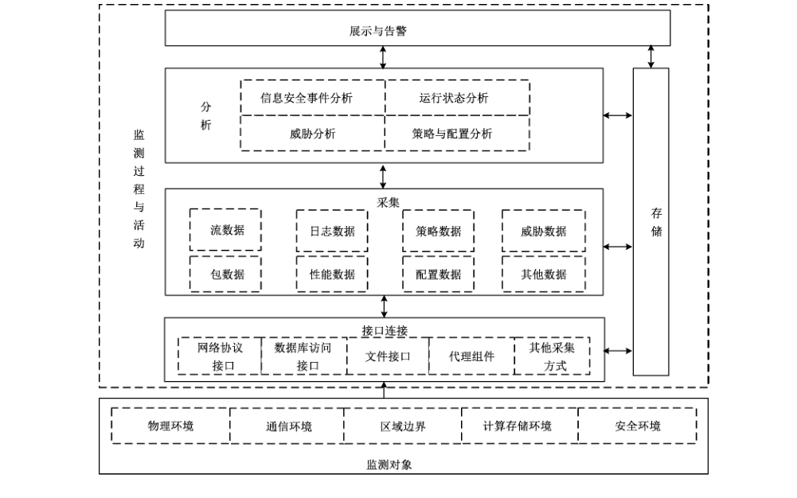

# GB/T 36635-2018 信息安全技术 网络安全监测基本要求与实施指南

> 来源：[GB/T 36635-2018 国家标准详情](https://openstd.samr.gov.cn/bzgk/std/newGbInfo?hcno=3C1F1A91CFC98838E63F7A81136F9100)；发布日期：2018-09-17；实施日期：2019-04-01。
> PDF SHA-256：b6ba6fe18cbb8c80737a81477c33b3745eaa364645d897e532f85fa7dd1777d4。
> 转写说明：按页渲染官方 PDF 并进行图像识别，对照全部 10 页原图校正文字、条款和图 1；省略封面、目录、页眉和页脚。正式引用请核对原 PDF。

## 前言

本标准按照 GB/T 1.1—2009 给出的规则起草。

请注意本文件的某些内容可能涉及专利。本文件的发布机构不承担识别这些专利的责任。

本标准由全国信息安全标准化技术委员会（SAC/TC 260）提出并归口。

本标准起草单位：国家信息中心、国家信息技术安全研究中心、北京启明星辰信息技术股份有限公司、北京天融信科技股份有限公司、东软集团股份有限公司、亚信科技（成都）有限公司。

本标准主要起草人：周民、罗海宁、任飞、焦迪、李森、曹虎、蔡景怡、曾辉、张锐卿、吴大明、肖彪、刘增益、郑伟。

## 1 范围

本标准规定了网络安全监测的基本要求，给出了网络安全监测框架和实施指南。

本标准适用于系统或网络安全监测的实施，网络安全监测产品的设计开发，网络安全监测服务的提供等。

## 2 规范性引用文件

下列文件对于本文件的应用是必不可少的。凡是注日期的引用文件，仅注日期的版本适用于本文件。凡是不注日期的引用文件，其最新版本（包括所有的修改单）适用于本文件。

- GB/Z 20986—2007 信息安全技术 信息安全事件分类分级指南

- GB/T 25069—2010 信息安全技术 术语

- GB/T 28458—2012 信息安全技术 安全漏洞标识与描述规范

- GB/T 31509—2015 信息安全技术 信息安全风险评估实施指南

## 3 术语和定义

GB/T 28458—2012 和 GB/T 25069—2010 界定的以及下列术语和定义适用于本文件。

### 3.1 网络安全监测 network security monitoring

通过对网络和安全设备日志、系统运行数据等信息进行实时采集，以关联分析等方式对监测对象进行风险识别、威胁发现、安全事件实时告警及可视化展示。

### 3.2 信息安全事件 information security incident

由单个或一系列意外或有害的信息安全事态所组成的，极有可能危害业务运行和威胁信息安全。

> ［GB/T 25069—2010，定义 2.1.53］

### 3.3 安全漏洞 vulnerability

计算机信息系统在需求、设计、实现、配置、运行等过程中，有意或无意产生的缺陷。这些缺陷以不同形式存在于计算机信息系统的各个层次和环节之中，一旦被恶意主体所利用，就会对计算机信息系统的安全造成损害，从而影响计算机信息系统的正常运行。

> ［GB/T 28458—2012，定义 3.2］

### 3.4 风险管理 risk management

识别、控制、消除或最小化可能影响系统资源的不确定因素的过程。

> ［GB/T 25069—2010，定义 2.3.39］

### 3.5 安全攻击 security attack

信息系统中，对系统或信息进行破坏、泄漏、更改或使其丧失功能的行为。

### 3.6 安全策略 security policy

用于治理组织及其系统内在安全上如何管理、保护和分发资产（包括敏感信息）的一组规则、指导和实践，特别是那些对系统安全及相关元素具有影响的资产。

> ［GB/T 25069—2010，定义 2.3.2］

## 4 缩略语

下列缩略语适用于本文件。

FTP：文件传送协议（File Transfer Protocol）

JDBC：Java 数据库连接（Java Database Connectivity）

ODBC：开放数据库互连（Open Database Connectivity）

PCAP：过程特性分析软件包（Process Characterization Analysis Package）

SFTP：安全文件传送协议（Secure File Transfer Protocol）

SNMP：简单网络管理协议（Simple Network Management Protocol）

SYSLOG：系统日志（System Log）

TELNET：远程登录协议（Teletype Network）

WMI：Windows 管理规范（Windows Management Instrumentation）

XML：可扩展标记语言（Extensible Markup Language）

> 转写注：PCAP 的中文及英文释义按原版保留；6.4 a）3）的“信息安全分类”亦为原文。

## 5 网络安全监测框架

### 5.1 概述

网络安全监测框架如图1所示。通过对网络或系统的基础环境以一定的接口方式采集日志等相关数据，关联分析并识别发现安全事件和威胁风险，进行可视化展示和告警，并存储产生的数据，从而掌握整体网络安全态势。

### 5.2 监测组成

网络安全监测主要由监测对象、监测活动两部分组成。

监测对象，为网络安全监测过程与活动提供数据源，主要包括物理环境、通信环境、区域边界、计算存储环境、安全环境。

监测活动，是网络安全监测行为的要素与流程，通过数据分析的方法识别与发现信息安全问题与状态。包括以下环节：

a） 接口连接：实现与监测对象或监测数据源的连通和数据交互，接口类型主要有网络协议接口、数据库访问接口、文件接口、代理组件等；

b） 采集：获取监测对象的数据，并将采集到的源数据转化为标准格式数据，为分析提供数据支持，采集数据主要包括流数据与包数据、日志数据与性能数据、威胁数据、策略数据与配置数据及其他数据等；

c） 存储：对网络安全监测过程中的数据分类存储，数据类型包括结构化、非结构化或半结构化；

d） 分析：对采集或存储数据按照一定规则或模型进行处理，发现安全事件，识别安全风险，分析的内容主要有信息安全事件分析、运行状态分析、威胁分析、策略与配置分析等；

e） 展示与告警：对分析的结果进行实时可视化展示，并按重要级别发布告警。

### 5.3 监测分类

按照监测目标的不同，网络安全监测分为以下四类：

a） 信息安全事件监测：对可能或正在损害监测对象正常运行或产生信息安全损失的事件，按照信息安全事件分类、分级要求，进行分析和识别；

b） 运行状态监测：对监测对象的运行状态进行实时监测，包括网络流量、各类设备和系统的可用性状态信息等，从运行状态方面判断监测对象信息安全事态；

c） 威胁监测：对监测对象的安全威胁进行评估分析，发现资产所面临的信息安全风险；

d） 策略与配置监测：按照监测对象既定的安全策略与相关设备或系统的配置信息进行核查分析，并评估其安全性。

## 6 网络安全监测基本要求

### 6.1 接口连接

应为每一种接口类型设置统一的标准格式要求，接口类型宜覆盖：

a） 网络协议接口：SNMP、SYSLOG、FTP 或 SFTP、TELNET 或 SSH 等；

b） 数据库访问接口：ODBC、JDBC 等；

c） 文件接口：XML、WMI 等；

d） 代理组件：采集操作系统、应用系统或中间件的监测数据的代理软件或数据转发代理组件等；

e） 其他方式：如网络嗅探、网络爬虫和离线脚本等。

### 6.2 采集

应支持实时采集、非实时采集与离线采集等采集模式，采集权限控制遵循最小授权原则，与统一标准时间源保持同步，采集过程不应干扰采集对象或监测对象正常运行。各类型数据采集要求包括：

a） 流数据或包数据采集应可进行协议解析和元数据收集；

b） 日志数据采集应将不同日志文件或数据转化为统一格式数据；

c） 性能数据采集应实时获取监测对象运行状态数据；

d） 威胁数据采集应支持从监测对象安全风险评估相关的威胁分析信息、主流威胁知识库等获取；

e） 策略数据采集应支持从监测对象安全策略、规则、正常行为特征库等内容生成或获取相应数据；

f） 配置数据采集应支持从监测对象的运行配置参数中获取，从设备或系统导出的配置文件应满足可解析为标准格式数据。

### 6.3 存储

网络安全监测数据存储应：

a） 将不同类型的异构数据（如标准格式日志、元数据、PCAP 文件等）进行分类、分布式存储；

b） 对存储数据进行预处理，包括格式化处理、补充上下文信息、异常数据清除等；

c） 设定监测数据保存期限；

d） 采取加密机制保证重要监测数据机密性；

e） 采取校验机制保证重要监测数据完整性；

f） 具备备份和恢复能力；

g） 设置访问权限，授权使用监测数据，并对访问存储行为进行审计，审计日志保存不少于6个月；

h） 支持分布式存储和原格式数据存储；

i） 源数据保存至少6个月，分析类数据、展示与告警类数据根据业务需要设定存储周期；

j） 与统一标准时间源保持同步。

### 6.4 分析

网络安全监测分析应包括信息安全事件分析、运行状态分析、威胁分析、策略与配置分析，各类型分析应满足：

a） 信息安全事件分析应支持：

<ol class="standard-subclauses">
<li>1） 识别和验证损害监测对象或造成损失的行为；</li>
<li>2） 信息安全事件分级按照 GB/Z 20986—2007 中 5.2 的要求；</li>
<li>3） 信息安全分类按照 GB/Z 20986—2007 中 4.1 的要求。</li>
</ol>

b） 运行状态分析应支持：

<ol class="standard-subclauses">
<li>1） 发现运行状态异常，并以数据值方式呈现与正常状态的差距；</li>
<li>2） 基于时间段、资产等不同维度的运行状态对比分析。</li>
</ol>

c） 威胁分析应支持：

<ol class="standard-subclauses">
<li>1） 分析威胁发生可能性和影响程度按照 GB/T 31509—2015 中 5.2.3.3.1 的要求；</li>
<li>2） 计算信息安全风险值按照 GB/T 31509—2015 中 5.3.2 和5.3.3的要求。</li>
</ol>

d） 策略与配置分析应支持：

<ol class="standard-subclauses">
<li>1） 对比分析现有策略与配置，判断其安全性；</li>
<li>2） 分析配置的变更，审核配置的动态变化。</li>
</ol>

### 6.5 展示与告警

网络安全监测的展示与告警应：

a） 对展示与告警进行时间源管理，保证展示和告警数据实时推送；

b） 支持安全事件、运行状态、安全威胁、策略与配置的监测结果的展示；

c） 支持短信通知、邮件通知、即时通信通知、声音警示、闪光警示等告警方式；

d） 支持按照设备类型、产生告警的原因对告警内容分类；

e） 对告警分级按照 GB/Z 20986—2007中5.2的要求。

### 6.6 自身安全保护

网络安全监测的自身安全保护应符合：

a） 重要数据加密存储；

b） 具备口令强度策略、口令强度自动核查及用户登录超时退出机制；

c） 监测自身运行状态，支持状态异常告警；

d） 监测敏感数据操作日志，定期执行日志审计；

e） 备份重要系统信息和数据，支持系统快速恢复；

f） 支持标准时间自动同步，每天至少同步一次。

## 7 网络安全监测实施指南

### 7.1 接口连接

根据监测目标和监测对象，选择适用的监测接口并对接口进行可用性评估，根据确定的接口类型，配置接口参数，通过接口连通监测对象和采集环境。接口连接的具体实施内容包括：

a） 通过 Netflow 协议和接口、网络嗅探方式等方式采集流数据和包数据；

b） 通过 SNMP 协议接口、SYSLOG 协议接口或代理组件等方式采集日志数据和性能数据；

c） 通过文件接口采集威胁数据；

d） 通过 SNMP 协议接口、数据库访问接口或离线脚本采集策略数据和配置数据；

e） 对不符合接口标准格式要求的设备，可将非标准接口转换为标准接口，或协调设备制造商按照标准格式要求整改提供标准化设备接口；

f） 设置接口认证及授权管理策略，防范数据泄露，保证接口连接的安全性。

### 7.2 采集

根据监测对象分类，明确采集数据类型，选择采集接口和方式，获取、收集监测数据，为分析提供源数据。采集的具体实施内容包括：

a） 统一部署相关采集接口、探针或嗅探设备等对相关类型数据进行采集；

b） 按照存储及分析的要求对数据进行处理，并向存储和分析输出数据；

c） 采集数据宜采用带外网络管理，通常不能占用业务端口或业务带宽；

d） 在开展采集工作前制定备份、回退等措施防范采集操作风险；

e） 按照标准格式要求提供数据，或明确由采集人员针对不同格式数据统一梳理成标准格式。

### 7.3 存储

根据采集数据的类型，选择数据存储方式，按不同数据格式分类存放在相关数据库中，如系统信息库、元数据库、原始数据库、主题数据库、资产信息库、运维服务库、统计报表库等。存储的具体实施内容包括：

a） 采用分布式数据库存储结构化数据，如日志数据、性能数据、流数据等关系型数据，支持大规模并发读写和快速检索；

b） 提供文档形式的数据存储和访问接口满足非结构化数据，如文件、图片及视频等格式的数据的存储，支持快速检索；

c） 采用分布式数据处理技术将半结构化数据转化为结构化数据，为上层应用提供数据存储和访问接口，建立快速索引提升查询性能；

d） 设计系统信息库，存储网络安全监测环境自身运行的支撑数据，如用户信息、权限控制信息、系统日志、系统配置等应用数据；

e） 设计元数据库，存储描述源数据、分析结果数据、展示与告警数据的数据；

f） 设计原始数据库，存储所有采集到的原始监测数据；

g） 设计主题数据库，存储按照监测目的进行分类的各种分析、展示与告警数据，主题数据库可以根据需要划分子库；

h） 设计资产信息库，存储所有采集对象及网络安全监测环境软硬件的相关信息，如资产名称、类型、IP、操作系统、用途、所属业务系统、工程、所属部门、所属安全域、资产供应商、保密性值、完整性值、可用性值、资产注册时间等基本属性。对于不同类型的信息资产，可记录特定的安全属性；

i） 设计运维服务数据库，存储工单管理、值班管理、知识库等相关的数据实体；

j） 设计统计报表库，存储资产类报表、漏洞类报表、风险类报表、告警类报表、日报、周报、月报、年报等综合类报表。

### 7.4 分析

根据监测对象的业务分析要求，明确分析目的，选择合适的数据分析工具和方法，进行数据处理，将分析结果发送给展示与告警。分析的具体实施内容包括：

a） 根据监测对象的业务分析要求，明确分析目的，以便对相应的数据进行处理。如安全事件分析需要收集监测对象的事件数据，运行状态分析需要收集监测对象的运行日志数据；

b） 根据业务需求，参照 6.4 的要求，选择合适的分析工具或方法，抽取数据、适配各类分析模型、匹配特征、出具结果，如：安全事件分析可以借助安全管理中心工具进行分析，威胁分析可以借助态势感知工具进行分析；

c） 将分析处理过程的结果进行校验，按照固定格式和约定的接口，提供给展示与告警，如：安全事件分析出高危事件，需要及时通报展示与告警，运行状态分析结果可以定时输出给展示与告警。

### 7.5 展示与告警

将采集的监测数据和分析结果通过接口传输到展示平台进行展示，根据安全事件级别、事态严重性、合规性、风险等因素判断告警级别触发告警信息。展示与告警的具体实施内容包括：

a） 展示物理环境状态、拓扑关系、日志、事件和告警信息，以及事件间的关联关系；

b） 按照设备类型的告警内容分类，可包括网络设备、安全设备、主机系统、数据库系统、应用程序、网管系统和日志服务器等设备的告警；

c） 按照产生告警的原因的告警内容分类，可包括漏洞、病毒/木马、可疑活动、扫描探测、拒绝服务类、认证/授权/访问类等告警；

d） 根据展示与告警的基本要求（见6.5），获取安全事件、运行状态、安全威胁、策略与配置方面的分析结果，主要关注安全事件或风险分析状况；

e） 根据展示需求，梳理展示数据，与数据可视化系统进行对接，将采集的源数据和分析结果能够可视化呈现；

f） 对已处理数据实时可视化展示，设置查询条件快速检索相关数据信息；

g） 对展示内容和对象进行分角色管理，不同展示内容对应不同级别的角色；

h） 根据展示与告警的基本要求（见6.5），确定相应事件的告警级别，并能与安全事件级别的调整进行联动；

i） 对告警内容和对象进行分角色管理，不同告警级别对应不同级别角色；

j） 根据告警级别，通过短信、邮件、即时通信等手段进行告警。
