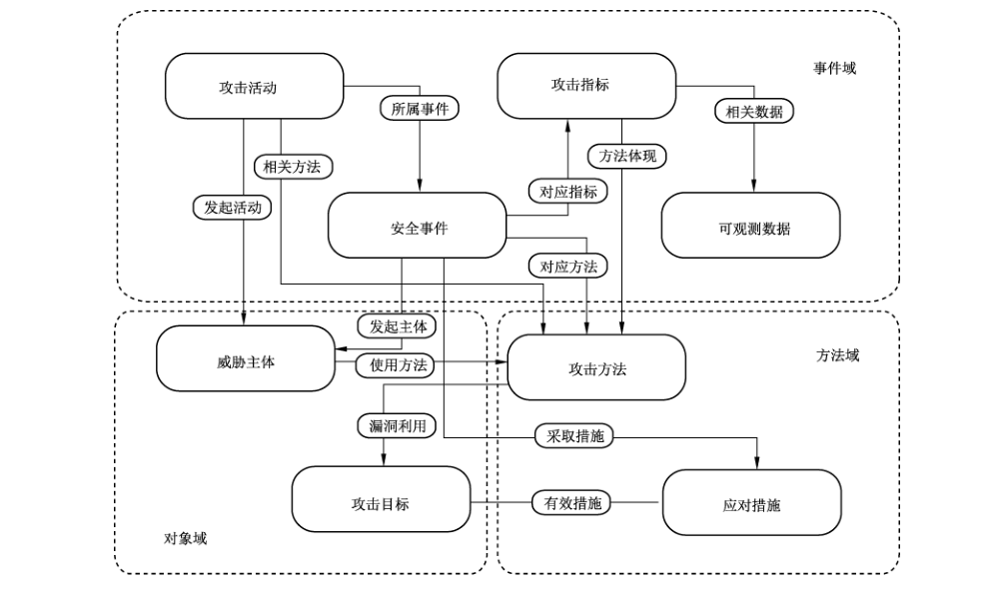

# GB/T 36643-2018 信息安全技术 网络安全威胁信息格式规范

> 来源：[GB/T 36643-2018 国家标准详情](https://openstd.samr.gov.cn/bzgk/std/newGbInfo?hcno=971636AF85AD7158EA50BB428F67C803)。
> PDF SHA-256：ea29a0e34107a5330b18aaf5090b5dddffe28dc54ec01e13b32219eb7f97a259。
> 转写说明：对照官方 PDF 全部 32 页图像整理；省略封面、目录、页眉、页脚和页码，合并跨页续表及附录示例。表 1 的多级字段名用点号表示层级。正式引用请核对官方 PDF。

> 转写核验注（不属于标准原文）：原版6.2.2使用“逻辑预算关系”，表5字段为“file_segement”，附录A.3口令为“WNcry@2ol7”，A.8参数为“co”、路径分隔符为“‖”，A.9补丁名为“MSC17-010”，这些原件内容按原样保留；附录示例与正文表格中的部分字段名大小写、类型不同，也未擅自统一。

## 前言

本标准按照 GB/T 1.1—2009给出的规则起草。

请注意本文件的某些内容可能涉及专利。本文件的发布机构不承担识别这些专利的责任。

本标准由全国信息安全标准化技术委员会（SAC/TC 260）提出并归口。

本标准起草单位：中国电子技术标准化研究院、北京赛西科技发展有限责任公司、北京天际友盟信息技术有限公司、北京奇安信科技有限公司、中国科学院信息工程研究所、公安部第三研究所、中国信息安全测评中心、国家计算机网络应急技术处理协调中心、中电长城网际系统应用有限公司、中国电子科技网络信息安全有限公司、阿里巴巴（北京）软件服务有限公司、百度在线网络技术（北京）有限公司、北京神州绿盟信息安全科技股份有限公司、北京启明星辰信息安全技术有限公司、神州网云（北京）信息技术有限公司、远江盛邦（北京）网络安全科技股份有限公司、北京君源创投投资管理有限公司、北京派网软件有限公司、深信服科技股份有限公司、中国科学院软件研究所、北京天融信网络安全技术有限公司、腾讯云计算（北京）有限责任公司、上海交通大学、北京工业大学、西安电子科技大学、北京邮电大学、北京中电普华信息技术有限公司、中国人民公安大学、武汉大学。

本标准主要起草人：蔡磊、叶润国、杨建军、刘贤刚、范科峰、闵京华、鲍旭华、刘威歆、冯侦探、金湘宇、董晓康、杨大路、杨泽明、李克鹏、李强、宋超、孙薇、贺新朋、李宗洋、孙波、梁露露、宋好好、王惠莅、刘慧晶、孙成胜、权晓文、李建华、雷晓锋、裴庆祺、易锦、刘玉岭、李衍、史博、孙朝晖、周毅、邹荣新、曾志峰、叶建伟、杨震、马占宇、翟湛鹏、曹占峰、姜政伟、杜彦辉、王丽娜。

## 引言

随着网络攻防对抗博弈的日益加剧，网络攻击方式和攻击手法呈现出多样性、复杂性特点，网络安全威胁具有越来越明显的普遍性和持续性，且攻击者获取攻击工具越来越便利，导致网络攻击成本大大降低、检测网络攻击的难度却越来越大。传统的网络安全防护方案仅仅依靠各个组织独立实施垂直的防护机制，在应对这些复杂网络攻击时显得越来越低效，亟待采取新的技术手段来提升整体网络安全防护能力。

网络安全威胁信息共享和利用是提升整体网络安全防护效率的重要措施，旨在采用多种技术手段，通过采集大规模、多渠道的碎片式攻击或异常数据，集中地进行深度融合、归并和分析，形成与网络安全防护有关的威胁信息线索，并在此基础上进行主动、协同式的网络安全威胁预警、检测和响应，以降低网络安全威胁的防护成本，并提升整体的网络安全防护效率。

网络安全威胁信息的共享和利用是实现关键信息基础设施安全防护的重要环节，有利于实现跨组织的网络安全威胁信息的快速传递，进而实现对复杂网络安全威胁的及时发现和快速响应。

规范网络安全威胁信息的格式和交换方式是实现网络安全威胁信息共享和利用的前提和基础，因此它在推动网络安全威胁信息技术发展和产业化应用方面具有重要意义。

## 1 范围

本标准规定了网络安全威胁信息模型和网络安全威胁信息组件，包括网络安全威胁信息中各组件的属性和属性值格式等信息。

本标准适用于网络安全威胁信息供方和需方之间进行网络安全威胁信息的生成、共享和使用，网络安全威胁信息共享平台的建设和运营可参考使用。

## 2 规范性引用文件

下列文件对于本文件的应用是必不可少的。凡是注日期的引用文件，仅注日期的版本适用于本文件。凡是不注日期的引用文件，其最新版本（包括所有的修改单）适用于本文件。

- GB/T 18336.1—2015 信息技术 安全技术 信息技术安全评估准则 第1部分：简介和一般模型

- GB/T 20274.1—2006 信息安全技术 信息系统安全保障评估框架 第1 部分：简介和一般模型

- GB/T 25069—2010 信息安全技术 术语

- GB/T 28458—2012 信息安全技术 安全漏洞标识与描述规范

## 3 术语和定义

GB/T 18336.1—2015、GB/T 20274.1—2006 和 GB/T 25069—2010界定的以及下列术语和定义适用于本文件。

### 3.1 网络安全/网络空间安全 cyber security

在网络空间中对信息保密性、完整性和可用性的保持。

［ISO/IEC 27032:2012，定义 4.20］

### 3.2 威胁 threat

可能对系统或组织造成危害的不期望事件的潜在原由。

［GB/T 29246—2017，定义2.83］。

### 3.3 威胁信息 threat information

一种基于证据的知识，用于描述现有或可能出现的威胁，从而实现对威胁的响应和预防。

> 注：威胁信息包括上下文、攻击机制、攻击指标、可能影响等信息。

### 3.4 脆弱性 vulnerability

可能被一个或多个威胁利用的资产或控制的弱点。

［GB/T 29246—2017，定义2.89］

### 3.5 攻击链 cyber kill chain

一个用来描述包含多个攻击步骤的多步攻击模型。

> 注：常见的多步攻击模型包括信息收集、工具研发、工具投放、脆弱性利用、后门安装、命令与控制、攻击目标达成等七个步骤。

## 4 缩略语

下列缩略语适用于本文件。

DNS：域名解析系统（Domain Name System）

IP：互联网协议（Internet Protocol）

JSON：Javascript 对象标记语言（JavaScript Object Notation）

MD5：消息摘要算法第五版（Message Digest Algorithm 5）

PE：可移植的可执行文件（Portable Executable）

URL：统一资源定位符（Uniform Resource Locator）

TTP：战术、技术和程序（Tactics, Techniques, and Procedures）

## 5 网络安全威胁信息模型

### 5.1 概述

本标准给出一种结构化方法描述网络安全威胁信息，目的是实现各组织间网络安全威胁信息的共享和利用，并支持网络安全威胁管理和应用的自动化。要实现这些目标，则需要一种通用模型来实现对网络安全威胁信息的统一描述，确保网络安全威胁信息描述的一致性，从而提升威胁信息共享的效率、互操作性，以及提升整体的网络安全威胁态势感知能力。

### 5.2 威胁信息维度

本标准定义了一个通用的网络安全威胁信息模型（以下简称“威胁信息模型”）。威胁信息模型从对象、方法和事件3个维度，对网络安全威胁信息进行了划分，采用包括可观测数据（Observation）、攻击指标（Indicator）、安全事件（Incident）、攻击活动（Campaign）、威胁主体（Threat Actor）、攻击目标（ExploitTarget）、攻击方法（TTP）、应对措施（CourseOfAction）在内的八个威胁信息组件描述网络安全威胁信息。威胁信息模型中的8个组件可以划分到3个域中：

a） 对象域：描述网络安全威胁的参与角色，包括两个组件：“威胁主体”（一般是攻击者）和“攻击目标”（一般是受害者）；

b） 方法域：描述网络安全威胁中的方法类元素，包括两个组件：“攻击方法”（攻击者实施入侵所采用的方法、技术和过程），以及“应对措施”（包括针对攻击行为的预警、检测、防护、响应等动作）；

c） 事件域：在不同层面描述网络安全威胁相关的事件，包括四个组件：“攻击活动”（以经济或政治为攻击目标）、“安全事件”（对信息系统进行渗透的行为）、“攻击指标”（对终端或设备实施的单步攻击）和“可观测数据”（在网络或主机层面捕获的基础事件）。

### 5.3 威胁信息组件

图1给出了威胁信息模型，它包括8个威胁信息组件，每个组件包含要素本身属性和与其他组件的关系信息，是构成威胁信息模型的关键要素。其中：

a）“可观测数据”，与主机或网络相关的有状态的属性或可测量事件，是威胁信息模型中最基础的组件；

b）“攻击指标”，用来识别一个特定“攻击方法”的技术指标，它是多个“可观测数据”的组合，是用来检测“安全事件”的检测规则；

c）“安全事件”，依据对应指标（“攻击指标”）检测出的可能影响到特定组织的网络攻击事件，一个具体的网络攻击事件可涉及到“威胁主体”、“攻击方法”和“应对措施”等信息；

d）“攻击活动”，“威胁主体”采用具体的“攻击方法”实现一个具体攻击意图的系列攻击动作，整个攻击活动会产生一系列“安全事件”；

e）“威胁主体”，“攻击活动”中发起活动的主体，“威胁主体”使用相关方法（“攻击方法”）达到攻击意图；

f）“攻击目标”，被“攻击方法”所利用的软件、系统、网络的漏洞或弱点，对于每个攻击目标，都有相应的有效措施（“应对措施”）进行抑制；

g）“攻击方法”，对“威胁主体”实施攻击过程中所使用方法的描述，每种“攻击方法”都会采取漏洞利用的方式来利用“攻击目标”上的漏洞或弱点类型；

h）“应对措施”，应对具体“攻击目标”有效措施，当安全事件发生后，也可能会采取相应的“应对措施”进行事后的安全事件处置。

本标准中定义的威胁信息模型应灵活、可扩展，主要表现在威胁信息模型中定义的各个威胁信息组件都是可选的，它既可以独立使用，也可以任意方式组合，比如，在特定应用场景下，可以只使用威胁信息模型中相关的组件，而无需使用全部的组件。威胁信息模型的灵活和可扩展特性使得其适合在各种独立的应用场景中使用。



**图1 威胁信息模型**

8个威胁信息组件的具体格式规范应符合第6章给出的细节要求。采用本标准的网络安全威胁信息格式的完整网络安全威胁信息示例参见附录 A。

## 6 网络安全威胁信息组件

### 6.1 概述

本章对威胁信息模型中的8个威胁信息组件进行了格式规范，具体包括各组件的属性以及属性值格式。各组件属性的格式用JSON 数据类型表示，包括 String（字符串）、JSON Array（JSON 数组）和JSON Object（JSON 对象）等数据类型。

### 6.2 可观测数据

#### 6.2.1 概述

在威胁信息模型中，“可观测数据”是最基础的组件，用于描述与主机或网络相关的各种带状态的数据或可测量的事件。“可观测数据”在形式上是一个逻辑表达式，其逻辑关系按照以下规则组织：

a）“可观测数据”表达式按照树状结构组织；

b） 每个非叶节点表示子节点的关系，包括“或”关系和“与”关系两种；

c） 每个叶节点是判别式，表示一个具体检查项。例如文件名是否包含指定字符串，注册表项是否为指定内容等。共有等于、不等于、包含和不包含4类判别方式。

#### 6.2.2 字段描述

本标准定义的可观测数据包括：DNS基本记录、电子邮件基本记录、文件下载基本记录、文件信息基本记录、进程信息基本记录、网址访问基本记录、注册表信息基本记录、用户信息基本记录、系统信息基本记录等。可观测数据包括如下内容：

a） 标识号，共享范围内全局唯一的标识；

b） 引用标识号，引用在其他地方的“可观测数据”；

c） 时间戳，与标识号共同使用，指定本地条目的版本，或是与引用标识号共同使用，指定外部条目的版本；

d） 版本，使用的标准版本；

e） 名称，“可观测数据”的简单名称；

f） 描述，采用文本形式详细描述本条目；

g） 简要描述，采用文本形式简要描述本条目；

h） 关系，“可观测数据”与其他组件之间的关系；

i） 判别式，用带逻辑预算关系的判别式表示单一“可观测数据”，或者多个“可观测数据”的组合，其组合关系如 6.2.1所示；

j） 对象类型，“可观测数据”的类型名称，除了对应6.2.3 中的所有对象类型外，也可以根据实际场景进行扩展。

可观测数据的各字段描述见表1。

**表1 可观测数据对象字段描述**

| 字段名 | 字段描述 | 字段格式 | 字段必要性 |
| --- | --- | --- | --- |
| id | 标识号 | String | 必选项 |
| idref | 引用标识号 | String | 可选项 |
| timestamp | 时间戳 | String | 可选项 |
| version | 版本 | String | 必选项 |
| title | 名称 | String | 可选项 |
| description | 描述 | String | 可选项 |
| short_description | 简要描述 | String | 可选项 |
| object.relationship | 关系 | String | 可选项 |
| object.value.constraint | 判别式 | String | 可选项 |
| object.value.object_type | 对象类型 | String | 可选项 |

#### 6.2.3 具体可观测数据

##### 6.2.3.1 DNS 基本记录

DNS基本记录主要记录与 DNS 域名解析相关的观测值，包括如下内容：

a） 域名解析主机，提供域名解析服务的服务器名称；

b）域名解析记录，DNS服务可以为一个给定域名提供映射的IP地址信息，即域名解析记录；

c） DNS记录类型，DNS服务可以提供多种查询和反查询服务，包括描述IPv4地址信息的主机记录，描述服务器的名称服务器记录，描述邮件服务器的邮件交换记录等。本字段指明具体的记录类型。

DNS 基本记录的各字段描述见表2。

**表2 DNS 基本记录**

| 字段名 | 字段描述 | 字段格式 | 字段必要性 |
| --- | --- | --- | --- |
| name_server | 域名解析主机 | String | 可选项 |
| record | IPv4 域名解析记录 | String | 可选项 |
| dns_type | DNS 记录类型 | String | 可选项 |

##### 6.2.3.2 电子邮件基本记录

电子邮件基本记录主要记录与电子邮件相关的观测值，包括如下内容：

a） 邮件附件多用途互联网邮件扩展类型，电子邮件附件的多用途互联网邮件扩展类型，可表明宜用哪种应用程序打开文件；

b） 邮件附件名称，电子邮件附件的文件名称，标明该附件文件的文件名称和类型；

c） 邮件附件内容，电子邮件附件的内容，表明附件文件中的全部信息；

d） 密件抄送地址，电子邮件密件抄送的地址，表明邮件密件抄送的全部收件人；

e） 邮件正文文本，电子邮件正文的文本，表明正文的全部文本内容；

f） 邮件抄送地址，电子邮件抄送的地址，表明邮件抄送的全部收件人；

g） 邮件发送者，电子邮件的发件人，表明邮件发送人的邮箱地址；

h） 邮件引用，回复电子邮件时引用的原文，表明原邮件正文的内容；

i） 邮件主题，电子邮件的主题，表明电子邮件内容的标志性信息；

j） 邮件接收者，电子邮件的收件人，表明全部收件人的邮箱地址。

电子邮件基本记录字段描述见表3。

**表3 电子邮件基本记录**

| 字段名 | 字段描述 | 字段格式 | 字段必要性 |
| --- | --- | --- | --- |
| is_multipart | 邮件附件多用途互联网邮件扩展类型 | String | 可选项 |
| attachment_name | 邮件附件名称 | String | 可选项 |
| attachment_content | 邮件附件内容 | String | 可选项 |
| bcc_refs | 密件抄送地址 | JSON Array | 可选项 |
| body | 邮件正文文本 | String | 可选项 |
| cc_refs | 邮件抄送地址 | JSON Array | 可选项 |
| from_ref | 邮件发送者 | String | 可选项 |
| quote | 邮件引用 | String | 可选项 |
| subject | 邮件主题 | String | 可选项 |
| to_refs | 邮件接收者 | JSON Array | 可选项 |

##### 6.2.3.3 文件下载基本记录

文件下载基本记录主要记录与文件下载相关的观测值，包括如下内容：

a） 文件下载历史名称，文件下载历史的文件名称，表明下载文件的文件名称和类型；

b） 文件下载浏览器名称，文件下载所用浏览器的名称，表明文件下载的方式；

c） 文件下载字节数，文件下载的字节数，表明下载文件的大小；

d） 文件下载名称，文件下载的文件名称；

e） 文件下载开始时间，记录的文件下载的开始时间，通常精确到秒。

文件下载基本记录字段描述见表4。

**表4 文件下载基本记录**

| 字段名 | 字段描述 | 字段格式 | 字段必要性 |
| --- | --- | --- | --- |
| historic_name | 文件下载历史名称 | String | 可选项 |
| browser | 文件下载浏览器名称 | String | 可选项 |
| file_byte | 文件下载字节数 | String | 可选项 |
| file_name | 文件下载名称 | String | 可选项 |
| start_time | 文件下载开始时间 | String | 可选项 |

##### 6.2.3.4 文件信息基本记录

文件信息基本记录主要记录与文件信息相关的观测值，包括如下内容：

a） 文件名称，文件的名称，表明文件的名称和文件类型；

b） 文件路径，文件的路径，表明文件所在的文件夹名称；

c） 文件完整路径，文件的完整路径，表明文件存储的绝对路径；

d） 文件 MD5 值，文件的 MD5 值。如果对文件有任何改动，其 MD5 值也会发生变化；

e） 文件证书发布者，颁发本标准证书的组织；

f） 文件导出函数，文件导出的函数，提供给第三方使用的文件导出函数；

g） 文件导入函数，文件导入的函数，用来实现第三方文件的数据导入；

h） 文件导入名称，文件导入的名称，表明所导入的第三方文件名称；

i） 文件编译时间，文件编译的时间，通常精确到秒；

j） PE文件资源信息名称，PE文件资源信息的名称。资源包含多种形式的数据，如字符串、图片等等；

k）PE 文件资源信息大小，PE文件资源信息的总字节；

l） 文件段名称，文件段的名称，是由 ANSI 字符组成的字符串；

m）文件PE 类型，文件所属的PE类型，例如 EXE、DLL、OCX.SYS.COM等；

n） PE版本公司名称，PE 文件版本信息中所标明的公司名称；

o） PE版本标准描述，PE文件版本信息中给出的描述信息；

p） PE 版本标准版本，PE 文件版本信息中所标明的文件版本号；

q） PE版本合法版权，PE 文件版本信息中所标明的合法版权声明；

r） PE版本原始文件名，PE 文件版本信息中所标明的原始文件名；

s） PE 版本产品名称，PE文件版本信息中所标明的产品名称信息；

t） PE 版本产品版本，PE文件版本信息中所标明的产品版本号信息；

u） 文件SHA1，文件的SHA1 值。SHA1 值的作用与 MD5值一样，为一种文件指纹；

v） 文件 SHA256，文件的SHA256 值。SHA256 值的作用与 MD5 值一样，为一种文件指纹；

w）文件大小，文件的字节数，表明文件所占用存储空间的大小；

x） 文件数字签名描述，文件的数字签名描述，用于验证文件的来源和完整性。

文件信息基本记录字段描述见表5。

**表5 文件信息基本记录**

| 字段名 | 字段描述 | 字段格式 | 字段必要性 |
| --- | --- | --- | --- |
| name | 文件名称 | String | 可选项 |
| path | 文件路径 | String | 可选项 |
| complete_path | 文件完整路径 | String | 可选项 |
| MD5 | 文件 MD5值 | String | 可选项 |
| cert_publisher | 文件证书发布者 | String | 可选项 |
| export_function | 文件导出函数 | JSON Array | 可选项 |
| import_function | 文件导入函数 | JSON Array | 可选项 |
| import_name | 文件导入名称 | String | 可选项 |
| compilation_time | 文件编译时间 | String | 可选项 |
| PE_resource_name | PE 文件资源信息名称 | String | 可选项 |
| PE_resource_size | PE 文件资源信息大小 | String | 可选项 |
| file_segement | 文件段信息 | String | 可选项 |
| PE_type | 文件 PE类型 | String | 可选项 |
| PE_company | PE 版本公司名称 | String | 可选项 |
| PE_description | PE 版本标准描述 | String | 可选项 |
| PE_file_version | PE 版本标准版本 | String | 可选项 |
| PE_copyright | PE 版本合法版权 | String | 可选项 |
| PE_original_name | PE版本原始文件名 | String | 可选项 |
| PE_product | PE 版本产品名称 | String | 可选项 |
| PE_product_version | PE 版本产品版本 | String | 可选项 |
| SHA1 | 文件 SHA1 | String | 可选项 |
| SHA256 | 文件 SHA256 | String | 可选项 |
| file_size | 文件大小 | String | 可选项 |
| file_signature | 文件数字签名描述 | String | 可选项 |

##### 6.2.3.5 进程信息基本记录

进程信息基本记录主要记录与进程相关的观测值，包括如下内容：

a） 进程本地IP，进程所使用的本地主机IP 地址；

b） 进程本地端口，进程所使用的本地主机端口号；

c） 进程传输协议，进程所使用的传输层协议，包括 TCP 协议和 UDP 协议；

d） 进程远程 IP，进程所连接的远程主机 IP地址；

e） 进程远程端口，进程所连接的远程主机端口号；

f） 进程名称，进程所显示的完整名称；

g） 进程用户名，进程在运行主机上所属的用户名；

h） 进程参数，进程运行所指定的参数；

i） 进程路径，进程的路径，表示进程相关的可执行文件在磁盘中的存储位置；

j） 进程标识符，进程的标识符，用于唯一标识一个进程的数值；

k）父进程路径，父进程的路径，表示父进程相关的可执行文件在磁盘中的存储位置；

l） 父进程 MD5，父进程的 MD5值，用于唯一标明父进程信息；

m）进程开始时间，进程开始运行的时间，通常精确到秒；

n） 进程结束时间，进程结束运行的时间，通常精确到秒。

进程信息基本记录见表6。

**表6 进程信息基本记录**

| 字段名 | 字段描述 | 字段格式 | 字段必要性 |
| --- | --- | --- | --- |
| local_ip | 进程本地 IP | String | 可选项 |
| local_port | 进程本地端口 | String | 可选项 |
| local_protocol | 进程端口协议 | String | 可选项 |
| remote_ip | 进程远程IP | JSON Array | 可选项 |
| remote_port | 进程远程端口 | JSON Array | 可选项 |
| name | 进程名称 | String | 可选项 |
| username | 进程用户名 | JSON Array | 可选项 |
| parameter | 进程参数 | JSON Array | 可选项 |
| path | 进程路径 | String | 可选项 |
| pid | 进程标识符 | String | 可选项 |
| parent_process_path | 父进程路径 | String | 可选项 |
| parent_process_MD5 | 父进程 MD5 | String | 可选项 |
| start_time | 进程开始时间 | String | 可选项 |
| end_time | 进程结束时间 | String | 可选项 |

##### 6.2.3.6 网址访问基本记录

网址访问基本记录主要记录与网址访问相关的观测值，包括如下内容：

a） 主机历史记录，访问主机的历史记录；

b）网址历史记录，访问网址的历史记录。

网址访问基本记录见表7。

**表7 网址访问基本记录**

| 字段名 | 字段描述 | 字段格式 | 字段必要性 |
| --- | --- | --- | --- |
| historic_host | 主机历史记录 | JSON Array | 可选项 |
| historic_domain | 网址访问记录 | JSON Array | 可选项 |

##### 6.2.3.7 注册表信息基本记录

注册表信息基本记录主要记录与注册表相关的观测值，包括如下内容：

a） 注册表键路径，注册表键在注册表结构中的访问路径；

b） 注册表存储路径，注册表文件的存储路径；

c） 注册表项类型，注册表项的类型，包括二进制、DWORD 值、字符串值三种类型；

d） 注册表键名称，注册表键的名称；

e） 注册表键值，注册表键的赋值。

注册表信息基本记录见表8。

**表8 注册表信息基本记录**

| 字段名 | 字段描述 | 字段格式 | 字段必要性 |
| --- | --- | --- | --- |
| registry_key_path | 注册表键路径 | String | 可选项 |
| registry_path | 注册表存储路径 | String | 可选项 |
| registry_type | 注册表项类型 | JSON Array | 可选项 |
| registry_key_name | 注册表键名称 | String | 可选项 |
| registry_key_value | 注册表键值 | String | 可选项 |

##### 6.2.3.8 用户信息基本记录

用户信息基本记录主要记录与用户相关的信息，包括如下内容：

a） 用户名称，登录系统的注册用户名称；

b）用户组名称，用户所在的用户组的名称。

用户信息基本记录各字段信息见表9。

**表9 用户信息基本记录**

| 字段名 | 字段描述 | 字段格式 | 字段必要性 |
| --- | --- | --- | --- |
| user | 用户名称 | String | 可选项 |
| group | 用户组名称 | String | 可选项 |

##### 6.2.3.9 系统信息基本记录

系统信息基本记录主要记录与操作系统相关的信息，包括如下内容：

a） 操作系统信息，操作系统的信息，如操作系统名称及版本等信息；

b） 主机名，运行操作系统的主机名称；

c） IP 地址，运行操作系统的主机 IP 地址；

d） 产品名称，操作系统所在主机的产品名称；

e） 系统用户，操作系统所在主机的系统用户。

系统信息基本记录见表 10。

**表10 系统信息基本记录**

| 字段名 | 字段描述 | 字段格式 | 字段必要性 |
| --- | --- | --- | --- |
| os | 操作系统信息 | String | 可选项 |
| host_name | 主机名 | String | 可选项 |
| ip | IP 地址 | String | 可选项 |
| product | 产品名称 | String | 可选项 |
| user | 系统用户 | JSON Array | 可选项 |

### 6.3 攻击指标

“攻击指标”是指在特定的网络环境中，用来识别出一个特定“攻击方法”的“可观测数据”组合。它由映射到“攻击方法”的一个或多个“可观测数据”组成，并附加相关的元数据。攻击指标组件包括如下内容：

a） 标识号，共享范围内全局唯一的标识；

b） 引用标识号，引用在其他地方的“攻击指标”；

> 注：当使用引用标识号时，本地“攻击指标”只是一个引用，不包含任何具体内容。

c） 时间戳，与标识号共同使用，指定本地条目的版本，或是与引用标识号共同使用，指定外部条目的版本；

d） 版本，使用的标准版本；

e） 名称，“攻击指标”的简单命名；

f） 类型，“攻击指标”的类型。攻击指标类型既可以使用现有类型列表中的值，也可以使用类型扩展机制自行定义；

g） 别名，“攻击指标”的可选标识（别名）；

h）描述，采用文本形式详细描述本条目；

i） 简要描述，采用文本形式简要描述本条目；

j） 时间，“攻击指标”发生的有效时间范围；

k） 可观测数据，与本条目对应的“可观测数据”；

l） 攻击方法，与本条目相关的“攻击方法”；

m）攻击阶段，本条目在攻击链中对应的攻击阶段；

n）检测机制，检测机制是一种方法，用于有效识别满足“攻击指标”的特定“可观测数据”；

o） 潜在影响，在“攻击指标”发生的场景下，对系统可能产生的潜在影响。这通常是用于本地使用而非共享的一个字段；

p） 应对措施，推荐对本次攻击进行修复的“应对措施”；

q） 可信度，本条目的可信度级别；

r） 相关攻击指标，与本条目相关的其他“攻击指标”；

s） 信息来源，本条目的产生者，描述信息来源细节。

攻击指标组件的各字段描述见表11。

**表11 攻击指标字段描述**

| 字段名 | 字段描述 | 字段格式 | 字段必要性 |
| --- | --- | --- | --- |
| id | 标识号 | String | 必选项 |
| idref | 引用标识号 | String | 可选项 |
| timestamp | 时间戳 | String | 可选项 |
| version | 版本 | String | 必选项 |
| title | 名称 | String | 可选项 |
| type | 类型 | String | 可选项 |
| aliases | 别名 | String | 可选项 |
| description | 描述 | String | 可选项 |
| short_description | 简要描述 | String | 可选项 |
| observable | 可观测数据 | String | 可选项 |
| valid_from | 有效时间（起始） | String | 可选项 |
| valid_to | 有效时间（结束） | String | 可选项 |
| indicated_TTP | 攻击方法 | JSON Array | 可选项 |
| kill_chain_phases | 攻击阶段 | String | 可选项 |
| test_mechanisms | 检测机制 | String | 可选项 |
| likely_impact | 潜在影响 | String | 可选项 |
| suggested_of_coa | 应对措施 | JSON Array | 可选项 |
| confidence | 可信度 | String | 可选项 |
| related_indicators | 相关攻击指标 | JSON Array | 可选项 |
| information_source | 信息来源 | String | 可选项 |

### 6.4 安全事件

“安全事件”是指检测中发现的可能影响到特定组织的一系列独立的“攻击指标”的实例。安全事件包括如下内容：

a） 标识号，共享范围内全局唯一的标识；

b） 引用标识号，引用发生在其他地方的“安全事件”；

> 注：当使用引用标识号时，本地“安全事件”只是一个引用，不包含任何具体内容。

c） 时间戳，与标识号共同使用，指定本地条目的版本，或是与引用标识号共同使用，指定外部条目的版本；

d） 版本，使用的标准版本；

e） 位置链接，给出一个 URL 链接，指向事件发生的网址；

f） 名称，“安全事件”的简单命名；

g） 外部标识号，当“安全事件”同时发生在本地和外部系统时，用该字段指出同一事件在外部系统中的标识号；

h）时间，“安全事件”发生的有效时间范围；

i） 描述，采用文本形式详细描述本条目；

j） 简要描述，采用文本形式简要描述本条目；

k）类别，用于描述本次“安全事件”所属类别的一个集合；

l） 关系者，和本次“安全事件”有关的各种角色信息，包括报告者、响应者、协作者，受害者。

m）影响资产，描述在本次“安全事件”中受影响的资产信息；

n） 影响评估，描述在本次“安全事件”中造成影响的评估结果；

o） 状态，描述本次“安全事件”的当前状态。可以使用预定义的状态类型，也可以由使用者自定义类型；

p） 相关指标，和本次“安全事件”有关的其他指标信息，包括相关攻击指标、相关攻击方法、相关威胁主体、相关安全事件；

q） 预期效果，描述本次“安全事件”的预期效果。可以使用预定义的状态类型，也可以由使用者自定义类型；

r） 获取权限，指出这次事件是否涉及攻击者取得了某种安全权限；

s） 发现方法，这次事件是怎样被发现的；

t）应对措施，受害者为消除本次“安全事件”的影响已采取和待执行应对措施；

u） 可信度，本条目的可信度级别；

v） 联系人，本次“安全事件”相关的组织或个人联系人；

w）历史，对本次“安全事件”处置或行动的相关历史日志；

x）信息来源，本条目的产生者，描述信息来源细节。

安全事件组件的字段描述见表12。

**表12 安全事件字段描述**

| 字段名 | 字段描述 | 字段格式 | 字段必要性 |
| --- | --- | --- | --- |
| id | 标识号 | String | 必选项 |
| idref | 引用标识号 | String | 可选项 |
| timestamp | 时间戳 | String | 可选项 |
| version | 版本 | String | 必选项 |
| url | 位置链接 | String | 可选项 |
| title | 名称 | String | 可选项 |
| external_id | 外部标识号 | String | 可选项 |
| valid_from | 有效时间（起始） | String | 可选项 |
| valid_to | 有效时间（结束） | String | 可选项 |
| description | 描述 | String | 可选项 |
| short_description | 简要描述 | String | 可选项 |
| categories | 类别 | JSON Array | 可选项 |
| participator | 关系者 | JSON Object | 可选项 |
| affected_assets | 影响资产 | String | 可选项 |
| impact_assessment | 影响评估 | String | 可选项 |
| status | 状态 | String | 可选项 |
| related_indicators | 相关指标 | JSON Array | 可选项 |
| intended_effect | 预期效果 | String | 可选项 |
| security_compromise | 获取权限 | String | 可选项 |
| discovery_method | 发现方法 | String | 可选项 |
| COA_requested | 应对措施 | JSON Array | 可选项 |
| confidence | 可信度 | String | 可选项 |
| contact | 联系人 | JSON Array | 可选项 |
| history | 历史 | JSON Array | 可选项 |
| info_source | 信息来源 | String | 可选项 |

### 6.5 攻击活动

“攻击活动”是指“威胁主体”实现一个具体意图的系列动作。攻击活动组件包括如下内容：

a） 标识号，共享范围内全局唯一的标识；

b）引用标识号，引用发生在其他地方的“攻击活动”；

> 注：当使用引用标识号时，本地“攻击活动”只是一个引用，不包含任何具体内容。

c） 时间戳，与标识号共同使用，指定本地条目的版本，或是与引用标识号共同使用，指定外部条目的版本；

d） 版本，使用的标准版本；

e） 名称，“攻击活动”的简单命名；

f） 描述，采用文本形式详细描述本条目；

g） 简要描述，采用文本形式简要描述本条目；

h）命名，对“攻击活动”的命名，可能是内部命名也可能是外部命名；

i） 预期效果，描述本“攻击活动”的预期效果。可以使用预定义的状态类型，也可以由使用者自定义类型；

j） 状态，描述本次“攻击活动”的当前状态，例如正在进行，历史，或未来。可以使用预定义的状态类型，也可以由使用者自定义类型；

k） 相关安全事件，与本条目对应的“安全事件”；

l） 相关威胁主体，与本条目相关的“威胁主体”；

m）相关攻击方法，与本条目相关的“攻击方法”；

n） 相关攻击活动，与本条目相关的其他“攻击活动”；

o） 可信度，本条目的可信度级别；

p） 相关活动，描述与这次“攻击活动”相关的一系列活动，是一个抽象类型，可以有各种扩展；

q） 信息来源，本条目的产生者，描述信息来源细节。

攻击活动组件各字段描述见表13。

**表13 攻击活动字段格式描述**

| 字段名 | 字段描述 | 字段格式 | 字段必要性 |
| --- | --- | --- | --- |
| id | 标识号 | String | 必选项 |
| idref | 引用标识号 | String | 可选项 |
| timestamp | 时间戳 | String | 可选项 |
| version | 版本 | String | 必选项 |
| title | 名称 | String | 可选项 |
| description | 描述 | String | 可选项 |
| short_description | 简要描述 | String | 可选项 |
| aliases | 命名 | String | 可选项 |
| intended_effect | 预期效果 | String | 可选项 |
| status | 状态 | String | 可选项 |
| related_incidents | 相关安全事件 | JSON Array | 可选项 |
| attributed_to | 相关威胁主体 | JSON Array | 可选项 |
| Related_TTPs | 相关攻击方法 | JSON Array | 可选项 |
| associated_campaigns | 相关攻击活动 | JSON Array | 可选项 |
| confidence | 可信度 | String | 可选项 |
| activity | 相关活动 | String | 可选项 |
| information_source | 信息来源 | String | 可选项 |

### 6.6 攻击方法

“攻击方法”是指对“威胁主体”的行为或攻击手法的描述。攻击方法组件包括如下内容：

a） 标识号，共享范围内全局唯一的标识；

b） 引用标识号，引用发生在其他地方的“攻击方法”；

> 注：当使用引用标识号时，本地“攻击方法”只是一个引用，不包含任何具体内容。

c） 时间戳，与标识号共同使用，指定本地条目的版本，或是与引用标识号共同使用，指定外部条目的版本；

d） 版本，使用的标准版本；

e） 名称，“攻击方法”的简单命名；

f） 描述，采用文本形式详细描述本条目；

g） 简要描述，采用文本形式简要描述本条目；

h）预期效果，描述本“攻击方法”的预期效果。可以使用预定义的状态类型，也可以由使用者自定义类型；

i） 攻击行为，描述攻击者用来实现本次“攻击方法”的行为，例如使用恶意软件或入侵程序等；

j） 攻击资源，用来描述攻击者实现本次“攻击方法”的所依赖的资源，包括恶意工具等；

k）攻击目标，描述作为攻击目标的人、组织或漏洞等信息；

l） 相关攻击目标，与本条目对应的“攻击目标”；

m）相关攻击方法，与本条目对应的“攻击方法”；

n） 攻击阶段，本条目在攻击链中对应的攻击阶段；

o） 信息来源，本条目的产生者，描述信息来源细节；

p）攻击链，攻击链提供的对这一“攻击方法”的具体参考信息。

攻击方法组件各字段描述见表14。

**表14 攻击方法字段描述**

| 字段名 | 字段描述 | 字段格式 | 字段必要性 |
| --- | --- | --- | --- |
| id | 标识号 | String | 必选项 |
| idref | 引用标识号 | String | 可选项 |
| timestamp | 时间戳 | String | 可选项 |
| version | 版本 | String | 必选项 |
| title | 名称 | String | 可选项 |
| description | 描述 | String | 可选项 |
| short_description | 简要描述 | String | 可选项 |
| intended_effect | 预期效果 | String | 可选项 |
| behavior | 攻击行为 | String | 可选项 |
| resources | 攻击资源 | JSON Array | 可选项 |
| victim_targeting | 攻击目标 | JSON Array | 可选项 |
| exploit_targets | 相关攻击目标 | JSON Array | 可选项 |
| related_TTPs | 相关攻击方法 | JSON Array | 可选项 |
| kill_chain_phases | 攻击阶段 | String | 可选项 |
| information_source | 信息来源 | String | 可选项 |
| kill_chains | 攻击链 | String | 可选项 |

### 6.7 应对措施

“应对措施”是指对威胁的具体应对方法。应对措施组件包括如下内容：

a） 标识号，共享范围内全局唯一的标识；

b） 引用标识号，引用发生在其他地方的“应对措施”；

> 注：当使用引用标识号时，本地“应对措施”只是一个引用，不包含任何具体内容。

c） 时间戳，与标识号共同使用，指定本地条目的版本，或是与引用标识号共同使用，指定外部条目的版本；

d） 版本，使用的标准版本；

e） 名称，“应对措施”的简单命名；

f） 阶段，本应对措施所属的阶段，例如：采取补救措施或者正在响应威胁；

g） 类型，描述“应对措施”的类型；

h） 描述，采用文本形式详细描述本条目；

i） 简要描述，采用文本形式简要描述本条目；

j） 对象，描述该“应对措施”实施的对象；

k） 参数，“应对措施”的技术参数。用于和类型字段关联，并定义自动化的“应对措施”；

l） 结构化描述，采用结构化形式对“应对措施”进行规范化描述，用于应对措施实施的自动化；

m）影响，描述实施本“应对措施”可能会造成的影响。可以使用预定义的状态类型，也可以由使用者自定义类型；

n） 成本，描述实施本“应对措施”可能会需要的成本。可以使用预定义的状态类型，也可以由使用者自定义类型；

o） 效果，描述实施本“应对措施”可能会产生的效果。可以使用预定义的状态类型，也可以由使用者自定义类型；

p） 信息来源，本条目的产生者，描述信息来源细节；

q） 相关应对措施，可能与本条目相关的其他“应对措施”。

应对措施组件各属性字段描述见表15。

**表15 应对措施字段描述**

| 字段名 | 字段描述 | 字段格式 | 字段必要性 |
| --- | --- | --- | --- |
| id | 标识号 | String | 必选项 |
| idref | 引用标识号 | String | 可选项 |
| timestamp | 时间戳 | String | 可选项 |
| version | 版本 | String | 必选项 |
| title | 名称 | String | 可选项 |
| stage | 阶段 | String | 可选项 |
| type | 类型 | JSON Array | 可选项 |
| description | 描述 | String | 可选项 |
| short_description | 简要描述 | String | 可选项 |
| objective | 对象 | JSON Array | 可选项 |
| parameter_observables | 参数 | String | 可选项 |
| structured_COA | 结构化描述 | String | 可选项 |
| impact | 影响 | String | 可选项 |
| cost | 成本 | String | 可选项 |
| efficacy | 效果 | String | 可选项 |
| information_source | 信息来源 | String | 可选项 |
| related_COAs | 相关应对措施 | JSON Array | 可选项 |

### 6.8 威胁主体

“威胁主体”是指实施网络安全威胁行为的主体，及其可能的意图和历史行为。威胁主体组件包括如下内容：

a） 标识号，共享范围内全局唯一的标识；

b） 引用标识号，引用发生在其他地方的“威胁主体”；

> 注：当使用引用标识号时，本地“威胁主体”只是一个引用，不包含任何具体内容。

c） 时间戳，与标识号共同使用，指定本地条目的版本，或是与引用标识号共同使用，指定外部条目的版本；

d） 版本，使用的标准版本；

e） 名称，“威胁主体”的简单命名；

f） 描述，采用文本形式详细描述本条目；

g） 简要描述，采用文本形式简要描述本条目；

h）身份，描述“威胁主体”的身份，可以使用预定义的类型，也可以由使用者自定义类型；

i） 类型，描述“威胁主体”的类型，可能会同时用多个字段描述，可以使用预定义的类型，也可以由使用者自定义类型；

j） 动机，描述“威胁主体”的动机，可能会同时用多个字段描述，可以使用预定义的类型，也可以由使用者自定义类型；

k）经验，描述“威胁主体”使用手法的熟练程度，从而判断对方的经验水平。可能会同时用多个字段描述，可以使用预定义的类型，也可以由使用者自定义类型；

l） 预期效果，描述本“威胁主体”的预期效果。可以使用预定义的状态类型，也可以由使用者自定义类型；

m）计划支持，描述“威胁主体”的计划支持。可能会同时用多个字段描述，可以使用预定义的类型，也可以由使用者自定义类型；

n） 相关攻击方法，与本条目对应的“攻击方法”；

o） 相关攻击活动，与本条目对应的“攻击活动”；

p） 相关威胁主体，与本条目对应的“威胁主体”；

q） 可信度，本条目的可信度级别；

r） 信息来源，本条目的产生者，描述信息来源细节。

威胁主体组件各字段描述见表16。

**表16 威胁主体字段描述**

| 字段名 | 字段描述 | 字段格式 | 字段必要性 |
| --- | --- | --- | --- |
| id | 标识号 | String | 必选项 |
| idref | 引用标识号 | String | 可选项 |
| timestamp | 时间戳 | String | 可选项 |
| version | 版本 | String | 必选项 |
| title | 名称 | String | 可选项 |
| description | 描述 | String | 可选项 |
| short_description | 简要描述 | String | 可选项 |
| identity | 身份 | String | 可选项 |
| type | 类型 | String | 可选项 |
| motivation | 动机 | String | 可选项 |
| sophistication | 经验 | String | 可选项 |
| intended_effect | 预期效果 | String | 可选项 |
| planning_and_operational_support | 计划支持 | String | 可选项 |
| observed_TTPs | 相关攻击方法 | JSON Array | 可选项 |
| associated_campaigns | 相关攻击活动 | JSON Array | 可选项 |
| associated_actors | 相关威胁主体 | JSON Array | 可选项 |
| confidence | 可信度 | String | 可选项 |
| information_source | 信息来源 | String | 可选项 |

### 6.9 攻击目标

“攻击目标”是指被“攻击方法”所利用的脆弱性。攻击目标组件包括如下内容：

a） 标识号，共享范围内全局唯一的标识；

b）引用标识号，引用发生在其他地方的“攻击目标”；

> 注：当使用引用标识号时，本地“攻击目标”只是一个引用，不包含任何具体内容。

c） 时间戳，与标识号共同使用，指定本地条目的版本，或是与引用标识号共同使用，指定外部条目的版本；

d） 版本，使用的标准版本；

e） 名称，“攻击目标”的简单命名；

f） 描述，采用文本形式详细描述本条目；

g） 简要描述，采用文本形式简要描述本条目；

h）漏洞列表，“攻击目标”利用的漏洞列表。利用的漏洞列表应满足 GB/T 28458—2012；

i） 弱点类型，“攻击目标”所利用漏洞的弱点类型；

j） 相关应对措施，与本条目相关，可能起到修复作用的“应对措施”；

k）信息来源，本条目的产生者，描述信息来源细节；

l） 相关攻击目标，与本条目可能相关的其他的“攻击目标”。

攻击目标组件各字段描述见表17。

**表17 攻击目标字段描述**

| 字段名 | 字段描述 | 字段格式 | 字段必要性 |
| --- | --- | --- | --- |
| id | 标识号 | String | 必选项 |
| idref | 引用标识号 | String | 可选项 |
| timestamp | 时间戳 | String | 可选项 |
| version | 版本 | String | 必选项 |
| title | 名称 | String | 可选项 |
| description | 描述 | String | 可选项 |
| short_description | 简要描述 | String | 可选项 |
| vulnerability | 漏洞列表 | JSON Array | 可选项 |
| weakness | 弱点类型 | String | 可选项 |
| potential_COAs | 相关应对措施 | JSON Array | 可选项 |
| information_source | 信息来源 | String | 可选项 |
| related_exploit_targets | 相关攻击目标 | JSON Array | 可选项 |

## 附录 A（资料性附录）采用 JSON 表示的完整网络安全威胁信息示例

### A.1 概述

本附录给出了一个采用本标准所规定的网络安全威胁信息格式描述的“永恒之蓝”勒索蠕虫网络安全威胁信息示例，目的是演示本标准所规范的网络安全威胁信息格式的使用方法。本示例采用 JSON 作为数据交换格式。注意，为确保示例的简洁性和可读性，本示例并没有将“永恒之蓝”勒索蠕虫的所有信息全部描述出来。

### A.2 攻击活动组件示例

```json
{
  "id": "campaign--e2e1a340-4415-4ba8-9671-f7343fbf0836",
  "idref": "",
  "timestamp": "2017-05-14T06:32:45Z",
  "version": "1.0",
  "title": "“永恒之蓝”勒索蠕虫的攻击活动",
  "description": "基于“永恒之蓝”生成的蠕虫病毒，通过 Windows 系统的 445 文件共享端口进行传播，往联网的计算机中植入勒索程序。计算机系统在感染后，勒索蠕虫在后台进行文件加密，完成加密后将弹出勒索通知的窗口，要求用户支付价值 300 美元的比特币才能解锁，不能按时支付赎金的系统会被销毁数据。同时，受害主机会自动随机扫描网络内开放 445 端口的、有漏洞的其他主机，并通过 SMB 协议将该勒索蠕虫再植入到新的目标主机中，扩散传播速度极快。",
  "short_description": "基于 Windows 系统 445 端口传播，加密文件，索要赎金。",
  "aliases": "",
  "intended_effect": "Theft",
  "status": "Ongoing",
  "related_TTPs": ["ttp--5ee9db36-4a1e-4dd4-bb32-2551eda97f4a"],
  "related_incidents": ["incident--34098fce-860f-48ae-8e50-ebd3cc5e41da", "incident--613f2e26-407d-48c7-9eca-b8e91df99dc9", "incident--f88d31f6-486f-44da-b317-01333bde0b82"],
  "attributed_to": ["threatactor--5e57c739-391a-4eb3-b6be-7d15ca92d5ed"],
  "associated_campaigns": [],
  "confidence": "high",
  "activity": "",
  "information_source": "XX 公司 XX 团队"
}
```

### A.3 攻击方法组件示例

```json
{
  "id": "ttp--5ee9db36-4a1e-4dd4-bb32-2551eda97f4a",
  "idref": "",
  "timestamp": "2017-05-14T06:32:45Z",
  "version": "1.0",
  "title": "“永恒之蓝”勒索蠕虫的攻击方法",
  "description": "勒索蠕虫通过漏洞远程执行时，会从资源文件夹下释放一个压缩包，此压缩包在内存中通过密码（WNcry@2ol7）解密并释放文件。这些文件包含了后续弹出勒索框的 exe，桌面背景图片的 bmp，包含各国语言的勒索字体，还有辅助攻击的两个 exe 文件。这些文件会释放到了本地目录，并设置为隐藏。然后，继续扫面网络中的其他主机，若发现存在 SMB 漏洞（MS17-010）的 Windows 系统，则继续传播。解压后在本机的文件，对用户主机的文件进行加密，并弹出索要赎金的提示框。",
  "short_description": "攻击存在 SMB 漏洞（MS17-010）的 Windows 系统，加密文件，索要赎金",
  "intended_effect": "Theft",
  "behavior": "加密用户常用文件，索要赎金",
  "resources": ["未安装 MS17-010 补丁的 Windows 系统"],
  "victim_targeting": ["所有连接网联网的计算机"],
  "exploit_targets": ["target--b346b4b3-f4b7-4235-b659-f985f65f0009"],
  "related_TTPs": [],
  "kill_chain_phases": "ActionsonObjective",
  "information_source": "XX 公司 XX 团队",
  "kill_chains": ""
}
```

### A.4 安全事件组件示例

示例 1：

```json
{
  "id": "incident--34098fce-860f-48ae-8e50-ebd3cc5e41da",
  "idref": "",
  "timestamp": "2017-05-14T06:32:45Z",
  "version": "1.0",
  "url": "",
  "title": "“永恒之蓝”勒索蠕虫的安全事件 1——连接开关域名",
  "external_id": "",
  "valid_from": "2017-05-12T15:00:00Z",
  "valid_to": "2017-05-14T06:32:45Z",
  "description": "勒索蠕虫启动后，立即访问一个特殊域名（开关域名）：http://www.iuqerfsodp9ifjaposdfjhgosurijfaewrwergwea.com，如果能访问到这个域名，则退出运行，不会触发任何恶意行为。如果访问不到，则执行后续的勒索和传播行为。",
  "short_description": "访问开关域名",
  "categories": ["蠕虫", "勒索软件"],
  "participator": [{"reporter": "Darien Huss"}],
  "affected_assets": "受感染的计算机",
  "impact_assessment": "决定勒索病毒是否产生恶意行为并继续传播",
  "status": "Open",
  "related_indicators": ["indicator--8e2e2d2b-17d4-4cbf-938f-98ee46b3cd3f"],
  "intended_effect": "Theft",
  "security_compromise": "Yes",
  "discovery_method": "",
  "related_incidents": ["incident--613f2e26-407d-48c7-9eca-b8e91df99dc9", "incident--f88d31f6-486f-44da-b317-01333bde0b82"],
  "COA_requested": [],
  "confidence": "high",
  "contact": [],
  "history": [],
  "info_source": "XX 公司 XX 团队"
}
```


示例 2：

```json
{
  "id": "incident--613f2e26-407d-48c7-9eca-b8e91df99dc9",
  "idref": "",
  "timestamp": "2017-05-14T06:32:45Z",
  "version": "1.0",
  "url": "",
  "title": "“永恒之蓝”勒索蠕虫的安全事件 2——加密并勒索",
  "external_id": "",
  "valid_from": "2017-05-12T15:00:00Z",
  "valid_to": "2017-05-14T06:32:45Z",
  "description": "执行 tasksche.exe，解压资源文件，从 t.wnry 文件中加载动态链接库，进行文件加密，弹出勒索对话框。",
  "short_description": "加密文件，索要赎金",
  "categories": ["蠕虫", "勒索软件"],
  "participator": [],
  "affected_assets": "受感染的计算机",
  "impact_assessment": "",
  "status": "Open",
  "related_indicators": ["indicator--8e2e2d2b-17d4-4cbf-938f-98ee46b3cd3f"],
  "intended_effect": "Theft",
  "security_compromise": "Yes",
  "discovery_method": "检查文件",
  "related_incidents": ["incident--34098fce-860f-48ae-8e50-ebd3cc5e41da", "incident--f88d31f6-486f-44da-b317-01333bde0b82"],
  "COA_requested": ["coa--34098fce-860f-48ae-8e50-ebd3cc5e41da"],
  "confidence": "high",
  "contact": [],
  "history": [],
  "info_source": "XX 公司 XX 团队"
}
```

示例 3：

```json
{
  "id": "incident--f88d31f6-486f-44da-b317-01333bde0b82",
  "idref": "",
  "timestamp": "2017-05-14T06:32:45Z",
  "version": "1.0",
  "url": "",
  "title": "“永恒之蓝”勒索蠕虫的安全事件 3——横向传播",
  "external_id": "",
  "valid_from": "2017-05-12T15:00:00Z",
  "valid_to": "2017-05-14T06:32:45Z",
  "description": "1.判断是否处于内网环境，如果是内网，扫描 10.0.0.0～10.255.255.255，172.16.0.0～172.31.255.255，192.168.0.0～192.168.255.255 范围内的主机并进行感染传播；如果是外网，则随机产生 IP 地址并进行感染传播；2.投递载荷（由 shell code 和 dll 组成），包括 32 位和 64 位两个版本；3.执行 shell code 并调用 dll。",
  "short_description": "扫描网络，投递载荷",
  "categories": ["蠕虫", "勒索软件"],
  "participator": [],
  "affected_assets": "与受感染计算机连接的计算机",
  "impact_assessment": "",
  "status": "Open",
  "related_indicators": [],
  "intended_effect": "Theft",
  "security_compromise": "Yes",
  "discovery_method": "",
  "related_incidents": ["incident--34098fce-860f-48ae-8e50-ebd3cc5e41da", "incident--613f2e26-407d-48c7-9eca-b8e91df99dc9"],
  "COA_requested": ["coa--34098fce-860f-48ae-8e50-ebd3cc5e41da"],
  "confidence": "high",
  "contact": [],
  "history": [],
  "info_source": "XX 公司 XX 团队"
}
```

### A.5 威胁主体示例

```json
{
  "id": "threatactor--5e57c739-391a-4eb3-b6be-7d15ca92d5ed",
  "idref": "",
  "timestamp": "2017-05-14T06:32:45Z",
  "version": "1.0",
  "title": "“永恒之蓝”勒索蠕虫的威胁主体",
  "description": "不明黑客组织/个人，利用“永恒之蓝”网络武器，通过 Windows 系统的 445 文件共享端口，传播勒索程序。计算机系统在感染后即被锁定，所有文件被加密，用户被要求支付价值 300 美元的比特币才能解锁，不能按时支付赎金的系统会被销毁数据。",
  "short_description": "不明黑客组织/个人",
  "identity": "",
  "type": [],
  "motivation": "Financial or Economic",
  "sophistication": "eCrime Actor - Malware Developer",
  "intended_effect": "Theft",
  "planning_and_operational_support": "",
  "observed_TTPs": ["ttp--5ee9db36-4a1e-4dd4-bb32-2551eda97f4a"],
  "associated_campaigns": ["campaign--e2e1a340-4415-4ba8-9671-f7343fbf0836"],
  "associated_actors": [],
  "confidence": "median",
  "information_source": "XX 公司 XX 团队"
}
```

### A.6 攻击目标示例

示例 1：

```json
{
  "id": "target--b346b4b3-f4b7-4235-b659-f985f65f0009",
  "idref": "",
  "timestamp": "2017-05-14T06:32:45Z",
  "version": "1.0",
  "title": "“永恒之蓝”勒索蠕虫的攻击目标",
  "description": "XX 省 XX 市 XX 加油站，5 台加油卡自助服务终端计算机。",
  "short_description": "XX 省 XX 市 XX 加油站计算机",
  "vulnerability": ["CVE-2017-0143", "CVE-2017-0144", "CVE-2017-0145", "CVE-2017-0146", "CVE-2017-0147", "CVE-2017-0148"],
  "weakness": "",
  "potential_COAs": ["coa--34098fce-860f-48ae-8e50-ebd3cc5e41da"],
  "information_source": "XX 公司 XX 团队",
  "related_exploit_targets": ["target--ee916c28-c7a4-4d0d-ad56-a8d357f89fef", "target--5d0092c5-5f74-4287-9642-33f4c354e56d"]
}
```

示例 2：

```json
{
  "id": "target--ee916c28-c7a4-4d0d-ad56-a8d357f89fef",
  "idref": "",
  "timestamp": "2017-05-14T06:32:45Z",
  "version": "1.0",
  "title": "“永恒之蓝”勒索蠕虫的攻击目标",
  "description": "XX 省 XX 市出入境业务办理大厅，10 台处理业务的计算机。",
  "short_description": "XX 省 XX 市出入境业务办理大厅计算机",
  "vulnerability": ["CVE-2017-0143", "CVE-2017-0144", "CVE-2017-0145", "CVE-2017-0146", "CVE-2017-0147", "CVE-2017-0148"],
  "weakness": "",
  "potential_COAs": ["coa--34098fce-860f-48ae-8e50-ebd3cc5e41da"],
  "information_source": "XX 公司 XX 团队",
  "related_exploit_targets": ["target--b346b4b3-f4b7-4235-b659-f985f65f0009"]
}
```

示例 3：

```json
{
  "id": "target--5d0092c5-5f74-4287-9642-33f4c354e56d",
  "idref": "",
  "timestamp": "2017-05-14T06:32:45Z",
  "version": "1.0",
  "title": "“永恒之蓝”勒索蠕虫的攻击目标",
  "description": "XX 省 XX 大学 XX 实验室，15 台计算机。",
  "short_description": "XX 省 XX 大学 XX 实验室计算机",
  "vulnerability": ["CVE-2017-0143", "CVE-2017-0144", "CVE-2017-0145", "CVE-2017-0146", "CVE-2017-0147", "CVE-2017-0148"],
  "weakness": "",
  "potential_COAs": ["coa--34098fce-860f-48ae-8e50-ebd3cc5e41da"],
  "information_source": "XX 公司 XX 团队",
  "related_exploit_targets": ["target--ee916c28-c7a4-4d0d-ad56-a8d357f89fef", "target--b346b4b3-f4b7-4235-b659-f985f65f0009"]
}
```

### A.7 攻击指标示例

```json
{
  "id": "indicator--8e2e2d2b-17d4-4cbf-938f-98ee46b3cd3f",
  "idref": "",
  "timestamp": "2017-05-14T06:32:45Z",
  "version": "1.0",
  "title": "“永恒之蓝”勒索蠕虫的攻击指标",
  "type": "ransomware worm",
  "aliases": "WannaCry",
  "description": "“永恒之蓝”勒索蠕虫的攻击指标，涉及到进程、文件、注册表等多类",
  "short_description": "",
  "valid_from": "2017-05-12T15:00:00Z",
  "valid_to": "2017-05-14T06:32:45Z",
  "observable": "observation--089a6ecb-cc15-43cc-9494-767639779123",
  "indicated_TTP": ["ttp--5ee9db36-4a1e-4dd4-bb32-2551eda97f4a"],
  "test_mechanisms": "",
  "likely_impact": "",
  "suggested_of_coa": ["coa--34098fce-860f-48ae-8e50-ebd3cc5e41da"],
  "confidence": "high",
  "related_indicators": [],
  "information_source": "XX 公司 XX 团队"
}
```

### A.8 可观测数据示例

```json
{
  "id": "observation--089a6ecb-cc15-43cc-9494-767639779123",
  "idref": "",
  "timestamp": "2017-05-14T06:32:45Z",
  "version": "1.0",
  "title": "“永恒之蓝”勒索蠕虫的可观测数据",
  "description": "“永恒之蓝”勒索蠕虫会改变多个参数，包括……",
  "short_description": "",
  "object": [
    {
      "relationship": "or",
      "value": [
        {"constraint": "equal", "object_type": "file", "file_name": "*.wncry"},
        {"constraint": "equal", "object_type": "process", "name": "attrib.exe", "parameter": ["+h."]},
        {"constraint": "equal", "object_type": "process", "name": "cmd.exe", "parameter": ["/c", "regadd HKLM‖SOFTWARE‖Microsoft‖Windows‖CurrentVersion‖Run"]},
        {"constraint": "equal", "object_type": "process", "name": "@WanaDecryptor@.exe", "parameter": ["co"]},
        {"constraint": "equal", "object_type": "registry", "registry_path": "HKEY_LOCAL_MACHINE‖SOFTWARE‖Microsoft‖Windows‖CurrentVersion‖Run", "registry_type": ["REG_SZ"], "registry_key_value": "tasksche.exe"}
      ]
    }
  ]
}
```

### A.9 应对措施示例

```json
{
  "id": "coa--34098fce-860f-48ae-8e50-ebd3cc5e41da",
  "idref": "",
  "timestamp": "2017-05-14T06:32:45Z",
  "version": "1.0",
  "title": "“永恒之蓝”勒索蠕虫的应对措施",
  "stage": "Response",
  "type": ["Physical Access Restrictions", "Eradication", "Patching"],
  "description": "1.拔掉网线再开机，防止继续感染其他计算机；2.用升级后的杀毒软件查杀该蠕虫病毒；3.在确定病毒清除后，迅速更新系统补丁 MSC17-010（对 Windows XP/2003 等官方已停止服务的系统，微软已推出针对该病毒利用漏洞的特别安全补丁）；4.若数据价值较高，在确认攻击者信誉度后，可考虑支付赎金取回。",
  "short_description": "断网，查杀蠕虫，打补丁，必要时考虑缴纳赎金",
  "objective": ["所有被怀疑的计算机"],
  "parameter_observables": "",
  "structured_COA": "",
  "impact": "",
  "cost": "",
  "efficacy": "",
  "information_source": "XX 公司 XX 团队",
  "related_COAs": []
}
```

## 参考文献

- ［1］ GB/T 29246—2017 信息技术 安全技术 信息安全管理体系 概述和词汇

- ［2］ ISO/IEC 27032:2012 信息技术 安全技术 网络安全指南（Information technology—Security techniques—Guidelines for cybersecurity）

- ［3］ IETF RFC8259. The JavaScript Object Notation （JSON） Data Interchange Format
