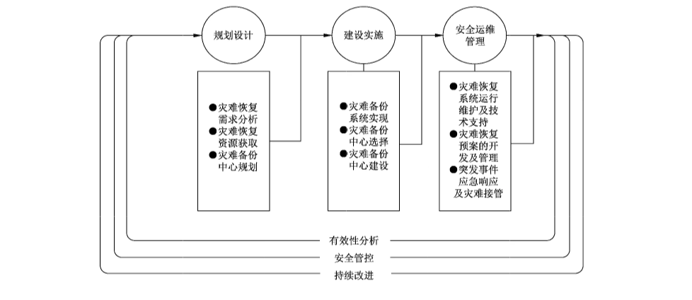
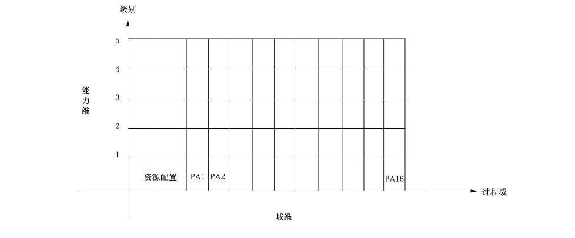
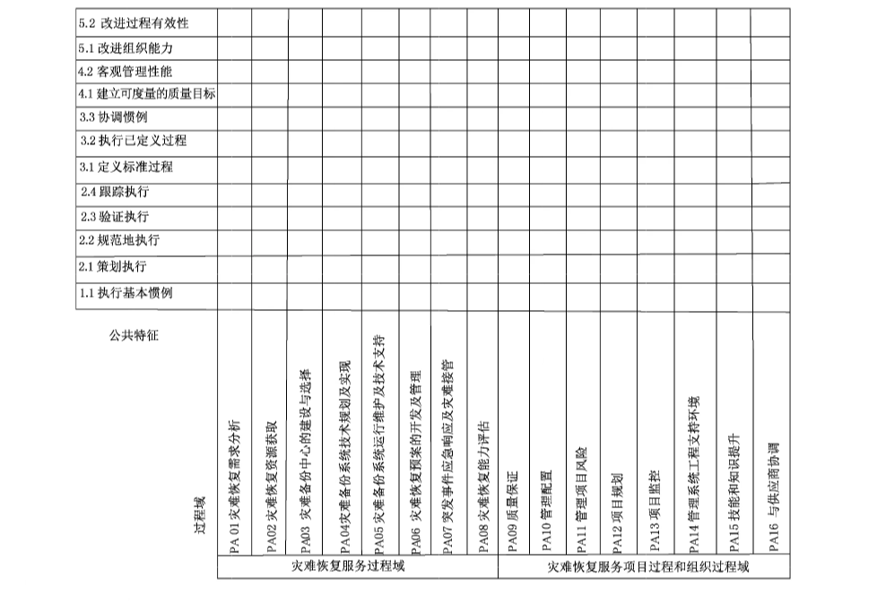
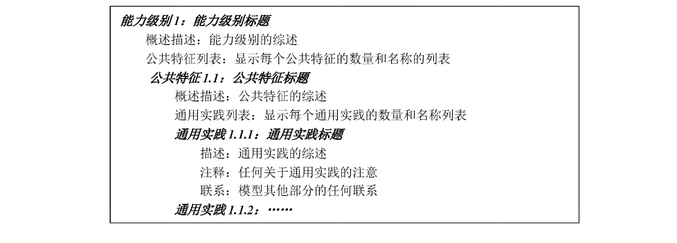

# GB/T 37046-2018 信息安全技术 灾难恢复服务能力评估准则

> 来源：[GB/T 37046-2018 国家标准详情](https://openstd.samr.gov.cn/bzgk/std/newGbInfo?hcno=E902AA095E0411982F8ECCF4D9FEF283)；发布日期：2018-12-28；实施日期：2019-07-01。
> 官方在线预览截图 SHA-256：fd0d91705d112449f7216057076be45c255c449f31fa456bbe774b57bb85cd1a。
> 转写说明：对照官方在线预览全部 48 页图像逐页校正；省略封面、目录、页眉、页脚和页码，合并跨页内容。图 1 至图 5、表 1、表 2、表 A.1、表 B.1、表 C.1 已与页面图像核对。原文中“现在资源的再利用”“应有由专人负责保存与分发”等疑似笔误照录。正式引用请核对官方原文。

## 前言

本标准按照GB/T1.1—2009给出的规则起草。

请注意本文件的某些内容可能涉及专利。本文件的发布机构不承担识别这些专利的责任。

本标准由全国信息安全标准化技术委员会（SAC/TC 260）提出并归口。

本标准起草单位：中国信息安全测评中心、中国网络安全审查技术与认证中心、中国电子技术标准化研究院、万国数据服务有限公司、中电长城网际系统应用有限公司、北京华胜天成科技股份有限公司、北京市太极华青信息系统有限公司、国富瑞数据系统有限公司、清华大学、中国民航大学、上海信息安全工程技术研究中心。

本标准主要起草人：孙明亮、李斌、位华、王琰、刘作康、张晓菲、张剑、魏立茹、程瑜琦、许玉娜、王惠莅、关继铮、闵京华、刘洋、闫城、安新亚、李杰、魏刚毅、刘玮、雷缙、叶晓俊、陆丽、汪涛、武勇。

## 引言

本标准参照和借鉴 GB/T 30271—2013《信息安全技术 信息安全服务能力评估准则》、GB/T 20988—2007《信息安全技术 信息系统灾难恢复规范》、GB/T 20261—2006《信息技术 系统安全工程能力成熟度模型》、ISO/IEC 21827:2008《信息技术 安全技术 系统安全工程能力成熟度模型®（SSE-CMM®）》的有关内容和思想，结合国内外实践经验制定而成。

本标准内容是在 GB/T 30271—2013的框架下对信息系统灾难恢复服务能力评估的具体细化，是针对信息系统灾难恢复组织的服务能力进行的评估框架。主要是阐述灾难恢复服务组织的灾难恢复服务能力的评估方法与模型，以及对灾难恢复服务组织服务能力评估分级的方法及特征描述，具体评估要求参照 GB/T 36957—2018。本标准在制定过程中对于灾难恢复服务组织的灾难恢复服务过程能力参考 GB/T 20988—2007 中的信息系统灾难恢复技术过程，主要针对灾难恢复服务组织的服务能力进行评估方法、模型、分级的框架阐述；GB/T 36957—2018主要阐述灾难恢复组织在做灾难恢复服务时的具体要求；GB/T 20988—2007是对信息系统灾难恢复服务过程的阐述，以及针对信息系统灾难恢复的能力的阐述，核心是信息系统；本标准与GB/T 36957—2018配套使用。

## 1 范围

本标准规定了信息系统灾难恢复服务所应遵循的基本原则，明确了信息系统灾难恢复服务组织服务能力的评估机制。

本标准适用于信息系统灾难恢复服务的需求方、提供方和评估方。

## 2 规范性引用文件

下列文件对于本文件的应用是必不可少的。凡是注日期的引用文件，仅注日期的版本适用于本文件。凡是不注日期的引用文件，其最新版本（包括所有的修改单）适用于本文件。

- GB/T 20988—2007 信息安全技术 信息系统灾难恢复规范

- GB/T 25069—2010 信息安全技术 术语

- GB/T 29246—2017 信息技术 安全技术 信息安全管理体系 概述和词汇

- GB/T 30271—2013 信息安全技术 信息安全服务能力评估准则

- GB/T 36957—2018 信息安全技术 灾难恢复服务要求

- ISO/IEC 21827:2008 信息技术 安全技术 系统安全工程能力成熟度模型®（Information technology—Security techniques—Systems Security Engineering—Capability Maturity Model®）（SSE-CMM®）

## 3 术语和定义

GB/T 25069—2010、GB/T 20988—2007、GB/T 30271—2013、GB/T 29246—2017、GB/T 36957—2018和ISO/IEC 21827:2008界定的以及下列术语和定义适用于本文件。为了便于使用，以下重复列出了 GB/T 36957—2018、GB/T 29246—2017 和 GB/T 30271—2013中的一些术语和定义。

### 3.1 灾难恢复服务 disaster recovery services

为了将信息系统从灾难造成的故障或瘫痪状态恢复到可正常运行的状态、并将其支持的业务功能从灾难造成的不正常状态恢复到可接受状态而进行的分析、设计、实施、运行、维护及组织管理等活动和流程。

［GB/T 36957 —2018，定义3.2］

### 3.2 灾难恢复服务提供方 provider of disaster recovery services

具有专业的灾难恢复服务团队和资源，并能提供灾难恢复服务的组织或部门，简称服务提供方。

［GB/T 36957—2018，定义 3.4］

### 3.3 灾难恢复服务需求方 customer of disaster recovery services

需要通过第三方专业服务和资源实现灾难恢复的组织或部门，简称服务需求方。

［GB/T 36957—2018，定义3.3］

### 3.4 灾难恢复服务能力 disaster recovery service capability

灾难恢复服务提供方实施系统容错、灾难恢复和容灾过程达到信息系统各项业务可持续运行，并使客户保持满意的有关各项活动的总和。

> 注：灾难恢复服务能力阐述的是灾难恢复服务提供方的总体服务能力，区别于GB/T 20988—2007 中灾难恢复能力阐述的是针对信息系统进行灾难恢复服务所能达到灾难恢复等级，两者阐述的对象不同。

### 3.5 灾难恢复服务能力成熟度 disaster recovery service capability maturity

对灾难恢复服务方服务能力的综合评价，反映了灾难恢复服务方的灾难恢复服务在资源配置、项目组织管理和专业技术水平等方面的成熟程度，标志着灾难恢复服务方提供给客户的灾难恢复服务专业水平和质量保证程度。

### 3.6 风险分析 risk analysis

理解风险本质和确定风险等级的过程。

注1：风险分析提供风险评价和风险处置决策的基础。

注2：风险分析包括风险估算。

［GB/T 29246—2017，定义2.70］

### 3.7 可用性 availability

已授权实体一旦需要，信息系统灾难恢复组织就可提供相应服务，保证信息系统访问和使用数据和资源的特性。

> 注：本标准中鉴于灾难恢复服务的特殊性，对可用性做了适用于灾难恢复服务的专有定义。

### 3.8 可靠性 reliability

与预期行为和结果相一致的特性。

［GB/T 29246—2017，定义2.62］

### 3.9 能力 capability

组织、体系或过程实现产品并使其满足要求的本领。

### 3.10 过程域 process area;PA

一组相关系统工程过程的性质，当这些性质全部实施后则能够达到过程域定义的目的。

［GB/T 30271—2013，定义3.1.1］

### 3.11 基本实践 base practices;BP

系统工程过程中应存在的性质，只有当所有这些性质完全实现后，才可说满足了这个过程域的要求。

> 注：一个过程域由基本实践（BP）组成。

［GB/T 30271—2013，定义3.1.2］

### 3.12 通用实践 generic practices;GP

在评估中用于确定任何过程的能力。

## 4 缩略语

下列缩略语适用于本文件。

BIA：业务影响分析（Business Impact Analysis）

BCM：业务连续性管理（Business Continuity Management）

BP：基本实施（Base Practices）

DRP：灾难恢复规划（Disaster Recovery Planning）

DRS-CMM：灾难恢复服务能力成熟度模型（Disaster Recovery Service—Capability Maturity Model）

GP：通用实施（Generic Practices）

PA：过程域（Process Area）

RPO：恢复点目标（Recovery Point Objective）

RTO：恢复时间目标（Recovery Time Objective）

SSE-CMM：系统安全工程能力成熟度模型®（Systems Security Engineering—Capability Maturity Model®）

SPICE：软件过程改进和能力测定（Software Process Improvement And Capability Determination）

SW-CMM：软件能力成熟度模型（Software—Capability Maturity Model）

## 5 灾难恢复服务能力成熟度模型概述

### 5.1 灾难恢复服务生命周期概述

灾难恢复服务能力成熟度模型是依据灾难恢复服务生命周期，灾难恢复服务提供方向灾难恢复服务需求方提供包括灾难恢复系统的规划设计、建设实施和安全运维管理，以及生产系统的灾后重建和回退等服务为主线，对能提供单个、多个过程域以及整个生命周期灾难服务的提供方整个组织的服务能力等级的评估模型。灾难恢复服务生命周期框架流程图参见图1。

信息系统灾难恢复服务过程除了实现信息系统的灾难恢复目标和策略外，还需进行灾难恢复服务过程的信息安全考虑，包括对灾难恢复系统进行信息安全的需求分析、安全设计与实现，对灾难恢复服务过程的项目与组织过程的信息安全管理等。

目前灾难恢复服务的形式呈现多样化，本标准意在阐述从灾难恢复系统的规划设计、建设实施和安全运维管理等全生命周期各阶段的灾难恢复服务过程为主线，对能提供单个、多个过程域以及整个生命周期灾难恢复服务的提供方从其服务过程中的资源配置、技术服务过程和项目与组织过程等服务能力要素对灾难服务提供方的服务能力成熟度进行等级评估。对于在具体灾难恢复服务的过程中不是针对整个生命周期进行服务的情况，可以对具体的服务过程域进行灾难恢复服务的能力等级进行评估。

### 5.2 灾难恢复服务能力构成要素

信息系统灾难恢复服务能力包括信息系统灾难恢复规划设计、灾难恢复系统实施、灾难恢复运行维护管理等方面能力，以求达到对信息系统灾难恢复目标的实现，同时还包括信息系统灾难恢复组织过程及项目实施过程管理能力等方面。这些服务能力也是信息系统灾难恢复服务的基本活动，这些活动能力的建设与评估需信息系统灾难恢复服务的需求方、服务提供方和评估方配置相应的人力、设备、环境等资源和服务过程的管理才能构成完整的灾难恢复服务能力。

因此，信息系统灾难恢复服务能力应由以下要素构成，如图2所示：

a） 灾难恢复服务资源配置

在资源配置方面包括信息系统灾难恢复服务人员的专业技术能力和知识面、实施信息系统灾难恢复服务所需的工具设备、设施和环境。

b） 灾难恢复服务过程

根据信息系统灾难恢复要求，针对灾难恢复服务的几个阶段分解出信息系统灾难恢复服务的八个技术过程域，分别是灾难恢复需求分析、灾难恢复资源获取、灾难备份中心的选择和建设、灾难备份系统技术规划及实现、灾难备份系统运行维护及技术支持、灾难恢复预案的开发及管理、突发事件应急响应及灾难接管、灾难恢复能力评估。

c） 灾难恢复服务项目管理过程

实施信息系统灾难恢复服务需要进行项目管理过程。项目管理过程应覆盖到信息系统灾难恢复服务的服务过程活动中。通过项目管理过程实现信息系统灾难恢复服务的持续改进和安全可靠性。

### 5.3 灾难恢复服务能力成熟度模型

信息系统灾难恢复服务能力成熟度模型（DRS-CMM）是在系统安全工程能力成熟度模型®（SSE- CMM®）的基础上，结合信息系统灾难恢复服务的最佳实践，所形成的对信息系统灾难恢复服务能力成熟度进行度量的模型。

信息系统灾难恢复服务能力成熟度由能力维和域维构成（如图3）。

信息系统灾难恢复服务能力级别分五级，一级是基本执行级，二级是计划跟踪级，三级是充分定义级，四级是量化控制级，五级是持续改进级。

能力级别从一级至五级逐级提高，标志着信息系统灾难恢复服务能力成熟度的不断提升。每个级别规定了对应的公共特征和通用实施。在本标准中，高级别需要涵盖低级别成熟度要求的所有内容。

但该级别只是规定了增加的内容。

能力维由公共特征构成，公共特征由通用实施（GP）构成。对于某一级别的所有通用实施满足了该级别的公共特征，从而形成了这一级别的能力（如图4）。

域维由过程域（PA）和资源配置组成。灾难恢复服务的过程域（PA）包括灾难恢复服务技术过程域、项目与组织过程域。过程域由基本实施（BP）构成，每个过程域的基本实施（BP）是构成该过程域的基本要素，是该完成该过程活动的基本单元。对于不同级别的能力维，灾难恢复服务过程域的各个基本实施（BP）都是必须的。

对应于各个灾难恢复服务过程域，资源配置是完成灾难恢复服务活动的基本条件。但针对不同能力级别和不同的信息系统灾难恢复级别，可能需要特定的资源配置条件（参见附录 A）。

## 6 灾难恢复服务能力要素

### 6.1 灾难恢复服务资源配置

#### 6.1.1 灾难恢复服务场地资源配置能力

灾难恢复场地是指由服务提供方所提供灾难恢复所需的场地环境，包括灾难恢复工作设施、辅助设施、生活设施及其他配套设施的建设实施能力，以确保服务提供方能灾难恢复服务。此外，灾难恢复服务场地还满足国家相关规范，同时需要具备符合安全管理要求的管理控制措施，包括物理安全、运行安全、人员安全等安全管控措施，并进行安全审计。

灾难恢复场地资源配置能力要求见 GB/T 36957—2018的 5.2。

#### 6.1.2 灾难恢复系统资源配置能力

灾难恢复系统是指由服务提供方应提供的用于向服务需求方提供灾难恢复服务的设备、设施及工具等，以提升信息系统灾难恢复能力和服务质量，为信息系统的快速恢复提供技术保障。服务的设备和设施应包括但不限于数据备份系统、备用数据处理系统、备用网络系统、灾难恢复服务工具等。

灾难恢复系统资源配置能力要求见 GB/T 36957—2018的 5.3。

#### 6.1.3 灾难恢复服务团队能力

灾难恢复服务团队的能力主要体现在服务提供方的灾难恢复服务人员的服务范围、团队编制、岗位职责、团队管理、理论知识、专业技能和服务经验等。

灾难恢复服务团队能力要求见 GB/T 36957—2018的 5.4。

### 6.2 灾难恢复服务过程

#### 6.2.1 灾难恢复服务过程综述

灾难恢复服务过程包括灾难恢复规划设计服务、建设实施服务和安全运维管理服务三个服务阶段，其中：

a） 灾难恢复规划设计服务包括灾难恢复需求分析（PA01）、灾难恢复资源获取方式（PA02）、灾难备份中心选择和建设（PA03）、灾难备份系统技术规划及实现（PA04-BP.04.01～03）；

b） 灾难恢复建设实施服务包括灾难备份系统技术规划及实现（PA04-BP.04.03~04）、灾难恢复预案的开发及管理（PA06）；

c） 灾难恢复安全运维管理服务包括灾难恢复系统运行维护及技术支持（PA05）、突发事件应急响应及灾难接管（PA07）、灾难恢复能力评估（PA08）。

#### 6.2.2 PA01——灾难恢复需求分析

##### 6.2.2.1 灾难恢复需求分析综述

灾难恢复需求分析能力要求见 GB/T 36957—2018 的6.2.2、6.2.5，其中风险分析（BP.01.01）见GB/T 36957—2018 的6.2.2.2，业务影响分析（BP.01.02）见 GB/T 36957—2018 的 6.2.2.1，灾难恢复目标与策略制定（BP.01.03）见 GB/T 36957—2018的 6.2.5。

##### 6.2.2.2 BP.01.01——风险分析

###### 6.2.2.2.1 描述

标识信息系统的资产价值，识别信息系统面临的自然的和人为的威胁，识别信息系统的脆弱性，分析各种威胁发生的可能性，并定量或定性描述可能造成的损失。通过技术和管理手段，防范或控制信息系统的风险。依据防范或控制风险的可行性和残余风险的可接受程度，确定对风险的防范和控制措施。

风险分析的范围应至少涵盖IT 基础环境可能面临的供电中断、地质灾害、气象灾害、交通、通信中断以及生产中心基础设施本身的缺陷和弱点，风险分析应根据业务和环境变换的情况至少每三年进行一次重新评估。

###### 6.2.2.2.2 工作产品示例

IT 系统调研分析报告、IT 系统风险分析报告等。

###### 6.2.2.2.3 注释

信息系统资源一般包括：信息系统的软硬件设备，以及支撑信息系统运行的基础资源环境及数据中心等。

##### 6.2.2.3 BP.01.02——业务影响分析

###### 6.2.2.3.1 描述

分析业务功能及其相关信息系统资源、评估特定灾难对各种业务功能的影响的过程。对组织的各项业务功能及各项业务功能之间的相关性进行分析，确定支持各种业务功能的相应信息系统资源及其他资源，明确相关信息的保密性、完整性和可用性要求（凡涉及到采用密码技术解决机密性、完整性、真实性、不可否认性需求的应遵循密码相关国家标准和行业标准）。

应采用定量和/或定性的方法，对各种业务功能的中断造成的影响进行评估：

a） 定量分析：以量化方法，评估业务功能的中断可能给组织带来的直接经济损失和间接经济影响；

b） 定性分析：运用归纳与演绎、分析与综合以及抽象与概括等方法，评估业务功能的中断可能给组织带来的非经济损失。

确定中断造成的影响、信息系统灾难恢复指标（RTO/RPO）、灾难恢复优先级别和灾难恢复资源需求等。

###### 6.2.2.3.2 工作产品示例

业务系统调研分析报告、业务系统的关联关系分析表、业务影响分析报告等。

##### 6.2.2.4 BP.01.03——灾难恢复目标与策略制定

###### 6.2.2.4.1 描述

根据风险分析和业务影响分析的结果，确定灾难恢复目标与策略，包括：

a） 关键业务功能及资源的恢复的优先顺序；

b） 关键业务功能及资源的灾难恢复时间范围，即 RTO和 RPO 的范围。

###### 6.2.2.4.2 工作产品示例

灾难恢复策略分析报告、信息系统灾难恢复等级评估报告等。

#### 6.2.3 PA02——灾难恢复资源获取

##### 6.2.3.1 灾难恢复资源获取综述

灾难恢复资源获取能力要求见 GB/T 36957—2018的 6.2.3。

##### 6.2.3.2 BP.02.01——数据备份系统

###### 6.2.3.2.1 描述

数据备份系统获取方式，可由组织自行建设，也可通过租用其他机构的系统而获取。

###### 6.2.3.2.2 工作产品示例

数据备份系统建议：指导用户如何获取数据备份系统的建议文档。

##### 6.2.3.3 BP.02.02——备用数据处理系统

###### 6.2.3.3.1 描述

备用数据处理系统获取方式，可选用以下三种方式之一来获取备用数据处理系统：

a） 事先购买所需的数据处理设备并存放在灾难备份中心或安全的设备仓库；

b） 事先与厂商签订紧急供货协议；

c） 利用商业化灾难备份中心或签有互惠协议的机构已有的兼容设备。

###### 6.2.3.3.2 工作产品示例

备用数据处理系统建议：指导用户如何获取备用数据处理系统的建议文档。

##### 6.2.3.4 BP.02.03——备用网络系统

###### 6.2.3.4.1 描述

备用网络系统获取方式。备用网络通信设备可通过BP.02.02所述的方式获取；备用数据通信线路可使用自有数据通信线路或租用公用数据通信线路。

###### 6.2.3.4.2 工作产品示例

备用网络系统建议：指导用户如何获取备用网络系统的建议文档。

##### 6.2.3.5 BP.02.04——备用基础设施

###### 6.2.3.5.1 描述

备用基础设施获取方式，可采用以下三种方式获取备用基础设施：

a） 由组织所有并运行；

b） 多方共建或通过互惠协议获取；

c） 租用商业化灾难备份中心的基础设施。

###### 6.2.3.5.2 工作产品示例

备用基础设施建议：指导用户如何获取备用基础设施的建议文档。

##### 6.2.3.6 BP.02.05——技术支持能力

###### 6.2.3.6.1 描述

技术支持能力获取方式，可选用以下几种方式获取技术支持能力：

a） 灾难备份中心设置专职技术支持人员；

b） 与厂商签订技术支持或服务合同；

c） 由第三方专业服务机构承担技术支持；

d） 由生产中心技术支持人员兼任；但对于 RTO较短的关键业务功能，应考虑到灾难发生时交通和通信的不正常，造成技术支持人员无法提供有效支持的情况。

###### 6.2.3.6.2 工作产品示例

技术支持能力建议：指导用户如何获取技术支持能力的建议文档。

##### 6.2.3.7 BP.02.06——运行维护管理能力

###### 6.2.3.7.1 描述

运行维护管理能力获取方式，可选用以下对灾难备份中心的运行维护管理模式：

a） 自行运行和维护；

b） 委托其他机构运行和维护；

c） 组织和专业服务机构共同运行维护。

###### 6.2.3.7.2 工作产品示例

运行维护管理能力建议：指导用户如何获取运行维护管理能力的建议文档。

##### 6.2.3.8 BP.02.07——灾难恢复预案

###### 6.2.3.8.1 描述

灾难恢复预案获取可采用以下方式，完成灾难恢复预案的制定、落实和管理：

a） 由组织独立完成；

b） 聘请外部专家指导完成；

c） 委托外部机构完成。

###### 6.2.3.8.2 工作产品示例

灾难恢复预案建议：指导用户如何获取灾难恢复预案的建议文档。

#### 6.2.4 PA03——灾难备份中心的选择和建设

##### 6.2.4.1 灾难备份中心的选择与建设综述

灾难备份中心的选择和建设能力要求见 GB/T 36957—2018的6.2.4。

##### 6.2.4.2 BP.03.01——选址原则

###### 6.2.4.2.1 描述

选择或建设灾难备份中心时，应根据风险分析的结果，避免灾难备份中心与主中心同时遭受同类风险。灾难备份中心还应具有方便灾难恢复人员或设备到达的交通条件，以及数据备份和灾难恢复所需的通信、电力等资源。

灾难备份中心应根据资源共享、平战结合的原则，合理地布局。

###### 6.2.4.2.2 工作产品示例

选址原则：制定能够指导灾难备份中心选址的文档。

##### 6.2.4.3 BP.03.02——基础设施的要求

###### 6.2.4.3.1 描述

灾难备份中心基础设施要求。新建或选用灾难备份中心的基础设施时：

a） 计算机机房应符合有关国家标准的要求；

b） 工作辅助设施和生活设施应符合灾难恢复目标的要求。

###### 6.2.4.3.2 工作产品示例

基础设施要求：制定能够指导灾难备份系统基础设施建设的要求文档。

#### 6.2.5 PA04——灾难备份系统技术规划及实现

##### 6.2.5.1 灾难备份系统技术规划及实现综述

灾难备份系统技术规划及实现能力要求见 GB/T 36957—2018的 6.2.6、6.2.7、6.3.1、6.3.2、6.3.3。

##### 6.2.5.2 BP.04.01——成本风险分析与策略制定

###### 6.2.5.2.1 描述

分析成本风险确定灾难恢复策略。按照灾难恢复资源的成本与风险可能造成的损失之间取得平衡的原则（以下简称“成本风险平衡原则”）确定每项关键业务系统的灾难恢复策略，不同的业务系统可采用不同的灾难恢复策略。

灾难恢复策略包括：

a） 灾难恢复资源的获取方式；

b） 灾难恢复等级各要素的具体要求。

###### 6.2.5.2.2 工作产品示例

组织总体灾难恢复策略：针对单一灾难场景制定所有业务系统恢复的策略；关键业务灾难恢复策略：针对每项关键业务系统制定不同的灾难恢复策略。

##### 6.2.5.3 BP.04.02——技术路线的规划

###### 6.2.5.3.1 描述

根据灾难恢复策略制定相应的灾难恢复系统技术路线，其中应包括：

a） 灾难恢复模式的确定；

b） 灾难恢复中心的建设模式；

c） 灾难恢复技术的选型；

d）相关配套的网络、主机、安全等规划。

###### 6.2.5.3.2 工作产品示例

技术路线：灾难备份系统的技术路线。

##### 6.2.5.4 BP.04.02——技术方案的设计

###### 6.2.5.4.1 描述

根据灾难恢复技术路线制定相应的灾难恢复系统技术方案，包含数据备份系统、备用数据处理系统和备用的网络系统。技术方案中所设计的系统应：

a） 获得同主系统相当的安全保护；

b） 现在资源的再利用；

c） 具有可扩展性。

###### 6.2.5.4.2 工作产品示例

技术方案：灾难备份系统的技术方案。

##### 6.2.5.5 BP.04.03——技术方案的验证、确认和系统开发

###### 6.2.5.5.1 描述

验证、确认技术方案并按照确认的方案进行开发。为确保技术方案满足灾难恢复策略的要求，应由服务需求方的相关部门对技术方案进行确认和验证，并记录和保存验证及确认的结果。

按照确认的灾难恢复系统技术方案进行开发，实现所要求的数据备份系统、备用数据处理系统和备用网络系统。

###### 6.2.5.5.2 工作产品示例

验证及确认报告：记录组织对技术方案进行确认和验证的结果的报告；开发计划：按照确认的灾难备份系统技术方案进行开发的计划文档。

##### 6.2.5.6 BP.04.04——系统安装和测试

###### 6.2.5.6.1 描述

按照经过确认的技术方案，制定各阶段的系统安装及测试计划，以及支持不同关键业务功能的系统安装及测试计划，并组织服务需求方共同进行测试。确认以下各项功能可正确实现：

a） 数据备份及数据恢复功能；

b） 在限定的时间内，利用备份数据正确恢复系统、应用软件及各类数据，并可正确恢复各项关键业务功能；

c） 客户端可与备用数据处理系统通信正常。

###### 6.2.5.6.2 工作产品示例

安装计划：包括针对各阶段和不同业务功能的安装计划；测试计划：包括针对各阶段和不同业务功能的测试计划等。

###### 6.2.5.6.3 注释

测试并实现描述中提到的功能。

#### 6.2.6 PA05——灾难备份系统运行维护及技术支持

##### 6.2.6.1 灾难备份系统运行维护及技术支持综述

灾难备份系统运行维护及技术支持能力要求见 GB/T 36957—2018中 6.4.2.1～6.4.2.11。

##### 6.2.6.2 BP.05.01——运行维护管理能力的实现

###### 6.2.6.2.1 描述

为了达到灾难恢复目标，灾难备份中心应建立各种操作和管理制度，用以保证：

a） 数据备份的及时性和有效性；

b） 备用数据处理系统和备用网络系统处于正常状态，并与主系统的参数保持一致；

c） 有效的应急响应、处理能力；

d） 对必要的供方服务进行有效管理。

###### 6.2.6.2.2 工作产品示例

操作管理制度：能够指导运行维护管理从而达到灾难恢复目标的文档。

###### 6.2.6.2.3 注释

操作管理制度应该包括的内容见描述。

##### 6.2.6.3 BP.05.02——技术支持能力的实现

###### 6.2.6.3.1 描述

获取技术支持能力和培训技术支持人员的建议。灾难恢复中心应建立相应的技术支持组织，定期对技术支持人员进行技能培训。

###### 6.2.6.3.2 工作产品示例

技术支持能力建议：指导用户如何获取技术支持能力的建议文档；培训建议：指导用户如何对自己的技术支持组织进行培训。

#### 6.2.7 PA06——灾难恢复预案的开发及管理

##### 6.2.7.1 灾难恢复预案的开发及管理

灾难恢复预案的开发及管理能力要求见 GB/T 36957—2018的6.3.4、6.3.5、6.4.2.12。

##### 6.2.7.2 BP.06.01——预案制定原则

###### 6.2.7.2.1 描述

灾难恢复预案的制定原则：

a） 完整性：灾难恢复预案（以下称预案）应包含灾难恢复的整个过程，以及灾难恢复所需的尽可能全面的数据和资料；

b） 易用性：预案应运用易于理解语言和图表，并适合在紧急情况下使用；

c） 明确性：预案应采用清晰的结构，对资源进行清楚的描述，工作内容和步骤应具体，每项工作应有明确的责任人；

d） 有效性：预案应尽可能满足灾难发生时进行恢复的实际需要，并保持与实际系统和人员组织的同步更新；

e） 兼容性：灾难恢复预案应与其他应急预案体系有机结合。

###### 6.2.7.2.2 工作产品示例

灾难恢复预案的制定原则：描述灾难恢复预案制定的指导性原则的说明书。

##### 6.2.7.3 BP.06.02——预案开发过程

###### 6.2.7.3.1 描述

灾难恢复预案制定的过程如下：

a） 起草：按照风险分析和业务影响分析所确定的灾难恢复内容，根据灾难恢复等级的要求，结合组织其他相关的应急预案，撰写出灾难恢复预案的初稿；

b） 测试：应预先制定测试计划，在计划中说明测试的案例。测试应包含基本单元测试、关联测试和整体测试。测试的整个过程应有详细的记录，并形成测试报告；

c） 修订：根据评审和测试结果，对预案进行修订，纠正在初稿评审过程和测试中发现的问题和缺陷，形成预案的报批稿；

d） 审核和批准：组织对报批稿进行审核和批准，确定为预案的执行稿。

###### 6.2.7.3.2 工作产品示例

流程说明书：描述灾难恢复预案整个制定流程的说明书；灾难恢复预案。

##### 6.2.7.4 BP.06.03——预案的教育、培训和演练

###### 6.2.7.4.1 描述

组织灾难恢复预案的教育、培训和演练。演练可分次及采用不同形式进行，但应确保在一个时间周期中各次演练覆盖预案的全部。必要时还应包括供方参与的演练。为了使相关人员了解信息系统灾难恢复的目标和流程，熟悉灾难恢复的操作规程，应按以下要求，组织灾难恢复预案的教育、培训和演练：

a） 在灾难恢复规划的初期就应开始灾难恢复观念的宣传教育工作；

b） 应预先对培训需求进行评估，开发和落实相应的培训/教育课程，保证课程内容与预案的要求相一致；

c） 应事先确定培训的频次和范围，事后保留培训的记录；

d） 预先制定演练计划，在计划中说明演练的场景；

e） 演练的整个过程应有详细的记录，并形成报告；

f） 每年应至少完成一次有最终用户参与的完全演练。

###### 6.2.7.4.2 工作产品示例

教育计划：用于落实灾难恢复预案宣传教育工作的计划书；培训课程、计划：用于灾难恢复预案学习的课程，及进行培训/教育的计划；演练计划：用于用户对灾难恢复预案进行演练的计划。

##### 6.2.7.5 BP.06.04——预案的保存与分发

###### 6.2.7.5.1 描述

经过审核和批准的灾难恢复预案应有由专人负责保存与分发，具有多份拷贝在不同的地点保存，分发给参与灾难恢复工作的所有人员，在每次修订后所有拷贝统一更新，并保留原件，以备查阅，原分发的旧版本应予销毁等特点。

###### 6.2.7.5.2 工作产品示例

保存原则：保存灾难恢复预案要遵循的原则；分发原则：灾难恢复预案进行分发所要遵循的原则。

###### 6.2.7.5.3 注释

保存与分发规范应满足描述中的要求。

##### 6.2.7.6 BP.06.05——预案的维护

###### 6.2.7.6.1 描述

灾难恢复预案的维护及变更管理。为了保证灾难恢复预案的有效性，应从以下方面对灾难恢复预案进行严格的维护和变更管理：

a） 业务流程的变化、信息系统的变更、人员的变更都应在灾难恢复预案中及时反映；

b） 预案在测试、演练和灾难发生后实际执行时，其过程均应有详细的记录，并应对测试、演练和执行的效果进行评估，同时对预案进行相应的修订；

c） 灾难恢复预案应定期评审和修订，至少每年一次。

###### 6.2.7.6.2 工作产品示例

维护和变更管理规范：用于指导对灾难恢复预案的维护和变更管理的说明文档。

###### 6.2.7.6.3 注释

操作规范的制定应满足描述要求。

#### 6.2.8 PA07——突发事件应急响应及灾难接管

##### 6.2.8.1 突发事件应急响应及灾难接管综述

突发事件应急响应及灾难接管能力要求见 GB/T 36957—2018 的 6.4.3。

##### 6.2.8.2 BP.07.01 突发事件的应急

###### 6.2.8.2.1 描述

当灾难事件发生以后，灾难恢复团队对灾难事件的本地处置，切换的准备，事件升级，事件决策等处置措施。灾难事件的应急措施，应：

a） 组成全方位的、高响应度的应急恢复团队；

b） 系统准备就绪检查；

c） 相关人员的切换决策过程；

d） 环境及人员准备就绪。

###### 6.2.8.2.2 工作产品示例

整个过程的处置记录，事件升级的决策报告等。

##### 6.2.8.3 BP.07.02——灾难恢复的切换

###### 6.2.8.3.1 描述

灾难恢复系统的切换及灾难恢复接管，应包含：

a） 检查系统数据的备份的完整性和有效性；

b） 检查灾难恢复网络及系统的有效性；

c） 执行网络及系统的切换过程及系统接管过程。

###### 6.2.8.3.2 工作产品示例

灾难备份系统的切换准备就绪报告，切换过程中问题记录、分析、总结及报告。

##### 6.2.8.4 BP.07.03——重续运行及生产系统回切

###### 6.2.8.4.1 描述

灾难恢复系统在灾难恢复中心的重续运行以及切换回生产中心。灾难恢复系统的重续运行，应包含：

a） 监控系统运行及故障处置；

b） 系统备份、报表等日常操作处置；

c） 系统的密码控制等安全管理。

生产系统的生产回切，应包含：

a） 制定系统回切方案；

b） 检查灾难恢复网络及系统的有效性；

c） 执行网络及系统的切换过程及系统接管过程；

d） 监控系统稳定期情况。

###### 6.2.8.4.2 工作产品示例

灾难备份系统的重续运行报告，生产切换过程中问题记录、分析、总结及报告。

#### 6.2.9 PA08——灾难恢复能力评估

##### 6.2.9.1 灾难恢复能力评估综述

灾难恢复能力评估能力要求见 GB/T 36957—2018的 6.4.4。

##### 6.2.9.2 BP.08.01——灾难恢复建设评估

###### 6.2.9.2.1 描述

根据相关的规范、标准及最佳实践，对灾难恢复建设的状况进行评估。评估主要包括对体系及工作机制进行评估：

a） 对灾难恢复需求、灾难恢复策略、应急及灾难恢复流程开发、变更管理、保障资源及分布，演练验证工作等状况进行评估；

b） 依据相关国家、国际标准和规范，评估灾难恢复及应急响应方面的工作机制是否健全；

c） 对系统灾难恢复及应急管理组织架构、事件等级划分、应急管理策略、应急沟通路径、应急响应工作流程、重要信息系统的灾难恢复预案建设的状况进行评估；

d） 依据相关国家、国际标准和规范，对灾难恢复及应急流程现状进行差距分析，并提出改进建议。

###### 6.2.9.2.2 工作产品示例

灾难恢复建设评估报告，组织建设的差距、问题及改进建议。

##### 6.2.9.3 BP.08.01——灾难恢复效果评估

###### 6.2.9.3.1 描述

对灾难恢复效果进行评估，包括对灾难发生的起因、处置的效果及恢复过程中的损失情况。对灾难恢复过程进行评估，主要为：

a） 灾难事件的原因；

b） 突发事件的应急响应过程；

c） 集结以及处置是否得当；

d） 切换过程的流程和步骤是否得当；

e） 灾难恢复过程中的数据损失。

###### 6.2.9.3.2 工作产品示例

灾难恢复效果评估报告：灾难恢复过程达到的效果，存在的问题以及处置情况。

### 6.3 灾难恢复服务项目过程和组织过程

#### 6.3.1 灾难恢复服务项目过程与组织过程综述

**6.3** 包含灾难恢复服务的项目过程和组织过程。项目过程和组织过程一共由八个过程域（PA）组成。这些过程域（PA）的实施对于灾难恢复技术过程的实现是很重要的。灾难恢复技术过程域（PA）中一些基本实施（BP）与项目和组织过程域（PA）中的某些基本实施（BP）存在一定的关联关系。灾难恢复服务项目过程和组织过程的过程域是逻辑层面上的，所以其适用于包括单个、多个过程域以及整个生命周期等各种形式的灾难恢复服务。整个灾难恢复服务的提供方需要满足组织过程管理，而整个项目过程满足具体灾难恢复服务的各种项目。换言之，项目管理过程满足各种形式的服务，具体服务时也可进行一定的裁剪。

#### 6.3.2 PA09——质量保证

##### 6.3.2.1 质量保证综述

质量保证不仅是对工作产品的质量的测量，还涉及到整个灾难服务过程的质量以及项目遵循已定义过程的角度。这一个过程域的潜在目的是：只有整个服务过程都在持续测量和改进质量的情况下才能产生高质量的灾难恢复服务。在整个灾难恢复服务的过程中，为保证高质量的服务，关键内容就是测量、分析和修正措施，保证相关内容的保密性等内容。该过程域的目标就是，在单个、多个过程域和整个生命周期等多种形式的灾难恢复服务过程中定义和测量过程质量，实现预期的工作产品质量。

成功的质量控制程序应该是始终与项目中的各个要素结合在一起，提供一种有效的提高整个服务过程的机制，减少对最终工作产品检查、测量的依赖性。这个过程域阐述的质量保证不仅仅是要求那些负责管理和保证工作产品或者过程质量的人负责工作产品输出的质量，更是关注整个服务过程的质量。

本过程域包括以下三个基本实施：

a） BP.09.01——测量产品质量；

b） BP.09.02——测量过程质量；

c） BP.09.03——质量分析与修正。

质量保证能力要求见GB/T 36957—2018的7.2、7.9。

##### 6.3.2.2 BP.09.01——测量产品质量

###### 6.3.2.2.1 描述

此过程域中的产品包括灾难恢复服务的最终工作产品和过程中间工作产品。这种测量应当设计来评估产品是否能符合客户或工程的质量要求。

测量活动可以依据灾难恢复服务技术流程的不同阶段、不同服务形式相应的不同工作产品质量要求进行。一般情况下，各种灾难恢复服务形式完成的最后阶段是一个必须要选取的测量点。

###### 6.3.2.2.2 工作产品示例

灾难恢复系统测试方案、灾难恢复系统测试报告、灾难恢复系统设计方案评审报告、灾难恢复系统阶段验收报告、灾难恢复系统最终验收报告等。

###### 6.3.2.2.3 注释

工作产品质量的测量与信息系统灾难恢复能力技术参数有关，技术参数包括：

a） RTO；

b） RPO；

c） 备份和恢复的应用类型；

d） 备份和恢复的数据类型；

e） 恢复能力级别；

f） 灾难恢复系统的性能和功能参数等。

##### 6.3.2.3 BP.09.02——测量过程质量

###### 6.3.2.3.1 描述

过程质量与产品质量是同样重要的。过程质量的测量有利在最终产品生产出来和在发现了不能满足要求之前及早地发现不良情况。因此，一个经过测量的过程可减少浪费和提高工作效率。

具体的“过程”因服务的形式不同而不同，可能包括：

a） 项目计划安排；

b） 项目实施方案；

c） 过程流程图；

d） 技术流程或步骤；

e） 技术工艺等。

###### 6.3.2.3.2 工作产品示例

过程质量报告、技术流程审定表，项目实施质量检查表等。

###### 6.3.2.3.3 注释

此处的“过程”包括因不同形式的灾难恢复服务中技术过程的所有过程域，也包括灾难恢复服务项目和组织过程域。可能的情况下，还应包括客户对灾难恢复服务的特定过程要求。

##### 6.3.2.4 BP.09.03——质量分析与修正

###### 6.3.2.4.1 描述

组织有关各方对工作质量进行质量分析和统计，对发现的质量问题进行修正并提出质量改进计划。

对产品、过程和项目执行所获得的数据进行仔细检查并能够找到问题的原因。这些信息能够用于改进过程和产品的质量。

###### 6.3.2.4.2 工作产品示例

偏差分析、失效分析、缺陷报告、质量趋势分析报告、因果图、改进灾难恢复服务过程的建议、质量改进计划。

###### 6.3.2.4.3 注释

在确定和报告质量问题时得到相关各方的参与，应建立一种或一套机制来检验过程或产品中修正行为的要求。

#### 6.3.3 PA10——管理配置

##### 6.3.3.1 管理配置综述

“管理配置”的目的是维持已标识的配置单元的数据和状况，并对灾难恢复服务及其配置单元的变化进行分析和控制。管理配置包括为服务方和需求方提供准确的和当前的配置数据和状况。

本过程域包括以下三个基本实施：

a） BP.10.01——建立配置单元；

b） BP.10.02——维护工作产品基线；

c） BP.10.03——控制变化。

管理配置能力要求见GB/T 36957—2018 的7.3。

##### 6.3.3.2 BP.10.01——建立配置单元

###### 6.3.3.2.1 描述

选择一种适合于灾难恢复服务过程的配置管理方法，从工作产品基线中识别出合适的配置单元。

一个配置单元就是一个或更多个处于同一基线的工作产品。此处“工作产品”应该包含灾难恢复服务技术过程和项目与组织过程所标示的工作产品。

###### 6.3.3.2.2 工作产品示例

所选的配置管理过程、所选的配置管理过程描述、工作产品配置基线、已标识配置单元、识别配置单元的指南等。

##### 6.3.3.3 BP.10.02——维护工作产品基线

###### 6.3.3.3.1 描述

维护工作产品基线的数据库。这项实施包括建立和维护一个关于工作产品配置的信息仓库。典型地说，这就由数据收集和配置单元的描述组成。这不仅包括配置数据的跟踪/监视、审计和记录等过程，而且还包括一个对基线进行添加、删除和修改的过程。维护配置数据的另一个目标是为审计跟踪提供在灾难恢复服务全生命周期的原始信息。

###### 6.3.3.3.2 工作产品示例

基线数据库。

##### 6.3.3.4 BP.10.03——控制变化

###### 6.3.3.4.1 描述

对已建立的配置单元的变化进行控制，并与有关组织沟通配置数据、建议改变和访问信息的状况。

对工作产品的标识问题或改变工作产品的需求进行分析，以便确定此变化将对工作产品、项目进度和费用、以及其他工作产品所产生的影响。基于分析，一旦接受了工作产品提出的变化，就要确定一个进度来把该变化结合到此工作产品或其他相关区。

变化了的配置单元在经过复查和正式得到配置变化批准以后予以发布。直到此时，上述变化才是合法的。

###### 6.3.3.4.2 工作产品示例

新的工作产品基线、基线变化通知等。

#### 6.3.4 PA11——管理项目风险

##### 6.3.4.1 管理项目风险综述

“管理风险”的目的是标识、评估、监视和降低风险以便于灾难恢复服务项目取得成功。这个过程域要在各种形式灾难恢复服务中持续整个生命周期。本过程域的范围包灾难恢复服务的技术过程、项目与组织过程。

本过程域包括以下三个基本实施：

a） BP.11.01——项目风险的识别和评估；

b） BP.11.02——项目风险的控制；

c） BP.11.03——跟踪风险降低效果。

管理项目风险能力要求见 GB/T 36957—2018 的7.4。

##### 6.3.4.2 BP.11.01——项目风险的识别和评估

###### 6.3.4.2.1 描述

在项目风险管理的计划下，识别和评估灾难恢复服务项目可能出现的各类风险，对各种风险单独进行分析并弄清不同风险间的关系，确定风险发生的可能性和造成的影响，并提出风险应对的措施。本基本实施的目的是开发一个有效的计划以指导项目的风险管理活动。风险管理计划内容基本包含已经识别的风险、风险控制责任人、控制风险的措施、预期达到的效果等。

###### 6.3.4.2.2 工作产品示例

风险管理计划、标识的风险清单、风险控制措施等。

###### 6.3.4.2.3 注释

项目风险包括项目进度、质量、安全、技术、人员状态、工具设备资源配置等各个方面的风险。

##### 6.3.4.3 BP.11.02——项目风险的控制

###### 6.3.4.3.1 描述

项目执行过程中，对确认的各类项目风险进行控制，落实风险控制措施，实现项目风险的降低。项目风险控制中，可列出减少风险发生的可能性或减少风险发生时所造成损失的程度。对那些应特别关注的风险，几种降低风险的活动可以同时进行。

###### 6.3.4.3.2 工作产品示例

风险降低策略、风险降低计划等。

##### 6.3.4.4 BP.11.03——跟踪风险降低效果

###### 6.3.4.4.1 描述

监视风险降低活动以确保得到预期效果。定期检查已经有效的降低风险活动结果，测量结果并决定该活动是否成功。

项目风险控制的目的是根据预先评估的项目风险提出对应风险控制措施，预期通过措施的实现降低可能出现的问题。但在实际的项目执行中，预期的效果可能会出现偏差。对降低风险活动的监督和对风险控制措施的纠正是很重要的。

###### 6.3.4.4.2 工作产品示例

风险状况、风险分类法等。

###### 6.3.4.4.3 注释

对项目持续时间在6个月以上的项目，应确定再次评估项目风险评估的周期。每进行一次风险再评估，重新估计每个风险发生的可能性及其后果，并修正对应的风险控制措施。

#### 6.3.5 PA12——项目规划

##### 6.3.5.1 项目规划综述

“项目规划”的目的是建立项目计划和规划项目的技术过程，为在灾难恢复服务过程中涉及到的技术性工作的进度、费用、控制、跟踪和商议性质和范围提供基础。

本过程域包括以下二个基本实施：

a） BP.12.01——项目计划；

b） BP.12.02——项目技术规划。

项目规划能力要求见 GB/T36957—2018的7.5。

##### 6.3.5.2 BP.12.01——项目计划

###### 6.3.5.2.1 描述

编制项目的计划，以确定项目的范围、明确项目费用、定义项目进度、分配项目任务、明确项目所需资源。计划过程包括项目范围的确定，估算工作产品的规格，估算所需资源，制定时间安排表，考虑风险和协商承诺等步骤。反复执行这些步骤对建立平衡质量、费用和进度目标的计划是必要的。

项目关键资源对项目的成功是非常必要的，关键资源可包括具有特殊技能的人员、工具、设施或数据。

###### 6.3.5.2.2 工作产品示例

项目计划、项目进度表、项目实施方案、已确定的关键性资源、关键资源列表，项目各种费用等。

###### 6.3.5.2.3 注释

定义项目进度涉及到项目的技术规划过程。

##### 6.3.5.3 BP.12.02——项目技术规划

###### 6.3.5.3.1 描述

对灾难恢复服务进行技术规划，编制项目技术实施计划或方案，确定项目的技术流程、工艺和步骤，设立技术指标等。技术规划过程包括定义工程过程，识别明确的技术活动，定义项目接口、设立关键技术参数等。设立的技术指标包括项目过程所需要达到的指标和灾难恢复系统应该达到的技术指标。

###### 6.3.5.3.2 工作产品示例

技术流程图、技术实施方案、项目技术规划、技术参数、项目接口定义、已定义的技术过程等。

###### 6.3.5.3.3 注释

此基本实施对项目技术过程的定义应以灾难恢复服务的技术过程域为基本依据。

#### 6.3.6 PA13——项目监控

##### 6.3.6.1 项目监控综述

“项目监控”的目的是为项目计划和技术过程得到有效执行，并通过监督和指导行为使得项目执行过程满足项目规划的效果，对执行计划发生严重偏差时可及时进行修正。

本过程域包括以下两个基本实施：

a） BP.13.01——项目监督和指导；

b） BP.13.02——问题分析与修正。

项目质监控能力要求见 GB/T 36957—2018的7.6。

##### 6.3.6.2 BP.13.01——项目监督和指导

###### 6.3.6.2.1 描述

根据项目计划监督项目执行过程，并根据项目技术规划对项目的技术过程进行指导。项目监督过程包括对项目进度、成本、资源的跟踪与核查，也包括对项目技术流程、工艺、技术参数、产品质量等方面的控制和监督。

###### 6.3.6.2.2 工作产品示例

项目监督控制表、技术性执行管理视图、技术讨论会议、项目周报、月报、质量控制图等。

###### 6.3.6.2.3 注释

区分本基本实施与“测量产品质量”之间的不同。本基本实施的目的是致力于产品质量的最终实现，并对产品可能的质量偏差进行修正。但“测量产品质量”是致力于判断产品质量是否可信，对并发现的质量问题要进行纠正和提出纠正措施以防质量问题再发生。

“测量产品质量”活动应独立于“项目监督和指导”活动。

##### 6.3.6.3 BP.13.02——问题分析和修正

###### 6.3.6.3.1 描述

对项目的问题进行跟踪和分析，并及时对存在的偏差修正。存在的偏差可能是进度、成本、产品质量、技术流程、工艺等。对这些问题进行分析后需要适时调整项目的计划或技术过程。

###### 6.3.6.3.2 工作产品示例

项目问题分析、技术分析报告、修正方案、质量分析和修正表（图）等。

###### 6.3.6.3.3 注释

项目进度、成本与产品质量、技术流程与工艺等方面存在的问题可能是互相关联的。项目问题的分析需要找到这些问题的平衡点。

#### 6.3.7 PA14——管理系统工程支持环境

##### 6.3.7.1 管理系统工程支持环境综述

本过程域列出了在灾难恢复服务项目层面和组织层面都属于系统工程支持环境的事项。此处“系统工程”是指灾难恢复系统建设工程，涵盖了灾难恢复服务所有的技术过程域。

支持环境的元素由灾难恢复服务技术过程的所有环境组成，包括计算机资源、通信资源、分析方法、被备份信息系统的配置准备、灾难恢复服务工作环境等。

本过程域包括以下两个基本实施：

a） BP.14.01——支持环境需求的确认；

b） BP.14.02——支持环境的获得与维持。

管理系统工程支持环境能力要求见GB/T 36957—2018的7.7。

##### 6.3.7.2 BP.14.01——支持环境需求的确认

###### 6.3.7.2.1 描述

根据组织的需要确定组织的系统工程支持环境的需求。在灾难恢复服务过程的四个阶段，对开展相应服务所需的环境需求不尽相同。根据灾难恢复服务的要求需要提出不同阶段对支持环境的需求并得到确认。支持环境是有效开展灾难恢复服务的基础。

灾难恢复服务支持环境可以包括以下一些内容，主要包括软件开发工具、模拟工具，专用的内部工具、可以定购的工具、特殊的测试环境和新设备。

###### 6.3.7.2.2 工作产品示例

支持环境列表、支持环境需求确认单等。

##### 6.3.7.3 BP.14.02——支持环境的获得与维持

###### 6.3.7.3.1 描述

获得一个持续满足灾难恢复服务需求的支持环境。针对所需的灾难恢复服务支持环境，提出一个可实施的解决方案。最后，得到和实现所选的灾难恢复服务支持环境。维护支持环境以持续支持依赖该环境的项目。

###### 6.3.7.3.2 工作产品示例

灾难恢复服务支持环境、剪裁后的支持环境、新的支持环境、支持环境的检测报告等。

###### 6.3.7.3.3 注释

根据组织的商务目标和项目需要将新技术插入到系统工程支持环境中，则应提供使用新技术的培训工作。

#### 6.3.8 PA15——技能和知识提升

##### 6.3.8.1 技能和知识提升综述

“技能和知识提升”的目的在于确保项目和组织拥有必要的知识和技能来达到项目和组织的目标。

所需的技能和知识可以通过内部培训和外部来源中获得。外部来源包括：外部专业培训、业内专家讲座、行业专题会议、技术交流会、图书馆资源等。

本过程域包括以下三个基本实施：

a） BP.15.01——识别技能和知识需求；

b） BP.15.02——实施培训；

c） BP.15.03——技能和培训评估。

技能和知识提升能力要求见 GB/T 36957—2018 的 7.8。

##### 6.3.8.2 BP.15.01——识别技能和知识需求

###### 6.3.8.2.1 描述

根据项目的要求和现有技术状况，识别项目组所需技能和知识的改进。这一基本实施确定了组织在技能与知识方面所需的改进。改进的方式可以是通过内部培训或从外部资源中获取。

###### 6.3.8.2.2 工作产品示例

组织的培训要求，项目的技能或知识、所需技能或知识的调查等。

##### 6.3.8.3 BP.15.02——实施培训

###### 6.3.8.3.1 描述

根据项目对项目组技能和知识的需求，组织实施对项目组成员的培训。本基本实施的目的是通过培训达到对项目组技术能力提高和知识面的增加。培训活动包括制定培训计划、准备培训教材、组织培训、培训记录、培训考核等。

培训内容应该包含信息安全有关知识，如安全意识、安全职责、安全风险控制技术等。

###### 6.3.8.3.2 工作产品示例

培训方案、项目培训计划、项目培训教材等。

###### 6.3.8.3.3 注释

培训是“技能和知识提升”的基本活动。当内部培训不能达到培训资源的进度或有效性时，就得要寻求所需技能和知识的外部来源。

##### 6.3.8.4 BP.15.03——技能和培训评估

###### 6.3.8.4.1 描述

根据项目要求评估技术能力以满足项目实施的要求，评估培训的有效性以满足所识别的培训要求。

本基本实施的目的是通过评估确保技能和知识对灾难恢复服务是适当的。

###### 6.3.8.4.2 工作产品示例

技能评价表、培训有效性分析、对培训进行调整、经过培训的人员、培训和经验记录等。

###### 6.3.8.4.3 注释

应该有一个程序，来确定项目成员在接受培训后的技能水平，以确定培训是否成功。工作中的技能演示是评估技能的一个方式。

#### 6.3.9 PA16——与供应商协调

##### 6.3.9.1 与供应商协调综述

“与供应商协调”的目的是选择胜任的供应商，并采购符合灾难恢复服务方要求的产品。采购的产品包括灾难恢复服务应用的硬件、软件、服务（如灾备系统网络通讯服务、供电服务）等。

当供应商交付的产品不满足灾难恢复服务组织的要求时，该组织可以选择改用另外的供应商、降低自身的标准并接收交付的产品。

本过程域包括以下两个基本实施：

a） BP.16.01——选择胜任的供应商；

b） BP.16.02——采购合格和安全产品或服务。

与供应商协调能力要求见 GB/T 36957—2018 的7.10。

##### 6.3.9.2 BP.16.01——选择胜任的供应商

###### 6.3.9.2.1 描述

根据项目需求筛选和分析供应商，分析供应商能力，维持可胜任的供应商清单，并与供应商保持沟通。供应商包括产品销售商、专业技术服务商、专业技术顾问等。对供应商能力分析包括供货能力、技术能力、产品质量保证能力等。

###### 6.3.9.2.2 工作产品示例

潜在供应商清单、供应商清单、采购清单等。

##### 6.3.9.3 BP.16.02——采购的合格和安全产品或服务

###### 6.3.9.3.1 描述

灾难恢复服务组织提出采购的要求，并从胜任的供应商中采购的合格和安全的产品或服务。灾难恢复服务组织需要对采购的产品或服务进行符合性判定和安全性判定。

###### 6.3.9.3.2 工作产品示例

要求陈述以下内容：技术性能参数：对供应商的要求；采购的要求；选定的供应商；正式合同过程中的复查、付款里程碑；验证规范。

###### 6.3.9.3.3 注释

在采购的产品和服务中，符合灾难恢复服务组织的要求是基本要求，但对产品或服务的安全性要求可能是隐含的也可能是明确的。

## 7 灾难恢复服务过程能力级别定义

### 7.1 灾难恢复服务过程能力概述

灾难恢复服务过程能力等级分为5级，由1级～5级递增。每个级别包含了几个公共特征，每个公共特征又包含若干个通用实施。通用实施是适用于所有过程的活动，是过程方面的管理、度量和制度化方面陈述。这些通用实施可在过程能力的评定中用于确定任何过程的能力。

能力级别具体定义如下所示：

a） 能力级别1：基本执行；

b） 能力级别2：计划跟踪；

c） 能力级别3：充分定义；

d） 能力级别 4：量化控制；

e） 能力级别5：持续改进。

图5显示了能力级别的通用格式。概述描述用于描述一个过程域的目标的简明的看法。每个级别分解为一系列的包含通用实施的公共特征。通用实施依据公共特征和能力级别进行分组，是适用于所有过程的活动，每个通用实施在下面的公共特征概述中详细的描述。

### 7.2 能力级别1——基本执行级

#### 7.2.1 基本执行级综述

在这一级别，过程域的基本实施通常被执行。但基本实施的执行可能未经严格的计划和跟踪，而是基于个人的知识和努力。此过程域的工作产品可确认基本实施的执行。组织内的个人可标识出一个行动应被执行，并同意这个行动会在需要时执行。此过程的工作产品是可标识的。

该能力级别包含的公共特征是：公共特征1.1——执行基本实施。

#### 7.2.2 公共特征1.1——执行基本实施

##### 7.2.2.1 执行基本实施综述

此公共特征的通用实施只是保证过程域的基本实施以某种方式执行。然而，工作产品的一致性、性能和质量会因缺乏适当控制而存在极大的差异。

该公共特征包含的通用实施是：GP 1.1.1——执行过程。

##### 7.2.2.2 GP 1.1.1——执行过程

###### 7.2.2.2.1 描述

执行一个实现过程域基本实施的过程，从而为服务需求方提供工作产品和/或服务。

###### 7.2.2.2.2 注释

该过程可称为“非正式过程”。过程域的服务需求方可为组织内的，也可为组织外的。过程域的工作产品和/或服务可作为基本实施的执行证明。

### 7.3 能力级别2——计划与跟踪级

#### 7.3.1 计划与跟踪级综述

在这一级别上，过程域基本实施的执行是经计划并被跟踪的，并对实施情况进行验证（验证范围包括过程和产品）。工作产品符合指定的标准和需求。通过测量来跟踪过程域的执行情况，因此，使组织能够基于实际实施活动进行管理其活动。本级别与能力级别1“非正式实施级别”间的主要区别是过程实施被计划和管理。

该能力级别包含如下公共特征：

a） 公共特征 2.1——规划执行；

b） 公共特征 2.2——规范化执行；

c） 公共特征 2.3——验证执行；

d） 公共特征 2.4——跟踪执行。

#### 7.3.2 公共特征 2.1——规划执行

##### 7.3.2.1 规划执行综述

该公共特征的基本实施集中在过程域以及相关的基本实施执行的规划方面。因而涉及到过程文档的编制，适当执行过程工具的提供，过程实施的计划，过程执行中的培训，过程资源的分配以及过程执行的责任分配。这些通用实施为规范化的过程执行提供了最根本的基础。

该公共特征包含如下通用实施：

a） GP 2.1.1——分配资源；

b） GP 2.1.2——分配责任；

c） GP 2.1.3——文档化过程；

d） GP 2.1.4——提供工具；

e） GP 2.1.5——保证培训；

f） GP 2.1.6——规划过程。

##### 7.3.2.2 GP 2.1.1——分配资源

###### 7.3.2.2.1 描述

为执行过程域基本实施提供充份的资源（包括人）。

###### 7.3.2.2.2 注释

提供的资源包括人（特别是关键人员）、技术、工具、设备、财务等，应确保过程的执行，提供足够充分的资源。

##### 7.3.2.3 GP 2.1.2——分配责任

###### 7.3.2.3.1 描述

为开发工作产品和/或提供过程域服务分配任务和责任。

###### 7.3.2.3.2 注释

任务和责任应规定到，包括内部、外部的和过程实施相关的所有相关方。

##### 7.3.2.4 GP 2.1.3——文档化过程

###### 7.3.2.4.1 描述

将过程域执行的方法形成标准化和/或程序化文档。

###### 7.3.2.4.2 注释

过程执行人员（过程拥有者）的参与是建立可用的过程描述的关键。在此模型中，一个组织或一个项目中的过程无需与过程域一一对应。因此，覆盖一个过程域的过程可能可以以不止一种方式进行描述（例如以政策、标准和/或程序等方式），一个过程描述可能包含不止一个过程域。

##### 7.3.2.5 GP 2.1.4——提供工具

###### 7.3.2.5.1 描述

为支持过程域的执行提供适当的工具。

###### 7.3.2.5.2 注释

所要求的工具随所执行的过程而变。执行过程域的人员应知道具体所用的工具。

##### 7.3.2.6 GP 2.1.5——保证培训

###### 7.3.2.6.1 描述

保证过程域执行人员获得适当的过程执行方面的培训。

###### 7.3.2.6.2 注释

培训内容及培训方式将随着过程能力的变化而变化。过程能力的变化是因过程执行和管理方式的变化所引起的。

##### 7.3.2.7 GP 2.1.6——计划过程

###### 7.3.2.7.1 描述

对过程域的实施进行规划。

###### 7.3.2.7.2 注释

工程和项目类的过程域规划可以项目计划的形式存在，而组织类的计划可以在组织层面上进行。

#### 7.3.3 公共特征 2.2——规范化执行

##### 7.3.3.1 规范化执行综述

该公共特征的通用实施注重于对过程实施的控制程度。因此列出了过程执行计划的使用、基于标准和程序的过程执行、配置管理下依照过程产生的工作产品。这些通用实施构成了验证过程执行的重要基础。

该公共特征包含如下通用实施：

a） GP 2.2.1——使用计划、标准和程序；

b） GP 2.2.2——进行配置管理。

##### 7.3.3.2 GP 2.2.1——使用计划、标准和程序

###### 7.3.3.2.1 描述

在执行过程域中，使用文档化的计划、标准和/或程序指导实施。

###### 7.3.3.2.2 注释

基于过程描述执行的过程称为“描述的过程”。过程测量应在计划、标准和程序中定义。

##### 7.3.3.3 GP 2.2.2——进行配置管理

###### 7.3.3.3.1 描述

将过程域工作产品适当的置于配置管理下，进行版本控制和/或变更控制。

###### 7.3.3.3.2 注释

配置管理可视项目具体情况，组织可采用工具和/或人工方式。配置管理应在计划、标准和程序中定义。

#### 7.3.4 公共特征 2.3——验证执行

##### 7.3.4.1 验证执行综述

该公共特征的通用实施注重于确认过程按预定的方式执行。因此这个通用实施涉及到验证执行过程与可应用的标准和程序是一致的以及对工作产品的审计。这些通用实施构成了跟踪过程实施能力的重要基础。

该公共特征包含如下通用实施：

a） GP 2.3.1——验证过程一致性；

b） GP 2.3.2——审计工作产品。

##### 7.3.4.2 GP 2.3.1——验证过程一致性

###### 7.3.4.2.1 描述

验证过程与可用标准和/或程序的一致性。

###### 7.3.4.2.2 注释

验证过程应在计划和/或标准和程序中定义。

##### 7.3.4.3 GP 2.3.2——审计工作产品

###### 7.3.4.3.1 描述

验证工作产品与可用标准和/或程序、需求及测量目标的一致性。

###### 7.3.4.3.2 注释

工作产品的审计活动应在计划和/或标准和程序中进行定义。

#### 7.3.5 公共特征 2.4——跟踪执行

##### 7.3.5.1 跟踪执行综述

该公共特征的通用实施注重于控制项目进展的能力。因此，该过程通过可测量的计划跟踪过程执行，当过程实施与计划产生重大偏离时采取修正行动。这些通用实施形成了达到充分定义过程能力的根本基础。

该公共特征包含如下通用实施：

a） GP 2.4.1——使用测量跟踪；

b） GP 2.4.2——采取修正措施。

##### 7.3.5.2 GP 2.4.1——使用测量跟踪

###### 7.3.5.2.1 描述

根据计划通过测量跟踪过程域状态。

###### 7.3.5.2.2 注释

建立测量历史记录是进行数据管理的基础，并由此开始。

##### 7.3.5.3 GP 2.4.2——采取修正措施

###### 7.3.5.3.1 描述

当过程与计划间有重大差别时适当地采取修正措施。

###### 7.3.5.3.2 注释

进展可能由于估算的不精确、实施受外部因素的影响、作为计划基础的需求变动而与计划发生偏离。修正措施可能包括改变过程或改变计划，或二者兼有。

### 7.4 能力级别3——充分定义级

#### 7.4.1 充分定义级综述

在这一级别，基本实施按照充分定义的过程执行。充分定义的过程是依据对文档化的标准过程进行裁剪并经批准的过程版本。这一过程与计划和跟踪级的主要区别在于利用组织范围内的过程标准来管理和规划。

该能力级别包括以下公共特征：

a） 公共特征 3.1——定义标准过程；

b） 公共特征 3.2——执行已定义的过程；

c） 公共特征3.3——协调安全实施。

#### 7.4.2 公共特征3.1——定义标准过程

##### 7.4.2.1 定义标准过程综述

该公共特征的通用实施注重于组织标准过程的制度化。过程制度化的起因和基础可能是一个或多个相似过程在特定项目中的成功应用。一个组织机构的标准过程可能需要适合特定环境的使用，所以也应考虑到如何进行裁剪。因此，要为组织定义标准化的过程文档，要为满足特定用途对标准过程进行裁剪。这些通用过程形成了执行已定义过程必要的基础。

该公共特征包括以下通用实施：

a） GP 3.1.1——过程标准化；

b） GP 3.1.2——裁剪标准过程。

##### 7.4.2.2 GP 3.1.1——过程标准化

###### 7.4.2.2.1 描述

为组织定义一个文档化的标准过程或过程族，描述了如何实现过程域的基本实施。

###### 7.4.2.2.2 注释

通用实施2.1.3和3.1.1，以及2级和3级过程描述间的主要差异在于政策、标准、流程的适用范围。

在2.1.3中，标准和程序只用于过程的特定实例，例如某个特定项目。在3.1.1中，是在组织层面上建立通用的政策、标准和程序，这称之为“标准过程定义”。

为了能够覆盖一个过程域，可能要定义多于一个的标准过程。在这个能力成熟模型中，组织机构的过程不必与过程域一一对应。同样，一个定义的过程可以跨越多个过程域。本准则并不是限定组织与结构的定义，因此可以定义多于一个的标准过程以涉及不同的应用域和不同的用户约束等。这多个标准称为标准过程族。

##### 7.4.2.3 GP 3.1.2——裁剪标准过程

###### 7.4.2.3.1 描述

裁剪组织机构的标准过程族以建立一个满足专门用途特定需要的定义过程。

###### 7.4.2.3.2 注释

裁剪组织的标准过程创建了3级的过程定义。就在项目层的定义过程而言，裁剪提出了项目的特殊需要。

#### 7.4.3 公共特征3.2——执行已定义过程

##### 7.4.3.1 执行已定义过程综述

该公共特征注重于充分定义过程的可重复执行。因此提出了已定义过程的使用，针对有缺陷的过程结果和工作产品的核查，过程执行及其结果数据的使用。该通用实施构成了协调安全实施的重要基础。

该公共特征包括如下通用实施：

a） GP 3.2.1——使用充分定义的过程；

b） GP 3.2.2——执行缺陷复查；

c） GP 3.2.3——使用充分定义的数据。

##### 7.4.3.2 GP 3.2.1——使用充分定义的过程

###### 7.4.3.2.1 描述

在过程域的实施中使用充分定义的过程。

###### 7.4.3.2.2 注释

“已定义过程”从组织机构的标准过程中裁剪而来。一个充分定义的过程应包含文档化的、一致的和完整的政策、标准、输入、进入条件、活动、程序、特定角色、测量、确认、模板、输出及退出条件。

##### 7.4.3.3 GP 3.2.2——执行缺陷复查

###### 7.4.3.3.1 描述

对过程域的适当工作产品进行缺陷复查。

###### 7.4.3.3.2 注释

没有专门的缺陷复查过程域。在 ISO SPICE 和SW-CMM 中称“对等复查”（在这点上，本准则不同于 SPICE 和SW-CMM）。

##### 7.4.3.4 GP 3.2.3——使用充分定义的数据

###### 7.4.3.4.1 描述

通过使用执行已定义过程的数据，来管理此过程。

###### 7.4.3.4.2 注释

在2级开始收集的测量数据，在这一层得到更积极的应用并且为下一级的定量管理奠定了基础。

#### 7.4.4 公共特征 3.3——协调实施

##### 7.4.4.1 协调实施综述

此公共特征侧重于项目和组织活动的协调。许多重大活动都是由项目中的不同工作组和代表项目的组织服务组（甲方）共同完成的。缺乏协调将会导致工期延误和不可比的结果。因此应确定组内、组间、组外活动的协调机制。这些通用实施是获得定量控制过程能力的必要基础。

此公共特征包含以下通用实施：

a） GP 3.3.1——执行组内协调；

b） GP 3.3.2——执行组间协调；

c） GP 3.3.3——执行外部协调。

##### 7.4.4.2 GP 3.3.1——执行组内协调

###### 7.4.4.2.1 描述

协调工程项目组内的沟通。

###### 7.4.4.2.2 注释

这类协调是对工程项目组提出的要求，此要求保证了关于技术问题（例如访问控制，安全测试）的决定是经一致同意的。相关工程师的承诺、期望、职责需文档化，并取得相关人员的同意。工程问题需进行跟踪和解决。

##### 7.4.4.3 GP 3.3.2——执行组间协调

###### 7.4.4.3.1 描述

协调组织内不同组间的沟通。

###### 7.4.4.3.2 注释

这类协调要求工程师要确保工程区中互影响的各技术区（例如风险评估，设计输入，安全测试）之间的关系。其目的在于验证作GP 3.3.1 部分收集的数据与其他工程区是协调的。

工程组间的一种关系是通过对组织中每个工程活动的承诺、期望、责任达成共识而建立的。这些活动和理解在组织内被文档化且达成一致。这些活动明确一个项目/组织内各组间的交互作用。工程问题在一个项目或一个组织的所有相关工程组中都应被跟踪和解决。

##### 7.4.4.4 GP 3.3.3——执行外部协调

###### 7.4.4.4.1 描述

协调与外部组间的沟通。

###### 7.4.4.4.2 注释

这类协调提出要求或需要工程结果的外部实体（例如顾客、认证活动、评定者）的要求。

外部组（例如顾客，系统安全认证者，签名授权，用户）间的关系是通过对组织内每一个工程活动的承诺、期望和责任的共识而建立的。工程组将标识、跟踪和解决外部的技术问题。

### 7.5 能力级别4——量化控制级

#### 7.5.1 量化控制级综述

这个级别收集、分析执行的详细测量。这将获得对过程能力和改进能力的量化理解以预测执行情况。这个级别执行的管理是客观的，工作产品的质量是量化的。这一级与充分定义级的主要区别在于定义的过程是定量的理解和控制。

该能力级别包括如下公共特征：

a） 公共特征4.1——建立可测的质量目标；

b） 公共特征 4.2——客观地管理执行。

#### 7.5.2 公共特征4.1——建立可测的质量目标

##### 7.5.2.1 建立可测的质量目标综述

该公共特征的通用实施侧重于为组织过程开发的工作产品建立可测量目标。因此这个公共特征提出了质量目标的建立。这些通用实施为客观地执行管理提供了必要的基础。

该公共特征包括的通用实施是：GP 4.1.1——建立质量目标

##### 7.5.2.2 GP 4.1.1——建立质量目标

###### 7.5.2.2.1 描述

为组织标准过程族的工作产品建立可测量的质量目标。

###### 7.5.2.2.2 注释

这些质量目标与组织战略质量目标、顾客的特定要求和优先级或项目策略的要求紧密联系。这里所指的测量超过了传统意义的最终产品的测量。测量的意义是对所使用过程得到充分理解，这样便能够设置并使用工作产品测量中间目标。

#### 7.5.3 公共特征 4.2——客观地管理执行

##### 7.5.3.1 客观地管理执行综述

该公共特征的通用实施侧重于确定过程能力的量化测量并使用量化测量来管理这一过程。这个公共特征提出了量化地确定过程能力和以量化测量作为修正行动的基础。这些通用实施构成了获得持续改进能力的必要基础。

该公共特征包括如下通用实施：

a） GP 4.2.1——确定过程能力；

b） GP 4.2.2——使用过程能力。

##### 7.5.3.2 GP 4.2.1——确定过程能力

###### 7.5.3.2.1 描述

量化地确定已定义过程的过程能力。

###### 7.5.3.2.2 注释

这是一个基于充分定义（3.1.1）和测量过程的量化过程能力。测量活动要被嵌入到过程定义中，并且在过程执行中收集测量数据。

##### 7.5.3.3 GP 4.2.2——使用过程能力

###### 7.5.3.3.1 描述

当过程未按定义过程能力执行时，适当地采取修正行动。

###### 7.5.3.3.2 注释

基于对过程能力的理解识别出现偏差的原因，并制定出适当的修正和/或预防措施，包括，何时和采取何种修正行动。

### 7.6 能力级别5——持续改进级

#### 7.6.1 持续改进级综述

在这个级别上，基于组织的商务目标并针对过程的有效性和执行效率建立量化执行目标。通过执行已定义过程和有创建的新概念、新技术的量化反馈来保证对这些目标进行持续过程改进。这一级与定量控制级的主要区别在于已定义的过程和标准过程基于对这些过程变化效果的量化理解，进行连续调整和改进。

该能力级别包括如下公共特征：

a） 公共特征 5.1——改进组织能力；

b） 公共特征 5.2——改进过程有效性。

#### 7.6.2 公共特征5.1——改进组织能力

##### 7.6.2.1 改进组织能力综述

该公共特征的通用实施注重于在整个组织范围内标准过程的使用进行比较和在这些不同使用之间进行比较。当这些过程被使用时，寻找改进标准过程的机会，分析产生的缺陷以标识对标准过程的其他可能改进。因此，这个公共特征对过程的有效性建立了目标、标识对标准过程的改进以及分析对标准过程的可能变更。这些通用实施构成了改进过程有效性的必要基础。

该公共特征包括如下通用实施：

a） GP 5.1.1——建立过程有效性目标；

b） GP 5.1.2——持续改进标准过程。

##### 7.6.2.2 GP 5.1.1——建立过程效力目标

###### 7.6.2.2.1 描述

为改进过程有效性，根据组织的业务目标和当前过程能力建立量化目标。

###### 7.6.2.2.2 注释

主要的目标为解决过程的有效性，过程域的参与者应解决业务目标与过程能力建的量化目标。

##### 7.6.2.3 GP 5.1.2——持续改进标准过程

###### 7.6.2.3.1 描述

通过改变组织机构的标准过程族连续地改进过程，从而提高过程有效性。

###### 7.6.2.3.2 注释

从管理个别项目得来的信息，反馈给组织用来分析和分布到其他应用区。组织标准过程族的变化可能来自技术革新和逐步地改进。通常外部新技术推动革新性改进，而内部对已定义过程的裁剪形成逐步改进。通过对标准过程的改进可克服引起差异的一般原因。

#### 7.6.3 公共特征 5.2——改进过程有效性

##### 7.6.3.1 改进过程有效性综述

该公共特征的通用实施注重于制定处于连续受控改进状态下的标准过程。因此这个公共特征提出消除标准过程产生缺陷的原因和持续改进的标准过程。

该公共特征包括如下通用实施：

a） GP 5.2.1——执行因果分析；

b） GP 5.2.2——消除缺陷原因；

c） GP 5.2.3——持续改进已定义过程。

##### 7.6.3.2 GP 5.2.1——执行因果分析

###### 7.6.3.2.1 描述

执行缺陷的因果分析。

###### 7.6.3.2.2 注释

执行该过程的人员一般为参与分析的人员。这是一种事前和反复的因果分析活动。以前具有相似属性的项目缺陷可作为目标改进区。

##### 7.6.3.3 GP 5.2.2——消除缺陷原因

###### 7.6.3.3.1 描述

有选择的消除已定义过程中缺陷产生的原因。

###### 7.6.3.3.2 注释

在这个公共实施中，意味着公共原因和特殊原因的变化，并且每一种缺陷都会导致采取不同的行动。

##### 7.6.3.4 GP 5.2.3——持续改进已定义过程

###### 7.6.3.4.1 描述

通过改变已定义过程来连续地改进过程实施，以提高其有效性。

###### 7.6.3.4.2 注释

改进可为基于渐进地改进（见GP 5.2.2）或革新性的改进，例如采用新的技术（可能作为引导测试的一部分）。GP 5.1.1中建立的目标是驱动过程持续改进的一个典型因素。

## 8 灾难恢复服务能力评估

### 8.1 概述

灾难恢复服务能力评估是根据灾难恢复服务成熟度模型，针对灾难恢复服务过程的能力成熟度进行评价的过程。

灾难恢复服务能力评估过程涉及到对信息系统灾难恢复服务过程评估的方法、流程、步骤和内容。

本标准不涉及更具体的评估方法、流程的内容，只规定对信息系统灾难恢复服务能力评估的总体思路和框架。一个组织可以按照任何一个单独的过程域或者几个过程域的组合来进行评估，这完全由受评估单位的服务形式而决定的。

### 8.2 灾难恢复服务能力评估

灾难恢复服务能力级别划分为5级，由1级～5级递增。如表1所示：

**表1 灾难恢复服务能力级别定义**

| 能力级别 | 说明 |
| --- | --- |
| 1级 | 达到全部资源配置要求；执行基本的灾难恢复服务技术过程、项目与组织过程，灾难恢复服务过程能力达到1级 |
| 2级 | 达到全部资源配置要求；执行基本的灾难恢复服务技术过程、项目与组织过程，灾难恢复服务过程能力达到2级，使灾难恢复服务质量得到基本保证 |
| 3级 | 达到全部资源配置要求；执行基本的灾难恢复服务技术过程、项目与组织过程，灾难恢复服务过程能力达到3级，使灾难恢复服务质量得到良好保证 |
| 4级 | 达到全部资源配置要求；执行基本的灾难恢复服务技术过程、项目与组织过程，灾难恢复服务过程能力达到4级，使灾难恢复服务质量得到良好控制 |
| 5级 | 达到全部资源配置要求；执行基本的灾难恢复服务技术过程、项目与组织过程，灾难恢复服务过程能力达到5级，使灾难恢复服务质量实现优化运作 |

注：灾难恢复服务能力级别的定义面对的组织可以是单一过程域或者多个过程域的组合，这依据灾难恢复服务方的具体服务形式。当灾难恢复服务提供方提供一个过程域的服务时，灾难恢复服务能力等级就是对一个过程域的评估；当灾难恢复服务提供方提供多个过程域组合的服务时，服务能力等级就针对多个过程域进行评估及综合评估。

表2提出了实现各灾难恢复服务能力级所应达到的基本要求；服务提供方根据自身情况可实现更多或更高的要求。

**表2 灾难恢复服务能力级别要求**

| 能力级别 | 资源配置 | 灾难恢复服务技术过程域 | 灾难恢复服务项目与组织过程域 |
| --- | --- | --- | --- |
| 1级 | 对应过程域全部满足有不同程度的要求 | 过程能力达到1级；不同服务类型可裁剪 | 过程能力达到1级 |
| 2级 | 对应过程域全部满足有不同程度的要求 | 过程能力达到2级；不同服务类型可裁剪 | 过程能力达到2级 |
| 3级 | 对应过程域全部满足有不同程度的要求 | 过程能力达到3级；不同服务类型可裁剪 | 过程能力达到3级 |
| 4级 | 对应过程域全部满足有不同程度的要求 | 过程能力达到4级；不同服务类型可裁剪 | 过程能力达到4级 |
| 5级 | 对应过程域全部满足有不同程度的要求 | 过程能力达到5级；不同服务类型可裁剪 | 过程能力达到5级 |

注：针对灾难恢复服务提供方提供的不同灾难服务形式的不同，可能提供多种不同的服务（一个或者多个过程域的组合甚至完整生命周期的过程域），服务能力级别要求只是提出针对提供方本身可以提供的灾难恢复服务对应的资源配置、灾难恢复服务技术过程域和灾难恢复服务项目与组织过程域的要求，当然在此基础上各种服务形式有更高的能力要素要求并不加限制。

### 8.3 本标准附录的适用性说明

鉴于灾难恢复服务的特殊性，有必要对灾难恢复服务提供方的服务能力进行判定，以便于灾难恢复服务系统的用户，根据灾备系统的重要程度（如不同等级要求等），选择恰当的灾难恢复服务提供方：

a） 灾难恢复服务提供方能力定级：可按照本标准的能力级别要求，对灾难恢复服务提供方服务能力进行评定。

b） 对灾难恢复服务提供方的评估：评估审核机构将从灾难恢复服务提供方的资源配置要求、灾难恢复服务技术过程、灾难恢复服务项目过程和组织过程三方面对灾难恢复服务提供方进行评估，并依据评估结果向灾难恢复服务提供方出具评估报告，并为灾难恢复服务提供方的服务能力定级提供依据。

c） 根据实际情况，灾难恢复级别与使用的工具设备参见附录 A。

d） 根据实际的灾难恢复服务内容，可依据附录B对不同阶段的灾难恢复服务过程进行能力评估。

e） 根据实际的灾难恢复服务内容，灾难恢复能力级别与能力要素的映射表见附录C。

## 附录 A（资料性附录）灾难恢复级别与使用的工具设备参考表

灾难恢复级别与使用的工具设备参考表见表 A.1。

**表 A.1 灾难恢复级别与使用的工具设备参考表**

| 编号 | 灾备等级 | 分析评估 | 需求规划 | 方案制定 | 资源建设 | 能力验证 | 运维管理 |
| --- | --- | --- | --- | --- | --- | --- | --- |
| 1 | 第 1 级 基本支持 | — | — | 备份方案制定 | 备份技术及工具；备份场地 | 备份验证及演练 | — |
| 2 | 第 2 级 备用场地支持 | — | — | 备份方案制定 | 备份技术及工具；备份场地；传输线路 | 备份验证及演练 | — |
| 3 | 第 3 级 电子传输和部分设备支持 | 分析评估工具 | 需求分析工具 | 灾难恢复方案制定 | 数据备份系统；备用数据处理系统；备用网络系统；备用基础设施 | 灾难恢复验证及演练 | 数据中心运营管理；灾难恢复运营 |
| 4 | 第 4 级 电子传输及完整设备支持 | 分析评估工具 | 需求分析工具；体系规划工具 | 灾难恢复方案制定 | 数据备份系统；备用数据处理系统；备用网络系统；备用基础设施；成熟项目管理工具 | 灾难恢复验证及演练 | 数据中心运营管理；灾难恢复运营 |
| 5 | 第 5 级 实时数据传输及完整设备支持 | 分析评估体系化工具；成熟项目管理工具 | 需求分析工具；体系规划工具；成熟项目管理工具 | 灾难恢复方案制定；成熟项目管理工具 | 数据备份系统；备用数据处理系统；备用网络系统；备用基础设施；成熟项目管理工具 | 灾难恢复验证及演练；大型自动化演练工具 | 数据中心运营管理；灾难恢复运营 |
| 6 | 第 6 级 数据零丢失和远程集群支持 | 分析评估体系化工具；成熟项目管理工具 | 需求分析工具；体系规划工具；成熟项目管理工具 | 高可用方案制定；成熟项目管理工具 | 数据备份系统；备用数据处理系统；备用网络系统；备用基础设施；成熟项目管理工具 | 灾难恢复验证及演练；大型自动化演练工具 | 双中心运营管理 |

## 附录 B（规范性附录）灾难恢复服务与过程域对应表

灾难恢复服务与过程域对应表见表 B.1。

**表 B.1 灾难恢复服务与过程域对应表**

| 过程域 | 专业咨询服务 | 资源提供服务 | 建设实施服务 | 运行维护服务 |
| --- | --- | --- | --- | --- |
| PA01——灾难恢复需求分析 | 灾难恢复评估咨询；风险分析咨询；业务影响分析咨询 | — | — | — |
| PA02——灾难恢复资源获取 | 灾难恢复策略咨询服务；灾难恢复系统规划服务；灾难恢复资源规划咨询 | 信息系统资源服务；数据中心资源服务；通讯线路资源服务；技术支持资源服务；运维支持资源服务 | — | — |
| PA03——灾难备份中心的选择和建设 | 灾难备份中心规划咨询；灾备备份中心建设咨询 | — | 灾难恢复中心建设服务 | — |
| PA04——灾难备份系统技术规划及实现 | 灾难恢复系统设计咨询；灾难恢复系统建设服务咨询 | — | 灾难恢复系统建设服务 | — |
| PA05——灾难恢复系统运行维护及技术支持 | 灾备中心运维管理咨询 | — | — | 灾难恢复系统运行维护服务 |
| PA06——灾难恢复预案的开发及管理 | — | — | 灾难恢复预案建设服务 | — |
| PA07——突发事件应急响应及灾难接管 | 灾难恢复预案培训；业务连续性管理知识培训 | — | 专业化演练实施服务 | 灾难恢复预案维护服务；突发事件应急服务；灾难事件灾难恢复服务 |
| PA08——灾难恢复有效性分析 | 灾难恢复体系评估咨询；灾难事件灾难恢复评估咨询 | — | — | — |

## 附录 C（规范性附录）灾难恢复能力级别与能力要素的映射表

灾难恢复能力级别与能力要素的映射表见表 C.1。

**表 C.1 灾难恢复能力级别与能力要素的映射表**

| 灾难恢复能力级别 | 技术团队能力 | 设备、设施与环境 | 技术过程 | 项目与组织过程 |
| --- | --- | --- | --- | --- |
| 8.3.1 能力级别 1——基本执行级 | 基本的技术实施能力 | — | 完成基本的技术过程 | 项目完成达到验收要求 |
| 8.3.2 能力级别 2——计划和跟踪 | 具备一定的管理能力；具有独立的管理团队 | 固定的服务场所；具有服务管理工具 | 明确定义技术过程；执行和跟踪、验证执行的过程 | 项目与组织过程本身需要明确和定义；执行已定义的管理过程 |
| 8.3.3 能力级别 3——充分定义级 | 具有全面的服务体系及标准文档；具有独立的解决方案团队，以及产品设计团队 | 固定的服务场所；均有灾难恢复服务资源；具有服务管理工具 | 充分定义技术过程并严格执行 | 通过体系化的手段进行项目及组织过程的管理 |
| 8.3.4 能力级别 4——量化控制级 | 均有严格的质量控制体系，严格的质量把控措施；具有独立的质量管理团队 | 具有服务所在地的服务场所；具有不同等级的灾难恢复服务资源；具有量化管控工具 | 技术过程基本量化 | 项目和组织管理程度达到量化 |
| 8.3.5 能力级别 5——持续改进级 | 具有定期的服务内容、服务能力、服务水平评估机制 | 具有服务评估、测试工具 | 不断完善的技术过程 | 执行体系化的质量持续改进 |
