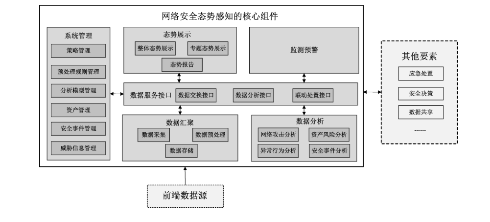

# GB/T 42453-2023 信息安全技术 网络安全态势感知通用技术要求

> 来源：[GB/T 42453-2023 国家标准详情](https://openstd.samr.gov.cn/bzgk/std/newGbInfo?hcno=11973BA1EB2D477C70B7DD4F77B076C6)。
> PDF SHA-256：5e719a465e6ab0f2a2620a9d087e63a7b9f40894a71f14beb6bd84b465342384。
> 发布日期：2023-03-17；实施日期：2023-10-01。依据官方公开文本的 13 页图像逐页核对；图 1 保留原图裁切。已去除封面、目录、分页和页眉页脚，正式引用请核对原 PDF。

## 前言

本文件按照 GB/T 1.1—2020《标准化工作导则 第1部分：标准化文件的结构和起草规则》的规定起草。

请注意本文件的某些内容可能涉及专利。本文件的发布机构不承担识别专利的责任。

本文件由全国信息安全标准化技术委员会（SAC/TC 260）提出并归口。

本文件起草单位：公安部第三研究所、北京锐安科技有限公司、国家信息技术安全研究中心、北京天融信网络安全技术有限公司、中国信息安全测评中心、北京奇虎科技有限公司、新华三技术有限公司、奇安信科技集团股份有限公司、启明星辰信息技术集团股份有限公司、长扬科技（北京）股份有限公司、北京神州绿盟科技有限公司、深信服科技股份有限公司、中国科学院信息工程研究所、北京山石网科信息技术有限公司、华为技术有限公司、杭州安恒信息技术股份有限公司、腾讯云计算（北京）有限责任公司、上海工业自动化仪表研究院有限公司、杭州迪普科技股份有限公司、中电长城网际系统应用有限公司、西安交大捷普网络科技有限公司、杭州中电安科现代科技有限公司、陕西省网络与信息安全测评中心、中国民航大学、中科国昱（合肥）科技有限公司、北京威努特技术有限公司、远江盛邦（北京）网络安全科技股份有限公司。

本文件主要起草人：陈妍、李京春、顾健、李雪莹、李斌、张屹、万晓兰、李军华、吕明、汪义舟、陶智、刘晨、万月亮、刘玉岭、张永皓、孙默、张华涛、聂桂兵、陶夏澈、刘慧芳、王涛、刘鹏、杨帆、何建锋、苗维杰、查正朋、周景贤。

## 1 范围

本文件给出了网络安全态势感知技术框架，规定了该框架中核心组件的通用技术要求。

本文件适用于网络安全态势感知产品、系统或平台等的规划、设计、开发、建设和测评。

## 2 规范性引用文件

下列文件中的内容通过文中的规范性引用而构成本文件必不可少的条款。其中，注日期的引用文件，仅该日期对应的版本适用于本文件；不注日期的引用文件，其最新版本（包括所有的修改单）适用于本文件。

- GB/T 25069—2022 信息安全技术 术语

- GB/T 28458—2020 信息安全技术 网络安全漏洞标识与描述规范

- GB/T 28517—2012 网络安全事件描述和交换格式

- GB/T 30279—2020 信息安全技术 网络安全漏洞分类分级指南

- GB/T 36643—2018 信息安全技术 网络安全威胁信息格式规范

- GB/T 37027—2018 信息安全技术 网络攻击定义及描述规范

## 3 术语和定义

GB/T 25069—2022 界定的以及下列术语和定义适用于本文件。

### 3.1 威胁 threat

可能对系统或组织造成危害的不期望事件的潜在因素。

> ［来源：GB/T 25069—2022,3.628］

### 3.2 威胁信息 threat information

基于证据的知识，用于描述现有或可能出现的威胁，从而实现对威胁的响应和预防。

> 注：威胁信息包括上下文、攻击机制、攻击指标、可能影响等信息。

> ［来源：GB/T 36643—2018,3.3，有修改］

### 3.3 网络安全态势感知 network security situation awareness

通过采集网络流量、资产信息、日志、漏洞信息、告警信息、威胁信息等数据，分析和处理网络行为及用户行为等因素，掌握网络安全状态，预测网络安全趋势，并进行展示和监测预警的活动。

### 3.4 前端数据源 front-end data source

向网络安全态势感知核心组件提供数据的软硬件。

### 3.5 画像 profiling

针对某类对象，在多维度上构建其描述性标签属性，并利用这些标签属性，分析对象多方面的特征，抽象概括其全貌的过程。

### 3.6 预警 warning

针对即将或正在发生的网络安全事件或威胁，提前或及时发出的警示。

> ［来源：GB/T 25069—2022,3.739］

## 4 缩略语

下列缩略语适用于本文件。

CPU：中央处理器（Central Processing Unit）

FTP：文件传输协议（File Transfer Protocol）

FTPS：安全套接层协议上的文件传输协议（File Transfer Protocol Secure）

HTTP：超文本传输协议（Hyper Text Transfer Protocol）

HTTPS：安全套接层协议上的超文本传输协议（Hypertext Transfer Protocol Secure）

IP：互联网协议（Internet Protocol）

SFTP：安全文件传送协议（SSH File Transfer Protocol）

SNMP：简单网络管理协议（Simple Network Management Protocol）

SSH：安全外壳（Secure Shell）

Syslog：系统日志（System log）

Web：全球广域网（World Wide Web）

## 5 网络安全态势感知技术框架

网络安全态势感知技术框架主要包括前端数据源、核心组件和其他要素三部分。其中网络安全态势感知的核心组件是实现网络安全态势感知能力的重要技术手段，表现形式可为产品、系统或平台，也可以是不同的功能组件；实现网络安全态势感知也依赖于应急处置、安全决策、数据共享等其他要素。

为能更好地进行网络安全态势感知，前端数据源需能覆盖网络安全态势感知范围内的通信网络、区域边界和计算环境。本文件规定了网络安全态势感知技术框架中核心组件的通用技术要求，不包括技术框架中相对独立的前端数据源和其他要素的要求。

依据通用性并保证网络安全态势感知功能完整性原则，本文件所指的网络安全态势感知核心组件由数据汇聚、数据分析、态势展示、监测预警、数据服务接口、系统管理等构成，见图1，其中虚线框不在本文件规定的技术要求中。数据汇聚组件依据业务需求从相应的前端数据源采集数据，经过筛选、转换、补全、标记等预处理后进行存储，用于后续的数据分析；数据分析组件基于不同的数据分析模型通过数据服务接口调用相关数据，进行网络攻击分析、资产风险分析、异常行为分析和安全事件分析；根据应用场景不同，态势展示组件可通过数据服务接口调用相关数据进行多维度评估和展示，包括整体态势展示、专题态势展示和态势报告；监测预警组件支持基于设定的监测策略和预警规则进行预警，便于后续的应急处置、安全决策等；此外，为方便用户接入不同类型的前端数据、更好地使用多样化的分析模型，该技术框架将数据采集、交换、分析和应用等数据处理活动充分解耦，通过数据服务接口组件，进行前端数据源、内部不同模块以及其他外部系统的数据交互，包括了数据交换接口、数据分析接口、联动处置接口等；数据服务接口也便于与其他系统进行数据共享。系统管理组件主要进行策略管理、预处理规则管理、分析模型管理、资产管理、安全事件管理和威胁信息管理。

## 6 技术要求

### 6.1 数据汇聚要求

#### 6.1.1 数据采集

##### 6.1.1.1 采集方式

对于不同的前端数据源，数据汇聚组件应支持以下采集方式：

a） 被动接收前端数据源发送的数据；

b） 主动发起获取前端数据源的数据，支持对数据采集频率进行设置；

c） 手动导入前端数据源的数据。

##### 6.1.1.2 采集协议

数据汇聚组件应根据应用场景支持两种或两种以上的采集协议进行数据采集，采集协议包括但不限于 Syslog、FTP/FTPS、SFTP、HTTP/HTTPS、SSH、SNMP等。

##### 6.1.1.3 采集内容

数据汇聚组件：

a） 应支持基于采集策略采集不同类型的数据，数据类型包括网络流量、资产信息、日志、漏洞信息、用户行为、告警信息、威胁信息等；

b） 应支持根据应用场景自定义采集的数据类型；

c） 应支持采用校验技术或密码技术确保从前端数据源采集数据的完整性。

#### 6.1.2 数据预处理

##### 6.1.2.1 数据筛选

数据汇聚组件应支持基于数据预处理规则对采集的原始数据进行筛选，如去除必填字段为空的数据、去除重要字段为空的数据、去除数据格式错误的数据、去除重复的数据等。

##### 6.1.2.2 数据转换

数据汇聚组件应支持将采集的同一类型、不同格式的原始数据转换为统一的数据格式，如统一时间格式、统一漏洞名称等，且转换时不能丢失或损坏关键数据项，其中漏洞描述应遵循 GB/T 28458—2020 第 5 章、GB/T 30279—2020 第 5 章和第 6 章的要求；威胁信息描述应遵循 GB/T 36643—2018 第 6 章的要求；网络攻击描述应遵循 GB/T 37027—2018 第 6 章和第 7 章的要求；安全事件描述应遵循 GB/T 28517—2012 第 5 章、第 6 章和第 7 章的要求。

##### 6.1.2.3 数据补全

数据汇聚组件应支持基于资产信息库、威胁信息库、地理信息库等对采集的原始数据进行补全，补全的内容包括资产的相关属性、关联事件、地理位置等。

##### 6.1.2.4 数据标记

数据汇聚组件应支持根据相关数据字段对采集的原始数据进行标记，标记内容应基于分析需求进行设置，如数据可信度、数据来源等。

#### 6.1.3 数据存储

##### 6.1.3.1 数据格式

数据汇聚组件应支持存储结构化、半结构化和非结构化的数据。

##### 6.1.3.2 存储内容

数据汇聚组件：

a） 应支持存储业务数据，如采集的流量数据、日志数据、告警信息以及产生的安全事件、预警信息等；

b） 应支持存储管理数据，如安全策略数据、运行日志、操作日志等；

c） 应支持存储知识数据并建立相应的数据库，如资产信息库、地理信息库、攻击特征库、漏洞库、安全事件库、威胁信息库等。

##### 6.1.3.3 存储时间

数据汇聚组件应支持设置各类数据的存储时间。

##### 6.1.3.4 存储安全

数据汇聚组件应支持对存储的重要数据、敏感数据等进行完整性和保密性保护。

### 6.2 数据分析要求

#### 6.2.1 网络攻击分析

数据分析组件：

a） 应支持识别不同类别的网络攻击，网络攻击类别包括但不限于漏洞利用攻击、拒绝服务攻击、Web 应用攻击、数据窃取攻击、恶意邮件攻击、恶意代码攻击等；

b） 应支持基于特征匹配、关联分析、数据挖掘、机器学习等技术进行网络攻击分析；

c） 应支持基于威胁信息等进行网络攻击分析；

d） 应支持通过分析得到网络攻击属性，包括攻击时间、攻击来源、攻击对象、攻击结果、攻击方式、分布情况、攻击频次、影响范围、危害程度等；

e） 应支持从攻击对象或攻击方视角对网络攻击行为进行分析，还原攻击路径；

f） 应支持建立攻击方画像；

g） 宜支持结合内外部的分析能力预测潜在的网络攻击。

#### 6.2.2 资产风险分析

数据分析组件：

a） 应支持结合资产类型、资产位置、资产重要程度、资产脆弱性、资产是否失陷及威胁信息等分析资产风险，评估资产风险等级；

b） 应支持建立资产画像；

c） 宜支持结合内外部的分析能力预测潜在的资产风险。

#### 6.2.3 异常行为分析

数据分析组件：

a） 应支持发现用户或实体的异常行为，异常行为包括但不限于登录异常、访问异常、操作异常、数据下载异常、可疑域名访问等；

b）应支持基于行为基线、关联分析、数据挖掘、机器学习等技术进行异常行为分析；

c） 应支持建立用户行为画像，包括用户个体行为画像和群体行为画像；

d） 宜支持基于历史数据学习预测用户或实体潜在的异常行为。

#### 6.2.4 安全事件分析

数据分析组件：

a） 应支持基于资产重要程度、造成的危害程度和影响范围对安全事件进行分类分级；

b） 应支持基于安全事件，关联分析出资产相关的威胁信息、网络攻击类别、网络攻击属性、影响范围等；

c） 宜支持结合内外部的分析能力预测潜在的安全事件。

### 6.3 态势展示要求

#### 6.3.1 整体态势展示

态势展示组件：

a） 应支持对网络的整体安全状况用分值或等级等方式进行评估和展示；

b）应支持对不同行业、不同区域、不同业务单元或不同资产等的局部网络安全状况采用分值或等级等方式进行评估和展示；

c） 应支持对不同时间段的整体网络安全状况进行评估和展示；

d） 应支持采用多种视图展示整体安全态势，展示视图至少包括以下中的两种：雷达图、地理信息图、关联关系图、威胁路径图、趋势图、同/环比图等；

e） 应支持分角色展示，即针对不同角色用户展示不同内容；

f） 应支持展示整体网络安全状况的变化趋势，如分值或等级的变化等；

g） 应支持根据应用场景进行不同类型专题态势的评估和展示。

#### 6.3.2 专题态势展示

##### 6.3.2.1 资产态势

态势展示组件：

a） 应支持以图表方式展示当前资产的类型和数量；

b）应支持展示资产名称、资产类型、重要程度、IP地址、开放端口、联网状态等；

c） 应支持对资产的安全状况进行评估和展示，包括具体资产的风险等级及资产的安全状况描述；

d）应支持展示资产安全状况的变化趋势，如资产风险等级的变化、联网状态的变化等。

##### 6.3.2.2 流量态势

态势展示组件：

a） 应支持对流量数据基于协议、时间、源IP 地址、目的IP 地址、前端数据源等进行统计和展示；

b） 应支持统计和展示的范围至少包括互联网流量，特定用户流量及特定资产流量等；

c） 应支持展示流量的变化趋势，如互联网流量大小的变化、前端数据源流量大小的变化等。

##### 6.3.2.3 运行态势

态势展示组件：

a） 应支持对资产的资源（如CPU、内存、网络）使用情况进行统计和展示；

b） 应支持统计和展示的范围至少包括重要资产、运行异常资产等；

c） 应支持展示资产的资源使用情况的变化趋势，如资产CPU/内存/网络使用情况的变化、运行异常资产的数量变化等。

##### 6.3.2.4 脆弱性态势

态势展示组件：

a） 应支持展示网络中存在的漏洞、弱口令、不安全配置等脆弱性；

b） 应支持展示存在漏洞的资产、漏洞的类型分布、漏洞的级别分布等；

c） 应支持基于资产信息统计和展示脆弱性分析结果，包括漏洞资产总数、弱口令资产数、不安全配置资产数及详情等；

d） 应支持展示资产脆弱性的变化趋势，如资产中高风险漏洞数量的变化、弱口令资产数的变化等。

##### 6.3.2.5 攻击态势

态势展示组件：

a） 应支持实时获取并展示当前网络的受攻击情况，包括攻击时间、攻击源IP 地址、目的IP地址、攻击方式、攻击路径等；

b）应支持统计和展示攻击方式分布、攻击时间段、攻击来源分布等；

c） 应支持展示当前网络受攻击情况的变化趋势，如攻击时间段的变化、攻击来源分布的变化等。

##### 6.3.2.6 异常行为态势

态势展示组件：

a） 应支持展示偏离用户行为基线的用户异常行为，如违规或越权访问网络或服务、非授权下载数据等；

b）应支持展示偏离实体访问基线的实体异常行为，实体包括主机操作系统、网络设备、安全设备、数据库、中间件、应用系统等；

c） 应支持展示的内容包括用户或实体信息、异常行为对象、异常行为类型、异常行为发生时间、异常行为描述等；

d） 应支持展示用户或实体异常行为的变化趋势，如异常行为类型的变化、异常行为发生时间的变化等。

##### 6.3.2.7 安全事件态势

态势展示组件：

a） 应支持展示网络中发现的安全事件，包括事件时间、事件类型、事件名称、事件等级、事件对象、攻击者IP 地址、事件描述、影响范围等；

b）应支持基于安全事件数量、类型、等级、资产分布等进行安全事件的统计和展示；

c） 应支持展示安全事件的变化趋势，如安全事件类型的变化、事件对象的变化等。

#### 6.3.3 态势报告

##### 6.3.3.1 数据查询

态势展示组件：

a） 应支持对态势相关数据进行查询；

b） 应支持基于时间或其他数据字段进行组合查询；

c） 应支持对查询结果根据字段进行排序。

##### 6.3.3.2 统计报表

态势展示组件：

a） 应支持根据数据分析、态势评估的结果生成统计报表并导出；

b） 应支持基于指定时间段生成统计报表或生成周期性报表；

c） 应支持自定义设置统计视图和报表模板，采用多种视图生成统计报表。

##### 6.3.3.3 分析报告

态势展示组件：

a） 应支持根据数据分析结果生成整体网络安全状况分析报告并导出；

b）应支持根据数据分析结果生成不同区域、不同业务单元等的局部网络安全状况分析报告并导出；

c） 应支持根据数据分析结果提供对策或修复建议；

d） 应支持基于指定时间段产生分析报告或生成周期性分析报告；

e） 应支持自定义设置分析报告的模板。

### 6.4 监测预警要求

监测预警组件：

a） 应支持基于监测策略对网络安全状况进行监测，具体监测策略支持根据应用场景自定义；

b）应支持基于监测结果、数据分析结果，并结合预警规则等进行分级别预警；

c） 应支持以下一种或多种预警方式：如平台、短信、邮件、即时通信等；

d） 应支持根据预警级别和预警流程发布预警信息，预警信息包括但不限于预警类型、预警级别、事件类型、威胁方式、涉及对象、影响程度、防范对策等；

e） 应支持通过预警信息进行受影响资产的关联分析，得出资产名称、资产类型、IP 地址等；

f） 应支持预警信息的上报，预警信息的上报方式和内容遵循国家相关规定；

g） 宜支持基于预警信息与第三方设备或系统进行联动处置。

### 6.5 数据服务接口要求

#### 6.5.1 数据交换接口

数据服务接口组件：

a） 应支持与不同前端数据源、内部不同模块及其他外部系统通过接口进行数据交换，数据交换包括但不限于数据采集、共享、级联交换；

b） 数据交换的内容应支持不同的类型、字段和格式，其中类型包括日志、告警信息、威胁信息、资产信息、用户信息、脆弱性信息、安全事件等，字段和格式应基于类型进行定义。

#### 6.5.2 数据分析接口

数据服务接口组件：

a） 宜支持为内部不同模块及其他外部系统通过接口进行数据分析；

b） 宜支持基于数据分析接口实现算术计算、逻辑关系计算、关联计算等分析能力。

#### 6.5.3 联动处置接口

数据服务接口组件：

a） 宜支持为内部不同模块及其他外部系统通过接口进行联动处置；

b） 宜支持通过接口进行防护策略的更新、扫描策略的下发等操作。

#### 6.5.4 接口安全性

数据服务接口应具有相应的安全保障机制，保证数据在传输过程中的可用性、完整性和保密性。

### 6.6 系统管理要求

#### 6.6.1 策略管理

系统管理组件应为授权管理员提供策略管理的功能，支持策略的集中管理和自定义设置，包括采集策略、监测策略和预警规则等。

#### 6.6.2 预处理规则管理

系统管理组件应为授权管理员提供管理数据处理规则的功能，包括新增、删除、修改、查询、启用、停用数据处理规则等。

#### 6.6.3 分析模型管理

系统管理组件宜为授权管理员提供数据分析模型的管理，包括新增、删除、修改数据分析模型等。

#### 6.6.4 资产管理

系统管理组件应为授权管理员提供资产管理的功能，支持对采用人工添加、主动探测发现、被动识别等技术手段获取的资产信息进行管理。

#### 6.6.5 安全事件管理

系统管理组件应为授权管理员提供安全事件管理的功能，包括建立并动态维护安全事件库，对安全事件进行分类和分级等。

#### 6.6.6 威胁信息管理

系统管理组件：

a） 应为授权管理员提供威胁信息管理的功能，包括威胁信息的添加、删除、上报、共享等；

b） 应建立威胁信息库，威胁信息库的内容至少包括：信息来源、更新时间、内容描述、关联事件、关联IP 地址等；

c） 应支持对不同来源的威胁信息进行汇聚并及时更新。

## 参考文献

- ［1］ GB/T 20985.1—2017 信息技术 安全技术 信息安全事件管理 第1部分：事件管理原理

- ［2］ GB/T 20985.2—2020 信息技术 安全技术 信息安全事件管理 第2部分：事件响应规划和准备指南

- ［3］ GB/Z 20986—2007 信息安全技术 信息安全事件分类分级指南

- ［4］ GB/T 32924—2016 信息安全技术 网络安全预警指南

- ［5］ GB/T 36635—2018 信息安全技术 网络安全监测基本要求与实施指南

- ［6］ NIST SP 1800-7 Situational Awareness for Electric Utilities
