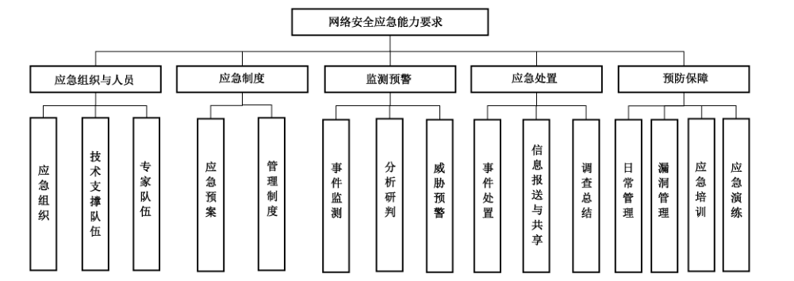

# GB/T 43269-2023 信息安全技术 网络安全应急能力评估准则

> 来源：[GB/T 43269-2023 国家标准详情](https://openstd.samr.gov.cn/bzgk/std/newGbInfo?hcno=0A8EE3AA22E563E2F5D5CC9DF556E726)；发布日期：2023-11-27；实施日期：2024-06-01。
> PDF SHA-256：75d9d0e1c3effcd12c623ac05b00a080d517eab2352a74838271133c465f772a。
> 转写说明：逐页对照官方 PDF 的 56 页图像校核文字、图示和附录表格；保留 2 幅原图，合并跨页表格与段落，省略封面、目录、页眉和页码。正式引用请核对原 PDF。

## 前言

本文件按照 GB/T 1.1—2020《标准化工作导则 第1部分：标准化文件的结构和起草规则》的规定起草。

请注意本文件的某些内容可能涉及专利。本文件的发布机构不承担识别专利的责任。

本文件由全国信息安全标准化技术委员会（SAC/TC 260）提出并归口。

本文件起草单位：国家计算机网络应急技术处理协调中心、国家计算机网络应急技术处理协调中心浙江分中心、安天科技集团股份有限公司、北京天融信网络安全技术有限公司、国家计算机网络应急技术处理协调中心江苏分中心、北京时代新威信息技术有限公司、中国电子技术标准化研究院、北京数字观星科技有限公司、中国网络安全审查技术与认证中心、国家计算机网络应急技术处理协调中心黑龙江分中心、新华三技术有限公司、国网智能电网研究院有限公司、北京东方通网信科技有限公司、深信服科技股份有限公司、奇安信网神信息技术（北京）股份有限公司、启明星辰信息技术集团股份有限公司、信联科技（南京）有限公司、华为技术有限公司、恒安嘉新（北京）科技股份公司、中电长城网际系统应用有限公司、深圳市腾讯计算机系统有限公司、联想（北京）有限公司、陕西省网络与信息安全测评中心、任子行网络技术股份有限公司、杭州安恒信息技术股份有限公司、华信咨询设计研究院有限公司、浙江鹏信信息科技股份有限公司、北京惠而特科技有限公司、北京辰安科技股份有限公司、上海观安信息技术股份有限公司、北京山石网科信息技术有限公司。

本文件主要起草人：陈悦、云晓春、耿冬梅、舒敏、王文磊、马骏野、赵焕菊、马旸、杨剑、于佳华、王新杰、吴莉莉、郭亮、龙泉、翟亚红、仲思超、闵京华、罗亮、王惠莅、蒋凌云、王秉政、万晓兰、崔婷婷、钱珂翔、叶润国、陈洪波、张璇、陈世俊、刘丙双、陈晓光、姚力、赵承刚、石竹君、高瑞、张胜、白峻、李汝鑫、刘蓝岭、董平、章亮、张帆、孙立立、李世斌、季莹莹、俞政臣、曾宪育、谢江、于俊杰、任协京、林峰。

## 1 范围

本文件规定了网络安全应急能力要求，给出了相应评估流程。

本文件适用于各类组织进行网络安全应急能力建设与评估。

## 2 规范性引用文件

下列文件中的内容通过文中的规范性引用而构成本文件必不可少的条款。其中，注日期的引用文件，仅该日期对应的版本适用于本文件；不注日期的引用文件，其最新版本（包括所有的修改单）适用于本文件。

- GB/T 20986 信息安全技术 网络安全事件分类分级指南

- GB/T 25069 信息安全技术 术语

- GB/T 38645—2020 信息安全技术 网络安全事件应急演练指南

## 3 术语和定义

GB/T 25069界定的以及下列术语和定义适用于本文件。

### 3.1 网络安全应急能力 cybersecurity emergency capability

在网络安全事件发生的事前、事中和事后，组织采取网络安全应急响应措施应对突发网络安全事件的能力。

## 4 概述

本文件将网络安全应急能力分为三个级别，从低到高依次是一级、二级和三级，每个级别的网络安全应急能力要求包括应急组织与人员、应急制度、监测预警、应急处置、预防保障5个方面共15个部分，如图1所示。第5章、第6章、第7章分别规定了一级、二级和三级网络安全应急能力要求，高级别在低一级别的基础上提出增强要求或增加新的条款，并用黑体字标出，各级网络安全应急能力适用场景见附录 A。

网络安全应急能力评估根据被评估组织申请的能力级别，按照相应级别的网络安全应急能力要求进行评估，第8章给出了整体评估流程，包括评估准备、评估实施、评估结论、报告编制4个阶段，一级、二级和三级网络安全应急能力各项要求的评估方法见附录 B、附录C和附录D。

## 5 一级能力要求

### 5.1 应急组织与人员

#### 5.1.1 应急组织

本项要求包括：

a） 组织应明确网络安全应急日常工作机构，配备网络安全应急人员，并明确各自职责；

b）组织应设置网络安全应急负责人，并明确其职责。

#### 5.1.2 技术支撑队伍

组织应具备网络安全应急技术支撑队伍并明确其职责，技术支撑队伍可自建或由外部提供。

#### 5.1.3 专家队伍

组织应具备网络安全应急专家队伍，专家队伍成员由内外部专家组成。

### 5.2 应急制度

#### 5.2.1 应急预案

本项要求包括：

a） 组织应按照国家、行业或地方网络安全应急预案相关要求制定网络安全应急预案，并经审批后发布实施；

b） 网络安全应急预案可被相关网络安全应急人员方便获取，网络安全应急人员应熟悉网络安全应急预案内容；

c） 组织应定期对网络安全应急预案的适宜性和有效性进行评估并修订。

#### 5.2.2 管理制度

组织应制定网络安全应急管理制度，例如网络安全应急值守制度、网络安全应急经费保障制度等，并经审批后发布实施。

### 5.3 监测预警

#### 5.3.1 事件监测

本项要求包括：

a） 组织应开展网络安全事件监测，留存网络日志不少于 6 个月；

b） 组织应对发现的安全隐患和可疑事件进行处理，留存处理记录，并在发现网络安全事件时，启动网络安全事件报告流程。

#### 5.3.2 分析研判

当初步判定发生网络安全事件时，组织应调集网络安全应急技术支撑队伍、网络安全应急专家队伍进行研判，确定网络安全事件的级别和类型，并启动相应网络安全应急预案。

#### 5.3.3 威胁预警

组织应按照主管部门或国家有关部门发布的预警信息与响应要求，采取风险防范措施，并形成预警响应记录。

### 5.4 应急处置

#### 5.4.1 事件处置

本项要求包括：

a） 组织应按照网络安全应急预案对已发生的网络安全事件实施处置，并形成网络安全事件处置记录；

b）对于不能处置的网络安全事件，组织应按照主管部门或国家有关部门要求报告并协调外部支援。

#### 5.4.2 信息报送与共享

本项要求包括：

a） 当发生网络安全事件时，组织应形成网络安全事件报告单，在组织内部进行网络安全事件报告；

b） 组织应按照主管部门或国家有关部门要求报告网络安全事件，并持续跟踪事件变化情况，更新报告信息；

c） 组织应开展网络安全信息共享，并在信息共享前进行脱敏处理。

#### 5.4.3 调查总结

组织应在网络安全应急响应结束后30 d 内完成对网络安全事件起因的调查与处置过程的总结，形成网络安全事件总结报告。

### 5.5 预防保障

#### 5.5.1 日常管理

本项要求包括：

a） 组织应实行网络安全应急值守制度，并制定网络安全应急值守工作规范；

b） 组织应具备网络安全应急值守人员，并实行5×8 h值班。

#### 5.5.2 漏洞管理

本项要求包括：

a） 组织应采取措施识别网络安全漏洞，对发现的网络安全漏洞评估影响后进行修补；

b） 接收主管部门或国家有关部门的网络安全漏洞通报后，组织应在要求时间内完成处置并反馈处置情况。

#### 5.5.3 应急培训

组织应定期对网络安全应急有关法规政策、网络安全应急预案进行培训。

#### 5.5.4 应急演练

本项要求包括：

a） 组织应每年进行网络安全应急演练，演练形式按照 GB/T 38645—2020开展；

b） 组织应对网络安全应急演练过程进行记录，对应急演练效果进行总结，形成应急演练总结报告，解决发现的问题，并对网络安全应急预案进行完善。

## 6 二级能力要求

### 6.1 应急组织与人员

#### 6.1.1 应急组织

本项要求包括：

a） 组织应明确网络安全应急日常工作机构，配备网络安全应急人员，并明确各自职责；

b） **组织应明确网络安全应急相关部门及职责，每个部门至少设置 1 名联系人：**

c） 组织应设置网络安全应急负责人，并明确其职责。

#### 6.1.2 技术支撑队伍

本项要求包括：

a） 组织应具备**自建的**网络安全应急技术支撑队伍并明确其职责；

b） **组织应明确网络安全应急技术支撑队伍中的关键岗位，并至少配备 1 名专职人员。**

#### 6.1.3 专家队伍

本项要求包括：

a） 组织应具备网络安全应急专家队伍，专家队伍成员由内外部专家组成；

b） **网络安全应急专家队伍应在应急预案修订、事件分析、响应决策等网络安全应急工作提供咨询与建议。**

### 6.2 应急制度

#### 6.2.1 应急预案

本项要求包括：

a） 组织应按照国家、行业或地方网络安全应急预案相关要求制定网络安全应急预案，并经审批后发布实施；

b） **网络安全应急预案应包括事件分类分级、预案启动条件、应急组织构成、事件报告流程、处置恢复流程、应急资源保障、演练和培训等内容；**

> 注：网络安全应急预案内容参见 GB/T 24363—2009。

c） **网络安全应急预案应明确预案适用范围，并结合网络安全事件对业务的影响范围和程度确定事件分级、预警分级和响应分级的标准，分级标准与 GB/T 20986 以及主管部门或国家有关部门要求相符；**

d） **网络安全应急预案应有信息报告、处置记录等表格模板，且模板规范、要素齐全；有联系方式清单，包括应急值班 24 h 联系电话、信息资产责任人联系方式、专家名单与联系方式、网络安全应急技术支撑队伍联系方式、应急相关单位联系方式等；**

e） 网络安全应急预案可被相关网络安全应急人员方便获取，网络安全应急人员应熟悉网络安全应急预案内容；

f） 组织应定期对网络安全应急预案的适宜性和有效性进行评估并修订。

#### 6.2.2 管理制度

本项要求包括：

a） 组织应制定网络安全应急管理制度，例如网络安全应急值守制度、网络安全应急经费保障制度等，并经审批后发布实施；

b） **网络安全应急管理制度内容应与网络安全应急预案内容衔接一致；**

c） **组织应定期对网络安全应急管理制度进行评估并修订。**

### 6.3 监测预警

#### 6.3.1 事件监测

本项要求包括：

a） 组织应开展网络安全事件监测，留存网络日志不少于 6 个月，**并采取技术措施保障网络日志存储的完整性，防止篡改**；

b） 组织应对发现的安全隐患和可疑事件进行处理，留存处理记录，并在发现网络安全事件时，启动网络安全事件报告流程。

#### 6.3.2 分析研判

本项要求包括：

a） 当初步判定发生网络安全事件时，组织应调集网络安全应急技术支撑队伍、网络安全应急专家队伍进行研判，确定网络安全事件的级别和类型，并启动相应网络安全应急预案；

b） **组织应对网络安全事件进行分析，形成网络安全事件分析报告，报告内容包括事件级别、事件类型、事件描述、事件起因、影响范围、危害程度、处置建议等；**

c） **组织应具备分析工具和分析方法，对日志、流量、漏洞、行为、恶意代码等方面进行分析，并持续更新完善相关工具和方法。**

#### 6.3.3 威胁预警

本项要求包括：

a） 组织应按照主管部门或国家有关部门发布的预警信息与响应要求，采取风险防范措施，并形成预警响应记录；

b） **组织应适当结合自动化技术手段收集内部网络安全监测信息与外部网络安全威胁信息，外部网络安全威胁信息包括网络安全漏洞、恶意程序、网络攻击最新动态等；**

c） **经研判，对于可能造成较大影响的网络安全威胁信息，组织应按照主管部门或国家有关部门要求报告，并持续跟踪威胁变化情况，更新报告信息。**

### 6.4 应急处置

#### 6.4.1 事件处置

本项要求包括：

a） 组织应按照网络安全应急预案对已发生的网络安全事件实施处置，**包括抑制事件发展、消除事件根源、恢复系统状态等**，并形成网络安全事件处置记录；

b） 对于不能处置的网络安全事件，组织应按照主管部门或国家有关部门要求报告并协调外部支援；

c） **组织应具备日志提取、病毒检查、木马检查、后门检查、恶意行为分析等工具进行网络安全应急处置，并持续更新完善相关工具；**

d） **现场处置人员应按照网络安全应急预案进行先期处置，防止危害扩大；**

e） **组织应按照网络安全应急预案在网络安全应急处置过程中校验处置结果，发生处置不当时采取回退措施。**

#### 6.4.2 信息报送与共享

本项要求包括：

a） 当发生网络安全事件时，组织应形成网络安全事件报告单，在组织内部进行网络安全事件报告；

b） 组织应按照主管部门或国家有关部门要求报告网络安全事件，并持续跟踪事件变化情况，更新报告信息；

c） **组织应向可能受到影响的相关方进行网络安全事件通报；**

d） **组织应急通信联络设备设施应保持畅通；**

e） 组织应开展网络安全信息共享，并在信息共享前进行脱敏处理；

f） **组织应建立并持续拓展网络安全信息共享渠道，并采用技术手段进行信息共享。**

#### 6.4.3 调查总结

本项要求包括：

a） 组织应在网络安全应急响应结束后**20 d** 内完成对网络安全事件起因的调查与处置过程的总结，形成网络安全事件总结报告，**报告内容包括事件起因、性质、影响和责任，以及提出的处理意见与整改措施等，并按照主管部门或国家有关部门要求报告**；

b） **组织应定期对网络安全事件总结报告中整改措施落实情况进行评估，总结网络安全应急响应活动的经验教训，对网络安全应急预案进行完善，并对存在问题进行改进。**

### 6.5 预防保障

#### 6.5.1 日常管理

本项要求包括：

a） 组织应实行网络安全应急值守制度，并制定网络安全应急值守工作规范；

b）组织应具备**专职的**网络安全应急值守人员，并实行**7×8 h** 值班；

c） **网络安全应急值守人员应熟悉网络安全应急值守工作规范；**

d） **组织应根据网络安全应急预案配备网络安全应急相关工具装备、备品备件，并建立台账清单；**

e） **组织应定期对网络安全应急值守工作规范进行评估并修订。**

#### 6.5.2 漏洞管理

本项要求包括：

a） 组织应采取措施识别网络安全漏洞，对发现的网络安全漏洞评估影响后进行修补；

b）接收主管部门或国家有关部门的网络安全漏洞通报后，组织应在要求时间内完成处置并反馈处置情况；

c） **组织应建立信息资产动态管理台账，对信息资产关联的风险信息进行识别与处置。**

#### 6.5.3 应急培训

本项要求包括：

a） **组织应制定年度网络安全应急培训计划，并按计划开展培训；针对一般人员，培训内容至少包括：网络安全应急有关法规政策、网络安全应急预案；针对网络安全应急人员，培训内容至少包括：网络安全基本知识、网络安全应急有关法规政策、网络安全应急预案、网络安全应急管理、网络安全应急技能；针对最高管理层成员与各部门负责人，培训内容至少包括：网络安全基本知识、网络安全应急有关法规政策、网络安全应急预案；**

b） **组织应定期对网络安全应急培训计划与培训内容进行评估并持续更新。**

#### 6.5.4 应急演练

本项要求包括：

a） **组织应制定年度网络安全应急演练计划，并按计划组织应急演练**，演练形式按照 GB/T 38645—2020开展，**每年至少进行一次实操演练**；

b） **组织应根据网络安全应急预案制定网络安全应急演练方案，包括应急演练的规模、形式、范围、内容、组织、评估、总结、脚本等内容；**

c） 组织应对网络安全应急演练过程进行记录，对应急演练效果进行总结，形成应急演练总结报告，解决发现的问题，并对网络安全应急预案进行完善；

d） **网络安全应急演练效果评估与总结应有专家队伍成员参与；**

e） **组织应定期对网络安全应急演练方案进行评估并持续完善。**

## 7 三级能力要求

### 7.1 应急组织与人员

#### 7.1.1 应急组织

本项要求包括：

a） 组织应明确网络安全应急日常工作机构，配备网络安全应急人员，并明确各自职责；

b） 组织应明确网络安全应急相关部门及职责，每个部门至少设置 1 名联系人；

c） **组织应明确网络安全应急领导机构，网络安全应急领导机构负责人为组织最高负责人，成员由各相关部门负责人组成，并明确各成员职责；**

d） **组织应定期对网络安全应急组织构成与人员配备情况进行评估与调整。**

#### 7.1.2 技术支撑队伍

本项要求包括：

a） 组织应具备自建的网络安全应急技术支撑队伍并明确其职责；

b） 组织应明确网络安全应急技术支撑队伍中的关键岗位，并至少配备 1 名专职人员；

c） **组织应明确网络安全应急技术支撑队伍的岗位构成以及岗位的职责与技术能力要求；**

> 注：网络安全应急技术支撑队伍的岗位职责包括应急管理规划、监测预警、事件分析、应急处置、数据备份、系统恢复、调查取证等方面。

d） **组织应定期对网络安全应急技术支撑队伍成员进行专业技能考核与评估并调整队伍成员。**

#### 7.1.3 专家队伍

本项要求包括：

a） 组织应具备网络安全应急专家队伍，专家队伍成员由内外部专家组成；

b） 网络安全应急专家队伍应在应急预案修订、事件分析、响应决策等网络安全应急工作提供咨询与建议；

c） **组织应建立网络安全应急专家库，专家库成员包括网络与信息安全技术专家、业务专家、法律专家等各相关方面专家；**

> 注：网络与信息安全技术专家分为网络安全事件分析专家、安全策略分析专家、安全产品专家、安全攻防专家、威胁情报专家、应急演练指导专家、应急预案咨询专家等类别。

d） **组织应定期对网络安全应急专家队伍的专家水平进行评估并调整专家成员。**

### 7.2 应急制度

#### 7.2.1 应急预案

本项要求包括：

a） 组织应按照国家、行业或地方网络安全应急预案相关要求制定网络安全应急预案，并经审批后发布实施；

b） **组织应按照主管部门或国家有关部门的备案管理要求，对网络安全应急预案进行备案；**

c） **组织应结合组织自身信息资产、业务运行、网络安全风险的特点制定网络安全应急预案，在制定网络安全应急预案前开展网络安全风险评估与应急资源调查，并在网络安全风险和应急资源发生重大变化时修订预案；**

d） 网络安全应急预案应包括事件分类分级、预案启动条件、应急组织构成、事件报告流程、处置恢复流程、应急资源保障、演练和培训等内容；

> 注：网络安全应急预案内容参见 GB/T 24363—2009。

e） 网络安全应急预案应明确预案适用范围，并结合网络安全事件对业务的影响范围和程度确定事件分级、预警分级和响应分级的标准，分级标准与 GB/T 20986 以及主管部门或国家有关部门要求相符；

f） **组织应持续完善网络安全应急预案体系，制定专项应急预案，明确相应事件报告和处置恢复流程，对造成系统中断和造成信息泄露的网络安全事件采用不同的报告程序，制定必要的现场处置方案，明确现场处置的管理职责与操作规程等；**

g） 网络安全应急预案应有信息报告、处置记录等表格模板，且模板规范、要素齐全；有联系方式清单，包括应急值班 24 h 联系电话、信息资产责任人联系方式、专家名单与联系方式、网络安全应急技术支撑队伍联系方式、应急相关单位联系方式等；

h）网络安全应急预案可被相关网络安全应急人员方便获取，网络安全应急人员应熟悉网络安全应急预案内容；

i） 组织应**每年**对网络安全应急预案的适宜性和有效性进行评估并修订。

#### 7.2.2 管理制度

本项要求包括：

a） 组织应制定网络安全应急管理制度，例如网络安全应急值守制度、网络安全应急经费保障制度等，并经审批后发布实施；

b） 网络安全应急管理制度内容应与网络安全应急预案内容衔接一致；

c） **网络安全应急管理制度应纳入组织整体网络安全管理制度体系；**

d） 组织应**每年**对网络安全应急管理制度进行评估并修订。

### 7.3 监测预警

#### 7.3.1 事件监测

本项要求包括：

a） 组织应开展**7×24 h** 网络安全事件监测，留存网络日志不少于 6 个月，并采取技术措施保障网络日志存储的完整性，防止篡改；

b）组织应对发现的安全隐患和可疑事件进行处理，留存处理记录，并在发现网络安全事件时，启动网络安全事件报告流程；

c） **组织应对关键业务系统的网络流量、日志信息、运行状态、性能状况、告警信息和异常行为进行监测；**

d） **组织应定期形成监测情况汇总报告，包括月报和年报，评估监测技术措施弱点并进行持续改进。**

#### 7.3.2 分析研判

本项要求包括：

a） 当初步判定发生网络安全事件时，组织应调集网络安全应急技术支撑队伍、网络安全应急专家队伍进行研判，确定网络安全事件的级别和类型，并启动相应网络安全应急预案；

b）组织应对网络安全事件进行分析，形成网络安全事件分析报告，报告内容包括事件级别、事件类型、事件描述、事件起因、影响范围、危害程度、处置建议等；

c） 组织应具备分析工具和分析方法，对日志、流量、漏洞、行为、恶意代码等方面进行分析，并持续更新完善相关工具和方法；

d） **组织应对内部网络安全监测信息与外部网络安全威胁信息进行整合，并综合分析网络安全态势。**

#### 7.3.3 威胁预警

本项要求包括：

a） 组织应按照主管部门或国家有关部门发布的预警信息与响应要求，采取风险防范措施，并形成预警响应记录；

b） 组织应适当结合自动化技术手段收集**处理**内部网络安全监测信息与外部网络安全威胁信息，外部网络安全威胁信息包括网络安全漏洞、恶意程序、网络攻击最新动态等；

c） 经研判，对于可能造成较大影响的网络安全威胁信息，组织应按照主管部门或国家有关部门要求报告，并持续跟踪威胁变化情况，更新报告信息；

d） **组织应构建网络安全威胁信息知识库，并持续更新完善知识库。**

> 注：网络安全威胁信息知识包括历史网络安全事件经验知识、网络攻击策略技术与过程知识、网络安全威胁应对措施知识等。

### 7.4 应急处置

#### 7.4.1 事件处置

本项要求包括：

a） 组织应按照网络安全应急预案对已发生的网络安全事件实施处置，包括抑制事件发展、消除事件根源、恢复系统状态等，并形成网络安全事件处置记录；

b） 对于不能处置的网络安全事件，组织应按照主管部门或国家有关部门要求报告并协调外部支援；

c） 组织应具备日志提取、病毒检查、木马检查、后门检查、恶意行为分析等工具进行网络安全应急处置，并持续更新完善相关工具；

d） 现场处置人员应按照网络安全应急预案进行先期处置，防止危害扩大；

e） 组织应按照网络安全应急预案在网络安全应急处置过程中校验处置结果，发生处置不当时采取回退措施；

f） **组织应按照网络安全应急预案在系统恢复后对系统恢复情况开展再评估，防止系统遭受二次破坏、危害或故障；**

g） **组织应结合网络安全应急处置与备份恢复自动化技术手段，优先保障关键业务系统符合恢复时间目标、恢复点目标等业务连续性要求，并持续提升业务连续性保障能力；**

h） **组织应具备不间断供电的网络安全应急指挥场所，建立网络安全应急指挥系统实现网络安全应急响应全流程管理，支持电视电话会议，并持续完善上、下级应急指挥系统协同功能；**

i） **组织应监测并报告网络安全事件相关舆情信息，并按照主管部门或国家有关部门要求，经批准后向社会公众通告突发网络安全事件情况及避免或减轻危害的措施。**

#### 7.4.2 信息报送与共享

本项要求包括：

a） 当发生网络安全事件时，组织应形成网络安全事件报告单，在组织内部进行网络安全事件报告；

b） 组织应按照主管部门或国家有关部门要求报告网络安全事件，并持续跟踪事件变化情况，更新报告信息；

c） 组织应向可能受到影响的相关方进行网络安全事件通报；

d） 组织应急通信联络设备设施应保持畅通；

e） 组织应开展网络安全信息共享，并在信息共享前进行脱敏处理；

f） 组织应建立并持续拓展网络安全信息共享渠道，并采用技术手段进行信息共享；

g） **组织应支持标准化格式的网络安全信息共享，并持续提升共享信息的标准化程度。**

#### 7.4.3 调查总结

本项要求包括：

a） 组织应在网络安全应急响应结束后 **10 d** 内完成对网络安全事件起因的调查与处置过程的总结，形成网络安全事件总结报告，报告内容包括事件起因、性质、影响和责任，以及提出的处理意见与整改措施等，并按照主管部门或国家有关部门要求报告；

b） **组织应按照网络安全事件取证相关要求，在网络安全事件发生后尽快备份数据、收集证据，进行网络安全事件取证；**

c） **组织应为溯源提供可靠的日志，包括网络访问日志、物理访问日志、审计日志等；**

d） 组织应**每年**对网络安全事件总结报告中整改措施落实情况进行评估，总结网络安全应急响应活动的经验教训，对网络安全应急预案进行完善，并对存在问题进行改进。

### 7.5 预防保障

#### 7.5.1 日常管理

本项要求包括：

a） 组织应实行网络安全应急值守制度，并制定网络安全应急值守工作规范；

b） 组织应具备专职的网络安全应急值守人员，并实行**7×24 h** 值班；

c） 网络安全应急值守人员应熟悉网络安全应急值守工作规范；

d） 组织应根据网络安全应急预案配备网络安全应急相关工具装备、备品备件，并建立台账清单；

e） **组织应对网络安全应急相关工具装备、备品备件进行维护，对软硬件及涉及的病毒库、特征库进行升级；**

f） 组织应**每年**对网络安全应急值守工作规范进行评估并修订。

#### 7.5.2 漏洞管理

本项要求包括：

a） 组织应采取措施识别网络安全漏洞，对发现的网络安全漏洞评估影响后进行修补；

b） 接收主管部门或国家有关部门的网络安全漏洞通报后，组织应在要求时间内完成处置并反馈处置情况；

c） 组织应建立信息资产动态管理台账，对信息资产关联的风险信息进行识别与处置，**并持续提升自动化风险识别与处置技术能力**；

d） **组织应具备并持续提升独立挖掘网络安全漏洞的能力，同时采用网络安全众测服务、攻防演练等方式拓展挖掘网络安全漏洞的渠道。**

#### 7.5.3 应急培训

本项要求包括：

a） 组织应制定年度网络安全应急培训计划，并按计划开展培训；针对一般人员，培训内容至少包括：网络安全应急有关法规政策、网络安全应急预案；针对网络安全应急人员，培训内容至少包括：网络安全基本知识、网络安全应急有关法规政策、网络安全应急预案、网络安全应急管理、网络安全应急技能；针对最高管理层成员与各部门负责人，培训内容至少包括：网络安全基本知识、网络安全应急有关法规政策、网络安全应急预案；

b） **组织应在网络安全应急培训后对参加培训的人员进行考核；**

c） **组织应每年组织网络安全应急人员参加网络与信息安全相关资质的培训与认证；**

d） 组织应**每年**对网络安全应急培训计划与培训内容进行评估并持续更新。

#### 7.5.4 应急演练

本项要求包括：

a） 组织应制定年度网络安全应急演练计划，并按计划组织应急演练，演练形式按照 GB/T 38645—2020开展，每年至少进行一次实操演练，**每三年对全部网络安全应急预案至少进行一次应急演练**；

b）组织应根据网络安全应急预案制定网络安全应急演练方案，包括应急演练的规模、形式、范围、内容、组织、评估、总结、脚本等内容；

c） **组织应按要求参与和配合主管部门或国家有关部门组织开展的网络安全应急演练；**

d） **重要网络安全应急演练应由网络安全应急领导机构组织开展，并按照主管部门或国家有关部门要求报告；**

e） **组织应定期组织跨组织、跨地域的网络安全应急演练；**

f） 组织对网络安全应急演练过程进行记录，对应急演练效果进行总结，形成应急演练总结报告，解决发现的问题，并对网络安全应急预案进行完善；

g） 网络安全应急演练效果评估与总结应有专家队伍成员参与；

h）组织应**每年**对网络安全应急演练方案进行评估并持续完善。

## 8 网络安全应急能力评估流程

### 8.1 流程图

如图2所示，网络安全应急能力评估流程应包括评估准备、评估实施、评估结论、报告编制4个阶段。

### 8.2 评估准备

开展网络安全应急能力评估应做好准备工作，评估方应组建评估小组，评估小组根据被评估方申请评估的能力级别，按照本文件规定的相应级别的网络安全应急能力要求进行评估，准备评估文档材料等；被评估方应派相关人员做好准备待审核的佐证文档资料等配合工作。

### 8.3 评估实施

在实施网络安全应急能力评估时，评估小组根据被评估方申请评估的能力级别，采用适宜的评估方法进行评估，评估方法见附录 B、附录 C 和附录 D，包括查阅文档、现场查看、访谈问答、实际操作、应急演练等：

- 查阅文档：查阅网络安全应急预案、网络安全应急管理制度、历史网络安全事件处置、演练等相关文字、音像资料和数据记录；
- 现场查看：现场查看网络安全应急值班场所、网络安全应急工具物资、网络安全应急系统平台等系统和设施；
- 访谈问答：主要面向网络安全应急领导机构成员、网络安全应急人员，了解其对本岗位网络安全应急工作职责、应急预案、相关法规政策、工作规章、应急技术知识等的掌握程度；
- 实际操作：主要评估网络安全应急人员对网络安全应急工具的掌握程度；
- 应急演练：主要通过进行应急演练抽查或观摩评估网络安全应急领导机构成员、网络安全应急人员对网络安全应急工作流程、网络安全应急技能的掌握程度。

### 8.4 评估结论

评估小组根据被评估方申请评估的网络安全应急能力级别，对该级别的各项能力要求进行符合性判定，每项能力要求的符合性判定结果都分为符合、部分符合和不符合。各级网络安全应急能力要求分为关键能力要求和扩展能力要求两类，在附录 B、附录 C 和附录 D的评估表中关键能力要求以★标记，扩展能力要求以☆标记，各级能力要求的关键能力要求和扩展能力要求数量统计见表1，高级别与低一级别保持一致的能力要求均为关键能力要求。

评估小组应综合各项能力要求的符合性判定结果并进行风险分析后给出该级别的整体评估结论：

a） 合格：该级别的所有能力要求都为符合项；

b） 基本合格：该级别的所有关键能力都为符合项，扩展能力要求有部分符合项或不符合项，但经风险分析，部分符合项或不符合项不涉及被评估方的关键网络安全应急能力因素，不会导致被评估方面临严重网络安全风险；

c） 不合格：该级别的能力要求有部分符合项或不符合项，且经风险分析，部分符合项或不符合项涉及被评估方的关键网络安全应急能力因素，会导致被评估方面临严重网络安全风险。

当被评估方所申请能力级别的评估结论为基本合格时，被评估方可对部分符合项与不符合项进行整改，在一年内申请对部分符合项与不符合项进行再评估，如果全部符合要求，则变更评估结论为合格。

**表1 各级网络安全应急能力要求数量统计表**

| 能力级别 | 关键能力要求 | 扩展能力要求 | 合计 |
| --- | --- | --- | --- |
| 一级 | 18 项 | 7 项 | 25 项 |
| 二级 | 37 项 | 15 项 | 52 项 |
| 三级 | 56 项 | 23 项 | 79 项 |

### 8.5 报告编制

编写评估报告应全面反映评估过程的全部工作，提供评估佐证资料，给出评估结论。报告内容应包括：

- 编制依据；
- 目的和适用范围；
- 评估程序和方法；
- 评估结果与分析；
- 改进措施及建议；
- 报告附件，包括评估过程中产生的数据、表格、图片和记录、评估过程中会议记录和评估意见、其他必要说明等。

## 附录 A（资料性）各级网络安全应急能力适用场景

网络安全应急能力从低到高分为一级、二级和三级，根据组织所属网络与信息系统在国家安全、经济建设和社会生活中的重要程度，以及组织发生网络安全事件可能对国家安全、社会秩序、公共利益以及公民、法人和其他相关组织的合法权益造成危害的严重程度进行分级。

a） 参照GB/T 22240—2020，各级网络安全应急能力适用场景如下：

<ol class="standard-subclauses">
<li>1） 一级网络安全应急能力适用于：组织所属网络与信息系统受到破坏后，会对相关公民、法人和其他组织的合法权益造成损害，但不危害国家安全、社会秩序和公共利益；</li>
<li>2） 二级网络安全应急能力适用于：组织所属网络与信息系统受到破坏后，会对相关公民、法人和其他组织的合法权益造成严重损害或特别严重损害，或者对社会秩序和公共利益造成危害，但不危害国家安全；</li>
<li>3） 三级网络安全应急能力适用于：组织所属网络与信息系统受到破坏后，会对社会秩序和公共利益造成严重损害或特别严重损害，或者对国家安全造成危害或严重危害。</li>
</ol>

b） 对于已根据GB/T 22240—2020进行等级保护对象定级的组织，网络安全应急能力级别对应如下：

<ol class="standard-subclauses">
<li>1）一级网络安全应急能力适用于：组织所属等级保护对象最高达到 GB/T 22240—2020规定的第一级；</li>
<li>2） 二级网络安全应急能力适用于：组织所属等级保护对象最高达到 GB/T 22240—2020规定的第二级；</li>
<li>3） 三级网络安全应急能力适用于：组织所属等级保护对象最高达到 GB/T 22240—2020规定的第三级及以上。</li>
</ol>

## 附录 B（资料性）一级网络安全应急能力评估方法

评估小组在实施网络安全应急能力评估时采用适宜的评估方法进行评估，表 B.1 给出了第 5 章各项一级网络安全应急能力要求的评估方法、评估方式与类别标记，表中评估方式参见 8.3，包括查阅文档、现场查看、访谈问答、应急演练等，表中关键能力要求以★标记，扩展能力要求以☆标记，评估小组按照表 B.1 给出的评估方法对各项一级能力要求进行符合性判定并记录判定结果，判定结果分为符合、部分符合和不符合。

**表 B.1 一级网络安全应急能力评估表**

<table>
<thead><tr><th>评估领域</th><th>能力项</th><th>对应条款号</th><th>评估方法</th><th>评估方式</th><th>类别标记</th><th>是否符合</th></tr></thead>
<tbody>
<tr><td rowspan="4">应急组织与人员评估</td><td rowspan="2">1. 应急组织</td><td>5.1.1a)</td><td>1) 查阅网络安全应急预案或网络安全应急组织及人员职责相关管理制度文档，例如签署的岗位责任书等，文档中明确了网络安全应急日常工作机构与网络安全应急人员及各自职责； 2) 抽查访谈网络安全应急人员，能应答各自职责</td><td>查阅文档、访谈问答</td><td>★</td><td>□符合　□部分符合　□不符合</td></tr>
<tr><td>5.1.1b)</td><td>1) 查阅网络安全应急预案或网络安全应急组织及人员职责相关管理制度文档，例如签署的岗位责任书等，文档中明确了网络安全应急负责人及其职责； 2) 访谈网络安全应急负责人，能应答其职责</td><td>查阅文档、访谈问答</td><td>★</td><td>□符合　□部分符合　□不符合</td></tr>
<tr><td rowspan="1">2. 技术支撑队伍</td><td>5.1.2</td><td>查阅网络安全应急预案或网络安全应急技术支撑队伍相关管理制度文档，技术支撑队伍可自建或由外部提供，自建技术支撑队伍成员均为组织正式员工，外部技术支撑队伍签署了网络安全应急服务协议，明确了技术支撑队伍职责</td><td>查阅文档</td><td>☆</td><td>□符合　□部分符合　□不符合</td></tr>
<tr><td rowspan="1">3. 专家队伍</td><td>5.1.3</td><td>查阅网络安全应急预案或网络安全应急专家队伍专家名单，成员包括内部专家与外部专家</td><td>查阅文档</td><td>☆</td><td>□符合　□部分符合　□不符合</td></tr>
<tr><td rowspan="4">应急制度评估</td><td rowspan="3">4. 应急预案</td><td>5.2.1a)</td><td>1) 查阅网络安全应急预案与编制说明文档，应急预案的编制依据包括国家、行业或地方有关部门网络安全应急预案相关要求，编制说明对应急预案与编制依据文件的符合情况进行了说明且合理； 2) 查阅网络安全应急预案审批发布流程文档，例如组织内部审签单、组织内部发文等，审批流程规范，发布范围适当</td><td>查阅文档</td><td>★</td><td>□符合　□部分符合　□不符合</td></tr>
<tr><td>5.2.1b)</td><td>抽查访谈网络安全应急人员，能应答与本岗位职责相关的网络安全应急预案内容及获取方式</td><td>访谈问答</td><td>★</td><td>□符合　□部分符合　□不符合</td></tr>
<tr><td>5.2.1c)</td><td>1) 查阅网络安全应急预案文档，文档中明确了定期对网络安全应急预案进行评估及评估周期； 2) 查阅网络安全应急预案评估的记录文档，例如会议纪要等，评估周期与 1) 中评估周期相符； 3) 查阅网络安全应急预案历史版本文档，修订内容与 2) 中会议纪要等评估记录相符且合理； 4) 查阅 3) 中历史版本的审批发布流程文档，例如组织内部审签单、组织内部发文等，修订后能及时审批实施</td><td>查阅文档</td><td>★</td><td>□符合　□部分符合　□不符合</td></tr>
<tr><td rowspan="1">5. 管理制度</td><td>5.2.2</td><td>1) 查阅网络安全应急管理制度文档，例如网络安全应急值守制度、网络安全应急经费保障制度等； 2) 查阅网络安全应急管理制度审批发布流程文档，例如组织内部审签单、组织内部发文等，审批流程规范，发布范围适当</td><td>查阅文档</td><td>☆</td><td>□符合　□部分符合　□不符合</td></tr>
<tr><td rowspan="4">监测预警评估</td><td rowspan="2">6. 事件监测</td><td>5.3.1a)</td><td>1) 查阅网络安全应急预案或监测技术方案文档，文档中有网络安全事件监测、网络日志留存技术措施的描述； 2) 现场查看网络安全事件监测技术措施，与 1) 中描述相符； 3) 现场查看网络日志留存技术措施，与 1) 中描述相符； 4) 现场查看留存的网络日志，留存网络日志时间不少于 6 个月，时间连贯、内容规范</td><td>查阅文档、现场查看</td><td>★</td><td>□符合　□部分符合　□不符合</td></tr>
<tr><td>5.3.1b)</td><td>1) 查阅监测异常相关处理记录与报告文档，处理报告流程与网络安全应急预案相符，处理记录中安全隐患和可疑事件描述清楚，处理措施及时有效，发现网络安全事件时及时报告； 2) 通过应急演练抽查或观摩，对于模拟触发的网络安全异常，能及时发现，处理报告流程与网络安全应急预案相符</td><td>查阅文档、应急演练</td><td>★</td><td>□符合　□部分符合　□不符合</td></tr>
<tr><td rowspan="1">7. 分析研判</td><td>5.3.2</td><td>1) 查阅网络安全事件研判记录文档，例如会议纪要等，文档中有事件研判的过程与结论，参与研判人员包括网络安全应急技术支撑队伍成员与网络安全应急专家队伍成员，网络安全事件级别和类型研判结论与网络安全应急预案相符，并及时启动应急预案； 2) 通过应急演练抽查或观摩，对于模拟触发的网络安全事件，能调集网络安全应急技术支撑队伍与网络安全应急专家队伍及时进行研判，正确判定网络安全事件级别和类型并启动相应网络安全应急预案</td><td>查阅文档、应急演练</td><td>★</td><td>□符合　□部分符合　□不符合</td></tr>
<tr><td rowspan="1">8. 威胁预警</td><td>5.3.3</td><td>1) 查阅网络安全应急预案或网络安全威胁预警相关管理制度文档，文档中有主管部门或国家有关部门预警信息的发布渠道与响应机制； 2) 抽查访谈预警响应相关岗位人员，能应答主管部门或国家有关部门预警信息发布渠道与响应机制； 3) 查阅预警响应记录文档，主管部门或国家有关部门发布的预警信息与响应要求记录清楚，风险防范措施及时有效</td><td>查阅文档、访谈问答</td><td>★</td><td>□符合　□部分符合　□不符合</td></tr>
<tr><td rowspan="6">应急处置评估</td><td rowspan="2">9. 事件处置</td><td>5.4.1a)</td><td>1) 查阅网络安全应急预案与事件处置记录文档，应急处置流程与网络安全应急预案相符，网络安全事件描述清楚，应急处置措施及时有效； 2) 通过应急演练抽查或观摩，对于模拟触发的网络安全事件，能采取及时有效的应急处置措施，应急处置流程与网络安全应急预案相符</td><td>查阅文档、应急演练</td><td>★</td><td>□符合　□部分符合　□不符合</td></tr>
<tr><td>5.4.1b)</td><td>1) 查阅网络安全应急预案文档，文档中有对于不能处置的事件，主管部门或国家有关部门报告要求与协调外部支援机制； 2) 查阅事件处置记录文档，对不能处置的事件有报告主管部门或国家有关部门与协调外部支援的记录，上级与外部支援能及时有效的协助事件处置</td><td>查阅文档</td><td>☆</td><td>□符合　□部分符合　□不符合</td></tr>
<tr><td rowspan="3">10. 信息报送与共享</td><td>5.4.2a)</td><td>1) 查阅网络安全应急预案或网络安全事件报告相关管理制度文档，文档中明确了网络安全事件报告流程与网络安全事件报告单模板； 2) 抽查访谈网络安全事件报告相关岗位人员，能应答网络安全事件报告流程； 3) 查阅网络安全事件报告单文档，事件报告流程规范，报告及时，内容清楚</td><td>查阅文档、访谈问答</td><td>★</td><td>□符合　□部分符合　□不符合</td></tr>
<tr><td>5.4.2b)</td><td>1) 查阅网络安全应急预案或网络安全事件报告相关管理制度文档，文档中有主管部门或国家有关部门网络安全事件报告要求与报告机制； 2) 抽查访谈网络安全事件报告相关岗位人员，能应答主管部门或国家有关部门网络安全事件报告要求与报告机制； 3) 查阅网络安全事件报告流程文档，报告流程规范，报告内容及时清楚，并持续跟踪事件变化情况，更新报告信息</td><td>查阅文档、访谈问答</td><td>★</td><td>□符合　□部分符合　□不符合</td></tr>
<tr><td>5.4.2c)</td><td>1) 查阅网络安全应急预案或网络安全信息共享相关管理制度文档，文档中明确了网络安全信息共享机制与脱敏处理要求； 2) 抽查访谈网络安全信息共享相关岗位人员，能应答网络安全信息共享机制； 3) 查阅网络安全信息共享记录文档，共享流程规范，在信息共享前按照脱敏处理要求进行脱敏</td><td>查阅文档、访谈问答</td><td>☆</td><td>□符合　□部分符合　□不符合</td></tr>
<tr><td rowspan="1">11. 调查总结</td><td>5.4.3</td><td>查阅网络安全事件总结报告文档，调查总结完成时间在网络安全应急响应结束后 30 d 内</td><td>查阅文档</td><td>★</td><td>□符合　□部分符合　□不符合</td></tr>
<tr><td rowspan="7">预防保障评估</td><td rowspan="2">12. 日常管理</td><td>5.5.1a)</td><td>1) 查阅网络完全应急预案或网络安全应急值守相关管理制度文档，文档中明确了网络安全应急值守制度与工作规范； 2) 查阅网络安全应急值守记录文档，文档中有值守情况、值守日期、值守人员签字等内容，格式规范，内容清楚</td><td>查阅文档</td><td>★</td><td>□符合　□部分符合　□不符合</td></tr>
<tr><td>5.5.1b)</td><td>1) 查阅网络安全应急预案或网络安全应急人员职责有关文档，例如签署的岗位责任书等，文档中明确了网络安全应急值守人员及值守职责； 2) 现场查看网络安全应急值守场所及值守排班，网络安全应急值守人员 5×8 h 在岗</td><td>查阅文档、现场查看</td><td>★</td><td>□符合　□部分符合　□不符合</td></tr>
<tr><td rowspan="2">13. 漏洞管理</td><td>5.5.2a)</td><td>1) 查阅网络安全应急预案或网络安全漏洞管理相关管理制度文档，文档中明确了网络安全漏洞识别与处置措施； 2) 查阅网络安全漏洞处置记录文档，文档中有网络安全漏洞描述、严重程度、影响范围、修补措施等内容，网络安全漏洞修补及时</td><td>查阅文档</td><td>★</td><td>□符合　□部分符合　□不符合</td></tr>
<tr><td>5.5.2b)</td><td>1) 查阅网络安全应急预案或网络安全漏洞管理相关管理制度文档，文档中有主管部门或国家有关部门的网络安全漏洞通报渠道与处置机制； 2) 查阅网络安全漏洞处置记录文档，主管部门或国家有关部门通报的网络安全漏洞信息与处置要求记录清楚，网络安全漏洞修补及时； 3) 查阅网络安全漏洞处置情况报告流程文档，报告流程规范，内容及时清楚</td><td>查阅文档</td><td>★</td><td>□符合　□部分符合　□不符合</td></tr>
<tr><td rowspan="1">14. 应急培训</td><td>5.5.3</td><td>1) 查阅网络安全应急预案或网络安全应急培训相关管理制度文档，文档中明确了定期对网络安全应急有关法规政策、网络安全应急预案进行培训及培训周期； 2) 查阅网络安全应急培训记录文档，例如培训通知、培训资料、签到表等，定期开展培训活动，周期与 1) 中培训周期相符，培训内容包括网络安全应急有关法规政策、网络安全应急预案</td><td>查阅文档</td><td>☆</td><td>□符合　□部分符合　□不符合</td></tr>
<tr><td rowspan="2">15. 应急演练</td><td>5.5.4a)</td><td>1) 查阅网络安全应急预案或网络安全应急演练相关管理制度文档，文档中明确了每年开展网络安全应急演练； 2) 查阅网络安全应急演练记录文档，演练形式按照 GB/T 38645—2020 开展，每年至少进行一次演练； 3) 通过应急演练抽查或观摩，能实施应急演练，演练过程规范完整，演练效果达到预期，发现问题及时解决</td><td>查阅文档、应急演练</td><td>★</td><td>□符合　□部分符合　□不符合</td></tr>
<tr><td>5.5.4b)</td><td>1) 查阅网络安全应急预案或网络安全应急演练相关管理制度文档，文档中明确了网络安全应急演练总结与预案完善机制； 2) 查阅网络安全应急演练记录与总结报告文档，演练记录包括演练过程中的文字和数据记录等内容，总结报告包括演练过程、演练效果、发现问题、应急预案完善建议等内容； 3) 查阅网络安全应急预案同期历史版本文档，修订内容与 2) 中应急预案完善建议相符且合理</td><td>查阅文档</td><td>☆</td><td>□符合　□部分符合　□不符合</td></tr>
</tbody>
</table>

## 附录 C（资料性）二级网络安全应急能力评估方法

评估小组在实施网络安全应急能力评估时采用适宜的评估方法进行评估，表 C.1 给出了第 6 章各项二级网络安全应急能力要求的方法、评估方式与类别标记，表中评估方式参见 8.3，包括查阅文档、现场查看、访谈问答、实际操作、应急演练等，表中关键能力要求以★标记，扩展能力要求以☆标记，评估小组按照表 C.1 给出的评估方法对各项二级能力要求进行符合性判定并记录判定结果，判定结果分为符合、部分符合和不符合。

**表 C.1 二级网络安全应急能力评估表**

<table>
<thead><tr><th>评估领域</th><th>能力项</th><th>对应条款号</th><th>评估方法</th><th>评估方式</th><th>类别标记</th><th>是否符合</th></tr></thead>
<tbody>
<tr><td rowspan="7">应急组织与人员评估</td><td rowspan="3">1. 应急组织</td><td>6.1.1a)</td><td>1) 查阅网络安全应急预案或网络安全应急组织及人员职责相关管理制度文档，例如签署的岗位责任书等，文档中明确了网络安全应急日常工作机构与网络安全应急人员及各自职责； 2) 抽查访谈网络安全应急人员，能应答各自职责</td><td>查阅文档、访谈问答</td><td>★</td><td>□符合　□部分符合　□不符合</td></tr>
<tr><td>6.1.1b)</td><td>1) 查阅网络安全应急预案或网络安全应急组织及人员职责相关管理制度文档，例如签署的岗位责任书等，文档中明确了网络安全应急相关部门及职责，并明确了每个部门的联系人； 2) 抽查访谈网络安全应急相关部门联系人，能应答各自职责</td><td>查阅文档、访谈问答</td><td>☆</td><td>□符合　□部分符合　□不符合</td></tr>
<tr><td>6.1.1c)</td><td>1) 查阅网络安全应急预案或网络安全应急组织及人员职责相关管理制度文档，例如签署的岗位责任书等，文档中明确了网络安全应急负责人及其职责； 2) 访谈网络安全应急负责人，能应答其职责</td><td>查阅文档、访谈问答</td><td>★</td><td>□符合　□部分符合　□不符合</td></tr>
<tr><td rowspan="2">2. 技术支撑队伍</td><td>6.1.2a)</td><td>查阅网络安全应急预案或网络安全应急技术支撑队伍相关管理制度文档，组织具备自建的技术支撑队伍，成员均为组织正式员工，明确了技术支撑队伍职责</td><td>查阅文档</td><td>★</td><td>□符合　□部分符合　□不符合</td></tr>
<tr><td>6.1.2b)</td><td>1) 查阅网络安全应急预案或网络安全应急技术支撑队伍相关管理制度文档，例如签署的岗位责任书等，文档中明确了关键岗位以及至少1名专职人员； 2) 抽查访谈关键岗位专职人员，能应答岗位职责，且根据关键岗位技术能力要求进行抽查问答或实操，能正确应答或操作</td><td>查阅文档、访谈问答、实际操作</td><td>☆</td><td>□符合　□部分符合　□不符合</td></tr>
<tr><td rowspan="2">3. 专家队伍</td><td>6.1.3a)</td><td>查阅网络安全应急预案或网络安全应急专家队伍专家名单，成员包括内部专家与外部专家</td><td>查阅文档</td><td>★</td><td>□符合　□部分符合　□不符合</td></tr>
<tr><td>6.1.3b)</td><td>1)查阅网络安全应急预案或网络安全应急专家队伍相关管理制度文档，例如签署的专家聘书等，文档明确了网络安全应急专家队伍在应急预案修订、事件分析、响应决策等网络安全应急工作提供咨询与建议的职责； 2) 查阅网络安全应急专家队伍参与网络安全应急工作的记录文档，通过电话等方式对相关参与专家进行抽查访谈，对其参与过的网络安全应急工作进行抽查问答，能应答相关情况</td><td>查阅文档、访谈问答</td><td>☆</td><td>□符合　□部分符合　□不符合</td></tr>
<tr><td rowspan="9">应急制度评估</td><td rowspan="6">4. 应急预案</td><td>6.2.1a)</td><td>1) 查阅网络安全应急预案与编制说明文档，应急预案的编制依据包括国家、行业或地方有关部门网络安全应急预案相关要求，编制说明对应急预案与编制依据文件的符合情况进行了说明且合理； 2) 查阅网络安全应急预案审批发布流程文档，例如组织内部审签单、组织内部发文等，审批流程规范，发布范围适当</td><td>查阅文档</td><td>★</td><td>□符合　□部分符合　□不符合</td></tr>
<tr><td>6.2.1b)</td><td>查阅网络安全应急预案文档，包括事件分类分级、预案启动条件、应急组织构成、事件报告流程、处置恢复流程、应急资源保障、演练和培训等内容</td><td>查阅文档</td><td>★</td><td>□符合　□部分符合　□不符合</td></tr>
<tr><td>6.2.1c)</td><td>查阅网络安全应急预案与编制说明文档，应急预案明确了预案适用范围与事件分级、预警分级和响应分级的标准，编制说明对分级标准与GB/T 20986 以及主管部门或国家有关部门要求相符进行了说明且合理</td><td>查阅文档</td><td>★</td><td>□符合　□部分符合　□不符合</td></tr>
<tr><td>6.2.1d)</td><td>查阅网络安全应急预案文档，有信息报告、处置记录等表格模板，且模板规范、要素齐全；有联系方式清单，包括应急值班 24 h联系电话、信息资产责任人联系方式、专家名单与联系方式、网络安全应急技术支撑队伍联系方式、应急相关单位联系方式等</td><td>查阅文档</td><td>★</td><td>□符合　□部分符合　□不符合</td></tr>
<tr><td>6.2.1e)</td><td>抽查访谈网络安全应急人员，能应答与本岗位职责相关的网络安全应急预案内容及获取方式</td><td>访谈问答</td><td>★</td><td>□符合　□部分符合　□不符合</td></tr>
<tr><td>6.2.1f)</td><td>1) 查阅网络安全应急预案文档，文档中明确了定期对网络安全应急预案进行评估及评估周期； 2) 查阅网络安全应急预案评估的记录文档，例如会议纪要等，评估周期与1)中评估周期相符； 3) 查阅网络安全应急预案历史版本文档，修订内容与2)中会议纪要等评估记录相符且合理； 4) 查阅3)中历史版本的审批发布流程文档，例如组织内部审签单、组织内部发文等，修订后能及时审批实施</td><td>查阅文档</td><td>★</td><td>□符合　□部分符合　□不符合</td></tr>
<tr><td rowspan="3">5. 管理制度</td><td>6.2.2a)</td><td>1)查阅网络安全应急管理制度文档，例如网络安全应急值守制度、网络安全应急经费保障制度等； 2) 查阅网络安全应急管理制度审批发布流程文档，例如组织内部审签单、组织内部发文等，审批流程规范，发布范围适当</td><td>查阅文档</td><td>★</td><td>□符合　□部分符合　□不符合</td></tr>
<tr><td>6.2.2b)</td><td>查阅网络安全应急预案与网络安全应急管理制度文档，管理制度内容与网络安全应急预案内容衔接一致</td><td>查阅文档</td><td>★</td><td>□符合　□部分符合　□不符合</td></tr>
<tr><td>6.2.2c)</td><td>1) 查阅网络安全应急管理制度文档，文档中明确了定期对网络安全应急管理制度进行评估及评估周期； 2) 查阅网络安全应急管理制度评估的记录文档，例如会议纪要等，评估周期与 1) 中评估周期相符； 3) 查阅网络安全应急管理制度历史版本文档，修订内容与 2) 中会议纪要等评估记录相符且合理； 4) 查阅 3) 中历史版本的审批发布流程文档，例如组织内部审签单、组织内部发文等，修订后能及时审批实施</td><td>查阅文档</td><td>☆</td><td>□符合　□部分符合　□不符合</td></tr>
<tr><td rowspan="8">监测预警评估</td><td rowspan="2">6. 事件监测</td><td>6.3.1a)</td><td>1) 查阅网络安全应急预案或监测技术方案文档，文档中有网络安全事件监测、网络日志留存技术措施的描述； 2) 现场查看网络安全事件监测技术措施，与 1) 中描述相符； 3) 现场查看网络日志留存技术措施，与 1) 中描述相符，网络日志存储具有完整性校验，防止篡改； 4) 现场查看留存的网络日志，留存网络日志时间不少于 6 个月，时间连贯、内容规范</td><td>查阅文档、现场查看</td><td>★</td><td>□符合　□部分符合　□不符合</td></tr>
<tr><td>6.3.1b)</td><td>1)查阅监测异常相关处理记录与报告文档，处理报告流程与网络安全应急预案相符，处理记录中安全隐患和可疑事件描述清楚，处理措施及时有效，发现网络安全事件时及时报告； 2) 通过应急演练抽查或观摩，对于模拟触发的网络安全异常，能及时发现，处理报告流程与网络安全应急预案相符</td><td>查阅文档、应急演练</td><td>★</td><td>□符合　□部分符合　□不符合</td></tr>
<tr><td rowspan="3">7. 分析研判</td><td>6.3.2a)</td><td>1) 查阅网络安全事件研判记录文档，例如会议纪要等，文档中有事件研判的过程与结论，参与研判人员包括网络安全应急技术支撑队伍成员与网络安全应急专家队伍成员，网络安全事件级别和类型研判结论与网络安全应急预案相符，并及时启动应急预案； 2) 通过应急演练抽查或观摩，对于模拟触发的网络安全事件，能调集网络安全应急技术支撑队伍与网络安全应急专家队伍及时进行研判，正确判定网络安全事件级别和类型并启动相应网络安全应急预案</td><td>查阅文档、应急演练</td><td>★</td><td>□符合　□部分符合　□不符合</td></tr>
<tr><td>6.3.2b)</td><td>查阅网络安全事件分析报告文档，报告内容包括事件级别、事件类型、事件描述、事件起因、影响范围、危害程度、处置建议等</td><td>查阅文档</td><td>☆</td><td>□符合　□部分符合　□不符合</td></tr>
<tr><td>6.3.2c)</td><td>1) 查阅网络安全应急预案或分析技术方案相关文档，文档中有分析工具和分析方法的描述，包括日志、流量、漏洞、行为、恶意代码等方面，现场查看分析工具，与描述相符，工具正常可用； 2) 查阅组织分析相关工具和方法持续更新完善情况的说明文档，现场查看相关工具并抽查访谈相关岗位人员，与情况说明相符； 3) 查阅分析记录文档，包括日志、流量、漏洞、行为、恶意代码等方面，内容清楚</td><td>查阅文档、现场查看、访谈问答</td><td>★</td><td>□符合　□部分符合　□不符合</td></tr>
<tr><td rowspan="3">8. 威胁预警</td><td>6.3.3a)</td><td>1) 查阅网络安全应急预案或网络安全威胁预警相关管理制度文档，文档中有主管部门或国家有关部门预警信息的发布渠道与响应机制； 2) 抽查访谈预警响应相关岗位人员，能应答主管部门或国家有关部门预警信息发布渠道与响应机制； 3) 查阅预警响应记录文档，主管部门或国家有关部门发布的预警信息与响应要求记录清楚，风险防范措施及时有效</td><td>查阅文档、访谈问答</td><td>★</td><td>□符合　□部分符合　□不符合</td></tr>
<tr><td>6.3.3b)</td><td>1)查阅网络安全应急预案或网络安全威胁预警相关管理制度文档，文档中明确了内部网络安全监测信息与外部网络安全威胁信息收集处理的自动化技术手段； 2) 现场查看自动化技术手段，与1)中描述相符，自动化技术手段正常可用； 3) 查阅内部网络安全监测信息与外部网络安全威胁信息记录文档，包括内部网络安全信息与外部网络安全威胁信息，外部网络安全威胁信息包括网络安全漏洞、恶意程序、网络攻击最新动态等方面，内容清楚，处理及时</td><td>查阅文档、现场查看</td><td>★</td><td>□符合　□部分符合　□不符合</td></tr>
<tr><td>6.3.3c)</td><td>1) 查阅网络安全应急预案或网络安全威胁预警相关管理制度文档，文档中有主管部门或国家有关部门网络安全威胁信息报告要求与报告机制； 2) 抽查访谈威胁信息报告相关岗位人员，能应答主管部门或国家有关部门网络安全威胁信息报告要求与报告机制； 3) 查阅网络安全威胁信息报告流程文档，报告流程规范，报告内容及时清楚，并持续跟踪威胁变化情况，更新报告信息</td><td>查阅文档、访谈问答</td><td>☆</td><td>□符合　□部分符合　□不符合</td></tr>
<tr><td rowspan="13">应急处置评估</td><td rowspan="5">9. 事件处置</td><td>6.4.1a)</td><td>1) 查阅网络安全应急预案与事件处置记录文档，明确了应急处置流程包括抑制事件发展、消除事件根源、恢复系统状态等阶段，应急处置流程与网络安全应急预案相符，网络安全事件描述清楚，应急处置措施及时有效； 2) 通过应急演练抽查或观摩，对于模拟触发的网络安全事件，能采取及时有效的应急处置措施，应急处置流程与网络安全应急预案相符</td><td>查阅文档、应急演练</td><td>★</td><td>□符合　□部分符合　□不符合</td></tr>
<tr><td>6.4.1b)</td><td>1)查阅网络安全应急预案文档，文档中有对于不能处置的事件，主管部门或国家有关部门报告要求与协调外部支援机制； 2) 查阅事件处置记录文档，对不能处置的事件有报告主管部门或国家有关部门与协调外部支援的记录，上级与外部支援能及时有效的协助事件处置</td><td>查阅文档</td><td>★</td><td>□符合　□部分符合　□不符合</td></tr>
<tr><td>6.4.1c)</td><td>1) 查阅网络安全应急预案文档，文档中有应急处置相关工具的描述，包括日志提取、病毒检查、木马检查、后门检查、恶意行为分析等方面，现场查看相关工具，与描述相符，工具正常可用； 2) 查阅组织应急处置相关工具持续更新完善情况的说明文档，现场查看相关工具并抽查访谈相关岗位人员，与情况说明相符； 3) 查阅网络安全事件处置记录文档，文档中有日志提取、病毒检查、木马检查、后门检查、恶意行为分析等工具的使用记录</td><td>查阅文档、现场查看、访谈问答</td><td>★</td><td>□符合　□部分符合　□不符合</td></tr>
<tr><td>6.4.1d)</td><td>1) 查阅网络安全应急预案与现场处置方案文档，文档中明确了现场先期处置要求与措施； 2) 查阅事件处置记录文档，在符合先期处置条件时有先期处置记录，先期处置流程与现场处置方案相符，先期处置措施及时有效； 3) 通过应急演练抽查或观摩，对于模拟触发的网络安全事件，能采取及时有效的先期处置措施，先期处置流程与现场处置方案相符</td><td>查阅文档、应急演练</td><td>★</td><td>□符合　□部分符合　□不符合</td></tr>
<tr><td>6.4.1e)</td><td>1) 查阅网络安全应急预案文档，文档中明确了应急处置过程中处置结果校验与回退措施； 2) 查阅事件处置记录文档，文档中有处置结果校验记录与发生处置不当的回退措施记录，处置结果校验与回退措施与网络安全应急预案相符，处置结果校验与回退措施规范适当</td><td>查阅文档</td><td>☆</td><td>□符合　□部分符合　□不符合</td></tr>
<tr><td rowspan="6">10. 信息报送与共享</td><td>6.4.2a)</td><td>1) 查阅网络安全应急预案或网络安全事件报告相关管理制度文档，文档中明确了网络安全事件报告流程与网络安全事件报告单模板； 2) 抽查访谈网络安全事件报告相关岗位人员，能应答网络安全事件报告流程； 3) 查阅网络安全事件报告单文档，事件报告流程规范，报告及时，内容清楚</td><td>查阅文档、访谈问答</td><td>★</td><td>□符合　□部分符合　□不符合</td></tr>
<tr><td>6.4.2b)</td><td>1) 查阅网络安全应急预案或网络安全事件报告相关管理制度文档，文档中有主管部门或国家有关部门网络安全事件报告要求与报告机制； 2) 抽查访谈网络安全事件报告相关岗位人员，能应答主管部门或国家有关部门网络安全事件报告要求与报告机制； 3) 查阅网络安全事件报告流程文档，报告流程规范，报告内容及时清楚，并持续跟踪事件变化情况，更新报告信息</td><td>查阅文档、访谈问答</td><td>★</td><td>□符合　□部分符合　□不符合</td></tr>
<tr><td>6.4.2c)</td><td>1) 查阅网络安全应急预案或网络安全事件报告相关管理制度文档，文档中明确了网络安全事件通报机制； 2) 抽查访谈网络安全事件通报相关岗位人员，能应答网络安全事件通报机制； 3) 查阅网络安全事件通报流程文档，通报范围适当，通报流程规范，通报内容及时清楚</td><td>查阅文档、访谈问答</td><td>★</td><td>□符合　□部分符合　□不符合</td></tr>
<tr><td>6.4.2d)</td><td>1) 查阅网络安全应急预案或网络安全事件报告相关管理制度文档，文档中有应急通信联络设备设施的描述； 2) 现场查看应急通信联络设备设施，与1)中描述相符，保持畅通</td><td>查阅文档、现场查看</td><td>★</td><td>□符合　□部分符合　□不符合</td></tr>
<tr><td>6.4.2e)</td><td>1)查阅网络安全应急预案或网络安全信息共享相关管理制度文档，文档中明确了网络安全信息共享机制与脱敏处理要求； 2) 抽查访谈网络安全信息共享相关岗位人员，能应答网络安全信息共享机制； 3) 查阅网络安全信息共享记录文档，共享流程规范，在信息共享前按照脱敏处理要求进行脱敏</td><td>查阅文档、访谈问答</td><td>★</td><td>□符合　□部分符合　□不符合</td></tr>
<tr><td>6.4.2f)</td><td>1) 查阅网络安全应急预案或网络安全信息共享相关管理制度文档，文档中明确了网络安全信息共享机制与技术手段，现场查看网络安全信息共享技术手段，与描述相符，信息共享技术手段正常可用； 2) 查阅组织网络安全信息共享渠道及持续拓展情况的说明文档，查阅各种共享渠道的信息共享记录文档并抽查访谈相关岗位人员，与情况说明相符</td><td>查阅文档、现场查看、访谈问答</td><td>☆</td><td>□符合　□部分符合　□不符合</td></tr>
<tr><td rowspan="2">11. 调查总结</td><td>6.4.3a)</td><td>1) 查阅网络安全事件总结报告文档，报告内容包括事件起因、性质、影响和责任、提出的处理意见与整改措施等，调查总结完成时间在网络安全应急响应结束后 20 d 内； 2) 查阅网络安全事件总结报告流程文档，报告流程规范，报告内容及时清楚</td><td>查阅文档</td><td>★</td><td>□符合　□部分符合　□不符合</td></tr>
<tr><td>6.4.3b)</td><td>1) 查阅网络安全应急预案与网络安全事件调查总结相关管理制度文档，文档中明确了定期对网络安全事件总结报告中整改措施落实情况进行评估及评估周期； 2) 查阅网络安全事件总结报告中整改措施落实情况评估的记录文档，例如会议纪要等，整改措施中的应急预案完善建议与应急预案修订内容相符且合理，发现未落实的整改措施时应再限期落实，评估周期与1)中评估周期相符</td><td>查阅文档</td><td>☆</td><td>□符合　□部分符合　□不符合</td></tr>
<tr><td rowspan="15">预防保障评估</td><td rowspan="5">12. 日常管理</td><td>6.5.1a)</td><td>1) 查阅网络完全应急预案或网络安全应急值守相关管理制度文档，文档中明确了网络安全应急值守制度与工作规范； 2) 查阅网络安全应急值守记录文档，文档中有值守情况、值守日期、值守人员签字等内容，格式规范，内容清楚</td><td>查阅文档</td><td>★</td><td>□符合　□部分符合　□不符合</td></tr>
<tr><td>6.5.1b)</td><td>1) 查阅网络安全应急预案或网络安全应急人员职责有关文档，例如签署的岗位责任书等，文档中明确了专职的网络安全应急值守人员及值守职责； 2) 现场查看网络安全应急值守场所及值守排班，专职的网络安全应急值守人员 7×8 h 在岗</td><td>查阅文档、现场查看</td><td>★</td><td>□符合　□部分符合　□不符合</td></tr>
<tr><td>6.5.1c)</td><td>抽查访谈网络安全应急值守人员，根据网络安全应急值守工作规范进行抽查问答或实操，能正确应答或操作</td><td>访谈问答、实际操作</td><td>☆</td><td>□符合　□部分符合　□不符合</td></tr>
<tr><td>6.5.1d)</td><td>1) 查阅网络安全应急预案与工具装备、备品备件台账清单文档，台账清单清晰，与网络安全应急预案要求相符； 2) 现场查看工具装备、备品备件，与 1) 中台账清单相符，工具装备、备品备件充足可用</td><td>查阅文档、现场查看</td><td>★</td><td>□符合　□部分符合　□不符合</td></tr>
<tr><td>6.5.1e)</td><td>1) 查阅网络安全应急预案与网络安全事件值守相关管理制度文档，文档中明确了定期对网络安全应急值守工作规范进行评估及评估周期； 2) 查阅网络安全应急值守工作规范评估的记录文档，例如会议纪要等，评估周期与1)相符； 3) 查阅网络安全应急值守工作规范历史版本，修订内容与 2)中会议纪要等评估记录相符且合理； 4) 查阅3)中历史版本的审批实施流程文档，例如组织内部审签单、组织内部发文等，修订后能及时审批实施</td><td>查阅文档</td><td>☆</td><td>□符合　□部分符合　□不符合</td></tr>
<tr><td rowspan="3">13. 漏洞管理</td><td>6.5.2a)</td><td>1) 查阅网络安全应急预案或网络安全漏洞管理相关管理制度文档，文档中明确了网络安全漏洞识别与处置措施； 2) 查阅网络安全漏洞处置记录文档，文档中有网络安全漏洞描述、严重程度、影响范围、修补措施等内容，网络安全漏洞修补及时</td><td>查阅文档</td><td>★</td><td>□符合　□部分符合　□不符合</td></tr>
<tr><td>6.5.2b)</td><td>1) 查阅网络安全应急预案或网络安全漏洞管理相关管理制度文档，文档中有主管部门或国家有关部门的网络安全漏洞通报渠道与处置机制； 2) 查阅网络安全漏洞处置记录文档，主管部门或国家有关部门通报的网络安全漏洞信息与处置要求记录清楚，网络安全漏洞修补及时； 3) 查阅网络安全漏洞处置情况报告流程文档，报告流程规范，内容及时清楚</td><td>查阅文档</td><td>★</td><td>□符合　□部分符合　□不符合</td></tr>
<tr><td>6.5.2c)</td><td>1) 查阅网络安全应急预案或网络安全漏洞管理相关管理制度文档，文档中明确了对信息资产关联风险信息的识别与处置措施，现场查看相关技术措施，与描述相符，技术措施运行有效； 2) 查阅信息资产动态管理台账与关联风险信息识别记录文档，抽查信息资产与台账相符，风险信息识别准确并已及时修补</td><td>查阅文档、现场查看</td><td>☆</td><td>□符合　□部分符合　□不符合</td></tr>
<tr><td rowspan="2">14. 应急培训</td><td>6.5.3a)</td><td>1) 查阅网络安全应急培训计划文档，文档中明确了每年开展网络安全应急培训的人员范围、培训时间、培训内容等； 2) 查阅网络安全应急培训记录文档，例如培训通知、培训资料、签到表等，与1)中培训计划相符，针对一般人员，培训内容包括：网络安全应急有关法规政策、网络安全应急预案等；针对网络安全应急人员，培训内容包括：网络安全基本知识、网络安全应急有关法规政策、网络安全应急预案、网络安全应急管理、网络安全应急技能等；针对最高管理层成员与各部门负责人，培训内容包括：网络安全基本知识、网络安全应急有关法规政策、网络安全应急预案等</td><td>查阅文档</td><td>★</td><td>□符合　□部分符合　□不符合</td></tr>
<tr><td>6.5.3b)</td><td>1)查阅网络安全应急预案或网络安全应急宣传培训相关管理制度文档，文档中明确了定期对网络安全应急培训计划与培训内容进行评估及评估周期； 2) 查阅网络安全应急培训计划与培训内容评估的记录文档，例如会议纪要，评估周期与 1)中评估周期相符； 3) 查阅网络安全应急培训计划与培训内容历史版本，更新内容与2)中会议纪要的评估记录相符且合理</td><td>查阅文档</td><td>☆</td><td>□符合　□部分符合　□不符合</td></tr>
<tr><td rowspan="5">15. 应急演练</td><td>6.5.4a)</td><td>1) 查阅网络安全应急演练计划文档，文档中明确了每年开展网络安全应急演练的演练内容、演练频次、演练形式等； 2) 查阅网络安全应急演练记录文档，与 1) 中演练计划相符，演练形式按照 GB/T 38645—2020 开展，每年至少进行一次实操演练； 3) 通过应急演练抽查或观摩，能按照 1) 中演练计划实施应急演练，演练过程规范完整，演练效果达到预期，发现问题及时解决</td><td>查阅文档、应急演练</td><td>★</td><td>□符合　□部分符合　□不符合</td></tr>
<tr><td>6.5.4b)</td><td>查阅网络安全应急演练方案文档，包括应急演练的规模、形式、范围、内容、组织、评估、总结、脚本等内容</td><td>查阅文档</td><td>★</td><td>□符合　□部分符合　□不符合</td></tr>
<tr><td>6.5.4c)</td><td>1) 查阅网络安全应急预案或网络安全应急演练相关管理制度文档，文档中明确了网络安全应急演练总结与预案完善机制； 2) 查阅网络安全应急演练记录与总结报告文档，演练记录包括演练过程中的文字和数据记录等内容，总结报告包括演练过程、演练效果、发现问题、应急预案完善建议等内容； 3) 查阅网络安全应急预案同期历史版本文档，修订内容与2)中应急预案完善建议相符且合理</td><td>查阅文档</td><td>★</td><td>□符合　□部分符合　□不符合</td></tr>
<tr><td>6.5.4d)</td><td>查阅网络安全应急演练总结报告文档，演练效果评估与总结有专家队伍成员意见与签字</td><td>查阅文档</td><td>☆</td><td>□符合　□部分符合　□不符合</td></tr>
<tr><td>6.5.4e)</td><td>1) 查阅网络安全应急预案或网络安全应急演练相关管理制度文档，文档中明确了定期对网络安全应急演练方案进行评估及评估周期； 2) 查阅网络安全应急演练方案定期评估的记录文档，例如会议纪要等，评估周期与 1) 相符； 3) 查阅网络安全应急演练方案历史版本文档，更新内容与 2) 中会议纪要的评估记录相符且合理</td><td>查阅文档</td><td>☆</td><td>□符合　□部分符合　□不符合</td></tr>
</tbody>
</table>

## 附录 D（资料性）三级网络安全应急能力评估方法

评估小组在实施网络安全应急能力评估时采用适宜的评估方法进行评估，表 D.1 给出了第 7 章各项三级网络安全应急能力要求的评估方法、评估方式与类别标记，表中评估方式参见 8.3，包括查阅文档、现场查看、访谈问答、实际操作、应急演练等，表中关键能力要求以★标记，扩展能力要求以☆标记，评估小组按照表 D.1 给出的评估方法对各项三级能力要求进行符合性判定并记录判定结果，判定结果分为符合、部分符合和不符合。

**表 D.1 三级网络安全应急能力评估表**

<table>
<thead><tr><th>评估领域</th><th>能力项</th><th>对应条款号</th><th>评估方法</th><th>评估方式</th><th>类别标记</th><th>是否符合</th></tr></thead>
<tbody>
<tr><td rowspan="12">应急组织与人员评估</td><td rowspan="4">1. 应急组织</td><td>7.1.1a)</td><td>1) 查阅网络安全应急预案或网络安全应急组织及人员职责相关管理制度文档，例如签署的岗位责任书等，文档中明确了网络安全应急日常工作机构与网络安全应急人员及各自职责； 2) 抽查访谈网络安全应急人员，能应答各自职责</td><td>查阅文档、访谈问答</td><td>★</td><td>□符合　□部分符合　□不符合</td></tr>
<tr><td>7.1.1b)</td><td>1) 查阅网络安全应急预案或网络安全应急组织及人员职责相关管理制度文档，例如签署的岗位责任书等，文档中明确了网络安全应急相关部门及职责，并明确了每个部门的联系人； 2) 抽查访谈网络安全应急相关部门联系人，能应答各自职责</td><td>查阅文档、访谈问答</td><td>★</td><td>□符合　□部分符合　□不符合</td></tr>
<tr><td>7.1.1c)</td><td>1) 查阅网络安全应急预案或网络安全应急组织及人员职责相关管理制度文档，例如签署的岗位责任书等，文档中明确了网络安全应急领导机构，网络安全应急领导机构负责人为组织最高负责人，成员由各相关部门负责人组成，并明确了各成员职责； 2) 抽查访谈网络安全应急领导机构成员，能应答各自职责</td><td>查阅文档、访谈问答</td><td>★</td><td>□符合　□部分符合　□不符合</td></tr>
<tr><td>7.1.1d)</td><td>1) 查阅网络安全应急预案或网络安全应急组织及人员职责相关管理制度文档，文档中明确了定期对网络安全应急组织构成与人员配备情况进行评估及评估周期； 2) 查阅网络安全应急组织及人员情况定期评估的记录文档，例如会议纪要、评估文档、改进记录等，文档中有发现问题、改进建议、落实时限等内容，评估周期与 1) 中评估周期相符并能在时限内落实改进建议</td><td>查阅文档</td><td>☆</td><td>□符合　□部分符合　□不符合</td></tr>
<tr><td rowspan="4">2. 技术支撑队伍</td><td>7.1.2a)</td><td>查阅网络安全应急预案或网络安全应急技术支撑队伍相关管理制度文档，组织具备自建的技术支撑队伍，成员均为组织正式员工，明确了技术支撑队伍职责</td><td>查阅文档</td><td>★</td><td>□符合　□部分符合　□不符合</td></tr>
<tr><td>7.1.2b)</td><td>1)查阅网络安全应急预案或网络安全应急技术支撑队伍相关管理制度文档，例如签署的岗位责任书等，文档中明确了关键岗位以及至少1名专职人员； 2) 抽查访谈关键岗位专职人员，能应答岗位职责，且根据关键岗位技术能力要求进行抽查问答或实操，能正确应答或操作</td><td>查阅文档、访谈问答、实际操作</td><td>★</td><td>□符合　□部分符合　□不符合</td></tr>
<tr><td>7.1.2c)</td><td>1) 查阅网络安全应急预案或网络安全应急技术支撑队伍相关管理制度文档，例如签署的岗位责任书等，文档中明确了网络安全应急技术支撑队伍的岗位构成以及岗位的职责与技术能力要求，岗位职责可包括应急管理规划、监测预警、事件分析、应急处置、数据备份、系统恢复、调查取证等方面； 2) 抽查访谈网络安全应急技术支撑队伍成员，能应答岗位职责，且根据技术能力要求进行抽查问答或实操，能正确应答或操作</td><td>查阅文档、访谈问答、实际操作</td><td>★</td><td>□符合　□部分符合　□不符合</td></tr>
<tr><td>7.1.2d)</td><td>1) 查阅网络安全应急预案或网络安全应急技术支撑队伍相关管理制度文档，文档中明确了定期对技术支撑队伍成员进行专业技能考核与评估及评估周期； 2) 查阅网络安全应急技术支撑队伍成员的专业技能考核与评估记录文档，例如考核记录、评估文档等，文档中有考核内容、考核成绩、成员调整记录等内容，考评评估周期与 1) 中评估周期相符</td><td>查阅文档</td><td>☆</td><td>□符合　□部分符合　□不符合</td></tr>
<tr><td rowspan="4">3. 专家队伍</td><td>7.1.3a)</td><td>查阅网络安全应急预案或网络安全应急专家队伍专家名单，成员包括内部专家与外部专家</td><td>查阅文档</td><td>★</td><td>□符合　□部分符合　□不符合</td></tr>
<tr><td>7.1.3b)</td><td>1) 查阅网络安全应急预案或网络安全应急专家队伍相关管理制度文档，例如签署的专家聘书等，文档明确了网络安全应急专家队伍在应急预案修订、事件分析、响应决策等网络安全应急工作提供咨询与建议的职责； 2) 查阅网络安全应急专家队伍参与网络安全应急工作的记录文档，通过电话等方式对相关参与专家进行抽查访谈，对其参与过的网络安全应急工作进行抽查问答，能应答相关情况</td><td>查阅文档、访谈问答</td><td>★</td><td>□符合　□部分符合　□不符合</td></tr>
<tr><td>7.1.3c)</td><td>1) 查阅网络安全应急专家库相关管理制度文档或现场查看专家库系统，文档或系统中有专家库成员名单与每位专家的简历与专业介绍，专家库成员包括网络与信息安全技术专家、业务专家、法律专家等各相关方面专家，网络与信息安全技术专家可根据技术领域分为网络安全事件分析专家、安全策略分析专家、安全产品专家、安全攻防专家、威胁情报专家、应急演练指导专家，应急预案咨询专家等类别； 2) 查阅网络安全应急专家库成员参与网络安全应急工作的记录文档，通过电话等方式对相关参与专家进行抽查访谈，对其参与过的网络安全应急工作进行电话抽查问答，能应答相关情况</td><td>查阅文档、现场查看、访谈问答</td><td>☆</td><td>□符合　□部分符合　□不符合</td></tr>
<tr><td>7.1.3d)</td><td>1) 查阅网络安全应急预案或网络安全应急专家队伍相关管理制度文档，文档中明确了定期对专家队伍的专家水平进行评估及评估周期等； 2) 查阅网络安全应急专家队伍专家水平定期评估的记录文档，例如会议纪要等，文档有专家履职评估情况、成员调整记录等内容，评估周期与 1)中评估周期相符</td><td>查阅文档</td><td>☆</td><td>□符合　□部分符合　□不符合</td></tr>
<tr><td rowspan="13">应急制度评估</td><td rowspan="9">4. 应急预案</td><td>7.2.1a)</td><td>1) 查阅网络安全应急预案与编制说明文档，应急预案的编制依据包括国家、行业或地方有关部门网络安全应急预案相关要求，编制说明对应急预案与编制依据文件的符合情况进行了说明且合理； 2) 查阅网络安全应急预案审批发布流程文档，例如组织内部审签单、组织内部发文等，审批流程规范，发布范围适当</td><td>查阅文档</td><td>★</td><td>□符合　□部分符合　□不符合</td></tr>
<tr><td>7.2.1b)</td><td>1) 查阅网络安全应急预案文档，文档中有主管部门或国家有关部门对网络安全应急预案的备案管理要求； 2) 查阅网络安全应急预案备案流程文档，备案流程规范</td><td>查阅文档</td><td>★</td><td>□符合　□部分符合　□不符合</td></tr>
<tr><td>7.2.1c)</td><td>1) 查阅网络安全应急预案与编制说明文档，文档中对制定网络安全应急预案前开展网络安全风险评估与应急资源调查情况进行了说明，预案内容与情况说明相符； 2) 查阅网络安全应急预案历史版本与修订说明文档，文档中对网络安全风险和应急资源重大变化情况进行了说明，修订内容与情况说明相符； 3) 查阅网络安全风险评估报告与应急资源调查报告等文档，报告内容与 1) 和 2) 中情况说明相符</td><td>查阅文档</td><td>★</td><td>□符合　□部分符合　□不符合</td></tr>
<tr><td>7.2.1d)</td><td>查阅网络安全应急预案文档，包括事件分类分级、预案启动条件、应急组织构成、事件报告流程、处置恢复流程、应急资源保障、演练和培训等内容</td><td>查阅文档</td><td>★</td><td>□符合　□部分符合　□不符合</td></tr>
<tr><td>7.2.1e)</td><td>查阅网络安全应急预案与编制说明文档，应急预案明确了预案适用范围与事件分级、预警分级和响应分级的标准，编制说明对分级标准与GB/T 20986以及主管部门或国家有关部门要求相符进行了说明且合理</td><td>查阅文档</td><td>★</td><td>□符合　□部分符合　□不符合</td></tr>
<tr><td>7.2.1f)</td><td>1) 查阅网络安全应急预案持续完善情况的说明文档，查看网络安全应急预案历史版本并抽查访谈相关岗位人员，与情况说明相符； 2) 查阅专项应急预案文档，明确了相应事件报告、处置恢复流程，对造成业务中断和造成信息泄露的网络安全事件应制定了不同的报告程序； 3) 查阅现场处置方案文档，明确了现场处置的管理职责与操作规程等</td><td>查阅文档、访谈问答</td><td>☆</td><td>□符合　□部分符合　□不符合</td></tr>
<tr><td>7.2.1g)</td><td>查阅网络安全应急预案文档，有信息报告、处置记录等表格模板，且模板规范、要素齐全；有联系方式清单，包括应急值班 24h联系电话、信息资产责任人联系方式、专家名单与联系方式、网络安全应急技术支撑队伍联系方式、应急相关单位联系方式等</td><td>查阅文档</td><td>★</td><td>□符合　□部分符合　□不符合</td></tr>
<tr><td>7.2.1h)</td><td>抽查访谈网络安全应急人员，能应答与本岗位职责相关的网络安全应急预案内容及获取方式</td><td>访谈问答</td><td>★</td><td>□符合　□部分符合　□不符合</td></tr>
<tr><td>7.2.1i)</td><td>1) 查阅网络安全应急预案文档，文档中明确了每年对网络安全应急预案进行评估并修订； 2) 查阅网络安全应急预案评估的记录文档，例如会议纪要等，评估周期不超过 1 年； 3) 查阅网络安全应急预案历史版本文档，修订内容与 2) 中会议纪要等评估记录相符且合理； 4) 查阅 3) 中历史版本的审批发布流程文档，例如组织内部审签单、组织内部发文等，修订后能及时审批实施</td><td>查阅文档</td><td>★</td><td>□符合　□部分符合　□不符合</td></tr>
<tr><td rowspan="4">5. 管理制度</td><td>7.2.2a)</td><td>1) 查阅网络安全应急管理制度文档，例如网络安全应急值守制度、网络安全应急经费保障制度等； 2) 查阅网络安全应急管理制度审批发布流程文档，例如组织内部审签单、组织内部发文等，审批流程规范，发布范围适当</td><td>查阅文档</td><td>★</td><td>□符合　□部分符合　□不符合</td></tr>
<tr><td>7.2.2b)</td><td>查阅网络安全应急预案与网络安全应急管理制度文档，管理制度内容与网络安全应急预案内容衔接一致</td><td>查阅文档</td><td>★</td><td>□符合　□部分符合　□不符合</td></tr>
<tr><td>7.2.2c)</td><td>查阅网络安全管理制度体系相关文档，例如组织内部制度汇编文档、组织办公系统制度栏目等，网络安全管理制度体系中包含了网络安全应急管理制度</td><td>查阅文档</td><td>☆</td><td>□符合　□部分符合　□不符合</td></tr>
<tr><td>7.2.2d)</td><td>1) 查阅网络安全应急管理制度文档，文档中明确了每年对网络安全应急管理制度进行评估并修订； 2) 查阅网络安全应急管理制度评估的记录文档，例如会议纪要等，评估周期不超过1年； 3) 查阅网络安全应急管理制度历史版本文档，修订内容与 2)中会议纪要等评估记录相符且合理； 4) 查阅 3)中历史版本的审批发布流程文档，例如组织内部审签单、组织内部发文等，修订后能及时审批实施</td><td>查阅文档</td><td>★</td><td>□符合　□部分符合　□不符合</td></tr>
<tr><td rowspan="12">监测预警评估</td><td rowspan="4">6. 事件监测</td><td>7.3.1a)</td><td>1) 查阅网络安全应急预案或监测技术方案文档，文档中有网络安全事件监测、网络日志留存技术措施的描述； 2) 现场查看网络安全事件监测技术措施，与 1) 中描述相符，监测技术措施 7×24 h 运行有效； 3) 现场查看网络日志留存技术措施，与 1) 中描述相符，网络日志存储具有完整性校验，防止篡改； 4) 现场查看留存的网络日志，留存网络日志时间不少于 6 个月，时间连贯、内容规范</td><td>查阅文档、现场查看</td><td>★</td><td>□符合　□部分符合　□不符合</td></tr>
<tr><td>7.3.1b)</td><td>1) 查阅监测异常相关处理记录与报告文档，处理报告流程与网络安全应急预案相符，处理记录中安全隐患和可疑事件描述清楚，处理措施及时有效，发现网络安全事件时及时报告； 2) 通过应急演练抽查或观摩，对于模拟触发的网络安全异常，能及时发现，处理报告流程与网络安全应急预案相符</td><td>查阅文档、应急演练</td><td>★</td><td>□符合　□部分符合　□不符合</td></tr>
<tr><td>7.3.1c)</td><td>1) 查阅网络安全应急预案或监测技术方案文档，文档中有关键业务系统范畴与监测技术措施的描述，包括网络流量、日志信息、运行状态、性能状况、告警信息和异常行为等方面； 2) 现场查看关键业务系统网络安全事件监测技术措施，与 1) 中描述相符，监测技术措施运行有效； 3) 现场查看留存的网络日志，包括网络流量、日志信息、运行状态、性能状况、告警信息和异常行为等方面，留存网络日志时间连贯、内容规范</td><td>查阅文档、现场查看</td><td>★</td><td>□符合　□部分符合　□不符合</td></tr>
<tr><td>7.3.1d)</td><td>1) 查阅监测情况汇总报告文档，包括月报和年报，内容与同期监测记录情况相符，并对网络安全监测技术措施弱点进行评估； 2) 查阅组织网络安全监测技术持续改进情况的说明文档，现场查看网络安全监测技术并抽查访谈相关岗位人员，与情况说明相符</td><td>查阅文档、现场查看、访谈问答</td><td>☆</td><td>□符合　□部分符合　□不符合</td></tr>
<tr><td rowspan="4">7. 分析研判</td><td>7.3.2a)</td><td>1) 查阅网络安全事件研判记录文档，例如会议纪要等，文档中有事件研判的过程与结论，参与研判人员包括网络安全应急技术支撑队伍成员与网络安全应急专家队伍成员，网络安全事件级别和类型研判结论与网络安全应急预案相符，并及时启动应急预案； 2) 通过应急演练抽查或观摩，对于模拟触发的网络安全事件，能调集网络安全应急技术支撑队伍与网络安全应急专家队伍及时进行研判，正确判定网络安全事件级别和类型并启动相应网络安全应急预案</td><td>查阅文档、应急演练</td><td>★</td><td>□符合　□部分符合　□不符合</td></tr>
<tr><td>7.3.2b)</td><td>查阅网络安全事件分析报告文档，报告内容包括事件级别、事件类型、事件描述、事件起因、影响范围、危害程度、处置建议等</td><td>查阅文档</td><td>★</td><td>□符合　□部分符合　□不符合</td></tr>
<tr><td>7.3.2c)</td><td>1) 查阅网络安全应急预案或分析技术方案相关文档，文档中有分析工具和分析方法的描述，包括日志、流量、漏洞、行为、恶意代码等方面，现场查看分析工具，与描述相符，工具正常可用； 2) 查阅组织分析相关工具和方法持续更新完善情况的说明文档，现场查看相关工具并抽查访谈相关岗位人员，与情况说明相符； 3) 查阅分析记录文档，包括日志、流量、漏洞、行为、恶意代码等方面，内容清楚</td><td>查阅文档、现场查看、访谈问答</td><td>★</td><td>□符合　□部分符合　□不符合</td></tr>
<tr><td>7.3.2d)</td><td>1)查阅网络安全应急预案或分析技术方案相关文档，文档中明确了内部网络安全监测信息与外部网络安全威胁信息整合并综合分析网络安全态势的技术方案； 2) 现场查看网络安全态势分析系统，与1)中描述相符，对内部网络安全监测信息与外部网络安全威胁信息进行整合，网络安全态势及时准确</td><td>查阅文档、现场查看</td><td>☆</td><td>□符合　□部分符合　□不符合</td></tr>
<tr><td rowspan="4">8. 威胁预警</td><td>7.3.3a)</td><td>1) 查阅网络安全应急预案或网络安全威胁预警相关管理制度文档，文档中有主管部门或国家有关部门预警信息的发布渠道与响应机制； 2) 抽查访谈预警响应相关岗位人员，能应答主管部门或国家有关部门预警信息发布渠道与响应机制； 3) 查阅预警响应记录文档，主管部门或国家有关部门发布的预警信息与响应要求记录清楚，风险防范措施及时有效</td><td>查阅文档、访谈问答</td><td>★</td><td>□符合　□部分符合　□不符合</td></tr>
<tr><td>7.3.3b)</td><td>1)查阅网络安全应急预案或网络安全威胁预警相关管理制度文档，文档中明确了内部网络安全监测信息与外部网络安全威胁信息收集处理的自动化技术手段； 2) 现场查看自动化技术手段，与1)中描述相符，自动化技术手段正常可用； 3) 查阅内部网络安全监测信息与外部网络安全威胁信息记录文档，包括内部网络安全信息与外部网络安全威胁信息，外部网络安全威胁信息包括网络安全漏洞、恶意程序、网络攻击最新动态等方面，内容清楚，处理及时</td><td>查阅文档、现场查看</td><td>★</td><td>□符合　□部分符合　□不符合</td></tr>
<tr><td>7.3.3c)</td><td>1) 查阅网络安全应急预案或网络安全威胁预警相关管理制度文档，文档中有主管部门或国家有关部门网络安全威胁信息报告要求与报告机制； 2) 抽查访谈威胁信息报告相关岗位人员，能应答主管部门或国家有关部门网络安全威胁信息报告要求与报告机制； 3) 查阅网络安全威胁信息报告流程文档，报告流程规范，报告内容及时清楚，并持续跟踪威胁变化情况，更新报告信息</td><td>查阅文档、访谈问答</td><td>★</td><td>□符合　□部分符合　□不符合</td></tr>
<tr><td>7.3.3d)</td><td>1) 查阅网络安全应急预案或网络安全威胁信息知识库技术方案相关文档，文档中有网络安全威胁信息知识库系统的描述，现场查看网络安全威胁信息知识库系统，与描述相符，知识库系统运行有效，网络安全威胁信息知识包括历史网络安全事件经验知识、网络攻击策略技术与过程知识、网络安全威胁应对措施知识等； 2) 查阅组织网络安全威胁知识库持续更新完善情况的说明文档，现场查看网络安全威胁知识库系统并抽查访谈相关岗位人员，与情况说明相符</td><td>查阅文档、现场查看、访谈问答</td><td>☆</td><td>□符合　□部分符合　□不符合</td></tr>
<tr><td rowspan="20">应急处置评估</td><td rowspan="9">9. 事件处置</td><td>7.4.1a)</td><td>1) 查阅网络安全应急预案与事件处置记录文档，明确了应急处置流程包括抑制事件发展、消除事件根源、恢复系统状态等阶段，应急处置流程与网络安全应急预案相符，网络安全事件描述清楚，应急处置措施及时有效； 2) 通过应急演练抽查或观摩，对于模拟触发的网络安全事件，能采取及时有效的应急处置措施，应急处置流程与网络安全应急预案相符</td><td>查阅文档、应急演练</td><td>★</td><td>□符合　□部分符合　□不符合</td></tr>
<tr><td>7.4.1b)</td><td>1)查阅网络安全应急预案文档，文档中有对于不能处置的事件，主管部门或国家有关部门报告报要求与协调外部支援机制； 2) 查阅事件处置记录文档，对不能处置的事件有报告主管部门或国家有关部门与协调外部支援的记录，上级与外部支援能及时有效的协助事件处置</td><td>查阅文档</td><td>★</td><td>□符合　□部分符合　□不符合</td></tr>
<tr><td>7.4.1c)</td><td>1) 查阅网络安全应急预案文档，文档中有应急处置相关工具的描述，包括日志提取、病毒检查、木马检查、后门检查、恶意行为分析等方面，现场查看相关工具，与描述相符，工具正常可用； 2) 查阅组织应急处置相关工具持续更新完善情况的说明文档，现场查看相关工具并抽查访谈相关岗位人员，与情况说明相符； 3) 查阅网络安全事件处置记录文档，文档中有日志提取、病毒检查、木马检查、后门检查、恶意行为分析等工具的使用记录</td><td>查阅文档、现场查看、访谈问答</td><td>★</td><td>□符合　□部分符合　□不符合</td></tr>
<tr><td>7.4.1d)</td><td>1) 查阅网络安全应急预案与现场处置方案文档，文档中明确了现场先期处置要求与措施； 2) 查阅事件处置记录文档，在符合先期处置条件时有先期处置记录，先期处置流程与现场处置方案相符，先期处置措施及时有效； 3) 通过应急演练抽查或观摩，对于模拟触发的网络安全事件，能采取及时有效的先期处置措施，先期处置流程与现场处置方案相符</td><td>查阅文档、应急演练</td><td>★</td><td>□符合　□部分符合　□不符合</td></tr>
<tr><td>7.4.1e)</td><td>1) 查阅网络安全应急预案文档，文档中明确了应急处置过程中处置结果校验与回退措施； 2) 查阅事件处置记录文档，文档中有处置结果校验记录与发生处置不当的回退措施记录，处置结果校验与回退措施与网络安全应急预案相符，处置结果校验与回退措施规范适当</td><td>查阅文档</td><td>★</td><td>□符合　□部分符合　□不符合</td></tr>
<tr><td>7.4.1f)</td><td>1) 查阅网络安全应急预案文档，文档中在系统恢复后有对系统恢复情况再评估的阶段； 2) 查阅事件处置记录文档，文档中有系统恢复后的系统恢复情况再评估记录，再评估后系统未遭受二次破坏、危害或故障</td><td>查阅文档</td><td>☆</td><td>□符合　□部分符合　□不符合</td></tr>
<tr><td>7.4.1g)</td><td>1) 查阅网络安全应急预案与专项应急预案文档，文档中明确了关键业务系统的恢复时间目标、恢复点目标等业务连续性要求与保障措施，及相关网络安全应急处置与备份恢复自动化技术手段，现场查看相关技术措施，与描述相符，技术措施正常可用； 2) 查阅组织业务连续性保障能力及持续提升情况的说明文档，现场查看相关技术措施并抽查访谈相关岗位人员，与情况说明相符； 3) 查阅事件处置记录文档，关键业务系统的恢复情况符合业务连续性要求</td><td>查阅文档、现场查看、访谈问答</td><td>☆</td><td>□符合　□部分符合　□不符合</td></tr>
<tr><td>7.4.1h)</td><td>1) 查阅网络安全应急预案文档，文档中明确了网络安全应急指挥场所与设施要求，现场查看网络安全应急指挥场所与设施，与描述相符，具备不间断供电保障，建有网络安全应急指挥系统，支持网络安全应急响应全流程管理，支持电视电话会议； 2) 查阅组织网络安全应急指挥系统与上、下级应急指挥系统协同功能及持续完善情况的说明，现场查看网络安全应急指挥系统协同功能并抽查访谈相关岗位人员，与情况说明相符</td><td>查阅文档、现场查看、访谈问答</td><td>☆</td><td>□符合　□部分符合　□不符合</td></tr>
<tr><td>7.4.1i)</td><td>1) 查阅网络安全应急预案文档，文档中明确了网络安全事件舆情信息监测与报告机制； 2) 查阅网络安全事件舆情信息监测与报送记录文档，舆情监测信息报告流程规范，报告内容及时清楚，并经主管部门或国家有关部门批准后向社会公众通告突发网络安全事件情况及避免或减轻危害的措施</td><td>查阅文档</td><td>☆</td><td>□符合　□部分符合　□不符合</td></tr>
<tr><td rowspan="7">10. 信息报送与共享</td><td>7.4.2a)</td><td>1) 查阅网络安全应急预案或网络安事件报告相关管理制度文档，文档中明确了网络安全事件报告流程与网络安全事件报告单模板； 2) 抽查访谈网络安全事件报告相关岗位人员，能应答网络安全事件报告流程； 3) 查阅网络安全事件报告单文档，事件报告流程规范，报告及时，内容清楚</td><td>查阅文档、访谈问答</td><td>★</td><td>□符合　□部分符合　□不符合</td></tr>
<tr><td>7.4.2b)</td><td>1) 查阅网络安全应急预案或网络安事件报告相关管理制度文档，文档中有主管部门或国家有关部门网络安全事件报告要求与报告机制； 2) 抽查访谈网络安全事件报告相关岗位人员，能应答主管部门或国家有关部门网络安全事件报告要求与报告机制； 3) 查阅网络安全事件报告流程文档，报告流程规范，报告内容及时清楚，并持续跟踪事件变化情况，更新报告信息</td><td>查阅文档、访谈问答</td><td>★</td><td>□符合　□部分符合　□不符合</td></tr>
<tr><td>7.4.2c)</td><td>1) 查阅网络安全应急预案或网络安事件报告相关管理制度文档，文档中明确了网络安全事件通报机制； 2) 抽查访谈网络安全事件通报相关岗位人员，能应答网络安全事件通报机制； 3) 查阅网络安全事件通报流程文档，通报范围适当，通报流程规范，通报内容及时清楚</td><td>查阅文档、访谈问答</td><td>★</td><td>□符合　□部分符合　□不符合</td></tr>
<tr><td>7.4.2d)</td><td>1) 查阅网络安全应急预案或网络安事件报告相关管理制度文档，文档中有应急通信联络设备设施的描述； 2) 现场查看应急通信联络设备设施，与1)中描述相符，保持畅通</td><td>查阅文档、现场查看</td><td>★</td><td>□符合　□部分符合　□不符合</td></tr>
<tr><td>7.4.2e)</td><td>1)查阅网络安全应急预案或网络安全信息共享相关管理制度文档，文档中明确了网络安全信息共享机制与脱敏处理要求； 2) 抽查访谈网络安全信息共享相关岗位人员，能应答网络安全信息共享机制； 3) 查阅网络安全信息共享记录文档，共享流程规范，在信息共享前按照脱敏处理要求进行脱敏</td><td>查阅文档、访谈问答</td><td>★</td><td>□符合　□部分符合　□不符合</td></tr>
<tr><td>7.4.2f)</td><td>1) 查阅网络安全应急预案或网络安全信息共享相关管理制度文档，文档中明确了网络安全信息共享机制与技术手段，现场查看网络安全信息共享技术手段，与描述相符，信息共享技术手段正常可用； 2) 查阅组织网络安全信息共享渠道及持续拓展情况的说明文档，查阅各种共享渠道的信息共享记录文档并抽查访谈相关岗位人员，与情况说明相符</td><td>查阅文档、现场查看、访谈问答</td><td>★</td><td>□符合　□部分符合　□不符合</td></tr>
<tr><td>7.4.2g)</td><td>1) 查阅网络安全应急预案或网络安全信息共享相关管理制度文档，文档中明确了网络安全信息共享机制与标准化格式，查阅网络安全信息共享记录文档，支持标准化格式信息共享； 2) 查阅组织网络安全信息共享标准化程度持续提升情况的说明文档，查阅网络安全信息共享记录文档并抽查访谈相关岗位人员，与情况说明相符</td><td>查阅文档、访谈问答</td><td>☆</td><td>□符合　□部分符合　□不符合</td></tr>
<tr><td rowspan="4">11. 调查总结</td><td>7.4.3a)</td><td>1) 查阅网络安全事件总结报告文档，报告内容包括事件起因、性质、影响和责任、提出的处理意见与整改措施等，调查总结完成时间在网络安全应急响应结束后 10 d 内； 2) 查阅网络安全事件总结报告流程文档，报告流程规范，报告内容及时清楚</td><td>查阅文档</td><td>★</td><td>□符合　□部分符合　□不符合</td></tr>
<tr><td>7.4.3b)</td><td>1) 查阅网络安全应急预案或网络安全事件取证相关管理制度文档，文档中有网络安全事件取证相关要求与措施； 2) 查阅网络安全事件取证记录文档，备份数据与收集证据留存规范，取证及时，符合 1) 中相关要求</td><td>查阅文档</td><td>☆</td><td>□符合　□部分符合　□不符合</td></tr>
<tr><td>7.4.3c)</td><td>查阅溯源记录文档，提供的日志符合溯源要求，包括网络访问日志、物理访问日志、审计日志等</td><td>查阅文档</td><td>☆</td><td>□符合　□部分符合　□不符合</td></tr>
<tr><td>7.4.3d)</td><td>1) 查阅网络安全应急预案与网络安全事件调查总结相关管理制度文档，文档中明确了每年对网络安全事件总结报告中整改措施落实情况进行评估； 2) 查阅网络安全事件总结报告中整改措施落实情况评估的记录文档，例如会议纪要等，整改措施中的应急预案完善建议与应急预案修订内容相符且合理，发现未落实的整改措施时应再限期落实，评估周期不超过 1 年</td><td>查阅文档</td><td>★</td><td>□符合　□部分符合　□不符合</td></tr>
<tr><td rowspan="22">预防保障评估</td><td rowspan="6">12. 日常管理</td><td>7.5.1a)</td><td>1) 查阅网络完全应急预案或网络安全应急值守相关管理制度文档，文档中明确了网络安全应急值守制度与工作规范； 2) 查阅网络安全应急值守记录文档，文档中有值守情况、值守日期、值守人员签字等内容，格式规范，内容清楚</td><td>查阅文档</td><td>★</td><td>□符合　□部分符合　□不符合</td></tr>
<tr><td>7.5.1b)</td><td>1) 查阅网络安全应急预案或网络安全应急人员职责有关文档，例如签署的岗位责任书等，文档中明确了专职的网络安全应急值守人员及值守职责； 2) 现场查看网络安全应急值守场所及值守排班，专职的网络安全应急值守人员 7×24 h 在岗</td><td>查阅文档、现场查看</td><td>★</td><td>□符合　□部分符合　□不符合</td></tr>
<tr><td>7.5.1c)</td><td>抽查访谈网络安全应急值守人员，根据网络安全应急值守工作规范进行抽查问答或实操，能正确应答或操作</td><td>访谈问答、实际操作</td><td>★</td><td>□符合　□部分符合　□不符合</td></tr>
<tr><td>7.5.1d)</td><td>1) 查阅网络安全应急预案与工具装备、备品备件台账清单文档，台账清单清晰，与网络安全应急预案要求相符； 2) 现场查看网络安全应急相关工具装备、备品备件，与 1) 中台账清单相符，工具装备、备品备件充足可用</td><td>查阅文档、现场查看</td><td>★</td><td>□符合　□部分符合　□不符合</td></tr>
<tr><td>7.5.1e)</td><td>1)查阅网络安全应急相关工具装备、备品备件维护记录，升级维护及时； 2) 现场查看网络安全应急相关工具装备、备品备件，软硬件及涉及的病毒库、特征库为最新版本</td><td>查阅文档、现场查看</td><td>☆</td><td>□符合　□部分符合　□不符合</td></tr>
<tr><td>7.5.1f)</td><td>1) 查阅网络安全应急预案与网络安全事件值守相关管理制度文档，文档中明确了每年对网络安全应急值守工作规范进行评估并修订； 2) 查阅网络安全应急值守工作规范评估的记录文档，例如会议纪要等，评估周期不超过 1 年； 3) 查阅网络安全应急值守工作规范历史版本，修订内容与 2) 中会议纪要等评估记录相符且合理； 4) 查阅 3) 中历史版本的审批实施流程文档，例如组织内部审签单、组织内部发文等，修订后能及时审批实施</td><td>查阅文档</td><td>★</td><td>□符合　□部分符合　□不符合</td></tr>
<tr><td rowspan="4">13. 漏洞管理</td><td>7.5.2a)</td><td>1) 查阅网络安全应急预案或网络安全漏洞管理相关管理制度文档，文档中明确了网络安全漏洞识别与处置措施； 2) 查阅网络安全漏洞处置记录文档，文档中有网络安全漏洞描述、严重程度、影响范围、修补措施等内容，网络安全漏洞修补及时</td><td>查阅文档</td><td>★</td><td>□符合　□部分符合　□不符合</td></tr>
<tr><td>7.5.2b)</td><td>1) 查阅网络安全应急预案或网络安全漏洞管理相关管理制度文档，文档中有主管部门或国家有关部门的网络安全漏洞通报渠道与处置机制； 2) 查阅网络安全漏洞处置记录文档，主管部门或国家有关部门通报的网络安全漏洞信息与处置要求记录清楚，网络安全漏洞修补及时； 3) 查阅网络安全漏洞处置情况报告流程文档，报告流程规范，内容及时清楚</td><td>查阅文档</td><td>★</td><td>□符合　□部分符合　□不符合</td></tr>
<tr><td>7.5.2c)</td><td>1) 查阅网络安全应急预案或网络安全漏洞管理相关管理制度文档，文档中明确了对信息资产关联风险信息的识别与处置措施，现场查看相关技术措施，与描述相符，技术措施运行有效； 2) 查阅组织自动化风险识别与处置技术能力及持续提升情况的说明文文档，现场查看相关技术措施并抽查访谈相关岗位人员，与情况说明相符； 3) 查阅信息资产动态管理台账与关联风险信息识别记录文档，抽查信息资产与台账相符，风险信息识别准确并已及时修补</td><td>查阅文档、现场查看、访谈问答</td><td>★</td><td>□符合　□部分符合　□不符合</td></tr>
<tr><td>7.5.2d)</td><td>1) 查阅组织独立挖掘网络安全漏洞的记录文档，文档中有网络安全漏洞描述、严重程度、影响范围、验证过程等内容； 2) 查阅组织独立挖掘网络安全漏洞能力及持续提升情况的说明文档，现场查看相关技术措施并抽查访谈相关岗位人员，与情况说明相符； 3) 查阅组织采用网络安全众测服务、攻防演练等其他方式挖掘网络安全漏洞的服务协议与记录文档，参与方挖掘网络安全漏洞活动与服务协议相符，至少提交网络安全漏洞描述、严重程度、影响范围、验证过程等内容</td><td>查阅文档、访谈问答</td><td>☆</td><td>□符合　□部分符合　□不符合</td></tr>
<tr><td rowspan="4">14. 应急培训</td><td>7.5.3a)</td><td>1) 查阅网络安全应急培训计划文档，文档中明确了每年开展网络安全应急培训的人员范围、培训时间、培训内容等； 2) 查阅网络安全应急培训记录文档，例如培训通知、培训资料、签到表等，与1)中培训计划相符，针对一般人员，培训内容包括：网络安全应急有关法规政策、网络安全应急预案等；针对网络安全应急人员，培训内容包括：网络安全基本知识、网络安全应急有关法规政策、网络安全应急预案、网络安全应急管理、网络安全应急技能等；针对最高管理层成员与各部门负责人，培训内容包括：网络安全基本知识、网络安全应急有关法规政策、网络安全应急预案等</td><td>查阅文档</td><td>★</td><td>□符合　□部分符合　□不符合</td></tr>
<tr><td>7.5.3b)</td><td>查阅网络安全应急培训考核记录文档，例如考核通知、考核记录、考核成绩等，每次培训后都进行考核，考核成绩不合格的有补考或再培训等记录</td><td>查阅文档</td><td>☆</td><td>□符合　□部分符合　□不符合</td></tr>
<tr><td>7.5.3c)</td><td>1) 查阅网络安全应急预案或网络安全应急宣传培训相关管理制度文档，文档中明确了每年组织网络安全应急人员参加网络与信息安全相关资质的培训与认证； 2) 查阅网络安全应急人员每年参加网络与信息安全相关资质培训与认证的记录与获得的资质证明文档，例如注册信息安全专业人员应急响应工程师、网络与信息安全应急人员、信息安全保障人员认证的证书等</td><td>查阅文档</td><td>☆</td><td>□符合　□部分符合　□不符合</td></tr>
<tr><td>7.5.3d)</td><td>1) 查阅网络安全应急预案或网络安全应急宣传培训相关管理制度文档，文档中明确了每年对网络安全应急培训计划与培训内容进行评估并持续更新； 2) 查阅网络安全应急培训计划与培训内容评估的记录文档，例如会议纪要，评估周期不超过1年； 3) 查阅网络安全应急培训计划与培训内容历史版本，更新内容与2)中会议纪要的评估记录相符且合理</td><td>查阅文档</td><td>★</td><td>□符合　□部分符合　□不符合</td></tr>
<tr><td rowspan="8">15. 应急演练</td><td>7.5.4a)</td><td>1) 查阅网络安全应急演练计划文档，文档中明确了每年开展网络安全应急演练的演练内容、演练频次、演练形式等； 2) 查阅网络安全应急演练记录文档，与 1) 中演练计划相符，演练形式按照 GB/T 38645—2020 开展，每年至少进行一次实操演练，每三年对全部网络安全应急预案至少进行一次应急演练； 3) 通过应急演练抽查或观摩，能按照 1) 中演练计划实施应急演练，演练过程规范完整，演练效果达到预期，发现问题及时解决</td><td>查阅文档、应急演练</td><td>★</td><td>□符合　□部分符合　□不符合</td></tr>
<tr><td>7.5.4b)</td><td>查阅网络安全应急演练方案文档，包括应急演练的规模、形式、范围、内容、组织、评估、总结、脚本等内容</td><td>查阅文档</td><td>★</td><td>□符合　□部分符合　□不符合</td></tr>
<tr><td>7.5.4c)</td><td>1) 查阅网络安全应急预案或网络安全应急演练相关管理制度文档，文档中有参与和配合主管部门与国家有关部门组织开展的网络安全应急演练相关要求； 2) 查阅参与和配合主管部门或国家有关部门组织开展的网络安全应急演练记录与总结报告文档，演练过程规范完整，演练效果达到预期，发现问题及时解决</td><td>查阅文档</td><td>☆</td><td>□符合　□部分符合　□不符合</td></tr>
<tr><td>7.5.4d)</td><td>1) 查阅网络安全应急演练计划文档，文档中明确了重要网络安全应急演练的演练内容、演练频次、演练形式等； 2) 查阅重要网络安全应急演练记录与总结报告文档，与 1) 中演练计划相符，由应急领导机构组织开展，演练过程规范完整，演练效果达到预期，发现问题及时解决； 3) 查阅重要网络安全应急演练报告流程文档，报告流程规范，内容及时清楚</td><td>查阅文档</td><td>☆</td><td>□符合　□部分符合　□不符合</td></tr>
<tr><td>7.5.4e)</td><td>1) 查阅网络安全应急演练计划文档，文档中明确了跨组织、跨地域的网络安全应急演练的演练内容、演练频次、演练形式等； 2) 查阅跨组织、跨地域的网络安全应急演练记录与总结报告文档，与 1) 中演练计划相符，演练过程规范完整，演练效果达到预期，发现问题及时解决</td><td>查阅文档</td><td>☆</td><td>□符合　□部分符合　□不符合</td></tr>
<tr><td>7.5.4f)</td><td>1) 查阅网络安全应急预案或网络安全应急演练相关管理制度文档，文档中明确了网络安全应急演练总结与预案完善机制； 2) 查阅网络安全应急演练记录与总结报告文档，演练记录包括演练过程中的文字和数据记录等内容，总结报告包括演练过程、演练效果、发现问题、应急预案完善建议等内容； 3) 查阅网络安全应急预案同期历史版本文档，修订内容与 2) 中应急预案完善建议相符且合理</td><td>查阅文档</td><td>★</td><td>□符合　□部分符合　□不符合</td></tr>
<tr><td>7.5.4g)</td><td>查阅网络安全应急演练总结报告文档，演练效果评估与总结有专家队伍成员意见与签字</td><td>查阅文档</td><td>★</td><td>□符合　□部分符合　□不符合</td></tr>
<tr><td>7.5.4h)</td><td>1) 查阅网络安全应急预案或网络安全应急演练相关管理制度文档，文档中明确了每年对网络安全应急演练方案进行评估并持续完善； 2) 查阅网络安全应急演练方案定期评估的记录文档，例如会议纪要等，评估周期不超过 1 年； 3) 查阅网络安全应急演练方案历史版本文档，更新内容与 2) 中会议纪要的评估记录相符且合理</td><td>查阅文档</td><td>★</td><td>□符合　□部分符合　□不符合</td></tr>
</tbody>
</table>

> 转写注：本篇保留表 C.1 引言的“要求的方法”，以及评估表中的“网络完全”“网络安事件报告”“报告报要求”“说明文文档”等排印；7.5.4 f）原文为“组织对”，未补“应”。

## 参考文献

- [1] GB/T 20985.1—2017 信息技术 安全技术 信息安全事件管理 第 1 部分：事件管理原理
- [2] GB/T 20985.2—2020 信息技术 安全技术 信息安全事件管理 第 2 部分：事件响应规划和准备指南
- [3] GB/T 20988—2007 信息安全技术 信息系统灾难恢复规范
- [4] GB/T 22239—2019 信息安全技术 网络安全等级保护基本要求
- [5] GB/T 22240—2020 信息安全技术 网络安全等级保护定级指南
- [6] GB/T 24363—2009 信息安全技术 信息安全应急响应计划规范
- [7] GB/T 25058—2019 信息安全技术 网络安全等级保护实施指南
- [8] GB/T 32924—2016 信息安全技术 网络安全预警指南
- [9] GB/T 34942—2017 信息安全技术 云计算服务安全能力评估方法
- [10] GB/T 36635—2018 信息安全技术 网络安全监测基本要求与实施指南
- [11] GB/T 36643—2018 信息安全技术 网络安全威胁信息格式规范
- [12] GB/T 36959—2018 信息安全技术 网络安全等级保护测评机构能力要求和评估规范
- [13] GB/T 37046—2018 信息安全技术 灾难恢复服务能力评估准则
- [14] GB/T 37521.2—2019 重点场所防爆炸安全检查 第 2 部分：能力评估
- [15] GB/T 37988—2019 信息安全技术 数据安全能力成熟度模型
- [16] GB/T 39204—2022 信息安全技术 关键信息基础设施安全保护要求
- [17] DL/T 5314—2014 水电水利工程施工安全生产应急能力评估导则
- [18] YD/T 1799—2008 网络与信息安全应急处理服务资质评估方法
- [19] YD/T 1826—2008 网络安全应急处理小组建设指南
- [20] ISO 22325:2016 Security and resilience—Emergency management—Guidelines for capability assessment
- [21] 中华人民共和国突发事件应对法（2007 年 8 月 30 日第十届全国人民代表大会常务委员会第二十九次会议通过）
- [22] 中华人民共和国网络安全法（2016 年 11 月 7 日第十二届全国人民代表大会常务委员会第二十四次会议通过）
- [23] 国家突发公共事件总体应急预案（2005 年 1 月 26 日国务院第 79 次常务会议通过）
- [24] 突发事件应急预案管理办法（2013 年 10 月 25 日国务院办公厅以国办发〔2013〕101 号印发）
- [25] 国家网络安全事件应急预案（2017 年 1 月 10 日中央网信办以中网办发文〔2017〕4 号印发）
- [26] Software Engineering Institute at Carnegie Mellon. Incident Management Capability Metrics, https://resources.sei.cmu.edu/asset_files/TechnicalReport/2007_005_001_14873.pdf
- [27] U. S. Department of Homeland Security. National Cyber Incident Response Plan, https://www.us-cert.gov/sites/default/files/ncirp/National_Cyber_Incident_Response_Plan.pdf
- [28] ENISA. Study on CSIRT Maturity—Evaluation Process, https://www.enisa.europa.eu/publications/study-on-csirt-maturity-evaluation-process/at_download/fullReport
- [29] RAND Europe. Developing Cybersecurity Capacity-A proof-of-concept implementation guide, https://www.rand.org/content/dam/rand/pubs/research_reports/RR2000/RR2072/RAND_RR2072.pdf
