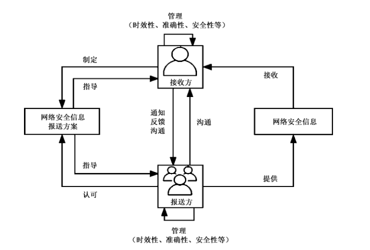
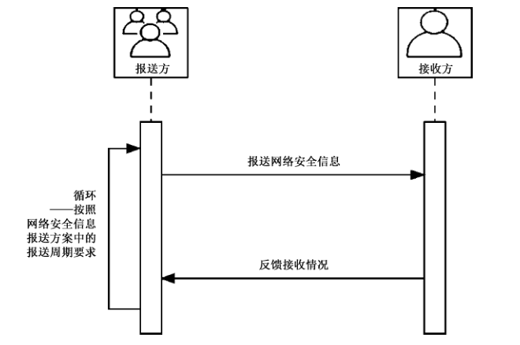
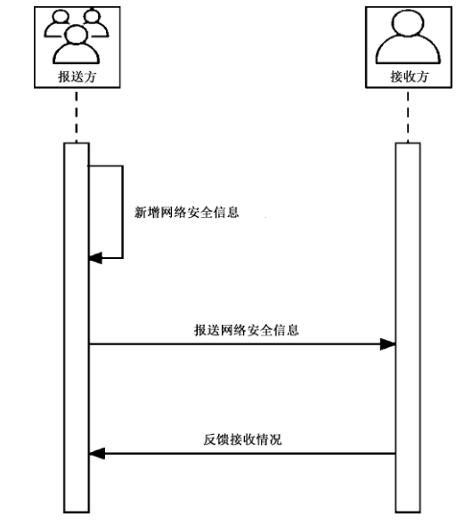
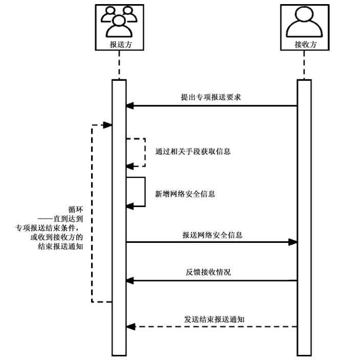

# GB/T 43557-2023 信息安全技术 网络安全信息报送指南

> 来源：[GB/T 43557-2023 国家标准详情](https://openstd.samr.gov.cn/bzgk/std/newGbInfo?hcno=97B9673C4BA188B51EC707F13DFE6127)；发布日期：2023-12-28；实施日期：2024-07-01。
> PDF SHA-256：649e2b6acb1c5ea7b4eca0acddcf42bdb62a14e56069bdbfeba5feae1ab0c584。
> 转写说明：按页渲染 PDF 并用 macOS Vision 进行图像识别，对照原页校正文字和表格；合并跨页续表，流程图保留原页裁切，省略封面、目录、页眉和页脚。正式引用请核对原 PDF。

## 前言

本文件按照 GB/T 1.1—2020《标准化工作导则 第1部分：标准化文件的结构和起草规则》的规定起草。

请注意本文件的某些内容可能涉及专利。本文件的发布机构不承担识别专利的责任。

本文件由全国信息安全标准化技术委员会（SAC/TC 260）提出并归口。

本文件起草单位:国家计算机网络应急技术处理协调中心浙江分中心、国家计算机网络应急技术处理协调中心、中国电子技术标准化研究院、国家计算机网络应急技术处理协调中心江苏分中心、中国信息安全研究院有限公司、上海观安信息技术股份有限公司、启明星辰信息技术集团股份有限公司、北京安天网络安全技术有限公司、北京东方通网信科技有限公司、杭州海康威视数字技术股份有限公司、哈尔滨工程大学、西安交大捷普网络科技有限公司、深信服科技股份有限公司、远江盛邦(北京)网络安全科技股份有限公司、南京聚铭网络科技有限公司、陕西省网络与信息安全测评中心、上海三零卫士信息安全有限公司、北京天融信网络安全技术有限公司、中国科学院信息工程研究所、公安部第三研究所、杉树岭网络科技有限公司、华信咨询设计研究院有限公司、北京神州绿盟科技有限公司、浙江大学计算机创新技术研究院、之江实验室、亚信科技(成都)有限公司、杭州安恒信息技术股份有限公司、恒安嘉新(北京)科技股份公司。

本文件主要起草人:严寒冰、郭晶、罗亮、龙泉、丁丽、何能强、温森浩、雷君、马旸、仲思超、李忠、谢江、吕明、王剑桥、崔婷婷、万里、庄园、何建锋、陈杨国、王晶、陈虎、巨腾飞、干露、杨剑、刘松、陈妍、白小愚、孙小平、张宇娜、姜博文、吴少勇、何中旭、李钰嘉、韩潇哲、李广立、马敏燕、王丽华、王小龙、廖双晓、苗春雨、张羽。

## 1 范围

本文件给出了网络安全信息报送的信息类型和要素，以及网络安全信息报送活动的要素和关系、基本流程、报送方式等。

本文件适用于各类组织间的网络安全信息报送活动。

## 2 规范性引用文件

下列文件中的内容通过文中的规范性引用而构成本文件必不可少的条款。其中，注日期的引用文件，仅该日期对应的版本适用于本文件；不注日期的引用文件，其最新版本(包括所有的修改单)适用于本文件。

- GB/T 20984 信息安全技术 信息安全风险评估方法

- GB/T 20986 信息安全技术 网络安全事件分类分级指南

- GB/T 25069—2022 信息安全技术 术语

- GB/T 30279 信息安全技术 网络安全漏洞分类分级指南

- GB/T 36643 信息安全技术 网络安全威胁信息格式规范

## 3 术语和定义

GB/T 20984、GB/T 20986、GB/T 25069—2022、GB/T 30279、GB/T 36643 界定的以及下列术语和定义适用于本文件。

### 3.1 网络安全信息 cyber security information

描述网络安全(即网络空间安全)相关情况的信息。

> 注:网络安全信息主要包括威胁信息、脆弱性信息、网络安全事件信息、网络安全态势信息等。

> [来源:GB/Z 42885—2023，3.1]

### 3.2 脆弱性 vulnerability

可能被一个或多个威胁利用资产或控制的弱点。

> [来源:GB/T 25069—2022，3.91]

### 3.3 威胁 threat

可能对系统或组织造成危害不期望事件的潜在因素。

> [来源:GB/T 25069—2022，3.628]

### 3.4 网络安全事态 cybersecurity event

表明可能信息安全违规或某些控制失效的发生。

> [来源:GB/T 25069—2022，3.686，有修改]

### 3.5 网络安全事件 cybersecurity incident

与可能危害组织资产或损害其运行相关、单个或多个被识别的信息安全事态。

> [来源:GB/T 25069—2022，3.684，有修改]

### 3.6 网络安全态势 cybersecurity situation

对一定范围网络中脆弱性、网络安全威胁、网络安全事态、网络安全事件，以及与网络安全相关的其他情况的整体描述。

### 3.7 网络安全消息 cybersecurity news

对网络安全情况的描述信息。但其信息要素可以不符合接收方对脆弱性信息、网络安全威胁信息、网络安全事态信息、网络安全事件信息、网络安全态势信息的要求。

> 注:包括公开的和非公开的网络安全动态信息、网络安全分析报告等。

### 3.8 报送 submission

根据双方或多方的约定，将特定信息按照特定方式进行提供和接收的活动。

### 3.9 报送方 submitter

在网络安全信息报送活动中，提供网络安全信息的组织。

### 3.10 接收方 receiver

在网络安全信息报送活动中，接收网络安全信息的组织。

## 4 网络安全信息报送内容

### 4.1 信息类型

报送的网络安全信息类型包括脆弱性信息、网络安全威胁信息、网络安全事态信息、网络安全事件信息、网络安全态势信息、网络安全消息以及其他信息等。

本节中的信息类型与GB/Z 42885—2023中的信息类别对应关系见附录A。

### 4.2 信息要素

#### 4.2.1 概述

报送的网络安全信息由通用部分、专属部分和可扩展部分组成。4.2.2给出通用部分的信息要素规范。4.2.3给出了各类型网络安全信息专属部分的信息要素。4.2.4给出可扩展部分的信息要素规范。

#### 4.2.2 通用部分

网络安全信息通用部分的信息要素见表1。

**表1 网络安全信息通用部分的信息要素**

| 信息项 | 说明 |
| --- | --- |
| 信息编号 | 网络安全信息编号 |
| 信息名称 | 网络安全信息名称 |
| 信息类型 | 包括脆弱性信息、网络安全威胁信息、网络安全事态信息、网络安全事件信息、网络安全态势信息、网络安全消息以及其他信息，可用编号表示 |
| 报送时间 | 宜精确到秒 |
| 报送方 | 报送网络安全信息的单位/组织名称、人员姓名，可用编号表示 |

#### 4.2.3 专属部分

##### 4.2.3.1 脆弱性信息的专属部分

脆弱性信息包括漏洞信息、网络配置合规缺陷信息等。

漏洞信息专属部分的推荐信息要素见表2，可选信息要素见表3。

**表2 漏洞信息专属部分的推荐信息要素**

| 信息项 | 说明 |
| --- | --- |
| 发现时间 | 以秒为单位 |
| 漏洞类型 | 漏洞分类归属的信息，漏洞类型和分类方法见GB/T 30279 |
| 漏洞级别 | 漏洞分级归属的信息，漏洞级别可分为超危、高危、中危和低危四个等级，分级方法见GB/T 30279 |
| 漏洞描述 | 对漏洞的详细描述，可包括漏洞的触发条件、生成机理或存在性证明、漏洞扫描或测试的方法以及需要说明的其他相关信息等 |
| 潜在受影响对象 | 存在漏洞的产品或服务所属单位 |
| 佐证材料 | 包括与此脆弱性相关的分析报告、验证工具等 |

> 转写注：原版表 3 将“国家信息安全漏洞库”也标为 CNVD，以下保留原文。原版 5.1 第三段为接收方“与接收方进行沟通”，同样按原文保留。

**表3 漏洞信息专属部分的可选信息要素**

| 信息项 | 说明 |
| --- | --- |
| 漏洞编号 | 可使用通用漏洞披露(CVE)/国家信息安全漏洞共享平台(CNVD)/国家信息安全漏洞库(CNVD)/通用缺陷列表(CWE)等编号 |
| 漏洞URL | 漏洞涉及的URL |
| 潜在影响的产品/服务 | 漏洞潜在影响的产品或服务 |
| 潜在影响的产品/服务版本 | 漏洞潜在影响的产品或服务的版本号 |
| 潜在影响评估 | 包括潜在的影响范围、危害后果、发生的可能性，以及对业务的潜在影响情况等 |
| 措施信息 | 包括临时解决方案、修复建议、正式解决方案等 |
| 关联信息 | 包括与此脆弱性相关的其他网络安全信息，如利用此脆弱性造成的网络安全事件等 |

网络配置合规缺陷信息专属部分的推荐信息要素见表4，可选信息要素见表5。

**表4 网络配置合规缺陷信息专属部分的推荐信息要素**

| 信息项 | 说明 |
| --- | --- |
| 发现时间 | 以秒为单位 |
| 违规类型 | 存在的网络配置合规缺陷类型 |
| 违规描述 | 对网络配置合规缺陷信息的详细描述 |
| 潜在影响单位/组织 | 存在网络配置合规缺陷的网络资产所属单位/组织 |

**表5 网络配置合规缺陷信息专属部分的可选信息要素**

| 信息项 | 说明 |
| --- | --- |
| 合规项要求 | 缺陷对应的合规项要求 |
| 当前值 | 缺陷项当前的情况 |
| 合规要求依据 | 合规项要求的来源，如法律法规、部门文件、标准等 |
| 潜在影响评估 | 包括潜在的影响范围、危害后果、发生的可能性，以及对业务的潜在影响情况等 |
| 措施信息 | 包括临时解决方案、修复建议、正式解决方案等 |
| 佐证材料 | 包括与此脆弱性相关的分析报告、验证工具等 |
| 关联信息 | 包括与此脆弱性相关的其他网络安全信息，如利用此脆弱性造成的网络安全事件等 |

##### 4.2.3.2 网络安全威胁信息的专属部分

网络安全威胁信息专属部分的推荐信息要素见表6，可选信息要素见表7。

**表6 网络安全威胁信息专属部分的推荐信息要素**

| 信息项 | 说明 |
| --- | --- |
| 发现时间 | 以秒为单位 |
| 威胁类型 | 网络安全威胁信息类型，见GB/T 36643 |
| 威胁描述 | 接收方宜针对每个威胁类型，分别制定威胁描述的信息要素规范，见GB/T 36643，可利用4.2.4的可扩展项进行扩展 |

**表7 网络安全威胁信息专属部分的可选信息要素**

| 信息项 | 说明 |
| --- | --- |
| 威胁来源 | 网络安全威胁的来源信息，可包括传播源IP/URL/域名、控制服务器IP地址/域名、回连URL、来源国家/地区/单位/组织等 |
| 威胁目标 | 网络安全威胁的目标信息，可包括目标国家/地区/行业/单位/组织/IP/域名/URL等 |
| 威胁行为 | 网络安全威胁的行为信息，可包括典型行为、运行环境、本地恶意行为、网络恶意行为等 |
| 威胁级别 | 宜分为特别重大、重大、较大、一般四个等级，接收方宜对网络安全威胁信息的级别划分方法制定规范，见GB/T 20984 |
| 影响评估 | 潜在的影响范围、危害后果、发生的可能性，以及对业务的潜在影响情况等 |
| 措施信息 | 报送方已采取的措施和后续计划措施，以及建议接收方/潜在受影响方/其他相关方采取的措施等 |
| 佐证材料 | 与此网络安全威胁相关的分析报告、样本文件等 |
| 关联信息 | 与此网络安全威胁相关的其他网络安全信息，如该网络安全威胁所利用的脆弱性信息等 |

##### 4.2.3.3 网络安全事态信息的专属部分

网络安全事态信息专属部分的推荐信息要素见表8，可选信息要素见表9。

**表8 网络安全事态信息专属部分的推荐信息要素**

| 信息项 | 说明 |
| --- | --- |
| 发生时间 | 网络安全事态的发生时间 |
| 发现时间 | 以秒为单位 |
| 事态类型 | 网络安全事态的类型，接收方宜根据需要制定需报送的网络安全事态类型 |
| 事态描述 | 接收方宜针对每个事态类型，分别制定事态描述的信息要素规范，可利用4.2.4的可扩展项进行扩展 |
| 潜在影响评估 | 潜在的影响范围、危害后果、发生的可能性，以及对业务的潜在影响情况等 |

**表9 网络安全事态信息专属部分的可选信息要素**

| 信息项 | 说明 |
| --- | --- |
| 措施信息 | 报送方已采取的措施和后续计划措施，以及建议接收方/潜在受影响方/其他相关方采取的措施等 |
| 佐证材料 | 与此事态相关的分析报告、日志信息等 |
| 关联信息 | 与此网络安全事态相关的网络安全信息，如同类型的网络安全事态信息等 |

##### 4.2.3.4 网络安全事件信息的专属部分

网络安全事件信息专属部分的推荐信息要素见表10，可选信息要素见表11。

**表10 网络安全事件信息专属部分的推荐信息要素**

| 信息项 | 说明 |
| --- | --- |
| 发生时间 | 网络安全事件的发生时间 |
| 发现时间 | 以秒为单位 |
| 事件类型 | 网络安全事件的类型，见GB/T 20986 |
| 事件级别 | 根据网络安全事件的危害程度，可分为特别重大、重大、较大、一般四个等级，接收方宜对网络安全事件信息的级别划分方法制定规范，见GB/T 20986 |
| 事件描述 | 接收方宜针对每个事件类型，分别制定事件描述的信息要素规范，可利用4.2.4的可扩展项进行扩展 |
| 攻击方信息 | 攻击方描述、攻击IP、攻击组织、可能的动机等 |
| 被攻击方信息 | 受影响IP、端口、URL、网络资产等 |

**表11 网络安全事件信息专属部分的可选信息要素**

| 信息项 | 说明 |
| --- | --- |
| 影响单位 | 网络安全事件影响资产的所属单位 |
| 影响评估 | 影响范围、危害后果，以及对业务的影响情况等 |
| 攻击方法信息 | 详细描述攻击行为、手法或过程等 |
| 措施信息 | 报送方已采取的措施和后续计划措施，以及建议接收方/受影响方/其他相关方采取的措施等 |
| 佐证材料 | 与此网络安全事件相关的分析报告、样本文件、日志信息等 |
| 关联信息 | 与此网络安全事件相关的网络安全信息，如相关的网络安全威胁信息、利用的脆弱性信息等 |

##### 4.2.3.5 网络安全态势信息的专属部分

网络安全态势信息专属部分的信息要素见表12。

**表12 网络安全态势信息专属部分的信息要素**

| 信息项 | 说明 |
| --- | --- |
| 时间范围 | 网络安全态势的时间范围 |
| 对象范围 | 描述网络安全态势所分析对象的范围，可包括地域、行业/领域、单位/部门等 |
| 态势类型 | 根据接收方的需求确定，并在信息报送方案明确，例如脆弱性态势、网络安全威胁态势、网络安全事件态势、攻击方态势、网络资产态势、网络运行态势、综合态势、专题态势等 |
| 输出信息类型 | 包括统计指标、分布特点、发展趋势、关联情况等 |
| 态势简介 | 对网络安全态势的简要描述 |
| 态势详情 | 对网络安全态势的详细描述，可采用文件、图表、数据等格式 |

##### 4.2.3.6 网络安全消息的专属部分

网络安全消息专属部分的信息要素见表13。

**表13 网络安全消息专属部分的信息要素**

| 信息项 | 说明 |
| --- | --- |
| 出现时间 | 网络安全消息首次出现时间 |
| 资讯来源 | 网络安全消息的初始来源 |
| 资讯简介 | 对网络安全消息的简要描述 |
| 资讯详情 | 对网络安全消息的详细描述，可采用文件、图表、数据等格式 |

##### 4.2.3.7 其他信息的专属部分

其他信息是不直接描述网络安全情况，但对网络安全态势研判有辅助作用的信息。如网络资产信息、流量协议日志、攻击方信息、防御能力信息、攻击手段方式进展等。

接收方宜根据需要，制定其他信息的专属部分信息要素。

#### 4.2.4 可扩展部分

除本文件列出的通用部分和各类型网络安全信息专属部分外，报送方和接收方可在报送网络安全信息中增加可扩展部分，以适应网络安全信息报送活动的需求。

## 5 网络安全信息报送活动

### 5.1 要素和关系

网络安全信息报送活动的要素包括网络安全信息报送方案、接收方、报送方、网络安全信息。

接收方宜制定网络安全信息报送方案，并取得报送方的认可。网络安全信息报送方案宜在本文件指导下，对网络安全信息报送内容和网络安全信息报送活动进行进一步具体规范，宜包括报送的信息类型及其细化类型、各类型信息的要素和格式规范，针对各类型信息的报送流程、报送方式和管理要求(如时效性、准确性、安全性等)，以及报送方和接收方认为需要约定的其他内容。

接收方宜对接收的网络安全信息进行时效性、准确性、安全性等方面的管理，发出专项报送开始和结束通知，反馈接收情况，并在网络安全信息报送活动中根据需要与接收方进行沟通。

报送方宜对报送的网络安全信息进行时效性、准确性、安全性等方面的管理，并在网络安全信息报送活动中根据需要与接收方进行沟通。

网络安全信息由报送方提供，由接收方接收，其内容宜参照第4章。

网络安全信息报送活动的要素和关系如图1所示。

### 5.2 基本流程

#### 5.2.1 概述

网络安全信息报送的基本流程包括周期常规报送流程、非周期常规报送流程、专项报送流程。

#### 5.2.2 周期常规报送流程

网络安全信息报送的周期常规报送流程如图2所示。该流程适用于网络安全信息报送方案中约定的以周期方式报送的网络安全信息。报送方按照网络安全信息报送方案中的报送周期要求，周期性地向接收方报送网络安全信息。接收方周期性地向报送方反馈接收情况。

#### 5.2.3 非周期常规报送流程

网络安全信息报送的非周期常规报送流程如图3所示。该流程适用于网络安全信息报送方案中约定的以非周期方式报送的网络安全信息。如重要的网络安全事件信息，报送方发现后宜及时报送。当报送方新增符合网络安全信息报送方案中要求的网络安全信息时，及时向接收方报送网络安全信息。

接收方及时向报送方反馈接收情况。

#### 5.2.4 专项报送流程

网络安全信息报送的专项报送流程如图4所示。该流程适用于网络安全信息报送方案中约定但具体内容根据接收方需求确定的网络安全信息。如网络安全信息报送方案中约定，报送方针对接收方指定的网络安全威胁进行跟踪监测并报送相关信息。当接收方提出针对特定网络安全威胁的专项报送要求后，报送方开展专项报送活动。报送方可通过相关手段获取网络安全信息，当报送方新增符合网络安全信息报送方案中要求的网络安全信息时，及时向接收方报送网络安全信息。接收方及时向报送方反馈接收情况。上述获取信息、报送信息、反馈接收情况的过程可重复进行，直到达到专项报送结束条件，或报送方接收到接收方发送的结束报送通知。

### 5.3 报送方式

网络安全信息报送可采用报送系统或电子邮件通过互联网、专用线路、虚拟专用网络(VPN)等方式进行，也可采用光电/纸质载体通过物理交换等方式进行。

网络安全信息报送宜支持接收方和报送方之间双向的通知与反馈。

### 5.4 时效性

接收方宜针对不同类型的信息，分别制定信息报送的时效性规范，并与报送方取得共识。

报送方宜按照时效性规范进行信息报送。

接收方可对报送方的报送时效性进行评价和反馈。

报送各类网络安全信息的时效性规范见表14。

**表14 报送各类网络安全信息的时效性**

| 信息类型 | 报送的推荐时效性 |
| --- | --- |
| 脆弱性信息 | “发现时间”后2d之内 |
| 网络安全威胁信息 | “发生时间”后1周之内，或“发现时间”后2d之内 |
| 网络安全事态信息 | “发生时间”后1周之内，或“发现时间”后2d之内 |
| 网络安全事件信息 | “发生时间”后1周之内，或“发现时间”后2d之内 |
| 网络安全态势信息 | 根据网络安全态势信息的“时间范围”，由接收方和报送方进行约定。比如，“时间范围”为1年、1月、1周的网络安全态势信息，分别可在3月之内、10d之内、3d之内报送 |
| 网络安全消息 | 网络安全消息“出现时间”后1周之内 |
| 其他信息 | 根据信息的类型和使用方式，由接收方和报送方共同确定 |

### 5.5 准确性

接收方和报送方宜对网络安全信息的准确性要求和评价方法进行约定，并体现在网络安全信息报送方案中。

报送方宜在报送前对网络安全信息的准确性进行自评价，对符合准确性要求的信息进行报送。

接收方宜对报送方报送的网络安全信息进行准确性评价，可向报送方反馈。

### 5.6 安全性

接收方和报送方宜共同对网络安全信息的报送过程制定安全性规范，接收方宜针对报送信息在接收方的存储、使用、共享和发布过程制定安全性规范。

上述安全性规范宜体现在网络安全信息报送方案中。接收方和报送方在网络安全信息报送活动中宜按此实施。

## 附录 A（资料性）

### 网络安全报送信息类型与网络安全共享信息类别的对应关系

根据GB/Z 42885—2023，共享场景一般可分为信息公开、信息报送或下发、信息互换三类。其中，信息报送或下发为“一般由多层级的共享活动参与者完成，由下级参与者与上级参与者完成网络安全信息的共享”。因此，本文件中的网络安全信息报送活动为GB/Z 42885—2023中网络安全信息共享活动的一类场景，并对该场景下的网络安全信息报送内容和报送活动进行了细化。

GB/Z 42885—2023中将网络安全共享信息分为威胁信息、安全事件信息、脆弱性信息、应对措施信息、经验信息、态势信息、其他信息等类别，并指出“网络安全信息可根据共享活动的目的和需要，在以上7个类别下进一步划分子类，确保在特定共享活动中，网络安全信息描述的一致性，提升共享活动的效率和互操作性。”本文件4.1的信息类型与GB/Z 42885—2023中的信息类别存在对应关系，如表A.1所示。

**表A.1 网络安全报送信息类型与网络安全共享信息类别的对应关系**

| 本文件中的网络安全报送信息类型 | 与GB/Z 42885—2023中网络安全共享信息类别的对应关系 |
| --- | --- |
| 脆弱性信息 | 脆弱性信息、可附加应对措施信息 |
| 网络安全威胁信息 | 威胁信息、可附加应对措施信息 |
| 网络安全事态信息 | 其他信息的子类、可附加应对措施信息 |
| 网络安全事件信息 | 安全事件信息、可附加应对措施信息 |
| 网络安全态势信息 | 态势信息的子类 |
| 网络安全消息 | 态势信息的子类 |
| 其他信息 | 经验信息、其他信息的子类信息 |

## 参考文献

- [1] GB/Z 42885—2023 信息安全技术 网络安全信息共享指南
