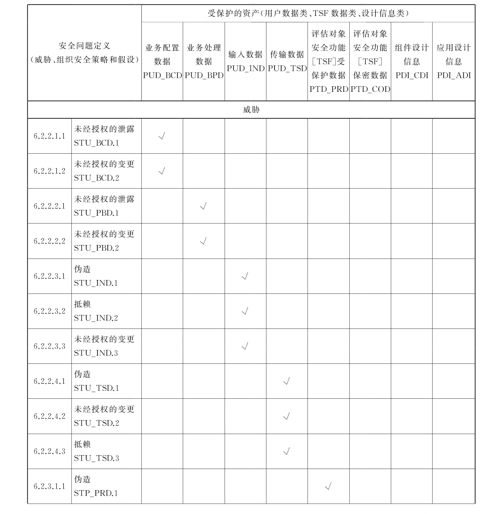
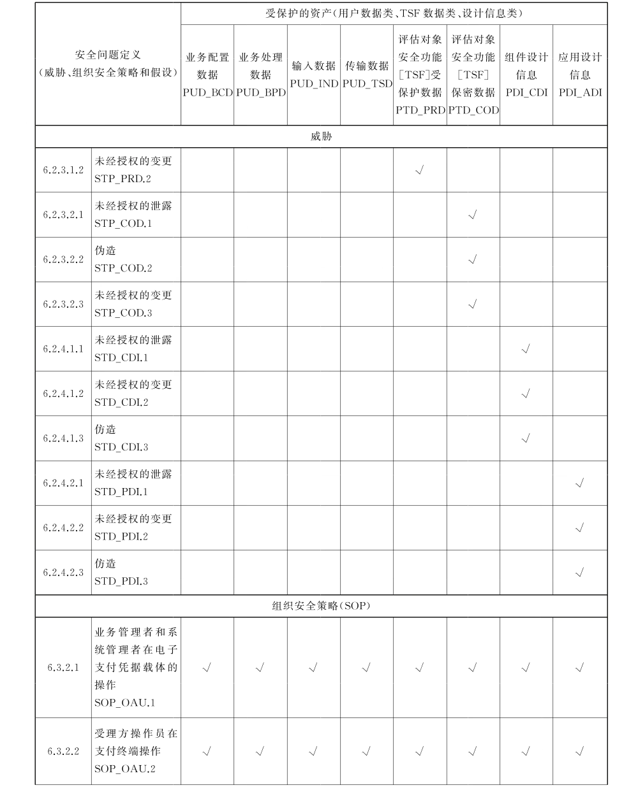
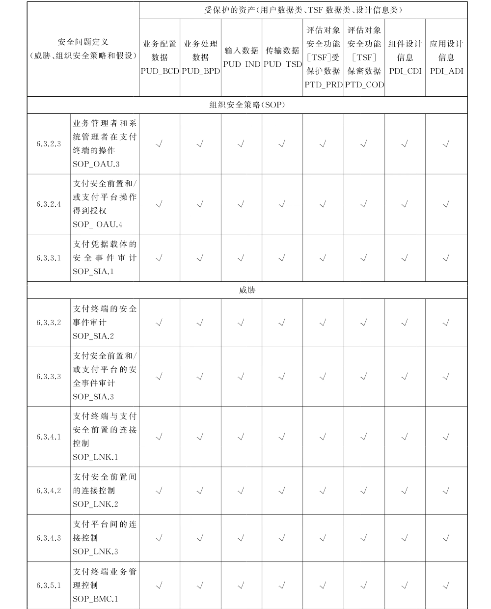
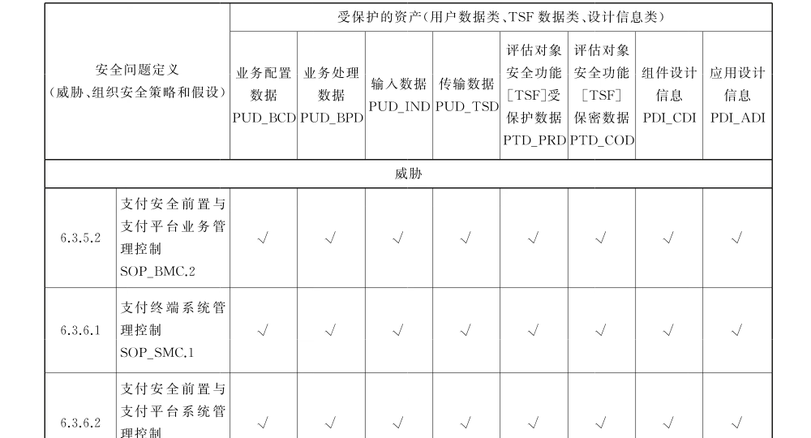
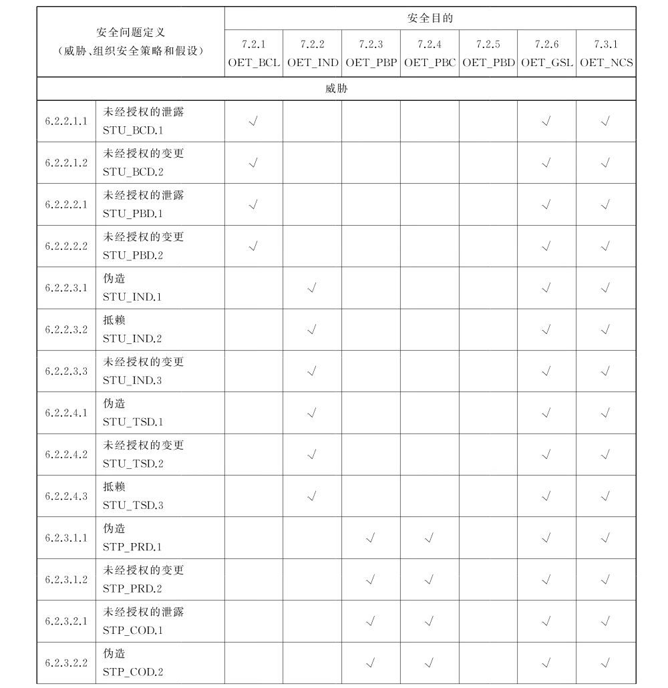
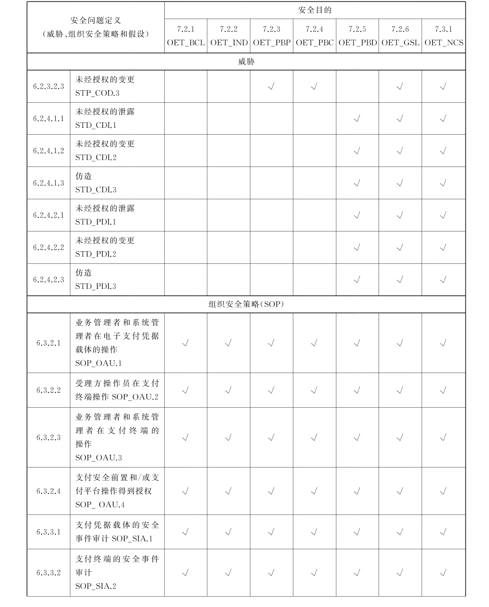
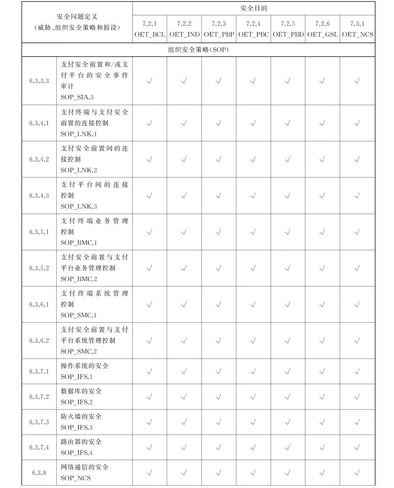
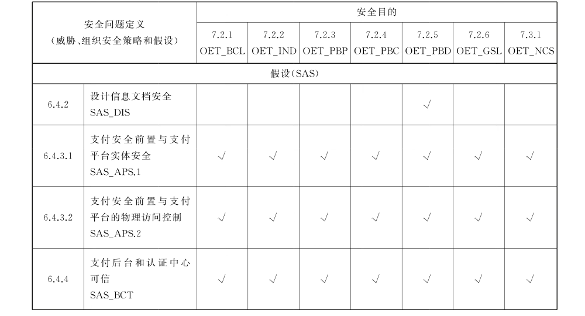

# GB/T 31502-2015 信息安全技术 电子支付系统安全保护框架

> 来源：[GB/T 31502-2015 国家标准详情](https://openstd.samr.gov.cn/bzgk/std/newGbInfo?hcno=A48D34A624E1315EBD5CB1BCA3DB151F)。
> 官方在线预览截图 SHA-256：b11751ecf0a62b7b1429e09a2a32c3cd596d78581b8e5e8f4907038de42d112d。
> 转写说明：将官方在线预览的全部 92 页逐页截图并用图像识别核对文字、标题、列表、图示和表格；复杂勾选矩阵保留去除页眉页脚及页码后的官方页面图像，合并跨页续表。正式引用请核对原页面图像。

## 前言

本标准按照GB/T 1.1—2009给出的规则起草。

请注意本文件的某些内容可能涉及专利。本文件的发布机构不承担识别这些专利的责任。

本标准由全国信息安全标准化技术委员会（SAC/TC 260）提出并归口。

本标准起草单位：北京多思科技工业园股份有限公司、中国农业银行、中国金融电子化公司、国家信息安全工程技术研究中心、东方集团网络信息安全技术有限公司、北京大秦兴宇电子有限公司、北京天宏绎网络技术有限公司、北京科蓝软件系统有限公司、长城瑞通（北京）科技有限公司、重庆银行、南充市商业银行。

本标准主要起草人：刘大力、李宽、沈敏锋、韩琳琳、吴义章、吴铮、刘运、文仲慧、沈昕立、康伟、张磊、于敬新、崔新杰、罗勇、夏鹏轩、闫凤如、陈辉武、王庆元、左小波、邱岩、张春阳、黄光伟、邢呈礼、高艳芳、王州府。

## 引言

本标准以国际通行的信息技术安全性评估准则为基础，结合我国现阶段电子支付系统的特点，按照我国有关法律、法规和政令的要求，以自主可控为原则，为公共类电子支付系统的信息安全提供一个公共框架；是进一步完善相关国家标准及行业标准的重要步骤；为构建、运行公共电子支付系统，提供支撑。

## 1 范围

本标准在给出电子支付系统模型的基础上，为公共类电子支付系统的信息安全提供了一个公共框架，主要包括安全问题定义、安全目的、安全功能需求和安全保障需求。

本标准适用于安全构建、运行公共类电子支付系统。

## 2 规范性引用文件

下列文件对于本文件的应用是必不可少的。凡是注日期的引用文件，仅注日期的版本适用于本文件。凡是不注日期的引用文件，其最新版本（包括所有的修改单）适用于本文件。

- GB/T 18336.1 信息技术 安全技术 信息技术安全性评估准则 第1部分：简介和一般模型

- GB/T 18336.2 信息技术 安全技术 信息技术安全性评估准则 第2部分：安全功能组件

- GB/T 18336.3 信息技术 安全技术 信息技术安全性评估准则 第3部分：安全保障组件

## 3 术语和定义

GB/T 18336.1 界定的以及下列术语和定义适用于本文件。

### 3.1 电子支付 electronic payment

采用数字化方式，在电子终端、信息传输通道以及相关系统的支持下，进行支付的行为。

### 3.2 支付通道 transaction channel

在电子支付交易过程中，电子支付凭据与支付终端以及支付终端与支付安全前置之间实现信息传输的途径。

### 3.3 公共网络通道 public network channel

支持电子支付交易的公共网络基础设施。在电子支付领域通常简称为网络。

### 3.4 接触通道 contact channel

支持电子支付交易的实体直接连接方式。

### 3.5 电子支付凭据 electronic payment credential

在电子支付过程中，用以最终确定支付相关账户的凭据。

电子支付凭据可能是有载体的，也可能是无载体的，同一电子支付凭据可能记载在不同的载体中。

### 3.6 电子支付凭据载体 electronic payment credentials carrier

记载电子支付凭据的介质。不同的电子支付凭据载体，其安全性是不同的。

### 3.7 电子支付凭据持有者 electronic payment credential holder

合法拥有电子支付凭据的人。对电子支付凭据记录了持有者信息的，电子支付凭据持有者的信息与电子支付凭据内部记录的信息应一致。

### 3.8 受理方 accepter

向电子支付凭据持有者提供通道，并在需要时协助电子支付凭据持有者完成电子支付交易的机构。

### 3.9 受理方操作员 operator of accepter

协助电子支付凭据持有者完成电子支付交易的人员，向受理方负责。

### 3.10 中介方 intermediary

在电子支付交易中，按照付款方或收款方提出的电子支付交易请求，代完成资金转移者。

### 3.11 安全域 security domain

在电子支付交易的过程中，遵守相同的安全策略的用户和系统的集合。

### 3.12 可信信道 trusted channel

为了支持安全功能策略，电子支付系统安全功能同远程可信IT 产品进行所需信任通信的一种手段。

### 3.13 可信路径 trusted path

为了支持安全功能策略，用户能同电子支付系统安全功能进行所需信任通信的一种手段。

### 3.14 电子支付系统安全保护 security protect of clectronic payment system

对电子支付系统信息的保护及其相关的保护措施，保护电子支付信息在采集、传输和处理中免遭未授权访问（保密性）、修改（完整性）和对授权用户的可用性，以及支持安全管理的可核查性和抗抵赖性等。

在具备条件的情况下，对具有本标准所述电子支付系统特征的信息系统编制保护轮廓（Protection Profile，以下简称：PP）和安全目标（Security Target，以下简称：ST），将有助于有效评价该电子支付系统的安全水平，发现潜在的风险，评估可能导致的损失，以便给出适宜的风险应对措施。

## 4 符号与缩略语

### 4.1 符号表示

本标准对受保护资产、安全问题、安全目的和安全需求均按可引用的单元进行了编码，以便于进行引用和参照。编码采用了与安全功能要求和安全保证要求协调的方式，编码的首字母如表1所示。

**表 1 类编码对象**

| 编码对象 | 编码首字母 |
| --- | --- |
| 受保护资产 | P |
| 安全问题 | S |
| 安全目的 | O |
| 安全功能要求 | F |
| 安全保障要求 | A |

### 4.2 缩略语

下列缩略语适用于本文件。

EPS：电子支付系统（Electronic Payment System）

IT：信息系统（Information Technology）

PIN：个人鉴别码（Personal Identification Number）

PP：保护轮廓（Protection Profile）

ST：安全目标（Security Target）

TOE：评估对象（Target of Evaluation）

TSF：TOE 安全功能（TOE Security Functions）

TSP：TOE 安全策略（TOE Security Policy）

## 5 电子支付系统描述

### 5.1 电子支付系统模型

#### 5.1.1 概述

本章给出了电子支付概念和电子支付系统模型，其中电子支付概念仅描述了一种典型状况，其目的在于使本标准阅读者能较快和准确地理解模型，并将视角聚焦于电子支付系统中的安全保护问题。

#### 5.1.2 电子支付概念

在电子支付中，付款方与受理方交互，提出付款申请；受理方将获取的支付请求发送到电子支付服务方；电子支付服务方完成相应的支付服务，并在必要时通过受理方转交或通知收款方。电子支付支撑方提供账户管理、账务核算、安全措施与管理等功能，这些功能可能自某一方可以实现电子支付开始就已经提供，但收款方、付款方与受理方的人员可能不需知悉。电子支付的概念如图1所示。

注2：收款方的受理方可能是隐含的，即实际上在电子支付服务方内部即完成了支付动作，收款方仅仅通过受理方获得了通知。

#### 5.1.3 电子支付系统模型

在电子支付系统模型中，电子支付凭据、支付终端、支付安全前置、支付平台组成了电子支付系统，通过与用户和相应支付后台交互工作，并在必要时使用认证中心提供的身份认证服务，以完成电子支付交易。

电子支付系统模型如图2所示。其与电子支付的映射关系一般为：

a） 付款方包括用户和电子支付凭据；

b） 收款方可能包括用户和电子支付凭据，也可能仅为用户；

c） 受理方包括支付终端和作为受理方操作员的用户；

d） 电子支付服务方包括支付安全前置、支付平台；

e） 电子支付支撑方包括支付后台和认证中心。

注1：图中用户是抽象的，为保持图的清晰性，未对角色及其操作的评估对象［TOE］组件进行进一步的划分。

注2：图中金融、中介、预存类支付安全前置、支付平台和支付后台都可能有多个受理方。

注3：图中的连接分为三类。用户与电子支付凭据载体和支付终端连接的点线表示人机交互；电子支付凭据载体与支付终端以及支付终端与预存支付安全前置的点划线表示近场或接触；实线表示公共网络，但不限制网络连接的物理链路；双线箭头表示同一受理方 TSF 内部传送。图中画出的六边形网络是为了便于描述支付终端、支付安全前置和认证中心的工作关系，并区别描述通过网络与通过近场或接触方式的连接。

注4：一个支付服务的提供实体，可仅支持图中的一种模式，也可同时支持图中的两种甚至三种模式，即同时承担几种不同方式的受理方。

注5：电子支付凭据载体、支付终端、支付安全前置、支付平台所构成的电子支付系统，其整体构成了一个分布式的评估对象［TOE］。

注6：用户、支付后台和认证中心是电子支付系统模型的边界条件，非评估对象实体。

注7：安全芯片可能涉及电子支付系统中的每一个组件，按照本标准给出的模型描述安全芯片所在的组件以及在交互过程中安全芯片的作用，更易于理解安全芯片的功能、安全问题定义、安全目的、安全功能要求和安全保证要求。

#### 5.1.4 评估对象［TOE］实体

##### 5.1.4.1 电子支付凭据载体

电子支付凭据载体是通过技术手段，存储安全属性和包括电子支付凭据在内的用户数据，并能够支持完成电子支付交易的介质。

注1：不同的电子支付凭据载体，其存储用户数据的方式，能力和安全属性不同。随现代电子技术和工艺的高速发展，新型电子支付凭据载体的存储和计算能力日新月异，其功能与安全性可能会出现颠覆性变化。

注2：在同一个交易中，可能需要电子支付凭据持有者的电子支付凭据载体，也可能还需要受理方操作员的电子支付凭据载体。

示例：金融磁条卡、金融IC卡、金融SD卡、金融SIM 卡、动态密码器和 USB Key 是不同形式的电子支付凭据载体。

金融磁条卡因其存储方式、能力和安全属性的落后，已经在全世界公共电子支付领域逐渐被金融 IC卡等带CPU 的电子支付凭据载体所替代。动态密码器在动态口令卡大规模应用后，出现了功能更强、更安全的接触型产品。第一代 USB Key 已过渡到带操作界面的第二代，带键盘第三代和基于生物识别技术的智能 USB Key 也已出现。

##### 5.1.4.2 支付终端

支付终端是能读取或读写电子支付凭据载体、接受用户输入支付相关信息，发起电子支付的电子设备。根据其安全识别可分为相对的专用支付终端和非专用支付终端，本标准 TOE 之内的支付终端不另说明的均为专用支付终端。非专用支付终端接入电子支付系统，需要包括电子支付凭据载体在内的各种安全识别配合。

注1：根据支付终端的种类不同，用户可能仅是电子支付凭据持有者，也可能还包括受理方操作员。

注2：各类支付终端连接的支付安全前置种类不同，其物理层、数据链路层和网络层的实现模式亦不相同。

注3：类比专用支付终端的初始化，非专用支付终端接入电子支付系统时需要数字证书认证。个人常用支付终端可以绑定硬件。

示例：销售点终端（POS）、自动金融柜员机（ATM）是专用支付终端的例子；个人计算机（PC）、电视机顶盒（STB）、电话支付终端、移动电话支付终端是非专用支付终端的例子，这些设备与电子支付无关的功能在本标准中不做描述。

##### 5.1.4.3 支付安全前置

支付安全前置是设置于支付平台前的安全接口，其主要功能为：

a） 预防、减缓对支付平台和支付后台的攻击；

b） 建立支付终端与支付平台之间的可信路径；

c） 建立支付平台与其他支付安全前置之间的可信路径。

示例 1：预防、减缓对支付平台和支付后台攻击的例子，包括，但不限于防火墙、入侵检测、防病毒系统；

示例2：在支付终端与支付平台之间建立可信路径的例子，包括，但不限于 VPN。

支付安全前置可进一步划分力：

a） 金融支付安全前置。接收来自支付终端的交易请求，也可能接收来自中介支付安全前置的交易请求，与金融支付平台进行信息交互；

b） 中介支付安全前置。接收来自支付终端的交易请求，与中介支付平台交互，并在需要时与金融支付安全前置和［或］其他中介支付安全前置交互；

c） 预存支付安全前置。接收来自支付终端的交易请求，与预存支付平台交互。

##### 5.1.4.4 支付平台

支付平台是电子支付的逻辑处理系统，接收支付终端通过支付安全前置发来的交易请求或交易记录，向支付后台发出动账请求并接收处理结果，形成对电子支付交易的响应，通过支付安全前置发送支付终端。

支付平台可进一步划分为：金融支付平台。接收来自金融支付安全前置的交易请求，与金融支付后台进行信息交互。

1）中介支付平台。接收来自中介支付安全前置的交易请求，按照预定的规则，与中介支付后台交互，并在需要时通过金融支付安全前置与金融支付平台交互，或通过其他中介支付安全前置与其他中介支付平台交互；

2） 预存支付平台。接收来自预存支付安全前置的交易请求，与预存支付后台交互。

> 注：中介支付平台可提供的交易双方的信用担保、降低网上交易风险、防止电子交易欺诈、增加网上交易成交率及提供其他相应的增值服务未在标准中描述。

示例1：税动运营商、广电运营商、石油供应商、自来水公司、电力公司、公共交通部门、商业零售机构等商业机构均可能建立专用的预存支付平台与预存支付后台，以实现对预付款卡服务的按约定计量单位的计价扣收。

示例2：有效识别、评估、监测、控制和报告风险的例子，包括，但不限于：操作风险管理信息系统、可疑交易预警系统。

#### 5.1.5 非评估对象［TOR］实体

##### 5.1.5.1 用户

用户是与电子支付系统交互以发起支付交易的实体，用户通过操作电子支付凭据载体与支付终端完成支付交易。典型的用户包括：

a） 电子支付凭据持有者。提供电子支付凭据，并在必要时在支付终端上输入完成电子支付交易所需的信息，通过支付终端发起电子支付交易的用户；

b） 受理方操作员。通过操作支付终端，按照业务规则初始化一个周期的电子交易环境，在电子支付交易时输入完成电子支付所需信息，通过支付终端发起电子支付交易的用户。对一些自助终端，可能不需要受理方操作员的操作；

c） 业务管理者。通过操作支付终端、支付安全前置、支付平台和支付后台，进行业务参数配置、业务异常调整、账务核算、清分、清算、产生业务状况报表的用户；

系统管理者。通过操作电子支付凭据载体、支付终端、支付安全前置、支付平台、支付后台及其运行环境支撑设施，进行设备安装、维护、技术参数配置、设备运行环境与状况监控，保证电子支付系统正常运行的用户。

示例1：电子支付凭据持有者可能是持卡人，网上银行 USB Key 的持有人，手机银行动态密码器的持有人。

示例 2：电子支付凭据持有者在支付终端上可能输入密码，也可能采集生物特征。

示例3：受理方操作员在支付终端上可能签到、输入交易金额，也可能进行终端的结算。

示例 4：业务管理者可能在支付平台上输入指令，以获得电子支付交易状况统计表。

示例5：在支付过程中出现故障时，可能需要系统管理者的介人以正确完成支付行为。

##### 5.1.5.2 支付后台

支付后台是接收支付平台发出的动账请求并返回执行结果的系统。这种动账请求可能是单笔模式的，也可能是批量模式的。支付后台分为：

a） 金融支付后台。其特征为：

1） 保存有付款方的法定货币账户余额和交易明细；

2） 能够对付款方账户进行动账处理；

3） 能够将电子支付交易发生额按照约定的规则分别存入收款方和电子支付相关方的账户；

4） 具有按照金融支付平台的请求或在金融支付后台本身发现核算错误时，进行账务调整的能力。

注1：经国家金融主管部门批准的金融机构才能设置金融支付后台。

注2：付款方的账户一般是电子支付凭据持有者的账户，收款方的账户一般是受理方的账户。除此之外的情况也是可能的，但会增加交易的复杂性。

示例：本条描述的金融支付后台是一个广泛的概念。在实际交易中，付款方账户和收款方账户可能不属于同一个银行，但金融后台能在其内部完成这样的账户资金转移。

b） 中介支付后台。其特征为：

1） 保存有付款方、收款方和电子支付相关方的账户；

2） 具有对付款方账户的动账能力，且将发生额暂时计入收款方和电子支付相关方的能力；

3） 具有根据电子支付交易序列，对暂时计入收款方和电子支付相关方的发生额进行清分的能力；

4） 具有根据电子支付交易序列，完成原支付交易的反向交易的能力；

5） 具有根据电子支付交易序列，按照约定的规则对收款方账户进行动账的能力。

注1：经国家金融主管部门批准的第三方支付机构才能设置中介支付后台。这是一种非银行金融服务，但在某些文献中，第三方支付服务也可能称作非金融支付服务。

注2：付款方的账户一般是电子支付凭据持有者的账户，收款方的账户一般是受理方的账户。除此之外的情况也是可能的，但会增加交易的复杂性。

c） 预存支付后台。其特征为：

1）保存有付款方账户；

2） 具有根据电子支付交易，对付款方账户进行动账的能力；

3） 具有根据电子支付交易序列，完成原支付交易的反向交易的能力。

注1：经国家主管部门批准的机构才能设置预存支付后台。这也是一种非银行金融服务，但目前还没完全纳人金融管理，有部分与第三方支付服务重迭。

注2：付款方的账户一般是电子支付凭据持有者的账户。除此之外的情况也是可能的，但会增加交易的复杂性。

示例：加油卡、购电卡、市政交通一卡通的后台系统为预存支付后台。

##### 5.1.5.3 认证中心

认证中心是经国家主管部门批准设立的具有权威性和公正性的第三方信任机构，负责在需要时签发和管理数字证书，提供身份认证服务。

> 注：电子支付机构内部设立的认证中心，不能满足公共电子支付系统抗抵赖性的完整需求。

### 5.2 电子支付系统工作模式

电子支付系统包括两种工作模式：

a） 在线模式。用户在支付终端上对电子支付凭据载体进行读［或读写］操作，在支付终端获取满足特定电子支付交易的全部必要信息后，通过网络向支付安全前置发出交易请求，随后：

1） 金融支付安全前置将信息发送到金融支付平台，金融支付平台进行逻辑处理，向金融支付后台发出动账请求并获得结果后，通过金融支付安全前置向支付终端返回交易结果，完成电子支付交易。

2） 中介支付安全前置将信息发送到本中介支付平台，本中介支付平台进行逻辑处理，向本中介支付后台发出动账请求，并：通过本中介支付安全前置、金融支付安全前置向金融支付平台发出交易请求，由金融支付平台向金融支付后台发出动账请求，取得处理结果后返回本中介支付平台；或［且］通过本中介支付安全前置，另一中介支付安全前置向另一中介支付平台发出交易请求，由另一中介支付平台向另一中介支付后台发出动账请求，取得处理结果后返回本中介支付平台。由本中介支付平台处理后产生对电子支付交易的响应，返回支付终端，完成电子支付交易。

3） 预存支付安全前置将信息发送到预存支付平台，预存支付平台进行逻辑处理，向预存支付后台发出动账请求并获得结果后，通过预存支付安全前置向支付终端返回交易结果，完成电子支付交易。

注1：在线模式（on line mode）也称为联机模式，联线模式。

注2：一般来说，通过中介支付服务方进行电子支付需要多次交易组成的交易序列，方可达到电子支付的目标。

b） 离线模式。用户在支付终端上对电子支付凭据载体进行读写操作以完成电子支付交易。

随后：

1） 支付终端通过网络连接金融支付安全前置，将交易记录发送到金融支付平台，金融支付平台进行逻辑处理，向金融支付后台发出动账请求并获得结果，并依据结果形成后继处理信息。在适宜的时刻，金融支付平台通过金融支付安全前置向支付终端发送后继处理信息。

2） 支付终端通过网络或近场、物理通道连接预存支付安全前置，将交易记录发送到预存支付平台，预存支付平台进行逻辑处理，向预存支付后台发出动账请求并获得结果，并依据结果形成后继处理信息。在适宜的时刻，预存支付平台通过预存支付安全前置向支付终端发送后继处理信息。

> 注：离线模式（off line mode）也称为脱机模式。

示例：在离线模式下，止付名单（黑名单）就是一种后继处理信息。

电子支付系统的行为模型参见附录A。

### 5.3 受保护资产

#### 5.3.1 描述目的

在本标准的后面各章中所描述的安全问题描述、安全目的和安全需求，均为了保护5.3中所描述的受保护的资产。

#### 5.3.2 用户数据［user data］类（PUD）

##### 5.3.2.1 概述

用户数据［user data］是指由用户产生或为用户产生的数据，这些数据不影响电子支付系统安全功能的运行。

##### 5.3.2.2 业务配置数据（PUD_BCD）

电子支付凭据载体、支付终端、支付平台、支付后台的业务配置数据，与应用处理软件一同构成了业务处理规则，至少是一些主要的业务处理规则。

示例：在使用卡号和密码登录网上银行时，每日转账的最高限额为一个业务配置数据。

##### 5.3.2.3 业务处理数据（PUD_BPD）

电子支付凭据载体、支付终端、支付平台、支付后台的业务数据，包括电子支付系统在运行时处理以及由处理产生的各种业务信息。

> 注：业务处理数据可根据管理需要分为客户信息、账户信息、交易记录、业务统计与业务支持等信息。

示例1：电子支付凭据持有者和受理方操作员的姓名、证件种类与号码、联系电话都是电子支付相关方人员的客户信息。

示例 2：付款方账户的余额、可支付的限额均为电子支付相关方账户信息。

示例3：从交易中获取的硬件绑定标识、交易时间、交易金额、接入地区、登陆IP、转入/出机构等信息进行组合形成预警监控规则，用于逐笔业务的实时风险筛选，并确定预警、批准或拒绝交易请求。

##### 5.3.2.4 输入数据（PUD_IND）

电子支付交易过程中，人工输入的数据。

##### 5.3.2.5 传输数据（PUD_TSD）

传输数据包括：

a） 电子支付凭据载体与支付终端之间传输的数据；

b） 支付终端与支付平台之间传输的数据；

c 各支付服务方通过各自的支付安全前置传输的数据。

> 注：在支付服务方内交换的数据，例如同一服务方的支付平台和支付后台间交换的数据，或不同银行构成了一个金融支付后台而在内部交换的数据，未作为电子支付系统的传输数据考虑。

示例：交易的业务报文是电子支付凭据载体与支付终端之间和支付终端与支付平台之间传输的数据。

#### 5.3.3 评估对象安全功能数据［TSF data］类（PTD）

5.3.3.1i 概述评估对象安全功能数据［TSF data］是指由电子支付系统产生或为电子支付系统产生的数据，这些数据可能会影响电子支付系统安全功能的运行。

5.3.3.2' 评估对象安全功能［TSF］受保护数据（PTD_PRD）除系统的管理者和拥有者外，不允许改变内容但允许公开内容的数据。

> 注：不管是数据的非管理者用户还是数据的非拥有者用户，对评估对象安全功能［TSF］受保护数据的改变可能影响该评估对象［TOE］的运行安全，但对这类数据的泄露是可接受的。

示例：用户和设备的标识数据（ID）、用户或系统状态数据、设备和网络状态信息和配置设置、设备安全状态等均为评估对象安全功能［TSF］受保护数据。

##### 5.3.3.3 评估对象安全功能［TSF］保密数据（PTD_COD）

除系统的管理者和拥有者外，既不允许改变内容也不允许公开内容的数据。

> 注：不管是数据的非管理者用户还是数据的非拥有者的用户，对评估对象安全功能［TSF］保密数据的改变和泄露均可能影响该评估对象［TOE］的运行安全。

示例：用户和设备的鉴别数据、用户口令、审计记录数据、数字证书的私钥、访问控制表等均为评估对象［TOE］保密数据。

#### 5.3.4 设计信息类（PDI）

##### 5.3.4.1 概述

设计信息类数据是指电子支付系统的设计、构建信息，这些信息可能会影响电子支付系统安全运行，或可能会缩短电子支付系统能够安全运行的时间，或可能会减少电子支付系统安全运行的场合。

##### 5.3.4.2 组件设计信息（PDL_CDI）

在电子支付系统组件的设计过程中，设计的输入信息和期望的输出信息；

示例：设计规格说明、指令体系。

确认和验证设计出的组件实现了要求的功能、性能以及未实现未要求功能的方法及其数据；

示例：测试激励数据。

电子支付系统组件的设计过程中所涉及的物理元件、部件工艺、专用装备、测试设备的信息。

示例：芯片掩膜版、ROM 掩膜数据生成工具、物理验证环境。

##### 5.3.4.3 应用设计信息（PDI_ADI

应用设计信息是指电子支付系统的设计过程中，产生的为按需求进行应用设计涉及的设计信息。

示例：应用系统软件本身、安全功能策略数据、预个人化数据存储策略均为应用设计信息。

## 6 安全问题定义

### 6.1 概述

本章描述了电子支付系统可能面临的典型安全问题，针对由不同的组件构成的电子支付系统以及应用在不同场合的电子支付系统，在制定 PP 和ST 时，应对本标准提出的典型安全问题进行分析，并补充在特定情况下可能出现的安全问题。

为了全面和易于理解地描述典型安全问题，并在编写不同组件的PP 和 ST 时便于参照标准中的内容，本标准对不同组件面临的典型安全问题，采用的描述方式为：-完全等同的，采取不分组件的文字描述方式；

不完全等同的，采用分组件的文字描述方式；

除明确说明外，对各典型安全问题的描述未隐含相互引用关系。

### 6.2 威胁

#### 6.2.1 描述方式

电子支付系统涉及三大类威胁：对用户数据的威胁，对安全功能数据的威胁，对设计信息的威胁。

描述威胁采用的统一格式：威胁主体（涉及：能力［知识与技术、工具］），威胁到的资产，威胁的负面作用。

在本标准中没有给出威胁主体的描述，在5.3“受保护资产”中已对威胁到的资产给出了相应的描述，因此可以如表2描述威胁：

**表2 威胁**

#### 6.2.2 对用户数据［user data］的威胁（STU）

##### 6.2.2.1 对业务配置数据的威胁（STU_BCD）

###### 6.2.2.1.1 未经授权的泄露（STU_BCD.1）

电子支付系统的业务配置数据，包括记载在软件代码中的业务配置数据、记载在数据库或文件系统中的业务配置数据或动态由配置管理软件发送到电子支付系统的业务配置数据，可能由于攻击者的恶意攻击或开发人员的疏漏，遭到未授权的泄露。

示例：客户进行动账交易时由电子支付系统下传的随机验证码规则过于简单被推算出来，即为未授权的泄簬。

###### 6.2.2.1.2 未经授权的变更（STU_BCD.2）

电子支付系统的业务配置数据，可能由于攻击者的恶意攻击或开发人员的疏漏，遭到未授权的变更，变更的方式可能包括更改原有的数据、删除原有数据或增加新的数据。

示例：客户进行动账交易时提交给电子支付系统的交易数据被截获并改变交易报文的主要内容，即为未经授权的变更。

##### 6.2.2.2 对业务处理数据的威胁（STU_PBD）

###### 6.2.2.2.1 未经授权的泄露（STU_PBD.1）

电子支付系统的业务处理数据，可能由于攻击者的恶意攻击或开发人员的疏漏，遭到未授权的泄露。

示例：电子支付系统的业务处理数据所在的存储空间可能在被释放和重新分配之前未完全清除，导致业务处理数据的泄漏。

###### 6.2.2.2.2 未经授权的变更（STU_PBD.2）

电子支付系统的业务处理数据，可能由于攻击者的恶意攻击或开发人员的疏漏，遭到未授权的变更，变更的方式可能包括更改原有的数据、删除原有数据或增加新的数据。

##### 6.2.2.3 对输入数据的威胁（STU_IND）

6.2.2.3.1| 伪造（STU_IND.1）电子支付系统的输入数据，可能由于攻击者的恶意攻击、开发人员的疏漏或用户的误操作，遭到伪造。

示例：在商户操作员没有在POS输入数据的情况下，POS认为接受到了输入数据，即为一种伪造。

###### 6.2.2.3.2 抵赖（STU_IND.2）

电子支付系统的输入数据，可能由于攻击者的恶意攻击、开发人员的疏漏或用户的误操作或恶意操作，遭到抵赖，抵赖的方式可能是输入方不承认输入过数据，也可能是接收方不承认接收到过数据。

示例：在商户操作员在 POS输入数据的情况下，POS认为没有接受到输入数据，即为一种抵赖。

###### 6.2.2.3.3 未经授权的变更（STU_IND.3）

电子支付系统的输入数据，可能由于攻击者的恶意攻击、开发人员的疏漏或用户的误操作，遭到未授权的变更。

示例：个人计算机接受到的输入数据与网上银行用户输入的数据不一致，且这种不一致并非电子支付系统在构造时设定的数据变换，即为一种未授权的变更。

##### 6.2.2.4 对传输数据的威胁（STU_TSD）

###### 6.2.2.4.1 伪造（STU_TSD.1）

电子支付系统的传输数据，可能由于攻击者的恶意攻击、开发人员的疏漏或用户的误操作，遭到伪造。

示例：在ATM 经过金融支付安全前置向金融支付平台发出请求的情况下，在金融支付平台尚未向 ATM 返回响应信息时，ATM 接收到了响应信息，即为一种传输数据的伪造。

###### 6.2.2.4.2 未经授权的变更（STU_TSD.2）

电子支付系统的传输数据，可能由于攻击者的恶意攻击、开发人员的疏漏或用户的误操作，遭到未授权的变更。

示例：支付平台接受到的传输数据与个人计算机发出的数据不一致，且这种不一致并非电子支付系统在构造时设定的数据变换，即为一种未授权的变更。

###### 6.2.2.4.3 抵赖（STU_TSD.3）

电子支付系统的传输数据，可能由于攻击者的恶意攻击、开发人员的疏漏或用户的误操作或恶意操作，遭到抵赖，抵赖的方式可能是发送方不承认发送过数据，也可能是接收方不承认接收到过数据。

#### 6.2.3 对评估对象安全功能数据［TSF data］的威胁（STP）

##### 6.2.3.1 对评估对象安全功能［TSF］受保护数据的威胁（STPPRD）

###### 6.2.3.1.1 伪造（STP_PRD.1）

电子支付系统的评估对象安全功能［TSF］受保护数据，可能由于攻击者的恶意攻击或开发人员的疏漏，遭到伪造。

示例：在ATM 经过金融支付安全前置向金融支付平台发出请求的情况下，在金融支付平台尚未向 ATM 返回响应信息时，ATM接收到了响应信息，且响应信息的鉴别码能够为 ATM确认，即为一种评估对象安全功能［TSF］受保护数据的伪造。

###### 6.2.3.1.2 未经授权的变更（STP. _PRD.2）

电子支付系统的评估对象安全功能［TSF］受保护数据，可能由于攻击者的恶意攻击或开发人员的疏漏，遭到未授权的变更。

示例：当支付平台的交易记录带有鉴别码时，在来经过操作的交易修改交易记录的情况下，未通过允许的操作修改了鉴别码，且再通过允许的操作进行鉴别码的确认时可以通过，即为一种评估对象安全功能［TSF］受保护数据的未经授权的变更。

##### 6.2.3.2 对评估对象安全功能［TSF］保密数据的威胁（STP_COD）

###### 6.2.3.2.1 未经授权的泄露（STP_COD.1）

电子支付系统的评估对象安全功能［TSF］保密数据，可能由于攻击者的恶意攻击、开发人员的疏漏或用户的误操作，遭到未经授权的泄露。

示例 1：存储于中介支付平台的用户名称与密码明文的泄露，即为一种评估对象安全功能［TSF］保密数据的未经授权的泄露。

示例2：在网上电子支付交易中，在互联网上通过明文传输用户账户的口令，即为一种 TSF 保密数据的未经授权的泄露。

示例3：当组件是IC 卡芯片时，可能通过未授权使用新的或未发行的IC卡芯片而非法获得IC卡芯片信息，也可能会利用相关命令，尤其是测试和调试命令来获取IC 卡芯片安全功能数据或敏感的用户数据，这些命令在智能卡生命周期的以往某些阶段是必要的，但在现阶段是被禁止的。

示例 4：当组件是IC卡芯片时，攻击者可能实施密码攻击或穷举攻击危及IC卡芯片的安全功能。这种攻击可能用到一些加密函数、编码/解码函数或随机数发生器。攻击者的目标是发现密码算法中的脆弱性或通过穷举来发现密钥和输入数据。

###### 6.2.3.2.2 伪造（STP_COD.2）

电子支付系统的评估对象安全功能［TSF］保密数据，可能由于攻击者的恶意攻击或开发人员的疏漏，遭到伪造。

示例1：在中介支付平台 A与金融支付平台B之间约定以加密方式交换支付信息时，若在中介支付平台 A未向金融支付平台 B发起请求报文，而金融支付平台 B接收到请求报文，且经过解密能正确解析报文时，即为一种评估对象安全功能［TSF］数据的伪造。

示例2：假定中介支付平台 A采用证书手段对其客户的交易进行加密，且证书应为某第三方机构发放，若中介支付平台 A接收到的交易请求采用某证书对交易进行了加密，且经解密和业务解析后认为内容正确，但交易的发起方并未从第三方机构获得上述证书，即为一种评估对象安全功能［TSF］数据的伪造。

###### 6.2.3.2.3 未经授权的变更（STP_COD.3）

电子支付系统的评估对象安全功能［TSF］保密数据，可能由于攻击者的恶意攻击、开发人员的疏漏或用户的误操作，遭到未授权的变更。

示例：当支付平台中的客户交易密码以密文的方式存储，但被进行了修改，且修改后的密文可被正确解密并成为另外的明文，即为一种未经授权的变更。

#### 6.2.4 对设计信息的威胁（STD）

##### 6.2.4.1 对组件设计信息的威胁（STD_CDI

###### 6.2.4.1.1 未经授权的泄露（STP_CDI.1）

电子支付系统的组件设计信息，可能由于攻击者的恶意攻击、开发人员的疏漏，遭到未经授权的泄露。

> 注：泄漏方式可能有缺陷插入、错误插入、未授权程序装载、反汇编和反编译、物理探测等。

示例 1：当组件是IC 卡芯片时，物理探测可能是利用IC卡芯片失效性分析和采用半导体逆向工程技术来从IC卡芯片中获取数据。这种探测可能包括对电气功能的探测，由于这种探测需要直接接触IC卡芯片内部，所以仍把它归为物理探测。攻击者的目的是获取诸如硬件安全机制、访问控制机制、鉴别系统、数据保护系统、存储器分区，以及密码算法程序等设计细节。弄清软件设计中诸如初始化数据、个人化数据、口令或密钥等也是他们的目标。IC卡芯片可能会在未上电或已上电状态下受到探测攻击并且在遭受这样的攻击后可能会处于无法操作状态。

示例2：电子支付系统组件的设计规格说明的扩散超出了必须的范围，即为一种组件设计信息的未经授权的泄露。

###### 6.2.4.1.2 未经授权的变更（STD_CDI.2）

电子支付系统的组件设计信息，可能由于攻击者的恶意攻击、开发人员的疏漏，遭到未授权的变更。

示例1：当组件是IC卡芯片时，对IC卡芯片的物理更改可能是利用IC 卡芯片失效性分析或采用半导体向工程技术来实现。攻击者的目的是获取诸如硬件安全机制、访问控制机制、鉴别系统、数据保护系统、存储器分区，以及密码算法程序等设计细节。弄清软件设计中诸如初始化数据、个人化数据、口令或密钥等也是他们的目标。更进一步的目标可能是修改或操纵调试阶段的锁定操作、初次使用标记、卡使用锁定、锁定功能配置、卡锁定标志、卡终止标志等，以便非法使用IC卡芯片以获取IC卡芯片的设计信息和操作内容、或者改变安全功能及安全功能数据。

示例 2：当组件是IC卡芯片时，攻击者可能通过反复地插入选定的数据，并观察相应的输出结果，从而获得IC卡芯片安全功能或用户相关的信息。这种威胁的特点是有目的选择和控制输入数据，而不是随机选择或控制。通过插入选定的数据并观察输出结果的变化，是对密码设备的一种常见攻击手段。其目的是通过观察IC 卡芯片如何对选定的输入做出响应，来获取与安全功能或用户相关的信息。这种威胁的特点是有意选择和控制输入数据，而不是随机选择数据或控制输入输出操作中的物理特性。

示例3：当组件是IC卡芯片时，攻击者可能通过引入无效的输入数据来危及IC卡芯片的安全功能数据的安全。

错误输入操作形式包括错误的格式、索要的信息超过记录范围，试图找到并执行无正式书面文件的命令。这样的输入可能在正常使用过程中的任意时间发生，包括访问授权前。其结果是该攻击可能会危及安全功能、在操作中产生可利用的错误或者泄漏所保护的数据。

示例4：当组件是IC 卡芯片时，攻击者可能利用未授权的程序探测或修改IC卡芯片安全功能代码及数据。每个授权角色都有特定的权限仅用于下载指定的程序。未授权程序可能包括在正常操作期间不希望执行的合法程序，也可能包括用于有意刺探或修改IC 卡芯片安全功能的未授权装载程序。

###### 6.2.4.1.3 仿造（STD_CDI.3）

电子支付系统的组件设计信息，可能由于攻击者的恶意攻击、开发人员的疏漏，遭到仿造。

示例：电子支付系统的某一组件不是按照授权的程序产生的，但是可以应用于电子支付系统并正常工作，即为一种组件设计信息的仿造。需要说明的是，仿造的组件可能可以完成全部要求的功能，但是不能排除完成了不应具备的功能，例如在完成对用户密码加解密的同时，再加密并保存了用户密码的明文的副本。

##### 6.2.4.2 对应用设计信息的威胁（STD _PDI

###### 6.2.4.2.1 未经授权的泄露（STP _PDI.1）

电子支付系统的应用设计信息，可能由于攻击者的恶意攻击、开发人员的疏漏，遭到未经授权的泄露。

示例：电子支付系统应用的源代码的扩散超出了必须的范围，即为一种应用设计信息的未经授权的泄露。

###### 6.2.4.2.2 未经授权的变更（STD_PDI.2）

电子支付系统的应用设计信息，可能由于攻击者的恶意攻击、开发人员的疏漏，遭到未授权的变更。

示例：安全功能策略数据的变更未按规定的程序进行授权，即为一种应用设计信息的未经授权的变更。

###### 6.2.4.2.3 仿造（STD_PDI.3）

电子支付系统的应用设计信息，可能由于攻击者的恶意攻击、开发人员的疏漏，遭到仿造。

> 注：仿造的系统不一定能够完成电子支付系统的全部有效功能。

示例：钓鱼网站即为一种对应用设计信息的仿造。

### 6.3 组织安全策略（SOP）

6.3.1| 概述电子支付系统的组织安全策略（OSP）是要由该 TOE、它的运行环境和它们组合来执行。

电子支付系统的组织安全策略（OSP）是电子支付系统的安全规则、规程或指导，它们是由一个实际组织现在和/或未来就系统运行环境所强加的或假定的。一个组织对TOE 运行环境的控制可以依靠该组织安全策略（OSP），或执法机构可以依靠该组织安全策略（OSP）。电子支付系统的组织安全策略（OSP）可应用到电子支付系统的TOE 和/或该 TOE 的运行环境。

例如：一所有用于公众电子支付系统组件的产品均必须符合有关口令生成和加密的国家标准。

-只允许具有系统管理员授权的用户才能管理电子支付系统的服务器。

对电子支付系统基本级的安全事件具有可核查性。

电子支付系统能按规约的事件模式捕获安全事件，并发出相应的警告。

#### 6.3.2 操作得到授权（SOP_OAU）

##### 6.3.2.1 业务管理者和系统管理者在电子支付凭据载体的操作（SOP_OAU.1）

电子支付凭据载体需要业务管理者和系统管理者操作时，业务管理者和系统管理者应仅当在得到操作该支付凭据载体的授权后才能进行操作。

示例：电子支付凭据载体的初始化操作必须经过严格的授权。

##### 6.3.2.2 受理方操作员在支付终端操作（SOP_OAU.2）

对有受理方操作员操作的支付终端，受理方操作员应仅当在得到操作该支付终端的授权后才能操作该支付终端。

##### 6.3.2.3 业务管理者和系统管理者在支付终端的操作（SOP_0AU.3）

对有业务管理者和系统管理者操作的支付终端，业务管理者和系统管理者应仅当在得到操作该支付终端的授权后才能操作该支付终端。

##### 6.3.2.4 支付安全前置和/或支付平台操作得到授权（SOP_0AU.4）

支付安全前置和/或支付平台操作的用户，应仅当在得到操作支付安全前置和/或支付平台的授权后才能操作支付安全前置和/或支付平台。

#### 6.3.3 安全事件审计（SOP.SIA）

##### 6.3.3.1 支付凭据载体的安全事件审计（SOP_SIA.1）

对具备能力的支付凭据载体，应产生并维护可提供有关支付凭据使用与安全有关事件的审计明细的记录，保护这样的记录免遭未授权地泄露或更改，并应由授权人予以评审。

示例：IC卡是一种具备能力的安全支付凭据载体；而磁条卡是一种不具备能力的支付凭据载体。

##### 6.3.3.2 支付终端的安全事件审计（SOP_SIA.2）

对具备能力的支付终端，应产生并维护可提供有关支付终端使用与安全有关事件的审计明细的记录，保护这样的记录免遭未授权地泄露或更改，并应由授权人予以评审。

示例：ATM 是一种具备能力的支付终端；个人计算机是一种不具备能力的支付终端，特别是当计算机的记忆器件（例如硬盘、静态存储器）进行信息消除后，将使所有的记录消失。带键盘、记忆器件的支付凭据载体-高安全等级USB Key 作为个人计算机的配件使用时，形成一种具备能力的支付终端手机也是一种不具备能力的支付终端，特别是当手机记忆器件（例如存储器）进行信息消除后，将使所有的记录消失。带记忆器件的支付凭据载体-接触型动态密码器作为手机的配件使用时，形成一种具备能力的支付终端。

##### 6.3.3.3 支付安全前置和/或支付平台的安全事件审计（SOP_SIA.3）

支付安全前置和支付平台应产生并维护可提供有关支付凭据使用与安全有关事件的审计明细的记录，保护这样的记录免遭未授权地泄露或更改，并应由授权人予以评审。

#### 6.3.4 连接安全控制（SOP_LNK）

##### 6.3.4.1 支付终端与支付安全前置的连接控制（SOP_LNK.1）

对支持安全事件审计的支付终端，其连接到支付安全前置应受支付安全前置和支付平台的控制，以防止未授权的连接和使用。

示例：对ATM 连接支付安全前置应进行控制；而对机顶盒连接到支付安全前置则不必进行控制；同一支付终端可连接到不同的支付安全前置，但不应在两个支付安全前置之间构成信道。

##### 6.3.4.2 支付安全前置间的连接控制（SOP_LNK.2）

不同支付服务方的支付安全前置的连接应受到连接的支付安全前置或支付平台各自的控制，以防止未授权的连接和使用。

##### 6.3.4.3 支付平台间的连接控制（SOP _LNK.3）

不同支付服务方支付平台之间仅应通过各自支付安全前置连接，不应直接进行连接。

#### 6.3.5 业务管理控制（SOP_BMC）

##### 6.3.5.1 支付终端业务管理控制（SOP_BMC.1）

对支持安全事件审记的支付终端，只有业务管理者才能通过操作支付终端，进行业务参数配置、业务异常调整、产生业务状况报表等操作。

##### 6.3.5.2 支付安全前置与支付平台业务管理控制（SOP_BMC.2）

只有业务管理者才能通过操作支付安全前置与支付平台，进行业务参数配置、业务异常调整、账务核算、清分、清算、产生业务状况报表等操作。

#### 6.3.6 系统管理控制（SOP_SMC）

##### 6.3.6.1 支付终端系统管理控制（SOP_SMC.1）

对支持安全事件审记的支付终端，只有系统管理者才能通过操作支付终端，进行设备技术参数配置等操作。

##### 6.3.6.2 支付安全前置与支付平台系统管理控制（SOP_SMC.2）

只有系统管理者才能通过操作支付安全前置与支付平台，进行设备技术参数配置、设备运行环境与状况监控等操作。

#### 6.3.7 基础设施安全（SOP_IFS）

##### 6.3.7.1 操作系统的安全（SOP_IFS.1）

支撑评估对象［TOE］运行的操作系统，应达到可接受的最低安全要求。

##### 6.3.7.2 数据库的安全（SOP_IFS.2）

支撑评估对象［TOE］运行的数据库，应达到可接受的最低安全要求。

##### 6.3.7.3 防火墙的安全（SOP_IFS.3）

支撑评估对象［TOE］运行的防火墙，应达到可接受的最低安全要求。

##### 6.3.7.4 路由器的安全（SOP_IFS.4）

支撑评估对象［TOE］运行的路由器，应达到可接受的最低安全要求。

#### 6.3.8 网络通信的安全（SOP_NCS）

TOE 内部能够建立可信路径。

TOE与银行后台和CA认证中心之间能够建立可信信道。

### 6.4 假设（SAS）

#### 6.4.1 概述

有关电子支付系统运行环境所做出的假定，其目的是使TOE 有能力提供安全功能。如果 TOE放在一个不满足这些假定的运行环境中，那么该 TOE 就不可能提供它的所有安全功能。这样的假定可以是有关该运行环境的物理方面、人员方面和连接方面。

注意：在评估期间，这些假定均被认为是真的，即对它们不做任何方式的测试。出于这一理由，假定仅是关于运行环境而做出的。假定决不可能有关 TOE 的行为而做出，因为一个评估是由有关该 TOE的评估断言所组成的，并且不能假定有关 TOE 是真的断言。

支付安全前置和支付平台都应放置在一个物理安全的环境之中，即使在出现物理意外事件的情况下，包括电磁辐射，也能够降低对运行支付安全前置和支付平台的硬件设备的影响。

#### 6.4.2 设计信息文档安全（SAS_DIS）

电子支付系统各组件的设计信息文档都应是安全可控的。

#### 6.4.3 实体安全（SAS_APS）

##### 6.4.3.1 支付安全前置与支付平台实体安全（SAS_APS.1）

支付安全前置和支付平台都应放置在一个物理安全的环境之中，即使在出现物理意外事件的情况下，包括电磁辐射，也能够降低对运行支付安全前置和支付平台的硬件设备的影响。

##### 6.4.3.2 支付安全前置与支付平台的物理访问控制（SAS_APS.2）

支付安全前置和支付平台的管理员终端应放置在一个受控访问的区域。

#### 6.4.4 支付后台和认证中心可信（SAS_BCT）

支付后台和认证中心符合国家相关监管规定，始终是可信的。

### 6.5 安全问题定义理由

安全问题定义对受保护资产的对应关系，见附录 B。

## 7 安全目的

### 7.1 概述

本章是针对电子支付系统的威胁、OSP等安全问题所给出的解决方案。描述了针对电子支付系统典型安全问题的典型安全目的，针对由不同的组件构成的电子支付系统以及应用在不同场合的电子支付系统组件，在制定 PP 和 ST 时，应针对剪裁的安全问题定义分析本标准提出的典型安全目的，对补充的安全问题定义补充安全目的。

为了全面和易于理解描述典型安全目的，并在编写不同组件的PP 和ST 时便于参照标准中的内容，本标准对不同组件面临的典型安全目的，采用的描述方式为：完全等同的，采取不分组件的文字描述方式；

-不完全等同的，采用分组件的文字描述方式；

除明确说明外，对各典型安全目的的描述未隐含相互引用关系。

### 7.2 针对评估对象［TOE』的安全目的（OET）

#### 7.2.1 防止业务配置数据和业务处理数据未授权的泄露和变更（OET_BCL）

电子支付系统各组件均应保护业务配置数据和业务处理数据，以免未经授权泄露和更改。

示例1：对用户进行标识与鉴别。

示例2：对不同的操作划分不同的用户权限。

#### 7.2.2 防止输入数据和传输数据的伪造、抵赖和未授权变更（OFT_IND）

电子支付系统各组件均应保护输入数据和传输数据，以免伪造、抵赖和未授权变更。

注1：信息传输应对通信方进行标识和鉴别，其中的标识应可与事先的设置进行比对。当支付平台和支付后台在物理上部署于同一环竞时，其对通信方的标识和鉴别可采用不同于网络传输时标识和鉴别的方式进行，也可不再鉴别传输数据。

注2：信息传输应正确鉴别传输数据。但不同组件在物理上部署于同一环竞时，其对通信方的标识和鉴别可采用不同于网络传输时标识和鉴别的方式进行，也可不再鉴别传输数据。

#### 7.2.3 防止受保护数据和保密数据伪造和未经授权的变更（OET_PBP）

电子支付系统各组件均应保护受保护数据和保密数据，以免伪造和未经授权变更。

#### 7.2.4 防止 TSF 保密数据泄露（OET_PBC）

电子支付系统各组件均应保护 TSF 保密数据以免未经授权泄路。

#### 7.2.5 防止设计信息伪造和未经授权的泄露、变更（OET_PBD）

电子支付系统各组件均应保护设计信息，以免伪造和未经授权的泄、变更。

> 注：在进行电子支付系统各组件的初始化中，应基于基础硬软件支持，植入发行者特定的鉴别信息。

#### 7.2.6 产生安全日志（OET_GSL）

电子支付系统各组件的基础硬软件和业务软件支持的，均应对所有的涉及电子支付交易的事件和安全事件产生日志，并防止伪造、未经授权泄露或变更。

### 7.3 针对评估对象［TOE］运行环境的安全目的（OTE）

#### 7.3.1 网络通信的安全（OET_NCS）

TOE 内部应使用可信路径。

TOE 与银行后台和 CA 认证中心之间应使用可信信道。

#### 7.3.2 安全目的理由

安全目的与安全问题定义之间的应对关系，见附录C。

> 注：建立可追踪性可使得本标准的阅读者便于判断是否所有的安全问题定义都被安全目的所覆盖，以及是否存在不针对安全问题定义的安全目的。

## 8 安全功能要求

### 8.1 概述

本章描述了电子支付系统针对典型安全目的的典型安全功能要求。针对 GB/T 18336.1—2008 中5.4.1.3.2组件允许的操作，方括号【】中的黑体字表示已经完成的操作，斜体字加下划线表示需在编制PP 和ST 时定义的赋值及选择。

针对由不同的组件构成的电子支付系统以及应用在不同场合的电子支付系统，在制定 PP和ST时，应针对剪裁的安全目的分析本标准提出的典型安全功能要求，对补充的安全目的定义补充的安全功能要求，并在必要时定义扩充的安全功能要求组件。

为在编写不同的电子支付系统和［或］其组件的PP 和 ST 时便于参照标准中的内容，本章采用了如下方式进行描述：

a） 显式地引用了 GB/T 18336.2—2008中要求的安全功能要求；

b） 在需要时，给出了电子支付系统对安全功能要求的注释；

c） 给出了适用情况和取值建议；

d） 给出了应用的示例，这些示例作为一个独立的列项进行描述。

### 8.2 安全审计（FAU类）

#### 8.2.1 安全审计数据的产生

##### 8.2.1.1 审计数据产生（FAU_GEN.1）

###### 8.2.1.1.1 要求描述

FAU_GEN.1.1 TSF 应能为下述可审计事件产生审计记录：

a） 审计功能的开启和关闭；

b） 有关基本级审计级别的所有可审计事件；

c）【赋值：其他专门定义的可审计事件】。

FAU_GEN.1.2 TSF 应在每个审计记录中至少记录下列信息：

a） 事件的时间、事件类型、主体身份、用户操作、事件的结果（成功或失败）；

b） 对每种审计事件类型，基于 PP或ST 中功能组件的可审计事件定义，【赋值：其他审计相关信息】。

###### 8.2.1.1.2 适用情况

a）一个完整的电子支付系统的 PP 和［或］ST；

b） 具备审计信息记录能力的电子支付系统组件的 PP 和［或］ST。

示例：当TOE为磁条卡时，其作为电子支付凭据载体不具备审计信息的记录能力；而TOE为IC卡时，其作为电子支付凭据载体则具备审计信息的记录能力。

###### 8.2.1.1.3 取值建议

a） 对基本级的取值建议如下：应针对每个需要审计的安全功能需求，按照 GB/T 18336.2—2008的要求进行选取。

> 注：在GB/T 18336.2—2008中，每个安全功能要求族均给出了有关审计的要求，并给出了可用的审计级别。

对【赋值：其他专门定义的可审计事件】的取值建议如下：

1） 考虑到电子支付系统的交易量与系统复杂程度，宜根据风险程度确定其他专门定义的可审计事件。

示例：对支付金融金额达到某一限额的交易，可能记载比未达到限额的交易更多的可供审计的信息。

2） 在技术实现时，在可能的情况下，应根据实现环境提供对专门定义的可审计事件的扩展性。

示例：在使用关系数据库时，可预留 varchar 类型的字段，而对记录在该字段中的内容进行有序组织。

b） 对详细级的取值建议如下：

1） 应在对事件类型进行划分的基础上，确定除 FAU_GEN.1.2 a）之外所有需要的信息。

2） 考虑到电子支付系统的交易量与系统复杂程度，宜根据风险程度确定其他审计相关信息。

示例：对支付金融金额达到某一限额的交易，可能记载比未达到限额的交易更多的可供审计的信息。

###### 8.2.1.1.4 应用示例

定义为一些记录在 TSF 控制下安全相关事件发生情况的需求。识别审计的级别，列举 TSF 可审计的时间类型，以及识别在各种审计记录内用提供的审计相关信息的最小集合。

从属于：无其他组件。

依赖关系；FPT_STM.1 可信时间戳。

###### 8.2.1.1.5 电子支付凭据载体

当电子支付凭据载体具备能力时：示例1：当电子支付凭据是磁条卡时，不具备产生审计记录的能力。

示例 2：当电子支付凭据载体是IC卡时，对在封闭环竞使用的，宜选择不低于基本级；对在开放环境使用且IC卡具备能力的，宜选择详细级。

示例3：对移动支付的SD卡，一个其他专门定义的可审计事件的例子是访同权限和能力的分配或撤销，例如是否可以在公交车上刷卡。

示例 4：一种能够采用加密后存储数字证书，具有相应加解密能力的硬件设备，也可能不具备审计能力。

FAU_GEN.1.2电子支付凭据载体应在每个审计记录中至少记录下列信息：

a） 事件的时间、事件类型、主体身份、事件的结果（成功或失败）；

b） 对每种审计事件类型是基于保护轮廓或安全目标文档中安全功能要求组件的可审计事件进行定义的，【赋值：其他审计相关信息】。

示例：当电子支付凭据载体是金融IC卡或金融SIM 卡或 USB Key 时，其他审计相关信息包括：PIN 码连续错误次数、PIN 码累计失败次数。

###### 8.2.1.1.6 支付终端

FAU_GEN.1.1 支付终端安全功能应能为下述可审计事件产生审计记录：

a） 审计功能的开启和关闭；

b） 有关【选择：根据支付终端的能力和支持的业务确定最小级、基本级、详细级之一】审计级别的所有可审计事件；

c）【赋值：支付终端的初始化操作，其他专门定义的可审计事件】。

示例1：当支付终端是查询终端、专用代缴费终端，宜选择不低于基本级；当支付终端是 ATM、自助支付终端、POS终端，宜选择详细级。

示例 2：对代缴费终端，一个其他专门定义的可审计事件的例子是访问权限和能力的分配或撤销，例如是否可以接受贷记卡应用。

FAU_GEN.1.2 支付终端应在每个审计记录中至少记录下列信息：

a） 事件的时间、事件类型、主体身份、事件的结果（成功或失败）；

b） 对每种审计事件类型是基于保护轮廓或安全目标文档中安全功能要求组件的可审计事件进行定义的，【赋值：其他审计相关信息】。

示例：当支付终端是 POS终端、自助支付终端：其他审计相关信息包括：操作员身份、机具唯一标识、安全部件唯一标识、事件安全等级、事件记录不可否认性签名。

###### 8.2.1.1.7 支付安全前置

FAU_GEN.1.1 支付安全前置安全功能应能为下述可审计事件产生审计记录：

a） 审计功能的开启和关闭；

b） 有关【选择：根据支付安全前置的能力和支持的业务确定最小级，基本级、详细级之一】审计级别的所有可审计事件；

c）【赋值：支付安全前置的初始化操作，其他专门定义的可审计事件】。

示例：对PSTN 支付安全前置；一个其他专门定义的可审计事件的例子是：验证支付终端的电话号码是否为绑定号码。

FAU_GEN.1.2 支付终端应在每个审计记录中至少记录下列信息：

a） 事件的时间、事件类型、主体身份、事件的结果（成功或失败）；

b） 对每种审计事件类型是基于保护轮廓或安全目标文档中安全功能要求组件的可审计事件进行定义的，【赋值：其他审计相关信息】。

示例：当支付安全前置是 PSTN 支付安全前置；其他审计相关信息包括：接入的支付终端所使用的电话号码、操作员身份唯一标识、线路占用时间。

###### 8.2.1.1.8 支付平台

FAU _GEN.1.1 支付平台安全功能应能为下述可审计事件产生审计记录：

a） 审计功能的开启和关闭；

b） 有关【选择：根据支付平台的能力和支持的业务确定最小级、基本级、详细级之一】审计级别的所有可审计事件；

c）【赋值：支付平台的初始化操作，其他专门定义的可审计事件】。

示例1：当支付平台是小范围，宜选择不低于基本级；当支付平台是大范围使用，宜选择详细级。

示例2：对网银业务支付平台、POS支付平台，一个其他专门定义的可审计事件的例子是绑定账户同日累计转出金额、转账交易数据签名、操作员签到口令连续错误次数、操作员签到口令累计错误次数。

FAU_GEN.1.2 支付平台应在每个审计记录中至少记录下列信息：

a） 事件的时间、事件类型、主体身份、事件的结果（成功或失败）；

b） 对每种审计事件类型是基于保护轮廓或安全日标文档中安全功能要求组件的可审计事件进行定义的，【赋值：其他审计相关信息】。

示例：当支付平台是 POS支付平台、ATM 支付平台：其他审计相关信息包括：操作员身份唯一标识、设备身份唯一标识。

> 注：本标准使用者对审计日志保存时间应遵从法律法规、国家监管要求，根据本标准使用者的商业利益需求而定。

##### 8.2.1.2 用户身份关联（FAU_GEN.2）

###### 8.2.1.2.1 应用示例

从属于：无其他组件。

依赖于：FAU_GEN.I 审计数据产生；

FIA_UID.1 标识的时机。

###### 8.2.1.2.2 电子支付凭据载体

FAU_GEN.2.1 当电子支付凭据载体具备产生审计记录的能力时，电子支付凭据载体安全功能应能将每个可审计的事件与引起该事件的用户身份相关联。

示例：磁条卡是不具备能力的电子支付凭据载体的例子；金融IC卡是具备能力的电子支付凭据载体的例子。

###### 8.2.1.2.3 支付终端

FAU_GEN.2.1 支付终端安全功能应能将每个可审计的事件与引起该事件的用户身份相关联。

> 注：在一个交易中涉及多用户的，应分别关联每个用户的身份。

###### 8.2.1.2.4 支付安全前置

FAU_GEN.2.1 支付安全前置安全功能应能将每个可审计的事件与引起该事件的用户身份相关联。

###### 8.2.1.2.5 支付平台

FAU_GEN.2.1 支付平台安全功能应能将每个可审计的事件与引起该事件的用户身份相关联。

#### 8.2.2 安全审计评审

##### 8.2.2.1 审计查阅（FAU_SAR.1）

###### 8.2.2.1.1 电子支付凭据载体

当电子支付凭据载体具备能力时：FAU_SAR.1.1 电子支付凭据载体安全功能应力【赋值：授权用户】提供从审计记录中读取【赋值：审计信息列表】的能力。

FAU_SAR.1.2电子支付凭据载体安全功能应以便于用户理解的方式提供审计记录。

示例1；当电子支付凭据载体是：IC 卡、USB Key；授权用户包括：电子支付凭据载体的所有者、支付终端。

示例 2：当电子支付凭据载体是：IC卡、USB Key；审计信息列表包括：PIN 码验证连续错误次数、PIN码验证累计锴误次数。

###### 8.2.2.1.2 支付终端

当支付终端具备能力时：FAU_SAR.1.1 支付终端安全功能应为【赋值：授权用户】提供从审计记录中读取【赋值：审计信息列表】的能力。

FAU_SAR.1.2 支付终端安全功能应以便于用户理解的方式提供审计记录。

示例1；当支付终端是：POS机、自助支付终端：授权用户包括：操作员、银行指定的设备管理员。

示例 2：当支付终端是：POS机、自助支付终端；审计信息列表包括：操作员认证失败、用户认证失败、与支付安全前置身份认证失败、检测到非法代码、检测到非法通讯。

###### 8.2.2.1.3 支付安全前置

FAU_SAR.1.1 支付安全前置安全功能应力【赋值：授权用户】提供从审计记录中读取【赋值：审计信息列表】的能力。

FAU_SAR.1.2 支付安全前置安全功能应以便于用户理解的方式提供审计记录。

示例1：当支付安全前置是：PSTN 支付安全前置；授权用户包括：操作员、审计员。

示例 2：当支付安全前置是：PSTN 支付安全前置；审计信息列表包括：对支付终端身份验证失败、支付终端使用未经准许的接入号码、从同一支付终端连续两次接收到相同的数据报文。

###### 8.2.2.1.4 支付平台

FAU_SAR.1.1 支付平台安全功能应为【赋值：授权用户】提供从审计记录中读取【赋值：审计信息列表】的能力。

FAU_SAR.1.2支付平台安全功能应以便于用户理解的方式提供审计记录。

示例1：当支付平台是：自助业务平台、网银业务平台；授权用户包括：操作员、审计员。

示例 2：当支付平台是：自助业务平台、网银业务平台；审计信息列表包括：支付密码验证失败、当日累计转出金额超限的账户、对交易数据签名验签失败。

##### 8.2.2.2 限制审计查阅（FAU_SAR.2）

FAU_SAR.2.1除明确准许读访问的用户外，电子支付系统各组件安全功能均应禁止所有用户对审计记录的读访问。

##### 8.2.2.3 可选审计查阅（FAU_SAR.3）

###### 8.2.2.3.1 支付安全前置

FAU_SAR.3.1 支付安全前置安全功能应根据【赋值：具有逻辑关系的准则】提供从审计数据中进行【选择：搜索、分类、排序】的能力。

示例：当支付安全前置是：PSTN 支付安全前置；具有逻辑关系的准则包括：支付终端唯一身份标识、操作员唯一身份标识、电话号码、时间、安全事件等级，同时需要提供搜索、分类、排序之组合、按时间段、按操作员、按安全事件等级的能力。

###### 8.2.2.3.2 支付平台

FAU_SAR.3.1 支付平台安全功能应根据【赋值：具有逻辑关系的准则】提供从审计数据中进行【选择：搜索、分类、排序】的能力。

示例：当支付平台是：自助支付平台、POS 支付平台；具有逻辑关系的准则包括：用户账户、交易类别、安全事件等级、安全事件类别、时间；同时需要提供搜索、分类、排序之组合、按时间段、按账户、按交易类别、按安全事件类别、按安全事件等级的能力。

#### 8.2.3 安全审计事件存储

##### 8.2.3.1 受保护的审计迹存储（FAU_STG.1）

###### 8.2.3.1.1 电子支付凭据载体

当电子支付凭据载体具备能力时：FAU_STG.1.1 电子支付凭据载体安全功能应保护所存储的审计记录，以避免未授权的删除。

FAU_STG.1.2 电子支付凭据载体安全功能应能【选择：防止】对审计迹中所存审计记录的未授权修改。

###### 8.2.3.1.2 支付终端

FAU_STG.1.1 支付终端安全功能应保护所存储的审计记录，以避免未授权的删除。

FAU_STG.1.2 支付终端安全功能应能【选择：防止】对审计迹中所存审计记录的未授权修改。

示例：当支付终端是：POS终端、自助支付终端、ATM时，选择防止。

###### 8.2.3.1.3 支付安全前置

FAU_STG.1.1 支付安全前置安全功能应保护所存储的审计记录，以避免未授权的删除。

FAU_STG.1.2 支付安全前置安全功能应能【选择：防止】对审计迹中所存审计记录的未授权修改。

###### 8.2.3.1.4 支付平台

FAU_STG.1.1支付安全前置安全功能应保护所存储的审计记录，以避免未授权的删除。

FAU_STG.1.2 支付安全前置安全功能应能【选择：防止】对审计迹中所存审计记录的未授权修改。

##### 8.2.3.2 审计数据可用性保证（FAU_STG.2）

###### 8.2.3.2.1 电子支付凭据载体

当电子支付凭据载体具备能力时：FAU_STG.2.1 电子支付凭据载体安全功能应保护所存储的审计记录，以避免未授权的删除。

FAU_STG.2.2 电子支付凭据载体安全功能应能【选择：防止】对审计迹中所存审计记录的未授权修改。

FAU_STG.2.3 当下列情况发生时：【选择：审计存储耗尽】，电子支付凭据载体安全功能应确保【赋值：已经产生的】审计记录将维持有效。

###### 8.2.3.2.2 支付终端

FAU_STG.2.1 支付终端安全功能应保护所存储的审计记录，以避免未授权的删除。

FAU_STG.2.2支付终端安全功能应能【选择：防止】对审计迹中所存审计记录的未授权修改。

FAU_STG.2.3当下列情况发生时：【选择：审计存储耗尽】，支付终端安全功能应确保【赋值：保存审计记录的度量】审计记录将维持有效。

示例 1：对于支付终端，选择防止对审计迹中所存审计记录的未授权修改。

示例 2：当支付终端的审计存储耗尽，保存审计记录的度量的一个例子是：按时间顺序新产生的审计记录，属于高级别安全事件的审计记录。

###### 8.2.3.2.3 支付安全前置

FAU_STG.2.1 支付安全前置安全功能应保护所存储的审计记录，以避免未授权的删除。

FAU_STG.2.2 支付安全前置安全功能应能【选择：防止】对审计迹中所存审计记录的未授权修改。

FAU_STG.2.3 当下列情况发生时：

a）【选择：审计存储耗尽】，支付安全前置安全功能应确保【赋值：已经产生的】审计记录将维持有效；

b）【选择：失效、受攻击】，支付安全前置安全功能应确保【赋值：保存审计记录的度量】审计记录将维持有效。

示例1：当支付安全前置的审计存储耗尽，保存审计记录的度量的一个例子是：按时间顺序新产生的审计记录，属于高级别安全事件的审计记录。

示例 2：当支付安全前置失效或受攻击时，保存审计记录的度量的一个例子是已经备份的审计记录。

###### 8.2.3.2.4 支付平台

FAU_STG.2.1 支付平台安全功能应保护所存储的审计记录，以避免未授权的删除。

FAU_STG.2.2 支付平台安全功能应能【选择，选择一个：检测】对审计迹中所存审计记录的未授权修改。

FAU_STG.2.3 当下列情况发生时：

a）【选择：审计存储耗尽】，支付平台安全功能应确保【赋值：已经产生的】审计记录将维持有效；

b）【选择：失效、受攻击】，支付平台安全功能应确保【赋值：保存审计记录的度量】审计记录将维持有效。

示例：当支付平台失效或受攻击时，保存审计记录的度量的一个例子是已经备份的审计记录。

##### 8.2.3.3 审计数据可能丢失时的行为（FAU_STG.3）

###### 8.2.3.3.1 电子支付凭据载体

当电子支付凭据载体具备能力时：FAU_STG.3.1 如果审计迹超过【赋值：预定的限度】，电子支付凭据载体安全功能应采取【赋值：审计存储可能失效时所采取的行为】。

示例：当电子支付凭据载体是IC卡时，如果某一电子现金账户的审计迹超过了能够存储的限度，则IC卡的安全功能应在下次交易时提醒交易存储已满，可选择导出审计迹，并清空审计迹存储空间；或选择按时间顺序覆盖处理，不拒绝交易。

###### 8.2.3.3.2 支付终端

FAU_STG.3.1 如果审计迹超过【赋值：预定的限度】，支付终端安全功能应采取【赋值：审计存储可能失效时所采取的行为】。

示例：当支付终端的审计迹超过预定的额度，所采取的行为的例子是采取有效的报警措施，提示操作员导出审计迹，并清空审计迹存储空间。

###### 8.2.3.3.3 支付安全前置

FAU_STG.3.1 如果审计迹超过【赋值：预定的限度】，支付安全前置安全功能应采取【赋值：审计存储可能失效时所采取的行为】。

示例：当支付安全前置的审计迹超过预定的额度，审计迹超过预定的额度的例子是：存储空间、记录条目数、记录时间段；所采取的行为的例子是：自动将审计备份至专用备份设备、采取有效的报警措施提示操作员导出审计迹。

###### 8.2.3.3.4 支付平台

FAU_STG.3.1 如果审计迹超过【赋值：预定的限度】，支付平台安全功能应采取【赋值：审计存储可能失效时所采取的行为】。

示例：当支付平台审计迹超过赋值的预定的限度时，支付平台应采取有效的报警措施，并通过采用备份后清除等手段，使得审计迹保持在预定的限度之下。

##### 8.2.3.4 防止审计数据丢失（FAU_STG.4）

###### 8.2.3.4.1 支付终端

FAU_STG.4.1 如果审计迹已满，支付终端安全功能应【选择，选取一个：“忽略可审计事件”，“阻止可审计事件，除非具有特权的授权用户产生”，“涵盖所存储的最早的审计记录”】和【赋值：审计存储可能失效时所采取的其他动作】。

> 注：支付终端的安全功能在选择动作时，首先要考虑确保电子支付的安全和可审计。

示例：对于支付终端，审计存储可能失效时所采用的其他动作是终止服务，并采取有效的报警措施对操作员进行提示。

###### 8.2.3.4.2 支付安全前置

FAU_STG.4.1 如果审计迹已满，支付安全前置安全功能应【选择，选取一个：“忽略可审计事件”，“阳止可审计事件，除非具有特权的授权用户产生”，“涵盖所存储的最早的审计记录”】和【赋值：审计存储可能失效时所采取的其他动作】。

示例1：若支付安全前置选择“忽略可审计事件”或“涵盖所存储的最早的审计记录”，则应全面评价这种选择可能导致的风险。

示例 2：当支付安全前置的审计存储可能失效时所采用的其他动作是：终止服务，并采取有效的报警措施对操作员进行提示，以热备或集群方式接续服务。

###### 8.2.3.4.3 支付平台

FAU_STG.4.1 如果审计迹已满，支付平台安全功能应【选择，选取一个：“忽略可审计事件”，“阳止可审计事件.除非具有特权的授权用户产生”，“涵盖所存储的最早的审计记录”】和【赋值：审计存储可能失效时所采取的其他动作】。

示例1：若支付平台选择“忽略可审计事件”或“涵盖所存储的最早的审计记录”，则应全面评价这种选择可能导致的风险。

示例2：当支付平台的审计存储可能失效时所采用的其他动作是：终止服务，并采取有效的报警措施对操作员进行提示，以热备或集群方式接续服务。

#### 8.2.4 安全审计事件选择

##### 8.2.4.1 选择性审计（FAU_SEL.1）

###### 8.2.4.1.1 支付安全前置

FAU_SEL.1.1 支付安全前置安全功能应能根据以下属性从审计事件集中包括或排除可审计事件：

a）【选择：客体身份、用户身份、主体身份、主机身份、事件类型】；

b）【赋值：审计选择所依据的附加属性表】。

示例 1：当支付安全前置是：POS终端，客体身份的例子是：操作员身份介质；用户身份的例子是：操作员身份证书；

主体身份的例子是：操作员身份认证程序；主机身份的例子是：POS终端设备身份证书；事件类型的例子是：对操作员进行身份认证。

示例2：当支付安全前置是：POS终端，审计选择所依据的附加属性表的例子是：操作员姓名、累计输入 PIN码错误次数。

###### 8.2.4.1.2 支付平台

FAU LSEL.1.1 支付平台安全功能应能根据以下属性从审计事件集中包括或排除可审计事件：

a）【选择：客体身份、用户身份、主体身份、主机身份、事件类型】；

b）【赋值：审计选择所依据的附加属性表】。

示例1：对于支付平台是：IP 网络支付平台，客体身份的例子是：接收到的支付终端发出的业务数据包密文、接收到的支付终端发出的身份认证数据；用户身份的例子是：支付终端设备证书；主体身份的例子是：通讯数据解密及验证进程、身份认证进程；主机身份的例子是：支付平台设备证书；事件类型的例子是：对支付终端身份认证失败、通讯数据完整验证失败。

示例2：当支付平台是：IP网络支付平台，审计选择所依据的附加属性表的例子是：数据包源 IP、数据包源端口。

#### 8.2.5 安全审计分析

##### 8.2.5.1 潜在危害分析（FAU_SAA.1）

###### 8.2.5.1.1 电子支付凭据载体

当电子支付凭据载体具备能力时：FAU_SAA.1.1 电子支付凭据载体安全功能应能使用一组规则去监测审计事件，并根据这些规则指示出一个对电子支付凭据安全功能策略的潜在违反。

FAU_SAA.1.2 电子支付凭据载体安全功能应执行下列规则监测审计事件：

a） 已知的用来指示潜在安全侵害的【赋值：已定义的可审计事件的子集】的积累或组合；

b）【赋值：任何其他规则】。

示例 1：当电子支付凭据载体是：USB Key.IC 卡，已定义的可审计事件的子集：包括在特定的时间内，连续输入密码错误的次数达到某个阈值、累计输入密码错误的次数。

示例2：当电子支付凭据载体是：金融 SIM 卡，其他规则包括：金融SIM 卡与绑定手机号码不符。

###### 8.2.5.1.2 支付终端

FAU_SAA.1.1 支付终端安全功能应能使用一组规则去监测审计事件，并根据这些规则指示出一个对支付终端安全功能策略的潜在违反。

FAU_SAA.1.2 支付终端安全功能应执行下列规则监测审计事件：

a） 已知的用来指示潜在安全侵害的【赋值：已定义的可审计事件的子集】的积累或组合；

b）【赋值：任何其他规则】。

示例1：当支付终端是：POS终端、ATM、自助支付机，已定义的可审计事件的子集：包括在特定的时间内，输入密码的连续错误次数达到某个阈值、输入密码的累计错误次数达到某个阈值。

示例 2：当支付终端是：POS终端、自助支付机，其他规则包括：操作员身份介质被拔出、操作员密码输入错误、操作员身份介质验证失败。

###### 8.2.5.1.3 支付安全前置

FAU_SAA.1.1 支付安全前置安全功能应能使用一组规则去监测审计事件，并根据这些规则指示出一个对支付安全前置安全功能策略的潜在违反。

FAU_SAA.1.2 支付安全前置安全功能应执行下列规则监测审计事件：

a）已知的用来指示潜在安全侵害的【赋值：已定义的可审计事件的子集】的积累或组合；

b>【赋值：任何其他规则】。

示例1：当支付安全前置是：PSTN支付安全前置，已定义的可审计事件的子集：包括在特定的时间内，终端身份验证错误、终端业务数据完整性校验失败、终端业务数据签名错误。

示例2：当支付安全前置是：IP 支付安全前置，其他规则包括：在特定的时间内，收到同一终端的完全相同的数据包数量达到某个阈值；在特定的时间内，从不同IP地址发起访问的支付终端所出示的设备身份相同。

###### 8.2.5.1.4 支付平台

FAU_SAA.1.1 支付平台安全功能应能使用一组规则去监测审计事件，并根据这些规则指示出一个对支付平台安全功能策略的潜在违反。

FAU_SAA.1.2 支付平台安全功能应执行下列规则监测审计事件：

a） 已知的用来指示潜在安全侵害的【赋值：已定义的可审计事件的子集】的积累或组合；

b）【赋值：任何其他规则】。

示例1：当支付安全平台是：自助业务平台，已定义的可审计事件的子集：用户账户当日累计转出金额超限、验证交易数据签名失败。

示例2：当支付平台是：自助业务平台，其他规则包括：资金转出方为贷记卡。

##### 8.2.5.2 基于轮廓的异常检测（FAU_SAA.2）

###### 8.2.5.2.1 电子支付凭据载体

当电子支付凭据载体具备能力时：FAU_SAA.2.1 电子支付凭据载体安全功能应能维护系统使用轮廓。在这里单个轮廓代表由【赋值：轮廓日标组】成员完成的历史使用模式。

FAU_SAA.2.2 电子支付凭据载体安全功能应能维护一个与每个用户相对应的置疑等级，这些用户的活动已记录在轮廓中。在这里，置疑等级代表用户当前活动与轮廓中已建立的使用模式不一致的程度。

FAU_SAA.2.3 当用户的置疑等级超过阈值【赋值：电子支付凭据安全功能报告异常活动的条件】时，电子支付凭据安全功能应能指出对电子支付凭据安全策略的违反即将发生。

示例1：当电子支付凭据是：IC卡、金融 SIM 卡，轮廓目标组包括：应用选择范围、密码算法支持范围、货币种类支持范围。

示例2：当电子支付凭据是：IC卡、金融SIM 卡，电子支付凭据安全功能报告异常活动的条件包括：所选择的应用类别不在限定应用范围内、支付终端要求使用的密码算法不在支持范围内。

###### 8.2.5.2.2 支付终端

FAU_SAA.2.1 支付终端安全功能应能维护系统使用轮廓。在这里单个轮廓代表由【赋值：轮廓日标组】成员完成的历史使用模式。

FAU_SAA.2.2支付终端安全功能应能维护一个与每个用户相对应的置疑等级，这些用户的活动已记录在轮廓中。在这里，置疑等级代表用户当前活动与轮廓中已建立的使用模式不一致的程度。

FAU_SAA.2.3 当用户的置疑等级超过阈值【赋值：电子支付凭据载体安全功能报告异常活动的条件】时，支付终端安全功能应能指出对支付终端安全策略的违反即将发生。

示例1：当支付终端是：POS终端、自助支付终端，轮廓目标组包括：许可的操作员列表、支持的应用类别、支持的用户账户类别、单笔转账金额上限。

示例 2：当支付终端是：POS终端、自助支付终端，支付终端安全功能报告异常活动的条件包括：操作员登录时出示的身份唯一标识不在许可范围内、用户单笔转账金额超过上限。

###### 8.2.5.2.3 3 支付安全前置

FAU_SAA.2.1 支付安全前置安全功能应能维护系统使用轮廓。在这里单个轮廓代表由【赋值：轮家日标组】成员完成的历史使用模式。

FAU_SAA.2.2 支付安全前置安全功能应能维护一个与每个用户相对应的置疑等级，这些用户的活动已记录在轮廓中。在这里，置疑等级代表用户当前活动与轮廓中已建立的使用模式不一致的程度。

FAU_SAA.2.3 当用户的置疑等级超过阈值【赋值：支付安全前置安全功能报告异常活动的条件】时，支付安全前置安全功能应能指出对支付安全前置安全策略的违反即将发生。

示例1：当支付安全前置是：PSTN支付前置，轮廓目标组包括：允许接入的电话号码范围、各个支付终端所对应的操作员许可列表，与支付终端进行业务通讯过程中允许的通讯空闲间隔时间。

示例 2：当支付安全前置是：PSTN 支付前置，支付安全前置安全功能报告异常活动的条件包括：请求接入的来电号码不在许可范围内、支付终端出示的操作员身份不在许可范围内、在与支付终端建立业务通讯链路后，通讯空闲间隔时问超出预定值。

###### 8.2.5.2.4 支付平台

FAU_SAA.2.1 支付平台安全功能应能维护系统使用轮廓。在这里单个轮廓代表由【赋值：轮廓日标组】成员完成的历史使用模式。

FAU_SAA.2.2支付平台安全功能应能维护一个与每个用户相对应的置疑等级，这些用户的活动已记录在轮廓中。在这里，置疑等级代表用户当前活动与轮廓中已建立的使用模式不一致的程度。

FAU_SAA.2.3当用户的置疑等级超过阈值【赋值：支付平台安全功能报告异常活动的条件】时，支付平台安全功能应能指出对支付平台安全策略的违反即将发生。

示例1：当支付平台是：自助支付平台、网银平台，轮廓目标组包括：管理员所使用的操作终端IP或MAC、许可的管理员列表。

示例2：当支付平台是：自助支付平台、网银平台，支付平台安全功能报告异常活动的条件包括：管理员所使用的操作终端IP 或 MAC 不在许可范围内、管理员登录时出示的唯一身份标识不在许可范围内。

##### 8.2.5.3 简单攻击探测（FAU_SAA.3）

###### 8.2.5.3.1 电子支付凭据载体

当电子支付凭据载体具备能力时：FAU_SAA.3.1 电子支付凭据载体安全功能应能维护可预示一个对电子支付凭据安全策略违反的下列特征事件【赋值：系统事件的一个子集】的内部表示。

FAU_SAA.3.2电子支付凭据载体安全功能应能对照系统活动记录比较特征事件。这里系统活动可以通过对【赋值：用来确定系统活动的信息】的检查而辨明。

FAU_SAA.3.3 当发现一个系统事件与一个预示对电子支付凭据载体安全策略潜在违反的特征事件匹配时，电子支付凭据载体安全功能应能指出对电子支付凭据载体安全策略的违反即将发生。

示例1：当电子支付凭据载体是：IC 卡、USB Key，系统事件的一个子集包括：验证支付终端身份失败、接收到应用指令或数据不合法。

示例 2：当电子支付凭据是：IC卡、USB Key，用来确定系统活动的信息包括：已通过PIN 码验证、PIN码已锁死。

###### 8.2.5.3.2 支付终端

FAU_SAA.3.1 支付终端安全功能应能维护可预示一个对支付终端安全策略违反的下列特征事件【赋值：系统事件的一个子集】的内部表示。

FAU_SAA.3.2支付终端安全功能应能对照系统活动记录比较特征事件。这里系统活动可以通过对【赋值：用来确定系统活动的信息】的检查而辨明。

FAU_SAA.3.3 当发现一个系统事件与一个预示对支付终端安全策略潜在违反的特征事件匹配时，支付终端安全功能应能指出对支付终端安全策略的违反即将发生。

示例1：当支付终端是：POS终端、自助支付终端，系统事件的一个子集包括：电子支付凭据身份被拔出、对电子支付凭据身份验证失败、从电子支付凭据接收到的数据不合法。

示例 2：当支付终端是：POS终端、自助支付终端，用来确定系统活动的信息包括：用户正在执行业务操作流程、正在与支付安全前置进行数据通讯。

###### 8.2.5.3.3 支付安全前置

FAU_SAA.3.1 支付安全前置安全功能应能维护可预示一个对支付安全前置安全策略违反的下列特征事件【赋值：系统事件的一个子集】的内部表示。

FAU_SAA.3.2 支付安全前置安全功能应能对照系统活动记录比较特征事件。这里系统活动可以通过对【赋值：用来确定系统活动的信息】的检查而辨明。

FAU_SAA.3.3 当发现一个系统事件与一个预示对支付安全前置安全策略潜在违反的特征事件匹配时，支付安全前置安全功能应能指出对支付安全前置安全策略的违反即将发生。

示例1：支付安全前置的系统事件的一个子集包括：对支付终端身份标识验证错误、支付终端出示的操作员证书已被撤销、收到的密文数据解密验证错误。

示例2：对于支付安全前置，用来确定系统活动的信息包括：对支付终端进行身份验证、与支付终端协商密钥、解密并验证接收支付终端发来的密文数据。

###### 8.2.5.3.4 支付平台

FAU_SAA.3.1 支付平台安全功能应能维护可预示一个对支付平台安全策略违反的下列特征事件【赋值：系统事件的一个子集】的内部表示。

FAU_SAA.3.2 支付平台安全功能应能对照系统活动记录比较特征事件。这里系统活动可以通过对【赋值：用来确定系统活动的信息】的检查而辨明。

FAU_SAA.3.3 当发现一个系统事件与一个预示对支付平台安全策略潜在违反的特征事件匹配时，支付平台安全功能应能指出对支付平台安全策略的违反即将发生。

##### 8.2.5.4 复杂攻击探测（FAU_SAA.4）

###### 8.2.5.4.1 支付终端

当支付终端具备能力时：FAU_SAA.4.1 支付终端安全功能应能维护一个下列已知入侵情景的事件序列【赋值：已知攻击出现的系统事件序列列表】的内部表示和可预示一个对支付终端安全策略潜在违反的下列特征事件【赋值：系统事件的一个子集】的内部表示。

FAU_SAA.4.2 支付终端安全功能应能对照系统活动记录比较特征事件和事件序列。这里系统活动可以通过对【赋值：用来确定系统活动的信息】的检查而辨明。

FAU_SAA.4.3 当发现一个系统事件与一个预示对支付终端安全策略潜在违反的特征事件或事件序列匹配时，支付终端安全功能应能指出对支付终端安全策略的违反即将发生。

示例 1：当支付终端是 POS终端、自助支付终端，已知攻击出现的系统事件序列列表包括：物理防护罩被打开；安全芯片检测到异常工作电压；检测到非授权代码。

示例 2：当支付终端是 POS终端、自助支付终端，系统事件的一个子集包括：用户操作超时；验证操作员身份错误；

验证安全支付前置身份错误；对支付安全前置发来的数据包进行完整性校验错误。

示例 3：当支付终端是：POS终端、自助支付终端，用来确定系统活动的信息包括：等待用户输入业务数据、验证操作员身份、与支付安全前置建立安全链路、从支付安全前置接收业务数据。

###### 8.2.5.4.2 支付安全前置

FAU_SAA.4.1 支付安全前置安全功能应能维护一个下列已知入侵情景的事件序列【赋值：已知攻击出现的系统事件序列列表】的内部表示和可预示一个对支付安全前置安全策略潜在违反的下列特征事件【赋值：系统事件的一个子集】的内部表示。

FAU_SAA.4.2支付安全前置安全功能应能对照系统活动记录比较特征事件和事件序列。这里系统活动可以通过对【赋值：用来确定系统活动的信息】的检查而辨明。

FAU_SAA.4.3 当发现一个系统事件与一个预示对支付安全前置安全策略潜在违反的特征事件或事件序列匹配时，支付安全前置安全功能应能指出对支付安全前置安全策略的违反即将发生。

示例1：对于支付安全前置，已知攻击出现的系统事件序列列表包括：物理防护罩被打开、安全芯片检测到异常工作电压、检测到非授权代码。

示例 2：对于支付安全前置，系统事件的一个子集包括：验证支付终端身份错误、支付终端当前的操作员没有权限、对支付终端发来的数据包进行完整性校验错误。

示例3：对于支付安全前置，用来确定系统活动的信息包括：与支付终端建立安全链路、从支付终端接收业务数据。

###### 8.2.5.4.3 支付平台

FAU_SAA.4.1 支付平台安全功能应能维护一个下列已知入侵情景的事件序列【赋值：已知攻击出现的系统事件序列列表】的内部表示和可预示一个对支付平台安全策略潜在违反的下列特征事件【赋值：系统事件的一个子集】的内部表示。

FAU_SAA.4.2 支付平台安全功能应能对照系统活动记录比较特征事件和事件序列。这里系统活动可以通过对【赋值：用来确定系统活动的信息】的检查而辨明。

FAU_SAA.4.3 当发现一个系统事件与一个预示对支付平台安全策略潜在违反的特征事件或事件序列匹配时，支付平台安全功能应能指出对支付平台安全策略的违反即将发生。

示例1：对于支付平台，已知攻击出现的系统事件序列列表包括：检测到病毒代码；检测到程序试图访问非授权的地址空间。

示例2：对于支付平台，系统事件的一个子集包括：操作员输入 PIN 码错误、检测到操作员身份 Key 被拔出、对用户的交易密码验证失败、验证用户的交易数据签名失败。

示例3：对于支付平台，用来确定系统活动的信息包括：操作员登录、处理用户交易请求。

#### 8.2.6 安全审计自动化响应

##### 8.2.6.1 安全告警（FAU_ARP.1）

###### 8.2.6.1.1 要求描述

FAU _ARP.1.1 当检测到潜在的安全违规时，TSF 应执行【赋值：动作列表】。

###### 8.2.6.1.2 适用情况

a） 一个完整的电子支付系统的 PP 和［或］ST；

b） 具备记录和报警能力的电子支付系统组件的PP 和［或JST。

###### 8.2.6.1.3 取值建议

对【赋值：最低破坏性的动作列表】的取值建议如下：

a） 该动作序列使得因抵御安全侵害而导致的支付行为可能产生的损失可接受；

b） 该动作序列使得因抵御安全侵害而对电子支付系统整体运行的影响可接受。

###### 8.2.6.1.4 应用示例

a） 若TOE 为带有输入键盘的 USB Key，在判定用户 PIN 码输入错误时，USB Key 的安全功能的最低破坏性的动作列表的一个例子是：

1） 记录本次操作连续输入 PIN 码错误次数；

2）- 记录累计 PIN 码输入错误次数；

向 USB Key 所连接的设备发出告警报告；

4） 对于带有显示功能的 USB Key，给出屏显告警提示；

5） 在累积错误次数达到阈值时，停止服务。

b） 若TOE 为IC卡，如在工作状态下判断侵害对安全部件可能造成危害，IC卡最低破坏性的动作列表的一个例子是：

1） 停止现有交易；

2） 销毁临时数据；

3） 向IC 卡所连接的设备发出告警报告；

4） 对于带有显示功能的IC 卡，给出屏显告警提示。

c） 若TOE为动态密码器，在判定用户PIN 码输入错误时，令牌的安全功能的最低破坏性的动作列表的一个例子是：

1） 记录本次操作连续输入 PIN 码错误次数；

2） 记录累计 PIN 码输入错误次数；

3） 向密码器所连接的设备发出告警报告；

4） 对于带有显示功能的密码器，给出屏显告警提示；

5） 在累积错误次数达到阈值时，停止服务。

d） 若TOE为支付终端的安全芯片，当高低压模块测试到电压输入值超出临界值时，终端安全芯片的安全功能的最低破坏性动作列表的一个例子是：

1） 记录高或低压标识及次数；

2） 中断方式返回系统初始态，在中断服务处理中，判断高或低压记录标识次数，达到某一时间段的阈值时设置攻击标志，然后锁定安全芯片。

e） 若TOE 为支付终端，在检测到侵害来自网络时，支付终端的最低破坏性的动作列表的一个例子是：

1） 终止与侵害来源的通讯；

2） 记录侵害来源及侵害行为特征；

3） 以声音、指示灯或屏显方式进行告警提示。

若TOE 为支付终端，在检测到对支付终端安全部件的物理攻击时，支付终端的最低破坏性的动作列表的一个例子是：

1） 停止现有交易；

2） 清除安全部件存储的关键数据；

33） 以声音、指示灯或屏显方式进行告警提示。

g） 若TOE 为支付终端，在检测到侵害来自电子支付凭据载体时，支付终端的最低破坏性的动作列表的一个例子是：

1） 停止现有交易；

2） 记录侵害来源及侵害行为；

3） 在可能的情况下将该支付凭据保留在支付终端中而不再退还；

4） 以声音、指示灯或屏显方式进行告警提示。

h） 若TOE为支付安全前置，在检测到侵害来自网络时，支付安全前置的最低破坏性的动作列表的一个例子是：

1） 终止与害来源的通讯；

2） 记录侵害来源及侵害行为；

3） 通过短信、邮件等方式向管理员发出告警信息。

i）若TOE 为支付安全前置，在检测到对安全部件的物理攻击时，支付安全前置的最低破坏性的动作列表的一个例子是：

1） 停止全部现有交易；

2） 锁定［或清除］安全部件存储的关键数据；

3） 通过短信、邮件等方式向管理员发出告警信息。

j 若TOE为支付平台，再检测到来自操作员的侵害时，支付平台的最低破坏性的动作列表的一个例子是：

1） 终止该操作员当前操作；

2） 记录侵害来源及侵害行为；

3） 通过短信、邮件等方式向上级管理员发出告警信息。

### 8.3 通信（FCO类）

#### 8.3.1 选择性原发证明（FCO_NRO.1）

##### 8.3.1.1 电子支付凭据载体

当电子支付凭据载体具备能力时：FCO_NRO.1.1 在【选择：原发者、接受者或【赋值：第三方列表】】请求时，电子支付凭据载体安全功能应能对所传送的【赋值：信息类型列表】产生原发证据。

FCO_NRO.1.2 电子支付凭据载体安全功能应能将信息原发者的【赋值：属性列表】和信息的【赋值：信息域列表】与证据相关联。

FCO_NRO.1.3给定【赋值：原发证据的限制条件】，电子支付凭据载体安全功能应能为【选择：原发者、接受者或【赋值：第三方列表】】提供验证信息原发证据的能力。

示例1：在支付终端请求时，金融IC卡、金融SIM卡或音频动态密码器，应能对所传递的本方身份唯一标识产生原发证据。

示例 2：音频动态密码器开机 PIN 码，可以避免未被用户授权的访问密码器操作。

示例3：音频动态密码器计算动态密码时，需要服务端提供用本密码器种子加密的时间，避免无服务端授权的访间密码器操作。动态密码一次性有效，抵御重放攻击。

##### 8.3.1.2 支付终端

当支付终端具备能力时：FCO_NRO.1.1 在【选择：原发者、接受者或【赋值：第三方列表】】请求时，支付终端安全功能应能对所传送的【赋值：信息类型列表】产生原发证据。

FCO_NRO.1.2 支付终端安全功能应能将信息原发者的【赋值：属姓列表】和信息的【赋值：信息域列表】与证据相关联。

FCO_NRO.1.3 给定【赋值：原发证据的限制条件】，支付终端安全功能应能为【选择：原发者、接受者或【赋值：第三方列表】】提供验证信息原发证据的能力。

示例1：在电子支付凭据载体请求时，支付终端应能对所传递的本方身份产生原发证据。音频动态密码器对服务端提供的加密时间T进行验证。钓鱼网站无法提供合法的时间T的加密数据。可以密码器生成挑战码，服务端应答的方式对服务端的合法性进行认证。

示例2：在支付安全前置请求时，支付终端应能对所传递的本方身份产生原发证据。

示例3：在支付平台请求时，支付终端应能对所传递的业务数据产生原发证据。

##### 8.3.1.3 支付安全前置

FCO_NRO.1.1 在【选择：具备处理能力且存在业务需求的原发者、接受者或【赋值：第三方列表】】请求时，支付安全前置安全功能应能对所传送的【赋值：信息类型列表】产生原发证据。

FCO_NRO.1.2 支付安全前置安全功能应能将信息原发者的【赋值：属性列表】和信息的【赋值：這息域列表】与证据相关联。

FCO_NRO.1.3给定【赋值：原发证据的限制条件】，支付安全前置安全功能应能 【选择：原发者、接受者或【赋值：第三方列表】】提供验证信息原发证据的能力。

> 注：因支付安全前置安全功能产生原发证据需要消耗资源，故对不具备处理能力的原发者、接受者或第三方均无需产生原发证据；对具备处理能力但无业务需求的，也无需产生原发证据，但应保持通过更改配置而产生原发证据的能力。

##### 8.3.1.4 支付平台

FCO_NRO.1.1 在【选择：具备处理能力且存在业务需求的原发者、接受者或【赋值：第三方列表】】请求时，支付平台安全功能应能对所传送的【赋值：信息类型列表】产生原发证据。

FCO_NRO.1.2 支付平台安全功能应能将信息原发者的【赋值：属性列表】和信息的【赋值：信息域列表】与证据相关联。

FCO_NRO.1.3 给定【赋值：原发证据的限制条件】，支付平台安全功能应能【选择：原发者、接受者或【赋值：第三方列表】】提供验证信息原发证据的能力。

注1：因支付平台安全功能产生原发证据需要消耗资源，故对不具备处理能力的原发者、接受者或第三方均无需产生原发证据；对具备处理能力但无业务需求的，也无需产生原发证据，但应保持通过更改配置而产生原发证据的能力。

注2：当支付平台与支付安全前置是分别设置的情况下，支付平台宜对所有具备条件的信息交换方产生原发证据。

#### 8.3.2 选择性接收证明（FCO_NRR.1）

##### 8.3.2.1 电子支付凭据载体

当电子支付凭据载体具备能力时：FCO_NRR.1.1 在【选择：原发者、接受者或【赋值：第三方列表】】请求时，电子支付凭据载体安全功能应能对接收到的【赋值：信息类型列表】产生接收证据。

FCO_NRR.1.2 电子支付凭据载体安全功能应能将信息接收者的【赋值：属性列表】和信息的【赋值：信息域列表】与证据相关联。

FCO_NRR.1.3给定【赋值：接收证据的限制条件】，电子支付凭据载体安全功能应能为【选择：原发者、接受者或【赋值：第三方列表】】提供验证信息接收证据的能力。

示例：在支付终端请求时，金融IC卡或金融SIM 卡，应能对接收到的圈存记录产生接收证据。

##### 8.3.2.2 支付终端

当支付终端具备能力时：FCO_NRR.1.1 在【选择：原发者、接受者或【赋值：第三方列表】】请求时，支付终端安全功能应能对接收到的【赋值：信息类型列表】产生接收证据。

FCO_NRR.1.2 支付终端安全功能应能将信息接收者的【赋值：属性列表】和信息的【赋值：信息域列表】与证据相关联。

FCO_NRR.1.3 给定【赋值：接收证据的限制条件】，支付终端安全功能应能为【选择：原发者、按受者或【赋值：第三方列表】】提供验证信息接收证据的能力。

示例：在IC卡或金融 SIM卡请求时，支付终端应能对接收到的电子钱包支付记录产生接收证据。

##### 8.3.2.3 支付安全前置

FCO_NRR.1.1 在【选择：具备处理能力且存在业务需求的原发者、接受者或【赋值：第三方列表】】请求时，支付安全前置安全功能应能对接收到的【赋值：信息类型列表】产生接收证据。

FCO_NRR.1.2 支付安全前置安全功能应能将信息接收者的【赋值：属性列表】和信息的【赋值：這总域列表】与证据相关联。

FCO_NRR.1.3 给定【赋值：接收证据的限制条件】，支付安全前置安全功能应能为【选择：原发者、接受者或【赋值：第三方列表】】提供验证信息接收证据的能力。

> 注：因支付安全前置安全功能产生接收证据需要消耗资源，故对不具备处理能力的原发者、接受者或第三方均无需产生接收证据；对具备处理能力但无业务需求的，也无需产生接收证据，但应保持通过更改配置而产生接收证据的能力。

##### 8.3.2.4 支付平台

FCO_NRR.1.1 在【选择：具备处理能力且存在业务需求的原发者、接受者或【赋值：第三方列表】】请求时，支付平台安全功能应能对接收到的【赋值：信息类型列表】产生接收证据。

FCO_NRR.1.2 支付平台安全功能应能将信息接收者的【赋值：属性列表】和信息的【赋值：信息域列表】与证据相关联。

FCO_NRR.1.3 给定【赋值：接收证据的限制条件】，支付平台安全功能应能为【选择：原发者、接受者或【赋值：第三方列表】】提供验证信息接收证据的能力。

注1：因支付平台安全功能产生接收证据需要消耗资源，故对不具备处理能力的原发者、接受者或第三方均无需产生接收证据；对具备处理能力但无业务需求的，也无需产生接收证据，但应保持通过更改配置而产生接收证据的能力。

注2：当支付平台与支付安全前置是分别设置的情况下，支付平台宜对所有具备条件的信息交换方产生接收证据。

### 8.4 密码支持（FCS类）

#### 8.4.1 密钥生成（FCS_CKM.1）

FCS_CKM.1.1 安全功能应根据满足下列标准【赋值：标准列表】的一个规定的密钥生成算法【赋值：密钥生成算法】和规定的密钥长度【赋值：密钥长度】来生成密钥。

示例：对在国内封闭环境中使用的金融IC卡，应根据国家密码局标准的随机数算法，按照密钥长度为SM2密码算法生成密钥。

#### 8.4.2 密钥分发（FCS_CKM.2）

FCS_CKM.2.1 安全功能应根据符合下列标准【赋值：标准列表】的一个特定的密钥分发方法【赋值：密钥分发方法】来分发密钥。

示例：对于支付终端的身份公钥，由认证中心使用SM2密码算法进行加密分发。

#### 8.4.3 密钥存取（FCS_CKM.3）

FCS_CKM.3.1 安全功能根据符合下列标准【赋值：标准列表】的一个特定的密钥存取方法【赋值：密钥存取方法】来执行【赋值：密钥存取类型】。

示例：对于支付终端的身份密钥对，应在安全芯片内部安全域中使用SM2密码算法进行存取。

#### 8.4.4 密钥销毁（FCS_CKM.4）

FCS_CKM.4.1 安全功能应根据符合下列标准【赋值：标准列表】的一个特定的密钥销毁方法【赋值：密钥销毁方法】来销毁密钥。

示例：对于支付终端，在一次交易结束后，与安全支付前置通讯所使用会话密钥应在安全芯片内采用两次随机数覆盖的方式进行销毁。

#### 8.4.5 •密钥运算（FCS_COP.1）

FCS_COP.1.1 安全功能应根据符合下列标准【赋值：标准列表】的特定的密钥算法【赋值：密钥算法】和密钥长度【赋值：密钥长度】来执行【赋值：密钥运算列表】。

示例1：身份认证采用256 位 SM2密码算法。

示例 2：数据加密采用 128 位或256位SM1、SM4算法。

示例 3：数据摘要采用 SM3算法。

### 8.5 用户数据保护（FDP类）

#### 8.5.1 子集访问控制（FDP_ACC.1）

##### 8.5.1.1 电子支付凭据载体

当电子支付凭据载体具备能力时：FDP_ACC.1.1 电子支付凭据载体安全功能应对【赋值：主体、客体及安全功能策略（SFP）所涵盖的主体和客体之间的操作列表】执行【赋值：访问控制安全功能策略（SFP）】。

示例：当电子支付凭据载体是金融IC 卡或音频动态密码器时，应对主体 PIN 码验证功能，客体用户输入的 PIN码，主体和客体之间的操作验证；执行：如连续三次验证失败，PIN 码锁死；如累计十次验证失败，PIN码锁死。

##### 8.5.1.2 支付终端

当支付终端具备能力时：FDP_ACC.1.1 支付终端安全功能应对【赋值：主体、客体及安全功能策略（SFP）所涵盖的主体和客体之间的操作列表】执行【赋值：访问控制安全功能策略（SFP）】。

示例：当支付终端是 POS终端和（或）自助支付终端时，应分别对主体1操作员 Key 实时检测功能；客体1操作员Key；主体和客体之间的操作定时检查 Key 是否在线；定时检查当前 Key 身份是否与已验证的Key 身份一致；执行：如Key 不在线或身份验证失败，则终止当前执行的功能，返回终端登录界面。

##### 8.5.1.3 支付安全前置

FDP_ACC.1.1 支付安全前置安全功能应对【赋值：主体、寄体及安全功能策略（SFP）所涵盖的主体和客体之间的操作列表】执行【赋值：访问控制安全功能策略（SFP）】。

##### 8.5.1.4 支付平台

FDP_ACC.1.1 支付平台安全功能应对【赋值：主体、客体及安全功能策略（SFP）所涵盖的主体和客体之间的操作列表】执行【赋值：访问控制安全功能策略（SFP）】。

#### 8.5.2 完全访问控制（FDP_ACC.2）

##### 8.5.2.1 电子支付凭据载体

当电子支付凭据载体具备能力时：FDP_ACC.2.1 电子支付凭据载体安全功能应对【赋值：主体、客体及安全功能策略（SFP）所涵盖的主体和客体之间的操作列表】执行【赋值：访问控制安全功能策略（SFP）】。

FDP_ACC.2.2 电子支付凭据载体安全功能应确保电子支付凭据载体安全功能控制范围（TSC）内的任何主体和客体之间的所有操作都被一个访问控制安全功能策略（SFP）涵盖。

> 注：具备子集访问控制能力的电子支付凭据载体不一定具备完全访问控制能力。

##### 8.5.2.2 支付终端

当支付终端具备能力时：FDP_ACC.2.1 支付终端安全功能应对【赋值：主体、客体及安全功能策略（SFP）所涵盖的主体和客体之问的操作列表】执行【赋值：访问控制安全功能策略（SFP）】。

FDP_ACC.2.2 支付终端安全功能应确保支付终端安全功能控制范围（TSC）内的任何主体和客体之间的所有操作都被一个访问控制安全功能策略（SFP）涵盖。

> 注：具备子集访问控制能力的支付终端不一定具备完全访问控制能力。

##### 8.5.2.3 支付安全前置

FDP_ACC.2.1 支付安全前置安全功能应对【赋值：主体、寄体及安全功能策略（SFP）所涵盖的主体和客体之间的操作列表】执行【赋值：访问控制安全功能策略（SFP）】。

FDP_ACC.2.2 支付安全前置安全功能应确保支付安全前置安全功能控制范围（TSC）内的任何主体和客体之间的所有操作都被一个访问控制安全功能策略（SFP）涵盖。

##### 8.5.2.4 支付平台

FDP_ACC.2.1 支付平台安全功能应对【赋值：主体、客体及安全功能策略（SFP）所涵盖的主体和客体之间的操作列表】执行【赋值：访问控制安全功能策略（SFP）】。

FDP_ACC.2.2 支付平台安全功能应确保支付平台安全功能控制范围（TSC）内的任何主体和客体之间的所有操作都被一个访同控制安全功能策略（SFP）涵盖。

#### 8.5.3 基于安全属性的访问控制（FDP_ACF.1）

##### 8.5.3.1 电子支付凭据载体

当电子支付凭据载体具备能力时：FDP_ACF.1.1 电子支付凭据载体安全功能应基于【赋值：指定安全功能策略（SFP）控制下的主体和客体列表，以及每个对应的安全功能策略（SFP）相关安全属性或安全功能策略（SFP）相关安全属性的已命名组】对客体执行【赋值：访问控制安全功能策略（SFP）】。

FDP_ACF.1.2 电子支付凭据载体安全功能应执行以下规则，以决定在受控主体与受控客体间的一个操作是否被允许：【赋值：在受控主体与受控客体问，通过对受控客体采取受控操作来管理访问的一些规则】。

FDP_ACF.1.3 电子支付凭据载体安全功能应基于以下附加规则：【赋值：基于安全属性，明确授权主体访问客体的一些规则】，明确授权主体访问客体。

FDP_ACF.1.4 电子支付凭据载体安全功能应基于：【赋值：基于安全属性，明确拒绝主体访问客体的一些规则】，明确拒绝主体访问客体。

##### 8.5.3.2 支付终端

当支付终端具备能力时：FDP_ACF.1.1 支付终端安全功能应基于【赋值：指定安全功能策略（SFP）控制下的主体和客体列表，以及每个对应的安全功能策略（SFP）相关安全属性或安全功能策略（SFP）相关安全属性的已命名组】对客体执行【赋值：访问控制安全功能策略（SFP）】FDP_ACF.1.2 支付终端安全功能应执行以下规则，以决定在受控主体与受控客体间的一个操作是否被允许：【赋值：在受控主体与受控客体间，通过对受控客体采取受控操作来管理访问的一些规则】。

FDP_ACF.1.3 支付终端安全功能应基于以下附加规则：【赋值：基于安全属性，明确授权主体访问客体的一些规则】，明确授权主体访问客体。

FDP_ACF.1.4 支付终端安全功能应基于：【赋值：基于安全属性，明确拒绝主体访问客体的一些规则】，明确拒绝主体访问客体。

##### 8.5.3.3 支付安全前置

FDP_ACF.1.1 支付安全前置安全功能应基于【赋值：指定安全功能策略（SFP）控制下的主体和客体列表，以及每个对应的安全功能策略（SFP）相关安全属性或安全功能策略（SFP）相关安全属性的已命名组】对客体执行【赋值：访问控制安全功能策略（SFP）】。

FDP_ACF.1.2 支付安全前置安全功能应执行以下规则，以决定在受控主体与受控客体间的一个操作是否被允许：【赋值：在受控主体与受控客体间，通过对受控客体采取受控操作来管理访问的一些规则】。

FDP_ACF.1.3 支付安全前置安全功能应基于以下附加规则：【赋值：基于安全属性，明确授权主体访问客体的一些规则】，明确授权主体访问客体。

FDP_ACF.1.4 支付安全前置安全功能应基于：【赋值：基于安全属性，明确拒绝主体访问客体的一些规则】，明确拒绝主体访问客体。

##### 8.5.3.4 支付平台

FDP_ACF.1.1 支付平台安全功能应基于【赋值：指定安全功能策略（SFP）控制下的主体和客体列表，以及每个对应的安全功能策略（SFP）相关安全属性或安全功能策略（SFP）相关安全属性的已命名组】对客体执行【赋值：访问控制安全功能策略（SFP）】。

FDP_ACF.1.2 支付平台安全功能应执行以下规则，以决定在受控主体与受控客体间的一个操作是否被允许：【赋值：在受控主体与受控客体间，通过对受控客体采取受控操作来管理访问的一些规则】。

FDP_ACF.1.3 支付平台安全功能应基于以下附加规则：【赋值：基于安全属性，明确授权主体访问客体的一些规则】，明确授权主体访问客体。

FDP_ACF.1.4 支付平台安全功能应基于：【赋值：基于安全属性，明确拒绝主体访问客体的一些规则】，明确拒绝主体访问客体。

#### 8.5.4 基本数据鉴别（FDP_DAU.1）

##### 8.5.4.1 电子支付凭据载体

当电子支付凭据载体具备能力时：FDP_DAU.1.1 电子支付凭据载体安全功能应提供一种能力，以生成能用来作为【赋值：客体或信息类型列表】有效性担保的证据。

FDP_DAU.1.2电子支付凭据载体安全功能应为【赋值：主体列表】提供能力，以验证指定信息有效的证据。

示例1：当电子支付凭据载体是金融IC卡或音频动态密码器时，需要为在线检测应答数据提供有效性担保的证据。

示例 2：当电子支付凭据载体是金融IC卡或音频动态密码器时，应为主体PIN码验证流程提供验证用户输入 PIN码信息有效的能力。

##### 8.5.4.2 支付终端

当支付终端具备能力时：FDP_DAU.1.1 支付终端安全功能应提供一种能力，以生成能用来作为【赋值：客体或信息类型列表】有效性担保的证据。

FDP_DAU.1.2 支付终端安全功能应为【赋值：主体列表】提供能力，以验证指定信息有效的证据。

示例1：支付终端是 POS终端；自助支付终端时，需要为向支付安全前置发送的数据提供有效性担保的证据。

示例2：当支付终端是 POS终端；自助支付终端时，应为主体业务数据通讯功能模块，提供验证收到的数据包信息有效的能力。

#### 8.5.5 带担保者身份的数据鉴别（FDP_DAU.2）

##### 8.5.5.1 电子支付凭据载体

当电子支付凭据载体具备能力时：FDP_DAU.2.1 电子支付凭据载体安全功能应提供一种能力，以生成能用来作为【赋值：客体或信息类型列表】有效性担保的证据。

FDP_DAU.2.2 电子支付凭据载体安全功能应为【赋值：主体列表】提供一种能力，以验证所指定信息有效性证据和产生证据的用户身份。

示例1：当电子支付凭据载体是金融IC卡或音频动态密码器时，需要为IC身份证书提供有效性担保的证据。

示例 2：当电子支付凭据载体是金融IC 卡或音频动态密码器时，应提供验证自助支付终端信息有效和产生证据的用户身份的能力。

##### 8.5.5.2 支付终端

当支付终端具备能力时：FDP_DAU.2.1 支付终端安全功能应提供一种能力，以生成能用来作为【赋值：客体或信息类型列表】有效性担保的证据。

FDP_DAU.2.2 支付终端安全功能应为【赋值：主体列表】提供一种能力，以验证所指定信息有效性证据和产生证据的用户身份。

示例1：当支付终端是 POS终端时，需要为设备证书提供有效性担保的证据。

示例2：当支付终端是 POS终端时，应为主体支付终端，提供验证IC证书信息有效和产生证据的用户身份的能力。

##### 8.5.5.3 支付安全前置

FDP_DAU.2.1 支付安全前置安全功能应提供一种能力，以生成能用来作为【赋值：客体或信息类型列表】有效性担保的证据。

FDP_DAU.2.2 支付安全前置安全功能应为【赋值：主体列表】提供一种能力，以验证所指定信息有效性证据和产生证据的用户身份。

示例1：支付安全前置需要应为本设备证书提供有效性担保的证据。

示例2：支付安全前置应为主体安全协商功能提供验证终端证书有效和产生证据的用户身份的能力。

##### 8.5.5.4 支付平台

FDP_DAU.2.1 支付平台安全功能应提供一种能力，以生成能用来作为【赋值：客体或信息类型列表】有效性担保的证据。

FDP_ DAU.2.2 支付平台安全功能应为【赋值：主体列表】提供一种能力，以验证所指定信息有效性证据和产生证据的用户身份。

示例：支付平台应为主体交易处理流程提供验证交易数据有效和产生证据的用户身份的能力。

#### 8.5.6 不带安全属性的用户数据输出（FDP_ETC.1）

##### 8.5.6.1 电子支付凭据载体

当电子支付凭据载体具备能力时：FDP_ETC.1.1 在安全功能策略（SFP）控制下将用户数据输出到电子支付凭据载体安全功能控制范围（TSC）之外时，电子支付凭据载体安全功能应执行【赋值：访问控制安全功能策略（SFP）或信息流控制安全功能策略（SFP）】。

FDP_ETC.1.2 电子支付凭据载体安全功能应输出用户数据但不带用户数据关联的安全属性。

##### 8.5.6.2 支付终端

当支付终端具备能力时：FDP_ETC.1.1 在安全功能策略（SFP）控制下将用户数据输出到支付终端安全功能控制范围（TSC）之外时，支付终端安全功能应执行【赋值：访问控制安全功能策略（SFP）或信息流控制安全功能策略（SFP】。

FDP_ETC.1.2 支付终端安全功能应输出用户数据但不带用户数据关联的安全属性。

示例：当支付终端是 POS终端时，应执行访问控制安全功能策略或信息流控制安全功能策略（SFP）将用户卡号部分位数以星号表示，以将用户交易凭证输出到支付终端安全功能控制范围（TSC）之外。

##### 8.5.6.3 支付安全前置

FDP_ETC.1.1 在安全功能策略（SFP）控制下将用户数据输出到支付安全前置安全功能控制范围（TSC）之外时，支付安全前置安全功能应执行【赋值：访问控制安全功能策略（SFP）或信息流控制安全功能策略（SFP）】。

FDP_ETC.1.2 支付安全前置安全功能应输出用户数据但不带用户数据关联的安全属性。

示例：对于支付安全前置，应执行访问控制安全功能策略，校验操作员身份，或信息流控制安全功能策略（SFP）拷贝至指定数据备份服务器，以将用户数据输出到支付安全前置安全功能控制范围（TSC）之外。

##### 8.5.6.4 支付平台

FDP_ETC.1.1 在安全功能策略（SFP）控制下将用户数据输出到支付平台安全功能控制范围（TSC）之外时，支付平台安全功能应执行【赋值：访问控制安全功能策略（SFP）或信息流控制安全功能策略（SFP）】。

FDP_ETC.1.2 支付平台安全功能应输出用户数据但不带用户数据关联的安全属性。

示例：对于支付平台，执行访问控制安全功能策略，校验操作员身份，或信息流控制安全功能策略（SFP），拷贝至指定数据备份服务器，以将用户数据输出到支付平台安全功能控制范围（TSC）之外。

### 8.6 标识和鉴别（FIA类）

#### 8.6.1 用户属性定义（FIA_ATD.1）

从属：无其他组件。

依赖：无依赖关系。

FIA_ATD.1.1 TSF 应为每个用户维护一个【赋值：安全属性列表】。

#### 8.6.2 鉴别定时（FIA_UAU.1）

从属：无其他组件。

依赖：FIA_UID.1 标识的时机。

FIA_UAU.1.1 在用户被鉴别之前，TSF 应允许 TOE 代表用户的【赋值：TSF促成的行动列表】被执行。

FIA_UAU.1.2 在允许任何其他代表用户的TSF 促成的行动执行前，TSF 应要求该用户已被成功鉴别。

#### 8.6.3 标识定时（FIA_UID.1）

从属：无其他组件。

依赖：无依赖关系。

FIA_UID.1.1 在用户被标识之前，TSF 应允许 TOE 代表用户的【赋值：TSF促成的行动列表】被执行。

FIA_UID.1.2 在允许任何其他代表用户的TSF 促成的行动执行前，TSF 应要求该用户已被成功标识。

### 8.7 安全管理（FMT类）

#### 8.7.1 安全功能行为的管理（FMT_MOF.1）

从属：无其他组件。

依赖：FMT_SMR.1 安全角色；

FMT_SMF.1 安全功能规范。

FMT_MOF.1.1 TSF 应仅限于【赋值：已识别授权角色】对功能【赋值：功能列表】具有【选择：确定其行为，禁止，允许，修改其行为】的能力。

a） 管理数据访问级别，该级别一旦确定，不能变更；

b） 在安全告警事件中要执行行为的管理；

c） 通过在规则集中增加、修改或删除规则，来维护违规分析规则；

d） 改变密钥属性行为的管理，密钥属性包括密钥类型，比如公钥、私钥、密钥，有效期和用途，比如数字签名、密钥加密、密钥协议、数据加密；

e） 在鉴别失败事件中要采取行为的管理；

f 在用户成功被鉴别之前所能采取行为的管理；

g） 授权管理员如果能改变用户被识别之前所能采取的行列表，应对授权管理员的此种行为进行管理；

h） 对撤消规则的管理；

1） 对重放中所采取行为的管理；

j TOE 自检发生【选择：初始化启动、定期间隔、其他特定条件】时的条件的管理；

k） ST 中附加【赋值：安全功能列表】的管理。

#### 8.7.2 安全属性的管理（FMIT_MSA.1）

从属：无其他组件。

依赖：LFDP. _ACC.1 子集访问控制，或FDP _IFC.1 子集信息流控制］；

FMT_SMR.1 安全角色；

FMT_SMF.1安全功能规范。

FMT_MSA.1.1 TSF 应执行【赋值：TOE访问控制策略和TOE 信息流控制策略】，仅限于【赋值：已识别了的授权角色】对安全属性进行【选择：改变默认值、查询、修改、删除水賦值：基他操作】。

#### 8.7.3 安全的安全属性（FMT_MSA.2）

从属：无其他组件。

依赖：ADV_SPM.1 非形式化的 TOE 安全策略模型；

［FDP_ACC.1 子集访问控制，或FDP_IFC.1 子集信息流控制］；

FMT_MSA.1 安全属性的管理；

FMT_SMR.1 安全角色；

FMT_MSA.2.1 TSF 应确保安全属性只接受安全的值。

#### 8.7.4 静态属性初始化（FMT_MSA.3）

从属：无其他组件。

依赖：FMT_MSA.1安全属性的管理；

FMT_SMR.1 安全角色。

FMT_MSA.3.1 TSF 应执行【赋值：TOE 访问控制策略和 TOE 信息流控制策略】，以便用于执行安全功能策略的安全属性提供【选择：受限的，许可的，其他特性】默认值。

FMT_MSA.3.2 TSF 应允许【赋值：已识别了的授权角色】为生成的客体或信息规定新的初始值以代替原来的默认值。

#### 8.7.5 ISF 数据管理（FMT_MTD.1）

从属：无其他组件。

依赖：FMT_SMR.1 安全角色；

FMT _SMF.1管理功能的规格说明。

PP应用注释：在以下 FMT_MTD.1.1 的迭代中，（a）可以使用不与一个普通用户相关联的TSF 数据，来表明这样的数据可以由授权管理角色管理之，也可由“没有任何人“管理之；（b）可以使用与一个普通用户关联的TSF 数据，或使用与一个普通用户所拥有的文档或任务相关联的TSF 数据，来表明这样的数据可以由授权管理角色管理之，也可由那个普通用户管理之或由“没有任何人”管理之。

FMT_MTD.1.1（a） TSF 应限制［选择：选择其中一个：“没有任何人”，［选择：U.ADMINISTRA- TOR，［赋值：除U.NORMAL之外的已授权标识角色］］［选择：默认改变，查询，修改，删除，清除，［赋值：其他操作］的［赋值：TSF 数据列表］的能力。

FMT_MTD. 1.1 （b）TSF 应限制［选择，选择其中一个：“没有任何人”，［选择：U. ADMINISTRATOR，与这种 TSF数据相关联的U.NORMAL］］［选择：默认改变，查询，修改，删除，清除，［赋值：其他操作］］的［赋值：与U.NORMAL相关联的 TSF数据列表或与U.NORMAL. 所拥有文档和任务相关联的 TSF数据列表］的能力。

#### 8.7.6 安全角色（FMT_SMR.1）

从属：无其他组件。

依赖：FMT_SMR.1.1【赋值：IT 环统】应维护【赋值：已标识的授权角色】。

FMT_SMR.1.2【赋值：IT 环墟】应能够把用户和角色关联起来。

### 8.8 TSF 保护（FPT类）

#### 8.8.1 带保存安全状态的失败（FPT_FLS.1）

从属：无其他组件。

依赖：ADV_SPM.1 非形式化的 TOE 安全策略模型。

FPT_FL.S.1.1 TSF 在失败【赋值：安全功能的失败类型列表】发生时应保存一个安全状态。

#### 8.8.2 基本内部传送保护（FDP_ITT.1）

从属：无其他组件。

依赖：【FPD_ACC.1 子集访问控制，或 FPD_IFC.1子集信息流控制】。

FDP_ITT.1.1 在TOE 物理上分隔的部分间传递用户数据时，TSF 应执行【选择：TOE 访问控制策略，TOE 信息流控制策略】，以防止【选择：泄露，篡改，丢失】。

#### 8.8.3 物理攻击的被动检测

对可能危及网关安全功能、物理篡改应提供明确的检测手段，并提供判断网关安全功能设备或要素是否已被物理篡改的能力。检测篡改是被动的，授权用户应激活安全管理功能或用手动方式检查，以确定篡改是否发生。

#### 8.8.4 物理攻击的自动报告

对需主动检测的网关安全功能设备或要素，网关安全功能应监视这些设备和要素，并当其发生物理篡改时，自动报告给指定用户。

#### 8.8.5 物理攻击抵抗（FPT_PHP.3）

从属：无其他组件。

依赖：无依赖关系。

FPT_PIIP.3.1 TSF 应通过自动应答来抵抗对【赋值：ZSF 设备/元件列表】的【赋值：各种物理篡改】，以遵从 TOE 安全策略。

提供自动检测并抵制对网关安全功能设备或要素的物理篡改，使网关安全策略不受损害。

对某些形式的威胁，网关安全功能不仅有必要检测到它们，更要以使设备受到保护的策略自动回应物理篡改，真正地抵制或阻止这些攻击。比如，根据保密性策略的要求，对于存储在某类存储介质上的信息，使其处于不可写的状态，从而保护其上的信息不被篡改。

#### 8.8.6 功能恢复（FPT_RCY.4）

从属：无其他组件。

依赖：ADV_SPM.1非形式化的TOE 安全策略模型。

FPT_RCV.4.1 TOE 应确保【赋值：涉及恢复、复位、掉电或撤销操作完成之前的情况的安全功能】有如下特性，即安全功能或者成功完成，或者出现指明的失败情况后，应恢复到一个安全状态。

#### 8.8.7 安全策略的不可旁路性（FPT_RVM.1）

从属：无其他组件。

依赖：无依赖关系。

FPT_RVM.1.1 TSF 应确保在安全控制范围内的每一项功能被允许继续执行前，安全策略的执行功能应被成功激活。

#### 8.8.8 安全功能域的隔离（FPT_SEP.1）

从属：无其他组件。

依赖：无依赖关系。

FPT_SEP.1.1 在TSF 执行时，应维持一个安全域，防止不可信主体的干扰和篡改。

FPT_SEP.1.2 TSF 应在安全控制范围内分离各主体的安全域。

#### 8.8.9 受限容错（FRU_FLT.2）

从属：FRU_FLT.1降级容错。

依赖：FPT_FLS.1 带保存状态的失效。

FRU_FLT.2.1 TSF 应能确保当【赋值：故障类型列表】发生时，所有TOE能力均能运行。

## 9 安全保证要求

安全保证要求按照 GB/T 18336.3—2008，最低应达到评估保证级 3（EAL.3），见附录 D。

## 10 国家相关标准的部分依从性分析

本标准对其他相关国家标准的部分依从性分析，见附录 E。

## 11 组织安全策略示例

为便于具体电子支付系统的构建、运行，本标准给出一种组织安全策略的示例：可疑交易预警规则，见附录F。

附录A（资料性附录）电子支付系统的行为模型A.1 概述本附录描述电子支付系统的典型行为模型，力图能够展现在电子支付过程中应关注的安全。

为便于理解，下面各章的描述内容是相对独立的。即如想了解中介支付服务方的在线模式，不必先阅读金融支付服务方的在线模式。

以下各章描述任务，主要描述可能涉及安全的环节和主要业务动作，并未严格描述流程的时序；对涉及账户处理，未严格按照会计学的要求明确会计分录。

A.2 金融支付服务方的在线模式A.2.1 交易前A.2.1.1 金融支付服务方就绪应完成如下的任务：

a） 系统管理者已经完成了对金融支付安全前置、金融支付平台、金融支付后台的技术构建与配置，可协同工作；

b）金融支付安全前置、金融支付平台、金融支付后台处于同一个安全域，建立安全计算环境；

c） 业务管理者已经 支付终端、金融支付安全前置、金融支付平台、金融支付后台进行了完成电子支付所需的业务配置；

d） 金融支付安全前置通过与认证中心交互，获取ID、根密钥。

> 注：系统管理者对金融支付安全前置、金融支付平台、金融支付后台的技术构建过程，可能包括需求分析、设计、实现、测试和安装调试的过程，这些过程都视作构建过程。

A.2.1.2 电子支付凭据就绪应完成如下的任务：

a） 电子支付凭据通过与认证中心交互，获取ID、根密钥；

b） 电子支付凭据已经分配给电子支付凭据持有者，并经过必要的客户化。

> 注：电子支付凭据的分配仅仅是从电子支付视角的任务，分配可能是销售，也可能是授予。

A.2.1.3 支付终端就绪应完成如下的任务：

a） 支付终端通过与认证中心交互，获取 ID、根密钥；

b） 支付终端已经完成了业务处理软件的安装和业务参数初始化；

c） 支付终端已经安置在可以进行电子支付交易的场所，对需要受理方操作员的，配置了受理方操作员；

d） 支付终端和金融支付安全前置可通过网络建立网络连接。

注1：支付终端的安置状况随支付终端不同的种类有所不同，有些支付终端，例如 ATM、个人计算机等，可能不需要受理方操作员；

注2：支付终端和安全支付前置的网络连接不意味着两者一定是相同的网络协议，网络中可能存在网络协议的转换设施，例如POS可能通过PSTN 网络以专用协议连接到网控器，而网控器则通过以太网以 TCP/IP协议与支付安全前置通信，此时，POS 和支付安全前置之间均视作网络。

A.2.1.4 业务规则就绪应完成：电子支付凭据持有者和受理方均在金融支付后台建立支付结算账户，明确了通过金融支付服务方提供电子支付服务的规则。

A.2.1.5 交易初始化就绪应完成如下的任务：

a） 对需要受理方操作者进行登录的支付终端，已经完成了登录；

b） 对在支付终端上次交易未完成需要冲正的交易，已完成处理，支付终端处于可接受正常交易的状态。

A.2.2 交易中A.2.2.1 基本要求仅当电子支付凭据持有者作为付款方时，方可通过金融支付服务方进行电子支付交易。

支付终端、金融支付平台、金融支付后台对所有接收和发送的信息，均作为TSF 受保护数据应进行记录，以备查询和审计。

下述交易过程未考虑在交易过程中网络故障导致交易失败的情况，也未考虑参与交易的各组件在交易过程中由于硬件、固件、软件的故障导致交易失败的情况。

A.2.2.2 电子支付凭据与支付终端的交互应完成如下的任务：

a） 根据支付终端的种类不同，电子支付凭据持有者可：

1） 将电子支付凭据提交给受理方操作员，由受理方操作员通过近场或接触通道，建立电子支付凭据与支付终端的通信通道，或

2） 通过近场或接触通道，建立电子支付凭据与支付终端的通信通道。

b） 电子支付凭据与支付终端交互，完成双向身份认证；

c） 受理方操作员和［或］电子支付凭据持有者在支付终端上输入完成电子支付交易的所有必要信息。

示例：电子支付凭据提交给受理方操作员的典型例子是在商场消费；电子支付凭据由电子支付凭据持有者自己与支付终端建立连接信道的例子是网上银行的 USB Key。

A.2.2.3 支付终端将交易传输到金融支付平台应完成如下的任务：

a） 支付终端与金融支付安全前置建立网络连接，直接或通过认证中心完成双向身份认证，建立支付终端与金融支付安全前置之间的安全信息通道；

b） 支付终端向金融支付安全前置发送电子支付的交易信息；

c） 金融支付安全前置将支付终端发来的电子支付交易信息发送到金融支付平台。

A.2.2.4 金融支付平台与金融支付后台的处理应完成如下的任务：

a） 金融支付平台对电子支付交易的种类进行判断，依据事先确定的交易逻辑，向金融支付后台发出动账请求，自付款方帐户转出发生额，在扣除了相应的手续费之后，转入收款方账户，并向金融支付平台返回动账的执行结果；

b） 金融支付平台依据金融支付后台的返回结果，形成交易响应信息。

注1：金融支付平台向金融支付后台可能发送的动账请求，可能是实时转账、可能是冻结；可能需要检验账户的密码，也可能不需要检验账户的密码；可能是从一个账户扣款，也可能是由多个账户按照给定的规则扣款。

注2：金融支付后台向金融支付平台返回的处理结果，可能是成功、也可能是失败，且在失败时应返回失败的原因；

对动账请求，转入的账户可能在本地，也可能在不同金融机构。

注3：一般来说，金融支付平台需要将金融支付后台返回的信息按照电子支付交易的处理约定加工后，形成返回支付终端的信息。

注4：当实际的金融机构支持电子支付凭据持有者作为收款方时，实际上是进行的中间代收业务，交易过程视同中介支付服务方。

注5：若 ATM 存现、取现视作电子支付交易，则收款方、付款方为电子支付凭据持有者的开户银行。

A.2.2.5 金融支付平台将处理响应返回支付终端应完成如下的任务：

a） 金融支付平台通过金融支付安全前置将交易响应信息发送给支付终端；

b） 支付终端在收到金融支付安全前置返回的交易结果信息后，拆除与金融支付安全前置之间的安全信息通道。

A.2.2.6 支付终端对交易结果的处理应完成如下的任务：

a） 支付终端根据返回结果，对电子支付凭据进行必要的读写操作，并形成可视读的交易结果；

b） 在需要时，支付终端将产生交易凭证和［或］支付动作。

A.2.3 交易后A.2.3.1 支付终端的处理应完成：支付终端在一笔或多笔交易完成后，可能需要与金融支付平台进行汇总核对，也可能需要进行明细核对。

A.2.3.2 金融支付平台与金融支付后台的处理应完成如下的任务：

a） 金融支付平台在运行一个给定的时间间隔后，可能需要对交易情况进行汇总产生必要的业务报表，并与金融后台进行账务核对；

b） 金融支付后台在运行一个给定的时间间隔后，可能需要对账户进行核对、结息等处理，并产生必要的业务报表。

> 注：给定的时间间隔可能是1天（日终）、可能是1个月（月終）、也可能是1年（年终），在典型的情况下，日终、月終与年终的操作并不相同。

A.2.3.3 异常处理应完成：在出现交易异常时，支付终端可能会在下次在线时先发起冲正交易，金融支付平台和［或］金融支付后台可能进行必要的交易与账务的调整处理。

A.3 中介支付服务方的在线模式A.3.1 交易前A.3.1.1 中介支付服务方就绪应完成如下的任务：

a） 系统管理者已经完成了对中介支付安全前置、中介支付平台、中介支付后台的技术构建与配置，可协同工作；

b） 中介支付安全前置、中介支付平台、中介支付后台处于同一个安全域，建立安全计算环境；

c） 业务管理者已经支付终端、中介支付安全前置、中介支付平台、中介支付后台进行了完成电子支付所需的业务配置；

d） 中介支付安全前置通过与认证中心交互，获取 ID、根密钥。

> 注：系统管理者对中介支付安全前置、中介支付平台、中介支付后台的技术构建过程，可能包括需求分析、设计、实现、测试和安装调试的过程，这些过程都视作构建过程。

A.3.1.2 金融支付服务方就绪应完成如下的任务：

a） 拟协同工作的金融支付服务方已经工作就绪；

b） 拟协同工作的金融支付安全前置与中介支付安全前置可建立安全连接；

c） 在协同的金融电子支付服务方多于一家时，中介支付安全前置应分别与每个金融支付安全前置建立安全连接；

d） 在未授权的情况下，应确认没有建立任意两个协同的金融电子支付服务方的金融支付安全前置间的通道，不管这种通道是安全的还是不安全的；

e） 与每个拟协同工作的金融支付服务方就报文的传输和解析协商一致且经过确认。

> 注：对金融支付服务方的技术构建过程未在构建中介支付服务方时考虑，其构建过程参见附录 A的 A.2.1.1。

A.3.1.3 电子支付凭据就绪应完成如下的任务：

a） 电子支付凭据通过与认证中心交互，获取ID、根密钥；

b） 电子支付凭据已经分配给电子支付凭据持有者，并经过必要的客户化。

> 注：电子支付凭据的分配仅仅是从电子支付视角的任务，分配可能是销售，也可能是授予；中介支付服务方使用的电子支付凭据可能并不是自行发行的，而是金融电子支付服务方发行的。

A.3.1.4 支付终端就绪应完成如下的任务：

a） 支付终端通过与认证中心交互，获取 ID、根密钥；

b） 支付终端已经完成了业务处理软件的安装和业务参数初始化；

c） 支付终端已经安置在可以进行电子交易的场所，对需要受理方操作员的，配置了受理方操作员；

d） 支付终端和中介支付安全前置可通过网络建立网络连接。

注1：通过中介支付服务方进行电子支付的支付终端一般不需受理方操作员。

注2：支付终端和安全支付前置的网络连接不意味着两者一定是相同的网络协议，网络中可能存在网络协议的转换设施。

A.3.1.5 业务规则就绪应完成如下的任务：

a） 电子支付凭据持有者和受理方均在中介支付后台建立支付结算账户，明确了通过中介支付服务方提供电子支付服务的规则；

b） 根据业务需要，电子支付凭据持有者和受理方均在协同工作的金融支付后台建立支付结算账户；

c） 中介支付服务方已经就电子支付的业务处理方法分别与每个协作的金融支付服务方协商一致。

> 注：电子支付凭据持有者和受理方可能在不同的金融电子支付服务方开立账户。

A.3.1.6 交易初始化就绪应完成如下的任务：

a） 对需要受理方操作者进行登录的支付终端，已经完成了登录；

b） 对在支付终端上次交易未完成需要冲正的交易，已完成处理，支付终端处于可接受正常交易的状态。

A.3.2 交易序列中A.3.2.1 基本要求无论电子支付凭据持有者作为付款方或收款方，均可通过中介支付服务方进行电子支付交易。

支付终端、中介支付平台、中介支付后台对所有接收和发送的信息，均应作为TSF 受保护数据进行记录，以备查询和审计。

通过中介支付服务方进行交易时，可能存在一个交易序列，本条描述的交易系列如下：

a） A.3.2.2描述了一个交易构成的交易序列；

b） A.3.2.3、A.3.2.4、A.3.2.5 描述了两个交易构成的交易序列，其中执行 A.3.2.3后，应执行A.3.2.4 和 A.3.2.5交易之一，如果不再继续执行交易，则按照执行 A.3.2.3设定的规则，隐式地执行 A.3.2.4和 A.3.2.5交易之一；

A.3.2.6、A.3.2.7、A.3.2.8描述了两个交易构成的交易序列，其中执行A.3.2.6后，应执行A.3.2.7 和A.3.2.8交易之一，如果不再继续执行交易，则按照执行 A.3.2.6设定的规则，隐式地执行 A.3.2.7 和 A.3.2.8交易之一。

下述交易过程未考虑在交易过程中网络故障导致交易失败的情况，也未考虑参与交易的各组件在交易过程中由于硬件、固件、软件的故障导致交易失败的情况。

本条所描述的中介支付后台与金融支付后台的动账申请，均是通过中介支付平台、中介支付安全前置、金融支付安全前置、金融支付平台完成的。

A.3.2.2 不可撤销的直接确认付款A.3.2.2.1 电子支付凭据与支付终端的交互应完成如下的任务：

a） 根据支付终端的种类不同，电子支付凭据持有者可：

1） 将电子支付凭据提交给受理方操作员，由受理方操作员通过近场或接触通道，建立电子支付凭据与支付终端的通信通道，或

2） 通过近场或接触通道，建立电子支付凭据与支付终端的通信通道。

b） 电子支付凭据与支付终端交互，完成双向身份认证；

c） 受理方操作员和［或］电子支付凭据持有者在支付终端上输入完成电子支付交易的所有必要信息。

A.3.2.2.2 支付终端将交易传输到中介支付平台应完成如下的任务：

a） 支付终端与中介支付安全前置建立网络连接，直接或通过认证中心完成双向身份认证，建立支付终端与中介支付安全前置之间的安全信息通道；

b） 支付终端向中介支付安全前置发送电子支付的交易信息；

c） 中介支付安全前置将支付终端发来的电子支付交易信息发送到中介支付平台。

A.3.2.2.3 中介支付平台与相关后台协作处理A.3.2.2.3.1 中介后台付款方款项直接转移到中介后台收款方应完成如下的任务：

a） 中介支付平台对电子支付交易进行判断，是否具有如下的特征：

1） 电子支付凭据持有者作为付款方；

2） 付款方在中介支付后台建有账户且作为支付账户；

3） 收款方在中介支付后台建有账户且作为收款账户。

b） 在具备上述特征时，中介支付平台向中介支付后台发出本地动账指令；

c） 中介支付后台从付款方账户中扣减本次电子支付交易的发生额；

d） 中介支付后台按照约定扣除交易的手续费；

e） 中介支付后台将扣除了交易手续费的发生额立即或在约定的时刻存入收款方；

f） 中介支付后台将处理结果返回中介支付平台。

A.3.2.2.3.2 中介后台付款方款项直接转移到金融后台收款方应完成如下的任务：

a） 中介支付平台对电子支付交易进行判断，是否具有如下的特征：

1） 电子支付凭据持有者作为付款方；

2） 付款方在中介支付后台建有账户且作为支付账户；

3） 收款方指定收款方账户为金融支付后台的账户。

b） 在具备上述特征时，中介支付平台向中介支付后台发出跨后台动账指令；

c） 中介支付后台从付款方账户中扣减本次电子支付交易的发生额；

d） 中介支付后台按照约定扣除交易的手续费；

e） 中介支付后台向金融支付后台的中介方银行账户发出动账申请，立即或在约定的时刻，由金融支付后台将扣除手续费的发生额存人收款方银行账户；

f） 中介支付后台将处理结果返回中介支付平台。

A.3.2.2.3.3 金融后台付款方款项直接转移到金融后台收款方应完成如下的任务：

a） 中介支付平台对电子支付交易进行判断，是否具有如下的特征：

1） 电子支付凭据持有者作为付款方；

2） 付款方在金融支付后台建有账户且作支付账户；

3） 收款方指定收款方账户为金融支付后台的账户。

b） 在具备上述特征时，中介支付平台向中介支付后台发出跨后台动账指令；

c） 中介支付后台向金融支付后台发出动账申请：

1） 将动账发生额由付款方账户转出；

2） 按照约定扣除交易的相应手续费并存储中介方账户；

3） 将扣除手续费的发生额存人收款方账户。

d） 金融支付后台向中介支付后台返回处理的状态；

e） 中介支付后台将处理结果返回中介支付平台。

A.3.2.2.3.4 金融后台付款方款项间接转移到金融后台收款方应完成如下的任务：

a） 中介支付平台对电子支付交易进行判断，是否具有如下的特征：

1） 电子支付凭据持有者作为付款方；

2） 付款方在金融支付后台建有账户且作为支付账户；

3） 收款方指定收款方账户为金融支付后台的账户。

b） 在具备上述特征时，中介支付平台向中介支付后台发出跨后台动账指令；

c） 中介支付后台向金融支付后台发出动账申请：

1） 将动账发生额由付款方账户转出；

2） 将动账发生额存人中介方账户；

3） 立即或在约定的时刻，将扣除了交易相应手续费的动账发生额由中介账户转出；

4） 将上述发生额存人收款方账户。

d） 金融支付后台向中介支付后台返回处理的状态；

e） 中介支付后台将处理结果返回中介支付平台。

示例：本模式一种可能的方式是，在交易时立即由付款方账户转出并存人中介账户，然后在约定的时刻，将若干交易汇总的款项由中介方账户转入收款方账户。

A.3.2.2.3.5 金融后台付款方款项直接转移到中介后台收款方应完成如下的任务：

a） 中介支付平台对电子支付交易进行判断，是否具有如下的特征：

1） 电子支付凭据持有者作为付款方；

2） 付款方在金融支付后台建有账户且作为支付账户；

3） 收款方指定收款方账户中介支付后台的账户。

b） 在具备上述特征时，中介支付平台向中介支付后台发出跨后台动账指令；

c） 中介支付后台向金融支付后台发出动账申请：

1） 将动账发生额由付款方账户转出；

2） 按照约定扣除交易的相应手续费并存入中介账户；

3） 立即或在约定的时刻，将扣除手续费的发生额存入中介方账户。

d） 金融支付后台向中介支付后台返回处理的状态；

e） 中介支付后台在中介后台收款方账户存入扣除手续费的发生额；

f） 中介支付后台将处理结果返回中介支付平台。

A.3.2.2.4 中介支付平台将处理响应返回支付终端应完成如下的任务：

a） 中介支付平台通过中介支付安全前置将交易响应信息发送给支付终端；

b） 支付终端在收到中介支付安全前置返回的交易结果信息后，拆除与中介支付安全前置之间的安全信息通道。

A.3.2.2.5 支付终端对交易结果的处理应完成如下的任务：

a） 支付终端根据返回结果，对电子支付凭据进行必要的读写操作，并形成可视读的交易结果；

b） 在需要时，支付终端将产生交易凭证和［或］支付动作。

A.3.2.3 两步式付款申请A.3.2.3.1 电子支付凭据与支付终端的交互应完成如下的任务：

a）根据支付终端的种类不同，电子支付凭据持有者可：

1） 将电子支付凭据提交给受理方操作员，由受理方操作员通过近场或接触通道，建立电子支付凭据与支付终端的通信通道；

2） 通过近场或接触通道，建立电子支付凭据与支付终端的通信通道。

b） 电子支付凭据与支付终端交互，完成双向身份认证；

c） 受理方操作员和［或］电子支付凭据持有者在支付终端上输入完成电子支付交易的所有必要信息。

A.3.2.3.2 支付终端将交易传输到中介支付平台应完成如下的任务：

a） 支付终端与中介支付安全前置建立网络连接，直接或通过认证中心完成双向身份认证，建立支付终端与中介支付安全前置之间的安全信息通道；

b） 支付终端向中介支付安全前置发送电子支付的交易信息；

c） 中介支付安全前置将支付终端发来的电子支付交易信息发送到中介支付平台。

A.3.2.3.3 中介支付平台与相关后台协作处理A.3.2.3.3.1 中介后台付款方款项转移到中介后台中介方应完成如下的任务：

a） 中介支付平台对电子支付交易进行判断，是否具有如下的特征：

1） 电子支付凭据持有者作为付款方；

2） 付款方在中介支付后台建有账户且作为支付账户。

b） 在具备上述特征时，中介支付平台向中介支付后台发出本地动账指令；

c） 中介支付后台从付款方账户中扣减本次电子支付交易的发生额；

d） 中介支付后台将发生额存入中介方账户；

e） 中介支付后台将处理结果返回中介支付平台。

A.3.2.3.3.2 中介后台付款方款项冻结应完成如下的任务：

a） 中介支付平台对电子支付交易进行判断，是否具有如下的特征：

1） 电子支付凭据持有者作为付款方；

2） 付款方在中介支付后台建有账户且作为支付账户。

b> 在具备上述特征时，中介支付平台向中介支付后台发出款项动账指令；

c） 中介支付后台在付款方账户中冻结本次电子支付交易的发生额；

d） 中介支付后台将处理结果返回中介支付平台。

A.3.2.3.3.3 金融后台付款方款项转移到金融后台中介方应完成如下的任务：

a） 中介支付平台对电子支付交易进行判断，是否具有如下的特征：

1） 电子支付凭据持有者作为付款方；

2） 付款方在金融支付后台建有账户且作为支付账户。

b） 在具备上述特征时，中介支付平台向中介支付后台发出跨后台动账指令；

c） 中介支付后台向金融支付后台发出动账申请：

1） 将动账发生额由付款方账户转出；

2） 将发生额存入中介方账户。

d） 金融支付后台向中介支付后台返回处理的状态；

e） 中介支付后台将处理结果返回中介支付平台。

A.3.2.3.3.4 金融后台付款方款项冻结应完成如下的任务：

a） 中介支付平台对电子支付交易进行判断，是否具有如下的特征：

1） 电子支付凭据持有者作为付款方；

2） 付款方在金融支付后台建有账户且作为支付账户。

b） 在具备上述特征时，中介支付平台向中介支付后台发出跨后台动账指令；

c） 中介支付后台向金融支付后台发出动账申请，在付款方账户冻结发生额；

d） 金融支付后台向中介支付后台返回处理的状态；

e） 中介支付后台将处理结果返回中介支付平台。

A.3.2.3.4 中介支付平台将处理响应返回支付终端应完成如下的任务：

a） 中介支付平台通过中介支付安全前置将交易响应信息发送给支付终端；

b） 支付终端在收到中介支付安全前置返回的交易结果信息后，拆除与中介支付安全前置之间的安全信息通道。

A.3.2.3.5 支付终端对交易结果的处理应完成如下的任务：

a） 支付终端根据返回结果，对电子支付凭据进行必要的读写操作，并形成可视读的交易结果；

b） 在需要时，支付终端将产生交易凭证和［或］支付动作。

A.3.2.4 两步式付款确认A.3.2.4.1 电子支付凭据与支付终端的交互应完成如下的任务：

a）根据支付终端的种类不同，电子支付凭据持有者可：

1） 将电子支付凭据提交给受理方操作员，由受理方操作员通过近场或接触通道，建立电子支付凭据与支付终端的通信通道，或

2） 通过近场或接触通道，建立电子支付凭据与支付终端的通信通道。

b） 电子支付凭据与支付终端交互，完成双向身份认证；

c） 受理方操作员和［或］电子支付凭据持有者在支付终端上输入完成电子支付交易的所有必要信息。

A.3.2.4.2 支付终端将交易传输到中介支付平台应完成如下的任务：

a） 支付终端与中介支付安全前置建立网络连接，直接或通过认证中心完成双向身份认证，建立支付终端与中介支付安全前置之间的安全信息通道；

b） 支付终端向中介支付安全前置发送电子支付的交易信息；

c） 中介支付安全前置将支付终端发来的电子支付交易信息发送到中介支付平台。

A.3.2.4.3 中介支付平台与相关后台协作处理A.3.2.4.3.1 中介后台中介方款项转移到中介后台收款方应完成如下的任务：

a） 中介支付平台对电子支付交易进行判断，是否具有如下的特征：

1） 收款方在中介支付后台建有账户且作为收款账户；

2） 中介支付后台已经将支付款项存入中介后台中介方账户。

b） 在具备上述特征时，中介支付平台向中介支付后台发出本地动账指令；

c） 中介支付后台从中介方账户中扣减本次电子支付交易的发生额；

d） 按照约定扣除交易的相应手续费并存入中介账户；

e） 中介支付后台将扣除手续费的发生额存人收款方账户；

f） 中介支付后台将处理结果返回中介支付平台。

A.3.2.4.3.2 中介后台付款方款项转移到中介后台收款方应完成如下的任务：

a） 中介支付平台对电子支付交易进行判断，是否具有如下的特征：

1） 收款方在中介支付后台建有账户且作为收款账户；

2） 中介支付后台已经在付款方的中介后台账户冻结了发生额。

b） 在具备上述特征时，中介支付平台向中介支付后台发出本地动账指令；

c） 中介支付后台从付款方账户中解除请求时冻结的额度；

d） 中介支付后台从付款方账户中扣减本次电子支付交易的发生额；

e） 按照约定扣除交易的相应手续费并存入中介账户；

f） 中介支付后台将扣除手续费的发生额存人收款方账户；

g） 中介支付后台将处理结果返回中介支付平台。

注1：中介支付后台从付款方账户中先解冻后扣减是考虑了冻结额可能大于扣减额的情况，确保在扣减之后不会有因该笔支付而导致的金额冻结。

注2：本标准未考虑对账户的并行操作的情况，即认为在自解除冻结开始一直到扣款的过程中，不允许有另外的对账户扣款的操作。

A.3.2.4.3.3 中介后台中介方款项转移到金融后台收款方应完成如下的任务：

a） 中介支付平台对电子支付交易进行判断，是否具有如下的特征：

1） 收款方在金融支付后台建有账户且作为收款账户；

2） 中介支付后台已经将支付款项存入中介后台中介方账户。

b） 在具备上述特征时，中介支付平台：

1） 向中介支付后台发出跨后台动账指令；

2） 金融支付后台从中介方账户中扣减扣除了相应手续费的本次电子支付交易的发生额；

3） 金融支付后台将扣除手续费的发生额存人收款方账户；

4） 金融支付后台向中介支付后台返回处理的状态。

c） 中介支付后台将处理结果返回中介支付平台。

A.3.2.4.3.4 中介后台付款方款项转移到金融后台收款方应完成如下的任务：

a） 中介支付平台对电子支付交易进行判断，是否具有如下的特征：

1） 收款方在金融支付后台建有账户且作为收款账户；

2） 中介支付后台已经在付款方的中介后台账户冻结了发生额。

b） 在具备上述特征时，中介支付平台：

1） 向中介支付后台发出本地动账指令；

2） 中介支付后台从付款方账户中解除请求时冻结的额度；

3） 中介支付后台从付款方账户中扣减本次电子支付交易的发生额；

4） 按照约定扣除交易的相应手续费并存人中介账户；

5） 向中介支付后台发出跨后台动账指令；

6） 金融支付后台从中介方账户中扣减本次电子支付交易的扣减手续费后的发生额；

7） 金融支付后台将扣减手续费后的发生额存人收款方账户；

8） 金融支付后台向中介支付后台返回处理的状态。

c） 中介支付后台将处理结果返回中介支付平台。

注1：中介支付后台从付款方账户中先解冻后扣减是考虑了冻结额可能大于扣减额的情况，确保在扣减之后不会有因该笔支付而导致的金额冻结。

注2：本标准未考虑对账户的并行操作的情况，即认为在自解除冻结开始一直到扣款的过程中，不允许有另外的对账户扣款的操作。

A.3.2.4.3.5 金融后台中介方款项转移到中介后台收款方应完成如下的任务：

a） 中介支付平台对电子支付交易进行判断，是否具有如下的特征：

1） 收款方在中介支付后台建有账户且作为收款账户；

2） 中介支付后台已经将支付款项存入金融后台中介方账户。

b） 在具备上述特征时，中介支付平台向中介支付后台发出本地动账指令；

c） 中介支付后台从中介方账户中扣减本次电子支付交易的发生额；

d） 按照约定扣除交易的相应手续费并存入中介账户；

e） 中介支付后台将扣除手续费的发生额存入收款方账户；

f） 中介支付后台将处理结果返回中介支付平台。

> 注：允许此种机制时，应采取有效措施，确保中介方在金融后台的暂收款能够支付所有收款方的提款要求，以免形成对收款方的资金风险。

A.3.2.4.3.6 金融后台付款方款项转移到中介后台收款方应完成如下的任务：

a） 中介支付平台对电子支付交易进行判断，是否具有如下的特征：

1） 收款方在中介支付后台建有账户且作为收款账户；

2） 中介支付后台已经在付款方的金融后台账户冻结了发生额。

b） 在具备上述特征时，中介支付平台向中介支付后台发出跨平台动帐指令；

c） 金融支付后台从付款方账户中解除请求时冻结的额度；

d） 金融支付后台从付款方账户中扣减本次电子支付交易的发生额；

e） 按照约定扣除交易的相应手续费并存入相关账户；

f） 金融支付后台将扣除手续费的发生额存入中介方账户；

g） 中介支付后台将扣除手续费的发生额存入收款方账户；

h） 中介支付后台将处理结果返回中介支付平台。

注1：允许此种机制时，应采取有效措施，确保中介方在金融后台的暂收款能够支付所有收款方的提款要求，以免形成对收款方的资金风险。

注2：金融支付后台从付款方账户中先解冻后扣减是考虑了冻结额可能大于扣减额的情况，确保在扣减之后不会有因该笔支付而导致的金额冻结。

注3：本标准未考虑对账户的并行操作的情况，即认为在自解除冻结开始一直到扣款的过程中，不允许有另外的对账户扣款的操作。

A.3.2.4.3.7 金融后台中介方款项转移到金融后台收款方应完成如下的任务：

a） 中介支付平台对电子支付交易进行判断，是否具有如下的特征：

1） 收款方在金融支付后台建有账户且作为收款账户；

2） 中介支付后台已经将支付款项存入金融后台中介方账户。

b） 在具备上述特征时，中介支付平台：

1） 向中介支付后台发出跨后台动账指令；

2） 金融支付后台从中介方账户中扣减扣除了相应手续费的本次电子支付交易的发生额；

3） 金融支付后台将扣除手续费的发生额存入收款方账户；

4） 金融支付后台向中介支付后台返回处理的状态。

c） 中介支付后台将处理结果返回中介支付平台。

A.3.2.4.3.8 中介后台付款方款项转移到金融后台收款方应完成如下的任务：

a） 中介支付平台对电子支付交易进行判断，是否具有如下的特征：

1） 收款方在金融支付后台建有账户且作为收款账户；

2） 中介支付后台已经在付款方的中介后台账户冻结了发生额。

b） 在具备上述特征时，中介支付平台：

1） 向中介支付后台发出本地动账指令；

2） 中介支付后台从付款方账户中解除请求时冻结的额度；

33） 中介支付后台从付款方账户中扣减本次电子支付交易的发生额；

4） 按照约定扣除交易的相应手续费并存入中介方中介账户；

5） 向中介支付后台发出跨后台动账指令；

6） 金融支付后台从中介方账户中扣减本次电子支付交易的扣减手续费后的发生额；

7） 金融支付后台将扣减手续费后的发生额存人收款方账户；

8） 金融支付后台向中介支付后台返回处理的状态。

c） 中介支付后台将处理结果返回中介支付平台。

注1：中介支付后台从付款方帐户中先解冻后扣减是考虑了冻结额可能大于扣减额的情况，确保在扣減之后不会有因该笔支付而导致的金额冻结。

注2：本标准未考虑对账户的并行操作的情况，即认为在自解除冻结开始一直到扣款的过程中，不允许有另外的对账户扣款的操作。

A.3.2.4.4 中介支付平台将处理响应返回支付终端应完成如下的任务：

a） 中介支付平台通过中介支付安全前置将交易响应信息发送给支付终端；

b） 支付终端在收到中介支付安全前置返回的交易结果信息后，拆除与中介支付安全前置之间的安全信息通道。

A.3.2.4.5 支付终端对交易结果的处理应完成如下的任务：

a） 支付终端根据返回结果，对电子支付凭据进行必要的读写操作，并形成可视读的交易结果；

b） 在需要时，支付终端将产生交易凭证和［或］支付动作。

A.3.2.5 两步式付款拒绝A.3.2.5.1 电子支付凭据与支付终端的交互应完成如下的任务：

a） 根据支付终端的种类不同，电子支付凭据持有者可：

1） 将电子支付凭据提交给受理方操作员，由受理方操作员通过近场或接触通道，建立电子支付凭据与支付终端的通信通道；或

2） 通过近场或接触通道，建立电子支付凭据与支付终端的通信通道。

b） 电子支付凭据与支付终端交互，完成双向身份认证；

c） 受理方操作员和［或］电子支付凭据持有者在支付终端上输入完成电子支付交易的所有必要信息。

A.3.2.5.2 支付终端将交易传输到中介支付平台应完成如下的任务：

a） 支付终端与中介支付安全前置建立网络连接，直接或通过认证中心完成双向身份认证，建立支付终端与中介支付安全前置之间的安全信息通道；

b） 支付终端向中介支付安全前置发送电子支付的交易信息；

c） 中介支付安全前置将支付终端发来的电子支付交易信息发送到中介支付平台。

A.3.2.5.3 中介支付平台与相关后台协作处理A.3.2.5.3.1 中介后台中介方款项转回中介后台付款方应完成如下的任务：

a） 中介支付平台对电子支付交易进行判断，是否具有如下的特征：

1） 电子支付凭据持有者作为付款方；

2） 付款方在中介支付后台建有账户且作支付账户；

3） 在两步式付款申请时，中介支付平台已经将中介后台付款方的账户金额转移到中介后台中介方。

b） 在具备上述特征时，中介支付平台向中介支付后台发出本地动账指令；

c） 中介支付后台从中介方账户中扣减本次电子支付交易的发生额；

d） 中介支付后台按照约定扣除可能存在的手续费；

e） 中介支付后台将扣除了手续费的发生额存入付款方账户；

f） 中介支付后台将处理结果返回中介支付平台。

A.3.2.5.3.2 中介后台付款方款项解冻应完成如下的任务：

a） 中介支付平台对电子支付交易进行判断，是否具有如下的特征：

1） 电子支付凭据持有者作为付款方；

2） 付款方在中介支付后台建有账户且作为支付账户；

3） 在两步式付款申请时，中介支付平台已经将中介后台付款方的账户金额冻结。

b） 在具备上述特征时，中介支付平台向中介支付后台发出款项动账指令；

c） 中介支付后台在付款方账户中解冻本次电子支付交易的发生额；

d） 中介支付后台将处理结果返回中介支付平台。

A.3.2.5.3.3 金融后台中介方款项转回金融后台付款方应完成如下的任务：

a） 中介支付平台对电子支付交易进行判断，是否具有如下的特征：

1） 电子支付凭据持有者作为付款方；

2） 付款方在金融支付后台建有账户且作支付账户；

3） 在两步式付款申请时，中介支付平台已经将金融后台付款方的账户金额转移到金融后台中介方。

b） 在具备上述特征时，中介支付平台向中介支付后台发出跨后台动账指令；

c） 中介支付后台向金融支付后台发出动账申请：

1） 按照约定扣除可能存在的手续费；

2） 将扣除手续费的动账发生额由中介方账户转出；

3） 将上述发生额存人付款方账户。

d） 金融支付后台向中介支付后台返回处理的状态；

e） 中介支付后台将处理结果返回中介支付平台。

A.3.2.5.3.4 金融后台付款方款项解冻应完成如下的任务：

a） 中介支付平台对电子支付交易进行判断，是否具有如下的特征：

1） 电子支付凭据持有者作付款方；

2） 付款方在金融支付后台建有账户且作支付账户；

3） 在两步式付款申请时，中介支付平台已经将金融后台付款方的账户金额冻结。

b） 在具备上述特征时，中介支付平台向中介支付后台发出跨后台动账指令；

c） 中介支付后台向金融支付后台发出动账申请，在付款方账户解冻发生额；

d） 金融支付后台向中介支付后台返回处理的状态；

e） 中介支付后台将处理结果返回中介支付平台。

A.3.2.5.4 中介支付平台将处理响应返回支付终端应完成如下的任务：

a） 中介支付平台通过中介支付安全前置将交易响应信息发送给支付终端；

b） 支付终端在收到中介支付安全前置返回的交易结果信息后，拆除与中介支付安全前置之间的安全信息通道。

A.3.2.5.5 支付终端对交易结果的处理应完成如下的任务：

a） 支付终端根据返回结果，对电子支付凭据进行必要的读写操作，并形成可视读的交易结果；

b） 在需要时，支付终端将产生交易凭证和［或］支付动作。

A.3.2.6 两步式请款申请A.3.2.6.1 电子支付凭据与支付终端的交互应完成如下的任务：

a） 根据支付终端的种类不同，电子支付凭据持有者可：

1） 将电子支付凭据提交给受理方操作员，由受理方操作员通过近场或接触通道，建立电子支付凭据与支付终端的通信通道，或

2） 通过近场或接触通道，建立电子支付凭据与支付终端的通信通道。

b） 电子支付凭据与支付终端交互，完成双向身份认证；

c） 受理方操作员和［或］电子支付凭据持有者在支付终端上输入完成电子支付交易的所有必要信息。

A.3.2.6.2 支付终端将交易传输到中介支付平台应完成如下的任务：

a） 支付终端与中介支付安全前置建立网络连接，直接或通过认证中心完成双向身份认证，建立支付终端与中介支付安全前置之间的安全信息通道；

b） 支付终端向中介支付安全前置发送电子支付的交易信息；

c） 中介支付安全前置将支付终端发来的电子支付交易信息发送到中介支付平台。

A.3.2.6.3 中介支付平台处理并将响应返回支付终端应完成如下的任务：

a） 中介支付平台对电子支付交易的种类进行判断，依据事先确定的交易逻辑，向付款对象发出付款通知；

b） 形成向支付终端的交易响应信息，通过中介支付安全前置发送给支付终端；

c） 支付终端在收到中介支付安全前置返回的交易结果信息后，拆除与中介支付安全前置之间的安全信息通道。

> 注：对付款通知发出后可以获得通知状态的，如短信是否发送成功等，中介支付平台应尽量将这些状态发送给支付终端。

A.3.2.6.4 支付终端对交易结果的处理应完成：支付终端根据返回结果，对电子支付凭据进行必要的读写操作，并形成可视读的交易结果。

A.3.2.7 两步式请款确认A.3.2.7.1 电子支付凭据与支付终端的交互应完成如下的任务：

a） 根据支付终端的种类不同，电子支付凭据持有者可：

1） 将电子支付凭据提交给受理方操作员，由受理方操作员通过近场或接触通道，建立电子支付凭据与支付终端的通信通道，或

2） 通过近场或接触通道，建立电子支付凭据与支付终端的通信通道。

b） 电子支付凭据与支付终端交互，完成双向身份认证；

c） 受理方操作员和［或］电子支付凭据持有者在支付终端上输入完成电子支付交易的所有必要信息。

A.3.2.7.2 支付终端将交易传输到中介支付平台应完成如下的任务：

a） 支付终端与中介支付安全前置建立网络连接，直接或通过认证中心完成双向身份认证，建立支付终端与中介支付安全前置之间的安全信息通道；

b） 支付终端向中介支付安全前置发送电子支付的交易信息；

c） 中介支付安全前置将支付终端发来的电子支付交易信息发送到中介支付平台。

A.3.2.7.3 中介支付平台与相关后台协作处理A.3.2.7.3.1 中介后台付款方款项转移到中介后台收款方应完成如下的任务：

a） 中介支付平台对电子支付交易进行判断，是否具有如下的特征：

1） 收款方在中介支付后台建有账户且作收款账户；

2） 付款方在中介支付后台建有账户且作为付款账户。

b） 在具备上述特征时，中介支付平台向中介支付后台发出本地动账指令；

c） 中介支付后台从付款方账户中扣减本次电子支付交易的发生额；

d） 按照约定扣除交易的相应手续费并存入中介账户；

e） 中介支付后台将扣除手续费的发生额存入收款方账户；

f） 中介支付后台将处理结果返回中介支付平台。

A.3.2.7.3.2 中介后台付款方款项转移到金融后台收款方应完成如下的任务：

a） 中介支付平台对电子支付交易进行判断，是否具有如下的特征：

1） 收款方在金融支付后台建有账户且作收款账户；

2） 付款方在中介支付后台建有账户且作为付款账户。

b） 在具备上述特征时，中介支付平台：

1） 向中介支付后台发出本地动账指令；

2） 中介支付后台从付款方账户中扣减本次电子支付交易的发生额；

3） 按照约定扣除交易的相应手续费并存入中介账户；

4） 向中介支付后台发出跨后台动账指令；

5） 金融支付后台从中介方账户中扣减本次电子支付交易的扣减手续费后的发生额；

6） 金融支付后台将扣减手续费后的发生额存入收款方账户；

7）金融支付后台向中介支付后台返回处理的状态。

c） 中介支付后台将处理结果返回中介支付平台。

A.3.2.7.3.3 金融后台付款方款项转移到中介后台收款方应完成如下的任务：

a） 中介支付平台对电子支付交易进行判断，是否具有如下的特征：

1） 收款方在中介支付后台建有账户且作收款账户；

2） 付款方在金融支付后台建有账户且作为付款账户。

b） 在具备上述特征时，中介支付平台向中介支付后台发出跨平台动账指令；

c） 金融支付后台从付款方账户中扣减本次电子支付交易的发生额；

d） 按照约定扣除交易的相应手续费并存入相关账户；

e） 金融支付后台将扣除手续费的发生额存入中介方账户；

f） 中介支付后台将扣除手续费的发生额存入收款方账户；

gs〉 中介支付后台将处理结果返回中介支付平台。

A.3.2.7.3.4 中介后台付款方款项转移到金融后台收款方应完成如下的任务：

a） 中介支付平台对电子支付交易进行判断，是否具有如下的特征：

1） 收款方在金融支付后台建有账户且作为收款账户；

2） 付款方在中介支付后台建有账户且作为付款账户。

b） 在具备上述特征时，中介支付平台：

1） 向中介支付后台发出本地动账指令；

2） 中介支付后台从付款方账户中扣减本次电子支付交易的发生额；

3） 按照约定扣除交易的相应手续费并存入中介方中介账户；

4） 向中介支付后台发出跨后台动账指令；

5） 金融支付后台从中介方账户中扣减本次电子支付交易的扣减手续费后的发生额；

6） 金融支付后台将扣减手续费后的发生额存人收款方账户；

7） 金融支付后台向中介支付后台返回处理的状态。

c 中介支付后台将处理结果返回中介支付平台。

A.3.2.7.4 中介支付平台将处理响应返回支付终端应完成如下的任务：

a） 中介支付平台通过中介支付安全前置将交易响应信息发送给支付终端；

b） 支付终端在收到中介支付安全前置返回的交易结果信息后，拆除与中介支付安全前置之间的安全信息通道。

A.3.2.7.5 支付终端对交易结果的处理应完成如下的任务：

a） 支付终端根据返回结果，对电子支付凭据进行必要的读写操作，并形成可视读的交易结果。

b） 在需要时，支付终端将产生交易凭证和［或］支付动作。

A.3.2.8 两步式请款拒绝A.3.2.8.1 电子支付凭据与支付终端的交互应完成如下的任务：

a） 根据支付终端的种类不同，电子支付凭据持有者可：

1） 将电子支付凭据提交给受理方操作员，由受理方操作员通过近场或接触通道，建立电子支付凭据与支付终端的通信通道，或

2） 通过近场或接触通道，建立电子支付凭据与支付终端的通信通道。

b） 电子支付凭据与支付终端交互，完成双向身份认证；

c） 受理方操作员和［或］电子支付凭据持有者在支付终端上输入完成电子支付交易的所有必要信息。

A.3.2.8.2 支付终端将交易传输到中介支付平台应完成如下的任务：

a） 支付终端与中介支付安全前置建立网络连接，直接或通过认证中心完成双向身份认证，建立支付终端与中介支付安全前置之间的安全信息通道；

b） 支付终端向中介支付安全前置发送电子支付的交易信息；

c） 中介支付安全前置将支付终端发来的电子支付交易信息发送到中介支付平台。

A.3.2.8.3 中介支付平台处理并将响应返回支付终端应完成如下的任务：

a） 中介支付平台对电子支付交易的种类进行判断，依据付款对象的拒绝应答，形成向支付终端的交易响应信息，通过中介支付安全前置发送给支付终端；

b） 支付终端在收到中介支付安全前置返回的交易结果信息后，拆除与中介支付安全前置之间的安全信息通道。

A.3.2.8.4 支付终端对交易结果的处理应完成：支付终端根据返回结果，对电子支付凭据进行必要的读写操作，并形成可视读的交易结果。

A.3.2.9 有关交易假定的说明在描述以上交易过程中，本标准做了一些假定，与个别交易相关的假定均以注释的方式随交易一起描述，一些公共的假定描述如下：

a） 在上述任务描述中，对付款方在中介支付服务方的帐户和银行账户，都按照单笔交易的方式进行描述，但也可通过实时交易时冻结，而在一个适宜的时刻，通过批量交易的方式转账；

b） 对收款方在中介方的账户和银行账户，则描述了单笔交易和批量交易两种情况，主要是考虑到对公共服务型的收款方，可能通过批量甚至汇总方式的处理，可以減少账务的笔数，并可能減少对资源的消耗；

c） 以上的交易过程未考虑账户余额不足、密码错等导致交易不成功的情况，未考虑付款方对同一电子支付交易多次付款后的账务调整等差错处理情况，未考虑在交易过程中网络故障导致交易失败的情况，也未考虑参与交易的各组件在交易过程中由于硬件、固件、软件的故障导致交易失败的情况；

d） 中介支付平台向中介支付后台可能发送的动账请求，可能需要检验账户的密码，也可能不需要检验账户的密码；

e） 对两步式付款，若中介支付服务方开展了信用增强业务，由收款方在中介支付服务方存放一定数额的质押金，则即便在付款方付款确认后，依然存在由中介支付服务方从信用增强质押金中先行扣除支付给付款方，再向收款方收回交易款项的可能；

f） 对两步式请款，仅描述了先收后付的情况，如果建立了关系组，也可能对同一关系组中的收款方可以做到先付后收，而付款方或在中介方存有保证金，或赋予中介方在一定金额内直接动帐的权限。因业务差异表现在对账户的划转次序，故未在本条展开说明；

g） 可能存在一个付款方和多个收款方以及一个收款方多个付款方的情况，为简化说明，在本条按照多次一个收款方对一个付款方进行电子支付交易的方式考虑。在实际实现中，可能在中介支付平台或中介支付后台进行账务的归集操作，在金融支付后台支持账户归集的情况下，也可能由中介方在金融支付后台开立不同的账户并建立归集关系来实现。由于这些归集动作均在同一个安全域内进行，故不再展开讨论；

h）支付后台向支付平台返回的处理结果，可能是成功、也可能是失败，且在失败时应返回失败的原因；

i） 一般来说，支付平台需要将支付后台返回的信息按照电子支付交易的处理约定加工后，形成返回支付终端的信息；

j） 在实际运作中，可能存在收款方或付款方是一个中介支付服务方的情况。本条未展开讨论中介支付服务方的互联，但其工作的状况，应与中介支付服务方与金融中介服务方协同工作的状况相似。即在两个中介支付服务方的支付安全前置建立了安全通道的情况下，即认为交换的信息是安全的；

k）在实际运作中，扣收手续费依据电子支付交易的各参与方事前确定的规则而定，是或有动作。

A.3.3 交易后交易后需要完成的任务概要如下：

a） 支付终端在一笔或多笔交易完成后，可能需要与中介支付平台进行汇总核对，也可能需要进行明细核对；

b） 中介支付平台在运行一个给定的时间间隔后，可能需要对交易情况进行汇总产生必要的业务报表，并与中介支付后台进行账务核对；

c） 中介支付后台在运行一个给定的时间间隔后，可能需要对账户进行核对、结息等处理，并产生必要的业务报表；

d） 中介支付平台在运行一个给定的时间间隔后，可能要按照约定与协同工作的金融支付服务方进行账务核对；

e） 在出现交易异常时，支付终端可能会在下次在线时先发起冲正交易，中介支付平台和［或］中介支付后台可能进行必要的交易与账务的调整处理。

> 注：给定的时间间隔可能是1天（日终）、可能是1个月（月终）、也可能是1年（年终），在典型的情况下，日终、月终与年终的操作并不相同。

A.4 预存支付服务方的在线模式A.4.1 交易前A.4.1.1 预存支付服务方就绪应完成如下的任务：

a） 系统管理者已经完成了对预存支付安全前置、预存支付平台、预存支付后台的技术构建与配置，可协同工作；

b） 预存支付安全前置、预存支付平台、预存支付后台处于同一个安全域，建立安全计算环境；

c）业务管理者已经 支付终端、预存支付安全前置、预存支付平台、预存支付后台进行了完成电子支付所需的业务配置；

d）预存支付安全前置通过与认证中心交互，获取 ID、根密钥。

> 注：系统管理者对预存支付安全前置、预存支付平台、预存支付后台的技术构建过程，可能包括需求分析、设计、实现、测试和安装调试的过程，这些过程都视作构建过程。

A.4.1.2 电子支付凭据就绪应完成如下的任务：

a） 电子支付凭据通过与认证中心交互，获取 ID、根密钥；

b） 电子支付凭据已经分配给电子支付凭据持有者，并经过必要的客户化。

> 注：电子支付凭据的分配仅仅是从电子支付视角的任务，分配可能是销售，也可能是授予。

A.4.1.3 支付终端就绪应完成如下的任务：

a） 支付终端通过与认证中心交互，获取 ID、根密钥；

b） 支付终端已经完成了业务处理软件的安装和业务参数初始化；

c） 支付终端已经安置在可以进行电子交易的场所，对需要受理方操作员的，配置了受理方操作员；

d） 支付终端和预存支付安全前置可通过网络建立网络连接。

> 注：支付终端和安全支付前置的网络连接不意味着两者一定是相同的网络协议，网络中可能存在网络协议的转换。

A.4.1.4 业务规则就绪应完成如下的任务：

a） 电子支付凭据持有者在预存支付后台建立付款方账户，明确了通过预存支付服务方提供电子支付服务的规则；

b） 电子支付凭据持有者在预存支付服务方预存了至少足够进行一次电子支付交易的款项。

> 注：电子支付凭据持有者在预存支付后台的账户设立与预存，可通过金融支付服务方、中介支付服务方完成，也可通过其他支付工具，例如现金，票据等完成，即便在业务处理过程中作为一个连续的业务动作序列，从电子支付交易的视角看，也作为不同的交易对待。

A.4.1.5 交易初始化就绪应完成如下的任务：

a） 对需要受理方操作者进行登录的支付终端，已经完成了登录；

b） 对在支付终端上次交易未完成需要冲正的交易，已完成处理，支付终端处于可接受正常交易的状态。

A.4.2 交易中应完成如下的任务：

a） 预存支付平台对电子支付交易的种类进行判断，依据事先确定的交易逻辑，向预存支付后台发出动账请求；

b） 预存支付后台自付款方账户转出发生额，转入预存支付服务方账户，并向预存支付平台返回动账的执行结果。

> 注：预存支付后台的付款方账户余额以及交易额均按预存计量单位核算。

A.4.3 交易后交易后需要完成的任务概要如下：

a） 支付终端在一笔或多笔交易完成后，可能需要与预存支付平台进行汇总核对，也可能需要进行明细核对；

b） 预存支付平台在运行一个给定的时间间隔后，可能需要对交易情况进行汇总产生必要的业务报表，并与预存支付后台进行账务核对；

c） 预存支付后台在运行一个给定的时间间隔后，可能需要对账户进行核对等处理，并产生必要的业务报表；

d） 在出现交易异常时，支付终端可能会在下次在线时先发起冲正交易，预存支付平台和［或］预存支付后台可能进行必要的交易与账务的调整处理。

> 注：给定的时间间隔可能是1天（日终）、可能是1个月（月終）、也可能是1年（年终），在典型的情况下，日终、月终与年终的操作并不相同。

A.5 金融支付服务方的离线模式A.5.1 交易前A.5.1.1 金融支付服务方就绪应完成如下的任务：

a） 系统管理者已经完成了对金融支付安全前置、金融支付平台、金融支付后台的技术构建与配置，可协同工作；

b） 金融支付安全前置、金融支付平台、金融支付后台处于同一个安全域，建立安全计算环境；

c） 业务管理者已经为支付终端、金融支付安全前置、金融支付平台、金融支付后台进行了完成电子支付所需的业务配置；

d） 金融支付安全前置通过与认证中心交互，获取 ID、根密钥。

> 注：系统管理者对金融支付安全前置、金融支付平台、金融支付后台的技术构建过程，可能包括需求分析、设计、实现、测试和安装调试的过程，这些过程都视作构建过程。

A.5.1.2 电子支付凭据就绪应完成如下的任务：

a） 电子支付凭据通过与认证中心交互，获取ID、根密钥；

b） 电子支付凭据已经分配给电子支付凭据持有者，并经过必要的客户化。

> 注：电子支付凭据的分配仅仅是从电子支付视角的任务，分配可能是销售，也可能是授予。

A.5.1.3 支付终端就绪应完成如下的任务：

a） 支付终端通过与认证中心交互，获取 ID、根密钥；

b） 支付终端已经完成了业务处理软件的安装和业务参数初始化；

c） 支付终端已经安置在可以进行电子交易的场所，对需要受理方操作员的，配置了受理方操作员；

d） 支付终端和金融支付安全前置可通过网络、近场或接触建立安全连接。

> 注：支付终端提供的功能应符合有关法律、法规的要求，例如同一个支付终端，在支持金融支付服务方的联线交易时，能够提供存取现功能；而在支持同一金融支付服务方得离线交易时，就只能提供转账功能。

A.5.1.4 业务规则就绪应完成如下的任务：

a） 电子支付凭据持有者在金融支付后台建立付款方账户，明确了通过金融支付服务方提供电子支付服务的规则；

b） 电子支付凭据持有者在金融支付服务方预存了至少足够进行一次离线电子支付交易的款项。

注1：电子支付凭据持有者在金融支付后台的离线交易账户设立与预存，可通过金融支付服务方、中介支付服务方完成，也可通过其他支付工具，例如现金、票据等完成，即便在业务处理过程中作为一个连续的业务动作序列，从电子支付交易的视角看，也作为不同的交易对待。

注2：电子支付凭据持有者在金融支付后台的离线支付专用账户的金额，应按有关法律法规转入，例如通过圈存。

A.5.1.5 交易初始化就绪应完成如下的任务：

a） 对需要受理方操作者进行登录的支付终端，已经完成了登录；

b） 对在支付终端上次交易未完成需要冲正的交易，已完成处理，支付终端处于可接受正常交易的状态。

A.5.2 交易中仅当电子支付凭据持有者作为付款方时，方可通过金融支付服务方进行电子支付交易。交易中需要完成的任务概要如下：

a） 根据支付终端的种类不同，电子支付凭据持有者可：

1） 将电子支付凭据提交给受理方操作员，由受理方操作员通过近场或接触通道，建立电子支付凭据与支付终端的通信通道，或

2） 通过近场或接触通道，建立电子支付凭据与支付终端的通信通道。

电子支付凭据与支付终端交互，完成双向身份认证；

c） 支付终端确认电子支付凭据未在止付名单中；

d） 受理方操作员和［或］电子支付凭据持有者在支付终端上输入完成电子支付交易的所有必要信息；

e） 支付终端按照预先设定的规则，与电子交易凭据交换信息，根据本身和电子支付凭据记录的信息，记录交易；

f） 支付终端根据与电子支付凭据交互的情况，形成可视读的交易结果；

g） 在需要时，支付终端将产生交易凭证和［或］支付动作。

注1：支付终端与电子支付交易凭据交换信息后，可能引起电子支付凭据中对账户余额、当日累计交易金额、当日累计交易次数等变化，对这些变化的记录，是由电子支付凭据的设计特点决定的。

注2：在支付终端记录达到限额时，可能要进行一次交易后处理，才能继续进行交易中处理。

A.5.3 交易后交易后需要完成的任务概要如下：

a） 支付终端在一笔或多笔交易完成后，需要将记录的离线交易信息通过网络、近场或接触通道，或采用混合的通道传送到金融支付安全前置；

b） 直接与金融支付安全前置进行交互时，应在支付终端和金融支付安全前置间建立安全通道；采用存储转发的方式进行交互的，应在存储转发的每个环节间建立安全通道，所有参与交易信息传递的环节均应处于同一安全域；

c） 金融支付平台接到金融支付安全前置发来的离线交易明细，按照约定向金融支付后台发起动账申请，从电子支付凭据持有者的付款方账户中，将发生额转人金融支付服务方的账户；

d） 金融支付后台将处理结果返回金融支付平台，金融支付平台根据交易状况确定后继的交易策略；

e） 金融支付平台在运行一个给定的时间间隔后，可能需要对交易情况进行汇总产生必要的业务报表，并与金融后台进行账务核对；

f） 金融支付后台在运行一个给定的时间间隔后，可能需要对账户进行核对、结息等处理，并产生必要的业务报表。

注1：给定的时间间隔可能是1天（日终）、可能是1个月（月终）、也可能是1年（年终），在典型的情况下，日终、月終与年终的操作并不相同。

注2：金融支付平台在接到金融支付后台发来的交易结果后，可能会产生止付名单（黑名单），并在与支付终端交互时发送到支付终端。

A.6 预存支付服务方的离线模式A.6.1 交易前A.6.1.1 预付支付服务方就绪应完成如下的任务：

a） 系统管理者已经完成了对预付支付安全前置、预付支付平台、预付支付后台的技术构建与配置，可协同工作；

b） 预付支付安全前置、预付支付平台、预付支付后台处于同一个安全域，建立安全计算环境；

c） 业务管理者已经为支付终端、预付支付安全前置、预付支付平台、预付支付后台进行了完成电子支付所需的业务配置；

d）预付支付安全前置通过与认证中心交互，获取ID、根密钥。

> 注：系统管理者对预付支付安全前置、预付支付平台、预付支付后台的技术构建过程，可能包括需求分析、设计、实现、测试和安装调试的过程，这些过程都视作构建过程。

A.6.1.2 电子支付凭据就绪应完成如下的任务：

a） 电子支付凭据通过与认证中心交互，获取ID、根密钥；

b） 电子支付凭据已经分配给电子支付凭据持有者，并经过必要的客户化。

> 注：电子支付凭据的分配仅仅是从电子支付视角的任务，分配可能是销售，也可能是授予。

A.6.1.3 支付终端就绪应完成如下的任务：

a） 支付终端通过与认证中心交互，获取 ID、根密钥；

b） 支付终端已经完成了业务处理软件的安装和业务参数初始化；

c） 支付终端已经安置在可以进行电子交易的场所，对需要受理方操作员的，配置了受理方操作员；

d） 支付终端和预付支付安全前置可通过网络、近场或接触建立安全连接。

> 注：支付终端提供的功能应符合有关法律、法规的要求。

A.6.1.4 业务规则就绪应完成如下的任务：

a） 电子支付凭据持有者在预付支付后台建立付款方账户，明确了通过预付支付服务方提供电子支付服务的规则；

b） 电子支付凭据持有者在预付支付服务方预存了至少足够进行一次离线电子支付交易的款项。

注1：电子支付凭据持有者在预付支付后台的离线交易账户设立与预存，可通过金融支付服务方、中介支付服务方完成，也可通过其他支付工具，例如现金、票据等完成，即便在业务处理过程中作为一个连续的业务动作序列，从电子支付交易的视角看，也作为不同的交易对待。

注2：电子支付凭据持有者在预付支付后台的离线支付专用账户的金额，应按有关法律法规转入，例如通过圈存。

A.6.1.5 交易初始化就绪应完成如下的任务：

a） 对需要受理方操作者进行登录的支付终端，已经完成了登录；

b） 对在支付终端上次交易未完成需要冲正的交易，已完成处理，支付终端处于可接受正常交易的状态。

A.6.2 交易中仅当电子支付凭据持有者作为付款方时，方可通过预付支付服务方进行电子支付交易。交易中需要完成的任务概要如下：

a） 根据支付终端的种类不同，电子支付凭据持有者可：

1） 将电子支付凭据提交给受理方操作员，由受理方操作员通过近场或接触通道，建立电子支付凭据与支付终端的通信通道，或

2） 通过近场或接触通道，建立电子支付凭据与支付终端的通信通道。

b） 电子支付凭据与支付终端交互，完成双向身份认证；

c） 支付终端确认电子支付凭据未在止付名单中；

d） 受理方操作员和［或］电子支付凭据持有者在支付终端上输入完成电子支付交易的所有必要信息；

e） 支付终端按照预先设定的规则，与电子交易凭据交换信息，根据本身和电子支付凭据记录的信息，记录交易；

f） 支付终端根据与电子支付凭据交互的情况，形成可视读的交易结果；

g） 在需要时，支付终端将产生交易凭证和［或］支付动作。

注1：支付终端与电子支付交易凭据交换信息后，可能引起电子支付凭据中对账户余额、当日累计交易金额、当日累计交易次数等变化，对这些变化的记录，是由电子支付凭据的设计特点决定的。

注2：在支付终端记录达到限额时，可能要进行一次交易后处理，才能继续进行交易中处理。

#### 4.6.3 交易后

交易后需要完成的任务概要如下：

a） 支付终端在一笔或多笔交易完成后，需要将记录的离线交易信息通过网络、近场或接触通道，或采用混合的通道传送到预付支付安全前置；

b） 直接与预付支付安全前置进行交互时，应在支付终端和预付支付安全前置间建立安全通道；采用存储转发的方式进行交互的，应在存储转发的每个环节间建立安全通道，所有参与交易信息传递的环节均应处于同一安全域；

预付支付平台接到预付支付安全前置发来的离线交易明细，按照约定向预付支付后台发起动账申请，从电子支付凭据持有者的付款方账户中，将发生额转入预付支付服务方的账户；

d） 预付支付后台将处理结果返回预付支付平台，预付支付平台根据交易状况确定后继的交易策略；

e） 预付支付平台在运行一个给定的时间间隔后，可能需要对交易情况进行汇总产生必要的业务报表，并与预付后台进行账务核对；

f） 预付支付后台在运行一个给定的时间间隔后，可能需要对账户进行核对、结息等处理，并产生必要的业务报表。

注1：给定的时间间隔可能是1天（日终）、可能是1个月（月终）、也可能是1年（年终），在典型的情况下，日终、月终与年终的操作并不相同。

注2：预付支付平台在接到预付支付后台发来的交易结果后，可能会产生止付名单（黑名单），并在与支付终端交互时发送到支付终端。

附录B（规范性附录）安全问题定义理由本附录以跟踪矩阵的方式给出了安全问题定义理由，通过安全问题定义对受保护资产的跟踪矩阵来体现，见表 B.1。

**表 B.1 安全问题定义对受保护资产的跟踪矩阵**

<!-- 复杂勾选矩阵按官方页面图像保留，以下 OCR 草稿不渲染。
|  |  | 受保护的资产（用户数据类、TSF数据类、设计信息类） |  |
| --- | --- | --- | --- |

评估对象 评估对象安全问题定义 业务配置 业务处理 安全功能 安全功能 组件设计 应用设计输入数据 传输数据（威胁、组织安全策略和假设） ［TSF］受 ［TSF］ 信息 信息PUD.BCD PUD. BPD FPUD, IND FUD.TSD保护数据 保密数据 PDL_CDI PDL_ADI PTD_PRDPTD_COD威胁未经授权的泄露

###### 6.2.2.1.1 人

STU_BCD.1未经授权的变更

###### 6.2.2.1.2 人

STU_BCD.2未经授权的泄露

###### 6.2.2.2.1 人

STU_PBD.1未经授权的变更人

**6.2.2.22** STU.PBD.2伪造

###### 6.2.2.3.1 人

STU_IND.1抵赖

###### 6.2.2.3.2 人

STU_IND.2未经授权的变更

###### 6.2.2.3.3 人

STU_IND.3伪造

**6.2.2.4.1** STU_TSD.1未经授权的变更

**6.2.2.4.2** STU_TSD.2抵赖

**6.2.2.4.3** STU_TSD.3伪造

**6.2.3.1.1** STP_PRD.1

**表B.1**

|  |  | 受保护的资产（用户数据类、TSF 数据类、设计信息类） |  |
| --- | --- | --- | --- |

评估对象 评估对象安全问题定义 业务配置 业务处理 安全功能 安全功能 组件设计 应用设计输入数据 传输数据（威胁、组织安全策略和假设〉 ［TSF］受 ［TSF］ 信息 信息PUD. BCD PUD.BPD PUD IND PUD. TSD保护数据 保密数据 PDLCDI PDL_ADI PTD_PRD PTD_COD威胁未经授权的变更人6.2.8.1:2 STP.PRD.2未经授权的泄露

**6.2.3.2.1** STP_COD.1伪造

**6.2.3.2.2** STP.COD.2未经授权的变更

**6.2.3.2.3** STP.COD.3未经授权的泄露

###### 6.2.4.1.1 人

STD_CDI.1未经授权的变更

**6.2.4.1.2** STD.CD1.2仿造

**6.2.4.1.3** STD.CDI.3未经授权的泄露

**6.2.4.2.1** ｛STD_PDI.1未经授权的变更

**6.2.4.2.2** STD.PDI2仿造

**6.2.4.2.3** STD_PD1.3组织安全策略（SOP）业务管理者和系统管理者在电子

##### 6.3.2.1 支付凭据载体的 人 人 人 人 人 人

操作SOP_OAU.1受理方操作员在

##### 6.3.2.2 支付终端操作 人 人 人 人 人 人

SOP_OAU.2

评估对象 评估对象安全问题定义 业务配置 业务处理安全功能 安全功能 组件设计 应用设计输入数据 传输数据（威胁，组织安全策略和假设〉 数据 ［TSF］受 ［TSF］ 信息 信息PUD. BCD） PUD.BPD PUD_IND PUD_ISD保护数据 保密数据 PDLCDI PDLADI PTD_PRD PTD_COD组织安全策略（SOP）业务管理者和系统管理者在支付

##### 6.3.2.3 人 人 人 人

终端的操作SOP_OAU.3支付安全前置和/或支付平台操作

##### 6.3.2.4 人 人 人 人 人

得到授权SOP_OAU.4支付凭据载体的

##### 6.3.3.1 安全事件审计 人 人 人

SOP_SIA.1威胁支付终端的安全

##### 6.3.3.2 事件审计 人 人 人

SOP_SIA.2支付安全前置和/或支付平台的安

##### 6.3.3.3 人 人 人 人 人

全事件审计SOP_SIA.3支付终端与支付安全前置的连接

##### 6.3.4.1 人 人 人 人

控制SOP_LNK.1支付安全前置间

##### 6.3.4.2 的连接控制 人 人 人

SOP_LNK.2支付平台间的连

##### 6.3.4.3 接控制 人 人 人 人

SOP_LNK.3支付终端业务管

##### 6.3.5.1 理控制 人 人

SOP_BMC.1

评估对象 评估对象安全问题定义 业务配置 业务处理 安全功能 安全功能 组件设计 应用设计输入数据 传输数据（威胁、组织安全策略和假设〉 ［TSF］受 ［TSF］ 信息 信息PUD.BCD PUD.BPD PUD_IND PUD_TSD保护数据 保密数据 PDLCDI PDLADI PTD_PRDPTD_COD威胁支付安全前置与支付平台业务管

##### 6.3.5.2 人 人 人 人 人 人 人

理控制SOP_BMC.2支付终端系统管

##### 6.3.6.1 理控制 人

SOP_SMC.1支付安全前置与支付平台系统管

##### 6.3.5.2 人 人 人 人

理控制SOP_SMC.2操作系统的安全

##### 6.3.7.1 人 人 人

SOP_IFS.1数据库的安全

##### 6.3.7.2 ｛ 人

SOP_IFS.2防火端的安全

**6.3.7.3** SOP_IFS.3路由器的安全

##### 6.3.7.4 人 人 人 人 人 人

SOP_IFS.4网络通信的安全

#### 6.3.8 人

SOP_NCS假设（SAS）设计信息文档

#### 6.4.2 安全

SAS_DIS支付安全前置与支付平台实体

##### 6.4.3.1 人 人

安全SAS_APS.1

评估对象 评估对象安全问题定义 业务配置 业务处理 安全功能 安全功能， 组件设计 应用设计输入数据 传输数据（威胁、组织安全策略和假设〉 ［TSF］受 ［TSF］ 信息 信息PUD. BCD） PUD.BPD PUD_IND PUD_ISD保护数据 保密数据 PDLCDI PDLADI PTD_PRD PTD_COD假设（SAS）支付安全前置与支付平台的物理

##### 6.4.3.2 人 人 人 人 人 人

访问控制SAS_APS.2支付后台和认证

#### 6.4.4 中心可信 人 人 人 人 人

SAS_BCT在应用本标准时，如确认存在本标准中未识别出的资产，则应首先在安全问题定义中，对涉及资产的威胁、组织安全策略和假定进行分析，如果本标准定义的安全问题定义不能覆盖新识别的资产，则应增加相应的安全问题定义，与本标准已经描述的安全问题定义一起描述存在的安全问题，并赋予新增加的安全问题定义与本标准已经定义的缩写协调且不冲突的缩写。

附录C（规范性附录）安全目的理由本附录以跟踪矩阵的方式给出了安全目的理由，通过安全目的对安全问题定义的跟踪矩阵来体现，见表C.1。
-->

附录C（规范性附录）安全目的理由本附录以跟踪矩阵的方式给出了安全目的理由，通过安全目的对安全问题定义的跟踪矩阵来体现，见表C.1。

**表 C.1 安全问题定义对安全目的的跟踪矩阵**

<!-- 复杂勾选矩阵按官方页面图像保留，以下 OCR 草稿不渲染。
|  |  |  |  |  |  | 安全目的 |  |  |  |  |
| --- | --- | --- | --- | --- | --- | --- | --- | --- | --- | --- |
|  | （威胁、组织安全策略和假设） |  | 7.2.1 OET_BCL OET_IND OET_PBP OET_PBC OET_PBD OET_GSL. OET_NCS | 7.2.2 | 7.2.3 | 7.2.4 | 7.2.5 | 7.2.6 | 7.3.1 |  |
|  |  |  |  | 威胁 |  |  |  |  |  |  |
|  | 6.2.2.1.1 | 未经授权的泄露STU_BCD.1 | 人 |  |  |  |  | 人 |  |  |
|  | 6.2.2.1.2 | 未经授权的变更STU_BCD.2 |  |  |  |  |  |  |  |  |
|  | 6.2.2.2.1 | 未经授权的泄露STU_PBD.1 | 人 |  |  |  |  |  |  |  |
|  | 6.2.2.2.2 | 未经授权的变更STU_PBD.2 | 人 |  |  |  |  |  |  |  |
|  | 6.2.2.3.1 | 伪造STU_IND.1 |  |  |  |  |  |  |  |  |
|  | 6.2.2.3.2 | 抵赖STU_IND.2 |  | 人 |  |  |  |  |  |  |
|  | 6.2.2.3.3 | 未经授权的变更STU_IND.3 |  | 人 |  |  |  |  |  |  |
|  | 6.2.2.4.1 | 伪造STU_TSD.I |  | 人 |  |  |  |  |  |  |
|  | 6.2.2.4.2 | 未经授权的变更STU_TSD.2 |  | 人 |  |  |  |  |  |  |
|  | 6.2.2.4.3 | 抵赖STU_TSD.3 |  |  |  |  |  |  |  |  |
|  | 6.2.3.1.1 | 伪造STP_PRD.I |  |  |  |  |  |  |  |  |
|  | 6.2.3.1.2 | 未经授权的变更STP_PRD.2 |  |  |  |  |  |  |  |  |
|  | 6.2.3.2.1 | 未经授权的泄露STP_COD.1 |  |  |  |  |  |  |  |  |
|  | 6.2.3.2.2 | 伪造 |  |  |  |  |  |  |  |  |

**表C.1**

|  |  |  |  |  |  | 安全目的 |  |  |  |  |
| --- | --- | --- | --- | --- | --- | --- | --- | --- | --- | --- |
|  | （威胁、组织安全策略和假设） |  | 7.2.1 OET_BCIL, OET_IND OET_PBP OET_PBC OET_PBD OET_GSL. OET_NCS | 7.2.2 | 7.2.3 | 7.2.4 | 7.2.5 | 7.2.6 | 7.3.1 |  |
|  |  |  |  | 威胁 |  |  |  |  |  |  |
|  | 6.2.3.2.3 | 未经授权的变更STP_COD.3 |  |  |  | 人 |  | 人 |  |  |
|  | 6.2.4.1.1 | 未经授权的泄露STD_CDL.1 |  |  |  |  | 人 | 人 | 人 |  |
|  | 6.2.4.1.2 | 未经授权的变更STD_CDI.2 |  |  |  |  |  | 人 | 人 |  |
|  | 6.2.4.1.3 | 仿造STD_CDI.3 |  |  |  |  |  | 人 |  |  |
|  | 6.2.4.2.1 | 未经授权的泄露STD_PDI.1 |  |  |  |  |  | 人 | 人 |  |
|  | 6.2.4.2.2 | 未经授权的变更STD_PDI.2 |  |  |  |  | 人 |  |  |  |
|  | 6.2.4.2.3 | 仿造STD_PD1.3 |  |  |  |  | 人 | 人 | 人 |  |
|  |  |  |  |  |  |  |  |  |  |  |
|  | 6.3.2.1 | 业务管理者和系统管理者在电子支付凭据载体的操作SOP_OAU.1 | 人 | 人 | 人 | 人 |  |  |  |  |
|  | 6.3.2.2 | 受理方操作员在支付终端操作 SOP_OAU.2 | 人 | 人 | 人 | 人 | 人 | 人 |  |  |
|  | 6.3.2.3 | 业务管理者和系统管理者在支付终端的操作SOP_OAU.3 | 人 | 人 |  |  | 人 |  |  |  |
|  | 6.3.2.4 | 支付安全前置和/或支付平台操作得到授权SOP_OAU.4 | 人 | 人 |  |  | 人 |  |  |  |
|  | 6.3.3.1 | 支付凭据载体的安全事件审计SOP_SIA.1 | 人 | 人 |  |  |  |  |  |  |
|  | 6.3.3.2 | 支付终端的安全事件审计SOP_SIA.2 |  | 人 |  |  |  |  |  |  |
|  | （威胁、组织安全策略和假设） |  | 7.2.1 OET_BCL OET_IND OET_PBP OET_PBC OET_PBD OET_GSL OET_NCS | 7.2.2 | 7.2.3 | 7.2.4 | 7.2.5 | 7.2.6 | 7.3.1 |  |
|  |  |  |  |  |  |  |  |  |  |  |
|  | 6.3.3.3 | 支付安全前置和/或支付平台的安全事件审计SOP_SIA.3 | 人 | 人 | 人 | 人 | 人 | 人 | 人 |  |
|  | 6.3.4.1 | 支付终端与支付安全前置的迮接控制SOP_LNK.I | 人 | 人 | 人 | 人 | 人 | 人 | 人 |  |
|  | 6.3.4.2 | 支付安全前置间的连接控制SOP_LNK.2 | 人 | 人 |  |  |  |  |  |  |
|  | 6.3.4.3 | 支付平台间的连接控制SOP_LNK.3 | 人 | 人 |  |  | 人 | 人 |  |  |
|  | 6.3.5.1 | 支付终端业务管理控制SOP_BMC.I |  | 人 |  |  |  |  |  |  |
|  | 6.3.5.2 | 支付安全前置与支付平台业务管理控制SOP_BMC.2 | 人 | 人 |  |  | 人 | 人 | 人 |  |
|  | 6.3.6.1 | 支付终端系统管理控制SOP_SMC.1 | 人 | 人 |  |  | 人 |  | 人 |  |
|  | 6.3.6.2 | 平台系统管理控制SOP_SMC.2 | 人 | 人 |  |  |  |  |  |  |
|  | 6.3.7.1 | 操作系统的安全SOP_IFS.1 | 人 | 人 |  |  |  |  |  |  |
|  | 6.3.7.2 | 数据库的安全SOP_IFS.2 | 人 | 人 |  |  |  |  |  |  |
|  | 6.3.7.3 | SOP_IFS.3 |  |  |  |  |  |  |  |  |
|  | 6.3.7.4 | 路由器的安全SOP_IFS.4 |  |  |  |  |  |  |  |  |
|  | 6.3.8 | 网络通信的安全SOP_NCS |  | 人 |  |  |  |  |  |  |
|  | （威胁、组织安全策略和假设） |  | 7.2.1 OET_BCL OET_IND OET_PBP OET_PBC OET_PBD OET_GSL, OET_NCS | 7.2.2 | 7.2.3 | 7.2.4 | 7.2.5 | 7.2.6 | 7.3.1 |  |
|  |  |  |  | 假设（SAS） |  |  |  |  |  |  |
|  | 6.4.2 | 设计信息文档安全SAS_DIS |  |  |  |  | 人 |  |  |  |
|  | 6.4.3.1 | 支付安全前置与支付平台实体安全SAS_APS.1 | 人 | 人 | 人 | 人 | 人 | 人 | 人 |  |
|  | 6.4.3.2平台的物理访问控制 | 支付安全前置与支付SAS_APS.2 |  | 人 |  |  |  |  |  |  |
|  | 6.4.4 | 支付后台和认证中心可信SAS_BCT | 人 | 人 | ｛ |  |  |  |  |  |

附录D（规范性附录）安全保证要求本附录按照 GB/T 18336.3—2008，以表格的形式列出安全保证要求，分别如表 D.1 EALI，表D.2 EAL2，表 D.3 EAL3。要求电子支付系统的安全保证要求最低应达到评估保证级 3（EAL3）。
-->

附录D（规范性附录）安全保证要求本附录按照 GB/T 18336.3—2008，以表格的形式列出安全保证要求，分别如表 D.1 EAL1，表D.2 EAL2，表 D.3 EAL3。要求电子支付系统的安全保证要求最低应达到评估保证级 3（EAL3）。

**表 D.1 EAL 1**

| 安全保证类 | 安全保证组件 |
| --- | --- |
| ADV：开发 | ADV_FSP.1 基本功能规范 |
| AGD：指导性文档 | AGD_OPE.1 操作员指南 |
| AGD：指导性文档 | AGD_PRE.1 准备程序 |
| ALC：生命周期支持 | ALC_CMC.1 TOE 标记 |
| ALC：生命周期支持 | ALC_CMS.1 TOE 配置管理范围 |
| ASE：安全目标评估 | ASE_CCL.1 一致性声明 |
| ASE：安全目标评估 | ASE_ECD.1 扩展组件定义 |
| ASE：安全目标评估 | ASE_INT.1 ST 引言 |
| ASE：安全目标评估 | ASE_OBJ.1 运行环境的安全目的 |
| ASE：安全目标评估 | ASE_REQ.1 明确安全要求 |
| ASE：安全目标评估 | ASE_TSS.1 TOE 概要规范 |
| ATE：测试 | ATE_IND.1 独立测试——一致性 |
| AVA：脆弱性评定 | AVA_VAN.1 脆弱性概览 |

**表 D.2 EAL2**

| 安全保证类 | 安全保证组件 |
| --- | --- |
| ADV：开发 | ADV_ARC.1 安全结构描述 |
| ADV：开发 | ADV_FSP.2 加强型安全功能描述 |
| ADV：开发 | ADV_TDS.1 基本设计 |
| AGD：指导性文档 | AGD_OPE.1 操作员指南 |
| AGD：指导性文档 | AGD_PRE.1 准备程序 |
| ALC：生命周期支持 | ALC_CMC.2 配置管理系统使用 |
| ALC：生命周期支持 | ALC_CMS.2 配置管理范围组成部分 |
| ALC：生命周期支持 | ALC_DEL.1 交付程序 |
| ASE：安全目标评估 | ASE_CCL.1 一致性声明 |
| ASE：安全目标评估 | ASE_ECD.1 扩展组件定义 |
| ASE：安全目标评估 | ASE_INT.1 ST 引言 |

**表 D.2**

| 安全保证类 | 安全保证组件 |
| --- | --- |
| ASE：安全目标评估 | ASE_OBJ.2 安全目的 |
| ASE：安全目标评估 | ASE_REQ.2 衍生安全要求 |
| ASE：安全目标评估 | ASE_SPD.1 安全问题定义 |
| ASE：安全目标评估 | ASE_TSS.1 TOE 概要规范 |
| ATE：测试 | ATE_COV.1 范围评估 |
| ATE：测试 | ATE_FUN.1 功能测试 |
| ATE：测试 | ATE_IND.2 独立测试——示例 |
| AVA：脆弱性评定 | AVA_VAN.2 脆弱性分析 |

**表 D.3 EAL 3**

| 安全保证类 | 安全保证组件 |
| --- | --- |
| ADV：开发 | ADV_ARC.1 安全结构描述 |
| ADV：开发 | ADV_FSP.3 全面概要功能规范 |
| ADV：开发 | ADV_TDS.2 结构设计 |
| AGD：指导性文档 | AGD_OPE.1 操作员指南 |
| AGD：指导性文档 | AGD_PRE.1 准备程序 |
| ALC：生命周期支持 | ALC_CMC.3 权限控制 |
| ALC：生命周期支持 | ALC_CMS.3 配置管理范围展示 |
| ALC：生命周期支持 | ALC_DEL.1 交付程序 |
| ALC：生命周期支持 | ALC_DVS.1 安全度量鉴别 |
| ALC：生命周期支持 | ALC_LCD.1 生命周期模型定义开发者 |
| ASE：安全目标评估 | ASE_CCL.1 一致性声明 |
| ASE：安全目标评估 | ASE_ECD.1 扩展组件定义 |
| ASE：安全目标评估 | ASE_INT.1 ST 引言 |
| ASE：安全目标评估 | ASE_OBJ.2 安全目的 |
| ASE：安全目标评估 | ASE_REQ.2 衍生安全要求 |
| ASE：安全目标评估 | ASE_SPD.1 安全问题定义 |
| ASE：安全目标评估 | ASE_TSS.1 TOE 概要规范 |
| ATE：测试 | ATE_COV.2 范围分析 |
| ATE：测试 | ATE_DPT.1 测试：基本设计 |
| ATE：测试 | ATE_FUN.1 功能测试 |
| ATE：测试 | ATE_IND.2 独立测试——示例 |
| AVA：脆弱性评定 | AVA_VAN.2 脆弱性分析 |

附录E（规范性附录）对国家相关标准的部分依从性分析E.1 概述电子支付系统是一个几乎涉及当前所有信息技术的系统，本标准仅从直接与电子支付方面相关需要保护的资产出发，分析了可能存在的威胁、需要强制实施的组织安全策略和假设，并由此导出了安全目的，提出了安全功能需求和保障需求。

对支撑电子支付系统运行的基础设施、IT 设备，我国已经按照GB/T 18336的要求和等级保护的要求，制定了很多信息安全方面的标准，这些标准从不同的技术方面提出了信息安全的要求，并在实践中发挥了重要的作用。

本附录即提出了在贯彻本标准的同时，应同时贯彻的相关信息安全标准的部分建议。

对于信息安全的某个实体，其不同的方面或不同的视角可能有多个标准规范，故本附录按照需要依从的实体描述依从建议。

E.2 信息系统物理安全

a） 支撑评估对象［TOE］内支付安全前置和支付平台运行的物理安全，应达到不低于GB/T 21052—2007 要求的第三级。

b） 支撑评估对象［TOE］外支付后台和认证中心的物理安全，应达到不低于 GB/T 21052—2007要求的第三级。

E.3 支撑评估对象［TOE］运行的操作系统支撑评估对象［TOE］内的任一组件运行的操作系统，应达到不低于 GB/T 20008—2005 和GB/T 20272—2006 要求的系统审计保护级。

E.4 支撑评估对象［TOE］运行的数据库支撑评估对象［TOE］内的任一组件运行的数据库，应达到不低于 GB/T 20009—2005 和GB/T 20273—2006 要求的系统审计保护级。

E.5 支撑评估对象［TOE］运行的包过滤防火墙支撑支付安全前置的包过滤防火墙，应达到不低于 GB/T 20010—2005要求的系统审计保护级。

E.6 支撑评估对象［TOE］运行的入侵检测系统支撑支付安全前置的入侵检测系统，应达到不低于 GB/T 20275—2006 要求的第三级。

E.7 支撑评估对象［TOR］运行的路由器支撑评估对象［TOE］内的任一组件运行的路由器，应达到不低于 GB/T 20011—2005要求的系统审计保护级。

附录F（资料性附录）组织安全策略示例：可疑交易预警规则F.1 概述可疑交易预警是通过对事件、交易以及与之相关的各种上下文数据进行分析从而实现对特定情况下风险水平的评估。参与分析的上下文数据包括：应用程序数据、业务交易数据、系统运行日志、用户信息、客户端环境信息、IP地址、地理位置信息、以及其他网络数据和第三方数据源等，需具备高度可配置的规则、自学习、用户行为模型的综合风险识别能力，提供规则判断顺序优先级的设置功能。

F.2 可疑交易预警规则的组成可疑交易预警规则应具有良好的可扩充性，规则设计要灵活，易于扩展，可通过界面操作对规则和参数进行调整，快速响应新型欺诈行为。风险规则模型应可灵活定制，针对命中率较低的规则，提供快速修改规则参数、甚至修改规则逻辑的功能。规则和参数调整后，即时生效。对于新出现的欺诈行为和欺诈手段，可根据这些欺诈行为的特征，添加新的规则，从而能够更加及时有效地防范。支持规则的优先级设置、调试、启用和停用。

可疑交易预警规则包括：

a） 单一规则：指单一渠道交易数据直接从联机交易获取交易时间、交易金额、接入地区、登录IP、转入/出银行，用于逐笔业务的实时筛选预警。规则需要进行参数化管理，规则是由参数自由组合而成，上线运行后，可根据实际情况手动调整参数来改变现有基本规则的监控效果，或者组合、增加新的单一规则。单一规则可独立作为判断条件。典型规则举例如表F.1所示：

**表 F.1 典型规则示例**

| 序号 | 业务类型 | 规则类型 | 监控规则 | 风险点 |
| --- | --- | --- | --- | --- |
| 1 | 登录类交易 | 单一渠道规则 | 案件高发地登录 | 账户被盗用登录（案件高发地风险） |
| 2 | 转账类交易 | 单一渠道规则 | 不同账户向同一账户转账 | 资金损失风险（集中转入风险） |

b） 组合规则：根据风险交易场景和特征，通过对风险交易的描述分解，形成组合规则（或可称为“场景规则”）。组合规则是以具体场景背景，根据某种风险行为特征，通过将多条单一规则灵活组合，达到防范复杂风险行为的目的。

“组合规则”应以友好、易于理解的浏览方式进行展现。能不同区域、为不同类型客户设置不同“组合规则”。能跨渠道设立组合规则。

例如：被欺诈人根据欺诈人要求，开通支付业务，并立即将其关键信息（包括用户名、密码、动态口令等）告知欺诈人，欺诈人当日立即通过海外上网代理服务器登录被欺诈人网银或手机银行，将关联账户中的款项全部转出，通常转账金额较大。具体规则如表F.2所示：

**表 F.2 组合规则示例**

| 序号 | 业务类型 | 规则类型 | 监控规则 | 风险点 |
| --- | --- | --- | --- | --- |
| 1 | 综合类交易 | 单一渠道关联规则 | 开户当日进行关联账户转账汇款交易，规则为关联账户转账日期为网银或手机银行开通日期；通过海外上网代理服务器登录，规则为登录 IP 为大陆外 IP，或者登录 IP 所属地与开户地不同省；转账金额单笔大于等于 x 万元或当日累计大于等于 x 万元 | 资金损失风险（用户端、单笔大额） |

c）统计规则：统计规则是规则重要的灵活性保证，要能根据用户需求当场配置、联机运算，提供规则判断；统计规则是针对历史统计数据才能进行判断的规则类型，例如，同客户一段时间内交易累计金额/笔数，如表F.3所示。

**表 F.3 统计规则示例**

| 序号 | 业务类型 | 规则类型 | 监控规则 | 风险点 |
| --- | --- | --- | --- | --- |
| 1 | 重复交易 | 单一渠道规则 | 短时间内两笔或两笔以上金额相同的交易 | 客户误操作造成的资金损失风险、系统挂账后客户重复交易 |
| 2 | 转账类交易 | 单一渠道规则 | 多笔交易后账户余额剩余不到 M 元 | 资金损失风险 |

d） 行为习惯规则：系统能够对每一个客户的交易行为进行纪录并单独建档，基于前期积累的用户行为历史数据，形成每个用户独有的个性化行为模式，进而对每个用户采用个性化的风险评判标准，重点关注用户的反常行，借以判断每次交易是否符合客户以往的行模式。

系统在运行过程中，需要能够自主地从多个维度（包括客户的交易金额、登录 IP、使用区域、使用时间段、使用设备等）对用户交易习惯进行学习，系统运行3~5个月后，能够针对每一客户建立单独的客户习惯模型，用户习惯作为规则的有效补充，当客户的交易突然超出客户的惯有交易方式时，系统会提示相应的报警信息，并根据风险级别是否给予客户短信提示。

支持对行为模式规则的自动更新和手工更新。例如：在监控人员进行人工确认时，客户反映将长期在某非正常时间段进行交易，则监控人员可根据反馈的信息，手动修改或增加该客户的行为规则，以便在后续交易操作中，系统可以放行。这里制定的新的客户行为规则可以设定有效时间，到期后自动停用。

客户行为习惯可抽象为如下内容，同时系统提供针对行习惯的自由组合，多个习惯参数可以排列组合出真正适用与客户的行为规则。例如：时间习惯十地点习惯；时间习惯十地点习惯十金额习惯等见

**表 F.4 行为习惯规则示例**

| 序号 | 行为习惯模型 | 模型描述 |
| --- | --- | --- |
| 1 | 登录时间区间 | 用户习惯使用网银的时间范围 |
| 2 | 登录频率 | 用户习惯的登录频率 |
| 3 | 登录 IP | 用户习惯的登录地点、登录城市 |
| 4 | 金融交易频率 | 用户习惯使用某一渠道业务的交易频率 |
| 5 | 金融交易的金额区间 | 用户习惯使用某一渠道业务的交易金额 |
| 6 | 金融交易的对象 | 用户习惯常用收款人、非常用收款人 |
| 7 | 登录错误次数 | 用户习惯的登录次数 |
| 8 | 修改密码的频率 | 用户习惯的修改密码的频率 |
| 9 | 修改手机号码的频率 | 用户习惯的修改手机号码的频率 |
| 10 | 修改限额的频率 | 用户习惯的修改限额的频率 |

基于以上的相关信息，可形成完整的用户行为模式。例如，经过一定时期的数据积累，可形成的某一客户的行为模式力：

1） 92% 的情况下在 9:00—17:00 间使用网银。

2） 40% 的情况在北京登录，60% 的情况在上海登录。

3） 平均使用 4 个 IP 地址，分别为 X.X.X.X……

4）50% 的情况使用 ID 为 115 的设备（办公用笔记本电脑），50% 的情况使用 ID 为 232 的设备（家中台式电脑）。

5）98% 的情况转账金额在 7 000 元以下，曾转账账号为 XXX……此种情况下，当用户某次在广州于夜间 1:00 登录电子支付系统并进行大金额转账交易时属于反常行为，违反其客户行为习惯的历史规则。系统将对此部分信息进行后续的预警分析及处理。

F.3 一种面向电子支付系统最终用户的可疑交易预警规则示例示例如下：

a） 短时间跨地区登录监控：描述：一定时间范围内在不同地区登录支付系统。

适应范围：登录交易。

阀值：时间、地区数。

备注：登录地区根据用户登录支付系统的IP地址查询 IP库获得。

示例：5分钟内在福建省和四川省登录的同一用户。要求：及时发现用户信息被盗。

b） 同IP不同用户多次登录监控：描述：一定时间内同一IP地址有两个或以上的用户都登录N 次的情况。

适应范围：登录交易。

阀值：时间、登录次数。

示例：5分钟内在IP 为60.51.***.75 的客户端登录了A用户3次及以上且登录B用户3次及以上或者更多用户3次以上。要求：及时发现用户信息被盗。

c） 异地账户集中转账监控：描述：一定时间内，存在多个不同开户机构的付款账户用同一IP地址向同一收款账户转账。

适应范围：所有动账类交易。

阀值：时间、付款账户数。

示例：5分钟内有3个或以上不同地区开户机构的付款账户向同一收款账户转账。要求：反欺诈。

d） 集中转人监控：描述：一定时间内，存在多个账户集中向同一账户转账，且转帐的累计交易额达到X 值或转账的次数达到Y次时，系统产生预警。

适应范围：所有动账类交易。

阀值：时间、付款账户数、交易总额、交易次数。

示例：5分钟内大于等于5个账户向一个收款账户转账，并且累计交易金额达50 000或者累计交易次数达10次。要求：反洗钱。

e） 集中转出监控：描述：一定时间内，存在同一账户集中向多个账户转帐，且转账的累计交易额达到X 值或转账的次数达到Y次时，系统产生预警。

适应范围：所有动账类交易。

阀值：时间、收款账户数、交易总额、交易次数。

示例：5分钟内同一账户向大于等于3个收款账户转帐，并且累计交易金额达 50000或累计交易次数达5次。要求：反洗钱。

F.4 一种面向电子支付系统终端的可疑交易预警规则示例A1 模型（风险点：欺诈风险）：同一终端当日同一卡号累计交易笔数大于等于参数笔的或者累计金额大于等于参数元。

A2 模型（风险点：分单）：对同一终端同一卡号当日第一笔交易金额大于等于参数 元的失败交易，且在失败交易后 参数分钟内有超过一笔以上连续交易，且交易金额合计约等于失败交易金额，即上下浮动误差在 参数 元以内的交易筛选。

A3 模型（风险点：高风险类交易）：如果某卡号有单笔交易金额大于等于［参数元的失败交易，且该失败交易的授权回应没收卡、丢失卡或者被盗卡，之后［参数 分钟内有不同卡号同金额的成功交易。

A4 模型（风险点：欺诈风险）：同一卡，参数小时内在同一终端，同金额交易连续出现 参数笔，或连续出现单笔大于 参数 元，总金额大于参数 元的交易。

A5模型（风险点：欺诈风险）：参数时间内，同一卡号在不同终端上连续发生大于参数笔的交易。

B1 模型（风险点：高风险类商户交易变化幅度大）：如终端所在地区为 参数（可填写多个地区码，地区码为受理行号，当填写“0000”则对全国生效），商户标识 参数（高风险类商户，可设置的多个商户标识码）的商户，近参数日内平均交易笔数超过以往 参数日内平均笔数 参数%以上，或近参数日内平均累计交易金额超过以往 参数日平均金额 参数%以上，则列举出符合本条件所有商户及商户的当日交易流水（包括该商户成功交易和失败交易，模型设置应考虑新商户无以往交易情况）。

B2 模型（风险点：移机风险）：同一终端接入的电话号码与终端档案中“机具接入号码”不一致，或当前接入号码与上一次接入号码不一致。

B3模型（风险点：商户交易变化幅度大）：商户当日交易量与前 参数日平均水平对比，交易金额变化幅度大于 参数 %或笔数变化幅度大于参数％。

B4 模型（风险点：套现风险）：同一天，多卡在同一商户 参数 小时内连续发生多笔 X元以上整数或整数加减参数元的交易。

B5 模型（风险点：商户交易行为异常）：商户当日退货笔数与当日全部成功交易笔数对比，变化幅度大于 参数 ％；或退货金额与当日全部成功交易金额对比，变化幅度大于 参数 ％。

## 参考文献

- ［1］ GB/T 20008-2005 信息安全技术 操作系统安全评估准则

L2」 GB/T 20009—2005 信息安全技术 数据库管理系统安全评估准则L3 GB/T 20010-2005 信息安全技术 包过滤防火墙评估准则

- ［4］ GB/T 20011-2005 信息安全技术 路由器安全评估准则

- ［5］ GB/T 20272—2006 信息安全技术 操作系统安全技术要求

L6］ GB/T 20273—2006 信息安全技术 数据库管理系统安全技术要求_7 GB/T 20275—2006 信息安全技术 入侵检测系统技术要求和测试评价方法_8 GB/Z 20283 —2006 信息安全技术 保护轮廓和安全目标的产生指南

- ［9］ GB/T 21052—2007 信息安全技术 信息系统物理安全技术要求
