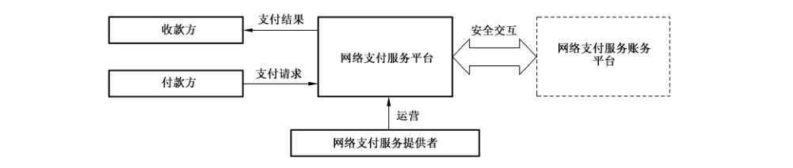
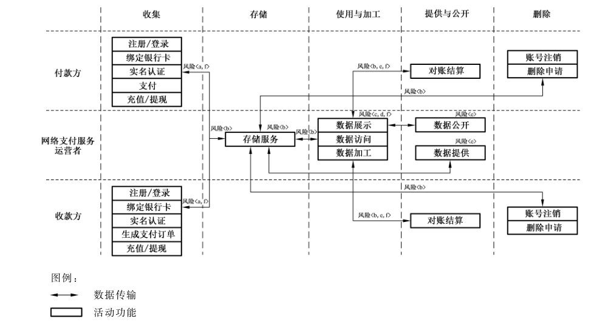

# GB/T 42015-2022 信息安全技术 网络支付服务数据安全要求

> 来源：[GB/T 42015-2022 国家标准详情](https://openstd.samr.gov.cn/bzgk/std/newGbInfo?hcno=CEB5771DBBF05ED5EA99EBA50896537F)；封面发布日期：2022-10-12；实施日期：2023-05-01。
> PDF SHA-256：ce5e353ea36972a4384391ad8faede4afe420dd9aa01a990c2589e6675960ce9。
> 转写说明：按页渲染官方 PDF 并对照全部 17 页校正文字、列表和表格；保留图 1、图 A.1，省略封面、目录、页眉、页脚和页码，合并跨页段落。正式引用请核对原 PDF。

## 前言

本文件按照 GB/T 1.1—2020《标准化工作导则 第1部分：标准化文件的结构和起草规则》的规定起草。

请注意本文件的某些内容可能涉及专利。本文件的发布机构不承担识别专利的责任。

本文件由全国信息安全标准化技术委员会（SAC/TC 260）提出并归口。

本文件起草单位：蚂蚁科技集团股份有限公司、中国电子技术标准化研究院、清华大学、中国网络安全审查技术与认证中心、国家计算机网络应急技术处理协调中心、中电长城网际系统应用有限公司、天翼电子商务有限公司、北京快手科技有限公司、马上消费金融股份有限公司、北京三快在线科技有限公司、北京小米移动软件有限公司、苏宁易购集团股份有限公司、中国信息通信研究院、北京字节跳动科技有限公司、北京小桔科技有限公司、深圳市腾讯计算机系统有限公司、中国移动通信集团有限公司、京东科技控股股份有限公司、浙江大学。

本文件主要起草人：彭晋、上官晓丽、徐羽佳、王昕、白晓媛、胡影、周晨炜、落红卫、金涛、魏立茹、李东南、李海英、李洁、宋铮、舒敏、王文磊、闵京华、张娜、刘源、焦伟、孟小楠、赵新强、黄馨蓓、甘俊杰、蔡一鸣、于浩洋、李昳婧、王宇晓、宋文娣、冷杉、黄著馨、张秉晟、曹京、郑新雅、宋建、蒋尉、邱勤、胡铁、武杨、蒋增增、蒋芳婕、李根。

## 1 范围

本文件规定了网络支付服务收集、存储、传输、使用、加工、提供、公开、删除、出境等数据处理活动的安全要求。

本文件适用于网络支付服务提供者规范数据处理活动，也可为监管部门、第三方评估机构对网络支付服务数据处理活动进行监督、管理、评估提供参考。

## 2 规范性引用文件

下列文件中的内容通过文中的规范性引用而构成本文件必不可少的条款。其中，注日期的引用文件，仅该日期对应的版本适用于本文件；不注日期的引用文件，其最新版本（包括所有的修改单）适用于本文件。

- GB/T 25069 信息安全技术 术语

- GB/T 35273—2020 信息安全技术 个人信息安全规范

- GB/T 37988 信息安全技术 数据安全能力成熟度模型

- GB/T 39335 信息安全技术 个人信息安全影响评估指南

- GB/T 40660 信息安全技术 生物特征识别信息保护基本要求

- GB/T 41391—2022 信息安全技术 移动互联网应用（App）收集个人信息基本规范

- GB/T 41479 信息安全技术 网络数据处理安全规范

- GB/T 41819 信息安全技术 人脸识别数据安全要求

## 3 术语和定义

GB/T 25069 和 GB/T 35273—2020 界定的以及下列术语和定义适用于本文件。

### 3.1 网络支付服务 internet payment service

收款方或付款方通过计算机、移动终端等电子设备，依托互联网远程传输支付指令完成直接或间接货币资金转移的经营活动。

> 注 1：不包括使用近场通信和专用网络完成的支付服务。

> 注 2：本文件所述网络支付服务仅限于非银行支付机构网络支付服务。

### 3.2 网络支付服务平台 internet payment service platform

通过互联网网络为收款方和付款方提供网络支付服务（3.1），同网络支付服务账务平台（3.3）交互完成资金划拨的信息系统。

### 3.3 网络支付服务账务平台 internet payment service accounting platform

为网络支付服务（3.1）提供账户管理、资金划拨、账务核算等服务的信息系统。

### 3.4 网络支付服务提供者 internet payment service provider

通过网络支付服务平台（3.2），提供网络支付服务（3.1）的组织。

### 3.5 网络支付服务数据 internet payment service data

网络支付服务提供者（3.4）在开展网络支付服务过程中收集和产生的数据。

> 注：网络支付服务数据包括用户数据和业务数据，不包括网络支付服务提供者内部管理数据。

### 3.6 网络支付服务用户 internet payment service user

使用网络支付服务（3.1）的个人或组织，包括收款方和付款方。

> 注：本文件中简称用户。

## 4 缩略语

下列缩略语适用于本文件。

SDK：软件开发工具包（Software Development Kit）

## 5 概述

### 5.1 网络支付服务业务组成

网络支付服务业务功能主要包括用户注册/登录、绑定银行卡、充值/提现、实名认证、生成支付订单、支付和对账结算等。

网络支付服务的相关方包括收款方、付款方、网络支付服务平台和网络支付服务提供者。其中，网络支付服务提供者运营网络支付服务平台，网络支付服务平台接收付款方的支付请求，将支付结果返回收款方，并与网络支付服务账务平台安全交互实现账务处理、完成网络支付服务，如图1所示。

图 1 网络支付服务相关方示意图

网络支付服务主要业务流程、数据处理活动及安全风险见附录 A。

### 5.2 网络支付服务数据范围

网络支付服务数据包括用户数据和业务数据：

a） 用户数据：网络支付服务提供者在提供网络支付服务过程中收集和产生的个人及组织用户数据，如个人自然信息、个人身份鉴别信息等；

b） 业务数据：在网络支付服务业务开展过程中处理的用于保障业务正常运行的数据，如商户签约信息、支付结算信息等。

## 6 基本要求

网络支付服务提供者数据安全的基本要求如下：

a） 数据处理活动应遵守GB/T 41479 中规定的要求；

b） 个人信息处理活动应遵守 GB/T 35273—2020中规定的要求，网络支付 App 个人信息收集活动应遵守 GB/T 41391—2022中规定的要求；

c） 应按照有关要求和标准进行数据分类分级保护，识别网络支付服务涉及的核心数据、重要数据、一般数据，对不同级别的数据采取不同的保护措施；

> 注 1：国家建立数据分类分级保护制度，按照数据对国家安全、公共利益或者个人、组织合法权益的影响和重要程度，将数据分为核心数据、重要数据、一般数据。

> 注 2：附录 B 给出了网络支付服务重要数据识别参考规则及数据分类示例。

d） 应识别网络支付服务涉及的一般个人信息、敏感个人信息，对个人信息进行标识和分类管理；

e） 应履行互联网平台运营者义务，如个人信息保护独立监督、制定公平公正的平台规则、隐私政策披露、平台内经营者管理、发布个人信息保护社会责任报告等；

f） 网络支付服务提供者的数据安全能力应至少符合 GB/T 37988二级能力要求；

g） 网络支付服务平台应符合国家网络安全等级保护相关标准要求；

h） 应结合数据处理活动的实际情况，按照有关国家标准定期开展数据安全风险评估；

i） 应在开展对个人权益有重大影响的个人信息处理活动前，按照 GB/T 39335 进行个人信息保护影响评估；

> 注 3：对个人权益有重大影响的个人信息处理活动，包括但不限于处理敏感个人信息、利用个人信息进行自动化决策、委托处理个人信息、向其他个人信息处理者提供个人信息、公开个人信息、向境外提供个人信息等。

j） 应按照有关国家标准，在网络支付平台规划建设时开展个人信息安全工程实践，同步规划、同步建设，同步使用个人信息保护措施。

## 7 数据收集

### 7.1 收集个人信息

网络支付服务提供者收集个人信息应在遵守GB/T 35273—2020中 5.1、5.2、5.3的要求基础上，遵守以下要求：

a） 通过App 收集必要个人信息应符合GB/T 41391—2022中 A.5的规定；

b） 扩展业务功能收集的个人信息均应由用户可选提供，且应限于实现处理目的的最小范围，常见扩展业务功能收集的个人信息范围及使用要求见附录C；

c） 应采取具有信息输入安全防护、即时数据加密功能的安全控件对支付鉴权信息的输入进行安全保护，并采取有效措施防止合作机构获取、留存。

> 注：支付鉴权信息包括但不限于网络支付交易口令、快捷支付口令、银行卡密码。

### 7.2 App 系统权限申请

网络支付服务 App 不应申请与App 业务功能无关的系统权限，系统权限申请范围及使用要求见附录D。

### 7.3 告知同意

网络支付服务提供者收集个人信息告知同意应在遵守 GB/T 35273—2020中 5.4、5.5、5.6 的要求基础上，遵守以下要求：

a） 收集用户金融账户、个人生物识别信息时，应当具有特定的目的和充分的必要性，应同步告知用户处理目的，并取得用户单独同意；

b） 不应将个人生物识别信息作为唯一的个人身份认证方式或支付方式，法律法规另有要求的除外；不应频繁要求用户开通个人生物识别认证或支付功能。

## 8 数据存储和传输

网络支付服务提供者存储、传输数据，应在遵守 GB/T 35273—2020中第6章的要求基础上，遵守以下要求：

a） 网络支付服务个人信息存储期限应为实现个人信息处理目的所必需的最短时间，超出存储期限应对个人信息进行删除或匿名化处理，法律法规另有规定的除外；

b） 如超出个人信息存储期限，但法律、行政法规规定的保存期限未届满，或者删除个人信息从技术上难以实现的，应停止除存储和采取必要的安全保护措施之外的处理；

c） 存储和传输敏感个人信息时，应采用密码技术进行保护；

d） 不应存储用户银行卡磁道信息、银行卡芯片信息，卡片验证码、银行卡密码；

e） 因业务需要存储用户银行卡有效期的，应取得用户和网络支付服务账务平台的授权；

f） 应至少使用本地备份、异地备份及场外备份中的两种方式对网络支付服务数据进行备份；

g） 应使用加密通道或数据加密的方式进行传输个人身份鉴别信息、可识别特定个人信息主体身份与资产状况的个人信息以及其他用于网络支付服务的关键信息；

h） 应采用密码技术保护个人身份鉴别信息的安全性；

i） 客户端和服务端的传输报文，日志等文件中不应包含明文用户鉴别信息、敏感个人信息。

## 9 数据使用和加工

### 9.1 数据展示

网络支付服务提供者数据展示应在遵守 GB/T 35273—2020中第7章的要求基础上，遵守以下要求：

a） 用户输入或设置网络支付平台登录口令、支付凭证（包括网络支付交易口令、快捷支付口令、银行卡密码等）时，应采取展示屏蔽等措施防止完整口令明文显示；

b） 用户处于未登录状态时，不应展示用户个人信息；

c） 用户处于已登录状态时，应脱敏展示除银行卡有效期外的用户个人信息，如用户选择明文展示，应在展示前对用户身份进行验证；

d） 展示账单信息时，应仅展示用户支出和收入金额、费用发生时间、费用发生主体，未经用户明示同意，不应展示账户绑定的银行卡信息、账户余额信息、账单详情；

e） 通过邮箱、手机号搜索目标用户，应脱敏展示目标用户账号、姓名。

### 9.2 数据访问

网络支付服务提供者对用户个人信息的访问控制，应在遵守 GB/T 35273—2020中7.1 的要求基础上，遵守以下要求：

a） 供提供者内部人员使用的业务系统，应对用户个人信息进行脱敏展示。因业务正常开展所需，需要查看未经脱敏处理的个人信息时，应在展示界面中采用数字水印技术；

b） 应遵循最少够用、职责分离的原则，按照数据分级建立相应的数据访问控制措施和访问权限申请审批流程；

c） 对于涉及用户个人信息的操作，应通过建立审批流程、限制数据访问范围等措施，限制批量查询、导出用户个人信息的操作功能；

d） 对于确需访问用户个人信息的业务场景，应对触发访问特定用户个人信息的事件、操作行为进行记录，并定期开展审计。

### 9.3 数据加工

网络支付服务提供者应在遵守 GB/T 35273—2020中7.4、7.5、7.7 的要求基础上，遵守以下要求：

a） 未经用户单独同意，不应对用户交易记录进行分析挖掘；

b） 利用通过网络支付服务收集的个人信息进行自动化决策时应允许用户自主选择，并遵守以下要求：

1） 应提供不针对其个人特征的选项，或向个人提供便捷的拒绝方式；

2） 如通过自动化决策方式作出对个人权益有重大影响的决定，应对用户予以说明，并保障用户拒绝仅通过自动化决策的方式作出决定的权利；

3） 应向用户提供针对自动化决策结果的便捷有效的投诉渠道；

4） 应在涉及资金动账交易的自动化决策前，应向用户予以说明并取得用户单独同意；

5） 应在自动化决策功能的规划设计阶段或首次使用前开展个人信息保护影响评估，并依据评估结果采取有效的保护措施。

c） 依据交易记录进行账单分类时，不应对用户购买商品的明细内容进行分析，取得用户单独同意的除外。

## 10 数据提供和公开

### 10.1 数据提供

网络支付服务提供者向第三方提供数据，应在遵守 GB/T 35273—2020中 9.2、9.3要求的基础上，遵守以下要求：

a） 涉及向第三方提供用户个人信息的：

1） 应向用户告知第三方的名称或者姓名、联系方式、处理目的、处理方式和个人信息的种类，并取得个人的单独同意；

2） 应在提供前进行个人信息保护影响评估。

b） 通过在网络支付平台中接入第三方应用或嵌入第三方 SDK 的形式对外提供数据时：

示例 1：在网络支付平台中接入第三方应用提供网络预约汽车、生活缴费等服务。

示例 2：在网络支付平台中嵌入第三方 SDK 实现定位、向用户推送消息等功能。

1） 应遵守 GB/T 41391—2022中6.6 规定的要求；

2） 用户跳转至第三方应用时，应提醒用户关注第三方应用的个人信息收集使用规则，涉及提供身份证件号码、地址等敏感个人信息的，宜在相关页面以具体活动规则或其他适当途径向用户同步告知个人信息收集使用规则；

3） 应对第三方的数据安全保护能力进行评估，并以协议等方式约定双方数据保护责任；

4） 涉及提供个人信息的，应与第三方以协议等方式约定个人信息处理规则。

c） 通过在第三方应用中嵌入网络支付服务 SDK，提供网络支付服务时（如在网上购物服务平台中嵌入网络支付服务 SDK，以使网上购物服务平台用户完成订单支付），不应将用户账户余额、银行卡绑定信息、个人身份鉴别信息、与当次支付行为无关的用户交易记录等数据提供给第三方应用；

d） 与第三方风险控制服务商开展合作时，应仅提供经过去标识化处理后的数据，且通过合同等方式约定双方数据安全保护责任；

e） 用户在网络支付账户中绑定银行卡时，网络支付服务提供者应仅向目标银行机构共享用户姓名、手机号、银行卡号信息；

f） 用户使用网络支付服务在商户进行消费时，网络支付服务提供者应仅向支付清算机构、发生交易的商户和用户选择的支付方式所对应的金融机构提供交易编号、交易金额、交易对象、交易时间；

g） 因兼并、重组、破产等原因需要转移数据的，应明确数据转移方案，数据接收方应继续履行相关数据安全保护义务。

### 10.2 数据公开

网络支付服务公开用户数据，应遵守 GB/T 35273—2020中9.4的要求。

## 11 数据删除

网络支付服务提供者删除数据，应遵守 GB/T 35273—2020中6.1 和8.3的要求。

## 12 数据出境

网络支付服务提供者如提供跨境支付服务，在境外商户消费、向境外汇款/接收境外汇款、为用户提供跨境支付结算服务等场景下，涉及数据出境。网络支付服务提供者数据出境应遵守以下要求：

a） 不涉及处理跨境支付业务的，不应向境外提供个人信息等数据；

b） 出境数据应仅限处理跨境支付业务所需的必要信息；

c） 应建立数据出境记录，包括但不限于出境时间、数据类型、数量、目的地、境外接收方等，相关记录至少保存五年；

d） 根据业务发展和运营情况，每年应自行或委托第三方机构对数据出境至少进行一次数据出境风险评估。

## 13 个人信息主体权利

网络支付服务提供者在保障个人信息主体权利方面，应在遵守GB/T 35273—2020中第8章要求的基础上，遵守以下要求：

a） 应为用户提供便捷的查阅、复制、转移、更正、删除个人信息，以及撤回同意的功能；

b） 应为用户提供查阅和删除交易记录的功能；

c） 应为用户提供便捷地撤回同意的渠道，包括但不限于撤回对免密支付、自动扣款、第三方收集个人信息（如账号登录等）、系统权限等的授权；

d） 应向用户提供查询个人信息的方法，并对网络支付敏感信息提供取消展示的方法；

e） 收集不满14周岁未成年人个人信息，应制定专门的个人信息处理规则，并取得未成年人的父母或者其他监护人的单独同意；

f） 应为用户提供便捷的账号注销功能，提供注销提醒或注销协议，告知执行注销操作对用户可能造成的影响，并在注销后及时对其个人信息进行删除或匿名化处理。如确需设置注销条件，设置的注销条件应在合理范围内，包括：

1） 除用户账号存在未处理完毕的交易与纠纷（包括差错账、涉嫌欺诈、未完成投诉处理等）、其账号下拥有财产权益（包括账号余额、优惠券、会员权益等），不应设置其他注销条件；

2） 因1）中所述情形影响或拒绝用户注销的，应向用户说明注销账号的影响或拒绝的理由。

如用户已妥善处理（包括自行提现、结清或自愿放弃等方式）相关财产权益或上述其他限制情形消除后，应为用户注销账号；

3） 除 1）中所述情形，可从保障用户权益和履行平台职责角度出发，对账号设置合理的注销限制条件，如待注销账号不存在违法违规或被盗风险。针对此类限制条件，应为用户提供专门的申诉渠道。

## 14 网络支付服务典型场景数据安全要求

### 14.1 通过生物特征实现支付、身份认证

网络支付服务提供者通过生物特征实现支付、身份认证等功能时，应遵守 GB/T 40660、GB/T 41819中规定的要求及其他生物特征识别信息安全相关国家标准的要求。

> 注：网络支付服务中，通过生物特征实现支付、身份认证等功能的常见场景包括但不限于在移动终端通过指纹或人脸信息进行网络支付服务平台的登录验证，线上支付时通过指纹、人脸或声纹进行支付指令验证，线下消费时通过人脸进行支付指令验证等。

### 14.2 对账

在对账场景下，对网络支付服务提供者的要求如下：

a） 应建立访问控制机制，确保对账商户仅能访问与自身相关的对账数据；

b） 应对交易记录中的敏感个人信息字段进行脱敏或加密处理；

c） 应对对账操作进行定期审计。

### 14.3 支付风险控制

#### 14.3.1 访问控制

支付风险控制场景下，对网络支付服务提供者的访问控制要求如下：

a） 应建立完整的风险控制数据权限管控机制：

1） 风险控制数据应包括但不限于行为信息、交易信息、风险控制特征、风险控制变量等；

2） 应覆盖风险控制数据访问权限的申请、审批、授权、回收等全生命周期。

b） 应仅对特定风险控制岗位人员开放必要访问权限，对访问行为进行完整的日志记录，并定期审计；

c） 应确保日志记录支持数据安全事件溯源与处置。

#### 14.3.2 风险控制建模

网络支付服务提供者进行风险控制建模的要求如下：

a） 应采取密码技术对用于建模的数据（如训练数据）进行保护；

b） 进行模型训练时，如需使用用户数据，应在使用前对用户数据进行去标识化处理。

#### 14.3.3 联合风险控制

网络支付服务提供者进行联合风险控制的要求如下：

a） 应通过合同等方式规定参与联合风险控制各方的数据保护责任；

b） 应对需要提供给其他联合风险控制参与方的训练数据及训练过程数据进行加密处理。

### 14.4 支付口令安全

网络支付服务提供者提供的支付口令安全要求如下：

a） 应建立支付口令复杂度校验机制，支付口令不应与用户个人信息（如出生日期、证件号码、手机号码等）相似度过高；

b） 用户输入支付口令时，客户端不应明文显示；

c） 应在重置支付口令时提供多种身份验证方式，并以短信、邮件等方式告知用户；

d） 不应将网络支付口令存储在移动智能终端或网络支付服务客户端中。

## 附录 A（资料性）网络支付服务数据处理活动及安全风险

### A.1 网络支付服务主要业务功能及数据处理活动

网络支付服务业务功能主要包括注册、登录、绑定银行卡、充值/提现、实名认证、生成支付订单、支付和对账结算等，具体如下：

a） 用户注册/登录：收款方和付款方在网络支付服务平台进行注册，创建网络支付服务平台账号，成为网络支付服务用户；收款方或付款方在网络支付服务平台完成身份核验，被平台允许使用相关服务；

b） 绑定银行卡：收款方或付款方通过网络支付服务平台将其平台账号与已有银行卡账户信息进行登记与关联；

c） 充值/提现：使用已绑定的银行卡将现金转入网络支付账户中，或将网络支付账户中的余额转入已绑定的银行卡中；

d） 实名认证：收款方或付款方同网络支付服务平台交互完成身份资料真实性的验证审核；

e） 生成支付订单：网络支付服务平台聚合付款方标识、收款方标识、支付金额等支付关键数据并提交给网络支付平台；

f） 支付：付款方通过网络支付服务平台完成向收款方的资金转移；

> 注：常见的支付业务模式包括扫码支付、扫码收款、转账等。

g） 对账结算：网络支付服务平台同收款方、付款方以及网络支付服务账务平台进行资金、账务核对。

网络支付服务过程中的数据处理活动及相关角色和服务功能示意图如图 A.1所示。

图 A.1 网络支付服务数据处理活动示意图

### A.2 网络支付服务数据安全风险

网络支付服务主要面临如下数据安全风险：

a） 在数据收集活动中，网络支付服务提供者过度收集用户数据，或过度索取移动 App 系统权限的风险；

b） 在数据传输、存储活动中，网络支付服务提供者未采取有效安全措施导致数据遭受未经授权的访问、泄露、篡改、丢失的风险；

c） 在用户数据使用活动中，网络支付服务提供者未采取脱敏、身份鉴别或访问控制等安全措施导致数据遭到未经授权的访问、泄露、篡改、丢失的风险；

d） 网络支付服务提供者滥用用户数据开展自动化决策，或滥用自动化决策机制造成用户权益损失的风险；

e） 网络支付服务提供者以接入第三方应用、嵌入第三方 SDK 或其他形式对外提供数据时，未经用户授权或超范围提供数据，以及接收方无法提供充足安全保障措施、滥用用户数据等风险；

f） 网络支付服务提供者以安全风险控制等为由扩大个人信息收集范围、未经用户授权或超出授权范围加工和使用其个人信息等风险。

## 附录 B（资料性）网络支付服务重要数据识别参考规则及数据分类示例

### B.1 网络支付服务重要数据识别参考规则

网络支付服务重要数据识别参考规则如下：

a） 按照国家和网络支付服务行业的重要数据目录，识别涉及的重要数据；

b） 相关目录不明确时，按照重要数据识别相关规定、国家或行业标准识别重要数据；

c） 相关目录、规定和标准均不明确时，将一旦被泄露或篡改、损毁，可能直接危害国家安全、经济运行、社会稳定、公共健康和安全的数据识别为重要数据。

### B.2 网络支付服务数据分类示例

网络支付服务数据分类示例见表 B.1。

**表 B.1 网络支付服务数据分类示例**

| 一级类别 | 子类 | 示例 |
| --- | --- | --- |
| 用户数据 | 个人自然信息 | 个人基本信息（如姓名、性别、证件信息）、个人联系信息（如电话号码、电子邮箱地址）、个人地理位置信息（如所在国家、城市、区域）等 |
| 用户数据 | 个人身份鉴别信息 | 网络支付交易口令、快捷支付口令、银行卡密码等、网络支付平台登录口令、生物识别信息（如指纹、人脸、声纹）、个人鉴别辅助信息（如动态口令、短信验证码）等 |
| 用户数据 | 个人行为信息 | 用户使用网络支付服务 App 的记录等 |
| 用户数据 | 个人标签信息 | 交易类标签信息（如支付结算业务标签）、签约标签信息等 |
| 用户数据 | 组织用户信息 | 组织用户基本概况（如法定代表人姓名、企业名称、统一社会信用代码）、组织用户联系人信息（如联系人姓名、联系电话、通信地址）、单位标签信息（如签约标签、交易类标签、营销标签）、法定代表人证件信息、组织用户身份鉴别信息等 |
| 用户数据 | 签约绑卡信息 | 银行卡号、绑定关系等 |
| 用户数据 | 用户交易记录 | 交易对象、商品名称、交易类型、交易金额等 |
| 用户数据 | 用户账户信息 | 账户基本信息（如账户名称、账户编号、账户类型、账户状态）、账户金额、余额等 |
| 业务数据 | 交易信息 | 交易基本信息（如交易流水号、类型、时间、渠道）、交易清结算信息、交易记账信息、交易金额、交易对象（如交易对象类型、账户名称）等 |
| 业务数据 | 商户签约信息 | 商户名称、营业信息、签约方式、结算方式等 |
| 业务数据 | 业务经营数据 | 活动宣传信息、产品信息（如产品编号、产品名称、适用用户类型）、活动规则信息、活动名单、安防管理信息（如认证授权设计文档等）、市场营销规划信息等 |
| 业务数据 | 业务技术数据 | 算法模型、风险控制数据等 |

## 附录 C（资料性）网络支付服务常见扩展业务功能的个人信息收集范围及使用要求

网络支付服务常见扩展业务功能的个人信息收集范围如表 C.1 所示。

**表 C.1 网络支付服务常见扩展业务功能及其收集的必要个人信息**

| 业务功能 | 个人信息收集范围 | 使用要求 |
| --- | --- | --- |
| 刷脸登录验证 | 人脸数据 | 用于核验用户身份 |
| 刷脸支付 | 人脸数据 | 用于核验用户身份 |
| 开通快捷支付 | 开户行名称、银行卡号、银行卡有效期、姓名、身份证号码、银行预留手机号 | 用于向发卡银行验证用户身份 |
| 转账 | 收款人账户、收款人部分姓名、转账金额 | 用于准确执行用户的支付指令，转账给目标用户 |
| 红包 | 红包金额、红包个数、发送对象 | 用于向他人发送红包 |
| 消费 | 交易信息、交易对象、交易商品、交易时间 | 用于在商家进行消费时，记录交易信息，按照法律法规要求对商家进行管理，防范套现或欺诈风险 |
| 信用卡还款 | 信用卡卡号、发卡银行、姓名、还款金额 | 用于对接发卡银行完成信用卡还款 |

## 附录 D（资料性）网络支付服务 App 相关系统权限申请范围及使用要求

### D.1 Android App

网络支付服务 Android App（Android 11 及以下版本）相关系统权限申请范围及使用要求见表 D.1。

**表 D.1 Android App 相关系统权限申请范围及使用要求**

| 权限名称 | 使用要求 |
| --- | --- |
| 拍摄（CAMERA） | 仅用于实名认证、扫码支付、刷脸登录及支付、头像图片设置、截图反馈服务 |
| 写入外置存储器（WRITE_EXTERNAL_STORAGE） | 仅用于实现将收款码等图片保存到本地等功能 |
| 读取外置存储器（READ_EXTERNAL_STORAGE） | 仅用于扫描图片进行扫码支付、上传选择的图片（如用于头像设置） |
| 读取通讯录（READ_CONTACTS） | 仅用于进行转账、添加好友等 |
| 访问粗略位置（ACCESS_COARSE_LOCATION） | 仅用于识别安全风险、保障用户资金安全 |

> 注：上述权限主要针对网络支付服务常见业务功能提出。

### D.2 iOS App

网络支付服务 iOS App（iOS 14 及以下版本）相关系统权限申请范围及使用要求见表 D.2。

**表 D.2 iOS App 相关系统权限申请范围及使用要求**

| 权限名称 | 使用要求 |
| --- | --- |
| 相机（Camera） | 仅用于实名认证、扫码支付、刷脸登录及支付、头像图片设置、截图反馈服务 |
| 通讯录（Contacts） | 仅用于进行转账、添加好友等 |
| 使用期间访问位置（Location When In Use） | 仅用于识别安全风险、保障用户资金安全 |
| 只写照片库（Photo Library Additions） | 仅用于实现将收款码等图片保存到本地等功能 |
| 读取和写入照片库（Photo Library） | 仅用于扫描图片进行扫码支付、上传选择的图片（如用于头像设置）及将收款码等图片保存到本地等 |

> 注：上述权限主要针对网络支付服务常见业务功能提出。

## 参考文献

- ［1］ GB/T 31502—2015 信息安全技术 电子支付系统安全保护框架

- ［2］ JR/T 0171—2020 个人金融信息保护技术规范

- ［3］ JR/T 0149—2016 中国金融移动支付 支付标记化技术规范

- ［4］ 非银行支付机构网络支付业务管理办法（中国人民银行公告〔2015］第43号）

- ［5］ 中国人民银行关于印发《条码支付业务规范（试行）》的通知（银发〔2017〕296号）
