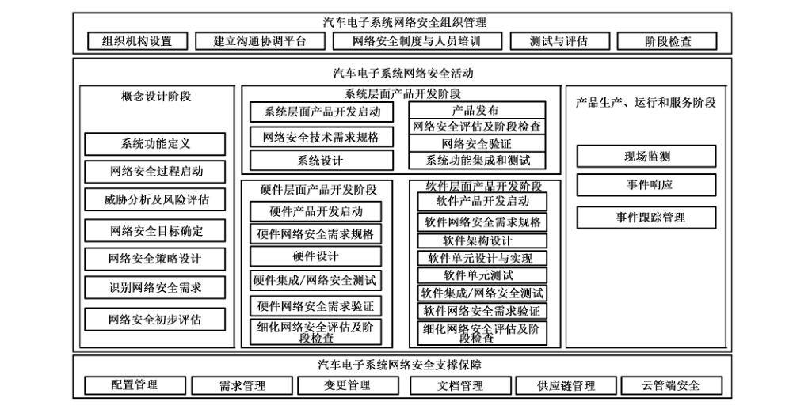
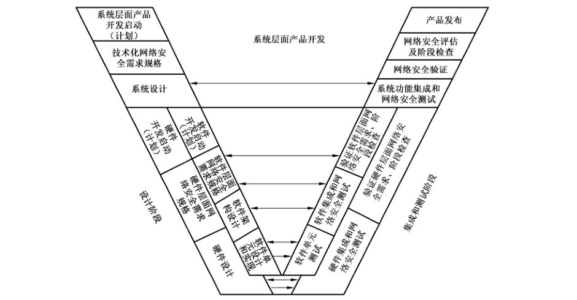
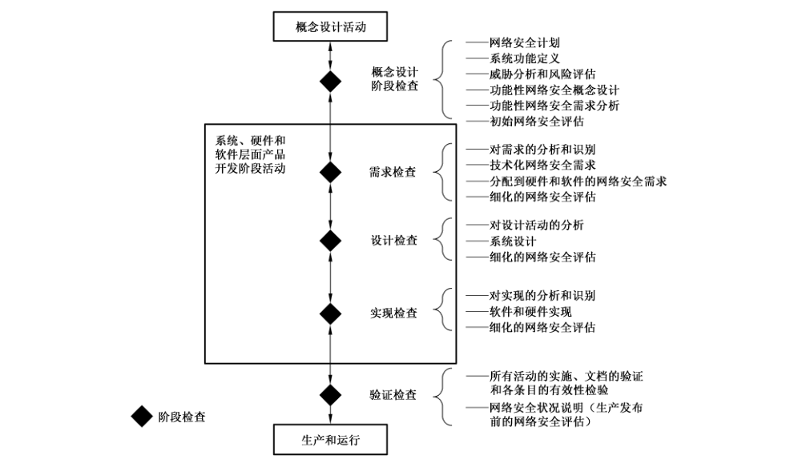
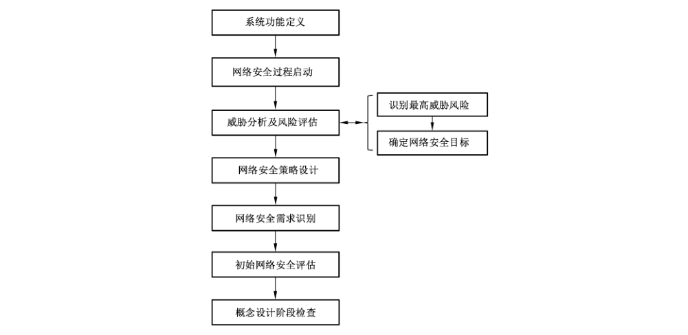
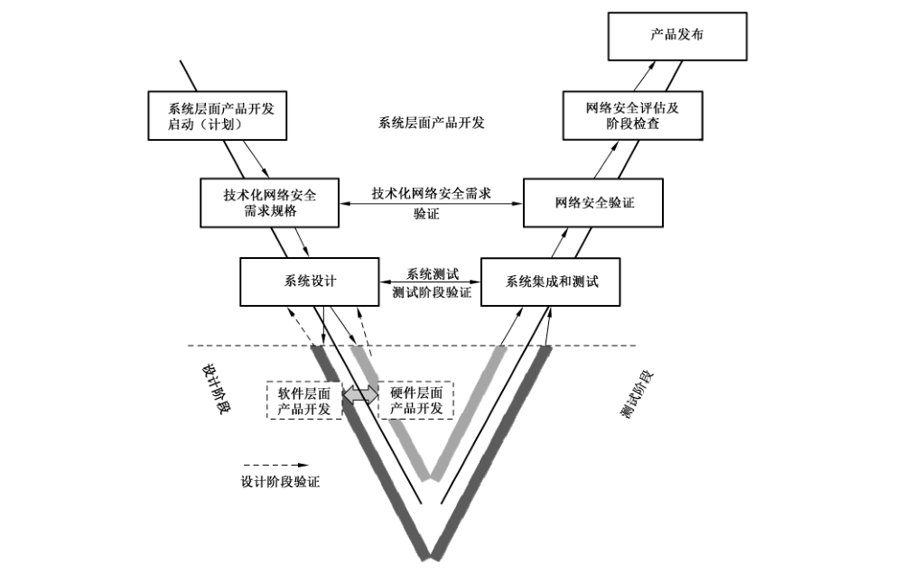
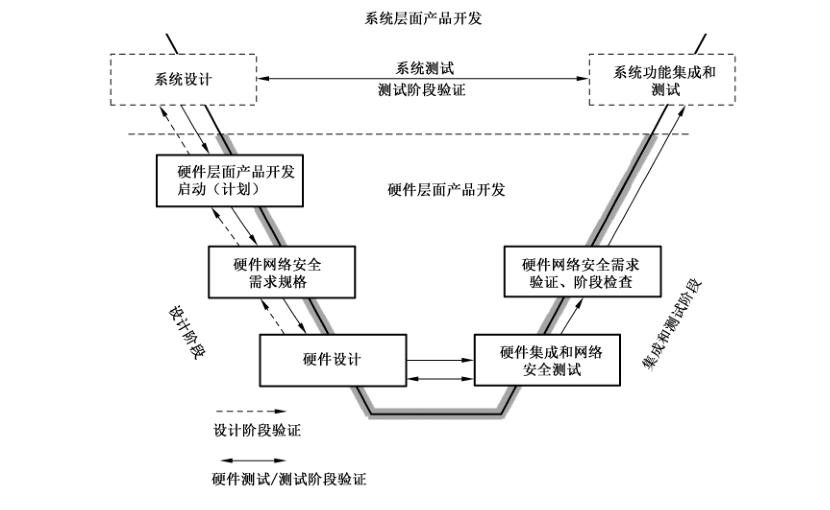
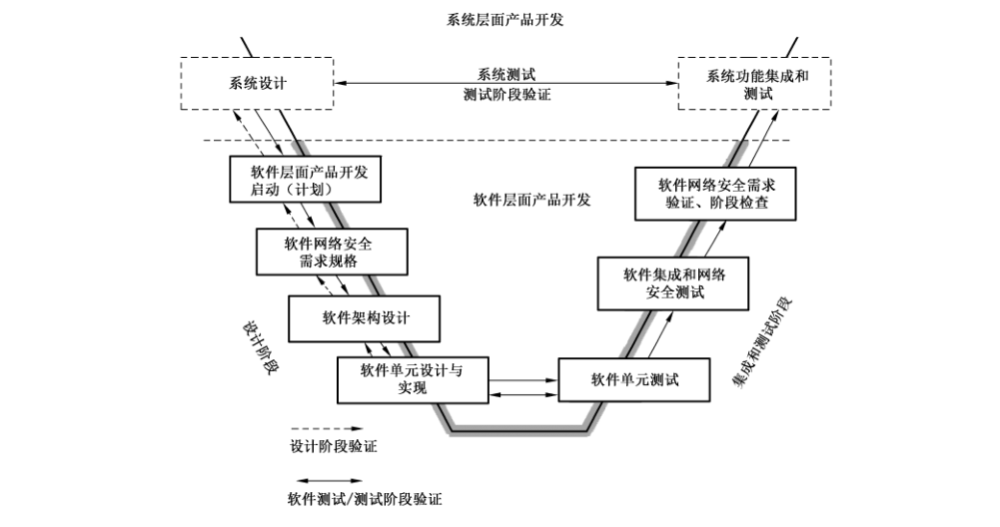

# GB/T 38628-2020 信息安全技术 汽车电子系统网络安全指南

> 来源：[GB/T 38628-2020 国家标准详情](https://openstd.samr.gov.cn/bzgk/std/newGbInfo?hcno=59F8899E944C9ED52288FE5E0146C621)；封面发布日期：2020-04-28；实施日期：2020-11-01。
> PDF SHA-256：80c5538d8aace856c1ae3c24610c7e284cc8cc1cf2b4949c4a08f2b3389e0293。
> 转写说明：逐页对照官方 PDF 的 30 页图像校核文字、列表、图示和附录表格；保留 7 幅原图，合并跨页内容，省略封面、目录、页眉、页脚和页码。正式引用请核对原 PDF。

## 前言

本标准按照 GB/T 1.1—2009给出的规则起草。

请注意本文件的某些内容可能涉及专利。本文件的发布机构不承担识别这些专利的责任。

本标准由全国信息安全标准化技术委员会（SAC/TC 260）提出并归口。

本标准起草单位：中国电子技术标准化研究院、电子科技大学、东软集团股份有限公司、国家信息技术安全研究中心、中国汽车技术研究中心有限公司、国汽（北京）智能网联汽车研究院有限公司、浙江吉利控股集团有限公司、重庆长安汽车股份有限公司、中国第一汽车集团有限公司、上海汽车集团有限公司、北京新能源汽车股份有限公司、威马汽车科技集团有限公司、三六零科技有限公司、上海银基信息安全技术股份有限公司、惠州德赛西威智能交通技术研究院有限公司、惠州华阳通用电子有限公司、广东为辰信息科技有限公司、四川省信息安全测评中心、北京百度网讯科技有限公司、东风汽车集团有限公司、国家计算机网络应急技术处理协调中心。

本标准主要起草人：龚洁中、刘贤刚、范科峰、罗蕾、陈丽蓉、路娜、陈静相、李京春、王羽、秦洪懋、王建、刘建行、付朝辉、汪向阳、罗薇、李允、汤利顺、李秋实、董威、杨起森、张军响、刘健皓、张屹、仇兆峰、周方俊男、张裁会、苗澎锋、罗建超、赵焕宇、王丹琛、李显杰、王重钦、郑伟、王晖、李琳、周睿康、王秉政。

## 1 范围

本标准给出了汽车电子系统网络安全活动框架，以及在此框架下的汽车电子系统网络安全活动、组织管理和支撑保障等方面的建议。

本标准适用于指导整车厂、零部件供应商、软件供应商、芯片供应商以及各种服务提供商等汽车电子供应链上各组织机构开展网络安全活动，指导相关人员在从事汽车电子系统的设计开发、生产、运行和服务等过程中满足基本的网络安全需求。

## 2 规范性引用文件

下列文件对于本文件的应用是必不可少的。凡是注日期的引用文件，仅注日期的版本适用于本文件。凡是不注日期的引用文件，其最新版本（包括所有的修改单）适用于本文件。

- GB/T 18336—2015（所有部分）信息技术 安全技术 信息技术安全评估准则

- GB/T 20984—2007 信息安全技术 信息安全风险评估规范

- GB/T 29246—2017 信息技术 安全技术 信息安全管理体系 概述和词汇

- GB/T 30279—2013 信息安全技术 安全漏洞等级划分指南

- GB/T 31167—2014 信息安全技术 云计算服务安全指南

- GB/T 31168—2014 信息安全技术 云计算服务安全能力要求

- GB/T 31509—2015 信息安全技术 信息安全风险评估实施指南

- GB/T 31722—2015 信息技术 安全技术 信息安全风险管理

## 3 术语和定义

GB/T 29246—2017 界定的以及下列术语和定义适用于本文件。

### 3.1 汽车电子系统 automotive electronics systems

在汽车中通过电子技术实现控制或服务的系统，是一类应用于汽车领域的嵌入式系统，包含车体控制电子系统和车载服务电子系统。

注1：车体控制电子系统与车上机械系统配合使用，包括发动机控制系统、底盘控制系统、车身电子控制系统等。

注2：车载服务电子系统能够独立于汽车环境使用，包括车载信息娱乐系统及个人设备交互信息系统等。

### 3.2 未决问题 pending question

在进行安全性评估时，现有网络安全控制措施不能降低或不确定能够降低的网络安全威胁，以及需要在后续过程中进一步分析和处理的问题。

### 3.3 系统上下文 system context

定义系统软硬件接口、关键数据流、存储和信息处理等内容的集合。

### 3.4 攻击树分析 attack tree analysis

由系统应用层出发，分析攻击者可能进行的攻击路径的方法。

### 3.5 信息物理系统 cyber-physical system

由计算部件和物理控制部件组成的系统。

### 3.6 信息物理车辆系统 cyber-physical vehicle system

在系统的计算部件和物理部件以及系统周围环境之间存在紧密耦合的车辆嵌入式控制系统。

### 3.7 网络安全状况说明 cybersecurity statement

在所有的阶段检查完成后，在产品即将正式发布的生产环节之前进行的网络安全评估，为每一个设计和开发的特性提供其满足网络安全目标的结论与证据。

### 3.8 网络安全目标 cybersecurity goal

从威胁分析和风险评估结果中获得的，针对某系统功能特性需要达到的网络安全目标。

> 注：网络安全目标是最高抽象层次的安全需求，在产品的开发阶段将会以它（们）为基础导出具体功能的和技术的网络安全需求。

### 3.9 信任边界 trust boundary

程序的数据或执行流的“信任”级别发生改变的边界。

> 注：一个执行流的信任边界可以是在一个应用的权限被提升的地方。

## 4 缩略语

下列缩略语适用于本文件。

CAN：控制域网络（Control Area Network）

> 转写注：正文第2页原版将 CAN 写作“控制域网络（Control Area Network）”，此处按原文保留。

ECU：电子控制单元（Electronic Control Unit）

FOTA：固件空中下载（Firmware Over The Air）

IVI：车载信息娱乐系统（In-Vehicle Infotainment）

JTAG：联合测试访问组（Joint Test Access Group）

MISRA：汽车工业软件可靠性协会（Motor Industry Software Reliability Association）

OBD：车载诊断系统（On-Board Diagnostic）

SIM：用户身份模块（Subscriber Identity Module）

SOTA：软件空中下载（Software Over The Air）

T-BOX：智能网联汽车的通信网关（Telematics BOX）

USB：通用串行总线（Universal Serial Bus）

V2X：车对车、车对外界的信息交换（Vehicle to Everything）

## 5 汽车电子系统网络安全活动框架

### 5.1 概述

汽车电子系统网络安全活动框架如图1所示，包含汽车电子系统网络安全活动、组织管理以及支撑保障，其中网络安全活动是框架的核心，主要是指在汽车电子系统生命周期各阶段开展的相关安全活动，这些阶段包括概念设计阶段，系统层面的产品开发阶段，硬件层面的产品开发阶段，软件层面的产品开发阶段，产品生产、运行和服务阶段。

组织可以根据自身实际情况，对网络安全活动框架中各部分进行配置和裁剪，并考虑与组织现有的管理体系（比如质量管理体系）的机构设置、过程活动进行结合，以便落实本标准所建议的网络安全措施，以较小的代价实现高效的安全。

### 5.2 组织管理

组织管理是指开展汽车电子系统网络安全活动所需要具备的组织、人员能力、制度等方面的条件，主要包括组织机构设置、建立沟通协调平台、制度建设与员工培训、建立网络安全测试与评估、阶段检查能力等。

### 5.3 网络安全活动

#### 5.3.1 概念设计阶段

概念设计阶段主要包括系统功能定义、网络安全过程启动、威胁分析及风险评估、网络安全目标确定、网络安全策略设计、网络安全需求识别、初始网络安全评估、阶段检查等环节的活动。

#### 5.3.2 产品开发阶段

产品开发阶段包括系统层面产品开发阶段、硬件层面产品开发阶段和软件层面产品开发阶段。

图2展示了产品开发阶段的基本过程，以及系统层面、硬件层面和软件层面产品开发之间的关系。图2没有包含迭代过程，但实际上许多阶段都需要反复迭代，才能最终实现开发目标。

系统层面产品开发阶段主要包括系统层面产品开发启动、网络安全技术需求规格（包括系统层面漏洞分析、网络安全策略具体化、确定网络安全技术需求等）、系统设计、系统功能集成和网络安全测试、网络安全验证、网络安全评估和检查以及产品发布等环节的工作。

硬件层面产品开发阶段主要包括硬件产品开发启动、硬件网络安全需求规格（包括硬件层面漏洞分析、确定网络安全需求）、硬件设计、硬件集成和网络安全测试、硬件网络安全需求验证、细化网络安全评估等环节。

软件层面产品开发阶段主要包括软件产品开发启动、软件网络安全需求规格（包括软件层面漏洞分析、确定网络安全需求）、软件架构设计、软件单元设计与实现、软件单元测试、软件集成和网络安全测试、软件网络安全需求验证、细化网络安全评估等环节。

在产品开发阶段需要用到密码技术时需要符合国家密码管理相关规定。

注1：图中双向箭头线表示对应或一致性关系，比如“系统设计”和“系统功能集成和网络安全测试”之间的双向箭头线表示，系统的功能集成和网络安全测试以与系统设计相一致的方式进行，集成和测试的内容、顺序以及具体方式等以系统设计为依据。

注2：图中单向箭头线表示过程活动之间的顺序关系。箭头左边的活动在前面执行，箭头右边的活动在后面执行。

#### 5.3.3 产品生产、运行与服务阶段

产品生产、运行与服务阶段主要包括现场监测、事件响应和后续相关的事件跟踪管理等活动。

### 5.4 支撑保障

汽车电子系统网络安全支撑保障主要包括配置管理、需求管理、变更管理、文档管理、供应链管理、云管端安全等方面的内容。

## 6 汽车电子系统网络安全组织管理

### 6.1 组织机构设置

组织需高度重视网络安全，把网络安全放在组织的战略层面进行考虑，并具体通过如下方面体现：

<ol type="a">
<li>

制定和实施组织的网络安全战略、方针和目标；

</li>
<li>

落实网络安全的领导责任制，可建立有组织高层领导负责的网络安全领导小组，负责网络安全战略、方针和目标的制定和实施监督，并协调各部门之间的配合协作；

</li>
<li>

设置专门的机构，负责有关网络安全方面的文化建设、信息沟通、培训、跨部门资源调配以及其他相关工作；

</li>
<li>

员工能够清楚地知道组织内部与网络安全相关的机构设置及职责分工。

</li>
</ol>

### 6.2 建立沟通协调平台

组织宜建立有关网络安全的内部及外部信息沟通协调渠道，包括但不限于以下方面：

<ol type="a">
<li>

制定组织内部或外部的个人或组织报告突发网络安全事件的流程，明确组织内相关各部门之间的衔接方式及应承担的责任；

</li>
<li>

制定组织向相关方通报有关网络安全事件的流程，对事件的严重性程度进行分级管理；

</li>
<li>

制定响应和处理来自政府、媒体、公众和组织内部的有关网络安全事件的处理流程。

</li>
</ol>

### 6.3 制度建设与员工培训

组织宜将网络安全制度作为组织建设的重要内容，创建、培养和维持组织的网络安全文化，以增强员工的网络安全意识能力。可具体从如下方面开展组织工作：

<ol type="a">
<li>

编制有关网络安全的制度或过程文件；

</li>
<li>

收集、积累和传播网络安全相关的实践经验、网络安全漏洞的解决方案和相关产品的应用案例，包括与汽车电子领域相关的网络安全内容；

</li>
<li>

密切关注国际国内在网络安全方面的最新进展情况，包括汽车电子领域重大安全漏洞的情况；

</li>
<li>

及时响应网络安全相关事件，优先处理风险程度高的网络安全威胁；

</li>
<li>

制定培训计划，定期组织有关网络安全的培训活动，通过培训提升员工的网络安全意识和能力，使得员工能够理解在产品的开发、生产、运行和服务中可能出现的各种网络安全漏洞和威胁，掌握威胁分析和风险评估的流程与方法。

</li>
</ol>

### 6.4 测试与评估

#### 6.4.1 网络安全测评团队

网络安全测试与评估工作宜由有经验的、有公正性的测评团队完成。具体条件可包括：

<ol type="a">
<li>

测评团队与被测评对象的开发、生产、运行和服务以及网络安全控制措施的设计没有任何利益冲突；

</li>
<li>

测评团队与被测评组织没有建立利益关系或产生利益冲突；

</li>
<li>

测评团队不宜测评自己的工作；

</li>
<li>

测评团队不宜是被测评组织的员工；

</li>
<li>

测评团队不宜诱导组织使用自己的服务；

</li>
<li>

测评团队宜将测评结果详细记录在案，包括找到的新漏洞。

</li>
</ol>

> 注：这里主要是针对组织聘请第三方测评团队的建议要求，组织自建测评团队的情况可以参考。

#### 6.4.2 网络安全测试内容

漏洞测试、渗透测试和模糊测试是评价一个对象网络安全能力的重要方法。其中，漏洞测试是较为常用的方法，可包含但不限于如下具体方式：

<ol type="a">
<li>

漏洞扫描，检测对象是否存在可能被攻击的漏洞；

</li>
<li>

探测性测试，检测和探查可能在软件或硬件实现中产生的漏洞；

</li>
<li>

攻击性测试，通过破坏、绕过、篡改网络安全控制措施等手段入侵对象，以达到测试对象抗攻击能力的目的。

</li>
</ol>

#### 6.4.3 网络安全评估

网络安全评估用于检验当前所实施的网络安全策略是否满足网络安全需求，以及是否能有效降低威胁和风险，可包括但不限于以下内容：

<ol type="a">
<li>

评估各阶段的网络安全策略是否满足网络安全需求；

</li>
<li>

评估各阶段的网络安全设计是否符合网络安全策略；

</li>
<li>

对于网络安全策略未能解决的威胁，将其定义为相应的未决问题，并评估该未决问题是否可以被接受；

</li>
<li>

如果未决问题可被接受，则提供相应的说明，解释该网络安全问题可以被接受的原因；如果未决问题不可被接受，并且可以通过后续阶段的活动解决，则记录该未决问题，以便将其作下一阶段开发的依据。

</li>
</ol>

### 6.5 阶段检查

在生命周期的每个阶段结束前宜进行阶段检查，以确保在下一阶段开始之前已经正确、一致地执行完成了当前阶段的活动。

阶段检查可由组织的技术专家小组来进行，该小组宜独立于产品开发团队。此外，为了保持产品在整个生命周期中所有功能的一致性和完整性，该小组宜参与产品整个开发过程中的所有检查工作。检查结果以“通过”“有条件通过”（即需要采取一些整改措施）或“不通过”表示，只有当检查结果是“通过”或“有条件通过”并且相关整改措施已实施和确认的情况下，才能进入到下一阶段的工作。各阶段检查的主要内容如图3所示，具体内容见各阶段对应章节。

> 注：在进入生产和运行阶段后，也可根据需要开展阶段检查活动，进一步确保安全措施执行到位。

## 7 汽车电子系统网络安全活动

### 7.1 概念设计阶段

#### 7.1.1 概述

概念设计阶段的活动流程如图4所示，包括系统功能定义、网络安全过程启动、风险评估与目标确定、网络安全策略设计、网络安全需求识别、初始网络安全评估及概念设计阶段检查等。

#### 7.1.2 系统功能定义

组织宜明确汽车电子系统中被开发的、可以实施网络安全的子系统及其功能的适用范围，并对其进行如下内容的分析：

<ol type="a">
<li>

子系统的物理边界；

</li>
<li>

子系统的网络边界；

</li>
<li>

子系统的信任边界；

</li>
<li>

子系统的网络安全边界。

</li>
</ol>

#### 7.1.3 网络安全过程启动

在启动汽车电子系统的网络安全生命周期过程时，组织宜制定相应的网络安全计划，包括但不限于以下内容：

<ol type="a">
<li>

需要执行的网络安全活动；

</li>
<li>

确定各项活动的负责人；

</li>
<li>

明确各项活动的开始时间和截止时间；

</li>
<li>

明确各项活动状态的报告和监督规则。

</li>
</ol>

#### 7.1.4 威胁分析及风险评估

组织宜对汽车电子系统开展威胁分析及风险评估，以便系统性地识别汽车电子系统可能面临的网络安全威胁，并对网络安全风险进行合理的估算，为确定汽车电子系统的网络安全目标、采取相应的风险处置措施提供依据。掌握威胁分析及风险评估的技术，在产品的早期开发阶段实施，能够尽量降低在产品生命周期较晚阶段发现问题而导致的昂贵修复代价；另外，随着产品开发过程的不断深入，威胁分析及风险评估活动还可以适时地针对产品的逐步细化而不断地迭代，为产品各开发阶段的网络安全评估提供依据。

汽车电子系统的威胁分析及风险评估活动宜按照 GB/T 18336—2015、GB/T 20984—2007、GB/T 31509—2015和GB/T 31722—2015 等标准内容，并结合汽车行业的实践经验开展，主要可包括以下步骤：

<ol type="a">
<li>

准备：确定威胁分析及风险评估的目标与范围。

</li>
<li>

功能定义：识别汽车电子系统主要功能和需要被保护的资产。

示例1：汽车电子系统需要保护的资产可主要从以下方面考虑：

<ul>
<li>车载设备：包括 ECU、传感器、执行器、网络通信设备等；</li>
<li>运行于在设备上的功能安全关键和非功能安全关键的应用；</li>
<li>ECU 内部、ECU 之间、ECU 和传感器/执行器之间、ECU 和网络通信设备及应用程序之间的数据链路。</li>
</ul>
</li>
<li>

威胁分析：识别来自组织外部或内部各种渠道的、针对汽车电子系统资产的潜在威胁并进行分析，可包括如下内容：威胁模型、系统功能用例分析、数据流/控制流分析、安全边界分析、攻击树分析等。组织可综合应用各种分析技术，形成规范化的分析流程。在威胁分析过程中，需要综合考虑威胁来源、威胁动机（或攻击动机）等因素，对威胁进行合理的分类。

示例 2：针对汽车电子系统的攻击动机可能是：获取车辆信息；获取驾驶员信息；对驾驶员、乘客等个人身体和精神造成伤害；扰乱行业经济或造成大规模基础设施损坏；恐怖袭击；使攻击者获得声誉；获取经济利益；获取其他利益。

注1：一种常用的分类方法是将威胁分为仿冒、篡改、抵赖、信息泄露、拒绝服务、特权提升等几种类型。

</li>
<li>

脆弱性分析：分析针对汽车电子系统资产可能的攻击途径和漏洞，其目标是基于汽车电子系统的具体实现，识别其中的薄弱环节或缺陷，以便对风险评估提供依据。可参考通用的信息系统脆弱性数据库，针对已发现的脆弱性，对汽车电子系统的实现进行分析或开展渗透测试，检验相关脆弱性是否真的存在。另外，组织还需要建立或参考本行业相关机构所建立的专业性脆弱性（或漏洞）数据库，以便针对汽车电子系统进行特定的脆弱性分析。

</li>
<li>

风险评估：基于威胁和脆弱性分析的结果，主要从两个方面对风险等级进行估算：一是威胁可能造成影响的严重程度，二是威胁成功实施攻击的概率。综合这两方面的评估数据，对每个具体的资产威胁，明确其风险等级。

注2：有关汽车电子系统典型网络安全风险参见附录 A。

注3：对于威胁可能造成结果的严重程度，可从对汽车的功能安全、隐私、经济、操控性等方面的影响进行综合分析；对于威胁成功实施攻击的概率，可综合考虑多方面因素，包括攻击所需要花费的时间（包括识别漏洞、开发攻击程序、成功安装程序等的时间）、专业知识、对被攻击对象的了解程度、机会的时间窗口和对特殊设备的要求等。

</li>
<li>

风险处置：根据风险等级对资产威胁进行优先级排序，尤其需要识别出高风险等级的威胁，并评估各个资产威胁的风险等级是否处于可接受的水平；如果风险等级属于不可接受的，宜考虑应用适当的方法或风险控制措施（具体措施参见附录 B），使系统的残余风险降低到可接受的范围。

示例3：针对附录A中所描述的 ECU“CAN总线访问”可能面临的网络安全风险，可采取的风险控制措施是提供CAN 总线的安全通信功能（软件），实现通信数据的防篡改、抗重放机制。

示例4：针对附录 A中所描述的车载网关“FOTA/SOTA”可能面临的网络安全风险，可采取的风险控制措施是实现安全的 FOTA/SOTA 过程，防止车载网关固件/软件或数据在其更新过程中被仿冒、篡改或信息泄露。

示例 5：针对附录 A 中所描述的车载接入设备 USB 接口可能被非授权访问的网络安全风险，可采取的风险控制措施是对 USB 接口实施安全访问控制，并通过安全日志对访问事件进行记录，以便及时发现可能出现的非授权访问。

</li>
</ol>

> 转写注：正文第8页7.1.4示例1第二项原文为“运行于在设备上的”，此处保留“于在”连用。

#### 7.1.5 网络安全目标确定

组织宜基于风险评估结果中识别的高风险威胁尤其是最高风险威胁来确定网络安全目标。

示例1：针对车辆与外部环境的4G通信，攻击者可能会嗅探4G 信号中的数据流，这将影响车辆外部通信数据的机密性，可能导致敏感信息的泄露。因此，相应的网络安全目标是保证车辆外部4G 通信数据的机密性，需要采取加密通信数据的措施。

示例 2：攻击者基于读取的4G通信数据信息，可能攻击车辆系统的其他部分，比如篡改发送给车内网关的远程控制指令，导致更为严重的安全事故。相比前一种情况，该威胁的风险程度更高，相应的网络安全目标则是防止车辆的远程控制指令被篡改，保证数据的完整性，需要采取的措施是针对关键数据信息进行完整性校验。

#### 7.1.6 网络安全策略设计

组织宜确定满足网络安全目标所需的策略，包括但不限于：

<ol type="a">
<li>

每个网络安全目标所对应的风险；

</li>
<li>

满足网络安全目标的、可行的策略；

</li>
<li>

针对不同类别的威胁，制定网络安全策略设计说明。

</li>
</ol>

#### 7.1.7 网络安全需求识别

组织宜从确定的网络安全目标中提取和识别网络安全需求，或者通过对网络安全策略的细化定义具体的网络安全需求。

#### 7.1.8 初始网络安全评估

组织宜开展初始网络安全评估，主要用于描述当前阶段系统功能对于网络安全的各项要求，形成的初始评估报告内容可包括但不限于：

<ol type="a">
<li>

通过风险评估所确定的所有网络安全目标；

</li>
<li>

每个网络安全目标所对应的风险；

</li>
<li>

在当前阶段的所有网络安全未决问题。

</li>
</ol>

#### 7.1.9 概念设计阶段检查

组织宜在概念设计阶段活动完成时进行阶段检查，以确保概念阶段所有活动均已完成并产生适宜的输出，主要检查以下内容：

<ol type="a">
<li>

网络安全计划；

</li>
<li>

系统功能定义；

</li>
<li>

风险评估结果；

</li>
<li>

网络安全目标；

</li>
<li>

网络安全策略设计；

</li>
<li>

网络安全需求；

</li>
<li>

初始网络安全评估结论。

</li>
</ol>

### 7.2 系统层面产品开发阶段

#### 7.2.1 过程步骤概述

图5展示了系统层面产品开发过程的 V型图。

在系统层面产品开发启动之后，进入网络安全技术需求定义环节，包括如下活动：执行系统层面的威胁分析或漏洞分析，将网络安全策略具体化为网络安全技术策略（例如，将高层的网络安全策略采用具体的工程术语进行描述），再进一步导出并细化网络安全技术需求。

在系统设计环节，可以创建系统上下文来定义系统硬件和软件之间的接口、关键的数据流和它们在系统中的存储和处理过程。使用系统上下文，系统层面产品的网络安全技术需求被分配到硬件和/或软件中。一旦完成这个步骤，就能够开始硬件层面产品开发和软件层面产品开发的活动了。

在完成硬件和软件层面的产品开发之后，进行硬件和软件的集成与测试，重点是针对系统的网络安全测试，可以采用漏洞测试、渗透测试等具体的测试方法。基于集成测试的结果验证网络安全技术需求是否得到满足，之后针对系统进行网络安全评估，最后是产品的正式发布。

#### 7.2.2 系统层面产品开发启动

组织宜针对系统层面产品开发启动网络安全活动，具体可包括：

<ol type="a">
<li>

制定系统层面产品开发的计划，并明确其中的网络安全相关内容与要求；

</li>
<li>

成立网络安全小组，具体负责产品开发过程中网络安全相关的技术及管理方面的工作，确定小组的关键成员与职责。

</li>
</ol>

#### 7.2.3 系统层面漏洞分析

宜由网络安全小组对系统的潜在威胁展开漏洞分析，找到系统被攻击可能性较高的区域，可包括以下步骤：

<ol type="a">
<li>

将系统内的资产进行分类，并按重要性和价值对各类资产进行综合评级，宜按照GB/T 30279—2013的内容进行安全漏洞等级划分；

</li>
<li>

找到评级较高的资产中的漏洞和威胁；

</li>
<li>

设计修补漏洞、对抗威胁的具体措施。

</li>
</ol>

注1：相比概念设计阶段，在系统层面阶段会有更多的细节信息出现，因此有必要开展系统层面的漏洞分析。

注2：分析过程中宜进行充分沟通，以确保系统的网络安全需求能够被充分定义和管理。

#### 7.2.4 网络安全策略具体化

组织宜将概念设计阶段的网络安全策略具体化为网络安全技术策略，主要针对系统中网络安全风险较高的部分，在系统层面定义能够保护其功能和数据的网络安全设计。

#### 7.2.5 确定网络安全技术需求

组织宜结合实际情况进一步确定网络安全技术需求，可包括以下步骤：

<ol type="a">
<li>

建立系统的功能列表，确定每一项功能的类别；

</li>
<li>

建立系统上下文；

</li>
<li>

定义系统接口：包括软件硬件的接口、数据流、数据存储和数据处理的要求；

</li>
<li>

通过功能列表和系统接口，逐项确定可以实现的功能，并确定其满足系统上下文的技术需求。

</li>
</ol>

#### 7.2.6 系统设计

组织开展系统设计时宜遵循已制定的过程、工具使用及具体流程要求，设计能满足其功能需求和网络安全需求的系统。

#### 7.2.7 系统集成和测试

在系统功能的集成和测试工作中，组织可通过测试确认如下内容：

<ol type="a">
<li>

子系统之间的通信是否正确，以及子系统之间通信的网络安全需求是否得到满足。

示例1：对于车体控制电子系统中各个 ECU、传感器、执行器之间的通信，需要确认车辆内部总线比如CAN总线、以太网上通信的网络安全，包括每条总线上通信的安全，以及通过网关进行连接的不同总线之间通信的安全，主要测试并确认通信数据的完整性、合法性及抗重放等机制。

示例 2：对于车载服务电子系统（包括各种车载接入设备如 IVI、T-BOX 等）与外部环境（比如后台服务器）之间通信的网络安全，主要测试并确认通信数据的机密性、完整性及真实性。

</li>
<li>

系统是否可以针对威胁实施相应的对抗措施。

</li>
<li>

进行整车级的系统集成与测试，以便确认所有的系统功能可以正确地协同工作，并满足整车级网络安全需求。

</li>
</ol>

#### 7.2.8 网络安全验证

为确保所应用的安全技术能够满足系统的网络安全技术需求，组织宜通过独立的网络安全测评团队对其有效性程度进行验证，可采用的验证方法包括：

<ol type="a">
<li>

漏洞测试，确定用于降低漏洞风险的系统需求已被实现；

</li>
<li>

渗透测试，通过模拟对系统的实战攻击，验证系统能够有效地实施相应的安全措施；

</li>
<li>

模糊测试，通过大量的数据或信号，对系统功能进行压力测试，判断系统是否会在设定的情况下产生漏洞，或出现异常的行为；

</li>
<li>

使用其他测试方法或工具进行的检验与验证。

</li>
</ol>

#### 7.2.9 系统层面网络安全评估

在完成网络安全验证之后，组织宜通过独立的网络安全测评团队进行网络安全评估，生成网络安全状况说明，对系统的网络安全状态进行评判。主要内容包括：

<ol type="a">
<li>

产品各阶段的网络安全需求是否都得到了满足；

</li>
<li>

产品开发过程中的未决问题是否被妥善处理；

</li>
<li>

对于未被处理的网络安全问题，提供解释性文件，说明可以接受此网络安全问题的原因。

</li>
</ol>

#### 7.2.10 系统层面产品开发阶段检查

组织在产品发布前宜通过独立的技术专家小组进行系统层面产品开发阶段检查，其目的主要在于对本阶段各项活动及其输出内容的完整性、一致性和正确性进行再次检查确认。具体的检查内容可包括但不限于：

<ol type="a">
<li>

确认系统层面漏洞分析及其结果的正确性和完整性；

</li>
<li>

确认网络安全技术策略、对概念阶段网络安全策略设计的具体化过程的完整性、一致性和正确性；

</li>
<li>

确认网络安全技术需求、网络安全技术策略和对概念阶段网络安全需求的细化过程的完整性、一致性和正确性；

</li>
<li>

确认系统的功能集成过程、集成测试过程和测试结果的完整性、一致性和正确性；

</li>
<li>

确认漏洞和渗透测试过程以及测试结果的完整性、一致性和正确性；

</li>
<li>

确认网络安全需求的有效性检验和验证过程的完整性、一致性和正确性；

</li>
<li>

确认网络安全状况说明及系统层面网络安全评估过程的完整性、一致性和正确性。

</li>
</ol>

#### 7.2.11 产品发布

通过网络安全评估及检查后，产品可进入到发布阶段，这一阶段的安全活动可包括：

<ol type="a">
<li>

制定产品正式投入生产阶段的网络安全相关计划；

</li>
<li>

制定车辆所有权变更和寿命终止时的网络安全相关计划。

</li>
</ol>

### 7.3 硬件层面产品开发阶段

#### 7.3.1 概述

图6展示了硬件层面产品开发过程及其与系统层面产品开发关系的V 型图。

硬件层面网络安全需求宜从系统层面产品开发阶段分配给硬件的网络安全需求中导出，并在硬件层面产品开发过程中进一步细化。组织需要进行硬件的漏洞分析以帮助识别潜在的漏洞和所需要的网络安全控制措施，这些控制措施能够覆盖所识别出来的潜在漏洞。在硬件集成及其功能测试之后，可将漏洞测试和渗透测试应用于硬件设计，并进行硬件层面网络安全需求的验证和评估，在此初始的网络安全评估会被进一步细化。

#### 7.3.2 硬件层面产品开发启动

组织宜针对硬件层面产品开发启动网络安全活动，具体可包括：

<ol type="a">
<li>

确定所有与硬件相关的网络安全需求，包括功能安全、隐私、财务、业务、法律和法规等方面；

</li>
<li>

定义网络安全与硬件/软件和功能安全之间的关系；

</li>
<li>

确定硬件网络安全测试和评估的范围。

</li>
</ol>

#### 7.3.3 硬件层面漏洞分析

组织宜开展硬件层面漏洞分析，以便识别、量化其网络安全风险，并进行优先级排序。

示例：针对汽车电子系统硬件漏洞的具体分析方面可包括但不限于：

<ol type="a">
<li>

ECU 硬件本身是否存在设计上的缺陷或者漏洞，比如缺乏防信号干扰、防逆向分析等机制，导致其易受到相应的攻击而信息泄露。

</li>
<li>

用于调试的 JTAG 接口：是否在最终硬件产品中移除，如果未移除，是否采取了相应的访问控制措施（比如在非调试状态下关闭该接口）。如果该接口被非法访问，可能导致恶意程序被植入系统。

</li>
<li>

用于车辆诊断的 OBD 接口：是否对该接口采取了相应的访问控制措施。OBD 接口如果被非法利用，非授权设备可能通过未受保护的OBD总线与汽车网关通信，读取网关内的敏感数据，甚至直接读写车内总线，发送伪造控制信息，严重干扰汽车正常功能。

</li>
<li>

串口、USB 以及各种无线通信接口：是否采取了相应的访问控制措施。未受保护的接口访问，可能导致访问者身份被仿冒、数据泄露、访问数据被篡改等风险。

</li>
</ol>

#### 7.3.4 确定网络安全需求

组织宜结合实际情况进一步确定硬件层面的网络安全需求，可包括如下内容：

<ol type="a">
<li>

检查并根据需要更新系统上下文；

</li>
<li>

明确硬件是如何支持整个系统所需要实现的网络安全目标和任务的；

</li>
<li>

定义其他方面的约束，包括组织内部或外部的威胁、法律法规要求和成本约束等。

</li>
</ol>

#### 7.3.5 硬件设计

组织宜对硬件层面的网络安全进行设计，满足设计层级安全要求，具体包括系统设计方案、硬件组件选型、安全组件、实施（如 PCB 布局）和配置安全漏洞（如调试端口安全配置）等，这些漏洞并非孤立存在，而是相互影响的，因此硬件设计漏洞宜从系统层级综合考虑分析。

> 转写注：正文第14页7.3.5原文为“配置安全漏洞（如调试端口安全配置）等，这些漏洞并非孤立存在”，此处保留原文表述。

示例 1：为ECU 硬件设计防信号干扰、防逆向分析等机制。

示例 2：用于调试的JTAG接口，在最终硬件产品中移除该接口，或者设计相应的访问控制措施（比如在非调试状态下关闭该接口）。

示例 3：针对 OBD 接口，采取相应的访问控制措施，防止OBD 接口被非法利用。

示例 4：针对串口、USB以及各种无线通信接口，根据各种接口的不同特点，设计相应的访问控制措施，保护对这些接口的访问。

#### 7.3.6 硬件集成和测试

组织宜对集成后的硬件进行网络安全测试，可包括：

<ol type="a">
<li>

进行漏洞测试，以验证已知或潜在的漏洞是否已被修复；

</li>
<li>

进行渗透测试，模拟攻击者绕过网络安全控制措施并取得系统控制权的行为，以验证硬件设计是否可以抵御此类威胁；

</li>
<li>

测试宜由具备相应资质的、独立的测评团队来进行。

</li>
</ol>

#### 7.3.7 网络安全验证

组织宜对硬件层面网络安全需求的有效性进行检验和验证，以确定硬件设计是否能产生符合需求所预期的效果。该验证活动宜由独立的网络安全测评团队进行。

#### 7.3.8 细化网络安全评估

组织宜通过独立的网络安全测评团队开展本阶段细化的网络安全评估活动，主要评估先前的未决问题，可包括以下步骤：

<ol type="a">
<li>

评估未决问题是否已得到解决，如果尚未解决则进入下一步。

</li>
<li>

根据硬件层面产品开发的情况，决定是否接受该问题。如果接受，则需要提供解释性文件，说明可以接受此网络安全问题的原因；如果不接受，则继续标识未决问题，以便在后续的产品开发过程中进行处理。

</li>
</ol>

#### 7.3.9 硬件层面产品开发阶段检查

组织在硬件层面产品开发阶段最后宜通过独立的技术专家小组，参照6.5 进行阶段检查。

### 7.4 软件层面产品开发阶段

#### 7.4.1 概述

图7展示了软件层面产品开发过程及其与系统层面产品开发关系的V型图。

软件层面网络安全需求宜从系统层面产品开发阶段分配给软件的网络安全需求中导出，并在软件层面产品开发过程中进一步细化。软件架构设计之后，进行漏洞分析以帮助识别潜在的设计漏洞和所需要的网络安全控制措施，这些控制措施能够覆盖所识别出来的潜在漏洞。在软件单元设计和实现之后，还可以进行软件单元设计及实现层面的漏洞分析，之后进行软件单元测试、软件集成和网络安全测试。为了验证软件的网络安全需求，可应用漏洞测试和渗透测试等方法。最后进行网络安全评估，之前的网络安全评估会被进一步细化。

#### 7.4.2 软件层面产品开发启动

组织宜针对软件层面产品开发启动网络安全活动，具体可包括但不限于：

<ol type="a">
<li>

为软件生命期的各阶段进行计划、调度和分配资源；

</li>
<li>

定义可被重用的软件组件，并明确为满足网络安全功能所需要的质量活动；

</li>
<li>

确定软件开发过程的支持工具，定义工具的可信级别、参考手册和指导教程；

</li>
<li>

选择适宜的软件开发方法；

</li>
<li>

选择程序设计语言和建模语言；

</li>
<li>

计划软件的集成和测试过程要求，尤其是网络安全测试的过程与要求。

</li>
</ol>

#### 7.4.3 确定网络安全需求

组织宜结合实际情况进一步确定网络安全需求，具体可包括如下内容：

<ol type="a">
<li>

检查并根据需要更新系统上下文；

</li>
<li>

明确软件是如何支持整个系统所需要实现的网络安全目标和任务的；

</li>
<li>

定义与网络安全相关的软件非功能性参数，如性能要求、存储空间需求、可靠性要求等；

</li>
<li>

定义软件开发其他方面的约束，包括组织内部或外部的威胁、法律法规要求和成本约束等。

</li>
</ol>

#### 7.4.4 软件架构设计

组织宜注重从安全方面考虑软件架构设计，可包括不限于如下内容：

> 转写注：正文第16页7.4.4原文为“可包括不限于”，此处不补写“但”字。

<ol type="a">
<li>

保持数据的机密性、完整性和可用性的设计；

</li>
<li>

采用分区的软件架构和隔离技术保障软件层面的安全；

</li>
<li>

提供错误检测和错误恢复功能；

</li>
<li>

提供日志和审计功能。

</li>
</ol>

#### 7.4.5 软件层面漏洞分析

组织宜基于软件的架构设计进行漏洞分析并建立威胁模型，具体可包括以下步骤：

<ol type="a">
<li>

分析系统功能用例；

</li>
<li>

基于软件架构设计，针对给定的系统功能用例，导出软件的数据/控制流图；

</li>
<li>

确定软件的信任边界，给予通过信任边界的数据或控制特别的关注；

</li>
<li>

构建攻击树；

</li>
<li>

基于数据/控制流图和攻击树进行软件的威胁分析，对威胁进行分类并排序；

注：一种常用的分类方法是，将威胁分为仿冒、篡改、抵赖、信息泄露、拒绝服务、特权提升等几种类型。

</li>
<li>

确定所需的软件网络安全控制，根据情况可选择降低或缓解风险、接受风险、揭示风险（例如，使用告警标签）或消除风险。

</li>
</ol>

#### 7.4.6 软件单元设计和实现

组织开展软件单元设计和实现过程可参考行业内的相关规范（如 MISRA C、CERT C等建立软件编程规范），网络安全方面可包括但不限于如下内容：

<ol type="a">
<li>

对输入信息和数据进行有效性验证；

</li>
<li>

使用安全的字符串，禁止对已过时或废弃的API 的调用，禁止使用非安全的函数；

</li>
<li>

禁止使用没有长度限制的字符串或数组，可能导致缓冲区溢出；

</li>
<li>

使用静态和动态的代码分析方法识别可能存在的软件漏洞。

</li>
</ol>

> 转写注：正文第16页7.4.6 c）原文为“禁止使用没有长度限制的字符串或数组，可能导致缓冲区溢出”，此处保留原句。

#### 7.4.7 软件实现的分析与评估

组织在软件实现的分析与评估过程中，可开展的网络安全活动包括但不限于：

<ol type="a">
<li>

对代码和数据结构进行分析，以便查找可能对系统造成或引入的漏洞和风险；

</li>
<li>

评估可能由开发工具引入的风险；

</li>
<li>

评估函数、类、模块等软件单元之间数据传输的一致性；

</li>
<li>

分析第三方软件库的脆弱性。

</li>
</ol>

#### 7.4.8 软件单元测试

组织开展软件单元测试过程中宜遵循以下要求：

<ol type="a">
<li>

从软件的最下层开始，对所有软件单元开展测试，包括测试软件的输入、输出、数据流/关键路径、边界条件、错误处理、异常处理、故障和恢复处理等；

</li>
<li>

考虑与安全有关的测试内容；

</li>
<li>

一旦有软件单元未通过测试，则立即采取纠正措施，并在软件单元修改后进行回归测试，以确保修改的软件单元不会对其他单元产生不利影响（包括安全方面的影响）。

</li>
</ol>

#### 7.4.9 软件集成和测试

软件集成完成后，组织宜检验相应的网络安全需求是否得到满足，包括如下内容：

<ol type="a">
<li>

对所有的数据接入点（例如，无线接口、以太网接口、USB 接口和CAN接口等）进行模糊测试；

</li>
<li>

进行渗透测试和漏洞测试，可由独立的内部团队或外部第三方团队实施；

</li>
<li>

记录测试结果和剩余风险；

</li>
<li>

制定处理剩余风险的行动计划；

</li>
<li>

编写软件的操作指南。

</li>
</ol>

#### 7.4.10 网络安全验证

组织宜基于软件测试的结果以及其他相关信息，对软件层面网络安全需求的有效性进行检验和验证。该验证活动宜由独立的网络安全测评团队进行。

#### 7.4.11 细化网络安全评估

组织宜通过独立的网络安全测评团队开展本阶段细化的网络安全评估活动，主要评估先前的未决问题，可包括以下步骤：

<ol type="a">
<li>

评估未决问题是否已得到解决，如果尚未解决则进入下一步。

</li>
<li>

根据软件层面产品开发的情况，决定是否接受该问题。如果接受，则需要提供解释性文件，说明可以接受此网络安全问题的原因；如果不接受，则继续标识为未决问题，以便在后续的产品开发过程中进行处理。

</li>
</ol>

#### 7.4.12 软件层面产品开发阶段检查

组织在软件层面产品开发阶段最后宜通过独立的技术专家小组，参照6.5 进行阶段检查。

### 7.5 产品生产、运行和服务阶段

#### 7.5.1 现场监测

##### 7.5.1.1 监测能力

具有联网功能的汽车电子产品宜具备网络安全监测能力。当汽车或相关基础设施被公众使用时，可实施现场监测，以便通过监测日常事件获得有关网络安全的威胁预警，根据预定程序向相关组织提供事件报告，并及时发布公告和安全须知。

##### 7.5.1.2 分析评估

组织还可通过多种渠道采集来的数据对现场出现的问题和事件进行分析评估，以找出威胁网络安全的事件源，数据来源可包括：

<ol type="a">
<li>

从执法部门、保险机构、媒体、其他整车企业等方面收集数据；

</li>
<li>

来自其他相关方的网络安全事件信息汇总和共享的数据。

</li>
</ol>

#### 7.5.2 事件响应

针对整车、相关基础设施、应用服务可能或已出现的网络安全事件，组织宜制定事件响应的相关内容，目的是限制事件的影响范围，降低事件的网络安全威胁程度，最小化损失和损害，并避免类似安全事件的再次发生。

事件响应具体可包括以下活动：

<ol type="a">
<li>

设置专门的机构负责检查和分析事件数据、管理事件（确定各种事件的优先级、向相关人员发送事件预警、及时报告问题）和处理事件；

</li>
<li>

通过书面文档定义事件的优先级；

</li>
<li>

创建事件响应策略和计划，内容可包括事件处理、报告的流程，确认威胁的真实性的方法，分析导致事件的原因并记录证据，确定事件对于组织运营的影响，正确处理敏感信息的方法，记录事件响应所采取的行动，与相关方进行沟通、交流的渠道和内容，总结经验教训，以及将其应用到后续产品开发和设计中的考虑；

</li>
<li>

一旦组织制定的事件响应计划获得管理层批准，组织应确保其得以实施，至少每年评审一次，以保障它的成熟度和实现事件处理目标的能力；

注：可通过事件响应计划演练的方式验证其可行性。

</li>
<li>

事件响应团队宜综合运用标准化操作流程、专业技术流程、检查清单（参见附录C）和表格以尽量避免响应中可能出现的错误。

</li>
</ol>

示例：针对汽车电子系统的网络安全漏洞事件，可采用远程软件升级的方式进行漏洞修复，保证升级过程本身的安全性，且在升级前对软件进行严格的安全测试验证和评估。

#### 7.5.3 事件跟踪管理

针对已出现的网络安全威胁与安全事件，组织宜对事件的发现、分析及处理的全过程进行记录与跟踪，其目的主要是促进管理流程的持续优化，以便尽可能地降低网络安全事件的威胁程度，最小化其可能造成的损失或损害，进一步形成典型事件案例，避免类似安全事件的再次发生。

事件跟踪管理可包括以下内容：

<ol type="a">
<li>

对已知事件进行定期排查、处理与记录；

</li>
<li>

对未知事件开展研究，并分类制定相应的标准化处理流程；

</li>
<li>

对事件记录进行归档，并规定其有效的保存时间。

</li>
</ol>

## 8 汽车电子系统网络安全支撑保障

### 8.1 配置管理

配置管理工作可包括：

<ol type="a">
<li>

确保产品开发过程中的工作环境受控，保证在产品的后续开发过程中，可重现产品开发的工作环境；

</li>
<li>

使用配置管理系统或工具，保证产品的各个版本之间的差异和关系是可追溯的；

</li>
<li>

审计并汇报系统的配置基线；

</li>
<li>

在系统配置管理计划确定后，确保其生命周期各阶段的初始条件都得到满足。

</li>
</ol>

### 8.2 需求管理

需求管理的目标是：确保需求符合系统特征和属性并被正确定义，并保证需求在生命周期各阶段的一致性。需求管理的具体内容可包括：

<ol type="a">
<li>

维护各阶段的需求，包括更新系统用例，确保每项需求自身没有矛盾，每项需求与其他需求之间没有冲突，确保没有重复的需求；

</li>
<li>

创建测试过程，以确认需求得到满足；

</li>
<li>

维护网络安全目标到其实现的可追溯性，以便对需求进行有效性检验和验证；

</li>
<li>

确保需求属性和内容的清晰性（没有歧义、容易理解）、一致性、完整性、可实现性和可测试性。

</li>
</ol>

### 8.3 变更管理

变更管理的目标是：分析和控制系统或产品在生命周期过程中的变更情况，系统性地开展变更的计划、变更的控制与监测、以及变更的实施等活动，并形成文档，执行变更的决策和责任分配。变更管理的具体内容可包括：

<ol type="a">
<li>

保存并维护系统或产品的变更日志，对于每一个修订版本，记录修订日期、修订原因（如果有的话，还需附加变更请求的编号）、修改的细节描述等；

</li>
<li>

设置变更评审委员会，负责决定是否批准变更请求，并确保变更文档（包含变更请求者姓名、日期、变更原因和变更细节）内容的准确性；

</li>
<li>

在系统或产品的修订版发布之前，宜通过变更评审委员会的评审，包括对变更的影响进行分析，制定变更实施计划（包括发布变更内容的方式），确定所有的参与者，分配各参与者的职责；

</li>
<li>

变更完成后，宜对受到变更影响的产品进行测试，以便确认变更所针对的问题已得到解决，以及确认变更没有引入新的问题。

</li>
</ol>

### 8.4 文档管理

文档管理的目标是：为系统的整个生命周期制定文档管理策略，以实施有效的、可重复的文档管理过程。组织需要制定文档的编制计划，确保文档在相应阶段的活动开展之前是可用的。下列类型的文档可被纳入到文档管理策略中：

<ol type="a">
<li>

网络安全计划；

</li>
<li>

系统功能定义；

</li>
<li>

系统上下文；

</li>
<li>

威胁分析与风险评估文件；

</li>
<li>

网络安全策略；

</li>
<li>

网络安全需求；

</li>
<li>

网络安全评估和网络安全状况说明。

</li>
</ol>

### 8.5 供应链管理

#### 8.5.1 供应商评估和选择的依据

组织在评估和选择供应商时，宜综合考虑供应商的产品开发能力及其在网络安全领域的专业水平，包括但不限于如下方面：

<ol type="a">
<li>

供应商是否能提供证据，表明其具备开发网络安全相关产品的能力；

</li>
<li>

供应商是否能提供证据，表明其具备良好定义的网络安全产品开发过程；

</li>
<li>

供应商是否能提供证据，表明其具备相应的质量管理系统；

</li>
<li>

供应商是否能提供证据，表明其有能力为产品提供整个生命周期的网络安全支持。

</li>
</ol>

#### 8.5.2 开发交付协议

组织宜与供应商签订《开发交付协议》，以明确供应商对特定系统或产品项目的责任范围，并保证供应商实现其所承诺的责任。《开发交付协议》可包括但不限于如下内容：

<ol type="a">
<li>

确定供应商的网络安全负责人，该负责人宜监督所提供产品的开发过程，并成为组织的主要联系人；

</li>
<li>

明确供应商需要遵守的网络安全法律法规条款；

</li>
<li>

明确供应商可以接触的工作产品范围；

</li>
<li>

明确对供应商的开发时间节点要求；

</li>
<li>

明确与供应商相关的技术评审的时间和地点；

</li>
<li>

明确组织与供应商的知识共享条款，包括供应商向组织提供已发现的网络安全事件的信息；

</li>
<li>

明确供应商和组织相互通报网络安全事件的条款，包括在产品开发时和发布后；

</li>
<li>

明确供应商在产品的整个生命周期中，需向组织提供的网络安全产品、技术和支持的条款。

</li>
</ol>

### 8.6 云管端安全

#### 8.6.1 云服务安全

为具备联网功能的汽车电子系统提供后台服务的云服务商，宜按照 GB/T 31167—2014 和GB/T 31168—2014，结合具体服务项，部署完善相应安全措施，建立健全云服务的安全保障能力。相关安全措施包括但不限于：

<ol type="a">
<li>

在云服务系统访问过程中使用身份认证机制；

</li>
<li>

对于云服务系统中存储和处理的关键、敏感信息，如车辆 ID、车辆状态信息、车辆配置信息、用户信息、密钥等，宜根据这些信息的重要性及风险评估的结果，采取相适宜的安全防护措施（包括但不限于安全存储、访问控制等），确保这些信息的数据安全（至少包括机密性、完整性和可用性）；

</li>
<li>

对于接入云平台的移动终端、车辆端设备或其他关联终端设备，云服务系统宜提供安全防护支持功能，包括密钥管理、身份认证管理、远程升级管理、终端应用软件管理、安全监测、入侵防御、恶意代码防护等安全功能。

</li>
</ol>

#### 8.6.2 通信安全

与汽车电子系统相关的通信通道主要包括：云服务系统与车辆端设备之间的通信通道，车辆端设备与运行汽车相关应用的移动终端之间的通信通道，云服务系统与运行汽车相关应用的移动终端之间的通信通道，以及各种路边单元与云服务系统、车辆端设备、移动终端之间的通信通道等。相关的安全措施包括但不限于：

<ol type="a">
<li>

采用安全的通信协议，基于通信通道加密、通信双方身份验证等措施，防止可能通过通信通道发生的攻击或其他网络安全风险事件；

</li>
<li>

在汽车电子系统与云服务系统、移动终端、路边单元之间的通信过程中使用身份认证机制，保障通信双方身份的真实性；

</li>
<li>

云服务系统在对车辆进行远程信息收集、远程控制及远程软件更新的过程中，宜通过数据加密、消息认证码、访问控制等方式保障通信数据（包括但不限于关键业务数据和用户信息）的机密性、完整性和非越权访问。

</li>
</ol>

#### 8.6.3 端安全

与汽车电子系统进行通信与交互的终端设备或设施主要包括移动终端、车辆端设备以及路边单元等。对于这些终端设备或设施，也需要进行网络安全风险评估，并采取相适宜的安全防护措施，可包括但不限于：

<ol type="a">
<li>

移动终端及车辆端设备中的应用宜采用身份认证、敏感信息输入安全保护、代码防篡改、防逆向、防重打包等防护技术进行安全加固；

</li>
<li>

对车体控制相关的重要数据进行安全存储和管理；

</li>
<li>

移动终端与云服务系统、车辆端设备以及路边单元之间，采取安全的接入方式，防止由外接终端引入新的网络安全风险。

</li>
</ol>

## 附录 A（资料性附录）汽车电子系统典型网络安全风险

### A.1 汽车电子系统资产概述

随着汽车智能化、网联化程度的不断提升，其面临的网络安全风险日益突出。本附录基于当前汽车行业的发展现状以及未来一段时期内的发展趋势，对其面临的典型网络安全风险进行归纳总结，以便为汽车电子系统的网络安全设计提供参考。

对汽车电子系统网络安全风险的分析需要基于合理的架构，遵循一定的顺序来进行。传统的汽车电子系统主要指车体控制电子系统，而随着汽车智能化、网联化程度的提高，车载服务电子系统也成为汽车电子系统的重要组成部分。各种汽车电子系统构筑起汽车内部分层次的网络结构，由内而外，大致可分为以下几个层次：

<ol type="a">
<li>

车辆内部控制网络中所有的 ECU、传感器和执行器。ECU 与传感器之间、ECU 与执行器之间通过相应的内部通信总线连接，而车内通信总线也可以分为多个不同的网段（或域），主要的通信总线类型有 CAN、以太网等。

</li>
<li>

车载网关，实现车辆内部各个总线网络的连接，以及与车载接入设备的连接。

</li>
<li>

连接车辆与其外部环境的各种车载接入设备（包括 IVI、T-BOX、OBD 等），以及有关的外部感知部件。这些设备或部件实现了车辆与外界环境（包括后台服务器、移动终端设备、路边单元等）的通信、互联，连接方式多种多样，如 USB、蓝牙、Wi-Fi、GPS、3G/4G/5G、V2X 通信接口等。

</li>
</ol>

上述各个层次的组成部分是汽车电子系统中需要保护的主要资产。另外从表现形式可以将资产分为数据、软件、硬件、服务等，而从需要保护的业务过程和活动、所关注信息的角度，资产类型可包括基于ECU 的控制功能、与特定车辆相关的信息、车辆状态信息、用户信息、配置信息、特定的软件、内容等。

### A.2 ECU 典型网络安全风险

ECU 主要面临的网络安全风险包括：

<ol type="a">
<li>

ECU 硬件（比如处理芯片）本身可能存在设计上的缺陷或者漏洞，比如缺乏防信号干扰、防逆向分析等的机制，导致其易受到相应的攻击而信息泄露。

</li>
<li>

ECU 固件刷新：未受保护的固件刷写过程，可能导致ECU 固件或其配置数据被篡改，给系统带来较大的安全风险。

</li>
<li>

CAN总线访问：ECU 之间、ECU 与传感器/执行器之间可通过CAN总线通信。由于CAN总线的消息通信缺乏必要的加密、校验、认证和访问控制机制，面临通信消息泄露或篡改、拒绝服务、重放攻击等一系列威胁，可能影响行车安全。

</li>
<li>

JTAG、串口等物理访问接口：如果被非法访问，可能导致恶意程序被植入系统，获取系统的IP信息，最终可能导致非法数据进入CAN总线的情况。

</li>
<li>

受ECU 硬件资源的限制及其工作时的实时性需求，一些传统的安全机制不适用或无法直接部署到 ECU 上，导致 ECU 在遭受攻击时影响汽车正常的行驶功能，甚至造成严重的安全威胁。

</li>
<li>

关键、敏感数据（如系统数据、配置数据等）：在这些数据的存储、访问过程中，如果未采取加密存储和访问控制等防护措施，则可能导致数据被篡改或泄露。被篡改的数据可能导致系统功能偏离预期，甚至带来其他网络安全方面的隐患；系统数据、配置数据等的泄露则可能导致系统的IP泄露。

</li>
</ol>

### A.3 车载网关典型网络安全风险

车载网关主要面临的网络安全风险包括：

<ol type="a">
<li>

关键、敏感数据（比如系统数据/配置数据等）：在这些数据的存储、访问过程中，如果未采取加密存储和访问控制等防护措施，则可能导致数据被篡改或泄露。被篡改的数据可能导致系统功能偏离预期，甚至带来其他网络安全方面的隐患；配置数据/系统数据的泄露则可能导致系统的IP泄露。

</li>
<li>

FOTA/SOTA：在网关固件（包括启动加载程序在内）或其他软件（比如网关操作系统）的更新过程中，如果未对更新的过程进行安全防护，软件或数据的更新包有可能被篡改，导致设备无法正常启动或正常执行其功能；如果引起信息泄露或是非法数据进入CAN总线，可能导致严重的安全隐患。

</li>
<li>

软件资产如操作系统等，如果存在设计或实现上的漏洞或缺陷，则可能被利用。尤其如果操作系统是源自传统计算机信息系统的操作系统，则面临各种已知漏洞的威胁，更易于被攻击者利用：攻击者通过安装未知应用程序或植入恶意软件，窃取各类数据，甚至可能将风险传导至车体控制系统，对驾驶安全造成隐患。

</li>
<li>

与CAN总线、以太网等的通信：由于CAN总线、以太网等的消息通信缺乏必要的加密、校验、认证和访问控制机制，面临通信消息泄露或篡改、拒绝服务、重放攻击等一系列威胁，可能影响行车安全。

</li>
<li>

JTAG、串口等物理访问接口：如果被非法访问，可能导致恶意程序被植入系统，获取系统的 IP 信息，最终可能导致非法数据进入 CAN 总线的情况。

</li>
<li>

OBD接口：OBD接口如果被非法利用，非授权设备通过未保护的OBD 总线与网关通信，读取网关内的敏感数据，甚至直接读写车内总线，发送伪造控制信息，严重干扰汽车正常功能。

</li>
<li>

网关域隔离、防火墙/过滤器、入侵行为集中式检测（IDS）：如果没有进行域隔离防火墙/过滤器、入侵行为集中式检测（IDS），非法的信息将进入车内网络，给相应的 ECU 发送危害报文，可能影响行车安全。

</li>
</ol>

> 转写注：正文第22页A.3 g）后半句“域隔离防火墙/过滤器”之间原版没有顿号，此处按原文保留。

### A.4 车载接入设备典型网络安全风险

车载接入设备主要指 IVI、T-BOX 等设备，它们存在与网关类似的网络安全风险，除此之外，由于具有更多的关键、敏感数据、更丰富的功能和对外通信接口，还存在如下一些网络安全风险：

<ol type="a">
<li>

设备ID 或用户 ID：未受保护的数据可能被篡改，其结果可能导致车载接入设备与服务平台之间的认证过程失败；ID也可能被泄露，导致非授权设备仿冒接入设备与服务平台进行通信。

</li>
<li>

SIM 仿冒：在移动通信中可能导致设备不能与服务平台正常通信。

</li>
<li>

其他用户信息：未受保护的用户信息可能遭泄露，导致暴露用户隐私或更大损失，比如移动金融账户用户名和密码在交易过程中被盗取，导致用户的财产损失。

</li>
<li>

密钥：未受保护的密钥存储和访问过程可能导致密钥被非法获取，攻击者可通过密钥获取系统的其他保密信息，或是仿冒身份绕过系统的授权机制。

</li>
<li>

应用软件：未受保护的应用软件更新过程（SOTA）可能导致应用软件被篡改，其功能与预期不符；如果应用软件存在设计和实现上的漏洞或缺陷，则可能被利用，尤其如果应用软件是源自传统计算机信息系统的应用软件，则面临各种已知漏洞的威胁，更易于被攻击者利用：攻击者通过安装未知应用程序或植入恶意软件，窃取各类数据，甚至可能将风险传导至车体控制系统，对驾驶安全造成隐患。

</li>
<li>

USB 接口：如果被非授权访问，USB通信数据可能被篡改，可能导致设备中的软件被修改或是植入非法程序，从而最终出现非法数据进入CAN 总线的情况。

</li>
<li>

3G/4G/5G 移动通信、V2X通信：未受保护的通信过程可能导致通信双方（车载接入设备或服务平台）被仿冒，通信结果与预期不一致；如果通信数据被篡改，导致数据不能反映真实需求，偏离管理或是用户的预期；如果通信数据被泄露，则可能泄露用户隐私或是其 IP。

</li>
<li>

Wi-Fi、蓝牙、以太网、NFC等接口：未受保护的接口访问，可能导致访问者身份被仿冒，出现数据泄露的情况；访问数据可能被篡改，导致数据不能反映真实需求，偏离预期功能；如果数据泄露，则会导致 IP泄露。

</li>
</ol>

## 附录 B（资料性附录）汽车电子系统网络安全防护措施示例

### B.1 概述

本附录主要从技术的角度，对现有的针对汽车电子系统网络安全的防护措施提供部分示例，主要从边界安全防护、访问控制、安全软件选择与管理、身份认证、远程访问安全、数据安全等不同的方面进行说明，可供组织在进行汽车电子系统网络安全相关设计开发时参考。

### B.2 边界安全防护

本项要求包括：

<ol type="a">
<li>

分离汽车电子系统的开发、测试和生产环境。

</li>
<li>

在车辆体系架构设计中，采用网络分段和隔离技术，对不同网段（如车辆内部不同类型网络，以及车辆与外部通信的移动通信网络、Wi-Fi、蓝牙、NFC 等）进行边界控制（如白名单、数据流向、数据内容等），对进入车辆内部控制总线的数据进行安全防护和安全监测。

</li>
<li>

车辆端关键网络边界设备（如车载接入设备 T-BOX、网关等）提供边界安全防护功能（如防火墙、入侵检测、入侵防御，以及限制诊断和其他非标准流量等）。

</li>
<li>

车辆与外部的通信采用必要的安全防护措施（如 VPN 接入、安全通信等）。

</li>
</ol>

### B.3 访问控制

本项要求包括：

<ol type="a">
<li>

对车辆端设备的接入点（如移动通信、Wi-Fi、蓝牙、USB、CD、诊断接口、调试接口、定位系统、TPMS 射频通信、车钥匙射频通信、RFID 等）进行访问控制（如白名单、数据流向、数据内容等）。

</li>
<li>

对关键硬件芯片和硬件接口，在物理安全、防止逆向分析等方面采取必要的安全防护措施。

</li>
</ol>

### B.4 安全软件选择与管理

本项要求包括：

<ol type="a">
<li>

基于风险评估结果以及车辆端设备在资源、性能方面的约束，选择相适宜的安全措施，比如安全启动、安全升级、安全通信、安全存储、安全监测、入侵防御、恶意代码防护等。

</li>
<li>

对车辆端设备上的应用软件，可采取非授权软件安装防护、授权软件卸载防护、授权软件篡改防护等安全措施；车辆端设备应用软件宜采用身份认证、敏感数据安全存储、安全传输等防护措施。

</li>
<li>

可采用远程软件升级的方法，对车辆端设备进行功能更新或漏洞修复，包括车辆端设备固件升级、操作系统升级、应用软件升级或配置参数更新等。如需进行远程软件升级，升级过程需在具有系统安全的条件下进行，具备通信安全（如真实性、完整性、保密性等），以及异常检测、响应的能力，并且升级过程需记录完整的日志信息。

</li>
</ol>

### B.5 身份认证

本项要求包括：

<ol type="a">
<li>

在对车辆进行远程/近程控制、移动终端应用登录、云服务系统访问等过程中使用身份认证机制。在关键业务场景下（如远程升级、远程控制等），可采用多因素认证方式（如组合采用静态密码验证、动态密码验证、基于密钥的认证、生物特征识别等两种或两种以上认证方式）。

</li>
<li>

保障车辆端设备及访问点等的登录账户及口令的安全，可在设备初次启动使用时要求用户更改默认口令，避免使用弱口令，并采用定期更新口令的机制。

</li>
<li>

在汽车电子系统与云服务系统、移动终端、路边单元之间的通信过程中使用身份认证机制。

</li>
</ol>

### B.6 远程访问安全

本项要求包括：

<ol type="a">
<li>

车辆端设备需对提供远程访问的服务端口进行严格控制，关闭不必要的端口。

</li>
<li>

确需远程访问的关键业务场景（如远程升级、远程控制等），采用安全通信，可对访问时限进行控制，并采用身份认证、数据安全传输、访问控制等机制。

</li>
<li>

保留对汽车电子系统的相关访问日志，以便后续对操作过程进行安全审计。

</li>
</ol>

### B.7 数据安全

本项要求包括：

<ol type="a">
<li>

对在汽车电子系统中采集、存储并传输至云服务系统或移动终端的数据，定期开展风险评估和安全检测。

</li>
<li>

关键业务数据和用户信息须在存储和传输过程中使用安全机制（如加密、防篡改等），并在使用过程中采用适宜的访问控制策略。

</li>
</ol>

## 附录 C（资料性附录）事件处理检查清单示例

事件处理检查清单为事件处理程序提供主要步骤，表 C.1 展示了事件处理检查清单的一个示例。

**表C.1 事件处理检查清单示例**

<table>
<thead>
<tr><th>步骤编号</th><th>处理内容</th><th>完成标记</th></tr>
</thead>
<tbody>
<tr><th colspan="3">一、检测和分析</th></tr>
<tr><td>1</td><td>确定是否确实发生了网络安全事件</td><td></td></tr>
<tr><td style="padding-left: 2em;">1.1</td><td style="padding-left: 2em;">分析前兆和指标</td><td></td></tr>
<tr><td style="padding-left: 2em;">1.2</td><td style="padding-left: 2em;">查找关联信息</td><td></td></tr>
<tr><td style="padding-left: 2em;">1.3</td><td style="padding-left: 2em;">开展研究（例如，利用搜索引擎、知识库等）</td><td></td></tr>
<tr><td style="padding-left: 2em;">1.4</td><td style="padding-left: 2em;">一旦确认事件已发生，记录调查过程，并收集证据</td><td></td></tr>
<tr><td>2</td><td>根据影响因素（功能影响、信息影响、可恢复性等）确定事件处理的优先级</td><td></td></tr>
<tr><td>3</td><td>向组织内部人员和外部机构报告事件</td><td></td></tr>
<tr><th colspan="3">二、限制事件的影响范围、消除影响和进行恢复</th></tr>
<tr><td>4</td><td>获取、保存、保护和记录证据</td><td></td></tr>
<tr><td>5</td><td>限制事件影响范围</td><td></td></tr>
<tr><td>6</td><td>降低事件影响</td><td></td></tr>
<tr><td style="padding-left: 2em;">6.1</td><td style="padding-left: 2em;">识别和减少所有被利用的漏洞</td><td></td></tr>
<tr><td style="padding-left: 2em;">6.2</td><td style="padding-left: 2em;">移除恶意软件、可疑资料和其他组件</td><td></td></tr>
<tr><td style="padding-left: 2em;">6.3</td><td style="padding-left: 2em;">如果发现更多受影响的系统（例如，新的恶意软件感染），重复检测和分析步骤（1.1、1.2），以识别所有受影响的系统，然后限制（步骤 5）和清除（步骤6）事件影响</td><td></td></tr>
<tr><td>7</td><td>事件恢复</td><td></td></tr>
<tr><td style="padding-left: 2em;">7.1</td><td style="padding-left: 2em;">将受影响的系统恢复到可操作状态</td><td></td></tr>
<tr><td style="padding-left: 2em;">7.2</td><td style="padding-left: 2em;">确认受影响的系统能够正常运行</td><td></td></tr>
<tr><td style="padding-left: 2em;">7.3</td><td style="padding-left: 2em;">如有必要，实施额外的监测活动</td><td></td></tr>
<tr><th colspan="3">三、事件后处理</th></tr>
<tr><td>8</td><td>建立事件的追踪报告</td><td></td></tr>
<tr><td>9</td><td>举行会议，分析从事件中学习到的经验教训（重大事件强制举行会议，其他事件可选择性举行会议）</td><td></td></tr>
</tbody>
</table>

## 参考文献

- ［1］ GB/T 22240—2008 信息安全技术 信息系统安全等级保护定级指南

- ［2］ GB/T 24363—2009 信息安全技术 信息安全应急响应计划规范

- ［3］ GB/T 25058—2019 信息安全技术 网络安全等级保护实施指南

- ［4］ 车载信息服务产业应用联盟.车联网网络安全白皮书（2017）

- ［5］ 全国信息安全标准化技术委员会.汽车电子网络安全标准化白皮书（2018）

- ［6］ ISO 26262 Road vehicles—Functional safety

- ［7］ ISO/IEC 27032 Information technology—Security techniques—Guidelines for cybersecurity

- ［8］ SAE J3061 Cybersecurity Guidebook for Cyber-Physical Vehicle Systems（2016）.

- ［9］ NHTSA Cybersecurity Best Practices for Modern Vehicles（2016）.
