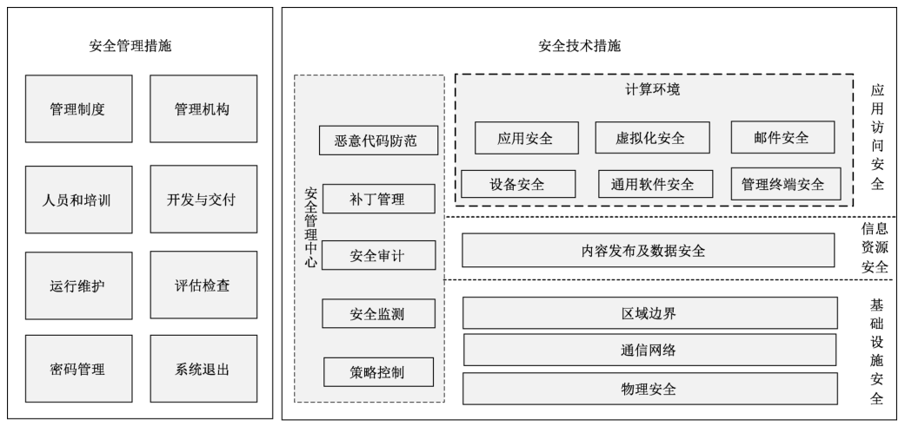
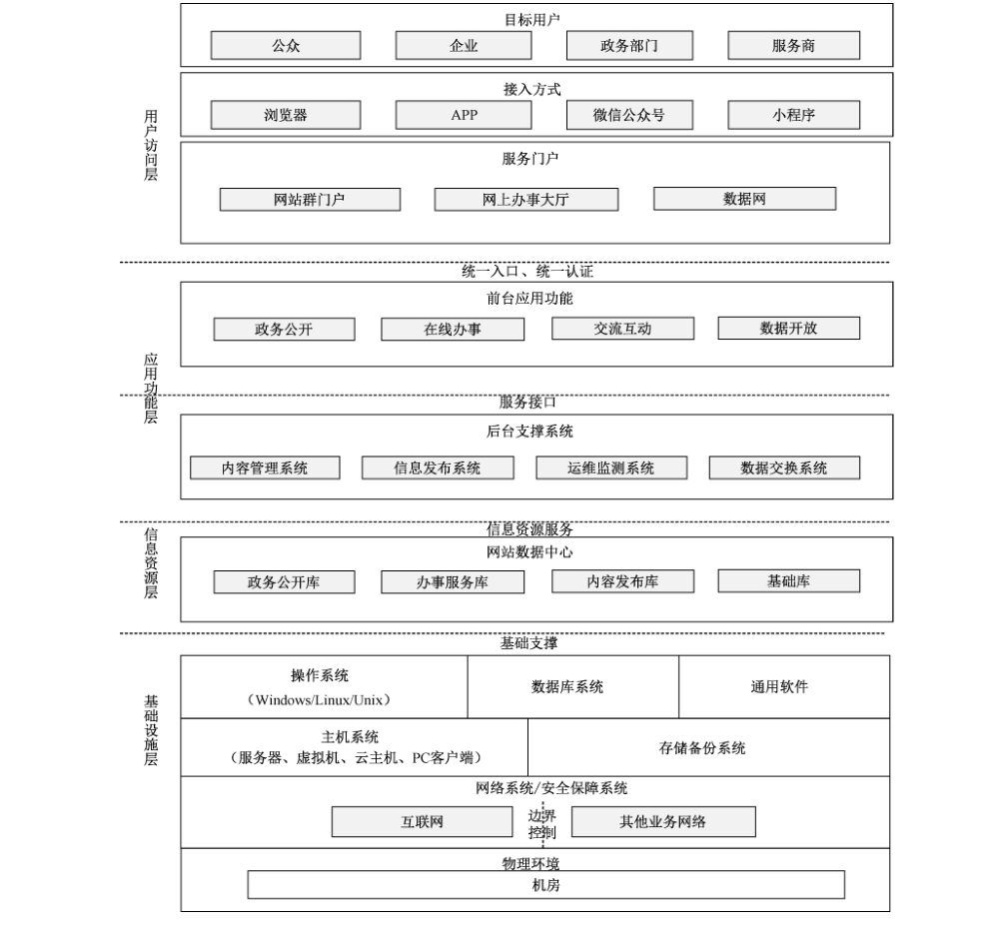

# GB/T 31506-2022 信息安全技术 政务网站系统安全指南

> 来源：[GB/T 31506-2022 国家标准详情](https://openstd.samr.gov.cn/bzgk/std/newGbInfo?hcno=A5239F1C999E046AC91815C231942E81)。
> PDF SHA-256：b89ec9e6cab00a624ab8a957886145392b0e132e08aee8d062f7e194464490db。
> 转写说明：对照官方 PDF 的全部 26 页图像整理；省略封面、目录、页眉、页脚和页码，并合并跨页内容。原文黑体标示增强级增加或增强的措施，以下用 **粗体** 保留。正式引用请核对官方 PDF。

## 前言

本文件按照 GB/T 1.1—2020《标准化工作导则 第1部分：标准化文件的结构和起草规则》的规定起草。

本文件代替 GB/T 31506—2015《信息安全技术 政府门户网站系统安全技术指南》，与 GB/T 31506—2015 相比，除结构调整和编辑性改动外，主要技术变化如下：

- 结合标准名称变更及内容，在范围中增加了安全管理措施等内容（见第1章）；

- 更改了3.1～3.3的术语和定义（见第3章，2015年版的3.1～3.3）；

- 增加了全文中的英文缩略语（见第4章）；

- 重新描述了第5章概述，删除了网站系统逻辑结构和网站系统组成结构，更改了网站安全目标和防护措施以及运行模式的内容（见第5章，2015年版的第5章）；

- 调整分类为物理安全、通信网络、区域边界、内容发布及数据安全、计算环境、安全管理中心、管理制度、管理机构、人员和培训、开发与交付、运行维护、评估检查、密码管理、系统退出（见第6章和第7章，2015年版的第6章和第7章）；

- 完善了各分类中具体安全防护措施内容（见第6章和第7章，2015年版的第6章和第7章）；

- 删除了附录A（规范性附录）高级安全技术措施（2015年版的附录A）。

请注意本文件的某些内容可能涉及专利。本文件的发布机构不承担识别这些专利的责任。

本文件由全国信息安全标准化技术委员会（SAC/TC 260）提出并归口。

本文件起草单位：北京信息安全测评中心、中电数据服务有限公司、首都之窗运行管理中心、中电长城网际系统应用有限公司、黑龙江省网络空间研究中心、北京市城乡经济信息中心、杭州安恒信息技术股份有限公司、北京天融信网络安全技术有限公司、桂林电子科技大学、湖北省标准化与质量研究院、陕西省信息化工程研究院、新华三技术有限公司、深圳开源互联网安全技术有限公司、武汉网安教育科技有限公司、国家应用软件产品质量检验检测中心、北京神州绿盟科技有限公司、北京数字认证股份有限公司、国家工业信息安全发展研究中心、北京北信源软件股份有限公司、国家计算机网络应急技术处理协调中心、远江盛邦（北京）网络安全科技股份有限公司、恒安嘉新（北京）科技股份公司、山谷网安科技股份有限公司、上海市信息安全测评认证中心、陕西省网络与信息安全测评中心、江苏省电子信息产品质量监督检验研究院（江苏省信息安全测评中心）、中国科学院信息工程研究所、四川省信息安全测评中心、北京知道创宇信息技术股份有限公司、上海观安信息技术股份有限公司。

本文件主要起草人：刘海峰、李媛、赵章界、左晓栋、李晨旸、闵京华、周亚超、高磊、舒敏、李珣、吕延辉、张法盛、于晓燕、马遥、贺海、林明峰、丁勇、顾鑫、王坤、杨洪起、潘正泰、李振宇、查文静、王颉、菅志刚、王彩虹、刘兴安、傅大鹏、田丽丹、刘为华、左洪强、郑明、孙科、于忠臣、江寰、万晓兰、刘中、王文磊、刘玉岭、张腾标、杨京、王丹琛、徐佟海、谢江、姚金龙、安高峰、杨勃、李慧颖、姜政伟、万耀东、徐春蕾。

本文件及其所代替文件的历次版本发布情况为：

- 2015年首次发布为 GB/T 31506—2015；

- 本次为第一次修订。

> 转写注：官方前言写作“3.1～3.3”，本版第3章实际仅列3.1和3.2两条，以上依原文保留。

## 1 范围

本文件给出了在对政务网站系统实施安全防护时可采取的安全技术措施和安全管理措施。

本文件适用于指导政务部门开展网站系统安全防护工作，也可作为对政务网站系统实施安全监督管理和评估检查时的参考。

## 2 规范性引用文件

下列文件中的内容通过文中的规范性引用而构成本文件必不可少的条款。其中，注日期的引用文件，仅该日期对应的版本适用于本文件；不注日期的引用文件，其最新版本（包括所有的修改单）适用于本文件。

- GB/T 8566—2007 信息技术 软件生存周期过程

- GB/T 25069 信息安全技术 术语

- GB/T 30998—2014 信息技术 软件安全保障规范

- GB/T 31168 信息安全技术 云计算服务安全能力要求

- GB/T 32925—2016 信息安全技术 政府联网计算机终端安全管理基本要求

- GB/T 33562—2017 信息安全技术 安全域名系统实施指南

- GB/T 35273—2020 信息安全技术 个人信息安全规范

- GB/T 36637—2018 信息安全技术 ICT 供应链安全风险管理指南

- GB/T 37002—2018 信息安全技术 电子邮件系统安全技术要求

- GB/T 37729—2019 信息技术 智能移动终端应用软件（APP）技术要求

- GB/T 38249—2019 信息安全技术 政府网站云计算服务安全指南

- GB/T 38645—2020 信息安全技术 网络安全事件应急演练指南

- GB/T 39477—2020 信息安全技术 政务信息共享 数据安全技术要求

- GB/T 39786—2021 信息安全技术 信息系统密码应用基本要求

- GB 50174—2017 数据中心设计规范

## 3 术语和定义

GB/T 25069界定的以及下列的术语和定义适用于本文件。

### 3.1 政务网站系统 website system of government affairs

政务部门为对外发布政务信息、提供在线服务、开展互动交流等建立的网站应用系统及支撑其运行的物理环境、网络环境、软硬件及产生和发布的信息等组成的信息系统。

### 3.2 云计算平台 cloud computing platform

云服务商提供的云基础设施及其上的服务软件的集合。

［来源：GB/T 31167—2014,3.7］

## 4 缩略语

下列缩略语适用于本文件。

API：应用程序编程接口（Application Programming Interface） 
APP：移动互联网应用程序（Mobile Internet Application） 
CDN：内容分发网络（Content Delivery Network） 
CPU：中央处理器（Central Processing Unit） 
DDoS：分布式拒绝服务（Distributed Denial of Service） 
DNS：域名系统（Domain Name System） 
FTP：文件传输协议（File Transfer Protocol） 
HTTPS：超文件传输安全协议（Hypertext Transfer Protocol Secure） 
HTTP：超文本传输协议（Hypertext Transfer Protocol） 
IDC：互联网数据中心（Internet Data Center） 
IP：互联网协议（Internet Protocol） 
IPSec：互联网协议安全（Internet Protocol Security） 
IT：互联网技术（Internet Technology） 
MAC：介质访问控制层（Media Access Control） 
PV：页面浏览量（Page View） 
SFTP：安全文件传送协议（Secret File Transfer Protocol） 
SQL：结构化查询语言（Structured Query Language） 
SSH：安全外壳协议（Secure Shell） 
SSL：安全套接层（Secure Sockets Layer） 
UPS：不间断电源（Uninterruptible Power System） 
VLAN：虚拟局域网（Virtual Local Area Network） 
VPN：虚拟专用网（Virtual Private Network） 
WWW：万维网（World Wide Web）

> 转写注：官方 PDF 第2页的 HTTPS 中文释义“超文件传输安全协议”、IT 释义“互联网技术（Internet Technology）”及 SFTP 英文释义“Secret File Transfer Protocol”均依原文保留。

## 5 概述

### 5.1 安全目标及防护措施

#### 5.1.1 安全目标

政务网站系统由于其代表政务部门的特殊属性，与普通网站相比更容易遭到来自互联网的攻击。

攻击者为了破坏政务形象、干扰政务工作秩序或窃取政务部门敏感信息，可能采用Web 应用攻击、拒绝服务攻击、暴力破解攻击、上传恶意木马等方式，实现篡改网页、中断服务、窃取信息、控制网站及感染访问用户等攻击目标。因此，政务网站系统的安全防护工作应重点实现以下目标：

<ol type="a">
  <li>
    提升网页防篡改及监测、恢复能力，降低网页被篡改的安全风险；
  </li>
  <li>
    提高抵抗拒绝服务攻击的能力及系统可用性，降低网站服务中断的风险；
  </li>
  <li>
    提高入侵防护能力，强化数据安全管控措施，降低网站敏感信息泄露的安全风险；
  </li>
  <li>
    构建纵深防御体系，降低网站被恶意控制的风险；
  </li>
  <li>
    采取网站防假冒措施，降低网站被仿冒的安全风险。
  </li>
</ol>

#### 5.1.2 安全措施概述

根据政务网站系统的结构组成（见附录A），结合对政务网站系统的安全风险分析，政务网站系统的安全防护措施应包括安全技术措施（包括安全管理中心）和安全管理措施两个部分。针对构成政务网站系统结构的基础设施层、信息资源层、应用和访问层等层面存在的脆弱性，分层给出相应的安全技术措施，其中应用访问安全、信息资源安全和基础设施安全中的相关内容共同构成网站系统中计算环境的安全保障措施。安全管理中心是通过技术措施配合管理手段共同建立主动防御能力的安全措施部分，实现对恶意代码、补丁升级、审计数据、策略管理、设备运行状况及安全事件等集中式的分析与管控。结合政务网站系统的建设、运维、退出等生命周期主要环节的安全防护需求，给出相应的安全管理措施，如图1所示。

#### 5.1.3 安全措施级别选择

本文件中的政务网站系统安全措施按其保障强度可划分为基本级安全措施、增强级安全措施两个措施等级。各单位可参考附录B，依据政务网站系统的行政级别、访问量、注册用户数、业务重要度和信息敏感度选择相应强度级别的安全措施。

在本文件中，黑体字部分表示高等级安全措施中增加或增强的内容，即对于满足任意一条级别选择指标要求的政务网站系统，宜按附录C中的增强级安全措施进一步加强防护。

### 5.2 常见运行模式及安全责任划分

根据实际运行情况，政务网站系统可分为以下三种主要运行模式。

<ol type="a">
  <li>
    自建自管模式：单位将网站服务器或虚拟服务器部署在自建的机房内并组织管理。单位对网站系统拥有资产管理权和安全管理责任。
  </li>
  <li>
    主机托管模式：单位将网站服务器或虚拟服务器委托专业的运营机构或互联网数据中心（IDC）来管理。受托机构负责物理数据中心基础设施的安全，单位对网站系统各种硬件、软件和网络等资产拥有管理权和安全管理责任。
  </li>
  <li>
    主机租用模式：单位未设立网站服务器，租用服务商的服务器或虚拟服务器。服务商负责云平台等基础设施安全，包括物理机房、IT 设备（如服务器、网络等），以及各种云产品（如云存储、数据库等）等。单位基于服务商提供的服务构建网站应用系统，综合运用服务商产品的安全功能、安全服务以及第三方安全产品等保护网站系统。
  </li>
</ol>

## 6 安全技术措施

### 6.1 物理安全

政务网站系统的物理环境安全措施包括：

<ol type="a">
  <li>
    通过机房门禁系统、视频监控、动力监控、温湿度监控、UPS电源等保障机房场地设施和周围环境及消防安全，满足24h不间断运行的要求，例如机房出入口及重要区域配置电子门禁系统，以便控制、鉴别和记录人员出入；
  </li>
  <li>
    采取双路供电等防护机制，保证电力设施的稳定；
  </li>
  <li>
    采用有效方法防范对信息传输线路的物理接触，如将通信线缆铺设在地下或管道内等隐蔽处，以防止传输过程中的数据篡改、干扰以及对线缆的物理破坏；
  </li>
  <li>
    电源线和通信线缆隔离铺设，避免互相干扰；
  </li>
  <li>
    对进入机房操作政务网站系统关键设备或平台的行为采取安全控制措施，如物理访问授权、专人操作、陪同和监视等；
  </li>
  <li>
    机房场地在防火、防水、防震、防盗、防静电、防雷、温湿度控制等方面应符合GB 50174—2017等国家标准中的相应要求；
  </li>
  <li>
    <strong>对于业务连续性要求更高的政务网站系统，可采用与电力供应商签订电力紧急支援协议、“两地三中心”等供电措施；</strong>
  </li>
  <li>
    <strong>关键区域宜避免外部人员访问，并对活动行为进行实时监视和记录等。</strong>
  </li>
</ol>

### 6.2 通信网络

#### 6.2.1 网站部署

政务网站系统的部署安全措施包括：

<ol type="a">
  <li>
    将服务政务网站系统业务运行、数据存储和处理的物理设备、运维和运营系统等部署、运维于中国境内；
  </li>
  <li>
    政务网站系统如采用主机托管或主机租用方式建设运行，宜优先选择由当地政府集中建设的数据中心，数据中心建设按照6.1中所列安全措施落实；
  </li>
  <li>
    政务网站系统采用主机托管或主机租用方式建设运行时，由网站系统的主管单位明确本单位和数据中心双方的安全责任边界以及建立对网站系统运行环境、安全措施运行情况的监督机制；
  </li>
  <li>
    政务网站系统使用云计算服务时，为网站系统搭建独立的资源池，实现与其他政务组织租户、非政务组织租户资源的安全隔离；
  </li>
  <li>
    政务网站系统的 Web 前台应用程序、后台管理系统与数据库系统宜分开部署，避免因Web应用程序漏洞或缺陷导致数据库数据泄漏或遭受破坏；
  </li>
  <li>
    <strong>政务网站系统的数据库与其他信息系统数据库宜分开部署，对于共用数据库管理系统的，通过设置数据库管理系统的身份鉴别、权限控制策略等方式，实现网站系统的数据库与其他应用的数据库系统之间的安全隔离。</strong>
  </li>
</ol>

#### 6.2.2 通信安全

政务网站系统的通信安全措施包括：

<ol type="a">
  <li>
    使用内容分发网络（CDN）服务时，禁止服务商将境内用户的域名解析地址指向境外节点；CDN 域名采用抗拒绝服务攻击、Web 应用检测、内容安全等措施，防止 CDN 页面被篡改；
  </li>
  <li>
    支持政务网站系统运营者提供专线或VPN接入，支持网络带宽优先级分配，提供双栈的域名解析安全防护能力；
  </li>
  <li>
    政务网站系统相关服务器使用私有 IP 地址，可通过边界防火墙或路由器实现私有 IP 地址与互联网 IP 地址之间的地址转换；
  </li>
  <li>
    建立完善的 IP 地址使用、绑定管理等防地址欺骗策略，包括但不限于仅允许指定的 IP 地址访问网站服务器提供的内容管理、系统管理等服务和端口等；
  </li>
  <li>
    限制对 Web 服务器、数据库服务器等重要服务器、边界隔离设备及云计算平台的远程管理。确需进行远程管理时，采用 SSH 等安全方式，并增加系统管理员账号鉴别口令的强度和更新频率，对系统管理员的操作行为进行审计和记录；
  </li>
  <li>
    <strong>对远程管理的系统管理员采用数字证书等高强度鉴别方式进行身份认证；</strong>
  </li>
  <li>
    <strong>对重要服务器采取IP 地址、MAC地址绑定措施，以防范地址欺骗。</strong>
  </li>
</ol>

#### 6.2.3 性能保障

政务网站系统的性能保障安全措施包括：

<ol type="a">
  <li>
    分析政务网站系统的性能需求，从网络带宽、冗余部署、服务器的处理能力、应用程序的并发处理能力等方面对网站性能予以保障；
  </li>
  <li>
    支撑政务网站系统运转的关键设备提供硬件冗余措施，关键设备包括但不限于出口路由器、核心交换机、应用及数据库服务器等；
  </li>
  <li>
    政务网站系统对外提供服务的互联网独享带宽不宜低于 100 Mbps；共享带宽条件下，网站互联网出口 HTTP/HTTPS 协议带宽不宜低于 100 Mbps；
  </li>
  <li>
    若政务网站系统访问量较大或提供在线视频等服务，可以依据网站的日均页面访问量（次）及业务高峰期（包括，日高峰及高峰日）访问量酌情调整出口带宽；
  </li>
  <li>
    <strong>对于业务量较大的政务网站系统，对外提供服务的互联网独享带宽不宜低于 200 Mbps；共享带宽条件下，网站互联网出口 HTTP/HTTPS 协议带宽不宜低于 200 Mbps；政务网站系统对外提供服务的抗拒绝服务攻击能力，流量带宽不宜低于 300G；</strong>
  </li>
  <li>
    <strong>政务网站系统采用负载均衡、分布式部署等方式实现多应用服务器之间、多数据库服务器之间等的负载均衡；</strong>
  </li>
  <li>
    <strong>至少部署2条由不同互联网接入服务商提供的互联网接入链路等方式实现关键链路的冗余部署。</strong>
  </li>
</ol>

#### 6.2.4 域名安全

##### 6.2.4.1 域名管理安全

政务网站系统的域名管理安全措施包括：

<ol type="a">
  <li>
    政务网站自建域名系统及域名的使用和管理等应符合国家法规政策与标准相关要求；
  </li>
  <li>
    选择主管部门批准的域名注册服务机构进行域名注册和域名托管，并进行域名信息备案；禁用未备案域名；
  </li>
  <li>
    指定专人对域名信息进行管理，妥善保存域名系统或第三方域名托管平台的用户名及口令信息；
  </li>
  <li>
    遵循国家有关监督审批流程开展域名变更、解析地址变更等工作；
  </li>
  <li>
    规范域名信息的变更管理，当域名信息发生变化时，经审核批准后，由指定专人负责实施并及时记录。
  </li>
</ol>

##### 6.2.4.2 域名系统安全

政务网站系统的域名系统安全措施包括：

<ol type="a">
  <li>
    为政务网站系统提供域名服务的域名系统按照 GB/T 33562—2017进行安全防护；
  </li>
  <li>
    为域名服务提供冗余备份机制等措施，减少来自拒绝服务攻击的影响；
  </li>
  <li>
    定期对政务网站系统域名服务进行检查评估，及时发现域名被劫持、被冒用等安全问题并处置。
  </li>
</ol>

### 6.3 区域边界

政务网站系统的区域边界安全措施包括：

<ol type="a">
  <li>
    对政务网站系统在网络边界处实施有效隔离，配置合理的边界访问控制策略；例如，仅允许互联网用户访问网站服务器提供的 HTTP 和 HTTPS 服务等指定的服务和端口；
  </li>
  <li>
    采取网络控制措施防止非授权设备连接服务政务网站系统的内部网络，并限制政务网站系统中的服务器、虚拟服务器主动访问单位内部网络，仅允许访问单位内部网络提供的指定交互业务、补丁更新、病毒库升级等服务；
  </li>
  <li>
    采取技术措施防止政务网站系统中的服务器非授权外联，例如采用非授权外联检测和阻断机制等；
  </li>
  <li>
    当政务网站系统建设使用云计算服务时，在虚拟网络边界设置访问控制规则，并自行划分子网，部署访问控制策略，实现虚拟机之间、虚拟机与资源管理系统之间、虚拟机与外部网络之间的安全访问控制；
  </li>
  <li>
    通过网络安全隔离措施的设置，实现服务政务网站系统的业务网络、数据网络与管理网络安全隔离，并按照安全需求划分为不同的网络区域；
  </li>
  <li>
    根据实际访问需求划分安全域，并合理配置相应的安全域边界访问控制策略，例如采用在交换设备上划分 VLAN 或部署安全域边界防火墙等方式实现政务网站系统所在安全域与其他业务系统所在安全域之间的逻辑隔离；
  </li>
  <li>
    在政务网站系统的网络边界部署抗拒绝服务攻击、Web 应用防护系统等，对用户请求进行扫描过滤、分析并校验，对无效或有攻击行为的请求进行阻断或隔离；
  </li>
  <li>
    <strong>在会话处于非活跃状态5 min 后或会话结束后及时终止网络连接；</strong>
  </li>
  <li>
    <strong>通过部署 IPv4-IPv6 协议转换器、支持IPv6协议的安全设备等，提高网络协议的适应性。</strong>
  </li>
</ol>

### 6.4 内容发布及数据安全

#### 6.4.1 标识安全

利用防伪技术等确保政务网站标识不被恶意篡改，符合全国党政机关事业单位互联网网站标识管理服务的相关规定。

#### 6.4.2 内容发布安全

政务网站系统的内容发布安全措施包括：

<ol type="a">
  <li>
    采用包括 Web 应用、APP 程序或公众号等新媒体形式发布内容时，支持内容发布、撤销、推送、转载、链接的审核功能，以及网站内容编辑与审核发布权限分离功能；
  </li>
  <li>
    仅面向经实名身份验证的注册用户提供信息发布功能，且提供信息经审核人员审核后才能发布的功能选项；
  </li>
  <li>
    对于已发布的内容进行监控，禁止发布违法和违反社会道德规范的内容；
  </li>
  <li>
    <strong>提供技术手段辅助进行网站发布内容的过滤。</strong>
  </li>
</ol>

#### 6.4.3 个人信息安全

政务网站系统参照 GB/T 35273—2020 对其掌握的个人信息、个人敏感信息（含14岁以下儿童个人信息等）进行分类和识别，并按照 GB/T 35273—2020 中规定的有关要求实施防护。

#### 6.4.4 网页防篡改

利用网页防篡改系统、人工自检或第三方安全服务等方式**实时**探测网站内容，发现黑客、黑页、暗链、页面篡改等行为，并迅速处置。

#### 6.4.5 传输和存储

政务网站系统的数据传输和存储安全措施包括：

<ol type="a">
  <li>
    采用密码技术与安全通信协议实现身份鉴别信息、配置参数、业务数据、管理数据等重要数据在传输和存储时的信息保密性及完整性；
  </li>
  <li>
    政务网站系统数据及备份数据与其他业务系统数据宜隔离存储；
  </li>
  <li>
    文件、目录和数据库等资源所在的存储空间被释放或重新分配给其他租户前完全清除；
  </li>
  <li>
    政务网站系统收集、存储、处理、共享交换、销毁政务数据时，按照 GB/T 39477—2020中6.2规定的有关技术要求实施防护；
  </li>
  <li>
    <strong>针对重要通信过程推荐基于硬件化的设备实现加解密运算和密钥管理。</strong>
  </li>
</ol>

#### 6.4.6 备份和容灾

政务网站系统的备份和容灾安全措施，包括：

<ol type="a">
  <li>
    制定并执行备份策略，记录数据的备份方式、存放位置、备份时间、备份频度等；
  </li>
  <li>
    支持业务应用和备份数据的恢复测试，验证应用和数据的有效性；
  </li>
  <li>
    删除因业务终止、迁移数据、合同终止等遗留的数据及备份数据，日志留存时间不少于180 d；
  </li>
  <li>
    周期性测试备份系统和备份数据，支持故障识别和备份重建；
  </li>
  <li>
    对数据容灾和系统容灾按照统筹规划、共建共享的原则集中实施，避免单独建设；
  </li>
  <li>
    <strong>制定灾难恢复计划，并对计划进行测试，测试内容包括运行系统恢复、人员协调、通信连接等；并根据测试结果，对不适用的规定进行修改或更新。</strong>
  </li>
</ol>

### 6.5 计算环境

#### 6.5.1 设备安全

政务网站系统的设备安全措施包括：

<ol type="a">
  <li>
    采购和使用符合国家有关规定的设备，设备类型包括但不限于网络设备、安全设备、密码设备、服务器和存储等；
  </li>
  <li>
    配置并启用有效的身份鉴别复杂度和访问控制等安全措施；
  </li>
  <li>
    启用设备的安全审计功能，配置覆盖重要用户行为和重要安全事件的审计策略，并对审计进程和审计记录进行保护；
  </li>
  <li>
    遵循最小安装原则，关闭不需要的系统服务、默认共享和高危端口；限制管理终端的接入方式或网络地址范围，提供人机接口或通信接口的数据有效性校验措施；
  </li>
  <li>
    能够发现存在的已知漏洞，并在经过充分测试评估后及时修补漏洞；
  </li>
  <li>
    采用使设备免受恶意代码攻击的技术措施，及时识别入侵和病毒行为，并有效将其阻断；
  </li>
  <li>
    <strong>采用密码技术如校验技术，对设备的资源访问控制信息、重要信息敏感标记、日志记录等进行完整性保护；</strong>
  </li>
  <li>
    <strong>采用密码技术对设备中承载的鉴别信息、敏感数据进行加密保护。</strong>
  </li>
</ol>

#### 6.5.2 通用软件安全

##### 6.5.2.1 操作系统安全

政务网站系统的操作系统安全措施包括：

<ol type="a">
  <li>
    操作系统遵循最小安装原则，仅安装应用必需的服务、组件、软件等，并开启业务所需的最少服务及端口；
  </li>
  <li>
    采用用户名/口令等鉴别机制实现操作系统用户身份鉴别，口令由大小写字母、数字及特殊字符中三种或三种以上组成，普通用户的口令长度不宜短于8个字符，系统管理员用户的口令长度不宜短于10个字符，且每半年至少修改一次；
  </li>
  <li>
    设置登录延时、限制最大失败登录次数、锁定账号等措施，防范口令暴力破解攻击；
  </li>
  <li>
    及时清除或锁定操作系统的无用账号、默认账号，禁止多人共用同一个系统账号；
  </li>
  <li>
    设置必要的访问控制，为不同用户授予其完成各自承担任务所需的最小权限，限制超级管理员等默认角色或用户的访问权限，仅授予普通用户打开文件和更改指定文件的权限等；
  </li>
  <li>
    实现操作系统的安全审计，并支持日志的集中收集和存储；
  </li>
  <li>
    <strong>选择安全操作系统或根据网站系统性能、可用性、安全要求等需求对操作系统、镜像进行定制（包括：内核、服务、应用、端口等），或借助第三方机构对操作系统、镜像进行安全加固；</strong>
  </li>
  <li>
    <strong>重要服务器操作系统可采用两种或两种以上组合的鉴别技术实现用户身份鉴别（动态口令、数字证书等）；普通用户和系统管理员用户的口令长度均不宜短于10个字符，口令由大小写字母、数字及特殊字符中三种或三种以上组成，且每三个月至少修改一次；</strong>
  </li>
  <li>
    <strong>在不同用户之间形成权限相互制约关系，例如系统管理员、安全管理员、安全审计员、普通用户等。</strong>
  </li>
</ol>

##### 6.5.2.2 数据库安全

政务网站系统的数据库安全措施包括：

<ol type="a">
  <li>
    数据库系统遵循最小安装原则，仅安装应用必需的服务、组件等，并开启业务所需的最少服务及端口；
  </li>
  <li>
    采用用户名/口令等鉴别机制实现数据库系统用户身份鉴别，口令由大小写字母、数字及特殊字符中三种及三种以上组成，普通用户的口令长度不宜短于8个字符，系统管理员用户的口令长度不宜短于10个字符，且每半年至少修改一次；
  </li>
  <li>
    设置登录超时、限制最大失败登录次数，锁定账号等措施，防范口令暴力破解攻击；
  </li>
  <li>
    及时修改数据库系统的默认密码，及时清除或锁定数据库系统的无用账号、默认账号，禁止多人共用同一个数据库系统帐号；禁止政务网站应用访问数据库服务与其他操作共用同一个数据库系统账号；
  </li>
  <li>
    设置必要的访问控制，为不同用户授予其完成各自承担任务所需的最小权限，限制超级管理员等默认角色或用户的访问权限，限制普通应用用户拥有数据库级别访问权限等；
  </li>
  <li>
    当政务网站系统使用云计算服务时，设定仅允许服务器从虚拟网络内部访问数据库服务；
  </li>
  <li>
    设置IP白名单，仅允许指定源IP 访问用户的数据库实例服务；
  </li>
  <li>
    实现数据库系统的安全审计，并支持日志的集中收集和存储；
  </li>
  <li>
    <strong>选择安全数据库系统或根据网站系统性能、可用性、安全要求等需求对数据库系统进行定制（包括：内核、服务、应用、端口等），或借助第三方机构对数据库系统进行安全加固；</strong>
  </li>
  <li>
    <strong>重要数据库系统可采用两种或两种以上组合的鉴别技术实现用户身份鉴别（动态口令、数字证书等）；普通用户和系统管理员用户的口令长度均不宜短于10个字符，口令由大小写字母、数字及特殊字符中三种及三种以上组成，且每三个月至少修改一次；</strong>
  </li>
  <li>
    <strong>在不同用户之间形成权限相互制约关系，例如系统管理员、安全管理员、安全审计员、普通应用用户等。</strong>
  </li>
</ol>

##### 6.5.2.3 中间件安全

政务网站系统的中间件安全措施包括：

<ol type="a">
  <li>
    启用身份鉴别、访问控制和审计等安全功能，并合理设置安全策略，同时禁止以操作系统管理员权限启用中间件；
  </li>
  <li>
    遵循最小安装原则，仅安装应用必需的服务、组件，删除默认账户、示例文件等；
  </li>
  <li>
    提供基于安全网络协议的接入方式，并对管理控制台实施安全控制策略；
  </li>
  <li>
    对中间件不同服务的通信提供接口安全控制，实现对会话信息的加密存储；
  </li>
  <li>
    <strong>支持全生命周期的会话安全管理，包括会话的生成、隔离、保持、结束等环节，实现通信协议安全控制。</strong>
  </li>
</ol>

##### 6.5.2.4 开源软件组件安全

政务网站系统的开源软件组件安全措施包括：

<ol type="a">
  <li>
    选用来源可靠，版本完整、稳定的开源软件和开源组件，并进行策略配置和安全加固；
  </li>
  <li>
    开源软件和开源组件集成应用前，进行软件成分分析和安全检测，确保使用的开源软件和开源组件不存在已知漏洞；
  </li>
  <li>
    确保开源软件和开源组件许可信息持续有效；
  </li>
  <li>
    <strong>设置开源软件和开源组件的黑、白、灰名单，并及时进行名单分类更新；</strong>
  </li>
</ol>

注：黑名单用于记录和跟踪管理已禁止使用的开源软件和开源组件；白名单用于记录和跟踪管理可使用且已使用的开源软件和开源组件；灰名单用于记录和跟踪管理需谨慎使用的开源软件和开源组件。

#### 6.5.3 管理终端安全

政务网站系统的管理终端安全措施包括：

<ol type="a">
  <li>
    对政务网站系统管理终端、内容管理终端提供补丁升级、恶意代码防护、网络安全接入、身份认证、数据加密等安全保障措施，保证管理终端的安全防护水平符合 GB/T 32925—2016 等相关标准的要求；
  </li>
  <li>
    通过设定终端接入方式、网络地址范围等条件限制终端登录，能够对已接入的管理终端行为进行检查、定位、阻断等管理控制；
  </li>
  <li>
    根据安全策略启用或设置超时锁定功能；
  </li>
  <li>
    设置并启用管理终端的移动存储介质接入安全策略，检验移动存储介质的合法性，并对接入的移动存储介质进行恶意代码扫描；
  </li>
  <li>
    管理终端通过互联网访问服务器端时使用安全的网络协议，如 HTTPS、SFTP、SSH 等；
  </li>
  <li>
    <strong>对接入网站系统和云计算平台的管理终端实行安全状态检查，并限制未通过安全状态检查的管理终端接入；</strong>
  </li>
  <li>
    <strong>设置并启用管理终端外联控制策略，防止任何形式的非授权连接外部网络，并对管理终端未经授权的外联行为进行监测和处置。</strong>
  </li>
</ol>

#### 6.5.4 虚拟化安全

政务网站系统的虚拟化安全措施包括：

<ol type="a">
  <li>
    虚拟化资源管理系统遵循最小安装原则进行裁剪安装，仅安装需要的组件，去除非授权或无用的硬件模块驱动程序等；
  </li>
  <li>
    合理安装配置模板和镜像，确保不含恶意代码，租户操作系统由预先制定的镜像模板生成；对模板版本进行统一管理；
  </li>
  <li>
    管理员定期检查并及时废止停用的虚拟机，虚拟机的创建、配置修改、废止通过审批确认；
  </li>
  <li>
    采取安全措施部署物理服务器、虚拟服务器、操作系统镜像等。例如虚拟机镜像和快照备份在不同物理服务器等；
  </li>
  <li>
    采取加密或其他技术措施，防止非法访问虚拟机快照和镜像中可能存在的敏感数据；
  </li>
  <li>
    实现虚拟化平台的资源隔离，确保每个虚拟机能获得相对独立的物理资源，并且只能访问分配给该虚拟机的物理磁盘；
  </li>
  <li>
    支持对政务网站系统宿主机运维的权限控制，并记录该权限的所有操作日志；
  </li>
  <li>
    <strong>对虚拟机模板、镜像和快照等文件进行完整性检测，对完整性被破坏的文件要及时报警，并采取有效的数据恢复措施；</strong>
  </li>
  <li>
    <strong>不同虚拟机之间实现内存隔离，虚拟机的磁盘存储空间被释放或再分配给其他虚拟机前得到完全清除；</strong>
  </li>
  <li>
    <strong>虚拟机与物理机之间采取安全隔离措施，对虚拟机之间以及虚拟机和物理机之间的数据通信进行安全控制。</strong>
  </li>
</ol>

#### 6.5.5 应用安全

##### 6.5.5.1 身份鉴别

政务网站系统的应用身份鉴别安全措施包括：

<ol type="a">
  <li>
    对前台注册用户、后台内容管理用户及系统管理用户等不同类型的网站用户设置不同强度的鉴别机制；
  </li>
  <li>
    各用户至少采用用户名/口令机制进行身份鉴别并启用验证码机制，口令由大小写字母、数字及特殊字符中三种及三种以上组成，前台注册用户的口令长度不宜少于8个字符，后台内容管理用户及系统管理用户的口令长度不宜少于10个字符，且每半年至少更新一次；
  </li>
  <li>
    针对各类网站用户设置登录超时重鉴别、连续登录失败尝试次数阈值等措施，定期清理无用账号；
  </li>
  <li>
    <strong>选择高强度认证方式的前台注册用户、后台内容管理用户及系统管理用户宜采用两种或两种以上组合的鉴别技术实现用户身份鉴别（动态口令、生物认证、数字证书等），口令长度均不宜少于10个字符，且每三个月至少更新一次。</strong>
  </li>
</ol>

##### 6.5.5.2 权限管理

政务网站系统的应用权限管理安全措施包括：

<ol type="a">
  <li>
    提供访问控制功能，授予网站用户为完成各自承担任务所需的最小权限，限制默认角色或用户的访问权限；
  </li>
  <li>
    通过权限分配设置实现系统管理用户、内容编辑用户、内容审核用户等特权用户的权限分离；
  </li>
  <li>
    <strong>提供统一的鉴权机制，支持统一的角色管理，例如当采用分布式部署时确保同一角色的权限保持一致，防范不同权限用户之间的越权操作。</strong>
  </li>
</ol>

##### 6.5.5.3 应用审计

政务网站系统的应用安全审计措施包括：

<ol type="a">
  <li>
    针对前台用户的注册、登录、关键业务操作等行为进行日志记录，内容包括但不限于用户姓名、手机号码、注册时间、注册地址、登录时间、登录地址、操作用户信息、操作时间、操作内容及操作结果等；
  </li>
  <li>
    针对后台内容管理用户的登录、网站内容编辑、审核及发布等行为进行日志记录，内容包括但不限于用户登录时间、登录地址以及编辑、审核及发布等行为发生时的用户信息、时间、地址、内容和结果等；
  </li>
  <li>
    针对后台系统管理用户登录、账号及权限管理等系统管理操作进行日志记录，内容包括但不限于用户登录时间、登录地址以及管理操作对象、操作内容、操作结果等。
  </li>
</ol>

##### 6.5.5.4 业务交互

政务网站系统的业务交互安全措施包括：

<ol type="a">
  <li>
    建立网站应用系统与其他业务系统交互的数据列表，规范交互数据的内容及格式，并采用密码技术保证传输数据的机密性和完整性；
  </li>
  <li>
    采用身份认证、访问控制等安全措施提高业务数据交互过程的安全性；
  </li>
  <li>
    根据网站访问需求等限制最大并发会话连接数；
  </li>
  <li>
    与网站系统连接的接口采用身份认证机制，验证接口调用方身份的合法性，并对接口调用的数据进行合法性检测，防止非法上传行为；
  </li>
  <li>
    对与网站系统连接接口设定资源使用权限，限定可访问的数据范围，并记录接口调用过程的操作日志；
  </li>
  <li>
    针对Web 和 API 的接口调用，定期进行应用安全防护检测；
  </li>
  <li>
    <strong>对与网站系统连接接口采用加密机制，保证数据的保密性；</strong>
  </li>
  <li>
    <strong>设置与网站系统连接的会话生命周期，防止接口被恶意调用；</strong>
  </li>
  <li>
    <strong>限制 API 调用，如限制调用频率和使用白名单等；</strong>
  </li>
  <li>
    <strong>限制接口访问顺序，避免逻辑绕过某些权限控制；</strong>
  </li>
  <li>
    <strong>对需要进行责任认定的网站应用，宜采用数字签名、时间戳等密码技术实现操作行为的不可否认性。</strong>
  </li>
</ol>

##### 6.5.5.5 移动应用安全

政务网站系统通过移动应用程序提供服务时，按照 GB/T 37729—2019中4.7规定的有关技术要求实施防护。

#### 6.5.6 邮件安全

政务网站系统中使用的邮件系统按照 GB/T 37002—2018中规定的有关要求实施防护。

### 6.6 安全管理中心

#### 6.6.1 恶意代码防范

政务网站系统的恶意代码防范安全措施包括：

<ol type="a">
  <li>
    及时更新恶意代码防护软件版本和恶意代码特征库，例如在网络边界、宿主机、虚拟机、管理终端等位置采取恶意代码防范措施；
  </li>
  <li>
    将恶意代码防护软件设置为开机自动启动，实时检测恶意代码的上传行为，定期对网络和所有本地存储介质实施安全扫描，及时对接入介质、文件等进行安全扫描；
  </li>
  <li>
    支持对恶意代码防护软件自身的安全监测和防护；
  </li>
  <li>
    对恶意代码防范信息进行数据采集与上报；
  </li>
  <li>
    <strong>采用统一有效的恶意代码防范机制；</strong>
  </li>
  <li>
    <strong>对关闭恶意代码防护软件进程或修改其配置的行为进行监测。</strong>
  </li>
</ol>

#### 6.6.2 补丁管理

政务网站系统的补丁管理安全措施包括：

<ol type="a">
  <li>
    支持宿主机操作系统、虚拟机操作系统及虚拟化资源管理系统、数据库系统、中间件、开源软件和开源组件等的版本及补丁及时更新；
  </li>
  <li>
    定期开展系统漏洞扫描工作，及时发现软件漏洞，扫描频率不低于每季度一次；
  </li>
  <li>
    统一采购、部署正版软件以及相关服务，通过软件官方网站或其他合法渠道获得补丁程序，并在补丁程序通过安全测试后，及时实行补丁更新和版本升级；
  </li>
  <li>
    确认软件漏洞没有对应补丁的情况下，宜利用其他的脆弱性缓解技术或安全防御技术来预防恶意软件事件的发生；
  </li>
  <li>
    定期针对应用程序或代码等进行脆弱性扫描，及时发现 SQL 注入漏洞、跨站脚本漏洞、开放服务漏洞、网站第三方应用漏洞等，并及时进行修复处理；
  </li>
  <li>
    当应用程序的版本需要变更时，经过验证、审核及批准确认，并保存相应记录；
  </li>
  <li>
    <strong>采用集中管理方式统一进行软件下发、漏洞扫描、补丁安装等；</strong>
  </li>
  <li>
    <strong>支持系统内核补丁检测加固和防止内核提权。</strong>
  </li>
</ol>

#### 6.6.3 安全审计

政务网站系统的安全审计措施包括：

<ol type="a">
  <li>
    针对网络系统、操作系统、虚拟机、数据库系统及应用系统等实现安全审计，并根据统一安全策略进行审计；
  </li>
  <li>
    审计记录包括但不限于审计主体、范围、人员、责任、日期、时间、发起者信息、类型、描述和结果等内容；
  </li>
  <li>
    启用操作审计功能等实施安全审计，例如对操作系统及数据库系统远程管理、账号登录、策略更改、对象访问、服务访问、系统事件、账户管理等行为及 WWW、FTP 等重要服务访问进行审计，并设置审计日志文件大小的阈值以及达到阈值的处理方式（覆写、自动转存等）；
  </li>
  <li>
    审计功能覆盖到每个管理员，记录所有管理员的重要操作行为和对安全事件的处置等；
  </li>
  <li>
    严格控制系统变更，变更过程中保留不可更改的审计日志；
  </li>
  <li>
    针对安全审计记录及审计策略设置必要的访问控制，限制管理用户对审计数据的访问，实现管理用户和审计用户的权限分离，避免未授权的删除、修改或覆盖等；
  </li>
  <li>
    审计记录宜独立保存，并定期备份审计记录，记录及备份数据的保存时间不少于180 d；
  </li>
  <li>
    定期审查和调整审计策略；
  </li>
  <li>
    <strong>指定独立的安全审计人员负责管理审计记录，并采取密码措施保证记录文件的完整性；</strong>
  </li>
  <li>
    <strong>支持集中审计和第三方审计，确保系统时钟与时钟服务器保持同步。</strong>
  </li>
</ol>

#### 6.6.4 安全监测

政务网站系统的安全监测措施包括如下内容。

<ol type="a">
  <li>
    为政务网站各类安全系统，包括防病毒管理系统、VPN 系统、Web 应用防护系统、加解密系统、登录认证系统、虚拟资源隔离和防护系统、安全审计系统等，提供定期检查和监测服务，监测政务网站系统服务的资源、重要行为、运行状态、安全事件等，并对异常状况进行报警和阻断。包括但不限于：
    <ol>
      <li>监测域名服务器（DNS）可用性，及时发现域名服务是否正常；</li>
      <li>对网络通信状况的监测，能够发现攻击行为和非授权的访问连接；</li>
      <li>对系统运行环境的监测，包括CPU、内存、存储、数据库、带宽实际使用情况；</li>
      <li>对系统运行状态的监测，探测网站可用性，及时发现断网、访问慢、服务异常等可用性问题；</li>
      <li>对 DDoS 攻击、注入、跨站、Webshell、扫描器、敏感信息泄露、盗链等应用攻击进行监测和<strong>防御</strong>，防止政务网站系统出现拒绝服务、篡改、信息泄露等安全问题；</li>
      <li>利用木马监控系统或第三方安全服务等方式实时发现并处置网站挂马事件；</li>
      <li><strong>对域名解析的正确性、域名服务器边界网络设备的流量及数据包等的监测，以发现可能的恶意攻击</strong>；</li>
      <li><strong>针对网站访问行为等关键业务操作进行监测和识别，发现异常访问时及时告警</strong>；</li>
      <li><strong>通过限制非注册用户访问行为、限制单个 IP 的访问间隔、访问次数等方式及时发现并阻断网页爬虫等攻击</strong>；</li>
      <li><strong>关联威胁情报库或通过流量、行为审计等技术，识别攻击常用域名、IP 地址等信息，记录并分析攻击者行为，对恶意攻击者 IP 地址等进行阻断</strong>；</li>
      <li>当威胁系统的环境发生变化，应用系统风险增加时，宜提升应用系统监测级别。</li>
    </ol>
  </li>
  <li>
    定期对网站应用程序、操作系统及数据库、管理终端等进行全面扫描，根据扫描结果判断网站存在的安全风险，及时调整监测策略。
  </li>
  <li>
    监测活动应符合个人信息保护的相关政策法规。
  </li>
  <li>
    监控数据宜存放在可持久化保存的设备上，存放时间不少于180d。
  </li>
  <li>
    组织相关人员定期对审计、监测和告警数据等进行查询、分析、统计，及时发现可疑行为。
  </li>
  <li>
    <strong>设置统一的安全运营平台，实现a）中的安全防护措施。</strong>
  </li>
  <li>
    <strong>当网站系统处于被篡改等紧急状况下，支持一键关闭等应急措施，防止事故影响进一步扩大。</strong>
  </li>
  <li>
    <strong>支持通过手机 APP 实时查看网站的监测信息，并能通过手机 APP 下发指令。</strong>
  </li>
  <li>
    <strong>定期形成监测分析报告。</strong>
  </li>
</ol>

#### 6.6.5 策略控制

政务网站系统的策略控制安全措施包括：

<ol type="a">
  <li>
    基于角色设置系统管理员、审计管理员、安全管理员等用户，并针对不同用户采取身份鉴别、访问控制、行为审计等措施；
  </li>
  <li>
    系统管理员用户对网站系统的资源和运行状况等进行配置、控制和管理操作，包括但不限于用户身份、系统资源配置、系统加载和启动、系统运行的异常处理、数据和设备的备份与恢复等；
  </li>
  <li>
    审计管理员用户对审计记录进行分析，并根据分析结果进行处理，包括但不限于根据安全审计策略对审计记录进行存储、管理和查询等；
  </li>
  <li>
    网站资产运维提供统一入口，仅通过特定可审计可授权的设备进行运维管理；
  </li>
  <li>
    对运维人员进行权限控制，管理员的运维操作权限经多级安全审批确认并固化命令级规则；
  </li>
  <li>
    详细记录运维人员操作日志，包括日常巡检工作、运行维护记录、参数的设置和修改等内容；
  </li>
  <li>
    <strong>安全管理员用户对网站系统中的安全策略进行配置，包括但不限于安全参数的设置、授权、安全配置检查和保存等；</strong>
  </li>
  <li>
    <strong>超级用户口令宜分角色分段管理，由安全管理员和安全审计员保存；</strong>
  </li>
  <li>
    <strong>系统账号宜集中统一管理，并具备完善的使用管控流程，确保使用前审批、使用中监管、使用后回收；</strong>
  </li>
  <li>
    <strong>对管理员的非固化操作实时审计告警；</strong>
  </li>
  <li>
    <strong>支持运维操作会话过程重现。</strong>
  </li>
</ol>

## 7 安全管理措施

### 7.1 管理制度

政务网站系统的安全管理制度包括：

<ol type="a">
  <li>
    建立由安全策略、管理制度、操作规程、记录表单等构成的网络安全管理体系；
  </li>
  <li>
    根据政务网站系统安全管理活动中的各类管理需求来建立安全管理制度，包括但不限于运行安全管理制度、通信与安全操作管理制度、访问控制管理制度、账号与口令管理制度、密码安全管理制度、安全审计管理制度、病毒及防护制度、补丁管理制度、安全事件管理制度、个人信息保护制度、安全监测管理制度等；
  </li>
  <li>
    通过正式、有效的方式发布安全管理制度，并进行版本控制；
  </li>
  <li>
    建立网络安全管理制度体系持续改进机制，定期论证和审定安全管理制度的合理性及适用性，修订存在不足或需要改进的安全管理制度。
  </li>
</ol>

### 7.2 管理机构

政务网站系统的安全管理机构包括：

<ol type="a">
  <li>
    成立由单位主管领导委任或授权的网络安全领导小组（委员会），负责设立和管理政务网站系统网络安全管理工作的职能部门、定义部门及负责人职责；
  </li>
  <li>
    设立系统管理员、网络管理员、审计管理员、安全管理员、密码管理员、内容审核员等岗位，并定义各个工作岗位职责；
  </li>
  <li>
    <strong>安全管理员不可兼任；</strong>
  </li>
  <li>
    建立与网络安全管理部门、职能部门、安全组织、供应商和业界专家等的联系名录，明确合作的方式和内容等，以建立与业界的协作与沟通。
  </li>
</ol>

### 7.3 人员和培训

政务网站系统对人员的安全管理措施包括：

<ol type="a">
  <li>
    在授予各类管理人员相应权限之前，对其进行人员背景审查、资质审查及能力考核，并定期复查和签署保密协议；
  </li>
  <li>
    在被授权可以访问信息系统或者执行所分配的职责之前，首先接受基础的安全意识培训和基于角色的安全技能培训等，例如上线前，对负责应用系统运行维护的技术人员进行相应的Web 安全技能培训；
  </li>
  <li>
    定期对政务网站系统相关人员开展应急预案培训和事后教育；
  </li>
  <li>
    当政务网站系统发生变更后及时开展威胁发现、风险评估等方面的安全培训；
  </li>
  <li>
    记录与政务网站系统相关的安全培训活动情况，保存人员培训记录；
  </li>
  <li>
    根据系统和服务等访问控制策略，分配或撤销用户访问权限，并定期对用户访问权限进行评审；
  </li>
  <li>
    根据人员离转岗情况，及时对网络、系统、应用等权限进行变更和回收确认。
  </li>
</ol>

### 7.4 开发与交付

#### 7.4.1 规划设计

政务网站系统在进行应用系统开发时，在规划设计阶段采取的安全管理措施包括：

<ol type="a">
  <li>
    依据国家有关规定确定网站系统的安全保护等级，基于安全保护等级进行安全规划和安全方案设计，规划和方案通过相关部门和有关安全专家的论证和审定，经本单位批准后实施；
  </li>
  <li>
    制定详细的应用开发人员配置计划，对应用实施相关人员进行安全培训指导；
  </li>
  <li>
    制定源代码安全编写规范，对应用程序代码存在的常见安全缺陷提出规范措施，具体措施可参考附录D制定；
  </li>
  <li>
    当政务网站应用系统为第三方开发时，按照 GB/T 30998—2014中5.13的相关要求签署合同，并将源代码安全规范作为合同的一部分，保证软件开发安全质量；
  </li>
  <li>
    <strong>在系统开发前识别系统的安全风险，应用软件设计中包含可能出现的各种异常情况的安全处理设计。</strong>
  </li>
</ol>

#### 7.4.2 安全开发

政务网站系统在进行应用系统开发时，在软件开发阶段采取的安全管理措施包括：

<ol type="a">
  <li>
    设置独立可控的工作区域作开发测试环境，对该区域进行网络访问控制和物理访问控制，所有生产数据经过脱敏后用于开发测试环境；
  </li>
  <li>
    配置并统一发布已批准使用的开发工具，禁止通过非正常渠道获取的、未经批准使用的开发工具；
  </li>
  <li>
    对用于开发测试的服务器、终端等按照6.5 实施安全管控，防止源代码、数据等泄露；
  </li>
  <li>
    按照 GB/T 8566—2007 进行网站开发，并遵循制定的源代码安全编写规范；利用配置管理软件等对文档和代码进行版本管理和控制，限制对政务网站系统程序源代码的获取；
  </li>
  <li>
    当政务网站系统为第三方开发时，明确允许第三方访问的信息、资产情况，并设置安全的代码共享路径；
  </li>
  <li>
    当政务网站系统为第三方开发时，禁止向第三方开放系统管理、数据访问和变更等权限，确需开放时执行审批机制；
  </li>
  <li>
    <strong>依据代码审计相关国家标准开展代码安全性测试，测试手段可以采取人工检测、自动化工具检测及两者相结合检测等方式，例如在单元测试、组合测试阶段实施白盒安全检测；在集成测试、系统联调阶段实施灰盒安全检测；在回归测试和系统部署阶段实施黑盒安全检测等。</strong>
  </li>
</ol>

#### 7.4.3 试行交付

政务网站系统在进行应用系统开发时，在试行交付阶段采取的安全管理措施包括：

<ol type="a">
  <li>
    在软件交付前<strong>委托第三方专业机构</strong>对网站进行全面的应用及代码安全检查，检测软件质量和可能存在的恶意代码及隐蔽通道等；
  </li>
  <li>
    在网站投入使用前制订安全验收方案，并依据方案实施安全测试，形成安全验收报告；
  </li>
  <li>
    指定或授权专门的部门负责应用交付的管理工作，并按照管理规定的要求完成交付，例如制定详细的应用交付清单，并根据交付清单对所交接的设备、软件和文档等进行清点等；
  </li>
  <li>
    在应用系统运行期间提供应用监控、Web 防护、网页防篡改等服务，定期对网站进行渗透性测试，确保应用系统安全可靠运行；
  </li>
  <li>
    <strong>加强试运行期间的安全监测，全面查看各种日志信息，以便能及时发现问题并进行整改；</strong>
  </li>
  <li>
    <strong>提高试运行期间的数据备份频率，以便出现问题时能尽可能地恢复丢失的数据；</strong>
  </li>
  <li>
    <strong>在网站程序更新后及时进行源代码安全检查。</strong>
  </li>
</ol>

### 7.5 运行维护

#### 7.5.1 外包服务管理

##### 7.5.1.1 服务商选择

政务网站系统采用服务外包形式运营时，对服务供应商选择采取的安全管理措施包括如下内容。

<ol type="a">
  <li>
    结合政务网站系统建设需求和安全需求，选择合适的服务供应商，包括但不限于系统集成商、软件开发商、云服务提供商、安全服务商及其他服务供应商等。
  </li>
  <li>
    服务供应商的选择应符合国家的有关规定。
  </li>
  <li>
    选择的服务供应商应满足以下要求：
    <ol>
      <li>声明不会通过在信息技术产品中设置后门，或利用提供产品的便利条件非法获取用户数据、控制和操纵用户系统和设备，不会利用单位对信息技术产品的依赖性谋取不正当利益，不会出于市场竞争的目的强迫单位对信息技术产品进行升级或更新换代；</li>
      <li>承诺发现信息技术产品存在安全缺陷、漏洞等风险时，立即采取补救措施，包括但不限于漏洞修复、安全替代方案等，并及时通知单位；</li>
      <li>在无法修复漏洞时，向单位提供所需的资料，并授权单位进行修复；</li>
      <li>对信息技术产品研发、制造过程中涉及的外国实体拥有或控制的技术专利和知识产权，获得十年以上授权，有效期不足十年的，以最长有效期为准；</li>
      <li>按照 GB/T 36637—2018 要求开展供应链安全风险评估；</li>
      <li>建立并实施信息技术产品安全开发流程，明确开发管理要求、安全控制措施和人员行为准则等；</li>
      <li>制定所采购的信息技术产品及部件的可追溯性策略，记录并保留信息技术产品及部件的原产地、原供应方等相关信息；</li>
      <li>建立并实施规范的生产流程，采用访问控制、完整性和一致性校验等措施保障信息技术产品关键生产环节的安全，并对信息技术产品及部件进行唯一标识；</li>
      <li>制定物流服务供应方、物流路线等方面的安全策略，记录和保留信息技术产品及部件的仓储、运输和交付等状态；</li>
      <li>在规定或者与单位约定的期限内，不应终止提供安全维护；在单位授权的范围内开展运行维护工作，保障信息技术产品运行维护过程中的数据安全，防止数据泄露、篡改、损毁，未经单位同意不得向他人提供数据或将数据用于除运行维护以外的目的。</li>
    </ol>
  </li>
  <li>
    与服务供应商签订合同，内容充分体现网络安全管理要求，制定服务水平协议，明确合同双方的网络安全权利义务以及安全保密协议、处罚条款等内容。
  </li>
  <li>
    通过采购文件或合同等手段，要求服务供应商提供的服务或产品通过相关安全审查。
  </li>
</ol>

##### 7.5.1.2 服务提供管理

政务网站系统采用服务外包形式运营时，对服务商提供的服务采取的安全管理措施包括：

<ol type="a">
  <li>
    提供的服务和产品均符合相关国家和行业标准，服务运营要满足网站运营者的安全要求；
  </li>
  <li>
    建立服务变更和关闭等工作机制，重要服务变更提前告知网站系统运营者；
  </li>
  <li>
    服务实施终止后，将服务的交付材料、服务访问方式、授权用户口令等一并交付网站系统运营者；若存在多家服务提供者，服务者间建立协同机制，协商建立工作机制；
  </li>
  <li>
    <strong>提供的服务资源与产品以自主可控的软硬件为主；</strong>
  </li>
  <li>
    <strong>开展服务运营监控，保障服务正常、高效运行，包括监视、测量、分析服务运行过程、定期向网站运营者提交服务使用和资源使用等情况；</strong>
  </li>
  <li>
    <strong>建立服务保障通道，包括提供7×24h的服务热线电话，统一受理服务咨询、故障申报、投诉建议等。根据网站系统安全值守、应急响应等服务需求，适时提供7×24h安全运营服务。</strong>
  </li>
</ol>

##### 7.5.1.3 服务监督管理

政务网站系统采用服务外包形式运营时，对服务质量监督等采取的安全管理措施包括：

<ol type="a">
  <li>
    制定网站系统安全服务质量的监管机制，对服务的全过程进行监督，包括日志管理、故障处理、日常质量监控、运行服务报告等，及时掌握服务安全发展态势，发现服务安全事件要及时反馈与处置，并对事故责任方进行处罚；
  </li>
  <li>
    建立服务使用满意度调查机制，收集服务提供者提交的服务报告及改进意见，确定服务改进措施并组织相关方对服务进行改进；
  </li>
  <li>
    制定服务质量评估技术指标，定期组织开展质量测评，依据指标对于服务资源、服务产品、服务运营、服务人员等进行测试和评价；
  </li>
  <li>
    <strong>服务质量评估达标者可继续提供服务，未达标者宜提交整改计划和方案，给予一定时长的整改期，整改后仍未达标者，宜取消其作为服务提供者的权利，测试评价结果纳入服务机构队伍的诚信建设内容；</strong>
  </li>
  <li>
    <strong>定期实施外包服务或采购产品对网站系统安全性的影响评估，确保供应链安全事件信息或威胁信息能够及时告知网站系统运营者；</strong>
  </li>
  <li>
    <strong>保证服务供应商的重要变更及时告知网站系统运营者，对服务供应商的重要变更带来的安全风险进行充分评估，采取有效措施控制风险。</strong>
  </li>
</ol>

#### 7.5.2 应急处置

政务网站系统的应用处置安全措施包括：

> 转写注：官方 PDF 第15页本节标题为“应急处置”，引导句印为“应用处置”，此处保留原文。

<ol type="a">
  <li>
    根据网站系统具体特点，按照国家和行业主管部门要求制定统一的应急响应预案框架，包含总则、组织构成、角色及职责、预防和预警机制、启动条件、响应分级、处置流程及资源保障等内容；
  </li>
  <li>
    综合分析各类安全事件可能造成的影响，破坏程度和恢复周期等多方面因素，有针对性地制定、维护不同事件应急预案；
  </li>
  <li>
    按照 GB/T 38645—2020 组织实施网络安全事件应急演练活动，并根据演练情况修订完善应急预案；
  </li>
  <li>
    网络安全事件发生时，按照应急预案的要求及时组织应急处置和记录，并进行信息报送；
  </li>
  <li>
    建立应急值班制度，安排专人通过电话、邮件等方式进行监控，定期进行信息报送。
  </li>
</ol>

#### 7.5.3 资产管理

政务网站系统的资产管理安全措施包括：

<ol type="a">
  <li>
    建立网站系统资产台账，定期梳理、监控网站服务提供设备情况，及时发现并阻止私搭乱建的网站服务；
  </li>
  <li>
    根据资产的重要程度和价值对网站系统IT 资产进行标识管理，并选择相应的管理措施；
  </li>
  <li>
    对软硬件资产的维护做出规定，包括明确维护人员的责任、维修和服务的审批、维修过程的监督控制等；
  </li>
  <li>
    设备和存储介质在重用、报废或更换时，对其承载的数据完全清除，例如信息处理设备、存储介质等经过审批后方能带离机房或办公地点等工作环境，带出前应对重要数据等采取加密等保护措施，防止信息泄露；
  </li>
  <li>
    含有存储介质的设备在报废或重用前，<strong>进行完全清除</strong>；确保该设备上的敏感数据和授权软件无法被恢复重用；
  </li>
  <li>
    根据国家政策要求采购服务产品，选择经过国家权威部门测评或认证的网络安全设备；
  </li>
  <li>
    选用来源可靠的运维工具，运维工具使用前根据6.5.3进行安全加固，并对其使用情况进行定期安全核查。
  </li>
</ol>

#### 7.5.4 信息审核

政务网站系统发布信息的审核管理措施包括：

<ol type="a">
  <li>
    设置专门的机构和人员负责政务网站系统信息发布前的内容审核、保密审查等工作；
  </li>
  <li>
    定期针对政务网站系统信息进行内容审核和保密审查；
  </li>
  <li>
    利用新技术新应用制作、发布信息的，按照国家有关规定开展安全评估；
  </li>
  <li>
    对已发布信息的撤销进行审核，确保信息撤销的及时性和安全性。
  </li>
</ol>

#### 7.5.5 变更管理

政务网站系统的变更管理措施包括：

<ol type="a">
  <li>
    建立变更的申报和审批控制程序，明确过程控制方法和人员职责；
  </li>
  <li>
    明确变更需求，变更前制定变更方案，变更方案经过审批后方可实施，记录变更实施过程；
  </li>
  <li>
    建立中止变更和变更恢复程序，依据程序控制所有的变更，必要时对恢复过程进行演练。
  </li>
</ol>

### 7.6 评估检查

政务网站系统的评估检查安全管理措施包括：

<ol type="a">
  <li>
    根据国家等级保护管理规定，政务网站系统开通前、运行期间，以及当应用系统、运行环境等发生重大变更后，均根据网站系统的备案级别，开展等级保护测评工作；
  </li>
  <li>
    在网站系统运行过程中，定期开展常规网络安全检查，检查内容包括系统日常运行、系统漏洞和数据备份情况等，根据政务网站系统安全保障需求，适时开展全面安全检查，检查内容包括现有安全技术措施的有效性、安全配置与安全策略的一致性、安全管理制度的执行情况等；安全检查实施前，设计安全检查记录表，实施后汇总安全检查数据，形成安全检查报告，并将安全检查结果告知相关方；
  </li>
  <li>
    定期或在应用系统或运行环境等发生重大变更（例如，新增栏目或功能，发现新的威胁和漏洞等）时进行安全风险评估，记录评估结果，形成评估报告，并将评估结果告知相关方，根据安全风险评估结果，有针对性地对政务网站系统等实施整改，降低安全风险；
  </li>
  <li>
    <strong>引入第三方机构等方式开展安全服务认证和评估工作，对网站系统服务安全进行评价。</strong>
  </li>
</ol>

### 7.7 密码管理

政务网站系统采用密码技术保障安全时，密码安全管理措施包括：

<ol type="a">
  <li>
    采用密码技术解决机密性、完整性、真实性、不可否认性需求的，应遵循国家密码管理相关规定和标准，其中附录C的基本级安全措施遵循GB/T 39786—2021第二级密码应用要求，增强级安全措施遵循 GB/T 39786—2021第三级密码应用要求；
  </li>
  <li>
    系统中采购的密码产品或密码服务应通过国家密码管理局核准或通过密码检测认证；
  </li>
  <li>
    <strong>系统规划阶段，对系统面临的安全风险和风险控制需求进行分析，明确密码应用需求，编制密码应用方案，并对方案进行评审；</strong>
  </li>
  <li>
    <strong>系统建设阶段，按照通过评审的密码应用方案建设密码保障系统，涉及密码应用方案调整优化的，对调整后的方案再次评审确认；</strong>
  </li>
  <li>
    <strong>系统投入运行前，委托商用密码应用安全性评估机构开展商用密码应用安全性评估，系统通过评估后方可正式运行；</strong>
  </li>
  <li>
    <strong>在运行期间定期开展商用密码应用安全性评估。</strong>
  </li>
</ol>

### 7.8 系统退出

政务网站系统的退出安全管理措施包括：

<ol type="a">
  <li>
    网站系统确需下线时，制定退出协议，明确下线过程中的各角色职责分工，做好应用的注销和数据留存工作，确保不影响云计算平台、其他应用等正常运行，例如制定下线移交清单，要求外包服务提供商按时返还应用数据、运行数据信息（包括历史数据和归档数据等），对数据存储介质、备份介质等进行彻底清理等；
  </li>
  <li>
    与外包服务提供商等相关方签订保密协议，明确系统退出后各相关方的保密义务和安全责任；
  </li>
  <li>
    网站系统退出云计算平台时，按照 GB/T 38249—2019的9.3中规定的有关措施实施防护；
  </li>
  <li>
    <strong>系统迁移过程中，按照 GB/T 31168 规定的有关要求实施防护。</strong>
  </li>
</ol>

## 附录 A（资料性）政务网站系统基本结构

政务网站系统采用分层设计思想，从顶层访问到底层环境将网站系统划分四个层次，分别是用户访问层、应用功能层、信息资源层和基础设施层，其基本结构如图 A.1 所示。

政务网站系统基本结构的内容如下。

<ol type="a">
  <li>
    
用户访问层

    
用户访问层是政务网站系统最顶层的内容，是对服务对象的归纳，再结合服务对象的不同提供不同的门户服务内容和访问方式；服务对象分为公众、企业、政务部门和服务商；访问方式包括浏览器、移动终端、微信公众号、小程序等，通过提供多种服务接入方式，为用户提供多渠道的服务内容。

  </li>
  <li>
    
应用功能层

    
应用功能层包括前台应用功能和后台支撑系统。前台应用功能是基于网站开发的应用功能，主要包括政务公开、在线办事、交流互动、数据开放等；后台支撑系统是为网站应用系统提供产品支持和应用支撑，包括提供的内容管理及发布系统、运维监测系统、数据交换系统等。

  </li>
  <li>
    
信息资源层

    
信息资源层主要是针对网站应用的需要，对底层的数据资源进行统一管理。数据库按照应用建设，主要包括政务公开库、办事服务库、内容发布库和基础库等。

  </li>
  <li>
    
基础设施层

    
IT 基础设施主要包括物理机房、网络系统、安全系统、服务器、存储系统，以及配套的操作系统、软件、数据库等。

  </li>
</ol>

## 附录 B（资料性）政务网站系统安全措施级别选择

政务网站系统可依据其行政级别、访问量、注册用户数、业务重要度和个人敏感信息等选择相应强度级别的安全措施，见表 B.1。其中，满足任意一条级别选择指标要求的政务网站系统，均宜选择增强级安全措施集。

**表B.1 政务网站系统安全措施级别选择方法**

<table>
  <thead>
    <tr><th>级别选择因素</th><th colspan="2">级别选择指标</th><th>适用的安全措施级别</th></tr>
  </thead>
  <tbody>
    <tr><td rowspan="2">行政级别</td><td rowspan="2">部委网站或省级网站</td><td>是</td><td>增强级安全措施集</td></tr>
    <tr><td>否</td><td>基本级安全措施集</td></tr>
    <tr><td rowspan="2">访问量</td><td rowspan="2">有效日均访问次数 ≥ 150 万 PV 注：有效日均访问次数宜避免重复统计同一访问源在短时间内进行的多次访问。</td><td>是</td><td>增强级安全措施集</td></tr>
    <tr><td>否</td><td>基本级安全措施集</td></tr>
    <tr><td rowspan="2">注册用户数</td><td rowspan="2">累计注册用户总数 ≥ 25 万</td><td>是</td><td>增强级安全措施集</td></tr>
    <tr><td>否</td><td>基本级安全措施集</td></tr>
    <tr><td rowspan="2">业务重要度</td><td rowspan="2">在线办事程度较高或按照 GB/T 22240—2020 要求安全保护等级级别定为三级以上（含三级）的网站</td><td>是</td><td>增强级安全措施集</td></tr>
    <tr><td>否</td><td>基本级安全措施集</td></tr>
    <tr><td rowspan="2">个人敏感信息</td><td rowspan="2">属于 GB/T 35273—2020 中定义的“个人敏感信息”</td><td>是</td><td>增强级安全措施集</td></tr>
    <tr><td>否</td><td>基本级安全措施集</td></tr>
  </tbody>
</table>

## 附录 C（规范性）安全措施分级表

政务网站系统安全措施分级对照表见表 C.1。

**表C.1 安全措施分级表**

<table>
  <thead>
    <tr><th colspan="4">安全措施</th><th>基本级</th><th>增强级</th></tr>
  </thead>
  <tbody>
    <tr><td rowspan="31">安全技术措施</td><td colspan="3">物理安全</td><td>6.1</td><td>6.1+</td></tr>
    <tr><td rowspan="5">通信网络</td><td colspan="2">网站部署</td><td>6.2.1</td><td>6.2.1+</td></tr>
    <tr><td colspan="2">通信安全</td><td>6.2.2</td><td>6.2.2+</td></tr>
    <tr><td colspan="2">性能保障</td><td>6.2.3</td><td>6.2.3+</td></tr>
    <tr><td rowspan="2">域名安全</td><td>域名管理安全</td><td>6.2.4.1</td><td>6.2.4.1</td></tr>
    <tr><td>域名系统安全</td><td>6.2.4.2</td><td>6.2.4.2</td></tr>
    <tr><td colspan="3">区域边界</td><td>6.3</td><td>6.3+</td></tr>
    <tr><td rowspan="6" colspan="2">内容发布及数据安全</td><td>标识安全</td><td>6.4.1</td><td>6.4.1</td></tr>
    <tr><td>内容发布安全</td><td>6.4.2</td><td>6.4.2+</td></tr>
    <tr><td>个人信息安全</td><td>6.4.3</td><td>6.4.3</td></tr>
    <tr><td>网页防篡改</td><td>6.4.4</td><td>6.4.4+</td></tr>
    <tr><td>传输和存储</td><td>6.4.5</td><td>6.4.5+</td></tr>
    <tr><td>备份和容灾</td><td>6.4.6</td><td>6.4.6+</td></tr>
    <tr><td rowspan="13">计算环境</td><td colspan="2">设备安全</td><td>6.5.1</td><td>6.5.1+</td></tr>
    <tr><td rowspan="4">通用软件安全</td><td>操作系统安全</td><td>6.5.2.1</td><td>6.5.2.1+</td></tr>
    <tr><td>数据库安全</td><td>6.5.2.2</td><td>6.5.2.2+</td></tr>
    <tr><td>中间件安全</td><td>6.5.2.3</td><td>6.5.2.3+</td></tr>
    <tr><td>开源软件组件安全</td><td>6.5.2.4</td><td>6.5.2.4+</td></tr>
    <tr><td colspan="2">管理终端安全</td><td>6.5.3</td><td>6.5.3+</td></tr>
    <tr><td colspan="2">虚拟化安全</td><td>6.5.4</td><td>6.5.4+</td></tr>
    <tr><td rowspan="5">应用安全</td><td>身份鉴别</td><td>6.5.5.1</td><td>6.5.6.1+</td></tr>
    <tr><td>权限管理</td><td>6.5.5.2</td><td>6.5.5.2+</td></tr>
    <tr><td>应用审计</td><td>6.5.5.3</td><td>6.5.5.3</td></tr>
    <tr><td>业务交互</td><td>6.5.5.4</td><td>6.5.5.4+</td></tr>
    <tr><td>移动应用安全</td><td>6.5.5.5</td><td>6.5.5.5</td></tr>
    <tr><td colspan="2">邮件安全</td><td>6.5.6</td><td>6.5.6</td></tr>
    <tr><td rowspan="5">安全管理中心</td><td colspan="2">恶意代码防范</td><td>6.6.1</td><td>6.6.1+</td></tr>
    <tr><td colspan="2">补丁管理</td><td>6.6.2</td><td>6.6.2+</td></tr>
    <tr><td colspan="2">安全审计</td><td>6.6.3</td><td>6.6.3+</td></tr>
    <tr><td colspan="2">安全监测</td><td>6.6.4</td><td>6.6.4+</td></tr>
    <tr><td colspan="2">策略控制</td><td>6.6.5</td><td>6.6.5+</td></tr>
    <tr><td rowspan="16">安全管理措施</td><td colspan="3">管理制度</td><td>7.1</td><td>7.1</td></tr>
    <tr><td colspan="3">管理机构</td><td>7.2</td><td>7.2+</td></tr>
    <tr><td colspan="3">人员和培训</td><td>7.3</td><td>7.3</td></tr>
    <tr><td rowspan="3">开发与交付</td><td colspan="2">规划设计</td><td>7.4.1</td><td>7.4.1+</td></tr>
    <tr><td colspan="2">安全开发</td><td>7.4.2</td><td>7.4.2+</td></tr>
    <tr><td colspan="2">试行交付</td><td>7.4.3</td><td>7.4.3+</td></tr>
    <tr><td rowspan="7">运行维护</td><td rowspan="3">外包服务管理</td><td>服务商选择</td><td>7.5.1.1</td><td>7.5.1.1</td></tr>
    <tr><td>服务提供管理</td><td>7.5.1.2</td><td>7.5.1.2+</td></tr>
    <tr><td>服务监督管理</td><td>7.5.1.3</td><td>7.5.1.3+</td></tr>
    <tr><td colspan="2">应急处置</td><td>7.5.2</td><td>7.5.2+</td></tr>
    <tr><td colspan="2">资产管理</td><td>7.5.3</td><td>7.5.3</td></tr>
    <tr><td colspan="2">信息审核</td><td>7.5.4</td><td>7.5.4</td></tr>
    <tr><td colspan="2">变更管理</td><td>7.5.5</td><td>7.5.5</td></tr>
    <tr><td colspan="3">评估检查</td><td>7.6</td><td>7.6+</td></tr>
    <tr><td colspan="3">密码管理</td><td>7.7</td><td>7.7+</td></tr>
    <tr><td colspan="3">系统退出</td><td>7.8</td><td>7.8+</td></tr>
    <tr><td colspan="6">注：“+”表示包含黑体字表达的高等级安全防护措施。</td></tr>
  </tbody>
</table>

> 转写注：官方 PDF 第20页表 C.1“身份鉴别”增强级编号印为“6.5.6.1+”，与正文第6.5.5.1条不一致；第21页表 C.1“应急处置”增强级列为“7.5.2+”，但正文7.5.2无黑体内容；表中“资产管理”增强级列为“7.5.3”（无“+”），但正文7.5.3 e）的“进行完全清除”为黑体。以上编号、加号及黑体均依官方原文保留。

## 附录 D（资料性）编码安全措施表

政务网站系统编码安全措施见表 D.1。

**表 D.1 政务网站系统编码安全措施表**

| 类别 | 具体措施 |
| --- | --- |
| 输入输出处理规范 | 集中验证所有的输入信息，禁止用户输入的数据被直接用到程序的逻辑中；在程序中清晰界定可信和不可信数据的边界，当数据要从不可信的区域进入可信区域时需使用验证逻辑进行判断；对用户的输入信息进行数据净化；HTTP 请求头中的特殊元素进行过滤 |
| Web 技术规范 | 校验来自客户端的任何数据，并在服务器端进行安全验证，避免内存溢出、编码绕过、跨站脚本等；传输敏感信息时，采用加密或脱敏措施；构造通用的错误提示信息，限制用户短时间内重复访问的次数；禁止可执行代码及可执行文件的写入操作；通过 cookie 验证，防止越权操作；模糊处理JavaScript 代码等 |
| 文件系统规范 | 限制应用程序文件及临时文件的访问权限；对来自文件系统的所有值进行合适的输入验证；禁止可执行文件的上传；支持禁止用户上传文件策略 |
| 网络系统规范 | 对来自网络的任何数据进行校验，确保数据包的大小和内容与预期要求相符 |
| 数据库规范 | 正确的使用参数化的结构化查询语句，禁止数据指向改变的方法；对来自数据库的数据进行验证，确保其格式正确且能够安全的使用，避免数据库注入 |
| 日志处理规范 | 根据操作的重要程度划分日志等级，保证日志记录的一致性；日志文件应独立保存于应用程序目录外，使用严格的访问权限控制日志文件；对日志中特殊元素、字符进行过滤或转义，以保护日志的数据安全 |
| 密码技术规范 | 使用经过国家有关部门批准的、符合相关国家政策与标准的密码算法；无用私密信息的存活时间宜尽量缩短；尽量少的共享私密信息 |
| 认证技术规范 | 鉴别信息在网络中加密传输，禁止在源代码中明文存储和显示；谨慎给出认证反馈信息，限制一个账号连续失败登录的次数并有相应的处理措施等；应对短时间内超过常规旅行速度的异地登录进行阻止 |
| 口令管理规范 | 使用统一的口令策略，使用安全的方法存储和传输口令；禁止在源代码中存储口令；在注册登录时启用动态验证码机制 |
| 随机数规范 | 使用安全的随机数生成方法来生成应用程序需要的随机数 |
| 数据保护规范 | 禁止在代码、注释、日志中保存敏感信息和个人信息；传输、存储敏感信息时，采用加密措施 |

## 参考文献

- ［1］ GB/T 2887—2011 计算机场地通用规范

- ［2］ GB/T 9361—2011 计算机场地安全要求

- ［3］ GB/T 22080—2016 信息技术 安全技术 信息安全管理体系 要求

- ［4］ GB/T 22081—2016 信息技术 安全技术 信息安全控制实践指南

- ［5］ GB/T 22239—2019 信息安全技术 网络安全等级保护基本要求

- ［6］ GB/T 22240—2020 信息安全技术 网络安全等级保护定级指南

- ［7］ GB/T 26360—2010 旅游电子商务网站建设技术规范

- ［8］ GB/T 29245—2012 信息安全技术 政府部门信息安全管理基本要求

- ［9］ GB/T 29766—2013 信息安全技术 网站数据恢复产品技术要求与测试评价方法

- ［10］ GB/T 30971—2014 软件工程 用于互联网的推荐实践 网站工程、网站管理和网站生存周期

- ［11］ GB/T 31167—2014 信息安全技术 云计算服务安全指南

- ［12］ GB/T 31506—2015 信息安全技术 政府门户网站系统安全技术指南

- ［13］ GB/T 32926—2016 信息安全技术 政府部门信息技术服务外包信息安全管理规范

- ［14］ GB/T 33134—2016 信息安全技术 公共域名服务系统安全要求

- ［15］ GB/T 35281—2017 信息安全技术 移动互联网应用服务器安全技术要求

- ［16］ GB/T 35282—2017 信息安全技术 电子政务移动办公系统安全技术规范

- ［17］ GB/T 35284—2017 信息安全技术 网站身份和系统安全要求与评估方法

- ［18］ GB/T 35287—2017 信息安全技术 网站可信标识技术指南

- ［19］ GB/T 37956—2019 信息安全技术 网站安全云防护平台技术要求

- ［20］ GA/T 1396—2017 信息安全技术 网站内容安全检查产品安全技术要求

- ［21］ GM/T 0022—2014 IPSec VPN 技术规范

- ［22］ GM/T 0024—2014 SSL VPN 技术规范

- ［23］ JT/T 906—2014 交通运输行业政府网站信息资源分类与编码

- ［24］ JT/T 907—2014 交通运输行业政府网站建设规范

- ［25］ QX/T 203—2013 涉农网站信息分类

- ［26］ QX/T 408—2017 基于 CAP 的气象灾害预警信息文件格式 网站

- ［27］ YD/T1761—2012 网站设计无障碍技术要求

- ［28］ YD/T 1822—2012 网站设计无障碍评级测试方法

- ［29］ YD/T 2841—2015 基于域名系统（DNS）的网站可信标识服务技术规范

- ［30］ YD/T 2907—2015 基于域名系统（DNS）的网站可信标识服务应用技术要求

- ［31］ YD/T 3118—2016 网站 IPv6 支持度评测指标与测试方法

- ［32］ 国务院办公厅关于印发政府网站发展指引的通知（国办发〔2017〕47号）

- ［33］ NIST SP 800-137 Information Security Continuous Monitoring (ISCM) for Federal Information Systems and Organizations, 2011
