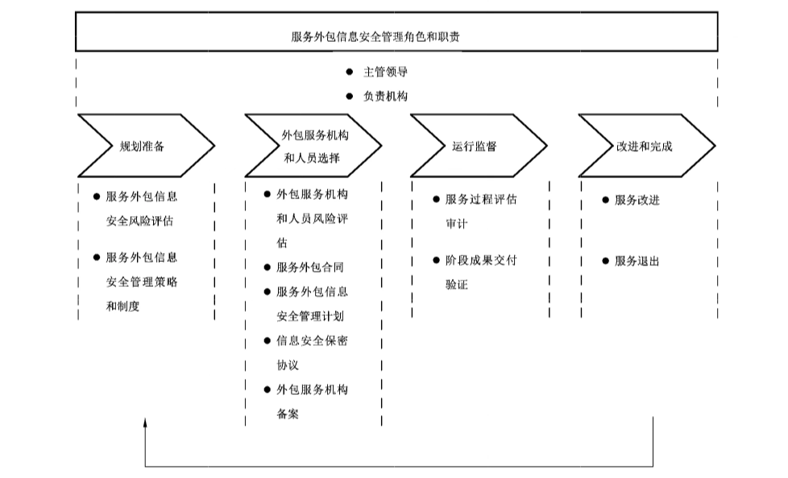

# GB/T 32926-2016 信息安全技术 政府部门信息技术服务外包信息安全管理规范

> 来源：[GB/T 32926-2016 国家标准详情](https://openstd.samr.gov.cn/bzgk/std/newGbInfo?hcno=3A93B0264FE28EA3E85C008F98A3E7E8)；发布日期：2016-08-29；实施日期：2017-03-01。
> 官方在线预览截图 SHA-256：f50ee905cfb3803644de27f01bae87f7841679480617ff4a39080cad5dabbf2e。
> 转写说明：依据官方在线预览的全部 16 张页图对照校正，保留图 1 的原页裁切；省略封面、目录、页眉、页脚和页码，合并跨页条款。正式引用请核对官方原文。

## 前言

本标准按照 GB/T 1.1—2009 给出的规则起草。

本标准由全国信息安全标准化技术委员会（SAC/TC 260）提出并归口。

本标准起草单位：北京信息安全测评中心、工业和信息化部电子科学技术情报研究所、信息产业信息安全测评中心、中国信息安全研究院有限公司。

本标准主要起草人：刘海峰、钱秀榕、梁博、赵章界、刘迎、霍珊珊、张晓梅、王春佳、李晨旸、张恒、张益、耿贵宁。

## 引言

随着经济社会的快速发展，政府部门在打造和建设服务型政府、不断提高为人民服务能力和水平的过程中，越来越多地采用和依赖信息化手段，并为此开展了与信息化相关的信息技术咨询、信息系统集成、运行维护、安全测评等服务外包工作。大量政务信息化工作的外包，既解决了政府行政资源有限和公共服务效能要求日益提高之间的矛盾，也提高了政府部门信息化工程的质量。但政府部门在享受信息技术服务外包带来便捷的同时，也面临外包服务机构背景复杂、服务人员流动性大、内部管理不规范等问题带来的信息安全风险，如果缺乏对服务外包活动信息安全的标准化管理，将对政府部门行政办公、人民群众生产生活，乃至国家安全带来巨大损失。

本标准用于规范和指导政府部门采购和使用信息技术服务。本标准通过对政府部门服务外包过程进行梳理，建立了政府部门信息技术服务外包信息安全管理模型，在明确了服务外包信息安全管理角色和责任的同时，将管理活动划分为规划准备、机构和人员选择、运行监督、改进完成四个阶段，分别提出信息安全管理规范，为政府部门信息技术服务外包的安全管理提供参考。

政府部门在信息技术服务外包的信息安全管理过程中，还要基于本标准提出的规范要求和基本控制措施，结合自身服务外包项目实际，提出与组织机构、人员管理、数据管理、信息技术服务类型等相适应的控制措施，分阶段，有侧重地对服务外包活动实施管理，以便信息安全管理规范的要求能够切实指导不同层级政府部门实际的服务外包信息安全管理工作，提升其服务外包信息安全水平。

## 1 范围

本标准建立了政府部门信息技术服务外包信息安全管理模型，提出了政府部门信息技术服务外包信息安全管理生命周期各阶段活动的管理要求。

本标准适用于政府部门采购和使用信息技术服务。

政府部门开展涉密信息技术服务外包工作，参照国家保密局相关保密规定和标准执行，不在本标准范围内。

## 2 规范性引用文件

下列文件对于本文件的应用是必不可少的。凡是注日期的引用文件，仅注日期的版本适用于本文件。凡是不注日期的引用文件，其最新版本（包括所有的修改单）适用于本文件。

- GB/T 25069—2010 信息安全技术 术语

- GB/T 29245—2012 信息安全技术 政府部门信息安全管理基本要求

## 3 术语和定义

GB/T 25069—2010界定的以及下列术语和定义适用于本文件。

### 3.1 信息技术服务 information technology service

供方为需方提供开发、应用信息技术的服务，以及供方以信息技术为手段提供支持需方业务活动的服务。

［GB/T 29264—2012］

> 注：常见服务形态有信息技术咨询服务、设计与开发服务、信息系统集成实施服务、运行维护服务、数据处理和存储服务、运营服务、数字内容服务、呼叫中心服务及其他信息技术服务。

### 3.2 服务外包 service outsourcing

政府部门以签订合同的方式，委托其他机构承担信息技术服务的商业行为。

### 3.3 外包服务机构 organization providing outsourced service

服务外包中承担信息技术服务的机构。

### 3.4 服务分包 service subcontraction

外包服务机构将自身承担的部分政府部门信息技术服务再次委托给其他机构完成的商业行为和管理模式。

## 4 综述

### 4.1 服务外包信息安全管理基本原则

政府部门应在实施服务外包信息安全管理时，始终遵循以下信息安全基本原则：

a） 责任延展原则。指信息技术服务活动本身的外包，不是信息安全管理责任外包。

b）领导决策原则。指应获得服务外包主管领导的支持、批准和授权。

c） 风险控制原则。指始终关注信息技术服务活动可能带来的信息安全风险，并能够及时应用风险控制措施。

d） 监督检查原则。指在对信息技术服务活动监管基础上，应接受信息安全行政主管部门的监督检查。

### 4.2 服务外包信息安全管理角色和职责

#### 4.2.1 管理角色

按照 GB/T 29245—2012 的要求，政府部门应根据服务外包活动范围确定管理角色和责任：

a） 当服务外包活动涉及多个政府部门内设机构时，应由政府部门信息安全主管领导担任服务外包活动的主管领导，多个内设机构分工承担负责机构职责；

b） 当服务外包活动仅涉及单一政府部门内设机构时，应由该内设机构信息安全主管领导担任服务外包活动的主管领导，该内设机构承担服务外包负责机构职责。

#### 4.2.2 主管领导

在服务外包信息安全管理活动中，主管领导职责应包括：

a） 在政府部门信息安全管理的总体框架下，批准本部门服务外包信息安全管理策略（见 5.2.1）；

b） 授权并支持相应的负责机构具体管理服务外包；

c） 支持对服务外包信息安全各环节的管理：

1） 定期评审并发布服务外包信息安全管理制度，保持与政府部门服务外包信息安全管理策略要求一致；

2） 提供并保障服务外包信息安全管理所需要的资源；

3） 组织检查信息安全受控的信息技术服务执行情况；

4） 协调处置服务外包信息安全管理应急事件；

5） 持续监督并促进服务外包信息安全管理改进完善。

d） 承担服务外包信息安全管理的监管责任。

#### 4.2.3 负责机构

负责机构指具体承担服务外包活动的管理工作的内设机构，主要职责应包括：

a） 对主管领导负责，将服务外包信息安全管理情况、信息技术服务信息安全执行情况及时报告主管领导；

b） 落实服务外包信息安全管理策略要求，组织制定并执行服务外包信息安全管理制度、服务外包合同、服务外包信息安全管理计划等，具体职责应包括以下方面：

1） 按照服务外包信息安全风险评估（见5.1）有关要求，开展服务外包信息安全风险评估；

2） 评估和推荐潜在的外包服务机构和服务人员；

3） 落实服务外包基本信息安全控制措施（见附录 A）；

4） 监督信息技术服务信息安全执行情况；

5） 落实服务外包信息安全管理应急处置措施；

6） 提出服务外包信息安全管理的改进建议；

c） 承担服务外包信息安全管理的直接责任。

### 4.3 服务外包信息安全管理模型

本标准提出了政府部门信息技术服务外包信息安全管理模型（见图 1）。该模型明确了政府部门在信息技术服务外包管理活动中的信息安全角色和责任，通过划分服务外包信息安全规划准备、机构和人员选择、运行监督和改进完成等管理阶段，针对性地提出规范性要求。

## 5 规划准备

### 5.1 服务外包信息安全风险评估

#### 5.1.1 风险评估实施

负责机构应采取以下措施，分析和管理服务外包活动可能引入的信息安全风险，确保政府部门重要敏感信息的保密性、完整性和可用性等，不受服务外包活动引入的信息安全威胁影响：

a） 识别信息技术服务活动的信息安全威胁、发生可能性，以及它们对服务外包安全管理的影响；

b）识别政府部门不同的负责机构，对服务外包活动管理可能产生的负面影响；

c） 评估已经存在的或计划的信息安全控制措施有效性；

d） 评估残余风险发生的可能性。

#### 5.1.2 风险评估结果分析

负责机构应：

a） 分析风险评估的结果，支持主管领导决策可接受的信息安全风险程度；

b） 开展服务外包信息安全风险控制成本效益分析，决定是否且如何开展服务外包：

1） 当基本信息安全风险控制措施充分有效时，积极支持服务外包活动开展；

2） 当信息安全风险控制成本较高时，服务外包活动应当重新被考虑；

当信息安全风险不能得到有效的处置或当信息安全风险评估未完成时，服务外包活动不能够被执行。

### 5.2 服务外包信息安全管理策略和制度

#### 5.2.1 服务外包信息安全管理策略

主管领导应：

a） 正式批准服务外包信息安全管理策略，以提供支持政府部门服务外包信息安全管理活动的依据，具体内容应包含以下方面：

1） 服务外包信息安全管理的角色和责任；

2） 服务外包信息安全管理的风险评估目标和控制要求；

3） 服务外包信息安全管理的运行监督作用和意义；

4） 服务外包信息安全管理的持续改进目标；

5） 与运行中的信息安全管理体系关系说明。

b） 定期审查服务外包信息安全管理策略及其运行效果。

#### 5.2.2 服务外包信息安全管理制度

负责机构应：

a） 依据服务外包信息安全管理策略，建立服务外包信息安全管理制度，具体应包含以下内容：

1） 服务外包信息安全管理程序；

2） 服务外包信息安全角色操作规范；

3） 服务外包信息安全风险控制措施和检查评估规范；

4） 服务外包信息安全文档记录规范。

b） 定期评审服务外包的信息安全管理制度，报主管领导批准后发布。

c） 定期向主管领导上报服务外包信息安全管理实施情况。

## 6 机构和人员选择

### 6.1 外包服务机构和人员风险评估

负责机构应：

a） 开展外包服务机构和人员风险评估，识别服务外包潜在的外包服务机构和服务人员；

b） 选择外包服务机构评估考虑以下条件：

1） 中华人民共和国境内注册（港澳台地区除外）；

2） 由中国公民投资、中国法人投资或者国家投资的企事业单位（港澳台地区除外）；

3） 法人及主要业务、技术人员无犯罪记录；

4） 固定的办公场所；

5） 信息安全管理体系运行良好；

6） 具备保障信息技术服务实施的技术、财务等能力；

7） 对国家安全、社会秩序、公共利益不构成威胁；

8） 服务机构背景经过安全审查；

9） 服务机构资质；

10） 法律、行政法规规定的其他条件；

c） 选择外包服务机构服务人员评估考虑以下条件：

1） 服务人员为中国公民；

2） 服务人员岗位角色、职责明确；

3） 服务人员资格；

4） 服务人员具备较强的信息安全意识；

5） 服务人员背景和技术能力经过安全审查；

6） 服务人员需与外包服务机构签署长期劳动合同，并且签订信息安全保密协议；

7） 法律、行政法规规定的其他条件。

### 6.2 服务外包合同

#### 6.2.1 信息安全条款

负责机构应：

a） 依据服务外包信息安全管理制度，制定信息安全条款，具体内容包含：

1） 服务外包信息安全目标和衡量标准；

2） 服务外包信息安全保障范围和费用；

3） 不得占有服务过程中产生的任何资产；

4） 不得以服务为由强制要求购买、使用指定产品；

5） 不泄露政府部门重要敏感信息的信息安全承诺；

6） 服务外包过程中的知识产权归属；

7） 明示外包服务机构在使用和处理数据过程中的所有权、边界控制等要求，确保数据使用和处理不出境；

8） 明示外包服务机构接受信息主管部门监督检查的责任义务；

9） 服务外包意外终止或变更的罚则。

b） 在信息安全影响因素发生变更后，及时修订信息安全条款。

c） 确保信息安全条款被外包服务机构及其服务人员所周知。

#### 6.2.2 退出策略条款

负责机构应：

a） 明确定义服务退出条件，具体包括以下内容：

1） 当服务合同到期后的正常退出条件；

2） 当服务发生错误且不能在一个有效时间内处理完成的退出条件；

3） 与外包服务机构协商达成一致的合同撤销退出条件；

4） 服务合同内容的修改或调整退出条件。

b） 建立服务退出策略中有关信息安全的管理要求：

1） 依据不同的服务退出条件，定义服务退出过程中及退出后的管理角色和职责；

2） 保证信息技术服务信息安全质量在退出阶段能够维持服务合同中的信息安全管理要求；

3） 在服务退出过程中，退还所有服务涉及的文档；

4） 保证在服务合同终止之后对服务内容和信息的保密性要求；

5） 将政府部门的数据有效地消除或移除，确保数据不被其他组织或个人公开；

6） 当服务失败或企业破产等突发情况发生时，保留继续雇佣服务人员开展服务工作的权利。

c） 建立服务退出策略中有关信息安全的技术要求：

1） 提供查看信息技术服务退出进展情况的技术手段和技术资源；

2） 定义执行最终的信息交换或信息技术资源交换的技术程序、角色和责任；

3） 提供并行的信息技术服务，确保在最终的交接之前，能够解决退出过程中可能出现的技术问题；

4） 要求外包服务机构备案信息技术服务手段和资源；

5） 及时删除信息技术服务生成的子账户或子功能；

6） 备案信息技术服务产生的附加记录，包括培训和信息技术资源配置等。

### 6.3 服务外包信息安全管理计划

负责机构应：

a） 在签订服务外包合同后，制定并细化形成服务外包信息安全管理计划，具体可包括以下方面：

1） 信息安全阶段目标和里程碑计划；

2） 信息安全执行阶段人员角色和责任分工计划；

3） 基本信息安全风险控制措施（见附录 A）部署计划；

4） 信息安全事件应急处置计划；

5） 资源储备和调用计划；

6） 跟踪和记录信息技术服务安全执行的计划等。

b） 提交服务外包信息安全管理计划，并经主管领导批准并执行。

### 6.4 信息安全保密协议

负责机构应：

a） 与外包服务机构及其服务人员分别签订信息安全保密协议，明确信息安全保密责任；

b） 在签订的信息安全保密协议中包含以下内容：

1） 不得自行服务分包；

2） 不得泄露、扩散、转让服务过程中获知的安全保密信息；

3） 为防止潜在的泄密进一步扩大，所采取的控制措施；

4） 损失或泄露政府部门安全保密信息的罚则；

5） 其他保密规定和标准的要求。

### 6.5 外包服务机构备案

负责机构应：

a） 在与外包服务机构签订服务合同和保密协议后，及时向电子政务信息安全主管部门申请备案，备案信息应包含以下内容：

1） 政府部门名称、负责机构、管理人员及其联系方式；

2） 信息技术服务类型；

3） 外包服务机构名称、规模、服务能力资质，项目负责人和联系方式等；

4） 服务外包信息安全管理计划中关于信息安全风险控制措施的说明等；

5） 信息安全主管部门要求提交的其他信息安全备案信息。

b）在外包服务机构或信息技术服务内容发生变化时，及时调整备案信息。

## 7 运行监督

### 7.1 服务过程评估审计

负责机构应：

a） 在信息技术服务过程中，定期评估服务外包活动信息安全执行情况，以确保信息技术服务的信息安全质量和连续性。

b） 评估政府部门所面临的风险和威胁变化情况，必要时调整对外包服务机构提出的安全要求，具体评估内容包括：

1） 政府部门组织机构、人员管理、数据管理等随着信息技术服务执行而面临的新脆弱性；

2） 服务机构和人员安全性和可靠性；

3） 信息技术服务类型、服务方式、服务产品等要素的调整而造成的新威胁；

4） 可能被威胁利用的脆弱性带来的新的信息安全影响；

5） 信息安全事件的处置措施准备情况。

c） 定期对服务外包管理行为进行审计，以确保所采取信息安全控制措施的有效性。

d） 根据评估和审计结果，提出新的信息安全风险预防措施和改进措施，并报主管领导批准。

### 7.2 阶段成果交付验证

负责机构应：

a） 验证信息技术服务阶段性交付成果，判断其是否满足服务外包信息安全管理计划有关阶段信息安全目标要求，具体应验证以下内容：

1） 服务外包合同有关信息安全条款落实情况；

2） 服务人员授权和权限回收情况；

3） 信息技术服务内容、服务时间、服务方式等记录；

4） 信息技术服务培训情况和记录。

b） 及时分析信息技术服务交付验证过程中发现问题的原因，并报主管领导决策改进。

## 8 改进和完成

### 8.1 服务改进

负责机构应：

a） 落实评估审计中提出的信息安全风险预防措施和改进措施；

b） 处置信息技术服务交付验证中发现的问题，并要求外包服务机构整改；

c） 在必要时，调整信息安全控制措施，并修订信息安全管理策略和管理制度；

d） 形成服务改进比对计划，以便确认服务改进效果；

e） 分析信息安全事件发生的原因，以及提出避免类似事件重复发生的措施。

### 8.2 服务退出

负责机构应：

a） 及时终止评估审计中发现问题的信息技术服务；

b） 按照服务合同中有关服务退出策略条款（见6.2.2）要求执行；

c） 验证服务外包涉及的所有政府重要敏感信息、文档和资源被安全销毁，或安全地交接到政府部门手中；

d） 将服务退出执行过程，结果及时报告主管领导。

## 附录 A（规范性附录）服务外包基本信息安全控制

### A.1 信息安全组织

负责机构应：

a） 建立能够评估外包服务机构服务安全实现和资源安全使用的组织，支持对服务外包各阶段潜在信息安全风险的识别和控制；

b） 授权该组织相应的审计权限，审计范围可延伸至服务分包机构；

c） 在不具备足够的资源和人员时，选择一个声誉良好、独立性强、安全可控的外部组织，执行服务过程风险识别和控制。

### A.2 通信和操作管理

#### A.2.1 服务交付管理

负责机构应当识别服务外包活动中的阶段交付目标，特别是对该目标作为服务合同中信息安全条款的描述。

#### A.2.2 备份策略

负责机构应当储备服务外包备份，以应对自然灾害、战争等不可抗力带来的服务意外终止，具体包括以下方面：

a） 建立信息技术服务操作备份，存储相关的信息技术服务信息；

b） 使用可靠的介质存储备份；

c） 定期进行备份数据、备份服务的恢复测试，以确保备份恢复的有效性和完整性。

#### A.2.3 网络安全

负责机构应：

a） 查看信息技术服务引入的网络配置；

b） 评估控制外部远程接入政府部门网络的安全措施有效性；

c） 评估是否需要增加额外的控制措施，以确保内部的网络不被攻击；

d） 严格限制未授权的网络接入。

#### A.2.4 介质管理

负责机构应：

a） 控制服务外包相关的介质存储在安全的物理地点，以防止未授权的复制、使用、移动和破坏；

b） 确保正常的介质操作不被干扰，具体包括以下两个方面：

1） 建立适当的操作规程，防止对数据、文档、电子介质等的未授权复制、使用、移动和破坏；

2） 监控介质操作过程，确保外包服务机构的介质使用和操作保持最小权限。

#### A.2.5 审计

负责机构应：

a） 激活审计机制，并定期审计服务人员活动；

b） 确保审计记录包含以下参数：

1） 事件发生的日期和时间；

2） 事件的类型；

3） 活动的用户账户；

4） 事件的成功和失败。

c） 限定授予特权账户的服务人员范围，审计记录应该包含其操作过程；

d） 定期复查审计记录，判断未授权的数据访问和服务尝试。

### A.3 人力资源安全

负责机构应：

a） 要求外包服务机构安排合同中承诺的、具备相应技能和经验的人员参与信息技术服务工作；

b） 识别外包服务机构分配的人员技能和经验；

c） 定期培训服务人员，确保服务人员正确认识政府部门服务外包信息安全管理策略和管理制度；

d） 在合同执行开始阶段，向服务人员重申信息安全保密要求；

e） 要求服务人员预先申报由于特殊原因无法继续执行信息技术服务的行为；

f） 要求外包服务机构对服务人员进行信息安全教育；

g） 识别服务人员未授权操作、恶意操作等可能威胁政府部门信息安全的活动；

h）验证外包服务机构制定的信息安全培训计划，确保服务人员具备相应的能力。

### A.4 访问控制

负责机构应：

a） 通过有效的信息系统授权或服务访问授权机制，防止未授权的服务人员接入政府信息系统；

b） 按照最小化原则，正式授权服务人员访问信息技术资源权限，并在不使用后立即注销；

c） 不允许私自远程接入信息技术资源；

d） 确保足够的信息安全控制措施被设计并应用于防止远程接入；

e） 监控授权的访问过程并定期审查访问日志；

f） 监控未经授权的服务访问或数据修改行为，并记录日志。

### A.5 物理和环境安全

负责机构应：

a） 建立物理和环境安全策略，及防护操作流程；

b） 将关键和重要敏感信息及信息处理设备控制在安全的区域里，且该区域具有清晰的安全边界标识；

c） 将服务外包引入的开发、测试等操作设备，与政府部门原有的设备安全隔离；

d） 确保服务人员在执行安全控制区域内的信息技术服务活动时，始终处于有效地监管状态。

### A.6 服务获取、管理和保持

信息技术服务活动和信息处理设备等带来的影响应当被安全的控制，负责机构应：

a） 设计、建立并维护服务过程管理策略；

b） 及时保存服务过程管理文档、培训材料等；

c） 恰当地管理信息技术服务变更；

d） 及时发现由于信息技术服务涉及系统开发、测试和操作等引起的信息安全问题，并报告主管领导；

e） 授权外包服务机构代表政府部门开展以下活动：

1） 确保服务得到了正确的、必要的变更，例如打补丁、系统升级；

2） 及时通知政府部门信息技术服务变更的内容和方式。

### A.7 信息安全事件管理

负责机构应：

a） 准备正式的信息安全事件管理流程预案，以便外包服务机构和服务人员遵循；

b） 提供必要的信息安全事件处置培训文档；

c） 限定信息安全事件报告和处置时间；

d） 采取措施，及时弥补引起信息安全事件的脆弱性。

### A.8 业务连续性管理

负责机构应：

a） 调查并确定信息技术服务人员和数据的冗余级别，保证政府部门业务的持续性；

b） 要求外包服务机构在服务过程中应用冗余的技术，特别是信息技术服务涉及的技术资源；

c） 建立并确保政务业务连续性保障计划，并进行恰当测试和验证。

## 参考文献

- [1] GB/T 29264—2012 信息技术服务 分类与代码
