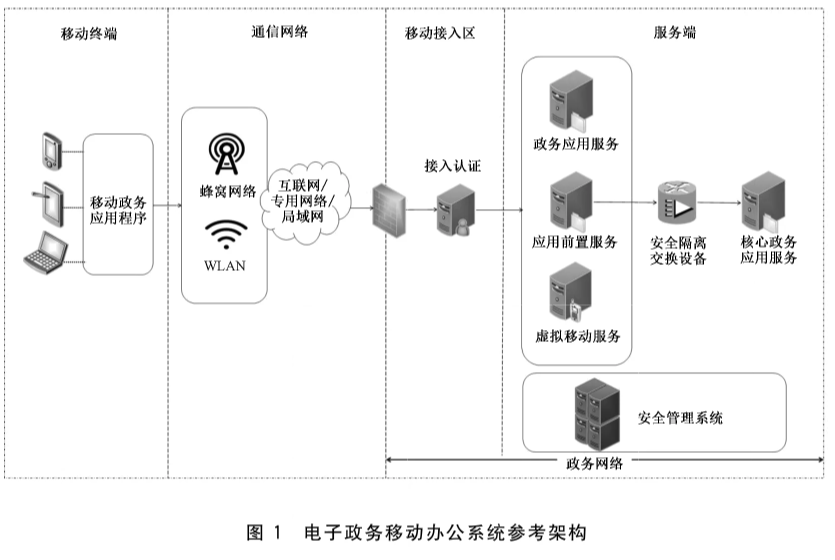
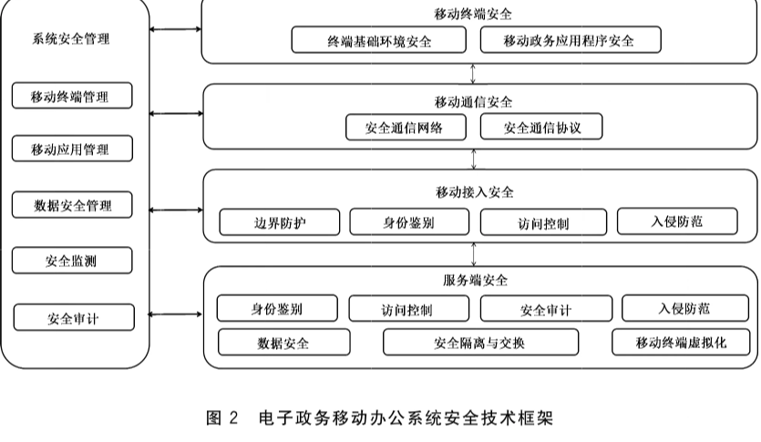

# GB/T 35282-2023 信息安全技术 电子政务移动办公系统安全技术规范

> 来源：[GB/T 35282-2023 国家标准详情](https://openstd.samr.gov.cn/bzgk/std/newGbInfo?hcno=679986DB9E7562223CC342FA160EC2BC)；发布日期：2023-05-23；实施日期：2023-12-01。
> 官方在线预览截图 SHA-256：96b455a12950eb9825e772174ee17f253e63bc84af6f5cfce2a5d9760b0ee4ae。
> 转写说明：按官方在线预览全部 27 张页面截图核对正文、图 1、图 2、表 A.1 和表 B.1；省略封面、目录、页眉、页脚及页码，合并跨页内容。正式引用请核对官方原页。

## 前言

本文件按照 GB/T 1.1—2020《标准化工作导则 第1部分：标准化文件的结构和起草规则》的规定起草。

本文件代替 GB/T 35282—2017《信息安全技术 电子政务移动办公系统安全技术规范》，与 GB/T 35282—2017 相比，除结构调整和编辑性改动外，主要技术变化如下：

- 更改了“范围”一章（见第 1 章，2017 年版的第 1 章）；

- 更改了移动终端、移动终端管理、移动应用管理等术语的定义，增加了政务数据、移动政务应用程序等术语和定义（见第 3 章，2017 年版的第 3 章）；

- 更改了“电子政务移动办公系统基本结构”图的移动接入区和服务端的结构，增加了系统安全管理（见第 5 章，2017 年版的第 5 章）；

- 增加了电子政务移动办公系统主要安全风险的相关内容，更改了“电子政务移动办公系统的安全技术框架”（见第 5 章和附录 A，2017 年版的第 5 章）；

- 更改了移动终端安全、移动通信安全、移动接入安全、服务端安全中具体的安全技术要求（见第 6 章、第 7 章、第 8 章、第 9 章，2017 年版的第 7 章、第 8 章、第 9 章、第 10 章）；

- 增加了“系统安全管理要求”一章，并增加对系统办公安全监测的相关技术要求（见第 10 章）；

- 增加了“测试评价方法”一章，提出了移动终端安全、移动通信安全、移动接入安全、服务端安全、系统安全管理的测试评价方法（见第 11 章）。

本文件由全国信息安全标准化技术委员会（SAC/TC 260）提出并归口。

本文件起草单位：国家信息中心、北京梆梆安全科技有限公司、上海瀛联信息科技股份有限公司、北京智游网安科技有限公司、中国移动通信集团有限公司、华为技术有限公司、亚信科技（成都）有限公司、北京北信源软件股份有限公司、同智伟业软件股份有限公司、杭州盈高科技有限公司、上海观安信息技术股份有限公司、西安交大捷普网络科技有限公司、北京天融信网络安全技术有限公司、元心信息科技集团有限公司、北京金山办公软件股份有限公司、中国信息通信研究院、福建省经济信息中心、中关村网络安全与信息化产业联盟、深信服科技股份有限公司、吉林信息安全测评中心、西安邮电大学、武汉安天信息技术有限责任公司、陕西省网络与信息安全测评中心、奇安信网神信息技术（北京）股份有限公司、郑州信大捷安信息技术股份有限公司、沈阳东软系统集成工程有限公司、深圳海云安网络安全技术有限公司、新华三技术有限公司、中国软件评测中心、中贸促信息技术有限责任公司。

本文件主要起草人：刘蓓、程浩、包莉娜、徐进、闫桂勋、袁森、李坤、吴阿明、韩云、赵海燕、黄静、黄敏、廖双晓、蒋国辉、王永起、孙建山、贺韬、刘浩、谢江、何建锋、张超、姜哲、张树玲、宁华、刘陶、张晓晟、王克、杨志刚、刘占丰、张勇、陈诚、田嘉豪、赵春雷、梁松涛、赵春鹏、谢朝海、万晓兰、李杞恬、赵恬。

本文件及其所代替文件的历次版本发布情况为：

- 2017 年首次发布为 GB/T 35282—2017；
- 本次为第一次修订。

## 1 范围

本文件规定了电子政务移动办公系统的移动终端安全、移动通信安全、移动接入安全、服务端安全和系统安全管理等各部分技术要求，给出了测试评价方法。

本文件适用于电子政务移动办公系统的安全设计、建设实施、安全管理和测试评价。

## 2 规范性引用文件

下列文件中的内容通过文中的规范性引用而构成本文件必不可少的条款。其中，注日期的引用文件，仅该日期对应的版本适用于本文件；不注日期的引用文件，其最新版本（包括所有的修改单）适用于本文件。

- GB/T 20279—2015 信息安全技术 网络和终端隔离产品安全技术要求

- GB/T 22239—2019 信息安全技术 网络安全等级保护基本要求

- GB/T 25069—2022 信息安全技术 术语

- GB/T 28448—2019 信息安全技术 网络安全等级保护测评要求

- GB/T 35281—2017 信息安全技术 移动互联网应用服务器安全技术要求

- GB/T 37952—2019 信息安全技术 移动终端安全管理平台技术要求

- GB/T 38636—2020 信息安全技术 传输层密码协议（TLCP）

- GB/T 39786 信息安全技术 信息系统密码应用基本要求

## 3 术语和定义

GB/T 25069—2022界定的以及下列术语和定义适用于本文件。

### 3.1 移动终端 mobile terminal

接入公众移动通信网络、具有操作系统、可由用户自行安装和卸载应用软件的移动通信终端产品。

［来源：GB/T 37952—2019,3.1］

### 3.2 电子政务移动办公系统 mobile e-government system

用户利用移动终端和移动通信网络访问电子政务办公系统进行移动办公的信息系统。

### 3.3 移动终端管理 mobile terminal management

针对移动终端，提供从注册、激活、使用到废弃等全生命周期的远程安全控制管理。

### 3.4 移动应用管理 mobile application management

针对移动应用软件，提供从分发、安装、使用、升级到卸载等全过程的安全管理。

### 3.5 政务数据 government data

各级政务部门及其技术支撑单位在履行职责过程中依法采集、生成、存储、管理的各类数据资源。

［来源：GB/T 38664.1—2020,3.1］

### 3.6 移动政务应用程序 mobile government application

安装并运行在移动终端上，具有政务移动办公功能的应用程序。

> 注：移动政务应用程序包括政务 APP、政务小程序、客户端软件等。

### 3.7 个人数据 personal data

个人用户在使用移动终端过程中产生与个人相关的数据。

### 3.8 敏感数据 sensitive data

因泄露、修改、破坏或丢失对用户产生不可预知的损害而需要保护的数据。

### 3.9 重要数据 critical data

一旦被泄露或篡改、损毁，可能直接危害国家安全、经济运行、社会稳定、公共健康和安全的数据。

> 注：重要数据不包括国家秘密。

## 4 缩略语

下列缩略语适用于本文件。

- APN：接入点名称（Access Point Name）
- APP：应用（Application）
- APT：高级持续性威胁（Advanced Persistent Threat）
- DDoS：分布式拒绝服务（Distributed Denial of Service）
- DNN：数据网络名称（Data Network Name）
- IP：网际互连协议（Internet Protocol）
- IPSec：互联网安全协议（Internet Protocol Security）
- SSL：安全套接层（Secure Sockets Layer）
- TLCP：传输层密码协议（Transport Layer Cryptography Protocol）
- TLS：网络传输层安全（Transport Layer Security）
- VPN：虚拟专用网（Virtual Private Network）
- WLAN：无线局域网（Wireless Local Area Networks）

## 5 概述

### 5.1 电子政务移动办公系统参考架构

电子政务移动办公系统参考架构见图1，其中：

a） 移动终端：处于电子政务移动办公系统的用户侧，包括手机、平板电脑、便携式计算机等类型终端，其上加载移动政务应用程序。

b） 通信网络：连接移动终端和政务网络的移动通信网络，以蜂窝网络、WLAN 等方式连接移动终端，以互联网、专用网络或局域网等方式接入政务网络。

c） 移动接入区：处于政务网络侧，一般包括边界防护设备，如防火墙、接入认证网关等。

d） 服务端：政务网络的核心服务区域，主要部署政务办公应用服务系统和安全管理系统。安全管理系统是对电子政务移动办公系统的各部分实施统一集中安全管理的系统平台或区域。政务办公应用服务系统主要通过三种方式访问：

1） 直接或 VPN 等方式；

2） 虚拟移动服务；

3） 应用前置服务和安全隔离交换设备。

### 5.2 电子政务移动办公系统安全技术框架

电子政务移动办公系统面临的安全风险主要存在于移动终端、通信网络、移动接入区和服务端等方面（见附录 A）。电子政务移动办公系统的安全技术框架见图 2，包括 5 个部分，其中：

a） 移动终端安全：提出用户侧计算环境安全技术要求，包括终端基础环境安全要求和终端应用程序安全要求；

b） 移动通信安全：提出从公众移动通信网络接入政务网络的通信网络安全技术要求，包括安全通信网络要求和安全通信协议要求；

c） 移动接入安全：提出移动接入政务网络区域边界安全技术要求，包括边界防护、身份鉴别、访问控制和入侵防范等安全要求；

d） 服务端安全：提出政务网络核心服务区计算环境安全技术要求，包括身份鉴别、访问控制、安全审计、入侵防范、数据安全、安全隔离与交换和移动终端虚拟化等安全要求；

e） 系统安全管理：提出电子政务移动办公系统安全统一集中管理技术要求，包括移动终端管理、移动应用管理、数据安全管理、安全监测和安全审计等安全要求。

本文件提出的安全技术要求分为基本要求和增强要求。基本要求适用于等级保护三级以下的电子政务移动办公系统，增强要求适用于等级保护三级（含）以上的电子政务移动办公系统，技术要求划分参见附录B。在本文件中，黑体字部分表示增强要求。

涉及个人信息保护的相关要求，参照GB/T 35273和 GB/T 34978 的相关规定。涉及密码技术的使用和管理要求，参照 GB/T 39786 的相关规定。

## 6 移动终端安全要求

### 6.1 终端基础环境安全

#### 6.1.1 身份鉴别

本项要求包括：

a） 应支持设置开机口令或利用生物特征识别等方式，在开启移动终端时进行身份鉴别；

b） 应具备屏幕锁定功能，移动终端空闲操作时间达到设定阈值时锁定屏幕，解锁时应重新进行身份鉴别；

c） 应能在限定次数内多次连续尝试身份验证失败后，或者一定时长后锁定移动终端；

d） 应能为每一台移动终端确定唯一身份标识。

#### 6.1.2 通用配置

本项要求包括：

a） 应支持具有VPN功能的应用程序的安装和运行，以及在线升级；

b） 应支持具备移动终端管理功能的应用程序的安装和运行，以及在线升级；

c） 应支持具备移动应用管理功能的应用程序的安装和运行，以及在线升级；

d） 应支持用于政务移动办公身份鉴别的密钥的安装和运行；

e） 宜支持基于密钥分割安全机制，保障移动端密钥数据的安全；

f） **用于身份鉴别的密钥（如数字证书对应的私钥）应存储在密码模块中，密码模块安全应用应符合 GB/T 39786 的相关要求，外置存储设备接口受限的移动终端可采用安全薄膜卡或虚拟硬件密码模块等方式。**

#### 6.1.3 访问控制

本项要求包括：

a） 应支持配置访问控制策略，可授权用户和应用程序访问和修改终端系统配置、数据、接口等资源；

b） **应支持对移动终端运行环境安全性进行持续评估，并可根据评估结果动态调整移动终端的访问权限；**

c） **在访问移动政务应用系统时，不应将移动终端作为无线热点提供政务网络共享。**

#### 6.1.4 可信验证

本项要求包括：

a） **宜支持终端安全启动信任链按序逐级验证，具备防止恶意绕过的功能；**

b） **宜支持对终端系统的动态可信度量，包括二进制文件加载过程中签名验签，对内核，以及核心模块的度量，及时识别入侵行为，并实施阻断。**

### 6.2 移动政务应用程序安全

#### 6.2.1 身份鉴别

本项要求包括：

a） 应对登录用户进行身份鉴别，在访问重要数据和敏感个人信息时应支持进行二次身份鉴别，鉴别方式包括但不限于口令、短信验证码、二维码、手势识别、生物特征识别或密码技术认证等；

b）移动政务应用程序进入后台运行状态超过设定时限，再次切换到前台时，应重新进行身份鉴别；

c） 应具备身份鉴别失败处理措施，包括结束会话、限制失败登录次数和自动退出等；

d） 应具备口令长度和复杂度校验功能，以及口令重置的验证机制，不应以明文形式显示和存储用户口令；

e） 应支持设置身份鉴别结果的有效期，过期后应重新进行身份鉴别，更换终端设备登录时，应重新进行身份鉴别并退出原有设备的登录信息。

#### 6.2.2 访问控制

本项要求包括：

a） 应能对数据进行基于接口调用或内容识别的访问控制；

b）应能对移动政务应用程序访问移动终端数据和资源，以及获取用户个人信息、更改终端配置等行为进行授权管理；

c） **应支持基于用户身份、角色、行为、环境等综合因素进行动态访问控制策略配置。**

#### 6.2.3 数据安全

##### 6.2.3.1 数据安全存储

本项要求包括：

a） 应支持将移动政务应用程序本地缓存数据和个人数据根据不同的策略隔离存储；

b） **应采用密码技术保证重要数据和敏感个人信息存储过程的完整性和保密性；**

c） **宜对政务数据进行标记，保证数据存储和使用过程中的可追踪性；**

d） **宜采用移动终端虚拟化等技术，实现政务数据在服务端存储。**

##### 6.2.3.2 数据防泄露

本项要求包括：

a） 在个人应用前台运行时，移动政务应用程序仅可提示有待处理事项，不可显示完整事项信息；

b） **应采用沙箱等隔离技术防止移动政务应用程序发生数据泄露，包括但不限于不可应用分享、不可截屏、剪切板控制等；**

c） **应采用密码技术保证重要数据和敏感个人信息传输过程的完整性和保密性。**

##### 6.2.3.3 剩余信息保护

应保证用户鉴别信息和敏感数据所在的存储空间被释放或重新分配前得到完全清除。

#### 6.2.4 运行安全

本项要求包括：

a） 应支持在移动政务应用程序安装、启动、更新时验证签名，并校验自身代码和文件完整性，当发现被篡改后，应立即终止运行；

b） 应支持对移动政务应用程序的运行状态进行安全监测，存在安全风险时应及时提醒用户；

c） 当检测到恶意行为发生时，移动政务应用程序应可根据配置参数决定是否退出；

d） 应用程序组件应限制仅对信任的其他应用进行共享数据或交互，同时应对共享数据和交互进行权限控制和参数校验。

e） **宜支持为重要移动政务应用提供应用级隔离的运行环境，保证应用的输入、输出、存储信息不被非法获取。**

## 7 移动通信安全要求

### 7.1 安全通信网络

本项要求包括：

a） 应通过 SSL VPN 网关或IPSec VPN 网关等建立安全传输通道，对通信实体进行身份鉴别，保证移动终端与政务服务端之间数据传输的完整性和保密性；

b） 应支持 VPN，在移动政务应用启动时自动启动，实现数据安全传输；

c） **移动终端通过蜂窝网络接入政务网络时，应采用专用网络切片、专用 DNN、APN、VPN 等方式，保证专有政务数据与互联网数据网络传输通道的安全隔离；**

d） **移动终端通过无线局域网接入政务网络时，应采用专用网络接入，保证专有政务数据与互联网数据网络传输通道的安全隔离。**

### 7.2 安全通信协议

本项要求包括：

a） 系统应支持 SSL/TLS或 IPSec 等安全通信协议；

b） 采用的安全通信协议版本应及时更新至安全稳定版本；

c） 采用的安全通信协议应确保不包含已知的公开漏洞；

d） **传输层密码协议应满足 GB/T 38636—2020 的要求。**

## 8 移动接入安全要求

### 8.1 边界防护

本项要求包括：

a） 应在政务网络边界侧部署接入认证网关设备，具备自主的接入控制能力，保证移动终端通过无线网络安全接入政务网络；

b） 移动终端通过无线局域网或蜂窝网络接入政务网络时，应具备自主的接入控制能力；

c） 应通过边界设备提供的受控接口进行访问和数据通信。

### 8.2 身份鉴别

本项要求包括：

a） 应对登录的用户进行身份鉴别，身份鉴别信息应具有复杂度要求并定期更换；

b） 应采用密码技术保证身份鉴别信息在传输过程中的完整性和保密性；

c） **应采用两种或两种以上组合的鉴别技术对用户进行身份鉴别，且其中一种鉴别技术至少应使用密码技术来实现。**

### 8.3 访问控制

本项要求包括：

a） 在访问被允许之前，访问主体需要经过身份鉴别和授权，并按照最小安全访问原则设置访问控制权限；

b） 应支持基于用户账户和权限分配的细粒度访问控制，仅授权用户才能访问特定资源；

c） **应能根据用户身份、行为、环境，以及安全监测情况等综合因素，动态调整用户的访问权限。**

### 8.4 入侵防范

本项要求包括：

a） 应在政务网络边界处检测、防范并阻止网络攻击行为；

b） **应采取技术措施对网络行为进行分析，实现对网络攻击特别是新型网络攻击行为的分析；**

c） **当检测到攻击行为时，记录攻击源 IP、攻击类型、攻击目标、攻击时间，在发生严重入侵事件时应及时报警并实施阻断。**

## 9 服务端安全要求

### 9.1 身份鉴别

本项要求包括：

a） 应符合 GB/T 22239—2019中 7.1.4.1 的要求；

b） 宜支持用户一次认证可访问多个域的应用和资源；

c） **应采用口令、密码技术、生物技术等两种或两种以上组合的鉴别技术对登录服务端的用户进行身份鉴别，且其中一种鉴别技术应使用密码技术来实现。**

### 9.2 访问控制

本项要求包括：

a） 应符合 GB/T 22239—2019中 7.1.4.2的要求；

b） **应配置服务端应用软件的访问控制策略，访问控制的粒度应达到用户级和进程级；**

c） **应配置服务端操作系统的访问控制策略，如文件系统权限、进程沙箱等，将中间件可访问的系统资源限制在最少够用的范围内，并且在不同的中间件进程之间实现隔离；**

d） **应配置服务端数据库的访问控制策略，应支持对访问数据库的应用进行身份鉴别与授权。**

e） **应支持针对用户访问应用或数据的每次请求，根据安全通信网络、安全区域边界和安全计算环境风险状况，动态调整访问控制策略，并重新进行授权。**

### 9.3 安全审计

本项要求包括：

a） 应符合 GB/T 22239—2019中 7.1.4.3的要求；

b） 对服务端应用服务器的安全审计应符合 GB/T 35281—2017中 11.3的要求；

c） 审计日志应留存时间不少于6个月。

### 9.4 入侵防范

本项要求包括：

a） 应符合 GB/T 22239—2019中 7.1.4.4的要求；

b） **应能够检测、防止或限制对服务端进行入侵的行为，包括但不限于网络扫描、DDoS 攻击、暴力破解、APT 等，并在发生严重入侵事件时提供告警并实施阻断。**

### 9.5 数据安全

#### 9.5.1 数据安全存储

本项要求包括：

a） 应对数据进行分类存储；

b） 应对存储的用户数据进行完整性和保密性保护，并配置访问控制策略；

c） **应采用校验技术或密码技术保证服务端重要数据在存储过程中的完整性，包括但不限于身份鉴别数据、重要数据和敏感个人信息等；**

d） **应采用密码技术保证服务端数据在存储过程中的保密性，包括但不限于身份鉴别数据、重要数据和敏感个人信息等；**

e） **宜采用移动终端虚拟化技术，实现移动政务应用程序及数据在虚拟移动服务端集中安装和存储。**

#### 9.5.2 数据防泄露

本项要求包括：

a） 应按照设定的数据分类分级规则，配置服务端数据防泄露安全策略，对服务端政务数据访问行为和操作行为进行监测和审计；

b） 应建立数据脱敏安全策略，在数据共享和导出过程中对敏感数据进行脱敏处理；

c） 宜支持对政务数据文件进行安全展现，如按页加载、按页清除等；

d） **宜建立数据共享管控和数据泄露溯源机制；**

e） **宜采用密码技术保证敏感数据提供给第三方机构进行处理过程中的保密性和完整性。**

#### 9.5.3 数据备份恢复

本项要求包括：

a） 应支持对服务端重要数据定期进行本地或异地备份，包括但不限于身份鉴别数据、重要数据和敏感个人信息等；

b） 应支持选择全部数据或部分数据备份方式，并用不同时间点的备份数据进行恢复，在数据恢复过程中应进行数据完整性校验；

c） **应提供服务端重要数据的异地实时备份和恢复功能；**

d） **应对重要政务应用系统采用热冗余部署方式，保证系统的业务连续性。**

#### 9.5.4 剩余信息保护

本项要求包括：

a） 应保证重要数据、个人信息和身份鉴别信息所在的存储空间被释放或重新分配前得到完全清除；

b） 应保证服务端所使用的内存和存储空间回收时得到完全清除；

c） 当用户注销账户时，应能够同步销毁该用户在服务端数据库中的用户个人数据及其备份。

### 9.6 安全隔离与交换

本项要求包括：

a） 应支持网络分区分域，核心政务应用系统所在的网络区域与其他网络区域之间应采用安全隔离与交换技术，并应符合 GB/T 20279—2015 中 5.2.2 的要求；

b） **宜采用单向传输技术，通过协议转换或剥离，以数据单向导入方式实现单向数据传输，同时确保数据无反向传输。**

### 9.7 移动终端虚拟化

本项要求包括：

a） **应支持政务数据统一存储在虚拟移动服务端，并保证不同用户数据的逻辑隔离；**

b） **应保证虚拟移动终端实例所在的存储空间被释放或重新分配前得到完全清除；**

c） **应支持仅传输加密绘图指令到移动终端物理设备进行解析和显示用户界面和指令交互窗口；**

d） **应支持登录用户和移动终端硬件标识码进行绑定，支持移动终端生物特征身份鉴别方式；**

e） **应支持对不同用户的虚拟化资源和安全策略进行统一配置管理；**

f） **应支持对虚拟移动终端的运行状态、资源占用、异常事件等进行实时监控。**

## 10 系统安全管理要求

### 10.1 移动终端管理

本项要求包括：

a） 应支持移动终端全生命周期管理，终端注册、远程控制管理和外接存储介质管理应符合GB/T 37952—2019 中 6.1.1.1 的要求；

b）应支持移动终端运行状态的收集上报，包括终端标识、位置信息、固件版本、系统版本、网络类型、用户信息、安全日志等；

c） 应能对发生异常（如丢失）或废弃的移动终端进行远程注销、数据擦除、禁用和锁定；

d） 应能对移动终端违规行为采取控制措施，包括限制访问、警告、锁定、禁用、系统还原、数据擦除等；

e） 应支持终端用户管理，包括一个用户绑定多个移动终端或者一个移动终端绑定多个用户，支持通过用户分组和关联角色进行管理控制；

f） 应支持建立移动终端的白名单或配置库，用于对非法移动终端的识别。

### 10.2 移动应用管理

本项要求包括：

a） 应符合 GB/T 22239—2019中 7.3.3.1、7.3.4.1 和 7.3.4.2 的要求；

b） 应支持对应用程序的安装和使用情况进行统计；

c） 应支持应用程序信息收集上报，如程序标识、名称、版本、平台、开发商等。

d） 应支持应用程序远程管理策略执行，包括软件分发、安装、卸载、应用黑白名单设置等；

e） **宜支持通过沙箱等安全容器运行移动应用程序；**

f） **应支持对政务 APP 进行安全防护和加固，防止受到恶意程序的破坏、破解和篡改；**

g） **应支持对政务 APP 进行安全检测和签名，并通过应用商店或授权渠道统一提供下载。**

### 10.3 数据安全管理

本项要求包括：

a） 应支持对政务数据和个人信息进行分类分级管理，并配置不同的数据访问控制策略，如读写、拷贝、下载等；

b） 应支持配置敏感数据和个人信息防泄露安全策略，支持敏感数据和个人信息的扫描、过滤、脱敏和外传阻断。

### 10.4 安全监测

本项要求包括：

a） 应支持对服务端的网络攻击行为进行监测和告警，包括但不限于漏洞利用攻击、拒绝服务攻击、网络扫描、暴力破解等；

b） 应支持对移动终端的网络攻击行为进行监测和告警，包括但不限于模拟器攻击、框架攻击、位置欺诈、域名欺诈等；

c） 应支持对移动政务应用的异常访问和操作行为进行监测和告警，包括但不限于账户登录异常、数据下载异常、可疑网络访问、操作异常等；

d） 应支持对政务数据的异常访问和操作行为进行监测和告警，包括但不限于越权访问、高频访问、恶意操作等；

e） 应支持对移动政务应用程序和服务端存在的安全漏洞和脆弱性进行持续监测；

f） **应支持与接入认证网关等安全设备或平台联动，根据监测结果，协助实施动态访问控制等安全处置策略。**

### 10.5 安全审计

本项要求包括：

a） 应支持对移动终端访问政务应用的操作进行审计；

b）应支持对授权管理员的重要操作进行审计，包括但不限于远程控制操作、终端用户管理等；

c） 审计日志应至少包括：事件发生的日期和时间、事件主体标识、事件描述和结果等；

d） 审计记录留存时间应不少于6个月，应对审计记录进行保护，定期备份，避免受到不可预期的删除、修改或覆盖；

e） **应支持对操作重要数据、敏感个人信息的行为进行审计。**

## 11 测试评价方法

### 11.1 移动终端安全要求

#### 11.1.1 终端运行环境安全

##### 11.1.1.1 身份鉴别

本项测试评价方法如下。

a） 测试方法：

1） 检查开启移动终端时，查看身份鉴别是否采用了开启口令或生物特征识别等方式进行身份鉴别；

2） 检查移动终端是否支持屏幕锁定口令功能，当空闲操作时间达到设定阈值时是否锁定屏幕，测试解锁时是否重新进行身份鉴别；

3） 检查在限定次数内多次连续尝试身份验证失败后或一定时长后是否锁定移动终端；

4） 应访谈系统管理员，询问移动终端标识是否具有唯一性，检查设计或验收文档，查看其是否有移动终端采用了保证唯一标识的措施的描述。

b） 预期结果：

1）～4）结果均为“是”。

c） 结果判定：实际测试结果与相关预期结果一致则判定为符合，其他情况判定为不符合。

##### 11.1.1.2 通用配置

本项测试评价方法如下。

a） 测试方法：

1） 检查是否支持具有VPN功能的应用程序的安装和运行，以及在线升级；

2） 检查是否支持具备移动终端管理功能的应用程序的安装和运行，以及在线升级；

3） 检查是否支持具备移动应用管理功能的应用程序的安装和运行，以及在线升级；

4） 检查是否用于政务移动办公身份鉴别的密钥的安装和运行；

5） 检查是否支持基于密钥分割安全机制，保障移动端密钥数据的安全；

6） **检查用于身份鉴别的密钥是否存储在密码模块中，密码模块安全应用是否符合 GB/T 39786 的相关要求，外置存储设备接口受限的移动终端是否支持采用安全薄膜卡或虚拟硬件密码模块等方式。**

b） 预期结果：

1） ～4）和6）结果均为“是”，5）结果根据实际情况可选。

c） 结果判定：实际测试结果与相关预期结果一致则判定为符合，其他情况判定为不符合。

##### 11.1.1.3 访问控制

本项测试评价方法如下。

a） 测试方法：

1） 检查是否支持配置访问控制策略，是否可授权用户和应用程序访问和修改终端系统配置、数据、接口等资源；

2） **测试系统是否具备对终端运行环境安全性进行持续评估，并可根据评估结果动态调整移动终端的访问权限；**

3） **核查在访问移动政务应用时，是否禁止将移动终端作为无线热点提供网络共享。**

b） 预期结果：

1）～3）结果均为“是”。

c） 结果判定：实际测试结果与相关预期结果一致则判定为符合，其他情况判定为不符合。

##### 11.1.1.4 可信验证

本项测试评价方法如下。

a） 测试方法：

1） **检查安全启动信任链是否按序逐级验证，不可被恶意绕过；**

2） **检查是否支持对系统的动态可信度量，包括二进制文件加载过程中签名验签，对内核，以及核心模块的度量，是否能够及时识别入侵行为，并将其有效阻断。**

b） 预期结果：

1）和 2）结果根据实际情况可选。

c） 结果判定：实际测试结果与相关预期结果一致则判定为符合，其他情况判定为不符合。

#### 11.1.2 移动政务应用程序安全

##### 11.1.2.1 身份鉴别

本项测试评价方法如下。

a） 测试方法：

1） 登录移动政务应用程序，测试身份鉴别方式，在访问重要数据和敏感个人信息时是否进行二次身份鉴别，鉴别方法是否可支持口令、短信验证码、二维码、手势识别、生物特征识别或密码认证技术等方式；

2） 验证用户登录移动政务应用程序后，如果进入后台运行状态的时间超过设定时限，再被唤醒切换到前台，是否对用户重新进行身份鉴别；

3） 验证移动政务应用程序在用户身份鉴别失败后，是否采取结束会话、限制失败登录次数和自动退出等措施；

4） 验证移动政务应用程序具有口令登录功能时，是否提供口令长度和复杂度校验功能，并对用户设置的口令进行强度检测，是否具备口令重置的验证机制，是否对用户输入的口令默认屏蔽显示，后台加密存储；

5） 验证移动政务应用程序的身份鉴别的结果是否设置有效期，过期后是否重新进行身份鉴别，在更换终端设备登录时，是否重新鉴别并退出原有设备的登录信息。

b） 预期结果：

1）～5）结果均为“是”。

c） 结果判定：实际测试结果与相关预期结果一致则判定为符合，其他情况判定为不符合。

##### 11.1.2.2 访问控制

本项测试评价方法如下。

a） 测试方法：

1） 访谈系统管理员，询问是否配置访问控制策略，对进出终端的数据实现基于接口调用和内容识别的访问控制；

2） 验证当移动政务应用程序访问或调用移动终端数据和资源，获取用户个人信息、更改终端配置时是否需要用户进行授权；

3） **检查是否支持基于用户身份、角色、行为、环境等综合因素进行访问控制策略配置。**

b） 预期结果：

1）～3）结果均为“是”。

c） 结果判定：实际测试结果与相关预期结果一致则判定为符合，其他情况判定为不符合。

##### 11.1.2.3 数据安全

###### 11.1.2.3.1 数据安全存储

本项测试评价方法如下。

a） 测试方法：

1） 检查移动政务应用程序本地缓存数据是否与个人数据根据不同的策略隔离存储；

2） **检查重要数据和敏感个人信息是否加密存储；**

3） **检查政务数据是否采用数字水印技术进行标记，保证数据存储和使用过程中的可追踪性；**

4） **检查系统是否支持采用移动终端虚拟化技术或其他技术措施，实现政务数据不在移动终端本地存储。**

b） 预期结果：

1）～2）结果均为“是”，3）～4）结果根据实际情况可选。

c） 结果判定：实际测试结果与相关预期结果一致则判定为符合，其他情况判定为不符合。

###### 11.1.2.3.2 数据防泄露

本项测试评价方法如下。

a） 测试方法：

1） 验证在个人应用前台运行时，移动政务应用程序是否仅提示有待处理事项，不显示完整事项信息；

2） **验证是否采用沙箱等隔离技术防止移动政务应用程序发生数据泄露，包括但不限于不可应用分享、不可截屏、剪切板控制等；**

3） **检查是否支持采用密码技术保证重要数据和敏感个人信息传输过程的完整性和保密性。**

b） 预期结果：

1）～3）结果均为“是”。

c） 结果判定：实际测试结果与相关预期结果一致则判定为符合，其他情况判定为不符合。

###### 11.1.2.3.3 剩余信息保护

本项测试评价方法如下。

a） 测试方法：验证用户鉴别信息和敏感数据所在的存储空间被释放或重新分配前是否得到完全清除。

b） 预期结果：结果均为“是”。

c） 结果判定：实际测试结果与相关预期结果一致则判定为符合，其他情况判定为不符合。

##### 11.1.2.4 运行安全

本项测试评价方法如下。

a） 测试方法：

1） 检查移动政务应用程序在安装、启动、更新时是否验证签名，是否校验自身代码和文件完整性，当发现被篡改后，是否立即终止运行；

2） 检查是否能对移动政务应用程序的运行安全状态进行安全监测，存在安全风险时是否能及时提醒用户；

3） 在检测到恶意行为发生时，检查移动政务应用程序是否可根据配置参数决定是否退出；

4） 检查应用程序组件是否限制仅对信任的其他应用进行共享数据或交互，同时是否对共享数据和交互进行权限控制和参数校验。

5） **检查是否支持应用沙箱或其他应用级隔离措施，保证应用的输入、输出、存储信息不被非法获取。**

b） 预期结果：

1） ～4）结果均为“是”，5）结果根据实际情况可选。

c） 结果判定：实际测试结果与相关预期结果一致则判定为符合，其他情况判定为不符合。

### 11.2 移动通信安全要求

#### 11.2.1 安全通信网络

本项测试评价方法如下。

a） 测试方法：

1） 检查是否通过 SSL VPN 网关、IPSec VPN 网关等建立安全传输通道，是否对通信实体进行身份鉴别，保证移动终端与政务服务端之间数据传输的完整性和保密性；

2） 核查系统的设计文档，是否支持 VPN功能，是否在移动政务应用启动时自动启动VPN，建立安全传输通道；

3） **核查移动终端在通过蜂窝网络接入政务网络时，是否采用专用网络切片、专用 DNN、APN、VPN 等方式，保证专有政务数据与互联网数据网络传输通道的安全隔离；**

4） **核查移动终端在通过无线局域网接入政务网络时，是否采用专用网络接入，保证专有政务数据与互联网数据网络传输通道的安全隔离。**

b） 预期结果：

1）～4）结果均为“是”。

c） 结果判定：实际测试结果与相关预期结果一致则判定为符合，其他情况判定为不符合。

#### 11.2.2 安全通信协议

本项测试评价方法如下。

a） 测试方法：

1） 核查系统的设计文档，系统是否使用了 SSL/TLS 或IPSec 等安全通信协议；

2） 核查采用的安全通信协议版本是否及时更新至安全稳定版本；

3） 核查采用的安全通信协议是否包含已知的公开漏洞；

4） **核查系统的设计文档，传输层密码协议是否使用了 TLCP 协议。**

b） 预期结果：

1）～4）结果均为“是”。

c） 结果判定：实际测试结果与相关预期结果一致则判定为符合，其他情况判定为不符合。

### 11.3 移动接入安全要求

#### 11.3.1 边界防护

本项测试评价方法如下。

a） 测试方法：

1） 核查在政务网络边界侧是否部署接入认证网关，是否具备自主的接入控制能力；

2） 核查是否通过边界设备提供的受控接口进行访问和数据通信。

b） 预期结果：

1）～2）结果均为“是”。

c） 结果判定：实际测试结果与相关预期结果一致则判定为符合，其他情况判定为不符合。

#### 11.3.2 身份鉴别

本项测试评价方法如下。

a） 测试方法：

1） 检查系统是否对登录的用户进行身份鉴别，且身份鉴别信息是否具有复杂度要求并定期更换；

2） 应检查是否采用密码技术保证身份鉴别信息在传输过程中的完整性和保密性；

3） **检查是否采用两种或两种以上组合的鉴别技术对用户进行身份鉴别，并且其中一种鉴别技术至少应使用密码技术来实现。**

b） 预期结果：

1）～3）结果均为“是”。

c） 结果判定：实际测试结果与相关预期结果一致则判定为符合，其他情况判定为不符合。

#### 11.3.3 访问控制

本项测试评价方法如下。

a） 测试方法：

1） 模拟移动用户和管理员进行访问，在不经过身份鉴别和授权的状态下，是否能够进行相关操作；在得到认证和授权的情况下，是否符合相应的授权身份；查看授权的配置信息，是否是最小的授权原则；

2） 登录系统查看用户账户的授权机制，是否支持细粒度的权限分配机制；

3） **应核查用户访问权限的授权机制，是否支持根据用户身份、行为、环境以及安全监测情况等综合因素，动态调整用户的访问权限，并验证其有效性。**

b） 预期结果：

1）~3）结果均为“是”。

c） 结果判定：实际测试结果与相关预期结果一致则判定为符合，其他情况判定为不符合。

#### 11.3.4 入侵防范

本项测试评价方法如下。

a） 测试方法：

1） 检查是否符合 GB/T 28448—2019中 7.1.3.3.1 的测试结果；

2） **检查是否符合 GB/T 28448—2019 中 8.1.3.3.3 的测试结果；**

3） **检查是否符合 GB/T 28448—2019 中 8.1.3.3.4 的测试结果。**

b） 预期结果：

1）~3）结果均为“是”；

c） 结果判定：实际测试结果与相关预期结果一致则判定为符合，其他情况判定为不符合。

### 11.4 服务端安全要求

#### 11.4.1 身份鉴别

本项测试评价方法如下。

a） 测试方法：

1） 检查是否符合 GB/T 28448—2019中 7.1.4.1的测试结果；

2） 查看设计文档是否具备一次认证访问多个应用和资源的功能，验证该功能是否支持一次认证访问多个应用和资源；

3） **查看身份验证是否满足使用了口令、密码技术、生物技术等两种或两种以上组合的鉴别技术对用户进行身份鉴别，且其中一种鉴别技术应使用密码技术来实现的。**

b） 预期结果：

1）和 3）结果均为“是”，2）结果根据实际情况可选。

c） 结果判定：实际测试结果与相关预期结果一致则判定为符合，其他情况判定为不符合。

#### 11.4.2 访问控制

本项测试评价方法如下。

a） 测试方法：

1） 检查是否符合 GB/T 28448—2019中 7.1.4.2的测试结果；

2） **核查是否能配置服务端应用软件的访问控制策略，访问控制的粒度应达到用户级和进程级；**

3） **核查是否能配置服务端操作系统的访问控制策略，如文件系统权限、进程沙箱等，将中间件可访问的系统资源限制在最少够用的范围内，并且在不同的中间件进程之间实现隔离；**

4） **核查是否能配置服务端数据库的访问控制策略，应支持对访问数据库的应用进行身份鉴别与授权；**

5） **核查当用户访问应用时，是否每次请求都应基于环境感知情况根据访问控制策略进行重新授权。**

b） 预期结果：

1） ～5）结果均为“是”。

c） 结果判定：实际测试结果与相关预期结果一致则判定为符合，其他情况判定为不符合。

#### 11.4.3 安全审计

本项测试评价方法如下。

a） 测试方法：

1） 检查是否符合 GB/T 28448—2019中 7.1.4.3的测试结果；

2） 核查服务端应用服务器的安全审计是否符合GB/T 35281 —2017中 11.3的要求。

3）核查审计日志留存时间是否不少于6个月。

b） 预期结果：

1） ～3）结果均为“是”。

c） 结果判定：实际测试结果与相关预期结果一致则判定为符合，其他情况判定为不符合。

#### 11.4.4 入侵防范

本项测试评价方法如下。

a） 测试方法：

1） 检查是否符合 GB/T 28448—2019中 7.1.4.4的测试结果；

2） **核查是否能够检测、防止或限制对服务端进行入侵的行为，包括但不限于网络扫描、DDoS 攻击、暴力破解、APT 等，并在发生严重入侵事件时提供报警并实施阻断。**

b） 预期结果：

1）～2）结果均为“是”。

c） 结果判定：实际测试结果与相关预期结果一致则判定为符合，其他情况判定为不符合。

#### 11.4.5 数据安全

##### 11.4.5.1 数据安全存储

本项测试评价方法如下。

a） 测试方法：

1） 检查是否对数据进行分类存储；

2） 检查服务端中的用户数据是否进行了加密存储和完整性保护，并配置了访问控制策略；

3） **核查是否采用校验技术或密码技术保证服务端重要数据在存储过程中的完整性，包括但不限于身份鉴别数据、重要数据和敏感个人信息等；**

4） **核查是否采用密码技术保证服务端重要数据在存储过程中的保密性，包括但不限于身份鉴别数据、重要数据和敏感个人信息等；**

5） **核查是否采用移动终端虚拟化技术，实现移动政务应用程序及数据安装和存储在虚拟化移动基础设施中，不在移动终端落地安装和存储。**

b） 预期结果：

1）~4）结果均为“是”，5）结果根据实际情况可选。

c） 结果判定：实际测试结果与相关预期结果一致则判定为符合，其他情况判定为不符合。

##### 11.4.5.2 数据防泄露

本项测试方法如下。

a） 测试方法：

1） 核查是否按照设定的数据分级分类规则，配置服务端数据防泄露安全策略，是否对服务端政务数据访问行为和操作行为进行监测和审计；

2） 核查是否建立了数据脱敏安全策略，在数据共享和导出过程中对敏感数据进行脱敏处理；

3） 核查是否支持对政务数据文件进行安全展现，如图片点击加载、邮件点击显示等；

4） **核查相关文档，是否建立数据共享管控和数据泄露溯源机制；**

5） **对数据安全管理员进行访谈，核查敏感数据的安全策略，是否有对敏感数据在提供给第三方机构进行数据处理过程中包含有对密文形态的安全要求。**

b） 预期结果：

1）～2）结果均为“是”，3）~5）结果根据实际情况可选。

c） 结果判定：实际测试结果与相关预期结果一致则判定为符合，其他情况判定为不符合。

##### 11.4.5.3 数据备份恢复

本项测试方法如下。

a） 测试方法：

1） 检查是否对服务端数据定期进行本地或异地备份，包括但不限于身份鉴别数据、重要数据和敏感个人信息等；

2） 核查所有系统的备份数据制度和备份记录，查看是否系统进行了全部或部分数据备份，核查是否对不同备份时间点的备份数据进行了恢复；

3） **核查是否提供服务端重要数据的异地实时备份和恢复功能；**

4） **核查是否对重要政务应用系统采用热冗余部署方式，保证系统的业务连续性。**

b） 预期结果：

1）~4）结果均为“是”。

c） 结果判定：实际测试结果与相关预期结果一致则判定为符合，其他情况判定为不符合。

##### 11.4.5.4 剩余信息保护

本项测试评价方法如下。

a） 测试方法：

1） 检查重要数据、敏感个人信息和身份鉴别信息所在的存储空间被释放或重新分配前是否完全清除；

2） 检查服务端所使用的内存和存储空间回收时是否完全清除；

3） 检查在用户注销账户后是否同步销毁该用户在服务端数据库中的用户个人数据及其备份。

b） 预期结果：

1）～3）结果均为“是”。

c） 结果判定：实际测试结果与相关预期结果一致则判定为符合，其他情况判定为不符合。

#### 11.4.6 安全隔离与交换

本项测试评价方法如下。

a） 测试方法：

1） 核查是否支持网络分区分域，核心政务应用系统所在的网络区域与其他网络区域之间是否采用安全隔离与交换技术，如网闸，通过协议转换，以数据摆渡的方式实现双向数据交换；

2） **核查单向数据传输是否采用单向光闸或网闸作为唯一连接通道，通过协议转换，以数据摆渡的方式实现单向数据交换，同时是否确保数据无反向传输。**

b） 预期结果：

1）结果均为“是”，2）结果根据实际情况可选。

c） 结果判定：实际测试结果与相关预期结果一致则判定为符合，其他情况判定为不符合。

#### 11.4.7 移动终端虚拟化

本项测试评价方法如下。

a） 测试方法：

1） **核查是否支持政务数据统一存储在移动虚拟化平台中，并保证不同用户数据的逻辑隔离；**

2） **核查虚拟移动终端实例所在的存储空间被释放或重新分配前是否得到完全清除；**

3） **核查是否支持仅传输加密绘图指令到物理终端进行解析显示用户界面和指令交互窗口避免数据落地；**

4） **核查管理员设置登录用户和移动终端硬件标识码进行绑定，支持移动终端生物特征身份鉴别方式；**

5） **核查是否支持对不同用户存储虚拟化资源和安全策略等定制管理；**

6） **核查是否对虚拟移动终端的运行状态、资源占用、异常事件等进行实时监控。**

b） 预期结果：

1） ～6）结果均为“是”。

c） 结果判定：实际测试结果与相关预期结果一致则判定为符合，其他情况判定为不符合。

### 11.5 系统安全管理要求

#### 11.5.1 移动终端管理

本项测试评价方法如下。

a） 测试方法：

1）查看移动终端管理系统是否支持移动终端的全生命周期管理，是否符合 GB/T 37952—2019 中 6.1.1.1的要求；

2） 查看是否支持终端运行状态数据上报，上报数据包括终端标识、位置信息、固件版本、系统版本、网络类型、用户信息、安全日志等；

3） 验证是否可对发生异常（如丢失）或废弃的移动终端进行远程注销、数据擦除、禁用和锁定；

4） 查看是否支持对移动终端违规行为采取控制措施，包括限制访问、警告、锁定、禁用、系统还原、数据擦除等；

5） 核查是否支持终端用户管理，包括一个用户绑定多个移动终端或者一个移动终端绑定多个用户，是否支持通过用户分组和关联角色进行管理控制；

6） 检查是否支持移动终端的白名单或配置库，用于对非法移动终端的识别。

b） 预期结果：

1）～6）结果均为“是”。

c） 结果判定：实际测试结果与相关预期结果一致则判定为符合，其他情况判定为不符合。

#### 11.5.2 移动应用管理

本项测试评价方法如下。

a） 测试方法：

1） 检查是否符合 GB/T 22239—2019中 7.3.3.1和 7.3.4.2的要求；

2） 检查是否支持对应用程序的安装、使用情况进行统计；

3） 检查应用程序是否对程序标识、名称、版本、平台、开发商等信息进行收集上报；

4） 检查是否支持应用程序远程管理策略执行，包括软件分发、安装、卸载、应用黑白名单设置；

5） **检查是否支持通过沙箱等安全容器运行移动应用程序；**

6） **检查是否支持对政务 APP 进行安全防护和加固，防止受到恶意程序的破坏、破解和篡改；**

7） **检查是否支持对政务 APP 进行安全检测和签名，是否通过应用商店或授权渠道统一提供下载。**

b） 预期结果：

1）～4）和6）～7）结果均为“是”，5）结果根据实际情况可选。

c） 结果判定：实际测试结果与相关预期结果一致则判定为符合，其他情况判定为不符合。

#### 11.5.3 数据安全管理

本项测试方法如下。

a） 测试方法：

1） 核查是否对政务数据和个人信息进行分类分级管理，并配置不同的访问策略；

2） 检查是否制定敏感数据和个人信息防泄漏安全策略，是否支持对敏感数据和个人信息的扫描、过滤、脱敏和外传阻断。

b） 预期结果：

1）～2）结果均为“是”。

c） 结果判定：实际测试结果与相关预期结果一致则判定为符合，其他情况判定为不符合。

#### 11.5.4 安全监测

本项测试评价方法如下。

a） 测试方法：

1） 检查是否支持对服务端的网络攻击行为进行监测和告警，包括但不限于漏洞利用攻击、拒绝服务攻击、网络扫描、暴力破解等；

2） 检查是否对移动政务应用的异常访问和操作行为进行监测和告警，包括但不限于账户登录异常、数据下载异常、可疑网络访问、操作异常等；

3） 检查是否支持对移动终端的网络攻击行为进行监测和告警，包括但不限于模拟器攻击、框架攻击、位置欺诈、域名欺诈等；

4） 检查是否支持对政务数据的异常访问和操作行为进行监测和告警，包括但不限于越权访问、高频访问、恶意操作等；

5） 检查是否支持对移动政务应用程序和服务端存在的安全漏洞和脆弱性进行持续监测；

6） **检查是否支持与接入认证网关等安全设备或平台联动，根据监测结果，协助实施动态访问控制等安全处置策略。**

b） 预期结果：

1）～6）结果均为“是”。

c） 结果判定：实际测试结果与相关预期结果一致则判定为符合，其他情况判定为不符合。

#### 11.5.5 安全审计

本项测试评价方法如下。

a） 测试方法：

1） 检查是否支持对移动终端访问政务应用的操作进行审计；

2） 登录授权管理员账户尝试远程控制终端、修改终端用户管理配置，检查系统是否支持对重要操作进行审计；

3） 检查系统审计日志是否包括：事件发生的日期和时间、事件主体标识、事件描述、结果；

4） 检查系统审计日志留存时间是否不少于6个月；

5） 尝试对系统审计日志进行篡改、删除或覆盖，检查系统是否对审计记录进行保护；

6） **检查系统是否支持对操作重要数据、敏感个人信息的行为进行审计。**

b） 预期结果：

1）～6）结果均为“是”。

c） 结果判定：实际测试结果与相关预期结果一致则判定为符合，其他情况判定为不符合。

## 附录 A（资料性附录）电子政务移动办公系统面临的主要安全风险

电子政务移动办公系统的安全风险存在于移动终端、通信网络、移动接入区和服务端 4 个方面，主要安全风险见表 A.1。

**表 A.1 电子政务移动办公系统面临的主要安全风险**

| 系统构成部分 | 面临安全风险的要素 | 主要安全风险 |
| --- | --- | --- |
| 移动终端 | 硬件、操作系统、应用软件及数据 | a）非授权用户/实体访问 b）授权用户/实体恶意访问 c）移动终端丢失或被盗 d）非授权应用软件安装 e）操作系统被越狱或 ROOT f）恶意软件入侵 g）终端安全配置不合规 h）办公数据违规外泄 i）个人信息违规采集或泄露 |
| 通信网络 | 移动通信网络自身、信息传输过程 | a）意外中断 b）传输信息被非法窃听、截获或者修改 c）恶意攻击破坏 d）移动设备接入不安全 WLAN 或移动网络 |
| 移动接入区 | 网络接入认证设备 | a）非授权用户访问 b）授权用户恶意访问 c）恶意软件访问 |
| 服务端 | 应用服务系统、应用前置系统、移动虚拟化系统和政务数据 | a）非授权用户访问 b）授权用户恶意访问 c）恶意软件入侵 d）信息泄漏 e）服务中断 f）未进行设备、应用、数据的安全管理 |

## 附录 B（资料性附录）电子政务移动办公系统技术要求划分

电子政务移动办公系统技术要求划分对照表见表 B.1。

**表 B.1 电子政务移动办公系统技术要求划分表**

| 类别 | 技术要求 | 基本要求 | 增强要求 |
| --- | --- | --- | --- |
| 移动终端安全 | 6.1.1 身份鉴别 | 6.1.1 | — |
| 移动终端安全 | 6.1.2 通用配置 | 6.1.2 a）～e） | 6.1.2 f） |
| 移动终端安全 | 6.1.3 访问控制 | 6.1.3 a） | 6.1.3 b）～c） |
| 移动终端安全 | 6.1.4 可信验证 | — | 6.1.4 |
| 移动终端安全 | 6.2.1 身份鉴别 | 6.2.1 | — |
| 移动终端安全 | 6.2.2 访问控制 | 6.2.2 a）～b） | 6.2.2 c） |
| 移动终端安全 | 6.2.3.1 数据安全存储 | 6.2.3.1 a） | 6.2.3.1 b）～d） |
| 移动终端安全 | 6.2.3.2 数据防泄露 | 6.2.3.2 a） | 6.2.3.2 b）～c） |
| 移动终端安全 | 6.2.3.3 剩余信息保护 | 6.2.3.3 | — |
| 移动终端安全 | 6.2.4 运行安全 | 6.2.4 a）～d） | 6.2.4 e） |
| 移动通信安全 | 7.1 安全通信网络 | 7.1 a）～b） | 7.1 c）～d） |
| 移动通信安全 | 7.2 安全通信协议 | 7.2 a）～c） | 7.2 d） |
| 移动接入安全 | 8.1 边界防护 | 8.1 | — |
| 移动接入安全 | 8.2 身份鉴别 | 8.2 a）～b） | 8.2 c） |
| 移动接入安全 | 8.3 访问控制 | 8.3 a）～b） | 8.3 c） |
| 移动接入安全 | 8.4 入侵防范 | 8.4 a） | 8.4 b）～c） |
| 服务端安全 | 9.1 身份鉴别 | 9.1 a）～b） | 9.1 c） |
| 服务端安全 | 9.2 访问控制 | 9.2 a） | 9.2 b）～e） |
| 服务端安全 | 9.3 安全审计 | 9.3 | — |
| 服务端安全 | 9.4 入侵防范 | 9.4 a） | 9.4 b） |
| 服务端安全 | 9.5.1 数据安全存储 | 9.5.1 a）～b） | 9.5.1 c）～e） |
| 服务端安全 | 9.5.2 数据防泄露 | 9.5.2 a）～c） | 9.5.2 d）～e） |
| 服务端安全 | 9.5.3 数据备份恢复 | 9.5.3 a）～b） | 9.5.3 c）～d） |
| 服务端安全 | 9.5.4 剩余信息保护 | 9.5.4 | — |
| 服务端安全 | 9.6 安全隔离与交换 | 9.6 a） | 9.6 b） |
| 服务端安全 | 9.7 移动终端虚拟化 | — | 9.7 |
| 系统安全管理 | 10.1 移动终端管理 | 10.1 | — |
| 系统安全管理 | 10.2 移动应用管理 | 10.2 a）～d） | 10.2 e）～g） |
| 系统安全管理 | 10.3 数据安全管理 | 10.3 | — |
| 系统安全管理 | 10.4 安全监测 | 10.4 a）～e） | 10.4 f） |
| 系统安全管理 | 10.5 安全审计 | 10.5 a）～d） | 10.5 e） |

## 参考文献

- ［1］ GB/T 20271—2006 信息安全技术 信息系统通用安全技术要求

- ［2］ GB/T 34978 信息安全技术 移动智能终端个人信息保护技术要求

- ［3］ GB/T 35273 信息安全技术 个人信息安全规范

- ［4］ GB/T 38664.1—2020 信息技术 大数据政务数据开放共享 第1部分：总则

- ［5］ GB/T 39786 信息安全技术 信息系统密码应用基本要求

- ［6］国办函［2021］105号 国务院办公厅关于印发全国一体化政务服务平台移动端建设指南的通知
